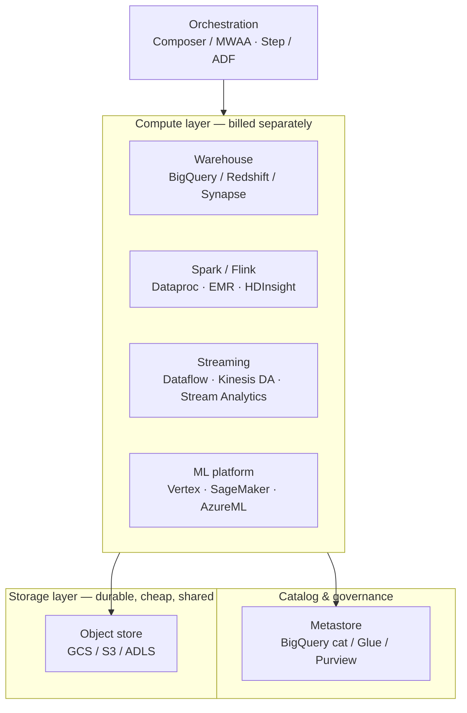
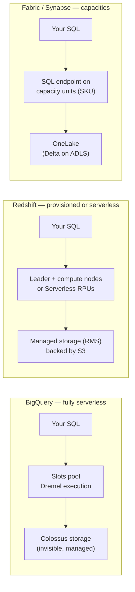
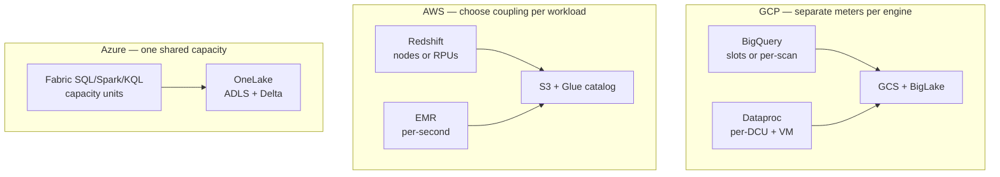
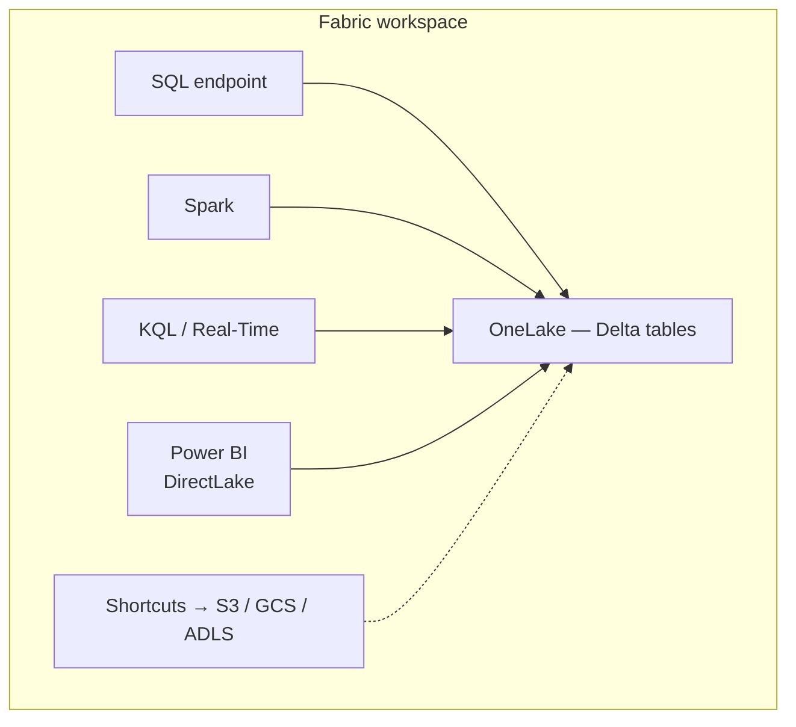

# GCP vs AWS vs Azure — The Service Map

> **Why it matters** — Clouds sell the same twelve capabilities under sixty different names. If you can't translate "we run Redshift" into "they use a provisioned-node MPP warehouse," you'll mis-estimate every cost and pick the wrong migration path. This chapter is the translation layer.

## The one idea that maps everything

Every modern cloud data stack is the same pattern with different branding: **object storage as the durable layer, decoupled compute engines on top, a metastore/catalog for discovery, and a control plane for orchestration**.

::: tip 💡 Senior insight
The decoupling is the product. Once storage is independent of compute, you can run three engines against one dataset, scale them separately, and lose a cluster without losing data. Every "lakehouse" pitch is just this diagram formalized with a table format.
:::

## The service map

The table you keep in your head. Read columns as "the thing I know," rows as the layer it serves.

| Layer | GCP | AWS | Azure |
|---|---|---|---|
| Object storage | **Cloud Storage (GCS)** | **S3** | **ADLS Gen2** |
| Data warehouse | **BigQuery** | **Redshift** (+ Redshift Serverless) | **Synapse dedicated SQL** → **Fabric** |
| Lakehouse table format | BigLake (Iceberg, Delta read) | Iceberg via Glue/S3 Tables | Delta (Fabric OneLake), Iceberg read |
| Managed Spark | **Dataproc** (GCE/GKE), Serverless Spark | **EMR** (EC2/EKS/Serverless), Glue jobs | **HDInsight** (retiring), Fabric Spark |
| Managed Flink/Beam | **Dataflow** (Beam), Managed Flink | **Kinesis Data Analytics** (Flink), EMR Flink | Fabric Real-Time, Stream Analytics |
| Streaming bus | **Pub/Sub** | **Kinesis**, MSK (Kafka) | **Event Hubs** (Kafka protocol) |
| Batch orchestration | **Cloud Composer** (managed Airflow), Workflows | **MWAA** (managed Airflow), Step Functions | **Data Factory**, Fabric pipelines |
| Catalog / governance | Dataplex, BigQuery catalog | **Glue Data Catalog**, Lake Formation | **Microsoft Purview**, Unity (on Databricks) |
| ML platform | **Vertex AI** | **SageMaker** | **Azure Machine Learning** |
| First-party Databricks | Partner (runs on GCP) | Partner (runs on AWS) | **Azure Databricks** (joint first-party) |

## Object storage: not actually identical

The three object stores look interchangeable until the details bite:

| Detail | S3 | GCS | ADLS Gen2 |
|---|---|---|---|
| Namespace | Flat; "folders" are key prefixes | Flat; same | **True hierarchical namespace** — real directories, atomic rename |
| Consistency | Strong read-after-write since 2020 | Strong | Strong |
| Rename a "directory" | Copy + delete every key (slow, non-atomic) | Same | **Atomic** — this is why Hadoop-era tools prefer ADLS |
| Lifecycle tiers | Standard → IA → Glacier → Deep Archive | Standard → Nearline → Coldline → Archive | Hot → Cool → Cold → Archive |
| Egress to internet | ~$0.09/GB | ~$0.08–0.12/GB | ~$0.05–0.08/GB |

::: info ℹ️ Why ADLS's atomic rename mattered
Spark and Hive commit job output by renaming temp directories to final paths. On flat object stores that "rename" is N copy+delete operations — the original reason `s3a` committers and manifest-based commit protocols exist. ADLS Gen2 sidesteps it. Modern engines (EMR S3A committers, Spark's `FileCommitProtocol` v2, table formats' atomic log commits) make this mostly history, but you'll still see it in legacy job configs.
:::

## Streaming buses: Pub/Sub vs Kinesis vs Event Hubs

| Dimension | Pub/Sub | Kinesis Data Streams | Event Hubs |
|---|---|---|---|
| Model | Global, partitioned automatically | Sharded — you size shard count | Partitioned — you pick partition count |
| Throughput unit | Autoscales | 1 MB/s in, 2 MB/s out per shard | 1 MB/s in, 2 MB/s out per throughput unit |
| Retention | Up to 31 days | Up to 365 days (long-term tier) | Up to 90 days (dedicated: longer) |
| Ordering | Per ordering key if enabled | Per shard | Per partition |
| Kafka protocol | No (Pub/Sub API) | No (Kinesis API) — use MSK for real Kafka | **Yes** — point Kafka clients at the endpoint |
| Replay | Seek to timestamp/snapshot | Iterator from sequence/timestamp | Consumer offsets + capture to ADLS |

::: warning ⚠️ The MSK vs managed-bus distinction
Only **MSK** gives you an actual Kafka cluster on AWS — topics, consumer groups, Kafka Streams, the ecosystem. Kinesis and Event Hubs are Kafka-*shaped* managed buses. If the org runs Kafka Connect connectors, Schema Registry, or ksqlDB, MSK (or Confluent Cloud) is the honest answer; "Event Hubs supports Kafka protocol" covers plain producers/consumers, not the ecosystem.
:::

## Orchestration: managed Airflow everywhere

All three clouds ship **managed open-source Airflow** plus a proprietary alternative:

- **GCP Composer** — managed Airflow on GKE; the most mature of the three. Workflows is the lightweight serverless-native option for simple chains.
- **AWS MWAA** — managed Airflow on ECS; historically the least loved (scaling granularity, cold starts), improving. Step Functions is the serverless-native option — excellent for glue workflows (Lambda, EMR steps, Redshift Data API), awkward for data-engineer ergonomics (no Python-native DAGs).
- **Azure** — Data Factory is the incumbent (low-code, SSIS lineage), but Microsoft now positions **managed Airflow inside Fabric** plus Fabric Data Pipelines. ADF's strength is 90+ managed connectors; its weakness is debugging — the visual pipeline abstraction leaks badly on complex logic.

::: tip 💡 Senior insight
The real orchestration question in 2026 isn't "which service" — it's **"Airflow vs the warehouse-native scheduler"**. Snowflake tasks, Databricks Workflows, and dbt Cloud all eat orchestration scope from below. Senior answer: Airflow (or Dagster) for cross-system coordination; let warehouse-native schedulers own intra-warehouse dependencies.
:::

::: warning ⚠️ Naming traps
- **Glue is three things**: a Spark runtime for ETL jobs, a data catalog, and a schema registry. People say "Glue" meaning any of them — ask which.
- **Synapse is dissolving into Fabric**. Classic Synapse workspaces (dedicated/serverless SQL pools, Spark pools) still exist but new investment goes to Fabric. Greenfield Azure data work in 2026 should assume Fabric, not Synapse workspaces.
- **HDInsight is retiring.** Microsoft's managed Hadoop is in retirement support; Fabric Spark or Azure Databricks is the replacement path. Don't greenfield on HDInsight.
- **Event Hubs speaks Kafka.** You can point a Kafka client at Event Hubs endpoints — it is not a Kafka cluster, though; no Kafka Streams, no direct partition control in the way MSK gives you.
:::

## Warehouse deep compare: BigQuery vs Redshift vs Synapse

These three are asked about in more senior interviews than any other services. The differences that matter are architectural, not benchmarks.

### Architecture

| Dimension | BigQuery | Redshift | Synapse / Fabric |
|---|---|---|---|
| Storage–compute | Fully separated since day one; storage is invisible (Colossus) | Separated since RA3/RMS (2019); local cache + S3-backed managed storage | OneLake = Delta files on ADLS; compute sits on top |
| Compute unit | **Slots** (virtual CPU units); editions or on-demand | **Nodes** (provisioned ra3/dc2) or **RPUs** (serverless) | **DWUs / capacity units** — shared across Fabric workloads |
| Pricing meter | On-demand: **~$6.25/TiB scanned**; Editions: reserved slot-hours with autoscale | Provisioned: **$/node-hour**; Serverless: **$/RPU-hour** + storage | Capacity **$/hour** whether idle or not (pause = manual); pay-as-you-go |
| Scaling | Autoscale slots per query; no cluster to size | Provisioned: resize op (minutes) or concurrency scaling; Serverless: auto RPU range | One capacity SKU shared by ALL workloads — warehouse, Spark, Power BI |
| Caching | Result cache (24h, per-user, free) + BI Engine in-memory | Result cache + materialized views + automatic table optimization | Result set cache per endpoint; Power BI semantic layer does heavy lifting |
| Concurrency | Massive by default; slot contention is the limit | Provisioned: ~50 queries/cluster, WLM queues; Serverless: better | Concurrency bounded by capacity SKU — one noisy workload starves the rest |
| Data model | No indexes, no distribution keys — partitioning + clustering only | Distribution styles (KEY/ALL/AUTO) + sort keys still matter | Delta tables; OPTIMIZE + V-order (Fabric's Delta optimization) |

::: info ℹ️ The pricing model shapes your design
- **BigQuery on-demand** punishes `SELECT *` — partition pruning and column selection are literally money. Teams adopt dbt incremental models fast because every full scan has a visible price tag.
- **Redshift provisioned** punishes underutilization — you pay the node-hour whether queries run or not. This pushes you toward scheduled batch windows and WLM tuning.
- **Fabric capacity** punishes ambiguity — warehouse, Spark jobs, and Power BI refreshes share one bill-meter. A runaway notebook can throttle the CEO dashboard on the same SKU.
:::

::: warning ⚠️ Production failure mode: BigQuery editions autoscaler floor
Teams set an edition with `max_slots` for safety and leave `baseline` at the default — then discover the baseline bills 24/7 whether or not queries run. The reverse also bites: set baseline 0 on the Standard edition and short queries queue while slots spin up. Measure the traffic shape before picking the edition.
:::

## Managed Spark and Flink: the honest state

| | GCP | AWS | Azure |
|---|---|---|---|
| Spark | **Dataproc** on GCE/GKE + **Serverless Spark** (batches & interactive) | **EMR** on EC2/EKS + **EMR Serverless** + **Glue** | **Fabric Spark** (default) / Azure Databricks / HDInsight (retiring) |
| Flink | Managed Flink + Beam on Dataflow | **Managed Service for Apache Flink** (ex-Kinesis DA) + EMR Flink | Fabric Real-Time; self-host on AKS |

::: details The "which managed Spark" interview question
The differentiator is ops surface vs version lag. **Dataproc** is closest to vanilla OSS — fastest version availability, easiest lift-and-shift of on-prem Hadoop/Spark. **EMR** offers the most control (bootstrap actions, instance fleets, Graviton) but also the most ways to misconfigure. **EMR Serverless / Dataproc Serverless / Glue** trade per-job cluster spin-up for zero cluster ops — right answer for intermittent batch, wrong answer for always-on dev loops. **Fabric Spark** is the most managed (pools, not clusters) and least portable.
:::

## The decoupled pattern, drawn three ways

Same architecture, three billing shapes:

::: tip 💡 The pattern to internalize
GCP sells **separate meters per engine** (max flexibility, max line items). AWS lets you **choose coupling per workload** (Athena/Spectrum for loose, managed storage for tight). Azure increasingly sells **one meter for everything** (simplest procurement, noisiest neighbors). Same decoupled architecture underneath — the difference is the billing model, which should loop back into how you design.
:::

## How to choose: the short version

- **GCP** wins on data-and-AI coherence: BigQuery + Vertex + Pub/Sub + Dataflow is the most opinionated, least assembly-required stack. Best serverless story.
- **AWS** wins on optionality: every layer has 2–3 services with different trade-offs. Best for teams that want to compose; worst for teams that want the cloud to decide.
- **Azure** wins on the enterprise bundle: Fabric + Power BI + Entra ID is a procurement argument as much as a technical one. Best for Power-BI-centric orgs.

Multi-cloud for data is almost always an accident (mergers, data-residency law), not a strategy — double egress, double IAM. If forced, anchor the lake in open formats on the cloud holding the most data and let other clouds' compute read over the wire.

## IAM and permissions: the underrated differentiator

Data permissions map differently per cloud and it's the migration item teams forget to size:

- **AWS**: IAM policies on buckets + **Lake Formation** for table/column-level grants on the Glue catalog. Powerful, notoriously fiddly — the two-layer model (IAM *and* Lake Formation) confuses everyone the first time.
- **GCP**: BigQuery does it natively — dataset/table/column-level + **row access policies** inside the warehouse, no separate service. Cleanest story of the three.
- **Azure**: Entra ID groups + Purview (legacy path) or **OneLake security** in Fabric. Still consolidating — expect the Fabric path to win.

::: warning ⚠️ Migration gotcha: permission models don't port
An S3-prefix IAM policy has no Lake Formation equivalent; a BigQuery row-access policy has no Redshift equivalent until you build row-level security + late-binding views. Inventory grants before scoping the migration — it's routinely a bigger workstream than the data move.
:::

## Fabric's OneLake play

Microsoft's bet is that the winning move isn't a better warehouse — it's **one storage layer all engines share**. OneLake is a single logical lake per tenant (backed by ADLS) where every Fabric engine — SQL, Spark, KQL, Power BI — reads the same Delta tables. `Shortcuts` mount external data (S3, GCS, ADLS) into OneLake without copying it.

::: tip 💡 Senior insight
DirectLake is the sleeper feature: Power BI reads Delta files in OneLake directly instead of importing or running SQL queries. If your org is Power-BI-heavy, Fabric removes an entire caching layer — that's the actual pitch, not the lake itself.
:::

## Azure deep dive: the post-DP-203 stack

Azure deserves a closer look because Microsoft's consolidation makes it the most confusing of the three maps — the same capability often exists twice under different roofs.

### Synapse vs Fabric: what Microsoft consolidated

| Piece | Synapse era (DP-203 world) | Fabric era (current) |
|---|---|---|
| Storage | ADLS Gen2, per-workspace | **OneLake** — one logical lake per tenant, Delta-native |
| Warehouse | Dedicated + serverless SQL pools | Warehouse + Lakehouse SQL endpoints |
| Spark | Synapse Spark pools | Fabric Spark (same runtime, new home) |
| BI | External Power BI, import/DirectQuery | **DirectLake** — Power BI reads Delta files in OneLake |
| Governance | Purview bolted on per service | OneLake security + Purview at tenant scope |
| Orchestration | Synapse pipelines (an ADF fork) | Data Factory in Fabric |

:::: warning ⚠️ DP-203 is retired — the cert map moved
Microsoft retired DP-203 (Azure Data Engineer Associate) in early 2025. The material didn't vanish — it was folded into **DP-600** (Fabric Analytics Engineer) and **DP-700** (Fabric Data Engineer). Cert guides from 2024 still teach the Synapse-centric stack accurately, but read them as *legacy architecture*, not the greenfield default. Synapse workspaces still run; they're just not where Microsoft is investing.
::::

### Three orchestrators that look identical

ADF, Synapse pipelines, and Data Factory in Fabric share the same JSON pipeline model and the same UI. They differ in where they live and what they can reach:

| | Azure Data Factory | Synapse pipelines | Data Factory in Fabric |
|---|---|---|---|
| Home | Standalone service | Inside a Synapse workspace | Inside a Fabric workspace |
| Best for | Org-wide ETL across heterogeneous sources | Synapse-native jobs (SQL pools, Synapse Spark) | Fabric-native flows (Lakehouse, KQL, notebooks) |
| Compute billing | Per activity/DIU | Per workspace | Capacity units (shared Fabric capacity) |
| Gotcha | No built-in lake — you point it at ADLS | Being absorbed; new features land in Fabric | Youngest; some ADF connectors still missing |

:::: tip 💡 Senior insight
When a job posting says "ADF experience" in 2026 it usually means "the Microsoft pipeline JSON dialect" — skills transfer verbatim across all three. The real interview question is knowing they *are* three products and which one your workload belongs in.
::::

### The Azure event path: pick by intent, not by name

| | Event Hubs | Event Grid | Service Bus |
|---|---|---|---|
| Mental model | Kafka — partitioned append log | Pub/Sub webhook router | Enterprise message broker |
| Message size | ~1 MB | ~1 MB | 256 KB standard, 1 MB premium |
| Ordering | Per partition | None | Sessions / FIFO queues |
| Consumers | Pull, consumer groups, replay | Push, at-least-once delivery | Pull, competing consumers, dead-letter |
| Use for | Telemetry, clickstream, streaming ingest | "A blob landed" → trigger a pipeline | Commands, orders, work queues |

The classic Azure pattern: Event Grid fires on blob creation → triggers an ADF/Fabric pipeline → results stream out via Event Hubs. Using Service Bus where Event Grid belongs (or vice versa) is the most common Azure architecture smell.

### Loading a Synapse/Fabric warehouse: PolyBase vs COPY INTO vs shortcuts

| | PolyBase (via COPY INTO) | ADF Copy activity | OneLake shortcuts |
|---|---|---|---|
| Mechanism | T-SQL command; reads ADLS/Blob into a SQL pool directly | Pipeline activity with source→sink mapping | Virtual mount — no copy at all |
| Speed | Fastest for bulk T-SQL loads | Fast; adds orchestration + retry | Zero-copy, instant |
| Formats | Parquet, CSV, ORC; no JSON/XML/nested formats | Broadest connector set | Anything Delta/Parquet in a lake |
| When | Code-first bulk load inside Synapse | Scheduled multi-source ingest | Data already in OneLake/S3/ADLS you don't want to duplicate |

::: warning
PolyBase rejects nested formats (JSON, XML) and fixed-width files — flatten upstream in Spark first, or you'll discover it at load time. Shortcuts sidestep the question entirely: the 2026 instinct is "don't copy it, shortcut it."
:::

### Azure security layers for data

Azure stacks four distinct layers — confuse them and auditors notice:

1. **Identity** — Entra ID; use **managed identities** (Azure-managed service principals with no stored credentials) for service-to-service auth instead of keys or connection strings.
2. **Coarse access** — Azure RBAC roles (`Storage Blob Data Reader`, etc.) at account/container scope.
3. **Fine access** — POSIX-like **ACLs** on ADLS Gen2 files/folders; apply at top-level folders, not timestamped leaf folders, or you'll be re-ACLing every partition forever. RBAC and ACLs can conflict — RBAC denies/permits first at the data-plane boundary.
4. **In-table controls** — row-level security, column-level security, dynamic data masking inside Synapse/SQL; plus TDE (platform keys) or double encryption with CMK for at-rest.

:::: details Microsoft Purview in one paragraph
Purview is the lineage/catalog layer: register data sources in its **Data Map**, grant it scan permissions (e.g., `Storage Blob Data Reader` on storage, a SQL user with the right role on dedicated pools), and it auto-tracks dependencies — including new pipelines, provided the Purview instance is also registered inside the Synapse/Fabric workspace. Lineage breaks silently when that workspace registration is skipped.
::::

## Managed vs self-host

| Signal | Stay managed | Self-host (VM/K8s) |
|---|---|---|
| Team size | < ~5 data engineers | Dedicated platform team |
| Workload shape | Spiky, mixed, growing | Steady-state at known scale |
| Custom needs | Standard Spark/SQL | Custom JVM builds, exotic libs, kernel-level tuning |
| Cost | Pay premium, sleep at night | Cheaper compute, pay in on-call |
| Compliance | Cloud SLA acceptable | Air-gap, bespoke hardening |

**Rule of thumb:** managed services tax you 30–50% on compute and return it in ops headcount. Self-hosting Kafka/Spark/Airflow only pencils out when you have the platform team to absorb the toil — and then it's usually worth it.

::: warning ⚠️ The egress trap
Moving data **into** a cloud is free. Moving it **out** costs roughly **$0.08–0.12/GB** — that's **$8,000–12,000 to export 100 TB** once. Cross-region and cross-cloud replication runs the same meter. This is the real vendor lock-in: not proprietary formats (Parquet is Parquet) but the tollbooth on the way out. Mitigate by keeping a canonical copy in open formats on object storage you control — the bucket is yours even if the compute isn't.
:::

::: details Common interview gotchas on this chapter
- "BigQuery has no indexes" — correct, and that's a feature: partitioning + clustering + massive slot parallelism replace index maintenance. Complaining about missing indexes marks you as on-prem thinking.
- "Redshift is a data lake" — no; Spectrum/Redshift Spectrum reads S3, but the engine's strength is its managed storage. Modern Redshift is the most warehouse-y of the three.
- "Synapse = the Azure warehouse" — was true; Fabric absorbed the position. Naming Synapse dedicated pools as the 2026 default dates you.
- "Managed means no ops" — managed means *different* ops: quotas, capacity, and cost governance instead of patching. The job moves up the stack, it doesn't vanish.
:::

## 🧠 Quiz

<QuizCard :questions="[{ q: 'A team runs Redshift provisioned ra3.4xlarge and complains about cost at night. What is the correct first move?', options: ['Add more nodes for faster queries', 'Enable result caching', 'Switch to BigQuery', 'Pause/resize the cluster or evaluate Redshift Serverless RPUs — provisioned nodes bill per hour regardless of utilization'], correct: 3, explain: 'Provisioned Redshift bills per node-hour 24/7. Underutilized nights mean you are paying for idle compute — serverless RPUs or pause/resize fixes the utilization gap before any migration talk.' }, { q: 'Why does BigQuery on-demand pricing push teams toward dbt incremental models?', options: ['BigQuery charges per row inserted', 'Incremental models use fewer slots', 'Incremental models limit bytes scanned per run, and on-demand billing is per-TiB-scanned', 'dbt is required by BigQuery'], correct: 2, explain: 'On-demand BigQuery meters bytes scanned. A full-refresh model re-scans the whole table every run; an incremental model scans only the new slice — the bill difference is the enforcement mechanism.' }, { q: 'In Fabric, a Spark notebook run can make the Power BI dashboard slow. Why?', options: ['Notebooks and dashboards share the same capacity units (SKU) — one meter for all workloads', 'Spark writes lock the Delta files', 'Fabric limits to one engine at a time', 'Power BI caches expire when Spark runs'], correct: 0, explain: 'Fabric capacity units are a single shared compute pool across SQL, Spark, KQL, and BI. A heavyweight Spark job consumes the same capacity the DirectLake/SQL endpoint needs — noisy-neighbor is a first-order concern.' }, { q: 'What is the primary mechanism of cloud vendor lock-in for data platforms?', options: ['Egress fees — roughly $0.08-0.12/GB to move data out, ~$10k per 100TB', 'SQL dialects', 'Proprietary file formats', 'Vendor-specific orchestrators'], correct: 0, explain: 'Parquet and Iceberg port fine; SQL ports with effort. Egress pricing is the toll: the more data you centralize, the more a migration costs in a single transfer. Canonical data in open formats on your own object storage is the hedge.' }, { q: 'Glue, in AWS data conversations, most commonly refers to which THREE things?', options: ['An ETL tool, a BI tool, a lake', 'A file format, a catalog, a query engine', 'A Spark ETL runtime, a data catalog/metastore, and a schema registry', 'A warehouse, a catalog, a scheduler'], correct: 2, explain: 'Glue jobs = managed Spark ETL; Glue Data Catalog = Hive-compatible metastore used by Athena/EMR/Redshift Spectrum; Glue Schema Registry = Avro/Protobuf registry. Ambiguity between them causes real design confusion.' }, { q: 'An org is greenfielding on Azure in 2026 and needs managed Spark + warehouse + BI. What is the default assumption?', options: ['Assume Microsoft Fabric — Synapse workspaces are being absorbed and HDInsight is retiring', 'Use Event Hubs as the warehouse', 'Deploy HDInsight + Synapse dedicated pools', 'Self-host Spark on AKS only'], correct: 0, explain: 'Microsoft is consolidating the data stack into Fabric: Spark, SQL endpoints, Real-Time, and Power BI over OneLake. HDInsight is in retirement support and new Synapse workspace investment has shifted to Fabric.' }]" />
<QuizCard :questions="[{ q: 'A pipeline must react the moment a blob lands in ADLS and kick off an ADF job. Which service belongs at the front?', options: ['Service Bus with sessions for ordering', 'Storage queues polled every minute', 'Event Hubs, partitioned for throughput', 'Event Grid, pushing the blob-created event to a trigger'], correct: 3, explain: 'Event Grid is the push router for resource events — blob created, file written. Event Hubs is a streaming log for telemetry volume, Service Bus is for commands and work queues, and polling a queue adds latency the event model was built to remove.' }, { q: 'Why did Microsoft retire DP-203 without leaving a Synapse-named successor?', options: ['Synapse was deprecated entirely', 'DP-203 was merged into the Azure admin exam', 'The material folded into the Fabric certs DP-600 and DP-700 — the exam now tests OneLake, DirectLake, and Fabric pipelines', 'Microsoft exited the data-engineering cert business'], correct: 2, explain: 'The DP-203 skill set did not disappear; it moved with the product. Fabric absorbed the Synapse position, so the cert track follows — DP-700 for data engineers, DP-600 for analytics engineers.' }, { q: 'A team loads nested JSON files into a dedicated SQL pool with COPY INTO and it fails. Root cause?', options: ['COPY INTO requires Premium storage', 'The files lack a schema registry', 'Dedicated pools reject files over 1 GB', 'PolyBase does not support nested formats like JSON and XML — flatten upstream in Spark first'], correct: 3, explain: 'PolyBase powers COPY INTO and supports Parquet, CSV, and ORC but rejects JSON, XML, and fixed-width formats. Flatten the JSON in Spark or Data Factory before the pool load, or shortcut the data instead of copying it.' }]" />

## Further reading

- [BigQuery editions and slots pricing](https://cloud.google.com/bigquery/docs/editions-intro) — official docs on the capacity/on-demand split
- [Amazon Redshift architecture and RA3 managed storage](https://docs.aws.amazon.com/redshift/latest/mgmt/welcome.html) — official docs
- [Microsoft Fabric and OneLake concepts](https://learn.microsoft.com/en-us/fabric/onelake/onelake-overview) — official docs
- [Azure HDInsight retirements and migration paths](https://learn.microsoft.com/en-us/azure/hdinsight/hdinsight-component-retirements-and-action-required) — official docs
- [AWS Prescriptive Guidance: choosing analytics services](https://docs.aws.amazon.com/prescriptive-guidance/latest/strategy-aws-analytics-services/welcome.html) — AWS's own decision tree
- *Designing Data-Intensive Applications* (Kleppmann, O'Reilly) — the storage/compute separation fundamentals every cloud builds on
- [Google Cloud egress pricing](https://cloud.google.com/vpc/network-pricing) — see the "egress" tables; do the 100 TB math yourself
- *Azure Data Engineer Associate Certification Guide, 2nd ed.* — Palmieri, Mettapalli & Alex (2024, Packt) — DP-203-era coverage of Synapse, ADF, Event Hubs, PolyBase, and Purview; read as legacy-map context now that the cert folded into Fabric's DP-600/DP-700
