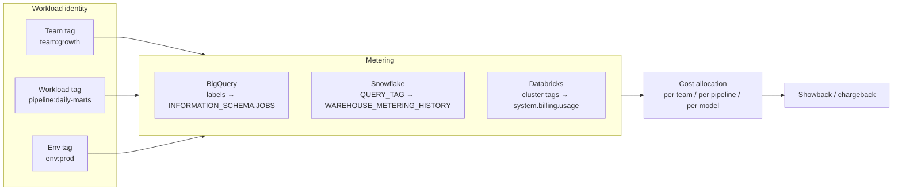
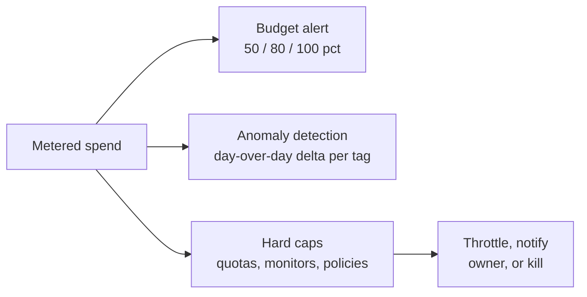
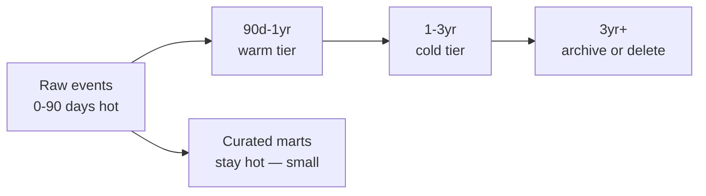
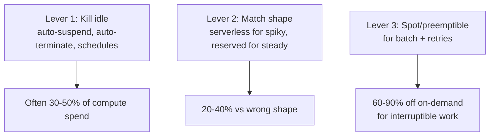
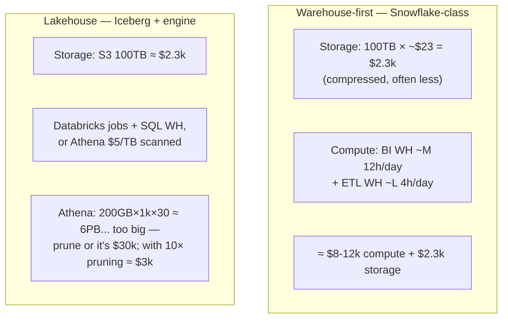

# Cost & Decoupled Architecture — FinOps for Data

> **Why it matters** — "Why is the bill this big?" lands on the data team eventually, and the honest answer is always architectural: nobody designed cost in, so it accumulated. Engineers who can attribute spend to workloads and name the lever that moves it get listened to in budget meetings — everyone else gets a mandate to "optimize 20%."

## Anatomy of a data bill

Before levers, know the lines. A cloud data bill decomposes into five buckets with very different behaviors:

| Bucket | Typical share | Behavior | Primary lever |
|---|---|---|---|
| Compute (warehouse/engine) | 50–70% | Volatile, workload-driven | Right-sizing, scheduling, query discipline |
| Storage (bytes at rest) | 10–25% | Smooth, ratchets up | Lifecycle tiering, compaction, deleting dead tables |
| Egress / network | 5–15% | Spiky, surprising | Keep compute in-region; kill cross-cloud reads |
| Managed service premiums | 5–15% | Per-feature meters (serverless, streaming, ML) | Audit which features are actually used |
| Metadata/requests | 1–5% | Scales with object/operation count | Compact small files; fewer, bigger partitions |

::: info ℹ️ The ratchet
Storage only ever grows — it has no natural feedback loop until someone gets paged on the bill. Compute has an hourly feedback loop (it hurts immediately), storage accrues silently for quarters. That's why the table-deletion and lifecycle policies below aren't optional hygiene; they're the only counter-ratchet that exists.
:::

## Cost attribution first

You cannot optimize what you cannot allocate. Every platform has the same attribution mechanism with different vocabulary — the common design is **label/tag the compute unit, then join metering history to workload metadata**.

- **BigQuery**: label jobs or reservations; `INFORMATION_SCHEMA.JOBS` gives bytes billed per query — the finest-grained cost data of any warehouse.
- **Snowflake**: `QUERY_TAG` on sessions + `WAREHOUSE_METERING_HISTORY` credits; resource monitors cap spend per warehouse.
- **Databricks**: cluster/pool tags propagate to `system.billing.usage` DBU records + cloud VM costs — remember **both** meters exist.

::: warning ⚠️ Production failure mode: the unlabeled tail
Every org discovers ~20–40% of spend is untaggable "mystery" usage — ad-hoc analyst queries, forgotten dev clusters, dashboards nobody owns. Attribution that only covers tagged spend shows a bill that doesn't reconcile; budget for the tail or force tags at the platform layer (required labels on job submission, default warehouse per role).
:::

::: details Tagging schema that survives reorgs
Design the label set once and enforce it mechanically:

| Key | Values | Set by |
|---|---|---|
| `team` | Owning team | Repo/PR review on infra definitions |
| `pipeline` | Named data product | Job config — required field |
| `env` | `prod` / `staging` / `dev` / `sandbox` | Environment, never user choice |
| `cost_center` | Finance's allocation code | Team mapping table |
| `criticality` | `tier1`–`tier3` | Pipeline owner — drives which queries may be throttled |

Reorg-proof rule: tag the *workload*, not the org chart. `pipeline:orders-marts` survives a reorg; `team:data-platform-q3` rots. Enforce at submission (required label on jobs, cluster policies on DBX, default QUERY_TAG on SF) — retroactive tagging never catches up.
:::

## Budgets, alerts, and anomaly detection

The minimum viable guardrail stack, per platform:

- **Soft alerts** (Slack/email at thresholds): every cloud billing console does this — use it, but alerts without an owner are noise within a month.
- **Hard caps**: BigQuery custom quotas (bytes billed per day/user), Snowflake resource monitors (suspend warehouses at credit limits), Databricks cluster policies + budgets. The only controls that actually *stop* spend.
- **Anomaly detection**: the real catch is a `JOIN` typo scanning 50× or a dev cluster left running — both show as day-over-day deltas on a tagged view, both are invisible in monthly totals. A scheduled query diffing daily spend-per-tag against a 7-day baseline is a weekend project that pays for itself the first incident it catches.

::: warning ⚠️ Hard caps on prod pipelines are a correctness risk
A resource monitor suspending your ETL warehouse mid-load can leave partial state where writes aren't atomic. Delta/Iceberg commits make most table writes safe — side-effecting steps (external writes, `INSERT OVERWRITE` on plain Parquet) are not. Cap dev and ad-hoc hard; cap prod only after auditing what partial failure looks like.
:::

## Storage lifecycle: the cheapest optimization there is

Object storage tiers differ by ~20× from hot to deep archive. Retrievals are where they get you.

| Tier | S3 | GCS | Azure Blob | ~$/TB-month (hot→cold) | Retrieval |
|---|---|---|---|---|---|
| Hot | Standard | Standard | Hot | ~$20–23 | Free, instant |
| Warm | Infrequent Access | Nearline | Cool | ~$10–12 | ~$10/TB + latency |
| Cold | Glacier Instant | Coldline | Cold | ~$4–5 | ~$30–50/TB |
| Deep archive | Glacier Deep Archive | Archive | Archive | **~$1–2** | ~$50–90/TB + hours |

Rules that hold across clouds:

1. **Raw lands hot, ages out on a lifecycle policy** — no human decides per-object.
2. **Curated marts stay hot** — they're the 5% of bytes serving 95% of queries.
3. **Never archive what you'd re-ingest** — retrieval + rehydration often costs more than the tiered storage saved. Archive is for compliance retention, not cost games.
4. **Small files waste money twice**: per-object minimums (128 KB on Glacier-class tiers) plus metadata overhead. Compact before tiering.

::: info ℹ️ Lakehouse footnote
Delta/Iceberg tables complicate tiering: the table metadata references every data file, so moving old partitions to a cold tier keeps the table queryable but retrieval fees apply when a query touches them. Partition by time, tier by partition age, and add partition filters — the format does the right thing if your queries are disciplined.
:::

## Compute right-sizing

The three levers, in order of effort:

| Workload shape | Right compute | Wrong compute |
|---|---|---|
| Interactive BI (spiky, bursty) | Serverless / auto-suspend (Snowflake WH, BigQuery autoscaler, DBSQL serverless) | Provisioned cluster sized for peak |
| Daily batch (predictable window) | Spot/preemptible workers + scheduled start/stop | Always-on all-purpose cluster |
| Continuous streaming (steady 24/7) | Rightsized provisioned/reserved — serverless premium never wins steady-state | Autoscaler at constant floor = paying the premium anyway |
| ML training (hours, interruptible) | Spot instances + checkpointing | On-demand GPU |

::: tip 💡 Senior insight
**Spot/preemptible pricing is the single biggest lever for batch fleets** — 60–90% off on-demand — and it only works if the job is idempotent and retries cleanly. This is why idempotent pipeline design isn't just correctness hygiene: it's a discount coupon. Non-resumable 6-hour Spark jobs on spot instances is how you get paged; checkpointed, retryable stages is how you get a 70% compute bill.
:::

## Query cost control

Ordered by leverage:

| Lever | What it does | Platform notes |
|---|---|---|
| **Partition pruning** | Skips whole files/partitions | BigQuery: required on large tables; `require_partition_filter` enforces it. Spark/Delta: partition-by-date is the norm |
| **Column pruning** | Columnar formats read only referenced columns | Free on Parquet everywhere — `SELECT *` is a paid anti-pattern on per-scan meters |
| **Result caching** | Repeat query = $0 | BigQuery 24h per-user; Snowflake 24h persisted results; both free |
| **Materialized views** | Pre-compute hot aggregations | All warehouses have them; the incremental maintenance is usually cheaper than re-scanning |
| **Clustering / sort keys** | Data skipping beyond partitions | BQ clustering, Delta Z-ORDER/liquid clustering, SF clustering/search optimization |
| **Bytes-scanned caps** | Hard ceiling per query/user | BigQuery custom quotas; Snowflake statement timeout + resource monitors |

::: warning ⚠️ Production failure mode: dashboard-driven scan storms
A Looker/Power BI dashboard with 12 tiles, 200 viewers, auto-refresh at 5 min = 12 × 200 × 288 daily queries hitting the same scans. Result cache absorbs *identical* queries only — each user's filters often differ slightly. The fix is upstream: a materialized aggregate table or BI-engine/semantic-layer cache, not a bigger warehouse.
:::

## Cost per useful workload

Raw spend is a vanity metric. The denominator is what matters:

$$
\text{Cost efficiency} = \frac{\text{monthly data spend}}{\text{useful queries served} \;\lor\; \text{fresh rows delivered} \;\lor\; \text{dashboard loads}}
$$

Pick ONE denominator that maps to business value (dashboard loads, models trained, rows delivered with SLA met) and track the ratio monthly. Two failure modes it exposes:

- **Spend flat, usefulness up** → healthy scaling, defend the budget.
- **Spend up, usefulness flat** → the unlabeled tail, abandoned tables, or dashboard storms. Now you have a hunt.

::: details The "cost per query" trap
A naive cost-per-query metric punishes good engineering: the materialized view that makes dashboards fast runs ONE expensive query so 10,000 cheap ones hit cache. Segment by workload type — serving queries vs build queries — or the metric optimizes you back to full scans.
:::

## Build vs buy

| Factor | Buy (managed platform) | Build (self-managed) |
|---|---|---|
| Team size | < 8–10 data engineers | Platform team exists and stays |
| Core differentiator | Data products are the output; plumbing is not | You ARE the platform company, or compliance demands control |
| Ops burden | Vendor absorbs upgrades, HA, security patches | You own on-call; budget 1–2 FTE per self-hosted system |
| Lock-in premium | 30–50% compute markup + egress risk | Pay in headcount + slower feature velocity |
| Time to value | Days | Months |

**The framework in one line:** compute the fully-loaded cost of the self-hosted path (infra + 1.5–2 FTE on-call + upgrade toil + opportunity cost), and compare to the managed premium — not the managed sticker. Self-hosting to save 30% on compute while adding an on-call rotation is how small teams drown.

::: details On-demand vs reserved: the capacity math
Every platform offers a discount for commitment. The decision procedure is the same everywhere:

1. Plot hourly utilization for 30 days. Ignore averages — look at the **floor**.
2. Reserve capacity up to the floor; burst on-demand above it. Reserving above the floor = paying for idle.
3. Re-check quarterly — workload floors drift up as products succeed.

| Platform | Commitment product | Discount shape |
|---|---|---|
| BigQuery | Editions (Standard/Enterprise/Plus) slot commitments | ~20–40% vs on-demand at steady utilization |
| Snowflake | Annual capacity purchase | Negotiated credit-rate discount, typically 10–30% |
| Redshift | Reserved Instances (1/3yr) | Up to ~60–75% for 3yr all-upfront |
| Databricks | Cloud reserved instances / savings plans on the VM half | Up to ~40–70% on VM cost; DBU rate negotiated separately |
| EMR/ECS/etc | EC2 Savings Plans / Reserved Instances | Standard compute discounting |

The BigQuery-specific version worth memorizing: on-demand is $6.25/TiB; the break-even vs a slot commitment is roughly **a constant ~200–250 GB scanned per hour per slot-hour purchased**. Any team that scans continuously (ETL-heavy) hits that fast; spiky ad-hoc teams never do. That's why hybrid — a small slot reservation for ETL, on-demand project for analysts — is the standard BigQuery cost architecture.
:::

## Worked sketch: 100 TB, 1,000 queries/day

Back-of-envelope monthly comparison. Public list prices, single region, ballpark — the point is the *shape*, not the last digit. Assume: 100 TB stored, ~1,000 queries/day scanning 200 GB average (heavy analytical traffic), one team, mixed batch + BI.

| Line item | Snowflake-ish | BigQuery on-demand | Iceberg + Athena | Iceberg + Databricks |
|---|---|---|---|---|
| Storage (100 TB) | ~$2.3k | ~$2k (active phys.) | ~$2.3k | ~$2.3k |
| Query compute | ~$8–12k credits | ~$37k @ $6.25/TiB unscanned-disciplined → ~$4k well-pruned | ~$30k raw → **~$3k** pruned 10× | ~$6–10k DBU+VM |
| ETL compute | included above | slots/on-demand scans | Athena/Glue/EMR ≈ $2–4k | included above |
| **Monthly ballpark** | **$10–14k** | **$6–8k** (disciplined) / $40k (naive) | **$7–9k** | **$8–12k** |

::: tip 💡 What the sketch actually teaches
- **Storage is a rounding error.** $2.3k vs $10k+ compute — optimizing storage tiers is the smallest lever at this scale.
- **Per-scan pricing is a discipline test.** BigQuery/Athena on-demand swings from cheapest to most expensive on the same workload depending entirely on partition pruning. If your team won't write disciplined queries, flat-rate compute (Snowflake credits, provisioned nodes) is insurance.
- **The honest answer to "which is cheapest" is "whoever's query patterns you actually have."** Model your bytes-scanned distribution from query history before signing anything.
:::

::: warning ⚠️ Don't forget the hidden lines
Egress (cross-region replication, BI extracts), small-object overhead, per-query metadata on Iceberg tables with millions of files, and dev/sandbox environments — routinely 15–30% of the real bill, invisible in every vendor calculator.
:::

::: details Sensitivity: what moves the sketch most
In rough order of impact on that scenario:

1. **Bytes scanned per query** — dropping the 200 GB average to 20 GB via pruning moves per-scan platforms from worst to cheapest. Nothing else swings 10×.
2. **Idle compute** — BI warehouses auto-suspending at 60s vs 30min changes the credit total ~2× on spiky workloads.
3. **ETL efficiency** — incremental vs full-refresh models on 100 TB is often a 5–20× scan difference per run.
4. **Where the data lives** — Iceberg-on-your-bucket pays ~$2.3k storage regardless of engine; Snowflake FDN compresses well (often 3–5× on raw logs), so its effective storage line can be *lower* despite the proprietary format.
5. **File sizing** — well-compacted Parquet at 512 MB–1 GB files reads cheaper on every meter; small files inflate both scan and metadata/request costs.
:::

## The 80/20 checklist

When someone hands you a bloated data bill, run this order — it covers ~80% of recoverable spend in most orgs:

1. **Top-10 queries by spend** — `INFORMATION_SCHEMA.JOBS` / `QUERY_HISTORY` / `system.billing.usage` ranked by cost. Fix or cache the top offenders; usually 30–50% of query spend is 10 queries.
2. **Idle compute** — warehouses/clusters running >4h/day under 20% utilization; audit auto-suspend/terminate configs.
3. **Unlabeled tail** — anything over 10% unattributed gets its own investigation.
4. **Storage ratchet** — top-20 tables by size vs last-accessed date; unread in 90 days → archive or drop.
5. **Dev/sandbox** — non-prod routinely carries 15–30% of compute with zero governance; cap it first.
6. **Egress** — find cross-region/cross-cloud reads in network logs; consolidate region or cache locally.

## 🧠 Quiz

<QuizCard :questions="[{ q: 'A data bill shows 30% of spend with no team attribution. What does that indicate?', options: ['Storage is mispriced', 'Egress charges', 'The unlabeled tail — ad-hoc queries, forgotten clusters, unowned dashboards; fix via enforced labels at submission and default-per-role compute', 'Vendor billing error'], correct: 2, explain: 'Untaggable spend accumulates wherever labels are optional. Enforce tags at the platform boundary — required labels on job submission, default warehouse/cluster per role — or the tail regrows after every cleanup.' }, { q: 'Why does spot/preemptible pricing only pay off for batch work that is idempotent?', options: ['Spot requires special SQL', 'Spot nodes can be reclaimed at any time — only retryable, resumable, idempotent jobs survive preemption without correctness risk', 'Idempotent jobs run faster', 'Spot instances are slower'], correct: 1, explain: 'Spot saves 60-90% precisely because capacity can vanish with ~30s notice. A job that restarts from scratch wastes the saving; a job that re-processes can double-write. Checkpointed stages + idempotent writes make the discount real.' }, { q: 'On BigQuery/Athena per-scan pricing, what is the single highest-leverage cost control?', options: ['Smaller clusters', 'Partition pruning + enforced partition filters — the difference between scanning 6TB and 6PB per day', 'Result caching', 'More materialized views'], correct: 1, explain: 'Result cache only absorbs identical queries; materialized views help specific hot paths. Partition pruning changes the denominator of every query — on-demand billing makes it a direct multiplier on the bill, which is why require_partition_filter exists.' }, { q: 'In the 100TB/1k-queries sketch, why is storage optimization the wrong first target?', options: ['Storage is ~$2.3k/mo while compute is $6-12k — the biggest lever is query compute, not bytes-at-rest', 'Compression is bad', 'Storage is free', 'Tiering is impossible'], correct: 0, explain: 'Hot object storage is ~$20-23/TB-mo; even perfect tiering saves under $2k while compute levers move thousands. Optimize in order of the bill, not in order of what is easiest to understand.' }, { q: 'A build-vs-buy analysis compares managed Snowflake at $12k/mo vs self-hosted Trino infra at $5k/mo. What is missing?', options: ['Trino licensing fees', 'Nothing, Trino wins', 'Fully-loaded cost: 1-2 FTE on-call + upgrades + opportunity cost — the self-hosted path is likely $20-30k/mo all-in', 'Snowflake storage costs'], correct: 2, explain: 'The managed premium is ~30-50% on compute; an on-call rotation costs a multiple of that. Self-host pencils out when the platform team already exists or compliance demands control — not when the infra line alone looks cheaper.' }, { q: 'Why does a naive cost-per-query metric punish materialized views?', options: ['MVs are expensive to store', 'Queries on MVs scan more', 'MVs do not cache', 'The build query is one expensive query that enables thousands of cheap cached serves — averaging hides the trade; segment build vs serving queries'], correct: 3, explain: 'Spending $50 to pre-compute so 10k dashboard loads cost $0 each is excellent engineering that looks terrible as average cost-per-query. Split the metric by workload type or it pushes you back to full scans.' }]" />

## Further reading

- [FinOps Framework](https://www.finops.org/framework/) — the industry-standard vocabulary: inform, optimize, operate
- [BigQuery cost controls and custom quotas](https://cloud.google.com/bigquery/docs/custom-quotas) — bytes-billed caps per user/project
- [Snowflake cost management: resource monitors and budgets](https://docs.snowflake.com/en/user-guide/resource-monitors) — official docs
- [AWS S3 storage classes and lifecycle](https://aws.amazon.com/s3/storage-classes/) — the canonical tier table; GCS/Azure equivalents map 1:1
- [Databricks system tables for billing](https://docs.databricks.com/en/administration-guide/system-tables/billing.html) — `system.billing.usage` attribution
- [AWS Spot Instances for data workloads](https://aws.amazon.com/ec2/spot/) — and [GCP Spot VMs](https://cloud.google.com/spot-vms); EMR/Dataproc task-node guidance
- *Cloud FinOps* (Storment & Fuller, O'Reilly) — the book behind the discipline; the tagging/showback chapters apply 1:1 to data platforms
