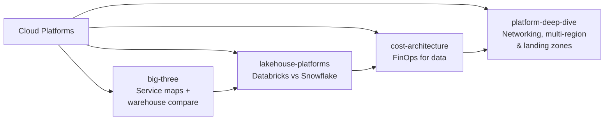

# Cloud Platforms

> **Why it matters** — Picking a cloud data stack is a multi-year, six-to-seven-figure commitment that is expensive to reverse. Senior engineers get asked three questions constantly: "which managed service replaces this thing we self-host?", "Databricks or Snowflake?", and "why is the bill this big?". This track gives you the mental model to answer all three.

## Who this is for

- Data engineers joining a new cloud org who need to map "the thing I knew" to "the thing they run" fast.
- Engineers preparing for senior/staff interviews where cloud architecture trade-offs come up.
- Anyone who has inherited a platform bill and needs to find the levers, not just the line items.

## Chapters

**[GCP vs AWS vs Azure](/cloud/big-three)** — The service-by-layer map across all three clouds: storage, warehouse, lakehouse format, managed Spark/Flink, streaming bus, orchestration, ML platform. Then a deep compare of BigQuery vs Redshift vs Synapse — the pricing model differences that change how you design pipelines — plus the egress trap and the managed-vs-self-host decision.

**[Databricks vs Snowflake](/cloud/lakehouse-platforms)** — The two lakehouse heavyweights dissected: how each is actually built (your object store + DBU compute vs centralized storage + credit compute), Delta vs Iceberg support, isolation and concurrency, governance via Unity Catalog vs Horizon, and the decision table for ML-heavy vs BI-heavy vs multi-cloud workloads. Includes the "neither" answer: Trino/Athena/DuckDB over Iceberg.

**[Cost & Decoupled Architecture](/cloud/cost-architecture)** — FinOps for data engineering. Cost attribution via tagging, storage lifecycle tiering, compute right-sizing (auto-suspend, serverless, spot), query cost control, the cost-per-useful-workload metric, a build-vs-buy framework, and a worked monthly cost sketch for a 100 TB / 1,000-queries-a-day workload.

**[Networking, Multi-Region & Landing Zones](/cloud/platform-deep-dive)** — The infrastructure layer under every platform decision: private connectivity (PrivateLink / Private Endpoint / Private Service Connect), VPC and subnet sizing that survives autoscale, landing-zone topology and account structure, multi-region DR with real RPO/RTO math, sovereignty constraints, and the commitment/egress pricing that decides whether the design is affordable.

## Pareto focus

The ideas in this track that carry the most weight:

1. **Storage–compute decoupling** is the single architectural decision that defines every modern cloud data platform — understand it once and every service comparison gets easier.
2. **The pricing meter shapes the design.** Per-scan (BigQuery on-demand), per-second-credits (Snowflake), per-DBU (Databricks), per-node (Redshift provisioned) reward completely different pipeline patterns.
3. **Egress is the real lock-in.** Storage is cheap; moving 100 TB out of a cloud is not. Design for the exit or accept the premium.
4. **Managed beats self-host until it doesn't** — the crossover is ops burden vs. control, not sticker price.
5. **Open table formats are the escape hatch.** Delta/Iceberg on your own bucket is what keeps both Databricks and Snowflake honest.
6. **Workload isolation is sold differently by every vendor** — warehouses vs DBU clusters vs slots; know what concurrency actually costs on each.
7. **Cost is an architecture property, not a report.** Tagging, lifecycle tiers, and auto-suspend are design decisions made before the first bill arrives.
8. **Private connectivity and DR are designed in, not tuned on.** Private endpoints, subnet sizing, and multi-region RPO/RTO are provisioning-time decisions — get them wrong and the fix is a migration.
