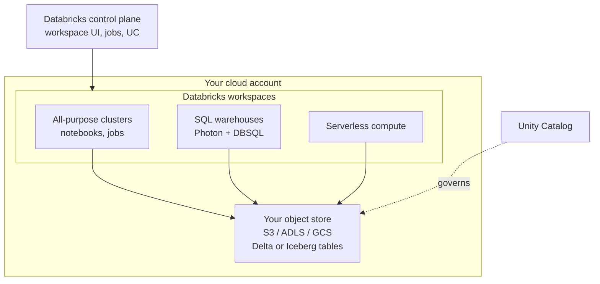
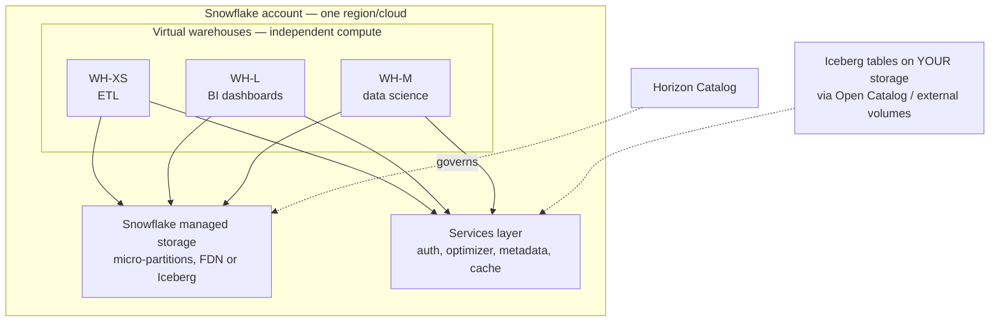
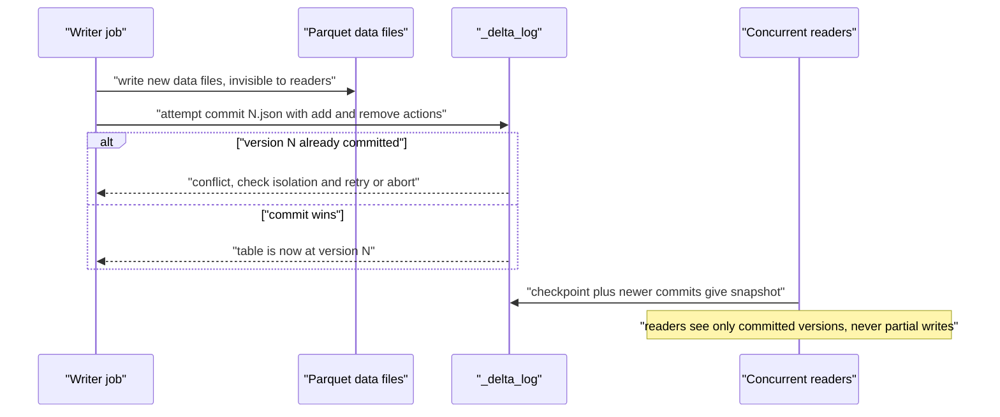
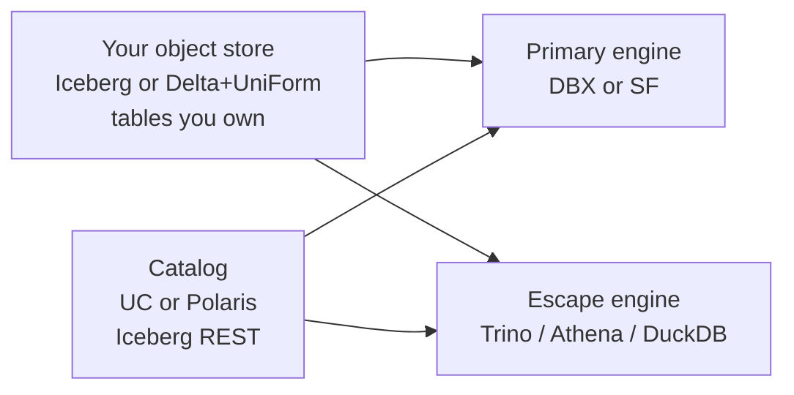

# Databricks vs Snowflake

> **Why it matters** — This is *the* platform decision of the decade for most data orgs, and it's genuinely not obvious: they converged on the same "lakehouse" idea from opposite directions. Snowflake built a warehouse that learned to do data science; Databricks built a data science platform that learned SQL. Knowing where each came from tells you where each is still weak.

## How each is actually built

### Databricks: your storage, their compute

Databricks is **control plane + compute**. Your data lives in **your cloud object storage** (S3/ADLS/GCS) as Delta or Iceberg tables. Databricks runs clusters — all-purpose, jobs, or SQL warehouses — inside your cloud account (or its own, for serverless), and bills you **DBUs** on top of the underlying VM cost.

Key consequence: **you keep the data if you leave**. The tables are open-format files in your bucket — Trino, Athena, Snowflake (via Iceberg) can read them in place. This is the strongest lock-in counter-argument Databricks has.

### Snowflake: their storage, their compute

Snowflake is a **managed service running on a cloud you pick per region**. Data loads into Snowflake's own centralized storage (compressed, micro-partitioned columnar — you never see the files). Compute is **virtual warehouses**: independent T-shirt-sized clusters (XS→6XL) billed in **credits per second** with auto-suspend.

Key consequence: **compute isolation is trivial**. Every warehouse is a separate cluster on shared storage — a runaway BI query can't touch the ETL warehouse's CPU. But the *default* data path puts bytes inside Snowflake's storage format, which is the lock-in — mitigated by Iceberg tables on external storage.

::: info ℹ️ One sentence each
- **Databricks** = "run any engine on your open files; we sell compute and a workspace."
- **Snowflake** = "hand us the data; we sell a finished product with compute you can dial up and down."
:::

## Side-by-side

| Dimension | Databricks | Snowflake |
|---|---|---|
| Storage | **Your object store**, Delta/Iceberg open formats | **Their managed storage** (proprietary micro-partitions); Iceberg-on-your-bucket now first-class |
| Compute unit | **DBU/hr + cloud VM cost** per cluster | **Credits/sec** per virtual warehouse (XS=1 credit/hr, doubles each size) |
| Idle behavior | Clusters auto-**terminate** after N min (config) | Warehouses auto-**suspend** after N min (default 10, set to 1–2 for BI) |
| Engine | **Photon** (C++ Spark engine) for SQL; open-source Spark underneath | Proprietary engine; Snowpark for Python/Java/Scala push-down |
| SQL polish | DBSQL good, improving fast | Best-in-class: near-zero tuning, excellent concurrency |
| ML/AI | Best-in-class: native Spark + MLflow + Mosaic AI | Snowpark ML, Cortex functions; workable, not the strength |
| Streaming | Structured Streaming mature; Delta Live Tables | Snowpipe streaming, Dynamic Tables; younger, simpler model |
| Concurrency model | More warehouses/clusters = more DBU spend, explicit | Auto-scale multi-cluster warehouses (up to 10 clusters/WH on Enterprise+) |
| Governance | **Unity Catalog** — tables, files, functions, models, volumes; Iceberg REST API | **Horizon Catalog** — same scope; Polaris OSS catalog for Iceberg interop |
| Format escape | Native: Delta/UniForm/Iceberg on your bucket | Iceberg tables on external storage; FDN data needs unload or Iceberg |

::: tip 💡 Senior insight
The pricing meters differ in a subtle way interviews love: **DBUs are per-cluster-second and you manage cluster lifetime; credits are per-warehouse-second and suspend is automatic**. A forgotten Databricks all-purpose cluster with a 60-min auto-terminate burns money the same way a forgotten Snowflake warehouse does — but Snowflake's 60-second auto-suspend default makes the accident cheaper. Both have killed budgets; only one does it by default while you sleep.
:::

## Delta vs Iceberg support — where it actually stands

- **Databricks**: Delta is native (Databricks created it). **UniForm** generates Iceberg metadata alongside Delta so external engines read the same files as Iceberg. Unity Catalog exposes an **Iceberg REST catalog** — Snowflake, Trino, and others can read UC-managed tables. Managed Iceberg writes landed in 2025-era releases.
- **Snowflake**: Iceberg tables are first-class — either Snowflake-managed catalog or an external catalog (AWS Glue, Polaris/Open Catalog, UC via REST). Delta reads work through UniForm metadata. FDN (Snowflake's native format) still gives the best engine-internal performance.

::: warning ⚠️ Production failure mode: the catalog is the lock-in now
Everyone fixates on file formats, but 2025-era lock-in moved up a layer: **the catalog**. Delta on your bucket is portable bytes; Unity Catalog's *governance graph* (lineage, permissions, volumes, functions) is not. Same for Horizon. Budget for catalog migration, not just table conversion, in any exit plan.
:::

## Performance features that actually matter

Ignore benchmark wars; these are the features that change real workloads:

| Feature | Databricks | Snowflake |
|---|---|---|
| Query engine acceleration | **Photon** — C++ vectorized engine replacing JVM Spark for SQL/DataFrame ops | Proprietary vectorized engine — every warehouse is already "Photon-class" |
| Data skipping | Delta stats + **liquid clustering** (successor to Z-ORDER) / OPTIMIZE | **Micro-partition** metadata pruning + **clustering keys** + **search optimization** (point-lookup service) |
| Caching | Disk cache (Delta cache) on cluster SSD; result cache in DBSQL | Result cache 24h + local SSD cache per warehouse + metadata cache |
| Auto-tuning | **Predictive optimization** (auto OPTIMIZE/VACUUM), AQE from Spark | Automatic: no indexes, no distribution keys to manage at all |
| Point lookups | Photon + liquid clustering | **Search Optimization Service** — purpose-built for needle-in-haystack selects |

::: details The tuning-tax asymmetry
Snowflake's architectural bet: *remove the knobs*. No indexes, no partition keys, no distribution styles — micro-partition pruning + statistics do the work for ~90% of workloads; you only reach for clustering keys or search optimization at extremes. Databricks gives you the knobs — partitioning, liquid clustering, OPTIMIZE schedules, file sizing — and rewards operators who use them. The same asymmetry repeats everywhere: Snowflake optimizes for "nobody has to think about this," Databricks for "you can think about everything." Neither is free: Snowflake's answer when the bet misses is a bigger warehouse.

## Delta Lake mechanics that actually matter on Databricks

### ACID via `_delta_log` — the commit protocol

Every Delta write is a two-phase affair: the job stages new Parquet files, then commits a single JSON file (`0000NN.json`) into `_delta_log/` recording `add`/`remove` actions. Readers snapshot-resolve from the latest checkpoint plus commits, so they only ever see whole versions — never half-written files. Concurrent writers fight over the *version number*, not the files: optimistic concurrency checks what changed since your read and retries or fails.

Periodic checkpoints compact the JSON chain into Parquet so log replay stays cheap; `spark.databricks.delta.checkpointPolicies=multiPart` splits large checkpoints for very wide tables.

### OPTIMIZE + Z-ORDER vs Liquid Clustering

| Dimension | `OPTIMIZE ... ZORDER BY` | Liquid clustering (`CLUSTER BY`) |
|---|---|---|
| Era | Legacy workhorse, OSS Delta too | Databricks Runtime 13.3+, default direction for 2024+ tables |
| Layout | Rewrites files with a space-filling-curve sort on 2–4 columns | Incremental; only unclustered files are rewritten on each run |
| Key change | Static — new filter patterns mean re-running full OPTIMIZE | `ALTER TABLE ... CLUSTER BY` changes keys without full rewrite |
| Skew / high-cardinality | Degrades when column values are unevenly distributed | Handles skew better; no partition skew problem at all |
| Partitioning | Sits on top of existing partitions | **Do not partition** clustered tables — clustering replaces partitioning |
| Best fit | Existing partitioned tables you can't re-create; OSS deployments | New tables; high-cardinality filter columns; evolving query patterns |

::: tip 💡 Senior insight
Z-ORDER is static: it optimizes for the data distribution *at write time* and decays as new data lands — the cookbook's own warning. Liquid clustering exists precisely because re-Z-ORDERing a drifting table is a treadmill. New table on DBR 15+? `CLUSTER BY (filter_col, join_col)` and let predictive optimization do the rest. Still on an old partitioned table? Keep OPTIMIZE on a schedule and don't bother re-clustering monthly — the gain rarely covers the rewrite cost.
:::

### VACUUM and time travel — the ops matrix

| Operation | What it does | Gotcha |
|---|---|---|
| `VERSION AS OF n` / `versionAsOf` | Read an old snapshot | Fails if log history was checkpointed/retained past `logRetentionDuration` |
| `TIMESTAMP AS OF` | Same, by wall clock | Maps to newest version ≤ timestamp |
| `RESTORE TABLE t TO VERSION AS OF n` | Rollback — itself recorded as a new commit | Only works while the old data files still exist |
| `VACUUM [RETAIN n HOURS]` | Deletes *unreferenced* data files | Default floor 7 days (168h); going under it needs a safety opt-out and kills time travel below that window |
| `DESCRIBE HISTORY t` | Audit every commit | Your free lineage at the table level |

Retention knobs: `delta.logRetentionDuration` (default **30 days**, log history) and `delta.deletedFileRetentionDuration` (default **7 days**, VACUUM eligibility). Want 60-day time travel? Extend **both** — extending only the log buys you a snapshot you can't fully resolve, and extending only file retention inflates storage.

::: warning ⚠️
`VACUUM` never deletes `_delta_log` files — checkpoints do that. And running `OPTIMIZE` twice is a no-op: it only rewrites files that don't meet the target size. Neither op changes *what* readers see, only how fast they see it.
:::

### Schema evolution — the flag map

| Flag / mode | Where | Effect |
|---|---|---|
| `option("mergeSchema","true")` | Batch write | Adds new columns from the incoming DataFrame |
| `spark.databricks.delta.schema.autoMerge.enabled` | Session / MERGE | Evolves target schema during `MERGE INTO` |
| `option("overwriteSchema","true")` | Overwrite write | Replaces schema wholesale — pairs with `mode("overwrite")` |
| `cloudFiles.schemaEvolutionMode` | Auto Loader | `addNewColumns` (default-ish), `failOnNewColumns`, `rescue`, `none` — pick `rescue` when you'd rather quarantine than break |
| `cloudFiles.schemaHints` | Auto Loader | Overrides inference for specific columns; `cloudFiles.inferColumnTypes=true` infers real types instead of all-strings |
| `_rescued_data` column | Auto Loader output | Rows that don't parse land here instead of dying — the built-in dead-letter |
| Column mapping | Table property | Enables `RENAME COLUMN` / `DROP COLUMN` on existing data |

## Ingestion routing: Auto Loader vs Structured Streaming vs batch

| Source shape | Pick | Why |
|---|---|---|
| Files landing in cloud object storage | **Auto Loader** (`cloud_files()` in DLT SQL, `readStream.format("cloudFiles")` elsewhere) | Incremental directory listing or event-notification mode, schema evolution modes, `_rescued_data` |
| Kafka / Kinesis / Event Hubs | **Structured Streaming** `readStream` directly | Native source connector; manage `checkpointLocation` yourself |
| Delta upstream with `enableChangeDataFeed` | CDF read (`table_changes` or stream) | Bronze→silver change propagation without full scans |
| Daily snapshots / small static files | **Plain batch read + MERGE** | Streaming machinery is pure cost here |

The `checkpointLocation` rule worth tattooing: never hand-delete files *inside* a checkpoint dir; stop the query and remove the whole directory, or the stream state corrupts.

## The medallion recipe as actually run on Databricks

| Layer | Write pattern | Concrete knobs |
|---|---|---|
| **Bronze** | Append-only `STREAMING TABLE` from `cloud_files` | `cloudFiles.inferColumnTypes`, keep `_rescued_data`; optionally `delta.enableChangeDataFeed = true` for downstream CDC; no dropping constraints — raw stays raw |
| **Silver** | `STREAM(live.bronze)` incremental or batch `MERGE INTO` for upserts | `EXPECT`/`CONSTRAINT ... ON VIOLATION DROP ROW` for quality gates; `dropDuplicates` on the business key before merge; `CLUSTER BY` the join/filter keys |
| **Gold** | `LIVE TABLE` (materialized view) aggregating silver | `GROUP BY` rollups; predictive optimization + liquid clustering on serving columns |

::: details DLT semantics behind the pattern
Delta Live Tables gives you two persistent abstractions: **streaming tables** process each record exactly once incrementally (bronze, silver); **materialized views** (`LIVE TABLE`) recompute to always reflect current state (gold). `CREATE OR REFRESH` means DLT owns dependency tracking and schema inference — you ship the SELECT, it ships the DAG.
:::
:::

## Data sharing — Snowflake's quiet moat

**Snowflake data sharing** (Secure Data Sharing / Marketplace) lets providers share live tables across accounts with zero copy — the consumer queries the provider's micro-partitions directly. Cross-cloud replication handles the multi-cloud case. This is a genuine architectural moat: entire data-marketplace businesses run on it.

Databricks answers with **Delta Sharing** — an open protocol (OSS server) that shares Delta/Iceberg tables over REST to any recipient, no Databricks account required. More open, more assembly.

::: warning ⚠️ Sharing ≠ governance transfer
Both models share *data*, not *policies*. A consumer's masking policy on their side doesn't constrain what you granted; your row filters are enforced at share time. Auditing "who read shared data" crosses account boundaries on Snowflake — check your regulator's stance before enabling outbound shares.
:::

## Serverless: both vendors, different meanings

- **Databricks serverless**: compute runs in *Databricks'* cloud account — instant-on, no VPC management, premium DBU rate. Serverless SQL warehouses, serverless jobs, and serverless notebooks each exist. You trade VM-level control and the ability to use your cloud commits/discounts.
- **Snowflake serverless**: always was. Warehouses are serverless by definition — you never saw the VM. What you pay extra for instead: **Snowpark-optimized warehouses** (bigger nodes for Python), and services like search optimization billed per-use.

The trap in both: serverless convenience prices ~1.3–2× equivalent classic compute. For steady-state ETL, classic provisioned clusters (DBX) or right-sized warehouses (SF) are cheaper. For spiky/dev/BI workloads, serverless wins on total cost including idle waste.

Two Databricks-specific wrinkles on top of that: **Photon** (the C++ vectorized engine) is what makes DBSQL competitive on SQL/BI — turning it off or landing on a runtime without it is a silent 2–4× slowdown on the same DBU spend; and serverless SQL warehouses scale to zero so aggressively that the first query of the day takes a cold-start hit. Predictive optimization (managed tables) runs OPTIMIZE/VACUUM for you — convenient, but it's its own compute line item you'll find in `system.billing.usage`, not free housekeeping.

## Cost model anatomy

Two bills to decompose, not one price to compare:

- **Databricks** = `DBU-rate × cluster-hours` (vendor) `+ VM-cost` (cloud provider). Classic compute lets you burn cloud commitments/reserved instances on the VM half — often 30–40% off the total at scale. Serverless = DBUs only, no VM lever.
- **Snowflake** = `credits × rate` per warehouse-second + storage ($/TB-mo, compressed) + services (serverless features bill their own credit meters). Edition (Standard→Business Critical) multiplies the credit rate.

::: tip 💡 Senior insight
When finance asks "what does a query cost," Databricks answers in cluster-seconds amortized across its tenants' jobs; Snowflake answers in warehouse-seconds even when the query used 1% of it. Both are approximations — Snowflake's is the more honest one since a warehouse's second is genuinely exclusive to your account during billing. Per-query cost on BigQuery is the only *exact* per-query answer in the industry.
:::

## Migration checklist reality

Moving between them is a quarter, not a sprint. The workstream order that reflects actual risk:

1. **Table format & storage** — Iceberg-on-your-bucket makes this mechanical; FDN or UC-managed Delta adds a conversion leg.
2. **SQL dialect port** — ~70% transpiles automatically (Snowflake↔Spark SQL tools exist); UDFs, semi-structured functions, and stored procedures are the hand-work.
3. **Permissions & catalog** — rebuild grants/row policies/masking in the new governance layer; no automated path.
4. **Orchestration & downstream** — task graphs, BI semantic layers, reverse-ETL. Always bigger than estimated.
5. **Cost re-baseline** — the metering models differ enough that month-1 bills surprise in both directions.

::: details Concurrency numbers worth remembering
- Snowflake default warehouse runs ~8 concurrent queries before queuing; max concurrency scales with warehouse size. Multi-cluster caps at 10 clusters/warehouse on Enterprise.
- Databricks SQL warehouse: concurrency scales by cluster size (t-shirt) up to its max; serverless warehouses autoscale to demand within a configured range.
- Both degrade the same way under sustained queue pressure: latency climbs before throughput dies. Watch queue depth (`QUERY_HISTORY` queueing fields on SF; `system.query` / metrics on DBX), not just p95.
:::

## Governance deep dive: UC vs Horizon

| Capability | Unity Catalog | Horizon Catalog |
|---|---|---|
| Object scope | Tables, volumes (files), functions, models, notebooks, external locations | Tables, views, stages, policies, tags, semantic models |
| Fine-grained | Row filters + column masks + dynamic views | Row access policies + masking policies + object tagging |
| Lineage | Built-in, table+column level across UC | Built-in via Horizon; OpenLineage integration |
| Interop | Iceberg REST catalog endpoint — external engines authenticate to UC | Polaris (Open Catalog) — OSS Iceberg REST catalog; Apache project |
| Federation | **Lakehouse Federation** — query external DBs in place | External tables, database links; Polaris catalogs external Iceberg |

::: tip 💡 The Polaris move
Snowflake donated its Iceberg REST catalog to Apache as **Polaris** — any engine that speaks Iceberg REST can sit on Polaris-cataloged tables, and Horizon governs them. It's the clearest signal that the industry settled on Iceberg REST as the catalog protocol. Databricks responded by making UC speak the same protocol. Practical result: a Trino cluster can read both vendors' tables through one catalog interface — the first real "multi-engine, multi-vendor" story that isn't vaporware.
:::

::: details UC system tables — governance you can query
Unity Catalog ships `system.*` schemas an account admin enables once via the UC REST API, then grants like normal tables: `system.access.audit` (who touched what), `system.access.table_lineage` (programmatic source→target lineage, joinable to `entity_id` for run-level attribution), `system.billing.usage` + `system.billing.list_prices` (per-SKU DBU cost rollups). Root-cause and impact analysis stop being screenshot hunts: `SELECT source_table_full_name, target_table_full_name FROM system.access.table_lineage WHERE target_table_full_name = 'cat.schema.table'`.
:::

## Workload isolation & concurrency

| Need | Databricks | Snowflake |
|---|---|---|
| Isolate ETL from BI | Separate job clusters vs SQL warehouses — natural, explicit sizing | Separate virtual warehouses — natural, trivially explicit |
| Burst concurrency on BI | SQL warehouse cluster scaling (classic) or serverless | **Multi-cluster warehouse**: same WH spins up 1→N clusters automatically |
| Cost attribution | Cluster tags → DBU usage tables | Warehouse names → `WAREHOUSE_METERING_HISTORY`; resource monitors + budgets |
| Kill a noisy query | `statement_timeout` / cancel via API | Per-query/per-WH timeout, `QUERY_HISTORY` audit |

Snowflake's multi-cluster auto-scaling is genuinely differentiated for spiky BI concurrency: one logical warehouse, compute scales out and back with query queue depth. Databricks answers with serverless SQL warehouses, which scale similarly but bill at a premium serverless DBU rate.

## Decision table

| Your situation | Lean toward |
|---|---|
| ML/DS-heavy, custom Spark, streaming-first, platform team exists | **Databricks** |
| SQL/BI-heavy, analysts > engineers, want zero-ops | **Snowflake** |
| Multi-cloud or cloud-exit clause in contracts | **Databricks** (open files on your storage) — or Iceberg-on-Snowflake |
| Power BI / Microsoft shop | Fabric; then Databricks (Azure Databricks is first-party) |
| Regulated, single source of truth governance | Either — UC vs Horizon is a coin flip; pilot the one your cloud favors |
| Small team, mostly ad-hoc analytics | **Snowflake** — the ops tax of Databricks isn't worth it |
| Heavy streaming (CDC, near-real-time at scale) | **Databricks** — Structured Streaming is a decade deep |

::: warning ⚠️ The "do both" anti-pattern
Orgs frequently buy both "for different teams" and end up with two copies of the silver layer, two catalogs, and no answer to "which number is right." If you run both, draw the line on *workload* (DBX = transform/ML, SF = serving/BI) and replicate one direction only — never federate writes.
:::

## When the answer is neither

Both are the expensive end of the market. The escape hatch that senior engineers should keep loaded:

**Iceberg on your bucket + a query engine you pay for only when it runs:**

- **Trino/Starburst** — self-host or managed; the classic open lakehouse query layer
- **Athena** — serverless per-TB-scanned on AWS, zero ops, great for ad-hoc
- **DuckDB / Polars** — honestly covers analytics up to ~1 TB per query on one box
- **ClickHouse / MotherDuck** — when the workload is really "fast dashboards," not "lakehouse"

| Scenario | Stack | Rough monthly shape |
|---|---|---|
| Team of 3, 10 TB, ad-hoc queries | Iceberg + Athena/DuckDB | Storage + $5/TB scanned — often **<$500/mo** |
| 50 TB, dbt + BI, growing team | Snowflake or Databricks | **$5k–30k/mo** depending on discipline |
| 500 TB, mixed ML+BI, platform team | Databricks + Iceberg | **$30k+** but compute-efficient at scale |

::: tip 💡 Senior insight
The strongest negotiating position in every Snowflake/Databricks renewal is a working proof that your tables are Iceberg and readable by an external engine. It costs a weekend to demonstrate and saves 15–30% at renewal. Vendors price against your switching cost, not your usage.
:::

## The open-format exit strategy

Whichever you pick, keep the escape hatch warm. A defensible open-format posture:

Checklist that keeps it real rather than aspirational:

1. Tables in Iceberg (or Delta+UniForm) on **your** bucket with **your** encryption keys.
2. An Iceberg REST catalog a third engine can authenticate to — UC or Polaris both qualify.
3. One quarterly drill: point Athena/Trino at a real table, run a real query. If nobody's tested the exit, it's a slide, not a strategy.
4. Keep transforms in dbt where possible — SQL ports across engines; proprietary procedural code doesn't.

::: warning ⚠️ What portability doesn't cover
Even a perfect open-format posture doesn't port: Snowpark/MLflow code, stored procedures, tasks/Dynamic Tables vs Databricks Workflows, semantic models, and the governance layer. Realistic switching cost is months, not weeks — the format just removes the *data* leg, which used to be the killer.
:::

## Ops burden — what you're actually signing up for

| Ops surface | Databricks classic | Databricks serverless | Snowflake |
|---|---|---|---|
| Cluster lifecycle | You size, schedule, tune pools | Platform-owned | Warehouse = one knob |
| Version upgrades | You schedule (LTS channels exist) | Automatic | Automatic, forced |
| VPC/networking | You manage (customer VPC) | Vendor-managed (less control) | Vendor-managed + PrivateLink |
| Capacity planning | Cluster policies, pools, spot mix | Min/max on serverless config | Warehouse size + multi-cluster count |
| Paging risk | Cluster failures, spot kills, init scripts | Low | Lowest of the three |

Rough headcount translation: a healthy Databricks classic deployment wants ~0.5–1 FTE of platform attention per few dozen pipelines; Snowflake wants a fraction of that — which is exactly what the credit premium is buying. Price the headcount, not the sticker.

## 🧠 Quiz

<QuizCard :questions="[{ q: 'A Snowflake warehouse is set to 6XL but suspends after 60s idle. A Databricks all-purpose cluster has 2h auto-terminate. Which idle accident is worse and why?', options: ['Databricks — cluster bills DBU+VM for the full idle window; Snowflake bills only while resumed', 'Snowflake — 6XL is huge', 'Equal — both bill idle', 'Neither — both auto-stop instantly'], correct: 0, explain: 'Snowflake suspends in seconds and bills per-second of uptime; an idle 6XL costs ~nothing once suspended. Databricks auto-terminate is measured in minutes and bills the whole window at DBU + underlying VM rates. Same bug, very different bill.' }, { q: 'What does Delta UniForm do?', options: ['A Snowflake storage format', 'Generates Iceberg metadata alongside a Delta table so external engines read the same files as Iceberg', 'A Unity Catalog tier', 'Converts Delta files to Iceberg files'], correct: 1, explain: 'UniForm writes Iceberg-compatible metadata next to the Delta log — one copy of the Parquet data files, two table-format views. It removes the copy-data tax for cross-engine reads but reads, not writes, are the interoperable side.' }, { q: 'Why is the data catalog now a bigger lock-in risk than the file format?', options: ['Catalogs cost more', 'Formats are portable bytes; the catalog holds lineage, permissions, volumes, functions — governance does not export', 'Iceberg requires a catalog', 'Catalogs are proprietary formats'], correct: 1, explain: 'Iceberg/Delta files move freely. Unity Catalog and Horizon encode the governance graph — who can see what, lineage, semantic models — and none of that ports. Exit plans must budget catalog rebuild, not just table migration.' }, { q: 'Your workload is 40 analysts, dbt models, Power BI dashboards, minimal Python, team of 4 engineers. Default pick?', options: ['Databricks — more features', 'Redshift provisioned', 'Self-host Trino', 'Snowflake — SQL/BI-first, near-zero ops, auto-suspend; or Fabric if deep Microsoft shop'], correct: 3, explain: 'BI-serving at small-team scale is the Snowflake home court: managed everything, multi-cluster concurrency for dashboard bursts, per-second billing. Databricks pays off when Spark/ML workload justifies the ops surface.' }, { q: 'How does Snowflake multi-cluster warehouse scaling differ from adding a second Databricks SQL warehouse?', options: ['Databricks cannot scale', 'Multi-cluster is faster queries', 'Multi-cluster scales ONE logical warehouse out/in automatically by queue depth; a second DBX warehouse is a separately sized cluster you manage', 'No difference'], correct: 2, explain: 'Snowflake spins up additional clusters behind the same warehouse name when queries queue, then spins them down — concurrency without a second endpoint to route to. Databricks classic warehouses scale by cluster count you configure; serverless narrows the gap at a price premium.' }, { q: 'Strongest negotiation lever at a Snowflake or Databricks renewal?', options: ['Moving to a different region', 'Threatening to leave', 'A demonstrated working read of your tables via Iceberg from an external engine — switching cost, not sentiment, sets the discount', 'Asking for credits'], correct: 2, explain: 'Vendors price against switching cost. Iceberg-on-your-bucket readable by Trino/Athena lowers that cost credibly; an account executive prices retention against a real exit path, not a slide deck.' }]" />

<QuizCard :questions="[{ q: 'A Delta table needs 60 days of time travel and a monthly VACUUM. Which properties change?', options: ['Neither — checkpoints preserve everything', 'Both — log retention covers metadata, file retention covers data; extending one alone is useless', 'Only delta.deletedFileRetentionDuration', 'Only delta.logRetentionDuration'], correct: 1, explain: 'delta.logRetentionDuration (default 30d) keeps commit history; delta.deletedFileRetentionDuration (default 7d) gates VACUUM eligibility for data files. Time travel needs both: the log to know which files existed, the files to still exist.' }, { q: 'Liquid clustering vs OPTIMIZE ZORDER BY — the biggest practical difference?', options: ['Z-ORDER is newer', 'Liquid clustering requires partitioning', 'Liquid clustering is incremental — new data gets clustered on each run without rewriting everything, and keys can change via ALTER', 'No difference, just syntax'], correct: 2, explain: 'Z-ORDER rewrites files to match the distribution at optimize time and decays as data drifts; it also assumes partitions. Liquid clustering is incremental, re-keyable via ALTER TABLE CLUSTER BY, and replaces partitioning entirely — never partition a clustered table.' }, { q: 'Where is ACID actually enforced in Delta Lake?', options: ['Unity Catalog', 'Row locks on Parquet files', 'The _delta_log JSON commit sequence — staged files become visible only when a commit file lands', 'A lock service in the cloud provider'], correct: 2, explain: 'Writes stage invisible Parquet files, then one JSON commit records add/remove actions. Readers snapshot-resolve the log and only see committed versions; concurrent writers conflict on the version number, resolved by optimistic concurrency — never on the data files.' }]" />

## Further reading

- [Databricks architecture overview](https://docs.databricks.com/en/getting-started/overview.html) — control plane vs compute plane, serverless vs classic
- [Snowflake key concepts and architecture](https://docs.snowflake.com/en/user-guide/intro-key-concepts) — the three-layer model, warehouses, credits
- [Delta Lake UniForm](https://docs.delta.io/latest/delta-uniform.html) — Iceberg-compatible reads on Delta
- [Snowflake Iceberg tables](https://docs.snowflake.com/en/user-guide/tables-iceberg) — external-catalog and Snowflake-managed modes
- [Unity Catalog](https://docs.databricks.com/en/data-governance/unity-catalog/index.html) and [Snowflake Horizon Catalog](https://docs.snowflake.com/en/user-guide/security-horizon-intro) — the governance layer on each side
- [Apache Polaris (incubating)](https://polaris.apache.org/) — the OSS Iceberg REST catalog Snowflake donated; the interop substrate
- *Databricks vs Snowflake* benchmark posts from both vendors — read both; each picks the workload that wins
- **Data Engineering with Databricks Cookbook** — Pulkit Chadha (2024), [Packt](https://www.packtpub.com/en-us/product/data-engineering-with-databricks-cookbook-9781837633358) — recipe-style coverage of Delta mechanics, Auto Loader, DLT medallion pipelines, and Unity Catalog ops
