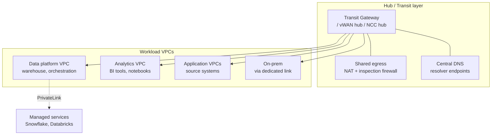
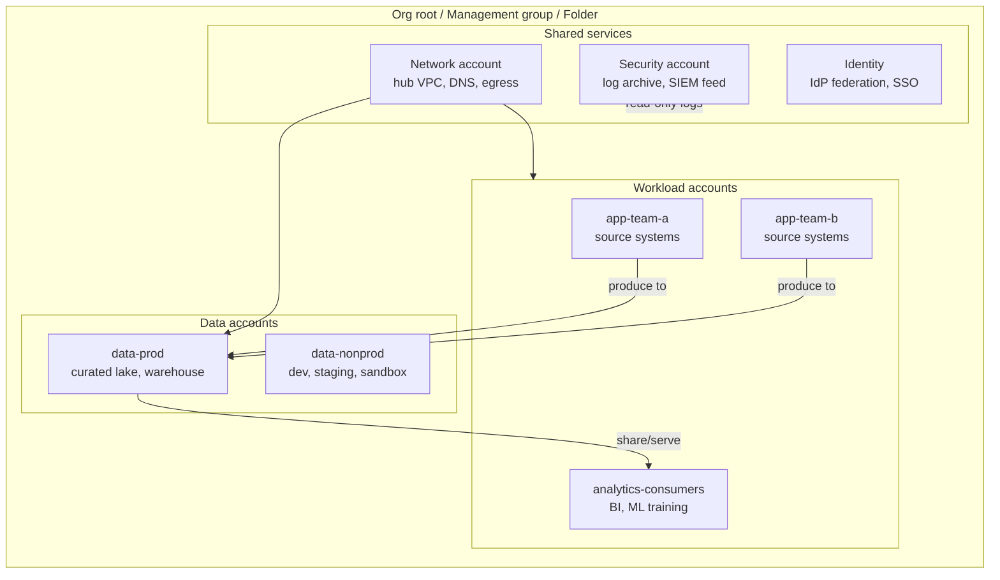
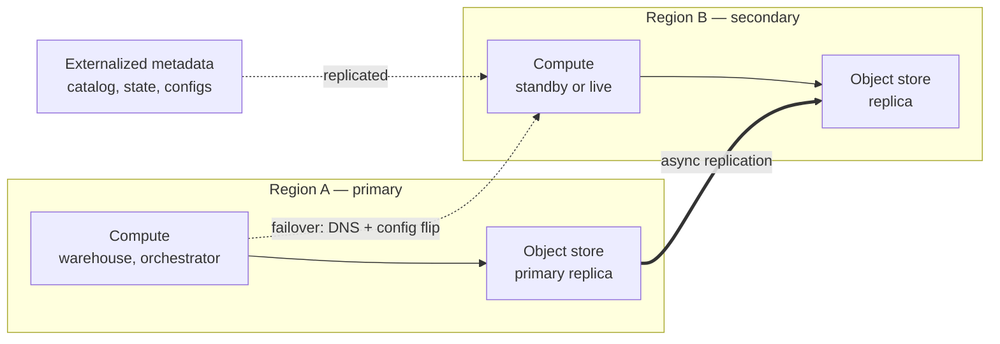

# Networking, Multi-Region & Landing Zones

> **Why it matters** — The questions that separate senior platform engineers from senior analysts are infrastructure-shaped: "Why can't the Databricks cluster reach the warehouse?", "What's our RPO if eu-west-1 dies?", "Should we commit to 3-year savings plans?" These are designed-in properties, not tuning knobs — get them wrong at provisioning time and the fix is a migration.

## Private connectivity for data platforms

Every data platform eventually hits the same wall: compute in your VPC needs to reach a managed service (Snowflake, Databricks control plane, BigQuery, Redshift) or a partner's endpoint **without traversing the public internet**. Security teams mandate it, and it's also a performance and cost question — private paths avoid NAT gateway fees and keep egress predictable.

### VPC and subnet design for compute clusters

The boring rules that prevent 90% of network incidents:

- **Compute lives in private subnets.** Spark clusters, Airflow workers, and ETL nodes get no public IPs. Outbound traffic (package installs, API calls) routes through a NAT gateway or an egress firewall — a controlled choke point you can log.
- **Size subnets for the real cluster, not the diagram.** A Spark cluster autoscaling to 500 workers in a /24 subnet (256 IPs) will fail at scale-up with `InsufficientFreeAddresses` — a failure that only appears on the busiest day of the year. Plan /22 or larger per compute subnet.
- **Reserve a private subnet tier for stateful services.** Managed databases and self-hosted stores (Kafka, ClickHouse) go in dedicated subnets with route tables that deny internet routes entirely.
- **One VPC per environment, not per pipeline.** VPC-per-team designs collapse under peering limits and IP overlap; consolidate and isolate with security groups and IAM instead.

::: warning ⚠️ Production failure mode: IP exhaustion
The classic 3am page isn't a route table bug — it's a /24 subnet that fit the dev cluster and silently can't fit prod's autoscale ceiling. Second place: NAT gateway throughput saturating because every node pulls container images through it. Both are design bugs discovered under load.
:::

### Private endpoints, per cloud

All three clouds offer the same primitive — a private IP inside your VPC that fronts a managed service — under different names:

| Capability | AWS | Azure | GCP |
|---|---|---|---|
| Service-to-consumer primitive | PrivateLink (interface endpoint) | Private Endpoint / Private Link | Private Service Connect endpoint |
| Service-to-AWS/Azure/GCP-managed service | VPC endpoint (interface + gateway) | Private Endpoint | Private Service Connect / Private Google Access |
| Gateway-style (free) endpoints | S3, DynamoDB gateway endpoints | Service endpoints | Private Google Access for APIs |
| Publish your own service privately | NLB + endpoint service | Private Link service | PSC service attachment |
| DNS integration | Private hosted zones, `enableDnsHostnames` | Private DNS zones (`privatelink.*`) | DNS zones / PSC DNS |
| Cross-org consumption | Yes, with endpoint acceptance | Yes, with approval workflow | Yes, via producer/consumer model |

The pattern to recognize: **consumer pays for the endpoint, producer controls acceptance.** A vendor like Snowflake publishes a PrivateLink service; you create an endpoint in your VPC; they approve the connection. DNS then resolves the service's public hostname to your private IP — which is why the private DNS zone must exist *before* you create the endpoint, or clients keep resolving public addresses.

::: tip 💡 Senior insight
Private endpoints fix reachability, not authorization. A PrivateLink to Snowflake means traffic stays off the internet — it does not mean only your VPC can reach the account. Combine with network policies (Snowflake `NETWORK_POLICY`, storage firewall rules, VPC SC perimeters on GCP) that reject public-source traffic, or the private path is decorative.
:::

### VPC peering vs Transit Gateway / hub-spoke

Point-to-point peering works until ~3 VPCs; past that it becomes an N² routing problem — peering is **non-transitive**, so VPC A↔B and B↔C does not give A↔C. The escape is hub-spoke:

| Model | When it wins | Breaking point |
|---|---|---|
| VPC peering | 2–3 VPCs, static relationships | Non-transitive; N² route tables past ~5 peers; CIDR overlap kills it |
| Transit Gateway (AWS) / vWAN (Azure) / NCC (GCP) | Many VPCs + on-prem, shared egress | Per-attachment + per-GB fees; single-hub blast radius |
| Shared VPC (GCP) / centralized egress | Org-wide standard, one security team owns egress | Blast radius and quota contention concentrated |
| Full mesh via cloud WAN | Global, multi-region transit | Cost and operational maturity required |

::: details Decision shortcut
Fewer than ~5 VPCs, one region, no on-prem → peering is fine and cheaper. Any of: multiple regions, on-prem connectivity, >5 networks, or a central security team that must inspect egress → hub-spoke, and design it before the third VPC exists. Retrofitting a transit layer under running peered VPCs means re-IPing or asymmetric routing during the migration.
:::

### DNS and on-prem connectivity

Hybrid DNS is the silent killer of "simple" VPN setups: on-prem resolvers must resolve `*.privatelink.*` names and cloud resolvers must resolve corporate names. The standard fix is **conditional forwarding in both directions** — Route 53 Resolver inbound/outbound endpoints, Azure DNS Private Resolver, or Cloud DNS forwarding zones — pinned to IP addresses both sides can reach.

| Connectivity need | AWS | Azure | GCP | Latency / bandwidth | When to choose |
|---|---|---|---|---|---|
| Quick, cheap hybrid | Site-to-site VPN | VPN Gateway | Cloud VPN | Variable over internet, ~1–3 Gbps/tunnel | Dev, low-volume, or backup path |
| Dedicated private line | Direct Connect | ExpressRoute | Cloud Interconnect (dedicated) | Deterministic, 1–100 Gbps | Prod data platforms, steady high-volume transfer, egress discounts |
| Partner-mediated dedicated | DX via partner | ER via provider | Partner Interconnect | Same, provisioned faster | No colo presence; telco handles last mile |

::: info ℹ️ Dedicated links change the egress math
Direct Connect and Cloud Interconnect have *discounted* egress rates versus public-internet transfer (roughly 2–4× cheaper per GB on AWS). For a data platform shipping terabytes to on-prem consumers daily, the dedicated link often pays for itself in egress savings alone — before counting the stability gain. See [Cost & Decoupled Architecture](/cloud/cost-architecture) for the broader egress picture.
:::

## The data-platform landing zone

A landing zone is the opinionated account/project skeleton every workload lands in. For data platforms the topology question is where data lives relative to where compute runs:

Two topologies dominate:

- **Centralized data account** — one `data-prod` owns the lake and warehouse; workload accounts write via controlled ingest paths. Simpler governance, but the data account becomes a bottleneck and a billing black hole unless cost flows back out.
- **Distributed/mesh accounts** — each domain owns its data in its own account; shared account provides network and guardrails. Scales with org size but multiplies cross-account access patterns and duplication risk.

::: tip 💡 Senior insight
Nonprod is not optional. The single highest-leverage landing-zone decision is a hard `data-nonprod` boundary — separate account, no prod data access, cheaper guardrails. It gives you a place to break things, test IAM changes, and let analysts experiment, all without a single exception request hitting prod policy.
:::

### IAM patterns: kill the long-lived key

The modern landing-zone IAM posture, uniform across clouds:

1. **Humans** federate through the IdP (Okta/Entra/Google) into short-lived SSO sessions — no IAM users with access keys.
2. **Workload identity** replaces service-account keys: AWS IAM Roles for Service Accounts (IRSA) / instance profiles, Azure workload identity federation + managed identities, GCP workload identity pools + attached service accounts. CI systems (GitHub Actions OIDC → cloud role) get short-lived tokens, never stored secrets.
3. **Cross-account access** via role assumption with `ExternalId`/audience constraints — not via shared credentials.

::: warning ⚠️ Risk
Long-lived service-account keys are still the #1 cloud data-breach vector. Landing-zone policy should make them *impossible*, not discouraged: GCP org policy `iam.disableServiceAccountKeyCreation`, AWS SCP denying `iam:CreateAccessKey`, Azure policy blocking key auth on storage. An allowlist exception process documents the unavoidable legacy cases.
:::

### Guardrails and tagging

Enforce at the org layer so individual teams can't opt out:

| Guardrail | AWS | Azure | GCP |
|---|---|---|---|
| Preventive policy | Service Control Policies | Azure Policy (deny) | Org Policy constraints |
| Allowed regions | SCP `aws:RequestedRegion` | Policy location rules | `constraints/gcp.resourceLocations` |
| Block public buckets | S3 Block Public Access (account-level) + SCP | Storage policy `allowPublicAccess=false` | `storage.publicAccessPrevention` |
| Enforce encryption | Deny unencrypted writes | Policy require CMK | Default CMEK + org policy |
| Key/material controls | SCP on `iam:*` mutations | Policy on RBAC/keys | `iam.disableServiceAccountKeyCreation` |

The tagging taxonomy from [Cost & Decoupled Architecture](/cloud/cost-architecture) applies doubly here — at account level it drives both **cost allocation** (chargeback) and **security controls** (ABAC policies like "dev roles can't touch `criticality:tier1` resources"). Tag the workload, not the org chart; enforce required tags at deploy time via policy-as-code, not wiki convention.

## Multi-region architecture

For data platforms the honest starting question is: *what breaks if this region is gone for 6 hours?* The answer splits workloads into (a) stateful storage you must replicate and (b) stateless compute you can rebuild — and storage-compute separation (see [Cloud Big Three](/cloud/big-three)) is what makes the rebuild path cheap.

### Active-passive vs active-active

| Model | Cost | RTO | RPO | Fit |
|---|---|---|---|---|
| Backup & restore | Lowest (storage only) | Hours–days | Hours (last snapshot) | Non-critical internal analytics |
| Pilot light | Replication + minimal standby | Tens of minutes | Minutes | Most data platforms — the pragmatic default |
| Warm standby | Scaled-down duplicate compute | Minutes | Minutes | Revenue-adjacent pipelines |
| Active-active | ~2× cost + conflict engineering | Near zero | Near zero | Serving layers, rarely whole pipelines |

::: info ℹ️ The metadata is the hard part
Replicating *data* is a checkbox. Replicating *state* — orchestrator DAG state, checkpointed stream offsets, catalog metadata, secrets, IAM — is the actual DR problem, and it's why restore drills consistently take 3× the runbook estimate. Active-active on a data platform usually means active-active *storage* with a promoted-writer compute model, not symmetric write-anywhere.
:::

### Replication options per store

| Store | Native replication | Notes |
|---|---|---|
| BigQuery | Cross-region dataset replication; managed multi-region failover via reservations | Replication is async; promotion is a manual flip — plan the runbook |
| S3 | Cross-Region Replication (CRR) + replica modification sync | Versioning required; replication time control (RTC) adds SLA |
| GCS | Dual-region buckets (turbo replication, 15-min RPO SLA) or multi-region | Dual-region gives an RPO guarantee most alternatives don't |
| Snowflake | Database replication + failover groups, client redirect | Client redirect makes failover a URL, not a reconfig |
| Kafka | MirrorMaker 2 / Confluent Replicator / cluster linking | Offset translation is the trap — consumers can't just resume |
| Airflow/orchestrators | No native DR — restore state DB + redeploy DAGs | This is why "backup & restore" RTOs balloon |

### Region-failure runbook sketch

1. **Detect & declare** — region impairment confirmed; human declares failover (automated region failover causes more outages than it prevents).
2. **Freeze ingestion** — pause producers/orchestrators so no new state diverges.
3. **Promote storage** — flip replica to primary (BQ dataset promotion, S3 CRR is already readable, failover group activate).
4. **Promote compute** — deploy IaC-defined compute in region B (this is why compute must be fully terraformable — consoles don't failover).
5. **Redirect** — DNS/client-redirect update; secrets and configs must already exist in region B.
6. **Backfill & reconcile** — replay from last consistent checkpoint; accept the RPO gap as duplicated-or-missing data to reconcile, not ignore.
7. **Failback is a second migration** — planned, calm, scheduled. Never automatic.

::: warning ⚠️ Risk: drills lie unless they are destructive
A failover runbook never executed is a hypothesis. The honest test is a game day where the primary region's endpoints are actually blocked at the network layer — every shortcut that "temporarily" points at region A reveals itself instantly. Run it annually, and time every step: measured RTO beats documented RTO.
:::

## Sovereignty and compliance brief

Data-residency requirements moved from contractual checkbox to engineered feature. What's actually on the table:

- **AWS European Sovereign Cloud** — a physically and logically separate AWS partition in Germany, EU-operated, launched to satisfy EU sovereignty demands. Distinct from "just use eu-* regions."
- **Microsoft EU Data Boundary** — commitment that customer data for core services is stored and processed within the EU; plus Sovereign Public/Private Cloud and National Partner Cloud tiers.
- **GCP** — sovereignty via data-residency controls (org policy `gcp.resourceLocations`, in-country processing options like sovereign controls partners e.g. T-Systems/S3NS), plus Assured Workloads for regulated workloads.
- **In-country processing** — all three offer region-pinning guardrails; the engineering work is proving *processing* (not just storage) stays in-boundary, which means auditing every managed service's control plane and support-access paths, not just bucket location.

| Need | AWS | Azure | GCP |
|---|---|---|---|
| Boundary commitment | European Sovereign Cloud (separate partition, in progress) | EU Data Boundary (store + process in EU) | Assured Workloads + sovereign partner controls |
| Region pinning | SCP `aws:RequestedRegion` | Azure Policy allowed locations | Org policy `gcp.resourceLocations` |
| Key residency | External key store / HYOK | Managed HSM, CMK | EKM / Cloud HSM, CMEK everywhere |
| Operator access control | Sovereign ops staffing model | Customer Lockbox | Access Transparency + Access Approval |

Key residency deserves its own line because it's the control that actually bites: an EU-bounded bucket decrypted by an operator with global key access isn't sovereign in any regulator's view. Customer-managed keys with in-boundary HSMs turn a policy promise into a technical constraint — expensive and operationally heavier, but it's the version that survives audit.

::: warning ⚠️ Risk: metadata leaves the boundary
Bucket location `eu` doesn't mean your *logs, telemetry, billing records, and support transcripts* are in the EU. Sovereignty audits that check only storage location miss the most common violation path. The EU Data Boundary-style commitments exist precisely because this gap was discovered.
:::

## Advanced FinOps

[Cost & Decoupled Architecture](/cloud/cost-architecture) covers attribution and guardrails; this section is the strategy layer.

### Commitment strategy

| Instrument | Cloud | Scope | Flexibility | Discount |
|---|---|---|---|---|
| Reserved Instances | AWS / Azure (reservations) | Specific instance family/region | Low–medium (convertible/exchange options) | Up to ~72% |
| Savings Plans | AWS (Compute/EC2/SageMaker SP) | $/hour spend commitment | High — floats across families/regions | Up to ~66–72% |
| Committed Use Discounts | GCP (CUDs, spend- or resource-based) | vCPU/RAM or $ spend | High for spend-based | Up to ~57–70% |
| Capacity reservations | All three | Guaranteed capacity, not price | Separate concern — don't confuse | None (or paired with above) |

Rules that survive contact with finance:

- **Commit to the floor, not the average.** Chart daily-minimum usage over 90 days; commit to ~70–80% of the floor. Committing to average utilization means paying for troughs.
- **1-year first, 3-year only for proven-stable baseload.** A 3-year commitment on an architecture you might migrate (lakehouse→warehouse, region move) is a lock-in tax layered on the vendor lock-in below.
- **Ladder commitments.** Buy quarterly tranches instead of one annual tranche — expirations stagger, so a workload change never strands the whole commitment at once.
- **Separate compute shape from spend.** Prefer spend-based instruments (Savings Plans, spend-based CUDs) — instance-family reservations strand when you right-size.

### Unit economics of a data team

Total-platform-cost ÷ useful-work is the only number executives can compare across teams. Practical denominators:

- **Cost per TB processed** — normalizes for growth; good for pipeline teams. Watch it trend, don't benchmark absolutes (a CDC pipeline and a scan-heavy analytics job have legitimately different unit costs).
- **Cost per delivered data product / per active consumer** — ties spend to output, not input. Best for proving platform ROI.
- **Marginal cost of the next workload** — what it *actually costs* to onboard one more pipeline on existing commitments. Usually near zero until you hit a commitment boundary — which is when onboarding reviews matter.

### Showback, chargeback, anomaly detection

- **Showback first.** Report cost per team for 2–3 quarters before charging anyone — chargeback against untrusted allocation starts political fights that end in sticker-tag chaos.
- **Chargeback with a floor.** Shared platform costs (network, control planes, the unlabeled tail) go into a platform tax allocated pro-rata; usage-based spend charges directly. Pure pass-through chargeback makes teams hostile to shared infrastructure.
- **Anomaly detection on spend, not just budgets.** Day-over-day delta per tag catches the runaway query in hours; monthly budget alerts catch it at the invoice. Cloud-native (Cost Anomaly Detection, GCP/AWS billing anomaly services) works — the gap is routing: an anomaly alert that lands in a finance mailbox is a decoration. Route to the owning team's channel via the tag.

## Vendor lock-in escape economics

Egress pricing is the tariff wall around every data platform. Worked example — **1 PB of data out to the internet**, list prices, approximate tiered rates:

| Cloud | Tiered math (approx.) | ~1 PB egress |
|---|---|---|
| AWS | 10 TB × $0.09 + 40 TB × $0.085 + 100 TB × $0.07 + rest × $0.05 | **≈ $55–60k** |
| Azure | Similar tiers, ~$0.087 → ~$0.05 | **≈ $55–60k** |
| GCP | Premium tier ~$0.08–0.12/GB by region; standard lower | **≈ $60–90k** |

Plus what the table hides: request charges, cross-AZ transfer to reach the egress point, *doubling* cost if you first replicate to a second region, and the parallel-write period where you pay both clouds.

The cheaper exit is **replication-based migration**: stand up the target platform, replicate incrementally (object-store sync, CDC streams), cut over consumers, then drain — converting a cliff-edge egress event into months of smaller transfers, and letting you validate before committing. Total cost is still substantial; what changes is risk and timing, not the physics.

::: tip 💡 Senior insight: the free-egress exit door
Following EU Data Act pressure, all three clouds now waive egress fees for customers **migrating entirely off the platform** (typically requires closing the account or approval). This helps the once-ever migration but does nothing for multi-cloud or repatriation-partial patterns — and approval isn't automatic. Know the policy exists; don't architect assuming it applies.
:::

The real senior-engineer take: **portable formats beat portable infrastructure.** Keeping the lake in open table formats (Iceberg/Delta) and open file formats (Parquet) means a migration moves bytes, not logic — the egress bill is fixed, but the rewrite bill, which is usually 5–10× the egress bill in labor, collapses.

## 🧠 Quiz

<QuizCard :questions="[{ q: 'A Spark cluster fails at scale-up on the busiest day with IP exhaustion. Root cause?', options: ['Too many security groups', 'Subnet sized for dev — e.g. a /24 cannot fit the prod autoscale ceiling', 'DNS resolver throttling', 'Route table misconfiguration'], correct: 1, explain: 'IP exhaustion is a design-time bug that only manifests under peak load. Compute subnets should be sized (e.g. /22+) for the autoscale ceiling, not the average footprint.' }, { q: 'What does PrivateLink / Private Endpoint / PSC actually change?', options: ['It encrypts data that was previously unencrypted', 'It gives the managed service a private IP inside your VPC so traffic stays off the public internet', 'It authorizes which identities may call the service', 'It removes the need for a private DNS zone'], correct: 1, explain: 'Private endpoints fix reachability, not authorization — you still need network policies that reject public-source traffic. And they depend on private DNS resolving the service hostname to the private IP.' }, { q: 'When should you choose hub-spoke over VPC peering?', options: ['Whenever two VPCs exist', 'Only for on-prem VPN links', 'Multiple regions, more than ~5 networks, on-prem connectivity, or centralized egress inspection', 'Only when peering costs exceed transit fees'], correct: 2, explain: 'Peering is non-transitive and becomes an N-squared route-table problem. Any of multi-region, on-prem links, many VPCs, or a central security team needing egress inspection justifies the transit layer.' }, { q: 'What usually breaks first in a real region-failover drill?', options: ['Externalized metadata and state — orchestrator state, stream offsets, catalogs, secrets', 'Compute autoscaling', 'Object storage replication', 'NAT gateway capacity'], correct: 0, explain: 'Data replication is a checkbox; replicating orchestrator state, checkpointed offsets, catalog metadata, and secrets is the real DR problem — which is why drills run 3x the runbook estimate.' }, { q: 'Right commitment strategy for volatile-but-growing data workloads?', options: ['Stay fully on-demand until spend exceeds $1M/yr', 'Three-year all-in reservations for max discount', 'Commit to average usage with instance-family reservations', 'Commit to the daily-minimum floor, prefer spend-based instruments, ladder purchases quarterly'], correct: 3, explain: 'Commit to ~70-80% of the floor (not the average), prefer Savings Plans / spend-based CUDs so the discount floats across instance shapes, and ladder tranches so a workload change never strands everything.' }, { q: 'Cheapest realistic path to migrate a 1 PB data platform off a cloud?', options: ['Compress the data first to cut egress volume 10x', 'Bulk export once and pay the ~$60k egress bill', 'Peer the two clouds privately so egress is free', 'Replication-based migration: incremental sync plus CDC, parallel-run, then cut over — trades the cliff-edge bill for staged transfers and validation time'], correct: 3, explain: 'Replication-based migration converts one risky egress event into staged transfers with validation. The all-in-one-shot option risks a failed cutover after paying; compression does not reach 10x on already-columnar data; all-clouds also offer free egress only for full account-closing exits.' }]" />

## Further reading

- [AWS PrivateLink documentation](https://docs.aws.amazon.com/vpc/latest/privatelink/what-is-privatelink.html)
- [Azure Private Link documentation](https://learn.microsoft.com/en-us/azure/private-link/private-link-overview)
- [Google Cloud Private Service Connect](https://cloud.google.com/vpc/docs/private-service-connect)
- [AWS Prescriptive Guidance — Establishing a data perimeter on AWS](https://docs.aws.amazon.com/prescriptive-guidance/latest/establishing-a-data-perimeter-on-aws/welcome.html)
- [BigQuery cross-region dataset replication](https://cloud.google.com/bigquery/docs/data-replication)
- [Microsoft EU Data Boundary](https://learn.microsoft.com/en-us/industry/sovereignty/eu-data-boundary)
- [AWS European Sovereign Cloud overview (PDF)](https://d1.awsstatic.com/onedam/marketing-channels/website/aws/en_US/whitepapers/compliance/Overview_of_the_AWS_European_Sovereign_Cloud.pdf)
- [AWS Well-Architected — Reliability pillar, disaster recovery](https://docs.aws.amazon.com/wellarchitected/latest/reliability-pillar/welcome.html)
