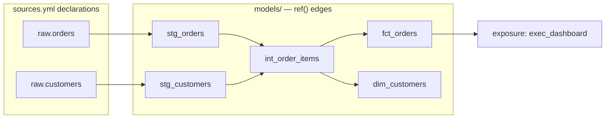
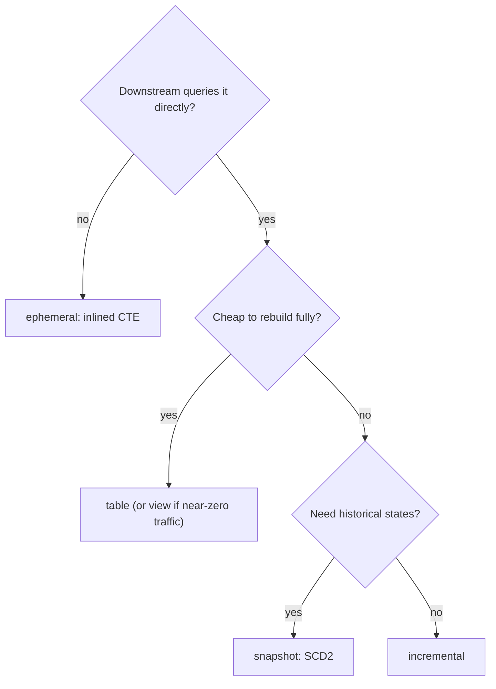
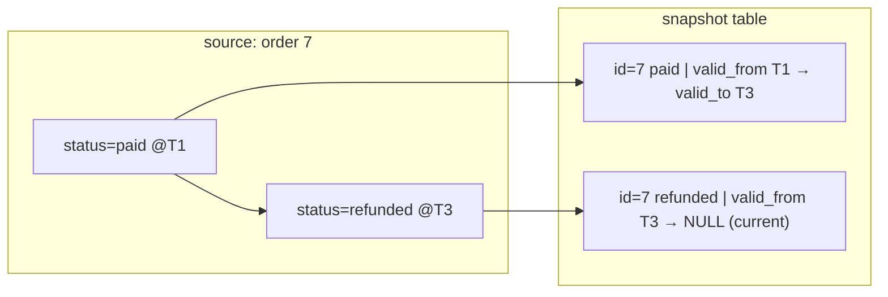
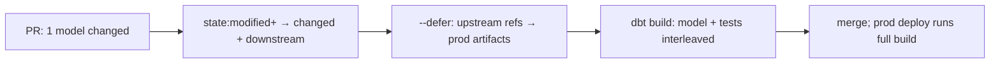

# dbt in Depth

> **Why it matters** — dbt won analytics transformation because it took the one thing every warehouse team was doing badly — hand-rolled SQL with cron, no tests, no lineage — and gave it a compiler: declare dependencies with <span v-pre>`{{ ref() }}`</span>, get a DAG, idempotent runs, tests, and docs for free. It owns the "T" in ELT for the same reason Terraform owns infra: the declarative model beats the imperative script at team scale. Senior interviews probe whether you understand *what the compiler is doing* — materialization trade-offs, incremental mechanics, snapshot internals — not whether you can write a <span v-pre>`{{ config() }}`</span> block.

## What dbt is (and is not)

dbt is a **compiler + runner + test framework** for in-warehouse transformation:

- **Compiler** — turns <span v-pre>`{{ ref('model') }}`</span>, <span v-pre>`{{ source() }}`</span>, macros, and configs into plain SQL plus a dependency graph (the *manifest*).
- **Runner** — walks the DAG topologically, issues DDL/DML to your warehouse, and picks a write strategy per model (the *materialization*).
- **Test framework** — generic tests (declarative assertions on columns) and singular tests (arbitrary SQL that must return zero rows).

It is **not** an orchestrator — it has no scheduler, no cross-system awareness, no ingestion. Airflow/Dagster trigger it; see [Orchestration](/dataops/orchestration) for how the two divide work.

## The ref graph: how dbt compiles

Everything hangs off `ref` and `source`:

- <span v-pre>`{{ source('raw', 'orders') }}`</span> — declares an upstream table dbt does *not* manage (landing-zone data). Gives you lineage, freshness checks, and one place to rename a physical table.
- <span v-pre>`{{ ref('stg_orders') }}`</span> — declares a dependency on another dbt model. This edge is what builds the DAG.



At `dbt compile` (or any run), dbt renders all Jinja, resolves every ref/source to a physical `database.schema.object`, topologically sorts the graph into the manifest, and runs nodes level by level. Rules that follow:

- **No ref to a physical table name.** Writing `from prod.raw.orders` inside a model breaks lineage, breaks environment overrides (dev schema vs prod), and defeats `--defer`.
- **Models are files; the DAG is derived.** You never declare "run A before B" — the ref edges do it. Circular refs are a compile error, which is the feature.
- **`dbt ls --select`/`dbt docs`/`manifest.json`** all read the same graph. Anything the orchestrator needs to know about intra-warehouse deps is in that manifest — parse it, don't re-derive it.

## Materializations

The single most-asked trade-off. Cost = warehouse compute at build time vs at query time.

| Materialization | What dbt does | Build cost | Query cost | When it wins |
|---|---|---|---|---|
| `view` | `CREATE OR REPLACE VIEW` each run | ~Zero | Full recompute every query | Cheap, always-current logic; staging layers; low-query-volume marts |
| `table` | Drop + rebuild the whole table each run | Full scan + write, every run | Fast — plain table | Small dims/marts where full rebuild is minutes, not money |
| `incremental` | First run: full build. Later runs: transform/insert only new-or-changed rows | Proportional to the batch | Fast | Large append-mostly facts; the workhorse |
| `ephemeral` | No object — model is inlined as a CTE into every downstream ref | Zero (folded into consumers) | Recomputed per consumer | Tiny intermediate reshaping; never for anything queried directly or reused by 3+ models |
| `snapshot` | Maintains an SCD2 history table via `dbt_valid_from`/`dbt_valid_to` | Diff-only, but full-table scan of source | Fast | Slowly-changing dims needing point-in-time history |



:::: tip 💡 Default ladder
Staging views → intermediate ephemeral → marts incremental or table. Deviating from that ladder is fine, but have a reason — "views are easy" collapses when 40 dashboards each recompute a 500M-row fact.
::::

## Incremental models

Incremental is where interviews go deep, because it's where production bills and subtle bugs live.

```sql
{{ config(materialized='incremental', unique_key='order_id',
          incremental_strategy='merge',
          partition_by={'field': 'order_date', 'data_type': 'date'}) }}

select * from {{ ref('stg_orders') }}

  where order_date >= (select max(order_date) from {{ this }})

```

<span v-pre>`{{ this }}`</span> = the existing target relation; `is_incremental()` is false on first run and on `--full-refresh`.

### unique_key semantics

`unique_key` tells merge-type strategies which existing rows to update. Get it right or you get duplicates:

- A row whose key matches → updated in place; no match → inserted. Rerunning the same batch is a no-op — **this is what makes incremental idempotent**.
- `NULL` keys never join to anything → every run re-inserts them. Silent duplicate growth. Test `not_null` + `unique` on the key in staging.
- Composite keys: a list (`unique_key: ['order_id', 'line_no']`) or an expression — but make sure the expression is deterministic and cheap, it runs in the join predicate.

### Strategies compared

| Strategy | How it writes | Adapter support | Cost profile | Watch out for |
|---|---|---|---|---|
| `merge` | `MERGE ... WHEN MATCHED UPDATE` | Snowflake, Databricks, BigQuery (non-partitioned or legacy) | Row-by-row compare; can cost more than a rebuild on wide tables | MERGE scans the whole target side of the join — late-arriving lookbacks multiply it |
| `insert_overwrite` | Replaces entire partitions touched by the batch | BigQuery (partitioned), Spark, Databricks, Trino, some others | Partition-level swap — cheapest for partitioned append-mostly facts | Mints/replaces whole partitions: if your batch selects partition X, all of X is rewritten — make the batch match the partition grain |
| `delete+insert` | `DELETE WHERE key IN (batch)` then `INSERT` | Postgres-family, adapters without MERGE | Two passes; transactional on ACID stores | The delete can remove rows the select then fails to re-insert — keep the batch deterministic |
| `append` | Blind `INSERT` | Most | Cheapest | Not idempotent — reruns duplicate. Almost never what you want |

:::: info ℹ️ microbatch: incremental in dbt 1.9+
The `microbatch` strategy (dbt Core 1.9+, dbt Cloud "Latest") reframes incremental as *event-time batching*: set `event_time` on the model and its upstream inputs, choose `batch_size` (hour/day/month), and dbt issues one filtered sub-query per batch in a single invocation — including for backfills (`--event-time-start/--event-time-end`). It composes with the same write strategies underneath, and makes "reprocess last Tuesday only" a flag instead of a hand-written lookback. It is *not* streaming — it's still batch, just self-partitioning.
::::

### Late-arriving data and lookback

A filter on `max(order_date)` only works if data never arrives late. In reality facts land days late (late events, CDC replays, timezone skew):

- **Fixed lookback window** — overlap deliberately: <span v-pre>`where order_date >= dateadd(day, -3, (select max(order_date) from {{ this }}))`</span>. Merge/`insert_overwrite` rewrites those partitions; idempotent, costs 3 days of recompute.
- **`incremental_predicates`** — narrow the merge join to recent partitions so the lookback doesn't scan history.
- **Full-refresh cadence** — for truly mutable sources, no lookback saves you; schedule a weekly `--full-refresh` or use a snapshot instead (next section).

:::: warning ⚠️ When incremental costs more than full refresh
MERGE joins the batch against the *whole target table*. Once your model is wide and the batch is large, a daily merge over a 2B-row table can out-cost a full rebuild. Measure: if `bytes_billed` for the merge ≈ full table scan, switch to `insert_overwrite` (partition swap is nearly free) or accept a table materialization.
::::

## Snapshots: SCD2 done for you

Snapshots answer "what did this dimension look like *as of* March 3?" — something incremental models fundamentally cannot, because incremental merges the *latest* state and snapshots *append history*.

```sql

{{ config(strategy='timestamp', unique_key='order_id',
          updated_at='updated_at') }}
select * from {{ source('raw', 'orders') }}

```

### Strategies

- **`timestamp`** — compares source `updated_at` to the snapshot's `dbt_valid_from`; changed rows get closed and re-inserted. Requires a trustworthy `updated_at` — a column that is set-on-insert-and-never-touched misses every update silently.
- **`check`** — diffs `check_cols` (list or `'all'`) between source and snapshot each run. No timestamp needed, at the cost of comparing every listed column every run. Correct for sources with unreliable or absent update timestamps.

### The generated columns

| Column | Meaning |
|---|---|
| `dbt_valid_from` | When this version became true |
| `dbt_valid_to` | When it stopped being true; `NULL` = current row |
| `dbt_scd_id` | Surrogate key for the version row (survives same-timestamp ties) |
| `dbt_updated_at` | When the snapshot run processed the change |



Point-in-time query: `where :asof >= dbt_valid_from and (:asof < dbt_valid_to or dbt_valid_to is null)` — the same hand-rolled SCD2 pattern in [Analytics SQL Patterns](/sql/analytics-patterns), except dbt maintains it.

:::: warning ⚠️ Snapshot ≠ incremental
An incremental model with `unique_key` keeps *one* current row per key — history is destroyed. A snapshot keeps *every* version — current state is derived (`dbt_valid_to is null`). Running a snapshot on a fast-mutating source without thinking about `check_cols` also fails the other way: you snapshot noise (e.g. `last_login_at`) and balloon the table with meaningless versions.
::::

## Sources, refs, and tests

### Generic vs singular tests

| | Generic | Singular |
|---|---|---|
| Shape | Parameterized macro on a column/model in YAML | A `.sql` file in `tests/` that must return **zero rows** |
| Examples | `unique`, `not_null`, `accepted_values`, `relationships`, `dbt_utils.expression_is_true`, `dbt_expectations.*` | "orders with status=shipped have a shipped_at", "no negative revenue after the refunds join" |
| When | Column-level invariants; reuse across the project | Business rules that span joins/window logic — one test per rule |

A test is just a compiled query; `severity: warn` keeps the build green while paging you, `store_failures` persists failing rows for triage. See [Data Quality & Contracts](/dataops/quality) for where these sit in the wider quality stack.

### Source freshness

`sources.yml` carries `freshness: { warn_after: {count: 24, period: hour} }` + `loaded_at_field`. `dbt source freshness` compares the max loaded timestamp to now. This is the cheapest high-ROI alert in the stack — most real incidents are "data stopped arriving," and freshness catches it before stakeholders do.

## Model contracts and governance

- **Enforced contracts** — `contract: { enforced: true }` makes dbt build the table with *exactly* the declared columns, names, and types; a model emitting an extra column fails the build. This is the producer-side half of a data contract.
- **Constraints** — `not_null`, `primary_key`, `foreign_key`, `unique`, `check` declared on columns; enforcement level is platform-dependent (Snowflake/Databricks enforce some, BigQuery uses them for join elimination, others are doc-only). They always document intent.
- **Groups & access** — `group:` assigns ownership; `access: private` restricts a model to same-group refs, `protected` to same-project, `public` to anyone (required for cross-project refs).
- **Exposures** — declare downstream dashboards/apps/notebooks so lineage doesn't dead-end at the last table. `dbt build --select +exposure:dashboard_x` builds everything a dashboard needs.

:::: tip 💡 Contracts first, then Mesh
Enforced contracts are a prerequisite for sane multi-project work — a cross-project consumer can only trust a public model if its shape can't silently change. Add `contract: enforced` to any model another team touches.
::::

## dbt Mesh vs the monorepo

The classic scaling question: one repo, or many?

| | Monorepo | dbt Mesh (multi-project) |
|---|---|---|
| Structure | All models, all teams, one DAG | Multiple dbt projects, each owned, connected via cross-project refs |
| Coupling | Any PR can touch the shared DAG; CI time grows with project size | Projects deploy independently; contracts are the seam |
| Lineage | Trivially complete | Complete *across* projects via public-model refs |
| Governance | Convention + codeowners | Enforced: `access` levels, groups, contracts |
| Fit | < ~1k models, one platform team | Multiple domains/teams shipping on different cadences |

- **Packages** (what came before Mesh) share *code* — macros and models you vendor in via `packages.yml`, like a dependency. The dbt-utils package is the canonical example. Packages are for reuse, not ownership boundaries.
- **Projects** (Mesh) share *models as APIs*: repo B does <span v-pre>`{{ ref('project_a', 'fct_orders') }}`</span> (two-argument ref) against a `public` model, gets lineage + contract guarantees, and project A owns the deploy.

:::: info ℹ️ Pick by coupling, not repo count
If every release still needs all projects deployed together, you have a distributed monorepo — the worst of both. Mesh pays off when teams genuinely own separate domains and can break the shared-DAG bottleneck.
::::

## Execution: build, test, and slim CI

- **`dbt run`** — models only, in DAG order. **`dbt test`** — tests only. **`dbt snapshot`** — snapshots only.
- **`dbt build`** — models, tests, seeds, snapshots interleaved in DAG order: a model's tests run *before* its downstream models build. This is the production default — a failed test blocks downstream propagation instead of discovering it an hour later.
- **Selectors** — `+model` (upstream), `model+` (downstream), `tag:`, `path:`, `state:`, `result:fail`, `source_status:fresher+`. Selection is graph surgery; learn the `+` operators cold.
- **Slim CI** — `dbt build --select state:modified+ --defer --state s3://prod-artifacts`: build only changed models *and their downstream*, resolving unbuilt upstream refs to the prod manifest's tables. Turns a 45-minute full build on every PR into a 4-minute targeted one.
- **`--defer` / `--favor-state`** — defer points refs for nodes *not* being built at the state manifest's relations; favor-state prefers prod artifacts even for nodes that exist in the CI schema.



## Anti-patterns

| Anti-pattern | Why it hurts | Fix |
|---|---|---|
| God-model | One 800-line model joins 12 sources; every change risks every metric; impossible to test | Split staging → intermediate → marts; one join/reason per layer |
| `--full-refresh` in prod as habit | Rebuilds history daily; hours of compute, dashboard gaps mid-run | Incremental with a real unique_key + lookback; full-refresh only on schema/logic breaks |
| Snapshot on a mutable source with no strategy thought | `timestamp` on a non-updated source silently misses changes; `check_cols: all` on a wide noisy table versions on every cosmetic diff | Match strategy to source behavior; choose `check_cols` deliberately |
| `ref()` a raw table / hardcode `db.schema.table` | Breaks lineage, defer, env overrides | `source()` for unmanaged, `ref()` for managed, never literals |
| Business logic in macros/Jinja soup | SQL becomes undebuggable codegen; reviewers can't see the shipped query | Macros for reuse, not cleverness; if the compiled SQL surprises, simplify |
| Ephemeral for shared logic | Inlined CTE recomputed by every consumer; a `ref()` to it from 5 models runs it 5× | Materialize it — view at minimum |
| Tests only on gold | Bad staging data propagates to every downstream model before anyone notices | Test at layer boundaries: staging not_null/unique, marts business rules |
| One `dbt run` task, no tests in prod | Green DAG, garbage data | `dbt build` so test failures block propagation |

## 🧠 Quiz

<QuizCard :questions="[{ q: 'A BigQuery incremental fact model costs more per merge run than recomputing the table daily. The usual fix is:', options: ['Use insert_overwrite with partition_by on the model', 'Convert the model into an SCD2 snapshot of the source', 'Switch the model to a view materialization to cut rebuild cost', 'Add more generic tests so bad rows get caught earlier'], correct: 0, explain: 'insert_overwrite swaps only the partitions present in the batch — partition-level writes are far cheaper than a row-by-row MERGE against the whole target table.' }, { q: 'A model sets unique_key: user_id, but the source sometimes emits NULL user_id rows. What happens on merge?', options: ['dbt automatically filters out NULL-key rows before the merge step', 'The run fails immediately with a unique constraint violation', 'NULL keys never match, so each run re-inserts them — duplicate growth', 'The merge treats NULL keys as equal and dedupes them per run'], correct: 2, explain: 'NULL never equals NULL in a join predicate, so merge sees each NULL-key row as new. The fix is a not_null test plus filtering at the staging layer.' }, { q: 'A snapshot must track history for a source with no reliable updated_at column. Which configuration works?', options: ['strategy: check with check_cols: all to diff the row contents', 'An incremental model with unique_key gives the same history', 'strategy: check is impossible to use without an updated_at column', 'strategy: timestamp with a synthetic updated_at default of now()'], correct: 0, explain: 'check diffs the listed columns between source and snapshot — no timestamp needed. timestamp on an unreliable updated_at silently misses changed rows, which is worse than no snapshot.' }, { q: 'dbt build differs from dbt run followed by dbt test because:', options: ['build runs models in parallel while test always runs serially', 'build skips snapshots and seeds entirely to keep runs fast', 'build interleaves models and tests so a failed test blocks downstream', 'build only executes tests and skips model materialization'], correct: 2, explain: 'build walks one unified graph: model, then its tests, then downstream models only if tests pass. run-then-test builds downstream on data that fails its test afterward.' }, { q: 'A PR touches one model in a 400-model project. Slim CI should run:', options: ['dbt test --select tag:daily against the production schema', 'dbt build with no selectors at all so nothing gets missed', 'dbt run --full-refresh across the entire project graph', 'dbt build --select state:modified+ --defer --state prod-artifacts'], correct: 3, explain: 'state:modified+ selects the changed model plus downstream dependents; --defer resolves unbuilt upstream refs against prod artifacts. Full builds per PR waste compute and review time.' }, { q: 'Two teams share a warehouse but own separate repos. Team B needs team A model. The dbt-native pattern is:', options: ['Copy the model SQL into repo B and keep both copies updated by hand', 'Reference a public model via two-argument ref across Mesh projects', 'Snapshot the output of repo A inside repo B on a nightly run', 'Ask team A to expose a view and hardcode its full database name'], correct: 1, explain: 'Mesh lets repo B ref a public model in project A — cross-project lineage and enforced contracts without a monorepo. Hardcoded names and copied SQL both break lineage and drift.' }]"/>

## Further reading

- [dbt docs — incremental models](https://docs.getdbt.com/docs/build/incremental-models)
- [dbt docs — incremental strategies](https://docs.getdbt.com/docs/build/incremental-strategy)
- [dbt docs — snapshots](https://docs.getdbt.com/docs/build/snapshots)
- [dbt docs — model contracts](https://docs.getdbt.com/docs/mesh/govern/model-contracts)
- [dbt docs — dbt Mesh](https://docs.getdbt.com/best-practices/how-we-mesh/mesh-1-intro)
- [dbt docs — state selection & deferral for CI](https://docs.getdbt.com/reference/node-selection/syntax)
- [dbt docs — tests](https://docs.getdbt.com/docs/build/data-tests)
