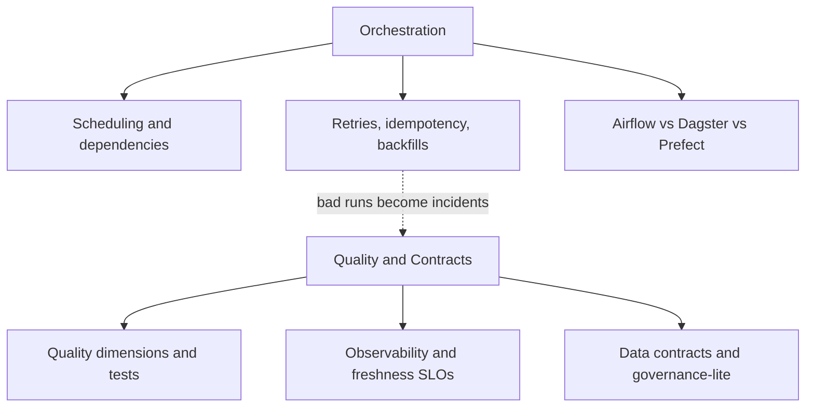
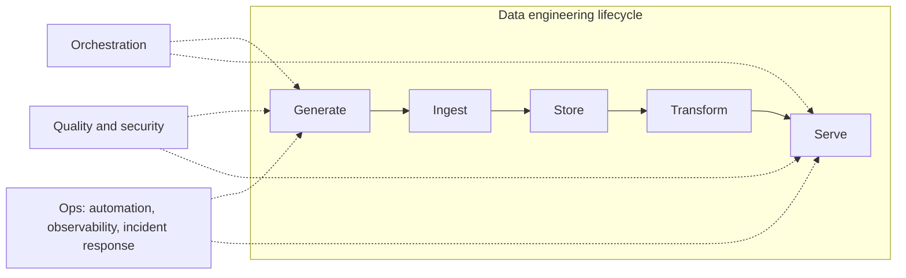

# DataOps & Orchestration

> **Why it matters** — A pipeline that works on your laptop is a script; a pipeline that survives a 3am partial outage, backfills three months without double-loading, and tells downstream consumers *before* they notice stale data is a system. This track is the difference.

**Who this is for:** data engineers who can already build pipelines and want to run them reliably in production — and pass the senior-interview questions about orchestration trade-offs and data quality frameworks.

## Chapters

**[Orchestration](/dataops/orchestration)** — Why schedulers earn their keep: dependency graphs, retries, observability, and backfills that don't double-load. Airflow's architecture and mental model (DAGs, operators, sensors, `data_interval`, catchup), deferrable operators, dynamic DAGs, and the anti-patterns that get you paged. Then the honest comparison: when Dagster's asset-first model beats Airflow's task graphs, where Prefect fits, how dbt slots in, and how to ship DAG changes through CI/CD without breaking prod.

**[Transformation, Quality & Contracts](/dataops/quality)** — Data quality as an engineering discipline, not a vibe. The six quality dimensions and where each gets enforced; dbt tests vs Great Expectations vs anomaly monitoring; lineage and freshness SLOs; data contracts that put enforcement on the producer side; incident management for data; and governance-lite — catalog, ownership, PII tiers — the 20% that gets you 80% of compliance.

## Pareto focus

The ideas in this track that matter most in real systems and interviews:

- **Idempotency is the whole game.** A task that can rerun and re-produce the same partition output unlocks retries, backfills, and painless incident recovery.
- **Data interval ≠ run time.** Airflow schedules the *end* of an interval, not the start. Misreading this is the #1 source of "why is my DAG a day behind" bugs.
- **Sensors are polling; defer them or pay for the slot.** Deferrable operators free worker slots while waiting on external state.
- **Assets over tasks.** Declaring *what should exist* (Dagster) gives lineage, backfills, and freshness for free where tasks only give you logs.
- **Quality gates belong between layers, not at the end.** Quarantine bronze, enforce on silver, publish gold — catching bad data downstream of a dashboard is a postmortem, not a check.
- **A contract is a schema plus an SLA plus an owner.** Enforcement belongs at the producer; consumer-side checks are the safety net.

## DataOps is an undercurrent, not a stage

The data engineering lifecycle — generate, ingest, store, transform, serve — reads like a pipeline, but the disciplines in this track aren't a box in that pipeline. Reis & Housley call them *undercurrents*: security, data management, DataOps, data architecture, orchestration, and software engineering run underneath *every* stage simultaneously. A quality check isn't a step after transform; it's a property each stage must carry.

The book's three pillars of DataOps map cleanly onto this track:

| Pillar | What it is | Where you see it here |
|--------|-----------|----------------------|
| **Automation** | Version control, CI/CD, config-as-code for pipelines — so a bad DAG can't be hand-deployed at 5pm on Friday | Orchestration: DAG deploy pipelines, `dbt build` gating |
| **Observability & monitoring** | Bad data is a silent killer — it sits in reports for months while executives decide on it. Watch freshness, volume, schema, and drift | Quality: freshness SLOs, lineage, anomaly monitoring |
| **Incident response** | Systems *will* break. The job is root-causing fast and telling consumers before they notice | Blameless postmortems, proactive comms, backfill runbooks |

::: tip 💡 Senior insight — the order matters
Retrofitting DataOps onto an existing mess? The book's sequence: **observability first** (you can't fix what you can't see), then **automation** (stop hand-deploying), then **incident response** (formalize the response loop). Reversing it — writing runbooks for failures you can't detect — is how teams end up with wikis nobody reads.
:::

## What DataOps maturity actually looks like

The book traces a familiar trajectory: cron jobs on a box → jobs collide and nobody notices until analysts complain → an orchestrator arrives → a bad hand-deployed DAG takes down the webserver → deployments get automated. Where you are on that ladder predicts your failure modes:

| Org size | Typical setup | What breaks | The maturity move |
|----------|--------------|-------------|-------------------|
| **~1 data person** | Cron + scripts, one-off reports, generalist wears all hats | Silent failures, nobody notices stale data for weeks; the laptop *is* prod | Just get observability — a stale-table alert beats a perfect orchestrator you don't have time to run. Avoid undifferentiated heavy lifting; buy managed, don't self-host Airflow |
| **~5 data people** | Orchestrator adopted, dbt in place, still hand-deploying DAGs | Job collisions, deploys breaking prod, splinter teams forming when trust erodes | Automate deployment: CI-tested DAGs, `dbt build` gates between layers, named ownership per domain |
| **~50 data people** | Platform team, federated domains, contracts between teams | Cross-team breakage at scale; one domain's schema change silently corrupts another's model | Contracts + SLOs as organizational APIs: producers enforce schemas, freshness SLOs are negotiated, incident response spans teams |

::: warning ⚠️ Trust is the real SLO
The book's warning: when stakeholders find stale or wrong data *before* the data team does, they don't just lose trust — they spin up shadow systems and splinter teams, and now you have inconsistent numbers *and* more systems to support. Telling consumers "we know, we're on it" before they notice is worth more than most tests.
:::

## Suggested reading order

Work this track front to back: **orchestration** gives you the machinery that runs the lifecycle, **dbt** gives you the transform layer where most gates live, and **quality & contracts** gives you what to enforce and how to respond when it fires. Skipping to quality without orchestration is writing checks your scheduler can't cash.

## 🧠 Quiz

<QuizCard :questions="[{ q: 'A team wants to add DataOps practices to a legacy pipeline estate they barely understand. What should they build first?', options: ['Observability and monitoring', 'A formal incident-response runbook', 'Automated CI/CD for DAG deploys', 'Data contracts between producers and consumers'], correct: 0, explain: 'Observability first — you cannot automate or respond to failures you cannot see. Automation second, incident response third.' }, { q: 'Under Reis & Housley’s undercurrent model, where do orchestration and data quality sit in the lifecycle?', options: ['As the final stage after serving data', 'As undercurrents beneath every stage from generation to serving', 'Only in the transform stage', 'As a separate lifecycle that runs weekly'], correct: 1, explain: 'They are undercurrents — cross-cutting disciplines that apply at every stage, not a step you pass through once.' }, { q: 'Stakeholders report a dashboard has been stale for days before the data team noticed. Beyond the missed SLA, what is the bigger risk the book warns about?', options: ['The warehouse bill increases', 'The orchestrator will backfill automatically', 'The dashboard will be deprecated', 'Stakeholders lose trust and spin up shadow teams and splinter systems'], correct: 3, explain: 'Undetected bad data erodes trust; teams respond by building their own pipelines, multiplying inconsistency and systems to support.' }]" />

## Further reading

- **Fundamentals of Data Engineering** — Joe Reis & Matt Housley (2022), [O'Reilly](https://www.oreilly.com/library/view/fundamentals-of-data/9781098108298/) — Chapters 1–2 on the lifecycle, undercurrents, and data maturity.
