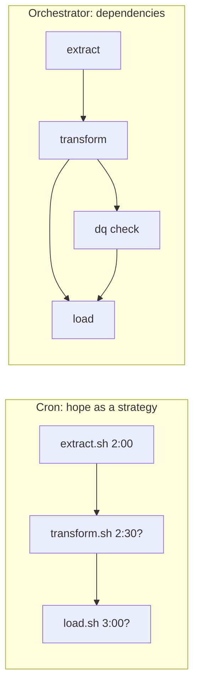
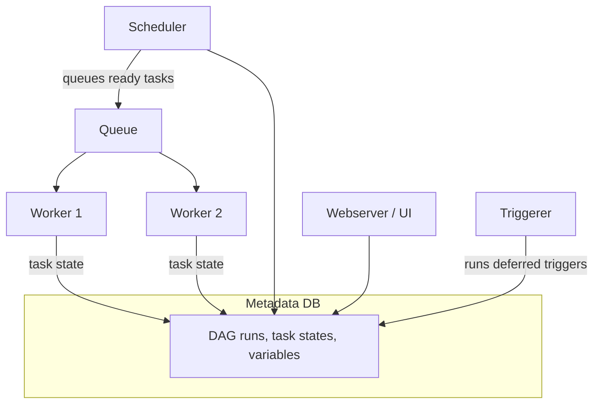
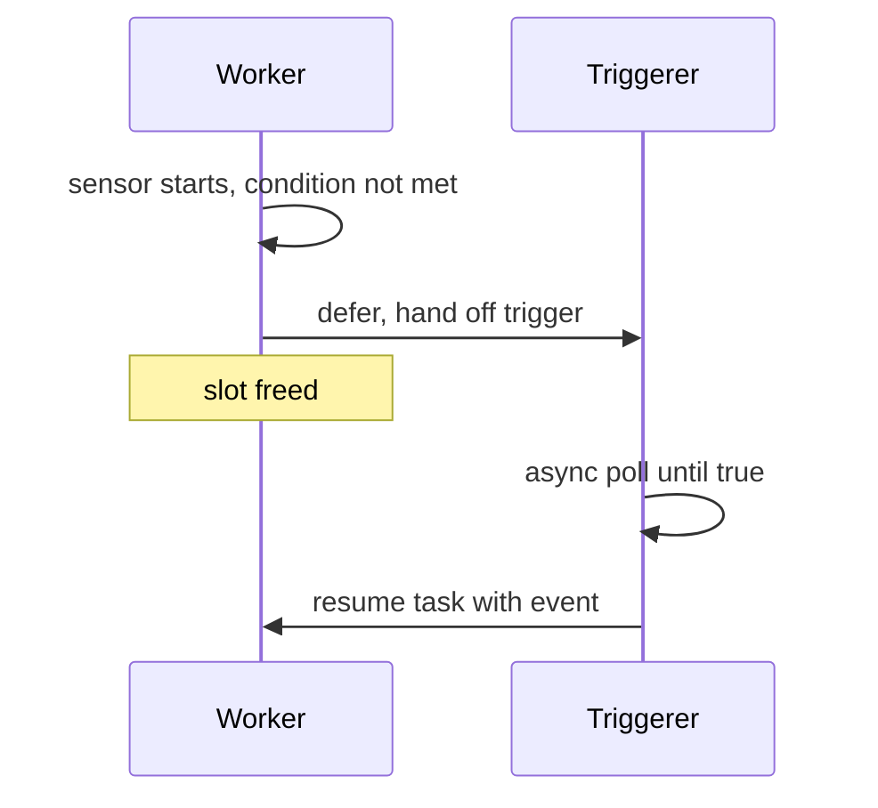
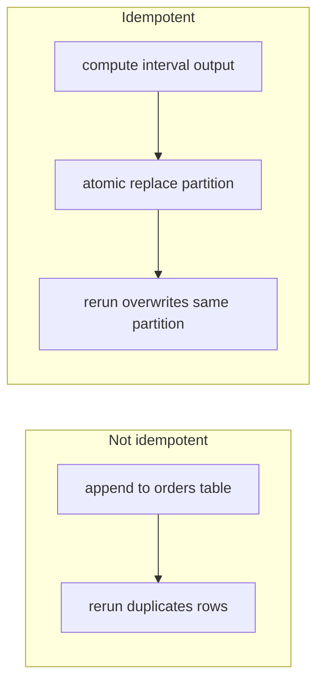
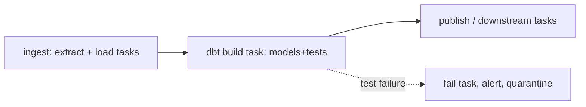
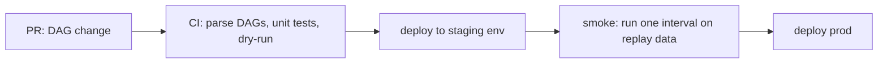

# Orchestration

> **Why it matters** — Every production pipeline eventually fails halfway: an API times out, a partition is late, a deploy wedges mid-run. An orchestrator is what turns "a script that crashed" into "a DAG run that retried, skipped what's already done, and paged someone only if it actually mattered." Skip the orchestrator and you will reinvent one badly — in cron, in a Makefile, or in your head at 3am.

## Why orchestrators exist

A scheduler runs things on a clock. An orchestrator runs things when their *dependencies* are satisfied, retries them when they flake, and tells you what happened. The four jobs:

1. **Dependencies** — `fact_orders` runs only after `stg_orders` *and* `dim_customers` succeed. Expressing this in cron is a pile of `sleep` and hope.
2. **Retries and recovery** — transient failures (network blip, warehouse slot contention) retry with backoff automatically.
3. **Observability** — one place answering: what ran, when, how long, did it succeed, what data did it produce.
4. **Backfills** — "re-run January through March with the fixed logic" is a first-class operation, not a shell loop.



::: warning ⚠️ Cron's failure mode is silent overlap
Cron doesn't know if the previous run finished. A slow extract that overruns its window starts a second extract on top of the first — two writers, one partition, corrupted output. Orchestrators serialize runs and make "previous run still going" a visible state, not a surprise.
:::

## Airflow core concepts

Airflow is still the industry default — most data platforms either run it or run a managed variant (Composer, MWAA, Astronomer). Know the model cold; it comes up in every senior interview.

### The mental model



- **Scheduler** — parses DAG files continuously, decides which task instances are runnable (deps met, pool slots free), queues them. Stateless-ish; the metadata DB is the truth.
- **Executor / workers** — actually run task code. `LocalExecutor` for small shops; `CeleryExecutor` or `KubernetesExecutor` (one pod per task) at scale.
- **Metadata DB** — Postgres/MySQL holding DAG runs, task instance states, XComs, connections. If it dies, Airflow dies — size it like a production database, because it is one.
- **Triggerer** — runs asyncio *triggers* for deferred tasks (below). Airflow 2.2+.

### DAGs, tasks, operators, sensors

- **DAG** — a Python file that, when executed at *parse time*, builds a graph of task objects. Top-level code runs on every scheduler parse (~every 30s) — keep it free of API calls, heavy imports, and `Variable.get` in loops.
- **Operator** — the task template: `PythonOperator`, `BashOperator`, `KubernetesPodOperator`, provider operators (`BigQueryInsertJobOperator`, `S3ToRedshiftOperator`...). TaskFlow (`@task`) is the modern Pythonic style.
- **Sensor** — an operator that polls until a condition holds: file landed, partition exists, upstream DAG finished (`ExternalTaskSensor`). A sensor occupies a worker slot while polling.
- **Schedule** — `schedule=` accepts cron, presets, timedelta, datasets (data-aware scheduling), or a custom `Timetable`.

```python
from airflow.decorators import dag, task
from airflow.providers.standard.operators.empty import EmptyOperator
import pendulum

@dag(schedule="@daily", start_date=pendulum.datetime(2025, 1, 1, tz="UTC"),
     catchup=False, tags=["orders"])
def orders_pipeline():
    @task
    def extract(data_interval_start=None, data_interval_end=None):
        # write to dt={{ data_interval_start }} partition
        ...

    @task
    def load(extract_path: str):
        ...

    load(extract())

orders_pipeline()
```

::: tip 💡 Keep DAG top-level code cheap
The scheduler re-parses every DAG file roughly every 30 seconds. A `requests.get()` at module level executes thousands of times a day against your API — and a slow one stalls *all* DAG parsing. Put external calls inside tasks or in `execute` of custom operators.
:::

### data_interval: the concept everyone gets wrong once

A daily-scheduled run for **January 15** has `data_interval_start = Jan 15 00:00` and `data_interval_end = Jan 16 00:00` — and it *starts executing* on Jan 16 (at interval close). `logical_date` = `data_interval_start`. Consequences:

- "Run for yesterday" is the normal case, not a backfill.
- `@hourly` run stamped 14:00 is processing the 13:00–14:00 window.
- Use <span v-pre>`{{ data_interval_start }}` / `{{ ds }}`</span> to name output partitions — never `datetime.now()`. `now()` differs on every retry; the interval doesn't.

::: details What changed in Airflow 3
`execution_date` is gone; `logical_date` is the name. Asset-based scheduling (`Dataset` → `Asset`) is promoted to first-class, `catchup` defaults changed toward scheduler-managed backfills, and the old `--conf` backfill CLI became a proper `airflow backfill` command. If you're on Airflow 2.x, everything above still applies — 3.x mostly renames and tidies.
:::

### Template context variables reference

Variables available inside templated fields (`bash_command`, `op_kwargs`, `sql`, `templates_dict`):

| Variable | Value | Notes |
|---|---|---|
| `ds` / `ds_nodash` | `logical_date` as `YYYY-MM-DD` / `YYYYMMDD` | The partition-name workhorse |
| `next_ds` / `prev_ds` | Adjacent interval boundaries | <span v-pre>`{{ds}}` → `{{next_ds}}`</span> spans the full window |
| `data_interval_start` / `data_interval_end` | Exact timestamps of the window | Prefer over `ds` for hourly/sub-daily schedules |
| `logical_date` | Start of the data interval | The run's identity — *not* when it executes |
| `ts` | `logical_date` as ISO timestamp | Handy for file naming |
| `dag`, `task`, `task_instance` | Context objects | <span v-pre>`{{ti.xcom_pull(...)}}`</span> in templates |
| `params` | DAG/task `params=` dict, overridable at trigger | <span v-pre>`{{params.lookback_days}}`</span> |
| `dag_run.conf` | Trigger-time config payload | Backfill / manual-run overrides |
| `var.value.*`, `macros.*` | Variables + Jinja macros | <span v-pre>`{{var.value.my_key}}`</span> avoids a parse-time DB round-trip |

:::: tip 💡 Any string attribute can be templated
Templating isn't limited to documented `template_fields` — `templates_dict` on any operator renders arbitrary Jinja into the task context, and `context["templates_dict"]` reads it in Python. Reach for it before hardcoding paths.
::::

### Deferrable operators

A normal sensor holds a worker slot while polling — 200 concurrent `TimeSensor`s = 200 dead workers. A **deferrable** operator instead raises `TaskDeferred`, frees the slot, and lets the triggerer process (asyncio, thousands of concurrent triggers) wait. When the trigger fires, the task resumes on a worker.



Rule of thumb: anything that waits (sensors, long-running external jobs like dbt Cloud runs, EMR steps, BigQuery jobs) should run in `deferrable=True` mode if the provider supports it.

### Sensor modes: poke vs reschedule vs deferrable

| Mode | Worker slot held? | How it waits | Use when |
|---|---|---|---|
| `mode="poke"` (default) | Yes, for the whole wait | Sleeps in-process, wakes to re-check | Short waits (seconds–minutes), cheap condition checks |
| `mode="reschedule"` | Only during each poke | Task exits to `up_for_reschedule`; scheduler re-queues it at the next poke time | Long waits where deferrable isn't available |
| `deferrable=True` | No | Triggerer runs an async trigger; task resumes on a worker when it fires | Long waits, many concurrent sensors; needs the triggerer component |

:::: warning ⚠️ Sensor deadlock snowballs
Two defaults conspire badly: sensor `timeout` defaults to **7 days** and per-DAG concurrency to ~16 tasks. A daily DAG with 4 sensors that never succeed accumulates ~4 stuck tasks per day — by day 6 every slot is a polling sensor and real work starves. Hit the *global* parallelism limit and the entire deployment stalls. Fix: sane `timeout`, `mode="reschedule"` or deferrable for anything that waits, and `poke_interval` that matches how fast the condition can actually change.
::::

### Static vs dynamic DAGs

| Pattern | What it is | When to use |
|---|---|---|
| Static DAG | Graph shape fixed in code | Default; predictable, reviewable |
| Dynamic task mapping | `expand()` / `map()` — one task def fans out into N mapped instances at runtime | Per-file/per-tenant fan-out where N isn't known at parse time |
| Dynamically generated DAGs | A loop or `dag_factory` emitting DAG objects from config | Multi-tenant stamping of the same pipeline; keep generation pure config, no I/O |

::: warning ⚠️ Config-driven DAGs hide blast radius
A YAML file that generates 50 DAGs means one bad config line breaks 50 pipelines at once — and the failure shows up as "DAG missing," not an error. Validate generator config in CI (parse the DAGs, assert expected DAG IDs exist) before deploying.
:::

The book's factory pattern: a `generate_dag(config)` function returns a `DAG`, and a loop over a config registry stamps one per entry — `globals()[dag_id] = generate_dag(...)`. Keep the config file (YAML checked into the repo) the single source of truth: it's a local file read at parse time, which is fine — an API call is not. Wrap generated task sets in `TaskGroup`s so the stamped DAGs stay readable in the UI, and keep generated-DAG-per-file setups rare: one bad config line is a fleet-wide outage.

## Idempotent task design

Idempotent = rerunning a task for the same data interval produces the same result, no duplicates, no double effects. This is the single most valuable property a pipeline can have: it makes retries free, backfills safe, and incident recovery boring.



Patterns that work:

- **Partition-replace writes** — `INSERT OVERWRITE PARTITION dt=...`, `MERGE` on natural key, or write-then-swap. The write scope must match the data interval exactly.
- **Deterministic naming** — output paths/keys derived from `data_interval`, never from wall-clock time or run IDs (unless you intentionally want append-only raw).
- **Upsert, not append** — for mutable targets, key the write so reprocessing replaces rather than adds.
- **Cleanup before write, or atomic commit** — "delete the day's rows, then insert" is idempotent but leaves a gap if it fails mid-way; prefer partition swap / transaction / Iceberg-style snapshot commit.


**Atomicity is the partner property.** An atomic task either completes fully or leaves no trace — never half-written output that downstream mistakes for success. This defines task boundaries: one task = one coherent unit of work. Splitting *too* far backfires — an "fetch auth token" task whose output feeds the next task creates a hidden ordering dependency (and stale tokens on retry). Keep tightly-coupled steps (authenticate → call API) inside one task; split at natural side-effect boundaries (compute → email report), so a flaky notification doesn't re-run the real work.

::: tip 💡 The re-run test
Ask of every task: "If this runs twice for the same interval, is the table identical?" If the answer requires cleanup steps or careful ordering, it's not idempotent — fix the write pattern, not the runbook.
:::

## Backfills & catchup

- **Catchup** — if a DAG's `start_date` is in the past and `catchup=True`, the scheduler creates runs for every missed interval since. Classic footgun: you copy a DAG, bump `start_date`, deploy, and it launches 400 parallel runs that hammer your warehouse. Default to `catchup=False`; backfill deliberately.
- **Backfill** — explicitly create DAG runs for a historical range (`airflow dags backfill` / the UI form). Backfills are only safe because tasks are idempotent — that's why the property matters.
- **`depends_on_past=True`** — a task waits for its own previous-interval run to succeed. Use for rolling windows ("compute 7-day aggregates") where a gap corrupts all later output. Costs you parallelism during backfills — the range processes serially.
- **Throttle backfills** — cap `max_active_runs` / `max_active_tasks` or backfill in chunks; a quarter of data reprocessed at full parallelism is a warehouse bill and a rate-limit incident in one.

**Worked example** — deploy a `@daily` DAG with `start_date=Jan 1, catchup=True` on **Feb 1**: the scheduler immediately creates 31 DAG runs, one per missed interval. Each run gets its own `data_interval` (Jan 1→2, Jan 2→3, … Jan 31→Feb 1), so a well-written task just processes its window — no special "backfill mode" exists or is needed. The backfill *is* normal scheduling, replayed — which is precisely why idempotent, interval-derived outputs are non-negotiable.

:::: tip 💡 Backfill is bounded by the source
Reprocessing after a code fix (clear the past task instances, let them re-run) works because the data already landed. Backfilling *new* extraction only reaches as far back as the source retains history — an API with 30 days of history cannot fill last year regardless of `start_date`.
::::

## Branching & trigger rules

`BranchPythonOperator` picks which downstream branch(es) to run and **skips the rest** — and skips propagate: a join task with the default `all_success` rule downstream of a branch never runs, because an unchosen parent is `skipped`, not `success`. Two clean fixes: set `trigger_rule="none_failed"` on the join, or insert an `EmptyOperator` "branch-join" task so the branch is self-contained and downstream tasks keep their default rules.

| Trigger rule | Runs when | Use it for |
|---|---|---|
| `all_success` (default) | All parents succeeded | Normal flow |
| `none_failed` | All parents finished, none failed (skips OK) | Joining branches |
| `all_done` | All parents finished, any state | Cleanup — stop cluster, release resources |
| `one_failed` | First parent failure, without waiting for the rest | Fast alerting / rollback |
| `one_success` | First parent success | Race sources; act on earliest result |
| `all_failed` | All parents failed / upstream_failed | Dead-man handling when success was expected |
| `none_skipped` | No parent skipped (success *or* failed) | "Did everything actually run?" gates |

Conditional execution without branching: `LatestOnlyOperator` skips downstream on every run except the most recent interval — put it in front of deploy/publish steps so a 90-day backfill doesn't ship 90 stale model versions. For custom conditions, raise `AirflowSkipException` in a Python task; downstream `all_success` propagates the skip.

## Passing data: XCom is metadata, not a data channel

XComs live in the metadata DB and exist for *small control values* — a run ID, a model version, a row count, an output path. Not dataframes.

- **Size limits bite** — backend-dependent (Postgres BYTEA ~1 GB, MySQL BLOB 64 KB); big payloads bloat the metastore and slow every XCom read.
- **Hidden dependencies** — `xcom_pull` creates an ordering contract the DAG structure doesn't express, and Airflow won't enforce it. Pulling across DAGs or across execution dates is a code smell.
- **Atomicity trap** — passing an expiring API token via XCom means retries reuse a stale credential. Fetch the token *inside* the task that needs it.
- **Large data → shared storage** — write to object storage / the warehouse, XCom the path. Custom XCom backends (S3/GCS) exist for bulkier payloads, but path-passing is the boring default that always works.

## Executors: how far Airflow scales

| Executor | Distributed | Setup cost | Good fit |
|---|---|---|---|
| SequentialExecutor | No | Trivial (SQLite) | Demos/tests only — runs one task at a time |
| LocalExecutor | No | Easy (needs real DB) | One machine is enough; ~32 parallel processes default |
| CeleryExecutor | Yes | Moderate (broker + worker fleet) | Scale across machines; the classic prod setup |
| KubernetesExecutor | Yes | Complex | Container-native shops; one pod per task, per-task images & isolation |

Signals to move up a rung: concurrency capped by one box → Celery; heterogeneous dependencies/images or bursty isolation needs → Kubernetes. Hybrid Celery+Kubernetes exists for mixed workloads.

## The other orchestrators

### Dagster: assets over tasks

Airflow asks "what tasks run, in what order?" Dagster asks "**what data assets should exist**, and what produces each one?" A `@dg.asset`-decorated function *is* the declaration of a table/model; dependencies come from function signatures, so the lineage graph is generated, not annotated.

```python
import dagster as dg

@dg.asset
def stg_orders(raw_orders: dg.AssetIn): ...

@dg.asset(deps=[stg_orders])
def daily_revenue(): ...
```

Why this wins for analytics workloads:

- **Lineage is automatic** — the asset graph *is* the lineage graph, visible in the UI.
- **Backfills are declarative** — select an asset + partition range, materialize; partitioning is a first-class concept, not a Jinja convention.
- **Observability per asset** — freshness, last materialization, metadata (row counts, schema) attach to the asset, not buried in task logs.
- **Testing locality** — assets are plain functions; unit-test them without a running scheduler.

The cost: Dagster's model fights you when the work isn't asset-shaped (ops exist for that, but the ergonomics degrade), and the operational footprint/ecosystem is smaller than Airflow's.

### Airflow vs Dagster vs Prefect

| | Airflow | Dagster | Prefect |
|---|---|---|---|
| Unit of work | Task | Asset (data object) | Task/flow (Python fn) |
| Mental model | DAG of tasks | Declarative asset graph | "Just Python" — annotate functions |
| Lineage | Manual / via OpenLineage | Built-in, generated | Basic |
| Backfills | DAG-run based, needs idempotent tasks + care | Native partition+asset backfills | Flow-run based, manual |
| Partitioning | Convention (`ds` templating) | First-class (daily/hourly/multi-dim) | Convention |
| Scheduling | Mature, incl. data-aware (assets) | Sensors + schedules + declarative automation | Schedules + automations |
| Local dev/test | Heavier (needs DB, scheduler) | `dagster dev`, assets are functions | Lightest — `python flow.py` works |
| Type of failure visibility | Task states | Task states + per-asset health | Task states |
| Ecosystem | Huge provider library, managed services everywhere | Growing; strong dbt integration | Good; simple API |
| Best fit | Mixed ops + analytics, existing infra, team knows it | Analytics/lakehouse teams who live in lineage | Lightweight jobs, ML workflows, minimal ops |

::: tip 💡 The interview answer
"Airflow when the org already runs it or the work is operational heterogenous tasks; Dagster when the platform is analytics-shaped and lineage/backfills matter; Prefect when you want the thinnest possible orchestration layer." Saying "it depends" with those reasons *is* the senior answer.
:::

## dbt + orchestrator pattern

Don't orchestrate every dbt model as a task. One task → `dbt build` (or a small number of tasks per layer) is the norm:



- **`dbt build`** interleaves models and their tests so a failing test blocks downstream models — the DAG edges inside dbt do the ordering, not Airflow.
- Parse `manifest.json` for lineage into your orchestrator (Cosmos for Airflow, `dagster-dbt` for Dagster) instead of hand-maintaining task per model.
- Let the orchestrator own cross-system deps (extract → dbt → reverse-ETL); let dbt own intra-warehouse deps.

## CI/CD for DAGs



- **Environments** — dev/staging/prod Airflow instances (or at minimum separate connections/variables); never test against prod connections.
- **Parse test in CI** — `DAGBag` import must succeed and produce expected DAG IDs; catches top-level-code crashes and missing imports before deploy.
- **DAG-level test** — run the DAG against yesterday's interval in staging; assert task order and success, not full data parity.
- **Deploy mechanics** — DAGs are files; rolling deploy means the scheduler picks them up. Version-controlled atomic deploy (sync folder swap / image bump for KubernetesExecutor) > file-by-file copy that can leave the scheduler seeing a half-updated codebase.
- **Blue-green for heavy changes** — for logic changes that would corrupt data mid-run, pause the DAG, let active runs finish, deploy, un-pause. Or version the table: write to `orders_v2`, swap views downstream.

### Testing DAGs, cheap to expensive

- **Integrity test in CI** — parametrize over `dags/**/*.py`, import each file, assert DAG objects exist, call `dag.test_cycle()` on each. Catches syntax errors, missing imports, and cycles — which Airflow otherwise only reports at scheduler parse time — before they reach a deploy.
- **Single task** — `airflow tasks test <dag> <task> <date>` (or `task.run()` inside pytest) executes one task without the scheduler. Use fixtures to point connections/variables at fakes — never prod.
- **Whole DAG** — `airflow dags test <dag> <date>` runs one full interval locally; reserve it for a staging smoke, since it actually executes every operator.
- **Keep logic importable-pure** — anything you want to unit test belongs in a callable you can invoke *without* Airflow context. Operators should be thin wrappers over testable functions.

## Anti-patterns

| Anti-pattern | Why it hurts | Fix |
|---|---|---|
| God-DAG | One 200-task DAG where everything depends on everything; impossible to reason about blast radius | Split by domain/cadence; use `ExternalTaskSensor` or datasets for cross-DAG deps |
| Task does too much | A task that extracts, transforms, loads, *and* emails a report retries all of it when only the email failed | One task = one retriable unit of work |
| Hidden state in sensors | A sensor that checks "did *I* run before?" via an external flag instead of `depends_on_past` | Use scheduling primitives, not side channels |
| `datetime.now()` in task code | Retries and backfills produce wrong partitions | `data_interval` context variables only |
| Top-level `Variable.get` in loops | Metadata DB hammered on every parse | Set at deploy time / use <span v-pre>`{{ var.value.x }}`</span> templating |
| Catching all exceptions to "keep the DAG green" | Failures invisible; downstream runs on garbage | Let it fail; alert on failure, not on silence |
| Branching by reading external mutable state | Same logical run behaves differently per retry | Make the decision data-interval-derived, or record it in XCom once |

## 🧠 Quiz

<QuizCard :questions="[{ q: 'A daily DAG has data_interval_start = Jan 15. When does the run actually execute?', options: ['Whenever the scheduler notices new data', 'At 23:59 on Jan 15', 'At 00:00 on Jan 15', 'At 00:00 on Jan 16, after the interval closes'], correct: 3, explain: 'Airflow schedules at the end of a data interval — a run processes the completed window, so the Jan 15 interval fires on Jan 16. This is why daily pipelines are always a day behind if you use now() instead of the interval.' }, { q: 'Why does idempotent task design matter most for orchestration?', options: ['It is required by the Airflow license', 'It enables safe retries and backfills without duplicate or corrupt output', 'It makes tasks run faster', 'It reduces scheduler CPU usage'], correct: 1, explain: 'If rerunning a task for the same interval produces identical output, retries become free and backfills become a routine operation instead of a data-corruption risk.' }, { q: 'A sensor polls for a file every 60s for up to 8 hours. What is wrong with running it non-deferrable?', options: ['Nothing — sensors are free', 'It holds a worker slot for hours doing nothing, starving real tasks', 'Polling too fast causes race conditions', 'Sensors cannot poll that frequently'], correct: 1, explain: 'A normal sensor occupies a worker slot the entire wait. Deferrable mode hands the wait to the triggerer (asyncio), freeing the slot for actual work.' }, { q: 'You copy a production DAG and change only start_date to six months ago. catchup=True. What happens?', options: ['The scheduler immediately launches ~180 parallel runs', 'Nothing until the next schedule tick', 'An error — start_date cannot be in the past', 'The DAG waits for manual trigger'], correct: 0, explain: 'catchup=True makes the scheduler create runs for every missed interval since start_date. This classic footgun floods workers and warehouses — default to catchup=False and backfill deliberately.' }, { q: 'What is the main reason Dagster asset model beats task-based orchestration for analytics?', options: ['It runs faster than Airflow', 'It does not require Python', 'Declaring assets auto-generates lineage, makes partitions first-class, and makes backfills declarative', 'It has no scheduler to maintain'], correct: 2, explain: 'Asset definitions double as lineage declarations; partitioning and backfill are native concepts rather than Jinja conventions — huge for analytics-shaped work.' }, { q: 'A task does extract, transform, load, then emails a report. The email fails. What is the design flaw?', options: ['The task does too much — a failure in a side-effect forces a full rerun of the real work', 'The email should use a sensor', 'The task needs more retries', 'Email should not be in a DAG'], correct: 0, explain: 'One task should be one retriable unit. Split the notification into its own task so a transient SMTP failure does not re-run the entire pipeline.' }]" />

<QuizCard :questions="[{ q: 'A BranchPythonOperator skips one branch; the join task downstream is always skipped too, even though the chosen branch succeeded. Fix?', options: ['Convert the join to a sensor', 'Add more retries to the join', 'Remove the branch operator', 'Set trigger_rule=none_failed on the join task (or insert an EmptyOperator join task)'], correct: 3, explain: 'Skip states propagate under the default all_success rule — a skipped parent blocks the join. none_failed tolerates skipped parents while still waiting for all upstream work to finish, which is exactly the branch-join semantics.' }, { q: 'A team passes a 500MB result set between two tasks via XCom. What is the problem?', options: ['XComs cannot store more than a few bytes', 'Nothing — XComs are designed for arbitrary data', 'XComs delete values after one hour', 'XComs live in the metadata DB with backend size limits; large data belongs in shared storage with only the path passed via XCom'], correct: 3, explain: 'XComs are a metadata channel (IDs, paths, counts), not a data channel. Big payloads bloat the metastore; write the data to object storage or the warehouse and pass a pointer.' }, { q: 'A sensor must wait up to 6 hours but the provider has no deferrable mode. Best option?', options: ['Split it into 6 hourly sensors', 'mode=poke with a 1-second interval', 'mode=reschedule — the sensor frees its worker slot between pokes', 'Provision 6x more workers'], correct: 2, explain: 'reschedule mode releases the task slot after each poke and re-queues the sensor at the next poke time, so a 6-hour wait does not hold a worker hostage. poke mode is only for short waits.' }]" />

## Further reading

- [Airflow documentation — DAG runs and data intervals](https://airflow.apache.org/docs/apache-airflow/stable/core-concepts/dag-run.html)
- [Airflow documentation — deferrable operators and triggers](https://airflow.apache.org/docs/apache-airflow/stable/authoring-and-scheduling/deferring.html)
- [Astronomer — Airflow guides (idempotency, scheduling, sensors)](https://www.astronomer.io/docs/learn)
- [Dagster documentation — software-defined assets](https://docs.dagster.io/guides/build/assets)
- [dbt documentation — model contracts](https://docs.getdbt.com/docs/mesh/govern/model-contracts)
- [dbt Cosmos — Airflow integration for dbt](https://astronomer.github.io/astronomer-cosmos/)
- [Prefect documentation](https://docs.prefect.io/)
- **Data Pipelines with Apache Airflow** — Bas P. Harenslak & Julian Rutger de Ruiter (2021), [Manning](https://www.manning.com/books/data-pipelines-with-apache-airflow)
