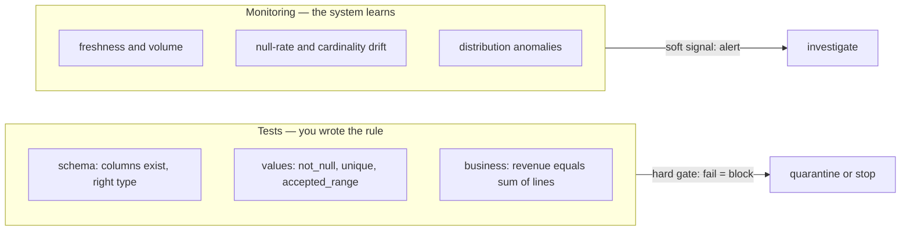
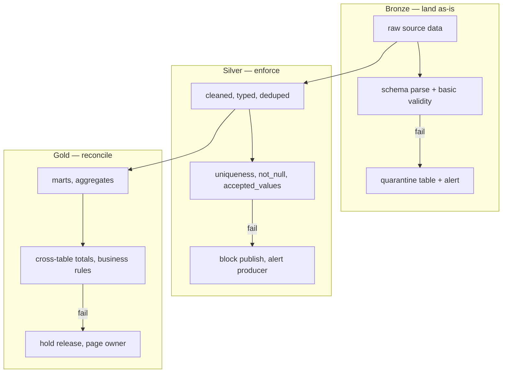
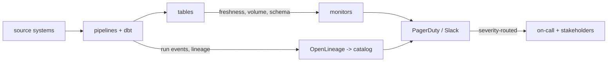
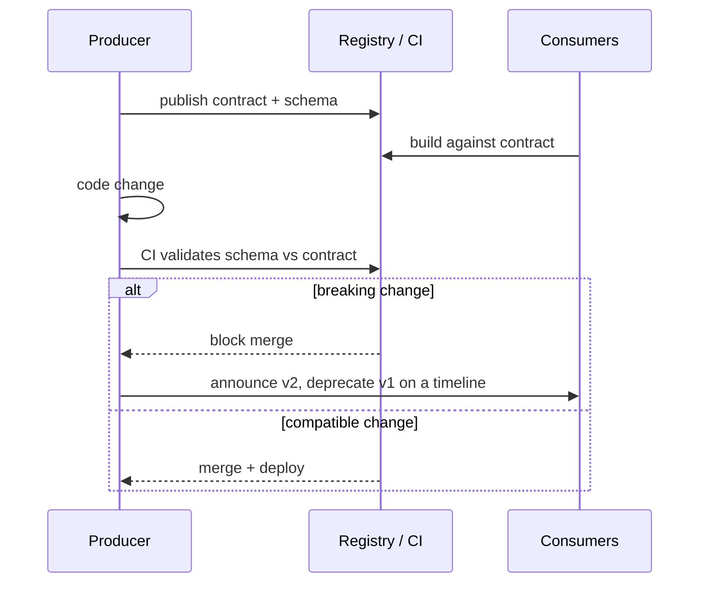
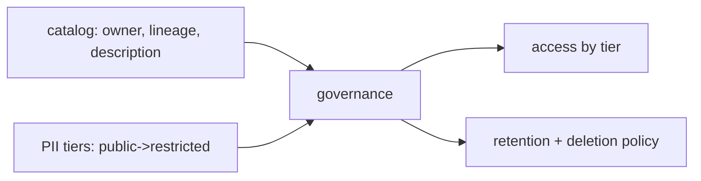
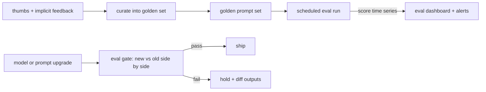
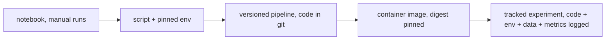

# Data Quality & Contracts

> **Why it matters** — Wrong data is worse than no data: a broken pipeline pages you, a silently wrong pipeline corrupts every downstream decision for weeks before anyone notices. Quality engineering is what lets you *know* — and a contract is what keeps you from finding out from a stakeholder.

## The six dimensions

Every data quality framework boils down to the same set of dimensions. Know them, and know which *mechanism* catches each.

| Dimension | Question it answers | Example failure | Typical check |
|---|---|---|---|
| **Freshness** | Is it recent enough? | Pipeline silently stopped Sunday; dashboards show Friday | `MAX(updated_at)` vs now; freshness SLO |
| **Completeness** | Is everything there? | `orders` missing 20% of rows after a join dropped nulls | Row count vs source / expected range |
| **Uniqueness** | Are there duplicates? | Fan-out join doubled `order_id` | `unique` test on keys |
| **Validity** | Do values conform? | `email` column has `null@`, `status` has unlisted enum | Regex, enum, range, `not_null` |
| **Consistency** | Does it agree with itself? | `fact_orders` total ≠ `daily_revenue` total | Cross-table reconciliation |
| **Accuracy** | Does it match reality? | `price` off by 100x (cents vs dollars) | Business-rule checks, spot audits, anomaly detection on distributions |
| **Behavioral drift** (AI) | Does the model still answer the same way? | Provider silently swapped the model version; refusals and tone changed overnight | Scheduled eval suite + canary prompts, pinned model versions |
| **Output conformance** (AI) | Is the response structurally usable? | LLM emits prose where a JSON tool-call was expected; downstream parser dead | Schema validation on every response, format-failure rate metric |

::: tip 💡 Freshness and completeness are 80% of real incidents
Most production "data quality" pages are not subtle value corruption — they're "the upstream extract didn't run" or "half the files failed to land." Instrument freshness and row counts everywhere before you invest in distribution monitoring.
:::

## Tests vs monitoring

Two complementary layers — different lifetimes, different questions:



- **Tests** are deterministic assertions run at build time. dbt generic tests (`unique`, `not_null`, `accepted_values`, `relationships`) cover most validity/uniqueness needs; singular tests (a `.sql` file returning failing rows) cover business rules. Great Expectations and SodaCL do the same job as standalone validation frameworks with profiling and richer expectations.
- **Monitoring/observability** watches *metrics about the data* over time — row counts, null rates, freshness lag, distribution stats — and flags anomalies. It catches what you didn't think to test for.

| | Tests | Monitoring |
|---|---|---|
| Catches | Known failure modes | Unknown / emergent ones |
| Runs at | Build/deploy time | Continuously, post-build |
| Action on failure | Block the pipeline, quarantine | Alert, investigate |
| Examples | dbt tests, GX expectations, SodaCL checks | Anomaly detection, Monte Carlo, warehouse-native monitors |

::: warning ⚠️ Tests only test what you wrote
A green test suite proves the *checks you defined* pass. New failure modes — upstream rekeyed an ID column, a currency silently changed units — sail through unless monitoring catches the drift or the contract prevents the change.
:::

### Where tests live

- **dbt tests** — cheapest wins: `not_null` + `unique` on every model key, `relationships` on every FK, `accepted_values` on status enums. Run via `dbt build` so a failure blocks downstream models.
- **GE / Soda** — when you need validation outside dbt (raw landing zones, non-dbt warehouses, pandas pipelines) or richer expectations (distributional checks, cross-table).
- **Anomaly detection** — monitor row count, null rate, distinct counts, freshness per table; alert on statistical deviation (e.g., volume 3σ below the trailing mean), not fixed thresholds that rot as data grows.

### What it looks like in code

dbt tests in `schema.yml` — declared next to the model, run with `dbt build`:

```yaml
models:
  - name: fct_orders
    columns:
      - name: order_id
        tests: [unique, not_null]
      - name: customer_id
        tests:
          - relationships: { to: ref('dim_customers'), field: customer_id }
      - name: status
        tests:
          - accepted_values: { values: ['placed', 'paid', 'shipped', 'refunded'] }
      - name: amount_cents
        tests:
          - dbt_utils.accepted_range: { min_value: 0 }
```

A SodaCL check file for a non-dbt target — same idea, standalone:

```yaml
checks for raw_orders:
  - row_count > 0
  - missing_count(email) = 0
  - duplicate_count(order_id) = 0
  - freshness(created_at) < 25h
  - anomaly score for row_count < default
```

::: info ℹ️ The 20% of tests that matter
If you write five tests, write these: `not_null` on the key, `unique` on the key, `relationships` on the join you depend on, `accepted_values` on the enum downstream branches on, and `accepted_range`/`not_null` on the money column. Everything else is marginal compared to instrumenting freshness and volume.
:::




::: details Why quarantine, not drop
Routing failing rows to a quarantine table (instead of deleting or hard-failing the whole batch) preserves evidence for debugging, lets partial-good batches proceed, and gives you a replayable population once the upstream bug is fixed. Hard-fail only when partial data is worse than no data — e.g., a ledger where missing rows silently corrupt balances.
:::

## Pipeline observability

Observability = can you answer, for any table, *what produced it, when it last updated, and whether it's healthy right now?*

- **Lineage** — column-level where possible. Emit it from the tools that already know it: dbt `manifest.json`, OpenLineage hooks on Airflow/Spark, query-log parsers. The catalog (DataHub, OpenMetadata, Collibra) consumes it — don't hand-draw lineage docs; they rot in a sprint.
- **Run metrics** — duration, rows in/out, bytes scanned, test pass rates per run. Track them per model so you can spot the slow creep (duration doubling monthly is a capacity problem *before* it's an outage).
- **Freshness SLOs** — declare `max_staleness` per table; alert when violated. This is the single highest-ROI alert in data engineering.

The signals worth collecting per table/model, cheapest first:

| Signal | What it catches | Cost to implement |
|---|---|---|
| Freshness (`max(updated_at)` lag) | Pipeline stopped, upstream silent | Trivial — one query |
| Row count per partition/day | Partial loads, dropped files | Trivial |
| Schema snapshot diff | Renames, type changes, dropped columns | Moderate — information_schema diff |
| Null rate / distinct count drift | Upstream semantic changes, rekeyed joins | Moderate — scheduled profile queries |
| Distribution stats (mean, p95 of key columns) | Unit changes, silent corruption | Higher — needs history + baselines |
| Run duration / bytes scanned | Capacity creep, cost blowouts | From warehouse metadata |



::: tip 💡 Alert on SLOs, not on events
"Task X failed" is noise if a retry fixes it. "Table `fct_orders` will breach its 09:00 freshness SLA" is signal. Route alerts by severity: page for customer-facing SLO breaches, Slack for internal, ticket for warnings.
:::

## Data contracts

A **data contract** is a formal agreement between producer and consumers covering:

- **Schema** — columns, types, nullability, enforced not documented.
- **Semantics** — what the fields mean, grain of the table, units (cents vs dollars — ask any payments team).
- **SLA** — freshness, completeness expectations, and the *breaking-change policy* (deprecation window, versioned tables/views).



Enforcement lives on the **producer side** — schema validation at emit time, contract tests in CI, compatibility checks on merge (schema-registry-style for events; dbt model contracts for warehouse models). Consumer-side checks are the safety net for when a contract doesn't exist or was bypassed.

Compatible vs breaking, the list CI should gate on:

| Change | Verdict |
|---|---|
| Add a nullable column | Compatible |
| Rename or drop a column | Breaking |
| Widen a type (int -> bigint, varchar -> bigger varchar) | Usually compatible |
| Narrow or change a type, change units/grain | Breaking |
| Make a nullable column non-nullable | Breaking for producers, compatible for consumers |
| Add an enum value downstream branches on | Semantically breaking — treat as breaking |


::: tip 💡 The policy is the contract
The schema is the easy part. What makes a contract real is the *policy*: "no column drops without 2 weeks notice + dual-publish window." Write it down, enforce it in CI (fail the build on a dropped column), and the contract survives turnover.
:::

dbt model contracts give you a lightweight version today: declare `contract: { enforced: true }` + `data_type`/`constraints` in YAML, and the build fails when output doesn't match — breaking changes caught at model build, not dashboard fire-drill.

## Incident management for data

Data incidents are special: the blast radius is *downstream decisions*, and the fix is often a backfill, not a rollback.

| Severity | Definition | Response |
|---|---|---|
| SEV-1 | Customer-facing data wrong or missing; revenue/financial reports affected | Page on-call, notify stakeholders now, freeze deploys |
| SEV-2 | Internal dashboards stale/wrong; analyst work blocked | Alert team, fix today, post notice |
| SEV-3 | Non-critical table degraded; no active consumers | Ticket, fix in sprint |

The playbook:

1. **Detect & declare** — someone owns the incident; open a channel, name the blast radius.
2. **Contain** — pause downstream consumers or flag the table stale. *Wrong data that looks fresh is worse than a visible gap.*
3. **Communicate** — post what broke, what's affected, ETA; update on a cadence. Stakeholders forgive outages; they don't forgive discovering it themselves in a board deck.
4. **Fix & backfill** — repair, then re-run the affected intervals (this is where idempotent pipelines pay rent). Verify with the same quality checks that should have caught it.
5. **Postmortem** — root cause, and the question that matters: *which check, added where, would have caught this earlier?* Add it.

::: warning ⚠️ The silent-failure failure mode
The worst data incidents are the ones monitoring didn't catch — discovered by a consumer days later. After every incident, ask: "what signal would have flagged this in the first hour?" If the answer is "none existed," that's the real defect.
:::

## Governance-lite

Not a committee — the minimum set that prevents "who owns this table" archaeology:

- **Catalog** — one searchable place (DataHub, OpenMetadata, Unity Catalog, even a well-tagged dbt docs site) where every table has an owner, description, and lineage. If it's not in the catalog, it doesn't exist.
- **Ownership** — every table has a named owner/team; ownership routes alerts and incidents. Unowned tables decay into landfill.
- **PII classification tiers** — tag columns/datasets (e.g., `public / internal / confidential / restricted-PII`), then enforce access and masking by tier, not per-table ad-hoc grants. Row/column access policies on the *tier* scale; per-user exceptions don't.



::: tip 💡 Classify at ingest, not audit time
Retro-classifying PII across 5,000 tables is a multi-quarter project. Tagging columns as they're declared (dbt YAML, table DDL, ingest config) is nearly free — and turns "where does SSN appear?" into a catalog query instead of a fire drill.
:::

## Monitoring AI systems

Everything above still applies — but an LLM in the pipeline adds a second surface that fails *silently and fluently*. An LLM output can be grammatically perfect, structurally valid, and completely wrong — no exception is ever thrown, so classic crash-based monitoring sees nothing. LLM observability is therefore an anomaly-detection problem layered on top of the table-level signals you already have.

### Signals worth a dashboard

Per model/endpoint, cheapest first:

| Signal | What it catches | Notes |
|---|---|---|
| Token counts in/out per call | Cost creep, truncated prompts, runaway completions | Tokens are the billing unit — a token dashboard *is* a cost dashboard |
| p95/p99 latency | Tail latency that wrecks UX while the mean looks fine | Trace into retrieval vs inference vs post-processing to attribute |
| Cost per request / per feature | A prompt refactor that doubled context silently | Alert on $/1k requests, not just total spend |
| Prompt token-length distribution | Templates that grew until context truncation | Drift in prompt length ≈ drift in effective context |
| Output length / format-failure rate | Truncation, broken JSON, fallback boilerplate | Sudden shift in completion length is an early failure tell |
| Prompt↔response drift | Inputs shifting (new intents, adversarial queries) and outputs shifting with them | Track embedding-cluster distribution of queries; a shift precedes quality complaints |

### Evaluation *is* the monitoring

Accuracy/loss don't exist at inference time — there is no label. The substitute is running evals continuously as a monitoring layer:

- **Scheduled eval suites** — a fixed set of scored prompts (golden dataset) run on a cadence, tracked like any other metric. The score *time series* is the monitor, not the suite itself.
- **Canary prompts** — a handful of prompts with known-good responses, run every few minutes like a synthetic check. If the canary's answer changes and nothing deployed, something upstream changed.
- **Regression suites on upgrades** — before any model-version or prompt-template change ships, run the golden set against old and new side by side. Treat it like a migration: compare, gate, then cut over.



:::: warning ⚠️ The silent model update
The nastiest LLM incident is the provider-side change you didn't make: an auto-update swaps the backing model and your prompts that "worked" quietly stop working — or keep working but cost more, refuse more, or flatter users differently. Nothing errors; outputs just *shift*. Mitigations: pin explicit model versions, never `auto-update` aliases in production, and keep the eval gate wired into the upgrade path so a version bump is a tested migration, not a surprise.
::::

### Log prompts and responses — redact at the boundary

Session-level logging (not just request/response pairs) is what makes nondeterminism debuggable: log the prompt version, model version, sampling parameters, retrieved documents, and full conversation context per call. But a prompt log is a PII sink — users paste emails, account numbers, medical details into chat boxes.

- **Redact at the logging boundary**, not later in the warehouse: run PII detection (NER/regex/entity classifiers) on prompts and responses *before* they hit durable storage. A scrub job over a log lake that already retained raw PII for a month is a breach report, not a fix.
- **Hash or pseudonymize user IDs** in traces so feedback links to a session without linking to a person.
- **Log outputs for hallucination forensics**: with ground truth or retrieved-doc comparison, output logs let you detect not just single hallucinations but the *conditions* where they cluster.

:::: tip 💡 Retention policy applies to traces too
LLM traces are the most sensitive logs you own — full user conversations plus model internals. Give them a shorter TTL than metrics, encrypt them, and restrict access like you would a PII table. "We log everything forever" is a liability, not observability.
::::

### LLM-specific incident patterns

| Incident | Signature | First mitigation |
|---|---|---|
| Provider model update degrades behavior | Eval scores or canary diffs shift with no deploy on your side | Pinned versions; eval gate on every upgrade; keep old version routable for rollback |
| Prompt regression | Minor template edit (whitespace, variable rename) degrades outputs | Prompt version control + diff-to-metric correlation; roll back to last good version |
| Silent behavior change | Tone, refusal rate, or verbosity drifts — no error anywhere | Track refusal/fallback/length distributions, not just errors |
| Retrieval drift (RAG) | Similarity scores decay; hallucinations rise while generation is unchanged | Monitor embedding-similarity distributions; refresh index/retriever |
| PII leak in outputs | Model surfaces training-data or cross-tenant sensitive content | Output-side PII detection in the response path, not just input scanning |

### Feedback is pipeline input

Thumbs-up/down, dwell time, retry frequency, and escalation-to-human rates are cheap to capture and are the only labels production will ever give you. The loop that matters: negative-feedback interactions get curated into the golden eval set, so tomorrow's regression suite tests the failures users actually hit. Feedback stops being a metric and becomes the mechanism that grows your eval coverage — closing the loop between deployment and iteration.


## MLOps practice for data teams

Gift & Deza's frame in *Practical MLOps* is the useful one for data engineers: **MLOps = DevOps + Data + Models**. It's not a separate discipline — it's the same discipline you already run (CI, testing, IaC, monitoring) with two extra moving parts: the data version and the model artifact. If your DevOps and data automation aren't solid, no amount of model tooling fixes it — their "ML hierarchy of needs" puts DevOps at the bottom, then data automation, then platform automation, and only then true ML automation. MLOps is a *behavior*, not a job title.

### The reproducibility ladder

A model trains on code + environment + data. Reproducibility means being able to rebuild *all three*. The ladder climbs from "works on my laptop" to "any run can be replayed":



Each rung removes a class of "it worked last month" failures:

| Rung | What it pins | What still drifts |
|---|---|---|
| Notebook | Nothing — hidden state in cell order | Everything; fine for exploration only |
| Script + lockfile | Dependency versions (conda env export / `uv.lock` / `requirements.txt` with hashes) | System libs, data, hyperparams |
| Versioned pipeline | Code path and orchestration via git | Environment where it executes |
| Container | Code + env as one artifact — deploy by image digest, not `latest` tag | The data it trained on |
| Tracked experiment | All of the above + data snapshot + params + metrics (MLflow/W&B-style run) | Nothing you control — this is the floor for production |

::::: warning ⚠️ Pin at the artifact level, not the name level
`pip install pandas` is not pinning — it's a suggestion. Pin **conda/`uv` lockfiles** (full transitive closure with hashes), **container digests** (`image@sha256:…`, since tags move), and **data versions**. For data, the DVC/lakeFS model treats datasets like git branches — a commit hash names an exact dataset snapshot — which beats timestamped `v3_final_FINAL` folders because the version is enforced by the tool, not by convention.
:::::

### ML CI/CD is not data CI

Your pipeline CI tests code against a fixed or sampled dataset and asserts deterministic rules (schema, nulls, ranges). ML CI/CD adds a second axis: **the artifact under test changes even when the code doesn't**. The gate therefore has to evaluate the trained model — accuracy/F1 on a held-out set, latency budget, bias checks — not just lint and unit tests. A model can pass every code test and still be worse than the one in production, which is why the deploy gate is a *comparison against the incumbent*, not a pass/fail test suite.

| | Data CI | ML CI/CD |
|---|---|---|
| What's versioned | Code + schema | Code + env + **data** + **model artifact** |
| Test target | Deterministic assertions on data | Model quality vs a baseline + deterministic checks |
| Deploy gate | Tests pass | Tests pass **and** new model beats incumbent on eval |
| Rollback unit | Last good code | Last good model artifact (code may be identical) |

### Maturity ladder

Roughly the book's hierarchy restated as levels you can locate yourself on:

| Level | Training | Deployment | Reality |
|---|---|---|---|
| 0 — manual | Notebooks, "the data scientist's laptop" | Someone copies a `.pkl` to a server | Most teams start here; the risk is the person, not the code |
| 1 — automated training | Scheduled pipeline re-trains; experiment tracking | Still manual deploy | Fresh model, stale process |
| 2 — automated deployment | CI/CD builds container, runs eval gate, can deploy anytime via IaC | Push-button or auto | True MLOps: deployable at any time, audit trail exists |

Don't buy a "level 2" platform while you're at level 0 — the book's point is that each layer depends on the one below.

### Monitoring and cost

Production ML monitoring is the same anomaly-detection problem already covered in *Monitoring AI systems* above — drift signals, eval-as-monitoring, silent provider updates — so it isn't repeated here. The ML-specific addition is **data drift**: the input distribution shifting beneath an unchanged model, which is the classic "model got worse and nobody deployed anything" case. Track input-feature distributions against the training snapshot, not just output metrics.

::::: tip 💡 ML cost management
Training and inference have opposite cost shapes. **Training** is bursty and retryable — a natural fit for spot/preemptible instances (checkpoint often, accept interruptions, save 60–90%). **Inference** is steady-state and latency-bound — right-size it (CPU is often enough for classical models), autoscale on real traffic, and measure cost *per request* the same way the token dashboard above measures cost per call.
:::::

## 🧠 Quiz

<QuizCard :questions="[{ q: 'A stakeholder reports a dashboard has shown the same numbers for three days. Which dimension failed first?', options: ['Consistency', 'Validity', 'Freshness', 'Accuracy'], correct: 2, explain: 'Stale data is a freshness failure — the most common real-world quality incident and the cheapest to catch with a max_staleness SLO.' }, { q: 'What is the key difference between tests and monitoring?', options: ['There is no difference', 'Tests assert rules you wrote at build time; monitoring watches metrics over time to catch failures you did not anticipate', 'Monitoring is only for schema', 'Tests are faster'], correct: 1, explain: 'Tests are deterministic assertions that gate the build; monitoring detects drift and anomalies in metrics you may never have written a rule for. You need both.' }, { q: 'Where does a data contract get enforced?', options: ['In the data catalog', 'By the DBA manually', 'On the producer side — schema validation at emit/build time plus compatibility checks in CI', 'On the consumer side, at query time'], correct: 2, explain: 'Producer-side enforcement prevents breaking changes from shipping. Consumer-side checks are a safety net — by the time a consumer catches it, the damage is already published.' }, { q: 'A bad batch is detected after loading 20% corrupt rows. What is the best containment move?', options: ['Wait for the next scheduled run to overwrite', 'Roll back the entire database', 'Delete the bad rows and continue', 'Quarantine or flag the affected partition and pause downstream consumers until it is fixed'], correct: 3, explain: 'Contain blast radius first: mark the data bad, stop consumers from trusting it, then fix and backfill. Silent deletion hides evidence; continuing publishes corrupt data.' }, { q: 'Why is per-table ad-hoc PII access control an anti-pattern?', options: ['It does not scale — classify by tier and enforce access on the tier, else every new table is a new security review', 'It is too slow', 'It requires a data catalog', 'PII cannot be classified'], correct: 0, explain: 'Tier-based classification lets you apply a handful of access/masking policies across thousands of tables; ad-hoc grants rot, drift, and get audited badly.' }, { q: 'After a data incident, the most important postmortem output is:', options: ['A blame assignment', 'A new check or monitor that would have caught this failure mode earlier, placed at the right layer', 'A longer runbook', 'More retries'], correct: 1, explain: 'Incidents reveal coverage gaps. The actionable output is the missing quality gate or signal — everything else is documentation.' }]" />
<QuizCard :questions="[{ q: 'A provider auto-updated the backing model overnight. No errors, but the chatbot now refuses requests it used to answer. What should have caught this before users did?', options: ['A scheduled eval suite and canary prompts running against golden outputs, plus a pinned model version', 'More retries on the API call', 'Higher rate limits', 'A longer system prompt'], correct: 0, explain: 'Silent behavior changes never throw errors — only continuous evaluation against known-good outputs and explicit version pinning surface them before users do.' }, { q: 'Where should PII redaction happen for prompt/response logging?', options: ['Only when an auditor asks', 'In a nightly warehouse scrub job', 'At the logging boundary, before traces hit durable storage', 'In the dashboard query layer'], correct: 2, explain: 'PII that lands in durable logs is already retained — redact in-stream at the boundary, or the later cleanup is a breach report rather than a fix.' }, { q: 'What is the highest-value use of thumbs-down feedback?', options: ['Triggering an immediate page', 'Curating negative-feedback interactions into the golden eval set so future regression suites test real user failures', 'A morale metric for the team', 'Auto-deleting the conversation'], correct: 1, explain: 'Feedback converts production failures into evaluation coverage — the eval set grows toward the failure modes users actually encounter.' }]" />
<QuizCard :questions="[{ q: 'Which rung of the reproducibility ladder first guarantees a run can be fully replayed?', options: ['A script with a lockfile', 'A tracked experiment logging code + env + data snapshot + metrics', 'A container image pinned by digest', 'A versioned pipeline in git'], correct: 1, explain: 'A model depends on code, environment, AND data — only the tracked-experiment rung pins all three; the lower rungs each still leave one axis free to drift.' }, { q: 'How does an ML deploy gate differ from a data CI gate?', options: ['It compares the new model against the incumbent on an eval set, not just pass/fail code tests', 'It skips unit tests', 'It only checks schema', 'It runs faster'], correct: 0, explain: 'The artifact under test changes even when code does not — a model can pass every code test and still be worse than what is in production.' }, { q: 'Where do spot instances fit best in the ML cost picture?', options: ['Eval dashboards', 'Bursty, retryable training jobs with frequent checkpoints', 'Steady-state inference serving', 'Feature stores'], correct: 1, explain: 'Training is interruptible and checkpointable, so spot capacity saves 60-90%; inference is latency-bound and needs right-sizing and autoscaling instead.' }]" />

## Further reading

- [dbt documentation — tests](https://docs.getdbt.com/docs/build/data-tests)
- [dbt documentation — model contracts](https://docs.getdbt.com/docs/mesh/govern/model-contracts)
- [Great Expectations documentation](https://docs.greatexpectations.io/docs/)
- [Soda documentation — SodaCL checks](https://docs.soda.io/soda-cl-overview)
- [OpenLineage](https://openlineage.io/) and [Marquez](https://marquezproject.github.io/marquez/)
- [DataHub — metadata platform](https://datahubproject.io/)
- [Data Contract Specification](https://datacontract.com/)
- *Fundamentals of Data Engineering* — Reis & Housley (O'Reilly), reliability/quality chapters
- *LLMOps: Managing Large Language Models in Production* — Abi Aryan (2025), [O'Reilly](https://www.oreilly.com/library/view/llmops/9781098154196/)
- *Practical MLOps: Operationalizing Machine Learning Models* — Gift & Deza (2021), [O'Reilly](https://www.oreilly.com/library/view/practical-mlops/9781098103002/)
