# Data Modeling

> **Why it matters** — The data model is the contract between storage and every consumer. Get the grain wrong and every metric is subtly wrong; model for the wrong consumer and BI tools fan out while ML pipelines re-join history. Modeling is the highest-leverage design decision in analytics — and the hardest to fix later.

## Two philosophies

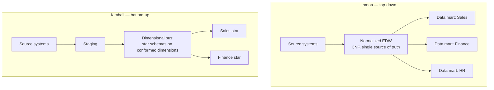

| | Inmon CIF | Kimball dimensional |
|---|---|---|
| Approach | Top-down: normalized EDW first, marts later | Bottom-up: dimensional marts on a shared bus |
| Schema | 3NF throughout | Star schemas in marts |
| Time to value | Slow — EDW must exist first | Fast — first mart ships in weeks |
| Consistency | Strong — one normalized truth | Via **conformed dimensions** |
| Change tolerance | Rigid — EDW changes ripple | Flexible — add marts incrementally |
| Best fit | Large regulated enterprises, slow-changing domains | Most modern BI/analytics teams |

::: tip 💡 Senior insight
Kimball won the market. Snowflake, BigQuery, Databricks, dbt — the modern stack is built around dimensional marts. Inmon CIF survives as the logical architecture behind regulated enterprises, but the *implementation* is usually a lakehouse medallion flow (bronze → silver → gold star schemas).
:::

## Kimball dimensional modeling

The 80% case. Kimball's four-step design process, worked end to end on the book's running example — a grocery chain's point-of-sale data:

1. **Select the business process** — *retail sales*. A business process is a low-level activity (orders, shipments, payments, claims), not a department. Departments consume process data; they don't own it — modeling "the Sales team's table" and "the Finance team's table" duplicates the same events under different labels.
2. **Declare the grain** — *one row per product scanned on a sales transaction* (POS receipt line). State it in business terms, not as a key list: the phrase answers "what does one row mean?" before anyone draws a table.
3. **Identify the dimensions** — the who/what/where/when/why/how that each take a single value at that grain: `date`, `time_of_day`, `product`, `store`, `cashier`, `promotion`, and the receipt number itself (a degenerate dimension — below).
4. **Identify the facts** — numeric measures true to that grain only: `quantity`, `unit_price`, `net_amount`, `discount_amount`. A fact that doesn't live at the declared grain (daily store target, monthly budget) goes in a **separate** fact table, never coerced in.

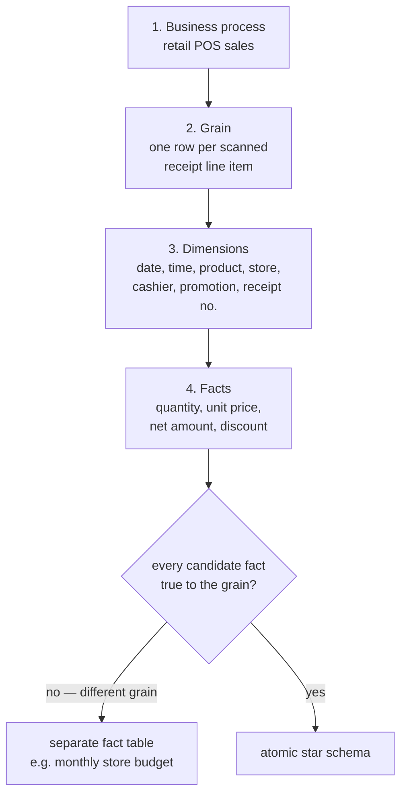

::: tip 💡 Senior insight
Kimball's debugging rule: the single most common design error is skipping step 2. If the grain isn't written down and agreed, dimension debates go in circles and rogue facts sneak in. If steps 3–4 reveal the grain was wrong, go *back* to step 2 and redo them — don't patch around it.
:::

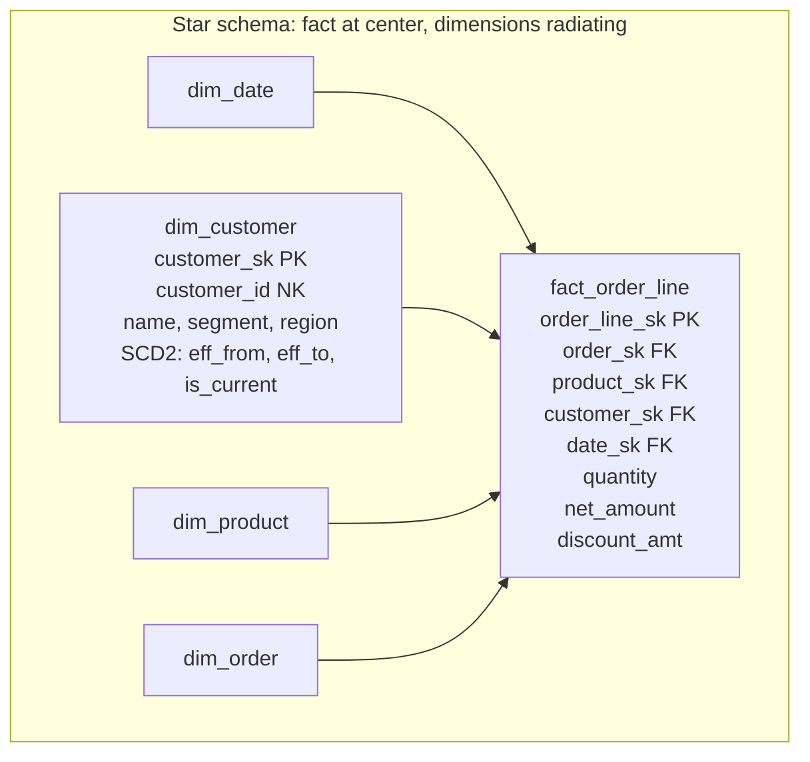

### Grain first — the rule that prevents every bug

Grain = "what does one row of the fact table mean?"

| Grain declaration | Consequence |
|---|---|
| `one row per order` | Line-item detail lost; can't analyze product mix |
| `one row per order line` | ✅ Atomic grain — most flexible |
| `one row per order line per shipment event` | Accumulating snapshot — tracks pipeline stages |

::: warning ⚠️ The #1 modeling bug
Declaring the wrong grain — or letting two grains coexist in one table — produces silent double-counting. If `fact_order` has one row per order but `fact_order_line` gets joined without deduping, revenue multiplies. **Write the grain in a comment at the top of the model and enforce it with a uniqueness test.**
:::

### Fact table types

Not all fact tables record the same thing. The grain declaration picks the type:

| Type | Grain | Updates? | Classic example | Watch for |
|---|---|---|---|---|
| **Transaction** | One row per atomic event (scan, click, line item) | Insert-only | `fact_pos_line`, `fact_click` | The default — always start here |
| **Periodic snapshot** | One row per entity per period (day/month) | Insert-only, semi-additive | `fact_daily_inventory`, `fact_monthly_balance` | SUM over the snapshot period is meaningless — AVG/LAST instead |
| **Accumulating snapshot** | One row per pipeline instance, updated as milestones pass | UPDATE in place | `fact_order_fulfillment`: order → ship → deliver → return | Breaks insert-only assumptions; milestones must actually arrive |
| **Factless** | One row recording an event or coverage — no measures | Insert-only | `fact_student_attendance`, `fact_product_promotion_coverage` | "Count of rows" IS the metric; existence is the fact |

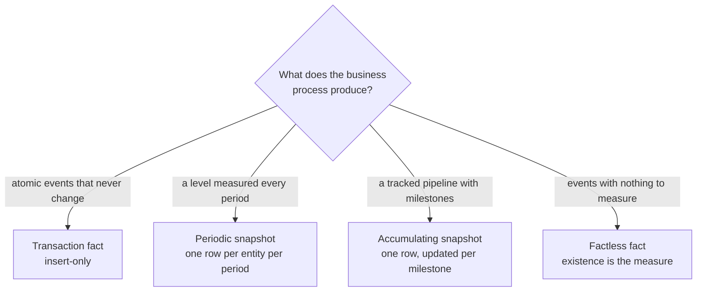

::: warning ⚠️ Semi-additivity
Only transaction facts are fully additive across every dimension. Snapshot facts (balances, inventory levels, headcounts) are additive across most dimensions but **never across time** — `SUM(daily_balance)` over a month is nonsense; you need `AVG` or `LAST`. Accumulating snapshots break aggregation differently: a row's measure changes as milestones land, so an "as of" query needs the effective-dated variant.
:::

### Dimension techniques beyond SCD

Senior-interview vocabulary, all from the Kimball toolkit:

| Technique | What it is | When to use |
|---|---|---|
| **Degenerate dimension** | A transaction/receipt number kept on the fact row with *no* dimension table — the number IS the attribute | `receipt_no`, `order_no`, `ticket_no`: the ID groups the line items and survives when its parent table is exhausted |
| **Role-playing dimension** | One physical dim joined multiple times under different roles | `dim_date` joined as `order_date`, `ship_date`, `due_date` — one table, N views/aliases |
| **Junk dimension** | A grab-bag dim for low-cardinality flags/indicators (`gift_wrap`, `channel`, `source_flag`) so they don't bloat the fact or mint a dim per flag | Correlation of combinations is the point — 5 binary flags = one 32-row junk dim, not five 2-row dims |
| **Outrigger** | A dim referenced by another dim (dim-of-a-dim) — the controlled exception to "dims never join dims" | `dim_customer` → `dim_date_of_birth`, or a shared `dim_geography` hung off both customer and store |
| **Mini-dimension** | Fast-changing attributes split into their own small dim, keyed on the fact | `dim_customer` grows to 10M rows and `credit_band` changes monthly → move volatile attrs to `dim_credit_profile` (SCD Type 4) |

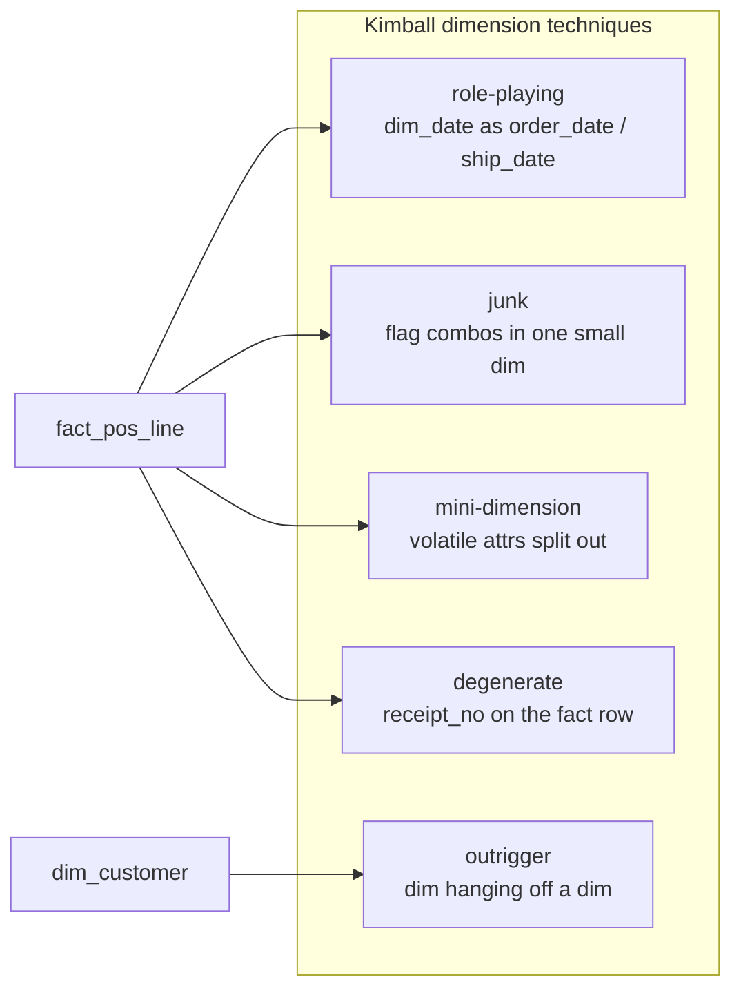

::: tip 💡 Senior insight
Degenerate dimensions confuse juniors because there's no table — but they're why `fact_pos_line` can still answer "show receipt #649" after the source POS purges its receipt header. Keep the operational number on the fact; don't build a one-column dimension table for it.
:::


### Conformed dimensions

Shared dimension tables used identically across fact tables — `dim_date`, `dim_customer` mean the same thing in Sales and Finance. This is what makes drilling-across possible: `SUM(revenue) BY region` and `SUM(cost) BY region` join through the *same* `region` value.

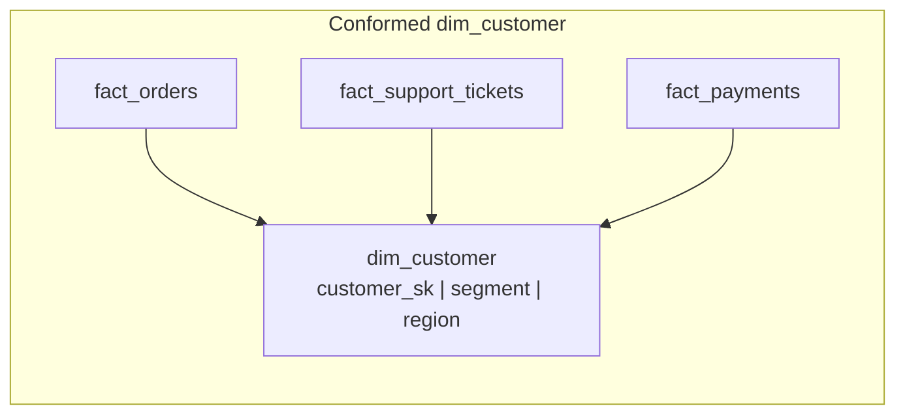

Without conformance, each mart re-derives "active customer" differently and the numbers never reconcile.

### Slowly Changing Dimensions — SCD types

How the dimension handles attribute changes over time. Customer moves from NY → CA: does the old region still matter?

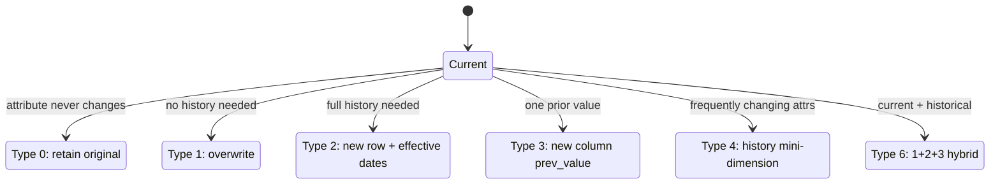

| Type | Strategy | History | Cost | Use when |
|---|---|---|---|---|
| **0** | Never update | None | Zero | Immutable attrs (birthdate, original source) |
| **1** | Overwrite in place | None — old value gone | Cheap | Corrections, typos, attributes nobody reports on historically |
| **2** | New row + `effective_from/to`, `is_current` | Full | Storage + join complexity | Most history requirements — **the default for real dims** |
| **3** | `current_val` + `prev_val` columns | One hop | Cheap | Track "previous" only (old/new territory) |
| **4** | Fast-changing attrs → mini-dimension | Full for those attrs | More tables | Dim grows huge + changes often (credit score, status) |
| **5** | 4 + 1 — mini-dim key embedded as Type 1 | Partial | Complex | Rare |
| **6** | 1+2+3: row has current + prior + historical | Full + easy "current" query | Most complex | Report needs "as-was" AND "as-is" |

::: details Deep dive: Type 2 is 90% of real SCD usage
```sql
-- customer moved: close the old row, open a new one
UPDATE dim_customer
SET effective_to = '2024-06-01', is_current = false
WHERE customer_sk = 42 AND is_current;

INSERT INTO dim_customer
(customer_sk, customer_id, region, effective_from, effective_to, is_current)
VALUES
(next_sk(), 'C-100', 'CA', '2024-06-01', '9999-12-31', true);
```
Facts join to the *surrogate key* (customer_sk), so an order on 2024-05-15 joins to the NY row and one on 2024-06-15 to the CA row — point-in-time truth for free.
:::

## Data Vault 2.0

Dan Linstedt's architecture for **auditable, parallel, insert-only** enterprise warehousing. Three entity types:

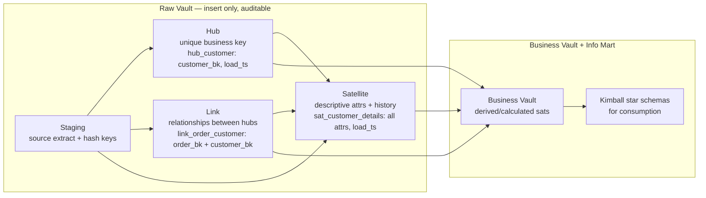

| Component | Contains | Rule |
|---|---|---|
| **Hub** | Business key + load metadata only | No descriptive data, no FKs to other hubs |
| **Link** | FK to 2+ hubs — the relationship | No descriptive data |
| **Satellite** | All descriptive attributes, history per load | Hangs off exactly one hub or link |

::: warning ⚠️ When Data Vault is NOT worth it
DV pays for itself only when you have **many sources, heavy audit/compliance needs, and constant schema churn** (banks, insurers, pharma). The price is real: every query joins 3+ tables, so you *must* materialize a Kimball layer on top for BI. For a single-source SaaS product, DV is over-engineering — a dbt-modeled star schema is cheaper and clearer.
:::

## One Big Table / wide tables

The pragmatic counterpoint: pre-join everything into one wide denormalized table.

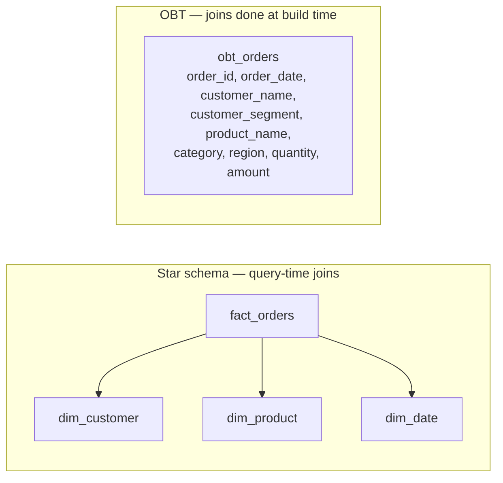

| | Star schema | OBT |
|---|---|---|
| Query complexity | Joins required | `SELECT *` — trivially simple |
| Storage | Compact dims, shared | Redundant values — but columnar compression absorbs most of it |
| Freshness | Dims update independently | Whole table rebuilds on dim change |
| Flexibility | Any slice via join | Fixed shape — new analysis = new OBT |
| Consumer | BI tools, analysts | ML feature tables, dashboards, self-serve |

::: info ℹ️ Where OBT actually wins
ML feature engineering and Looker/Tableau extracts where users can't be trusted with join logic. Columnar formats make the redundancy cheap — a `country` column repeats a million times but dictionary-encodes to almost nothing. The cost is *freshness and rigidity*, not storage.
:::

## Aggregate awareness

Pre-computed summary tables that the BI layer routes to transparently — the classic answer to "why is the dashboard slow on a billion-row fact."

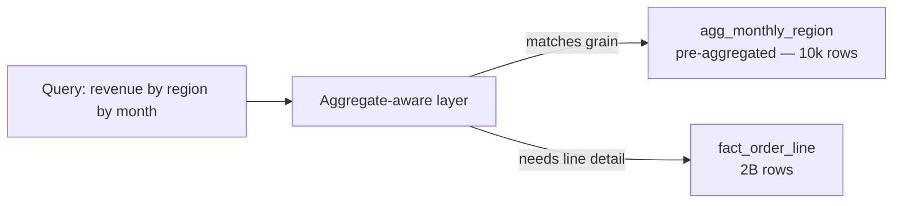

- **Aggregate fact tables** — same conformed dims, coarser grain (`month` not `day`, `region` not `store`). Must share the dimension so results reconcile.
- **Materialized views / result caches** — the modern implementation. BigQuery `MATERIALIZED VIEW`, Snowflake MVs, dbt `materialized='incremental'` — the engine picks the aggregate automatically.
- **When it fails** — aggregates break the moment a query filters on an attribute not in the aggregate grain (a product filter kills a `month×region` agg). Dimension conformance is what makes the routing safe.

::: info ℹ️ Interview answer
Aggregate awareness = "serve 90% of queries from a small pre-rolled table, fall through to the atomic fact for the rest." It's why atomic-grain facts still matter — the aggregates are *derived* from them, never the source of truth.
:::


## Modeling for BI vs ML

The consumers pull the model in opposite directions:

| Concern | BI / star schema | ML / feature store |
|---|---|---|
| Shape | Long, thin facts + shared dims | Wide, flat feature rows |
| Time | SCD-aware — "as it was" | Point-in-time correct — critical for no-leakage |
| Grain | Whatever the mart defines | One row per entity per prediction time |
| Updates | Overwrite/SCD fine | Immutable, versioned — training/serving skew is fatal |
| Tooling | dbt, Looker, Snowflake | Feast, Tecton, custom wide tables |

::: tip 💡 Senior insight
The same source data often needs both: a star schema for BI correctness, and a point-in-time-correct wide feature table for ML. The point-in-time join (`feature value AS OF prediction_time`) is the ML equivalent of the SCD2 lookup — get it wrong and the model trains on future data.
:::

## Knowledge graphs: modeling as context

Relational models make rows cheap and relationships implicit — they live inside foreign keys and JOIN clauses. A **knowledge graph** flips that: entities *and* their relationships are first-class citizens, and an **organizing principle** (labels, taxonomies, ontologies) sits on top as a contract that makes the data self-describing to humans and machines. Schema is flexible: new entity and relationship types appear without migrations, which is why graphs absorb siloed data more gracefully than yet another normalized schema.

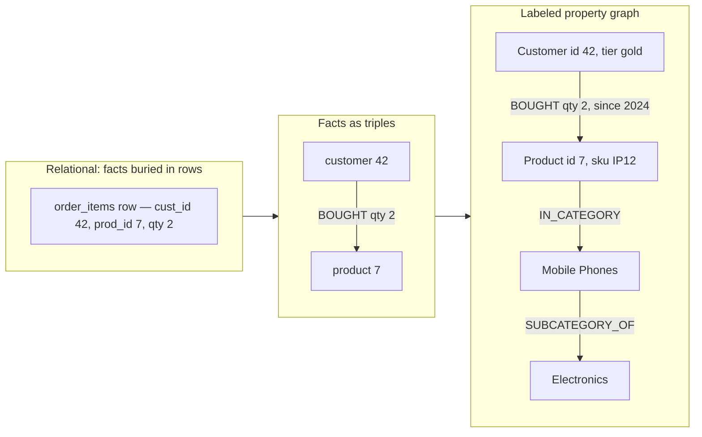

The taxonomy layer (`IN_CATEGORY`, `SUBCATEGORY_OF`) is the organizing principle doing work: a query for "electronics buyers" resolves through the hierarchy without a hand-maintained category column on every product row.

### RDF triplestores vs labeled property graphs

| | RDF triplestore | Labeled property graph (Neo4j-style) |
|---|---|---|
| Fact form | Subject–predicate–object triple | Nodes + typed relationships, both carry key–value properties |
| Properties on edges | Needs reification (extra triples) | First-class attributes on the relationship |
| Semantics | Formal: RDFS / OWL ontologies, machine inference | Labels + optional schema; semantics layered on as needed |
| Query language | SPARQL | Cypher / GQL, Gremlin |
| Interop | W3C standards; links cleanly with open/public data | Vendor-leaning; exports via RDF or GraphQL layers |
| Best at | Regulated domains, cross-org data exchange, ontology-driven inference | App-facing traversal, recommendations, lineage, fast iteration |

::: tip RDF is a wire format, not a mandate
RDF governs how graph data is *serialized and exchanged*, not how it must be stored. You don't need a triplestore to build a knowledge graph — a property graph is fine internally; use RDF when you *share* knowledge across systems or org boundaries.
:::

### When graph vs relational vs document

| Use case | Best fit | Why |
|---|---|---|
| 360° customer / entity resolution across silos | Knowledge graph | Many-to-many identities merge naturally; relationships first-class |
| Data lineage, impact analysis | Knowledge graph | Arbitrary-depth traversal without recursive CTE gymnastics |
| Shared vocabulary across domains (ontology) | Knowledge graph (RDF/OWL) | Machine-readable semantics; inference derives new facts |
| Fraud rings, network analysis | Knowledge graph | Multi-hop patterns + graph algorithms (centrality, communities) |
| Measure aggregation over stable dimensions | Relational / dimensional | Star schemas crush scan-heavy analytics; graphs lose here |
| Self-contained payloads, doc-shaped reads | Document store | No join cost; per-document schema |

### KG + GenAI: grounding with GraphRAG

A graph gives an LLM *structured* context: instead of retrieving raw text chunks, GraphRAG-style retrieval pulls the subgraph around matched entities — entities, relationships, and provenance — so answers are grounded in connected facts with explainable paths rather than nearest-neighbor prose. The organizing principle doubles as a guardrail on what the model can claim. See [GenAI engineering](/system-design/genai-engineering) for the RAG/grounding side.

### Loading data into a graph

Same ETL trade-offs as anywhere, plus a mapping step: keys → nodes, foreign keys → edges. **Batch loaders** (bulk CSV/Parquet import, e.g. Neo4j bulk import) are for initial load and full rebuilds — fastest per record, no incremental state. **CDC streams** (Debezium/Kafka → graph upserts keyed on node identity) keep the graph fresh against operational systems; watch for ordering and deletes propagating as edge removals. Start batch, add CDC only where freshness pays.

::: warning Anti-patterns
- **Graph-everything hype** — graphs are worse than columnar stars for scan-heavy aggregation. Model the *questions*, not the hype; most workloads need a mart plus a small graph, not a graph instead.
- **Ontological perfectionism** — a prematurely detailed enterprise ontology is expensive precisely when its utility is least understood, and risks being stale by completion. Apply *just enough semantics* for today's use case; compose richer organizing principles iteratively.
:::

## Choosing a methodology

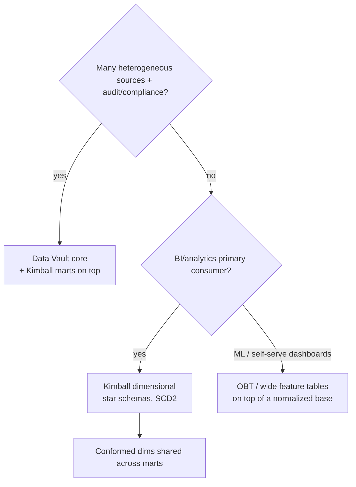

## 🧠 Quiz

<QuizCard :questions="[{ q: 'A fact table contains one row per order, but downstream a join to line items multiplies revenue. What was skipped?', options: ['Compression', 'Normalization', 'SCD type 2', 'Declaring and enforcing the grain — fact should be order-line or the join needs pre-aggregation'], correct: 3, explain: 'Grain mismatch is the classic silent double-count. Declare one row per order line, or aggregate line items before the join.' }, { q: 'A customer changes region and you must preserve the old region for historical reporting. Which SCD?', options: ['Type 1', 'Type 2', 'Type 3', 'Type 0'], correct: 1, explain: 'Type 2 closes the old row with effective_to and inserts a new row — full history via surrogate keys.' }, { q: 'The main reason Data Vault hubs, links, and satellites exist as separate tables is:', options: ['Faster queries', 'Less storage', 'Insert-only parallelism + auditability: keys, relationships, and descriptive history load independently without updates', 'BI tools require it'], correct: 2, explain: 'DV decouples business keys (hubs), relationships (links), and descriptive history (sats) so loads are parallel and never update in place — ideal for audit, terrible for direct querying.' }, { q: 'A team builds OBTs for every dashboard and a dimension value changes. What happens?', options: ['Only the fact table changes', 'Nothing — OBT is decoupled', 'Every OBT must be rebuilt/refreshed to pick up the change', 'The warehouse auto-propagates'], correct: 2, explain: 'OBT denormalizes at build time — dimension changes do not propagate; the table is stale until rebuilt. That is the freshness trade.' }, { q: 'Conformed dimensions matter because:', options: ['They are faster', 'They compress better', 'They let different fact tables drill across on shared attributes — same customer/region meaning everywhere', 'They remove surrogate keys'], correct: 2, explain: 'Without conformance, Sales and Finance each define customer differently and cross-mart analysis never reconciles.' }, { q: 'Point-in-time correctness in ML feature tables is the analogue of:', options: ['A natural key', 'SCD Type 2 — knowing the value as it was at prediction time to prevent training/serving skew', 'Compaction', 'BCNF'], correct: 1, explain: 'Both solve the same problem: the value must be the one that was true at the event/prediction time, not the current value.' }]" />

<QuizCard :questions="[{ q: 'Marketing wants to analyze which products are bought together, but fact_sales is declared one row per order. What is the real problem?', options: ['The facts are not additive', 'The grain is too coarse — basket analysis needs one row per order line, the atomic grain', 'Need a bridge table', 'Missing SCD Type 2 on products'], correct: 1, explain: 'Kimball rule: declare the grain at the atomic level the business process captures. Product-mix questions are only answerable at order-line grain; anything coarser loses the detail permanently.' }, { q: 'An order fact tracks order to pick to ship to deliver milestones, each milestone overwriting the same row. Which fact table type?', options: ['Periodic snapshot', 'Accumulating snapshot — one row per pipeline instance, updated as milestones complete', 'Factless', 'Transaction'], correct: 1, explain: 'Accumulating snapshots are the one fact type that UPDATEs in place: the row mints at order time and milestone date-FK/measure columns fill in as the shipment progresses.' }, { q: 'A daily bank balance snapshot is summed across 30 days by a report. What went wrong?', options: ['Need SCD Type 2', 'Need a junk dimension', 'Snapshot facts are semi-additive: SUM over time is meaningless — use AVG or end-of-period value', 'Nothing — SUM is always safe'], correct: 2, explain: 'Periodic snapshots add across most dimensions but never across the snapshot period. Only transaction facts are fully additive.' }]" />

<QuizCard :questions="[{ q: 'A data catalog must answer &quot;which dashboards break if this column changes?&quot; through arbitrarily deep pipelines. Which model fits?', options: ['OBT wide table', 'Knowledge graph — arbitrary-depth traversal over lineage edges is its native operation', 'Document store', 'Relational with recursive CTEs'], correct: 1, explain: 'Impact analysis is multi-hop traversal: dataset → transformation → dashboard. Graph stores the edges first-class; relational makes you fight recursion and documents make you fight joins.' }, { q: 'A team needs properties on the BOUGHT edge (quantity, timestamp) and fast app-facing queries. RDF or labeled property graph?', options: ['RDF — it supports edge properties natively', 'Neither, use a document store', 'Either, they are identical', 'Labeled property graph — edges carry first-class properties; RDF needs reification for the same'], correct: 3, explain: 'In LPG the relationship itself holds key–value attributes. In RDF an edge is a bare triple, so qualifying it requires extra reification triples — heavier for app queries, though RDF wins on standards and ontology inference.' }, { q: 'An enterprise designs a complete top-down ontology for the whole business before shipping anything. What is the anti-pattern?', options: ['Premature denormalization', 'Ontological perfectionism — premature semantics costs most when utility is least understood; apply just enough semantics and iterate', 'Over-normalization', 'Schema-on-read'], correct: 1, explain: 'A big upfront ontology is expensive, risky, and likely stale by completion. Start with the simplest organizing principle that serves today\'s use case; compose richer layers later.' }]" />

## Further reading

- [Kimball dimensional modeling techniques](https://www.kimballgroup.com/data-warehouse-business-intelligence-resources/kimball-techniques/dimensional-modeling-techniques/)
- [Kimball SCD types 0-7](https://www.kimballgroup.com/2013/02/design-tip-152-slowly-changing-dimension-types-0-4-5-6-7/)
- **The Data Warehouse Toolkit** — Ralph Kimball & Margy Ross (2013), [Wiley / Kimball Group](https://www.kimballgroup.com/data-warehouse-business-intelligence-resources/books/data-warehouse-dw-toolkit/)
- [dbt — How we structure our projects](https://docs.getdbt.com/best-practices/how-we-structure/1-guide-overview)
- [dbt — Kimball dimensional modeling](https://docs.getdbt.com/blog/kimball-dimensional-model)
- [Data Vault basics — Dan Linstedt](https://www.danlinstedt.com/allposts/datavaultcat/data-vault-basics/)
- [Dimensional modeling — Wikipedia](https://en.wikipedia.org/wiki/Dimensional_modeling)
- **Knowledge Graphs: Data in Context for Responsive Businesses** — Jesús Barrasa, Amy E. Hodler & Jim Webber (2021), [O'Reilly](https://www.oreilly.com/library/view/knowledge-graphs/9781098104825/)
