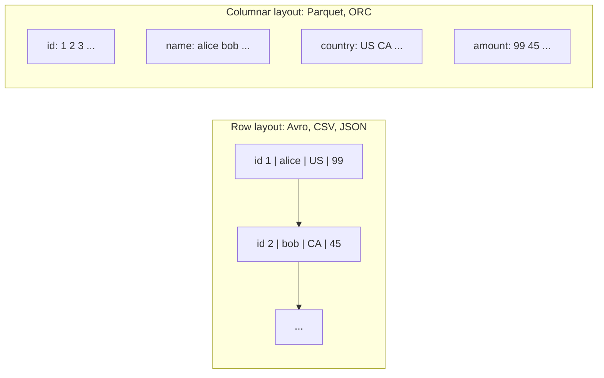
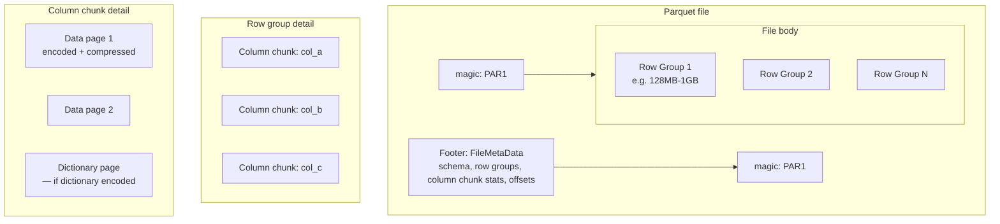
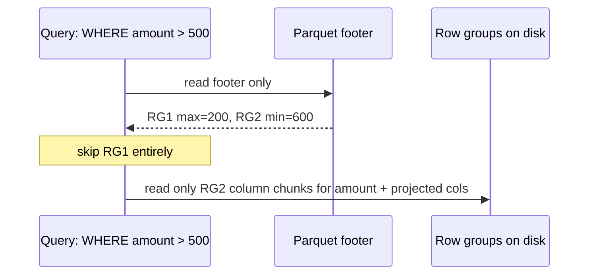
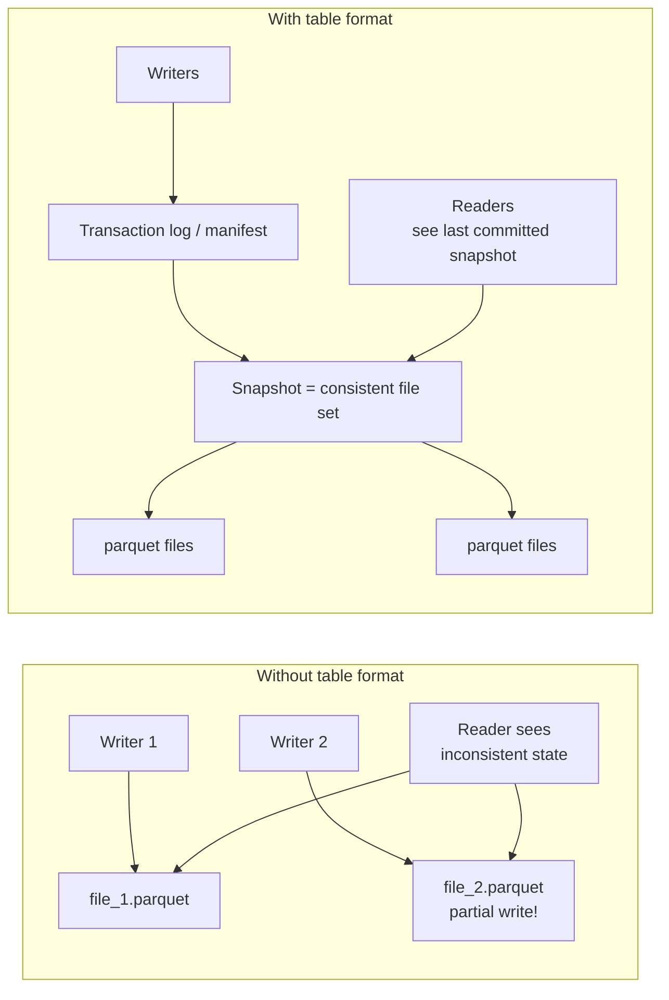
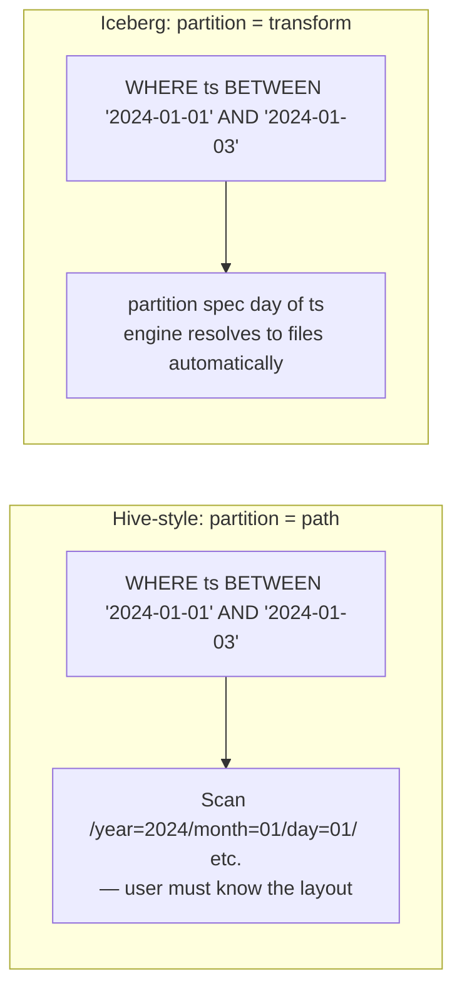
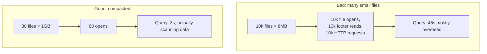
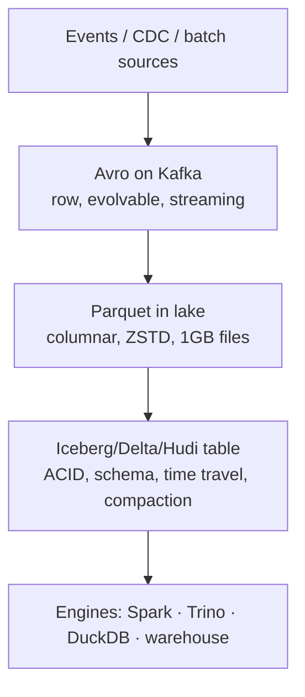

# File & Table Formats

> **Why it matters** — The difference between a 30-second query and a 30-minute scan is usually *format*, not engine. Parquet's statistics let a query read 3% of the bytes; CSV reads all of them. Table formats (Iceberg/Delta/Hudi) are what separate a data lake from a pile of files — they are the most consequential storage choice you make.

## Row vs columnar layout

A row layout stores each record contiguously; a columnar layout stores each column contiguously. This one decision determines almost everything about read performance:

| | Row (Avro, CSV, JSON) | Columnar (Parquet, ORC) |
|---|---|---|
| Read one record | Fast — single contiguous read | Slow — gather scattered values |
| Read 3 of 100 columns | Reads all 100 anyway | Reads only the 3 — **massive I/O win** |
| Compression | Poor (mixed types in a row) | Excellent (homogeneous data, repetitive values) |
| Write/append | Cheap, streaming-friendly | Expensive — needs buffering + stats collection |
| Schema evolution | Excellent (Avro) | Good (by name, in table formats) |
| Use | OLTP, CDC, streaming, exchange format | Analytics, warehousing, lake storage |

::: tip 💡 Senior insight
The mental model: **columnar is a read-optimized index you pay for at write time**. Every Parquet write buffers a row group, collects statistics, encodes, and compresses. That cost buys the 10-100x query speedup. Don't use Parquet for append-per-event workloads — use Avro, then compact to Parquet.
:::

## Parquet internals

Parquet is the dominant analytics format. Understanding its layout is how you understand predicate pushdown, why it beats CSV, and why file size matters:

The footer is the secret weapon. It contains, per column chunk:

- **min / max / null_count** — enables row-group skipping
- **dictionary page presence** — enables dictionary filtering
- **byte offsets** — readers seek directly to needed chunks

### Predicate pushdown & stats skipping

The query **never opens** row groups whose min/max prove they can't match. This is why:

- **Sorting/clustering data** makes skipping brutally effective — contiguous ranges cluster min/max tightly.
- **File size matters**: too small → footer overhead per tiny scan; too large → coarse skipping.

::: warning ⚠️ Predicate pushdown is not automatic
It requires: (1) stats present (some writers skip them), (2) filter column is *sorted or clustered* enough for min/max to help, (3) your engine actually pushes the filter (Spark/Trino/BigQuery external tables all do). A `WHERE` on an unsorted high-cardinality UUID gets no skipping — stats exist but are useless.
:::

### Encodings inside a page

| Encoding | When it wins | Effect |
|---|---|---|
| **Dictionary** | Low-cardinality columns (country, status) | Store each distinct value once + integer indexes |
| **RLE (run-length)** | Sorted/repetitive data | `US US US US` → `(US, 4)` |
| **Delta / bit-packing** | Timestamps, IDs | Store differences not absolute values |
| **Plain** | High-entropy strings | Fallback, no encoding gain |

Low-cardinality columns are nearly free in Parquet — `country` with 200 values in a million-row file compresses to almost nothing. This is why denormalized wide tables are *cheaper* in columnar format than normalized ones: the repeated dimension attributes compress away.

## ORC

Optimized Row Columnar — Hive's answer to Parquet. Very similar design:

| | Parquet | ORC |
|---|---|---|
| Structure | Row groups → column chunks → pages | Stripes → column streams → index data |
| Stats | Per column chunk | Per stripe + per 10k-row group (bloom filters optional) |
| Compression | Per column chunk | Per stripe |
| ACID | Via table format | Native Hive ACID (legacy) |
| Ecosystem | Universal (Spark, Trino, BigQuery, Snowflake, DuckDB) | Hive/Hadoop-heavy |

::: info ℹ️ Heuristic
**Default to Parquet** — widest ecosystem support. Use ORC only inside Hive-native estates where it already lives. Their performance is within ~10% of each other for most workloads; the choice is ecosystem, not speed.
:::

## Avro & Protobuf

Row-oriented formats for a different job: streaming, CDC, RPC, schemas-in-motion.

| | Avro | Protobuf |
|---|---|---|
| Schema | JSON schema, stored with data or in registry | `.proto` IDL, compiled to code |
| Wire format | Binary, self-describing | Binary, field-number tagged |
| Schema evolution | Excellent — field add/remove/rename with defaults | Good — field numbers make it robust, but stricter |
| Read without schema | Yes (schema embedded or resolvable) | **No** — you need the `.proto` |
| Data files | Splittable container files (`.avro`) | Raw messages, no container file concept |
| Typical use | Kafka payloads, CDC, landing raw events | gRPC, service-to-service, telemetry |

::: details Deep dive: why Avro owns the Kafka niche
Avro's trick is *schema resolution*: writer schema and reader schema can differ, and Avro reconciles them (add field with default → old readers see default; readers with new fields get default for old data). Combine with a schema registry (Confluent) and you get versioned, evolvable events. Protobuf requires consumers to have generated code — fine for services, painful for arbitrary data consumers.
:::

## ACID table formats

Raw Parquet on S3 gives you no transactions, no schema enforcement, no deletes. **Table formats** fix this — they are metadata layers that turn files into tables.

| | **Delta Lake** | **Apache Iceberg** | **Apache Hudi** |
|---|---|---|---|
| Metadata | `_delta_log/` — JSON transaction log (checkpointed to Parquet) | Manifest lists → manifest files → data files | Timeline + file index (HFile), per-slice |
| Concurrency | OCC (optimistic) on object store | OCC, snapshot isolation, atomic swap via catalog | MOW/COW, OCC + optional locking |
| Partitioning | Explicit partitions + liquid clustering | **Hidden partitioning** — spec evolves without rewrite | Explicit + partition index |
| Time travel | Yes (`VERSION AS OF`, `TIMESTAMP AS OF`) | Yes (snapshot-based, branch/tag) | Yes (commit timeline) |
| Compaction | `OPTIMIZE` + Z-order / liquid | `rewrite_data_files` (engine-provided) | Built-in async compaction (MOW) |
| Update/delete | Merge, delete files vectorized (Deletion Vectors) | Position/equality deletes, copy-on-write | Native upsert/delete — strongest for mutable data |
| Schema evolution | Column mapping | Full — rename/reorder/add/drop by ID | Good |
| Best at | Databricks/Spark workloads | Multi-engine, vendor-neutral, large tables | Streaming upserts, CDC-heavy, mutable tables |
| Ecosystem | Spark-first (growing via Delta-RS, Unity) | Spark, Trino, Flink, Snowflake, BigQuery, DuckDB | Spark, Flink, AWS-native |

### Iceberg's hidden partitioning

Iceberg's killer feature: partitions are defined as **transforms of source columns**, not physical directory layout.

Users filter on `ts`; Iceberg maps the predicate to `day(ts)` partitions. You can **evolve the spec** (`day(ts)` → `hour(ts)`) without rewriting data — old partitions keep the old spec, new writes use the new one. Hive-style partition evolution requires a full rewrite.

::: warning ⚠️ Table-format lock-in is different from warehouse lock-in
Iceberg/Delta tables can be *read* by many engines, but each format's write path and ecosystem differ. Snowflake can read Iceberg but manages its own catalog; Databricks favors Delta (and UniForm for Iceberg compat). You're choosing a metadata/cogovernance ecosystem, not just a file layout — switching later is a real project, just a smaller one than leaving a warehouse.
:::

## The small-files problem

Streaming + micro-batch writes produce thousands of tiny files. Every query pays per-file overhead: open/seek/footer-read, and the metastore/catalog chokes on millions of objects.

Fixes, in order of preference:

1. **Batch your writes** — trigger micro-batch less often, or buffer to target 128MB-1GB files.
2. **`repartition`/`coalesce` before write** — control output file count explicitly.
3. **Table-format compaction** — `OPTIMIZE` (Delta), `rewrite_data_files` (Iceberg), Hudi clustering — scheduled, idempotent.
4. **Don't over-partition** — `dt=2024-01-01/hr=03/user_id=42/` directories with 3 rows each are the classic cause.

::: tip 💡 Senior insight
Target **128MB-1GB per file**, matching your engine's split size (Spark default `maxPartitionBytes` = 128MB). A million 1KB files is a metastore incident; a hundred 10GB files defeats parallelism. The number that matters is *files per query scan*, not total files.
:::

## Compression codecs

Applied per column-chunk (Parquet) or stripe (ORC):

| Codec | Ratio | Compress speed | Decompress speed | Splittable | Use |
|---|---|---|---|---|---|
| **Snappy** | Low | Fast | Very fast | Yes* | Default for Parquet — speed over ratio |
| **ZSTD** | High | Medium | Fast | Yes* | Modern default — best ratio/speed balance |
| **GZIP** | High | Slow | Slow | No | Archive only — not parallel-friendly |
| **LZ4** | Low | Very fast | Very fast | Yes* | Hot data where CPU is the bottleneck |

\* via block-level splitting in Parquet — the *file* is splittable regardless of codec.

::: info ℹ️ Decision
**ZSTD level 3 is the 2024+ sweet spot** — ~10-20% smaller than Snappy, similar decompress speed. Snappy if CPU-bound; ZSTD if storage/scan-bound. Never GZIP for analytics tables — it forces single-threaded decompression and kills parallelism.
:::

## How they stack in practice

::: details Deep dive: the canonical modern pipeline
Events land as Avro on Kafka (evolvable, compact, streaming-native) → consumed to the lake as Parquet+ZSTD inside an Iceberg table (columnar, ACID, queryable by anything) → served to BI/ML. Each format plays to its strength: row for write/transport, columnar for storage/scan, table format for consistency.
:::

## 🧠 Quiz

<QuizCard :questions="[{ q: 'A query filters on a timestamp column but scans 100% of files. The most likely reason is:', options: ['The table has too many partitions', 'Parquet is too compressed', 'ZSTD was used instead of Snappy', 'Data is not sorted/clustered on that column, so row-group min/max stats cannot skip anything'], correct: 3, explain: 'Predicate pushdown only skips row groups whose min/max stats prove non-match. Unsorted data gives min/max ranges that overlap everywhere — stats exist but prune nothing.' }, { q: 'Why does Parquet compress low-cardinality columns so well?', options: ['It deduplicates files', 'It uses a faster codec', 'It stores them as strings', 'Dictionary encoding stores each distinct value once plus integer indexes, then RLE compresses runs'], correct: 3, explain: 'Dictionary + run-length encoding on homogeneous column data is why a country column in a billion-row table is nearly free.' }, { q: 'Iceberg hidden partitioning solves which problem?', options: ['Small files', 'Schema evolution', 'File compression', 'Users must filter on the physical partition column; Iceberg lets them filter on the source column while the engine maps to partition transforms'], correct: 3, explain: 'Partition specs are transforms of data columns — day(ts) — so queries filter ts naturally and specs can evolve without rewriting data.' }, { q: 'Your streaming job writes 50KB Parquet files every 5 seconds to a Delta table. The fix is:', options: ['Switch to CSV', 'Larger batch intervals, repartition before write, and scheduled OPTIMIZE compaction', 'More partitions', 'More executors'], correct: 1, explain: 'Small files come from write frequency × low buffering. Batch writes, control output file count, and compact — the table format gives you the tool, you still have to run it.' }, { q: 'Avro vs Protobuf for a Kafka event that arbitrary consumers will read:', options: ['Protobuf — smaller', 'Protobuf — faster', 'Avro — self-describing schema works with a registry so consumers need no generated code', 'Either, identical'], correct: 2, explain: 'Avro resolves writer/reader schemas at read time. Protobuf requires generated code per consumer — wrong tool for open data exchange.' }, { q: 'Deletion Vectors in Delta Lake improve:', options: ['Compression', 'Encryption', 'Partitioning', 'Update/delete performance by marking rows deleted without rewriting whole files'], correct: 3, explain: 'DVs are a merge-on-read optimization: deletes write a bitmap instead of rewriting the full Parquet file, amortizing the cost.' }]" />

## Further reading

- [Parquet file format docs](https://parquet.apache.org/docs/file-format/)
- [Apache ORC docs](https://orc.apache.org/docs/)
- [Apache Avro docs](https://avro.apache.org/docs/)
- [Protocol Buffers docs](https://protobuf.dev/)
- [Apache Iceberg docs](https://iceberg.apache.org/docs/latest/)
- [Delta Lake docs](https://docs.delta.io/latest/index.html)
- [Apache Hudi docs](https://hudi.apache.org/docs/overview)
- [Zstandard — facebook/zstd](https://facebook.github.io/zstd/)
