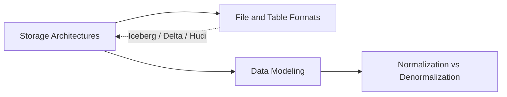

# Data Platforms

> **Why it matters** — Every downstream decision inherits your platform choices. The storage architecture, file format, and data model you pick decide query cost, correctness, and how much pain every team that touches the data will feel for years.

The storage layer is where every data platform decision compounds. Pick the wrong architecture and you fight it for years; pick the wrong format and every query pays a tax; pick the wrong model and every downstream team re-derives the truth differently.

This track covers the four platform decisions you make exactly once — and then live with:

## Who this is for

Data engineers, analytics engineers, and architects who need to *choose* — not just use — the storage and modeling layer. Assumes working SQL and some exposure to a warehouse or lake. This is the vocabulary senior interviews and architecture reviews are conducted in.

## Chapters

### [Storage Architectures](/fundamentals/storage-architectures)

Warehouse vs lake vs lakehouse vs data mesh — how the industry got from Oracle EDWs to Iceberg-on-S3, what each architecture actually buys you (cost, governance, flexibility, freshness), and where each one fails in production: swamp lakes, lock-in, and organizational meshes that collapse.

### [File & Table Formats](/fundamentals/file-formats)

Row vs columnar layout; Parquet internals (row groups, column chunks, statistics, encodings, predicate pushdown); Avro and Protobuf for row-oriented work; and the ACID table formats — Delta, Iceberg, Hudi — that turned raw files into tables. Plus the small-files problem and codec choice.

### [Data Modeling](/fundamentals/data-modeling)

Kimball dimensional modeling (grain, facts, conformed dimensions, SCD types), Inmon CIF, Data Vault 2.0, and One Big Table. When each earns its complexity, and how BI and ML consumers pull the model in opposite directions.

### [Normalization & Denormalization](/fundamentals/normalization)

1NF → BCNF with tiny concrete examples, the anomalies normalization prevents, and why the star schema is *deliberate* denormalization. Fan-out and chasm traps, surrogate vs natural keys, and where the OLTP/analytics trade-off actually bites.

## Pareto focus

If you only internalize these, you get most of the value:

- **Architecture is a workload decision, not a brand decision** — ACID-heavy BI on curated data favors warehouses/lakehouses; raw-data-at-scale plus ML favors lakehouse; org-scale favors mesh *as an operating model*, not a product.
- **Columnar + statistics = the whole trick** — Parquet/ORC are fast because queries read fewer bytes and skip row groups via min/max metadata. Predicate pushdown is not an optimization, it is the design.
- **Table formats are the real lakehouse** — Iceberg/Delta/Hudi add ACID, time travel, and partition evolution to object storage. Choosing one matters more than the file format underneath.
- **Declare the grain before anything else** — in dimensional modeling, the fact table's row definition decides every join, every metric, every bug you will or will not have.
- **Normalize until it hurts, then denormalize for reads** — OLTP wants BCNF; analytics wants star schemas. The failure mode is running BI queries on a normalized schema, not the other way round.
- **Surrogate keys are load-bearing** — they are what make SCD Type 2 history possible. Never expose natural keys in fact tables.
- **Every denormalization is a write-path contract** — you are trading a join for the obligation to keep copies consistent. Fan-out traps punish people who forget which side of the join multiplies.

Start with [Storage Architectures](/fundamentals/storage-architectures) — everything else sits on top of it.
