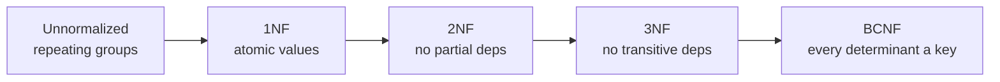
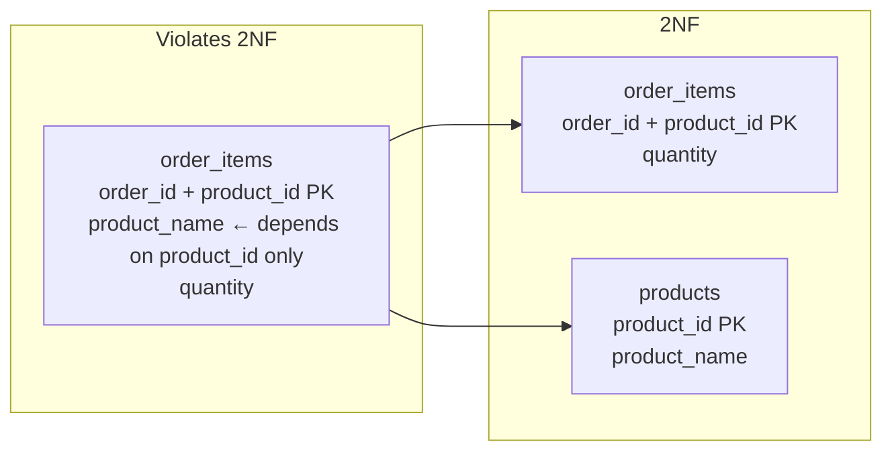
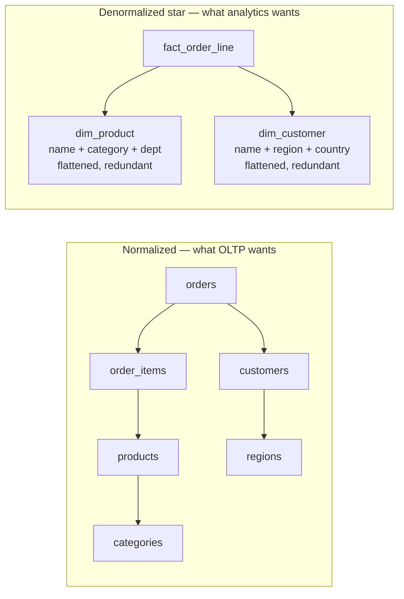
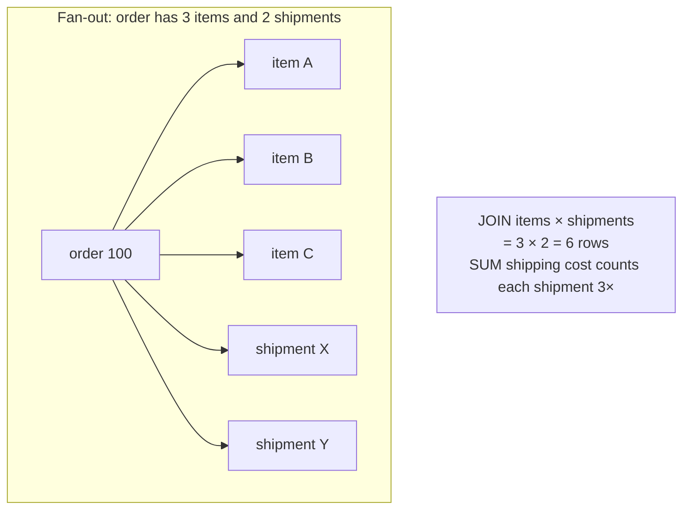
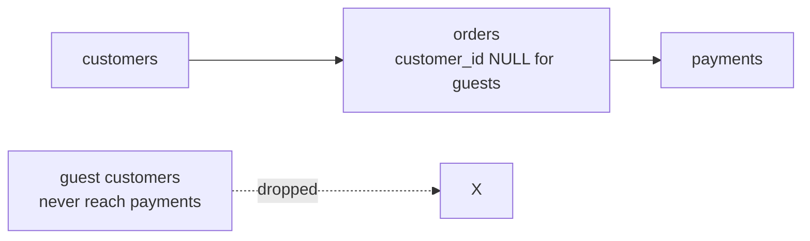
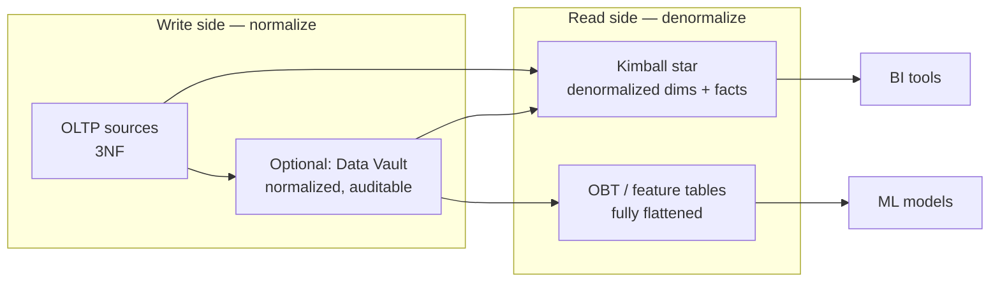
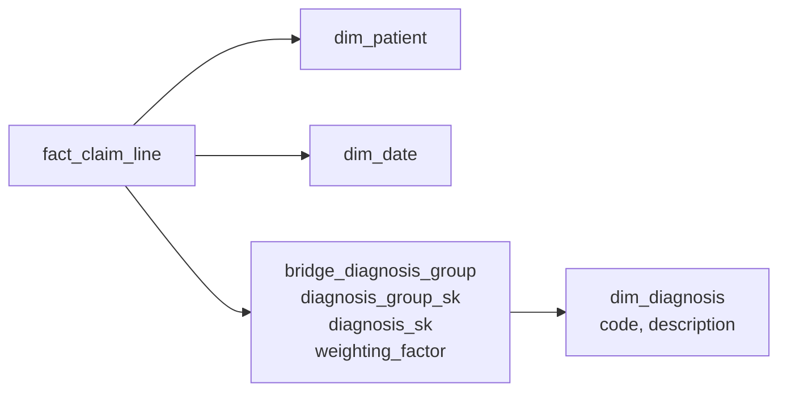

# Normalization & Denormalization

> **Why it matters** — Normalization is the discipline that keeps OLTP data correct; denormalization is the technique that makes analytics fast. Running BI queries on a 3NF schema is the most common self-inflicted performance problem in data engineering — and star schemas being *deliberate* denormalization is the insight junior engineers miss.

## What normalization prevents

Three anomalies, all from storing the same fact in multiple places:

| Anomaly | What goes wrong |
|---|---|
| **Insert** | Can't record a fact without unrelated data — can't add a new course until a student enrolls |
| **Update** | Update one copy, miss the others → inconsistent truth |
| **Delete** | Delete a row, lose an unrelated fact — dropping the last student deletes the course |

Normalization's whole job: **store each fact once**, so each of the three anomalies becomes impossible.

## The normal forms — with minimal examples

### 1NF — atomic values, no repeating groups

**Violates 1NF:**

| student_id | name | courses |
|---|---|---|
| 1 | Alice | `Math, Physics` ← list in a cell |
| 2 | Bob | `Math` |

**1NF:**

| student_id | name | course |
|---|---|---|
| 1 | Alice | Math |
| 1 | Alice | Physics |
| 2 | Bob | Math |

::: info ℹ️ Rule of thumb
If a WHERE clause needs `LIKE '%,Math,%'` or `SPLIT()`, you're not in 1NF. Arrays/JSON columns are a deliberate modern exception — they trade normalization for locality.
:::

### 2NF — no partial dependency on part of a composite key

Only relevant for **composite keys**. Violation:

`order_items(order_id, product_id, product_name, quantity)` — `product_name` depends only on `product_id` (part of the key), not the whole `(order_id, product_id)` key.

**2NF fix — split it:**

Now `product_name` lives once — updating it can't create inconsistency.

### 3NF — no transitive dependencies

Non-key attribute can't depend on another non-key attribute.

`employees(emp_id, emp_name, dept_id, dept_name)` — `dept_name` depends on `dept_id`, which depends on `emp_id`. That's transitive.

**3NF:** `employees(emp_id, emp_name, dept_id)` + `departments(dept_id, dept_name)`. Rename a department → one row changes, not every employee row.

### BCNF — every determinant is a candidate key

3NF's stricter sibling. Rarely matters, but interviewers ask. Violation:

`teaches(student, course, professor)` where each professor teaches exactly one course. Candidate keys: `(student, course)` and `(student, professor)`. But `professor → course` holds and `professor` is *not* a superkey — BCNF violation.

**BCNF fix:** `professor_course(professor, course)` + `enrolled(student, professor)`. Now professor→course lives in its own table.

::: details Deep dive: why BCNF matters less than 3NF
BCNF only bites on tables with multiple overlapping candidate keys — rare in practice. 3NF is the practical ceiling for OLTP; BCNF is the answer to "what's beyond 3NF" in an interview, not a design target you'll hit often.
:::

### Summary

| Form | Eliminates | Test question |
|---|---|---|
| 1NF | Repeating groups, non-atomic values | Is every cell scalar? |
| 2NF | Partial dependencies | Does every non-key attr need the *whole* key? |
| 3NF | Transitive dependencies | Does any non-key attr depend on another non-key? |
| BCNF | Non-key determinants | Is every determinant a superkey? |

## Why analytics denormalizes on purpose

The star schema is *deliberate* denormalization — you re-introduce redundancy to kill joins:

| | Normalized (3NF) | Denormalized (star/wide) |
|---|---|---|
| Joins per query | 5-10 | 1-4 |
| Write anomalies | None | Possible — mitigated by batch ETL |
| Storage | Compact | Redundant — cheap in columnar formats |
| Read pattern | Many small lookups | Big scans + aggregates |
| Schema rigidity | High | Flexible for analysts |
| Fits | OLTP, CDC sources, operational systems | Warehouses, marts, BI, ML features |

::: tip 💡 Senior insight
The asymmetry is *workload*, not dogma. OLTP does millions of tiny point-writes where an anomaly is a real bug; analytics does scans where a join is a real cost. You normalize the write side (sources, OLTP, Data Vault) and denormalize the read side (star schemas, OBTs, feature tables). The ETL between them is the consistency mechanism.
:::

## The traps denormalization creates

### Fan-out trap

Join a 1:N table to another 1:N on a shared key and rows multiply — aggregates silently inflate.

`SUM(s.shipping_cost)` returns 3× the real answer because each shipment row fanned out per item.

::: warning ⚠️ This is the #1 production bug in analytics SQL
Fan-out doesn't error — it returns a plausible wrong number. Fix: **aggregate each side before joining**, or use `SUM(DISTINCT)` where safe, or restructure so you never join two 1:N relationships in one query. Every analytics engineer has shipped this bug.
:::

### Chasm trap

A lookup table that should connect two facts is optional — rows silently drop because the bridge is NULL.

`customers → orders → payments` with an inner join drops guest orders entirely. The model assumes every order has a customer; reality disagrees. Fix: outer join, or a `guest` sentinel row.

## Surrogate vs natural keys

| | Natural key | Surrogate key |
|---|---|---|
| What | `email`, `SKU`, `SSN` — meaning in the data | Auto-increment / UUID — no meaning |
| Stability | Can change (email, SKU re-use) | Immutable |
| SCD support | Breaks — same natural key = new row impossible | Enables Type 2 — one entity, many surrogate rows |
| Join performance | Wider (strings) | Narrow (int/bigint) |
| Portability | Leaks business logic into schema | Clean separation |

::: tip 💡 Senior insight
**Always surrogate keys in the warehouse** — they are what makes SCD Type 2 possible (same `customer_id`, different `customer_sk` per version) and they never break when a source re-keys. Expose natural keys as *attributes* for lookup, never as join keys.
:::

## SCDs as the history strategy

Denormalized dimensions change slowly but *do* change. The SCD type is the contract for how much history the dimension keeps — Type 1 overwrites (no history), Type 2 keeps point-in-time rows via effective dates. Covered in depth in [Data Modeling](/fundamentals/data-modeling) — the link here is that **SCD Type 2 is only implementable because of surrogate keys**: the natural key stays constant while each version gets a new surrogate.

## Where the two disciplines meet

## Denormalization patterns beyond the star

| Pattern | What it is | The trade |
|---|---|---|
| **Flattened dimension** | `dim_product` holds `category_name`, `dept_name` — not FKs to snowflake tables | Redundancy for 1-join queries; update anomalies handled by rebuild |
| **Pre-joined wide table / OBT** | Facts + all dimension attrs in one row | Zero joins; rebuild on any dim change |
| **Materialized aggregate** | `agg_monthly_region` pre-summed | Fast dashboards; only answers its grain |
| **JSON/ARRAY column** | Order items nested inside `orders` | Locality over normalization; query engines handle `UNNEST` |
| **Snapshot table** | Daily copy of the entity | Point-in-time queries without SCD joins; storage × time |

Every one is a **read-optimization paid for at write time** — the same contract as denormalization in general, just different granularity.

## Bridge tables — many-to-many in a star schema

A fact row can legitimately carry *several* values for one dimension: a patient has many diagnoses, a bank account has many account holders, a sale involves many sales reps. A star schema's FK columns hold one value each — the **bridge table** is the deliberate denormalized join that makes the multivalued case work.

| Piece | Role |
|---|---|
| `diagnosis_group_sk` on the fact | A single key per claim — star schema grain preserved |
| Bridge rows per group member | One row per (group, diagnosis) pair |
| `weighting_factor` | Shares of the measure across members summing to 1.00 — the column that makes allocations correct |

:::: warning ⚠️ Double counting is the default, not the exception
Join the bridge without the weighting factor and every measure fans out — a $1,000 claim with 3 diagnoses becomes $3,000. Two safe aggregations: **weighted** (`SUM(amount × weighting_factor)` → allocates the dollar once) or **impact** (`COUNT DISTINCT claim` per diagnosis → answers "how many claims *involved* this code" without adding to a total). Pick per question; never SUM the raw amount through a bridge.
::::

Hierarchy bridges are the same idea for ragged hierarchies (org charts, chart-of-accounts): one row per (subordinate, superior) pair at every depth, so "all spend under manager X" is a join, not a recursive CTE at query time.

## Practical rules

- **Normalize until 3NF, then stop** — BCNF/4NF/5NF matter for exams and edge cases, not most schemas.
- **The write side normalizes; the read side denormalizes** — never serve analytics off the OLTP schema, never put a star schema in front of a transactional app.
- **A fact table is already denormalized** — `customer_name` does *not* belong on the fact; that is an accidental redundancy, not the deliberate kind. Denormalize into *dimensions*, not facts.
- **Every denormalized copy needs a rebuild story** — if you can't regenerate the wide table from the normalized base, you don't have a model, you have a fork.

The modern stack implements this literally: **normalized raw/bronze → conformed silver → denormalized gold marts**. You didn't abandon normalization — you moved it upstream.

## 🧠 Quiz

<QuizCard :questions="[{ q: 'A table has order_id + product_id as composite key and stores product_name. Updating a product name requires touching every order_items row. Which normal form is violated?', options: ['2NF', '3NF', 'BCNF', '1NF'], correct: 0, explain: 'product_name depends only on product_id — a part of the composite key. That partial dependency is a 2NF violation; fix by splitting products out.' }, { q: 'A star schema with a flattened dim_product containing product_name, category, and department is an example of:', options: ['A fan-out trap', 'Deliberate denormalization that trades redundancy for fewer joins — correct for analytics', 'A normalization failure', 'BCNF'], correct: 1, explain: 'Analytics denormalizes on purpose. The redundancy is absorbed by columnar compression; the win is 1 join instead of 4.' }, { q: 'SUM(revenue) returns triple the expected value after joining orders to both items and shipments. The cause:', options: ['Surrogate key misuse', 'Fan-out trap — joining two 1:N relationships multiplies rows; each shipment counted once per item', 'Compression issue', 'SCD Type 2'], correct: 1, explain: 'items(3) × shipments(2) = 6 joined rows, each shipment repeated 3 times. Aggregate each side before joining.' }, { q: 'Why must fact tables join dimensions on surrogate keys, not natural keys?', options: ['Surrogate keys are faster only', 'It does not matter', 'Natural keys are too long', 'SCD Type 2 creates multiple dimension rows per natural key — only the surrogate identifies the version valid at fact time'], correct: 3, explain: 'With Type 2, customer_id C-100 has two rows (NY then CA). The fact stores the surrogate of the row valid at event time — the natural key alone is ambiguous.' }, { q: 'When is denormalizing an OLTP schema appropriate?', options: ['Always — fewer joins is always better', 'Never — normalization is a correctness property for write-heavy systems', 'When storage is expensive', 'Only for the audit log'], correct: 1, explain: 'In OLTP, normalization prevents update/insert/delete anomalies — a correctness guarantee. Denormalize the read/analytics side; keep writes normalized.' }, { q: 'BCNF differs from 3NF in that it additionally requires:', options: ['Composite keys only', 'No NULLs', 'Every determinant to be a candidate key — catches anomalies when multiple overlapping candidate keys exist', 'Foreign keys on all columns'], correct: 2, explain: '3NF allows a non-key attribute to be determined by another non-key if the latter is part of a candidate key; BCNF forbids it. Only relevant with overlapping candidate keys.' }]" />

<QuizCard :questions="[{ q: 'In Kimball four-step order, what must be declared before identifying dimensions and facts?', options: ['The SCD type', 'The grain — exactly what one fact row means, in business terms', 'The ETL tool', 'The surrogate key strategy'], correct: 1, explain: 'Grain comes second only to choosing the business process. Dimensions and facts are validated against it — a fact at a different grain belongs in a separate table.' }, { q: 'A POS receipt has a line for every scanned item. The most atomic grain for retail sales analysis is:', options: ['One row per receipt', 'One row per customer per visit', 'One row per store per day', 'One row per product scanned on a sales transaction — the receipt line'], correct: 3, explain: 'Atomic grain preserves basket composition: product mix, promotion lift, and basket analysis all need line-level rows. Coarser grains can aggregate up but never drill down.' }, { q: 'A bridge table resolves many-to-many (one claim, many diagnoses). What stops SUM(amount) from inflating?', options: ['Nothing — SUM is always correct through a bridge', 'The weighting_factor column — allocates each measure across members so weighted sums total correctly', 'SCD Type 2 on the bridge', 'DISTINCT on the diagnosis key'], correct: 1, explain: 'Bridge joins fan out by design. weighting_factor (sum 1.0 per group) makes SUM(amount x factor) correct; unweighted use COUNT DISTINCT for impact-style questions.' }]" />

## Further reading

- [Database normalization — Wikipedia](https://en.wikipedia.org/wiki/Database_normalization)
- [Boyce-Codd normal form — Wikipedia](https://en.wikipedia.org/wiki/Boyce%E2%80%93Codd_normal_form)
- [Description of database normalization basics — Microsoft](https://learn.microsoft.com/en-us/office/troubleshoot/access/database-normalization-description)
- [Database normalization — AWS prescriptive guidance](https://docs.aws.amazon.com/whitepapers/latest/modern-data-architecture-rationales-on-aws/database-normalization.html)
- [Star schema — Wikipedia](https://en.wikipedia.org/wiki/Star_schema)
- [Slowly changing dimension — Wikipedia](https://en.wikipedia.org/wiki/Slowly_changing_dimension)
- [Kimball dimensional modeling techniques](https://www.kimballgroup.com/data-warehouse-business-intelligence-resources/kimball-techniques/dimensional-modeling-techniques/)
- **The Data Warehouse Toolkit** — Ralph Kimball & Margy Ross (2013), [Wiley / Kimball Group](https://www.kimballgroup.com/data-warehouse-business-intelligence-resources/books/data-warehouse-dw-toolkit/)
