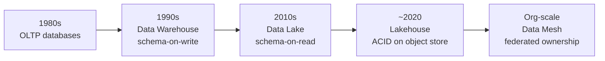
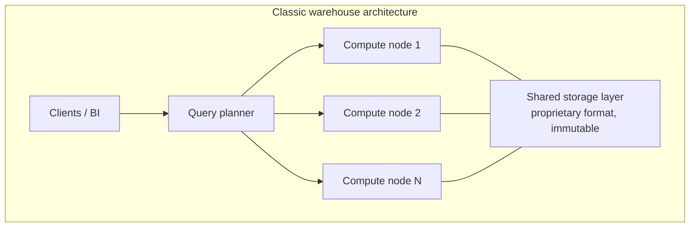
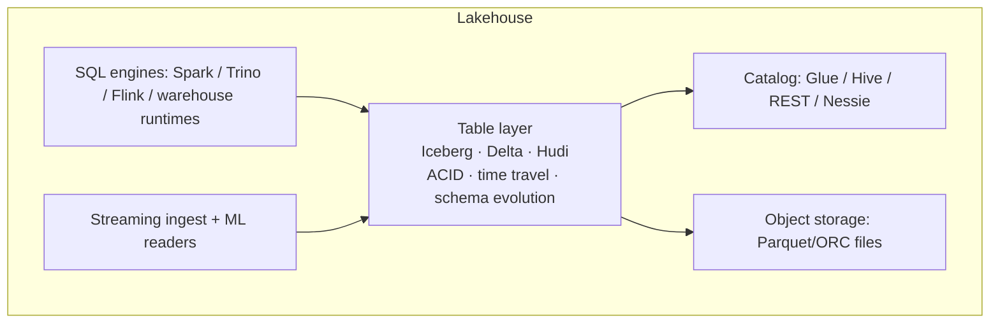
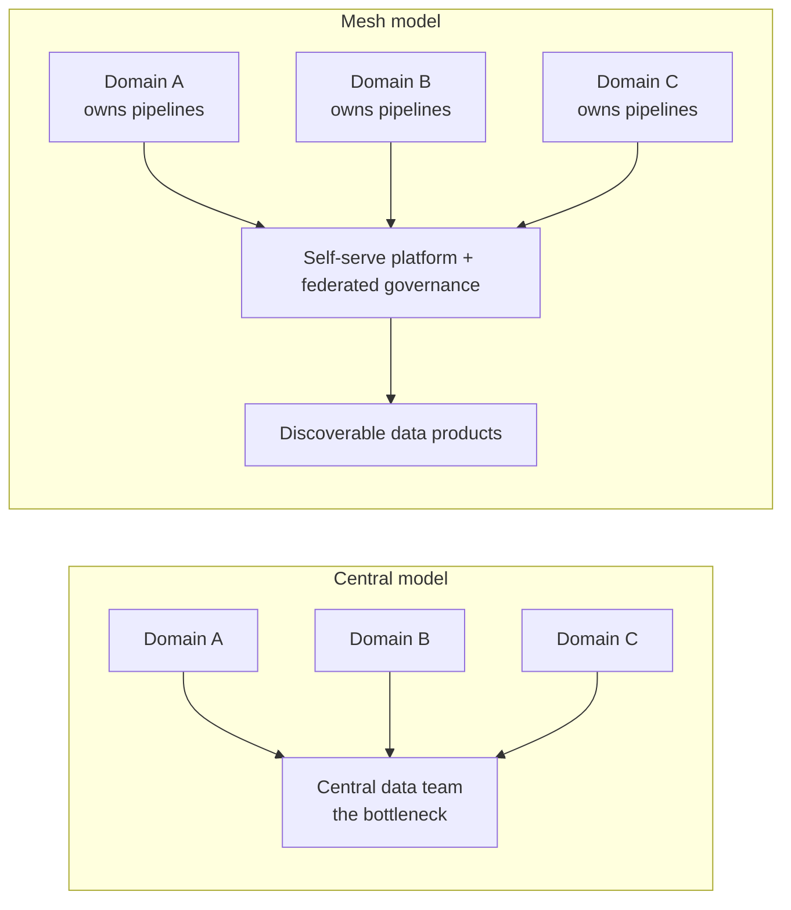
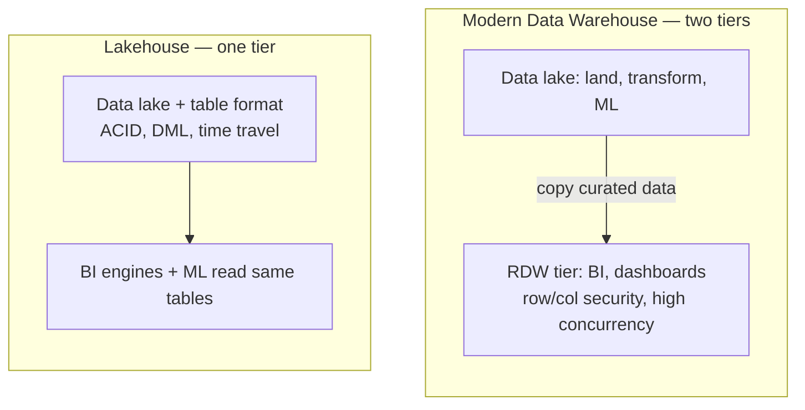
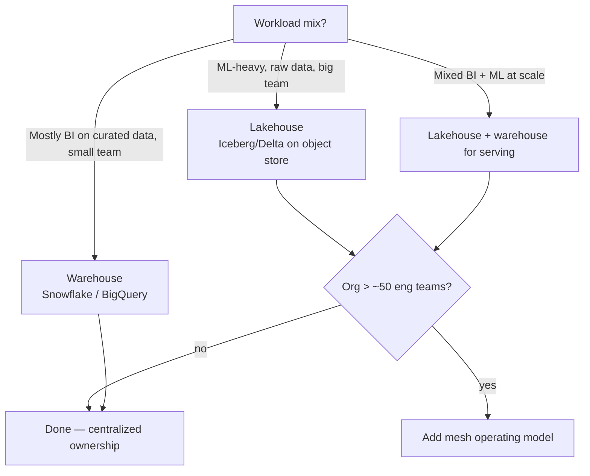
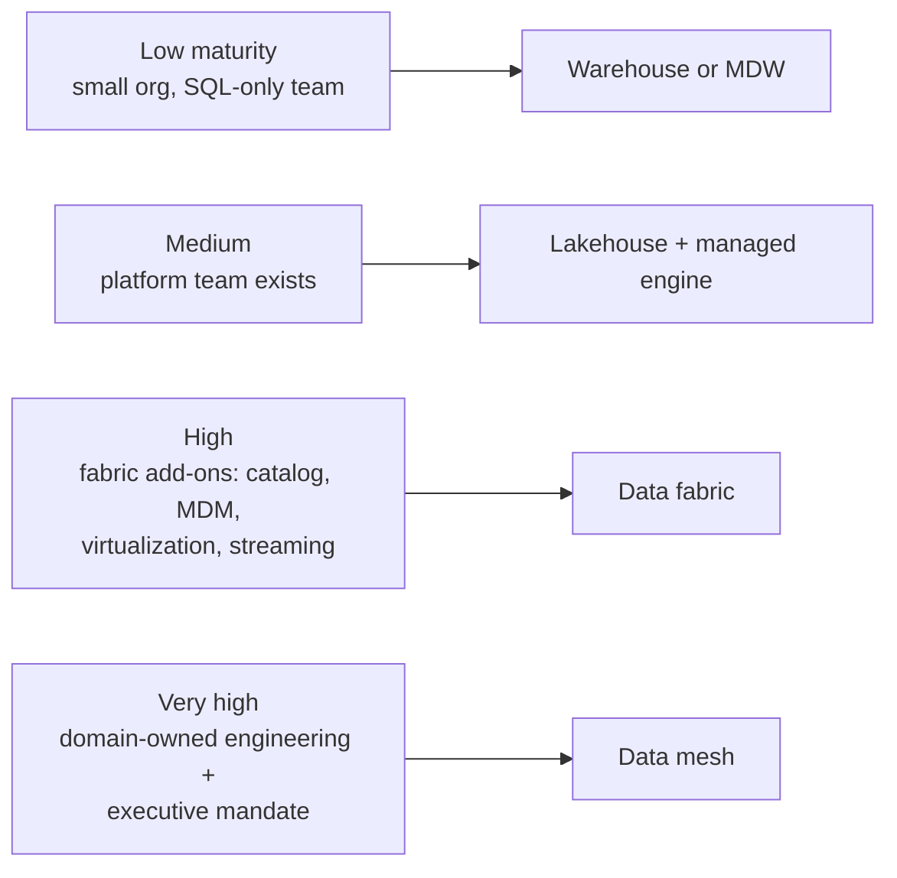
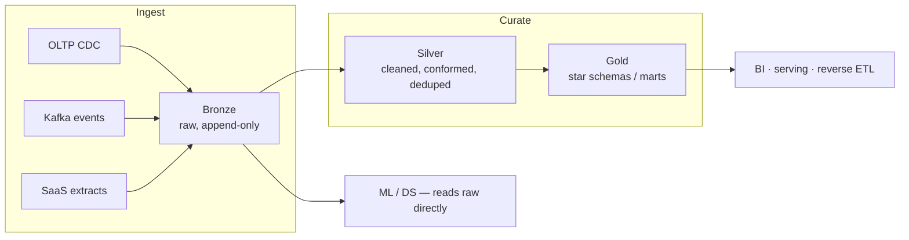

# Storage Architectures

> **Why it matters** — Every data platform you'll ever touch is one of four architectures (or a hybrid trying to be two). Choosing wrong is the most expensive mistake in the field: you migrate petabytes, rewrite every model, and retrain every consumer. Senior interviews test whether you can defend the trade-offs, not recite vendor marketing.

## How we got here

Each architecture exists because the previous one couldn't handle a workload. The sequence matters more than the definitions:

| Architecture | Triggered by | It fixed |
|---|---|---|
| Data warehouse | BI/OLAP couldn't run on OLTP boxes | Analytical queries at reasonable speed |
| Data lake | Warehouses too rigid/expensive for big data + ML | Cheap storage of everything, any schema |
| Lakehouse | Lakes had no ACID, no schema enforcement, became swamps | Warehouse features on cheap lake storage |
| Data mesh | Central team became the bottleneck at org scale | Domain ownership, data-as-product |

The pattern: **centralize → decentralize → reconcile**. Every stage adds a layer without deleting the previous one — most real companies have a lake *and* a warehouse right now.

## Data warehouse

Curated, structured, schema-on-write storage optimized for SQL analytics. Historically shared-nothing MPP engines (Teradata, Netezza, Exadata); today dominated by decoupled storage/compute systems.

**Modern examples:** Snowflake, BigQuery, Redshift, Databricks SQL warehouses, ClickHouse.

::: tip 💡 Senior insight
Modern warehouses are *all* variations of the same idea: immutable storage + elastic compute + automatic optimization. Snowflake stores data in proprietary micro-partitions; BigQuery in Capacitor; Redshift RA3 in managed S3. You cannot read the files directly — that is the price of the managed experience.
:::

## Data lake

Cheap object storage (S3, GCS, ADLS, HDFS historically) holding files in open formats. Schema is applied at read time, not write time.

**Examples:** S3 + Parquet queried by Spark, Trino, Athena; Hadoop clusters (legacy).

| What it wins | What it loses |
|---|---|
| Store anything, schema-on-read | No ACID — partial writes visible |
| ~$23/TB/month object storage vs $$$ warehouse | No enforcement → **data swamp** |
| Any engine can read the files | Data discoverability collapses without a catalog |
| ML/DS workloads read raw data directly | BI teams can't find or trust anything |

::: warning ⚠️ The swamp failure mode
The lake doesn't fail at ingest — it fails 18 months later when nobody knows which of the 40 `customers_*` folders is real, the "raw" bucket has PII nobody catalogued, and every team re-derives the same transformations. Ingest without a catalog, lifecycle policy, and ownership is deferred cost, not savings.
:::

## Data lakehouse

The lakehouse bolts warehouse capabilities onto the lake: an **open table format** (Delta, Iceberg, Hudi — see [File & Table Formats](/fundamentals/file-formats)) adds ACID transactions, schema enforcement, time travel, and partition management on top of files in object storage.

The key insight: **the "warehouse" is now a metadata layer**, not a storage engine. Any engine that understands the table format can read/write the same tables — that is the anti-lock-in property warehouses lack.

::: details Deep dive: why "open format" is the whole point
A Snowflake table is only readable by Snowflake. An Iceberg table on S3 is readable by Snowflake, Databricks, Trino, Flink, and duckdb — simultaneously, through a shared catalog. This changes procurement math: you can switch query engines without a migration. The trade is that *you* now own compaction, clustering, and metadata hygiene that a warehouse does for you.
:::

## Data mesh

Not a storage technology — an **operating model**. Zhamak Dehghani's four principles:

1. **Domain ownership** — teams that produce data own it, not a central DE team.
2. **Data as a product** — domains ship discoverable, documented, quality-guaranteed datasets.
3. **Self-serve platform** — a platform team provides tooling so domains don't rebuild infra.
4. **Federated computational governance** — global policies enforced via platform, local decisions by domains.

::: warning ⚠️ Mesh fails organizationally, not technically
Most failed "mesh" adoptions were tech purchases for an org problem. If a company can't make domain teams own their *services'* quality, it won't make them own data products. Mesh amplifies governance problems — it never fixes them. Precondition: engineering maturity high enough that teams already own their operational quality.
:::

## Serra's taxonomy: MDW vs lakehouse vs fabric vs mesh

James Serra (*Deciphering Data Architectures*, O'Reilly 2024) draws the boundaries differently than marketing does — and his definitions are the ones that survive scrutiny:

- **Modern Data Warehouse (MDW)** — a *two-tier* pattern: data lake for landing/transform/ML **plus** a relational warehouse that holds a *copy* of curated data for BI. Serra's litmus test: "if no data is replicated from the lake into an RDW, it's a lakehouse, not an MDW."
- **Lakehouse** — *one-tier*: the lake does both jobs; the warehouse is deleted, not layered.
- **Data fabric** — an MDW plus a *technology layer*: Serra lists eight add-ons (data access policies, metadata catalog, MDM, data virtualization, real-time processing, APIs, services, products) and calls it a fabric once ~3+ are present. Fabric is still **centralized** — it's the MDW with better plumbing.
- **Data mesh** — an *organizational* layer, not a product: domain ownership + data-as-product.

The MDW pays a **duplication tax**: extra storage, extra pipelines, and a second copy of truth that can drift. The lakehouse removes the tax but gives up RDW-grade machinery — MPP joins, indexing, caching, materialized views, row/column security, high dashboard concurrency, and a *forced* metadata layer where schema-on-write guarantees the metadata always matches the data.

::: warning ⚠️ Fabric ≠ mesh — different axes entirely
Fabric is a **technology** decision; mesh is an **org-chart** decision. They compose, not compete: each mesh domain can run its own fabric internally. "Should we do fabric or mesh?" is a category error — the real question is "does our bottleneck live in the plumbing (fabric) or the org (mesh)?"
:::

::: details Serra's lakehouse trade-off checklist — what you lose skipping the RDW
- Millisecond dashboard queries (MPP joins, columnstore indexes, result caching, materialized views)
- Row-level / column-level security, dynamic masking, workload management, high concurrency
- A forced metadata layer — in file-land the catalog can drift or go missing entirely
- ANSI-SQL tooling comfort — Spark-centric stacks can mean retraining users and rewriting procs/views

His rule: none of these alone is a showstopper — PoC it. If BI users tolerate 5-second queries, skip the RDW; if they need millisecond dashboards, you've just rediscovered the MDW.
:::

## The comparison that matters

| Dimension | Warehouse | Data Lake | Lakehouse | Data Mesh |
|---|---|---|---|---|
| Schema | On write, enforced | On read, optional | On write (enforced by format) | Per-domain, federated |
| Storage cost/TB | High ($$$) | Lowest | Lowest | Same as underlying stack |
| Query cost | Predictable, pricey | Cheap storage, expensive scans | Medium | Varies by domain |
| ACID / updates | Native | None (object store append only) | Yes via table format | Inherited |
| BI performance | Excellent | Poor without format layer | Good | Depends on products |
| ML/raw-data access | Awkward | Native | Native | Per domain |
| Governance | Centralized, strong | Weak → swamp | Strong if you build it | Federated, hardest |
| Vendor lock-in | Highest | Lowest | Medium (format open, engine swappable) | Architectural, not vendor |
| Org fit | Small/mid team | DE-heavy | DE-heavy + platform team | Large eng orgs only |

## How to actually choose

::: info ℹ️ Heuristic
Default 2026 answer for a new platform: **lakehouse table format on object storage** (Iceberg is the current gravitational center) with a managed query engine on top. Pure warehouse for BI-only teams; mesh only when org structure demands it.
:::

### The scored decision table (Serra's framework)

Serra's core argument is that there is **no one-size-fits-all architecture** — you score your own org, not the vendor's slide deck. Weight each factor 1–5 for your situation:

| Factor | Score low → | Score high → | Where high points |
|---|---|---|---|
| Org size | Few domains, one data team | Dozens of domains, federated teams | Mesh only at the top end |
| Data team maturity | Analysts + SQL only | Platform team, data engineers per domain | Lakehouse / mesh need high |
| Governance needs | Loose, internal use only | Regulated: lineage, row/col security, audit | MDW / warehouse tier |
| Tooling appetite | Prefer managed, pay for convenience | Run OSS formats, own compaction/catalog | Lakehouse |
| Data volume | under 10 TB, BI-centric | Big + streaming + semi-structured | MDW → fabric at scale |

::: tip 💡 Senior insight
Serra's readiness gate for mesh is brutal: Dehghani's own self-assessment lists ~9 criteria (domain-oriented org, exec sponsorship, modern engineering culture, bleeding-edge tolerance, data-as-asset literacy...) and *all* must be somewhat/highly applicable — in his experience maybe **1% of companies qualify**. The rarest scores are "early adopter," "domain-oriented org structure," and "modern engineering practices." If you can't reorg the company by domains, you don't have a mesh — you have data federation, which is fine, but call it what it is.
:::

::: warning ⚠️ Mesh myth-busting
Two myths Serra kills: (1) mesh *replaces* your lake/warehouse — no, it reorganizes who owns them; (2) data virtualization alone = mesh — no, federation satisfies only the domain-ownership principle, not data-as-product. And "partial mesh" (hub-and-spoke: mesh domains extending a still-centralized platform) is the realistic path, not the pure model.
:::

## The real-world hybrid: medallion on a lakehouse

Almost nobody runs a *pure* architecture anymore. The common production shape:

Bronze/silver/gold is the *data-quality* layering the lakehouse gives you for free — warehouses can ingest semi-structured raw (Snowflake VARIANT, BigQuery JSON, external tables) but treat it as staging, while open-format lakehouses make raw a first-class, engine-portable layer. A raw lake can't enforce silver quality (no schema enforcement). The medallion pattern is the lakehouse's killer workflow.

## Cost model intuition

| Cost driver | Warehouse | Lakehouse |
|---|---|---|
| Storage | Premium $$$/TB-month | Object-store $/TB-month |
| Query | Credits/slots — predictable, expensive | Engine-dependent — cheaper but ops burden |
| Ingest/ETL | Load credits + transform compute | Spark/Flink compute + format compaction jobs |
| Hidden cost | Egress + migration lock-in | Compaction, clustering, catalog ops you own |
| Break-even | BI-heavy, spiky query load | Write-heavy, ML-heavy, multi-engine |

::: tip 💡 Senior insight
Warehouses price for *convenience* — auto-optimization, zero tuning. Lakehouses are cheaper per byte but you pay in headcount: someone runs compaction, tunes partitions, maintains the catalog. Below ~5 engineers the warehouse's ops-free model usually wins on total cost even at higher $/TB.
:::

Serra adds the two cost levers people forget: the MDW's **duplication tax** (paying for the same data in lake *and* RDW storage, plus the pipelines to keep them in sync — and risking silos when they drift) versus the lakehouse's **serverless-per-query** upside when you skip the RDW copy entirely. His governance corollary: an RDW forces schema-on-write, so metadata can never detach from the data — in a file-based lakehouse the catalog is optional plumbing, and "the metadata drifted from the data" is a governance failure you now own.

## Migrating between architectures

Migrations are the expensive part — so plan the *exit* before you pick the entry:

| From → To | Pattern | The catch |
|---|---|---|
| OLTP → Warehouse | CDC + scheduled ELT into star schemas | Schema drift breaks ETL; late-arriving dimensions |
| Warehouse → Lakehouse | Unload to open format (Iceberg) in your own bucket | Stored procs/UDFs don't port; credit-burn query tuning needs redoing |
| Lake → Lakehouse | Register existing files under a table format | No data move needed — the format is metadata. The work is schema + partitioning |
| Any → Mesh | Replatform domains one at a time onto a self-serve stack | Org change disguised as a migration; needs executive ownership, not a project plan |

::: details Deep dive: the "strangler fig" pattern for storage
Don't big-bang migrate. Stand up the new architecture, route *new* workloads to it, backfill historical data in parallel, and cut over consumers mart-by-mart — the same strangler-fig approach used for microservice migrations. The kill signal isn't "all data moved" — it's "all consumers moved." Tables nobody reads get archived, not migrated.
:::

## What senior engineers actually optimize for

The architecture decision is rarely "which is best" — it's "which failure mode can we absorb."

- **Can't afford a platform team?** Warehouse. Auto-everything is worth the premium.
- **Can't afford lock-in?** Open table format on your own bucket — engine-swappable forever.
- **Can't afford a swamp?** Enforce schema + catalog from day one — governance is cheaper at ingest than retrofit.
- **Can't afford central bottleneck?** Mesh — but only after the org can actually own quality.

::: warning ⚠️ The two-platform tax is the default failure
Most real-world "architectures" are accidental: a lake stood up for ML, a warehouse bought for BI, and a nightly ETL job shuffling truth between them. The lakehouse's entire value proposition is killing that middle leg. If your diagram has an arrow labelled "sync to warehouse," that's the thing to delete.
:::

## Failure modes to quote in an interview

- **Swamp**: ingest with no catalog, retention, or ownership.
- **Two-platform tax**: lake for ML + warehouse for BI, with nightly ETL between them — the classic 2015-2020 architecture the lakehouse exists to kill.
- **Lock-in**: proprietary format means migration = rewrite. Snowflake egress + re-ETL cost is real money at scale.
- **Mesh theatre**: "self-serve platform" that is actually a Jira queue to the data team.
- **Format sprawl**: Delta in one team, Iceberg in another, CSV-landing zones everywhere — a swamp wearing a nicer costume.

## 🧠 Quiz

<QuizCard :questions="[{ q: 'A company stores all data as Parquet on S3 and queries via Trino. A BI team complains queries are slow and updates are impossible. What is the minimal architectural fix?', options: ['Add more Trino workers', 'Move everything to Snowflake', 'Switch from Parquet to CSV for flexibility', 'Add an open table format like Iceberg on top of the files'], correct: 3, explain: 'The missing layer is table metadata — ACID, partition pruning, schema enforcement. Iceberg adds it without a migration: same files, same bucket, any engine.' }, { q: 'What is the defining technical property of a lakehouse?', options: ['It requires Hadoop', 'It uses Snowflake on the frontend', 'ACID transactions and schema enforcement on open file formats in object storage', 'It stores data in proprietary micro-partitions'], correct: 2, explain: 'The table format layer (Delta/Iceberg/Hudi) supplies ACID and schema management on top of open files — that combination is the lakehouse definition.' }, { q: 'A data lake turns into a swamp primarily because of:', options: ['Streaming ingestion', 'No catalog, ownership, lifecycle, or schema enforcement at ingest', 'Object storage costs growing', 'Too much Parquet compression'], correct: 1, explain: 'Lakes fail on governance debt, not technology. Files without metadata/ownership stop being discoverable and trustworthy.' }, { q: 'Data mesh is best described as:', options: ['A file format', 'An operating model: domain ownership + data-as-product + self-serve platform + federated governance', 'A CDC technology', 'A faster data warehouse'], correct: 1, explain: 'Mesh decentralizes ownership to domains. It is an organizational architecture — buying software cannot install it.' }, { q: 'BigQuery and Snowflake both charge more per TB than S3 because:', options: ['They store data on SSDs', 'They replicate data more', 'You are paying for the managed query layer, automatic optimization, and proprietary storage format that only their engine can read', 'Marketing'], correct: 2, explain: 'The premium buys the tightly integrated storage+compute+optimization — and the lock-in that comes with a format only that engine reads.' }, { q: 'When does data mesh become the right choice?', options: ['When you want cheaper storage', 'When a centralized data team is the bottleneck in a large, mature engineering org', 'Always, it is the modern default', 'When you have lots of data'], correct: 1, explain: 'Mesh solves an org-scale coordination problem. Below ~dozens of domain teams, centralization is simpler and faster.' }]" />
<QuizCard :questions="[{ q: 'Per Serra, what separates a Modern Data Warehouse from a lakehouse?', options: ['The MDW replicates at least some data from the lake into a separate RDW tier; a lakehouse keeps everything in one tier', 'The lakehouse cannot store Parquet files', 'The MDW uses only Snowflake', 'Nothing, they are synonyms'], correct: 0, explain: 'Serra\'s litmus test: no RDW copy means it is a lakehouse. The MDW pays a duplication tax; the lakehouse deletes the serving tier entirely.' }, { q: 'Data fabric vs data mesh — the correct framing is:', options: ['They are competing products', 'Fabric is a technology layer on top of a centralized architecture; mesh is an organizational layer, and each mesh domain can run its own fabric', 'Fabric is only for unstructured data', 'Mesh is a vendor product you can buy'], correct: 1, explain: 'Different axes: fabric answers a plumbing problem (catalog, virtualization, MDM, real-time), mesh answers an org-scaling problem. They compose rather than compete.' }, { q: 'Serra reports that roughly how many companies pass Dehghani\'s full data mesh readiness assessment?', options: ['About 25%', 'About half', 'All of them, since mesh is just software', 'About 1% — all criteria must be somewhat or highly applicable, and early-adopter, domain-oriented structure, and modern engineering scores are rare'], correct: 3, explain: 'The bar is organizational: exec sponsorship, domain reorg, modern engineering culture. Fail the org test and what you built is data federation, not mesh.' }]" />

## Further reading

- [Data lakehouse overview — Databricks](https://www.databricks.com/glossary/data-lakehouse)
- [What is a data warehouse? — Google Cloud](https://cloud.google.com/learn/what-is-a-data-warehouse)
- [What is a data lake? — AWS](https://aws.amazon.com/what-is/data-lake/)
- [What is a data warehouse? — AWS](https://aws.amazon.com/what-is/data-warehouse/)
- [Data Mesh principles — martinfowler.com](https://martinfowler.com/articles/data-mesh-principles.html)
- [Apache Iceberg docs](https://iceberg.apache.org/docs/latest/)
- [Delta Lake docs](https://docs.delta.io/latest/index.html)
- **Deciphering Data Architectures** — James Serra (2024), [O'Reilly](https://www.oreilly.com/library/view/deciphering-data-architectures/9781098150754/)
