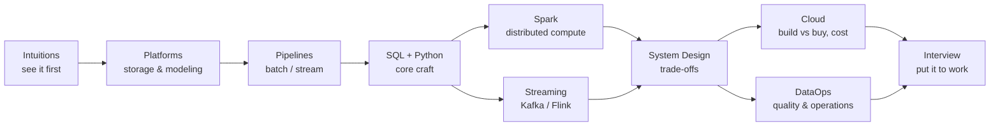

# How to use this knowledge base

## The learning model

Each of the 11 tracks is self-contained, but they build on each other. If you are aiming at **Senior Data Engineer / Solution Architect / Cloud Engineer**, the highest-leverage order is:

## Chapter anatomy

Every chapter follows the same shape:

1. **Why it matters** — the production problem the concept solves
2. **Core ideas** — visual, diagram-first explanations
3. **Comparison tables** — options and their trade-offs, side by side
4. **⚠️ Risks / 💡 Senior insights / ℹ️ Hints** — callouts for what bites in production
5. **🧠 Quiz** — 4–6 active-recall questions with explanations
6. **Further reading** — authoritative sources (books, official docs, engineering blogs)

## Studying effectively

- **Do quizzes honestly.** Answer before revealing. Retrieval practice is the mechanism; progress persists locally in your browser and shows on the [home page](/).
- **Redraw diagrams from memory.** If you can reproduce the Lambda vs Kappa diagram and explain when each wins, you own it.
- **Explain trade-offs out loud.** Senior interviews are trade-off conversations: "it depends" + *on what* + *what breaks first*.
- **Go wide, then deep.** First pass: all track overviews + one chapter per track. Second pass: full deep dives in your target area.

## The Pareto principle here

We deliberately exclude: tool version trivia, certification question banks, framework APIs you can look up in 30 seconds, and vendor marketing. We include: concepts that survive tool churn, failure modes that page you at 3am, and trade-offs that decide architecture reviews.

## Learn it like the lifecycle

The fastest way to make this stick is to build the *whole* lifecycle once, end to end, for one real thing — the way Reis & Housley frame the field: generation → ingestion → storage → transformation → serving, with security, orchestration, and quality as undercurrents beneath every stage, not as afterthoughts.

**Capstone exercise:** pick one business process you actually understand — your side project's orders table, a public transit feed, a personal finance export. Then walk the lifecycle:

1. **Source & ingest** — land the raw data (files, API, or CDC stream) untouched
2. **Store** — lay out bronze/silver/gold zones on a real warehouse or lakehouse
3. **Transform** — model it (staging → marts), with tests on every layer boundary
4. **Serve** — put it behind a dashboard, API, or a scheduled report someone would read
5. **Run it** — orchestrate the schedule, add a freshness alert, break it deliberately, and write the one-paragraph postmortem

A toy pipeline you built, broke, backfilled, and postmortemed teaches more than ten chapters read passively — each track on this site then slots into a stage you've already felt.

**Where the tracks fit:** the mermaid above is the core spine. Newer chapters extend it past the interview stage — *ML pipelines* and *GenAI engineering* apply the same lifecycle to model features and LLM data flows; once you can walk the capstone above, both are the same stages with different payloads.

<ProgressOverview />
