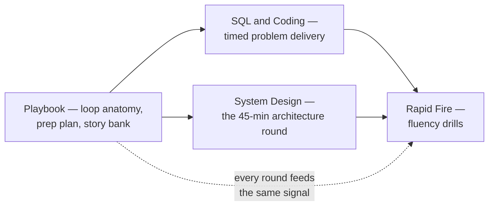
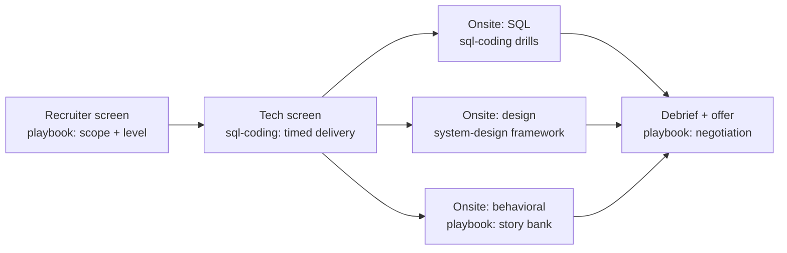

# Cracking the DE Interview

> **Why it matters** — Senior DE interviews don't test whether you know SQL; they test whether you can *narrate correct trade-offs in 45 minutes while someone watches*. Plenty of strong engineers fail loops because they've never practiced producing an answer under time pressure, out loud, on demand.

## Who this is for

Senior data engineers, staff candidates, and solution architects heading into loops at companies where "data engineering" means pipeline ownership, not dashboard maintenance. You already have the technical content — the other ten tracks cover it. This track covers the *delivery*: what each round filters for, how to structure an answer, what interviewers score, and where candidates actually lose points.

## How this differs from memorizing

An interview is a compressed simulation of working with you. The interviewer can't see your six months of production judgment, so they proxy it with three signals:

1. **Do you clarify before building?** Restating the grain, the edge cases, the constraints — in the first two minutes, not after a wrong answer.
2. **Do you trade off explicitly?** "I'd dedupe on event_id rather than timestamp because retries shift timestamps" beats a silently-correct query.
3. **Do you recover?** A senior candidate who writes a bug, spots it, and narrates the fix scores higher than one who never errs but never narrates.

Everything in this track is organized around those signals.

## How the chapters fit

The loop itself, mapped to where this track helps:

## Chapters

**[The Playbook](/interview/playbook)** — The loop as it actually runs in 2024-2026: recruiter screen → technical screen → onsite rounds (SQL/coding, system design, behavioral, sometimes ML or cloud depth), with what each round really filters for. Includes a 4-8 week prep plan, résumé rules that survive follow-up questions, a STAR story bank built for DEs (migration, incident, cost save), mid-vs-senior-vs-staff signal differences, red flags interviewers note, and a negotiation brief.

**[SQL & Coding Rounds](/interview/sql-coding)** — The timed round, deconstructed: what's actually asked (top-N-per-group, dedup, funnels, sessionization; Python generators, dict/set work, pandas/polars transforms), worked walkthroughs with minute-by-minute narration, eight practice problems with hints and full solutions, the failure modes that sink candidates, and the rubric interviewers score you on.

**[System Design Round](/interview/system-design)** — The data-platform design round: a 45-minute framework (requirements → estimation → high-level → deep dives → bottlenecks) and three fully worked designs — a real-time analytics pipeline, a zero-downtime CDC migration of a 2TB OLTP database, and a metrics/feature platform serving BI and ML — each with capacity math, trade-off decision points, failure modes, and the follow-up questions interviewers ask.

**[Rapid Fire](/interview/rapid-fire)** — Thirty quick-fire questions across fundamentals, SQL, Spark, streaming, cloud, modeling, and DataOps — each with a one-paragraph model answer you reveal after answering aloud. Fluency drills for the last 72 hours before the loop.

## Round → chapter → drill map

| Round | Chapter | What to drill |
|---|---|---|
| Recruiter + hiring manager | [Playbook](/interview/playbook) | Level calibration, comp deflection, why-this-role |
| Technical screen | [SQL & Coding](/interview/sql-coding) | 25-min timed problems, narrated |
| Onsite coding | [SQL & Coding](/interview/sql-coding) | The 8 problems + twist follow-ups |
| Onsite design | [System Design](/interview/system-design) | The 5-phase framework, one full design aloud daily |
| Behavioral | [Playbook](/interview/playbook) | 8-12 STAR stories, 2-min versions |
| Final 72 hours | [Rapid Fire](/interview/rapid-fire) | All 30 Q&As aloud, QuizCard sets |

## Pareto focus

What actually moves offer decisions:

1. **Say the grain before anything else.** "One row per user per day" — most wrong answers are unspoken wrong assumptions about grain.
2. **Narrate continuously.** Silence is scored as floundering even when you're thinking correctly. Think aloud or lose credit for the thought.
3. **Timebox ruthlessly.** A perfect answer to a question you weren't asked costs you the question you were.
4. **Trade-offs are the answer.** At senior level there is no "correct" design — there's a defensible one with named costs.
5. **Numbers beat adjectives.** "10k events/sec, ~500B each, ~4GB/day" signals you operate systems; "it should scale" signals you read about them.
6. **Own failure modes first.** Naming what breaks before you're asked is the single strongest senior signal.
7. **Behavioral stories are data.** Migration, incident, cost save, conflict — prepare 8-12 STAR stories with real numbers and reuse them across every question.
8. **The round is the product demo.** You are demoing what it's like to work with you. Collaborate with the interviewer; don't perform at them.
