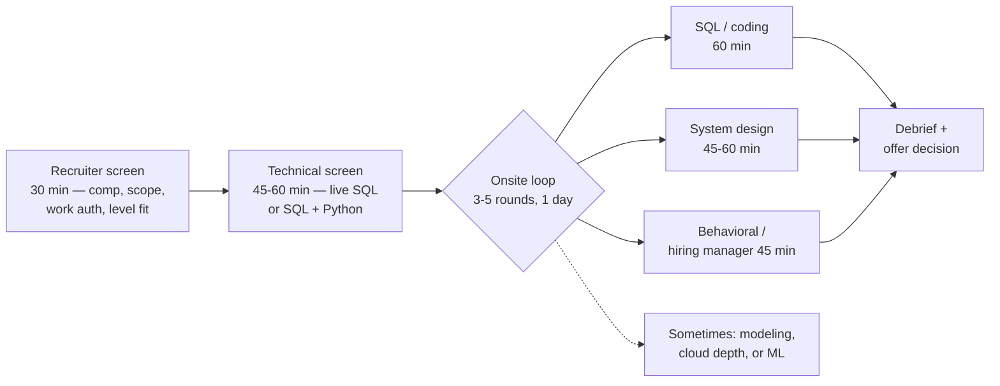
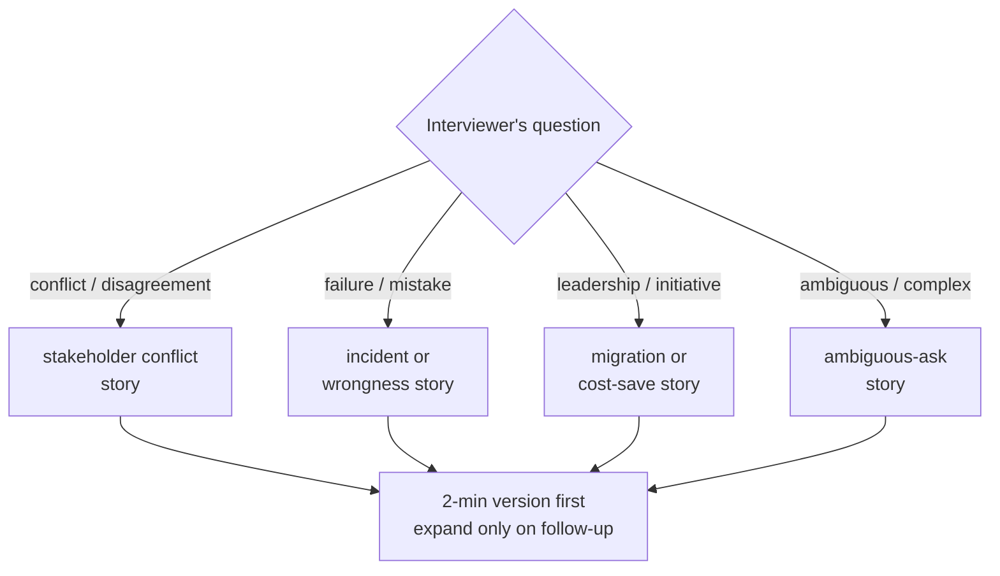
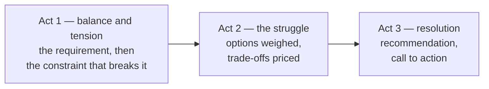

# The DE Interview Playbook

> **Why it matters** — Most failed loops aren't failed on skill; they're failed on logistics: no prep plan, stories improvised on the spot, a résumé line that collapses under two follow-up questions. This chapter is the operating plan for the whole loop — the technical content lives in the sibling chapters.

## The loop, as it actually runs

Senior DE loops have standardized. Expect 4-6 rounds across 3-6 weeks from recruiter contact to decision:

Two structural notes:

- **The technical screen is the filter.** Companies report it eliminates most candidates. It's usually one medium SQL problem + one Python manipulation problem in a shared editor (CoderPad, HackerRank). Pass rate here gates everything else.
- **"DE loops" vary more than SWE loops.** At some shops the onsite is SQL-heavy (Meta-style); at others it's pipeline-design-heavy with barely any live coding (startup platform teams). Ask the recruiter explicitly: *"What does each round cover?"* — it's a normal question and the answer shapes your prep allocation.

::: tip 💡 Senior insight
Ask the recruiter two things candidates rarely do: the **level band** the role is calibrated for and the **round breakdown**. "Is the design round a data-platform design or a generic web-backend design?" — teams answer this, and prepping for the wrong design round is a common unforced error.
:::

## What each round actually filters for

| Round | Surface question | Real filter |
|---|---|---|
| Recruiter screen | Comp expectations, timeline, visa | Can they afford you; will you waste the loop |
| Technical screen | "Write a query / script" | Can you produce working code under time pressure, narrating as you go |
| SQL/coding onsite | Dedup, funnels, sessionization, transforms | Grain discipline, edge cases (NULLs, dupes, ties), correctness over cleverness |
| System design | "Design a pipeline / platform" | Trade-off reasoning, failure-mode ownership, capacity intuition |
| Behavioral | "Tell me about a time..." | Ownership, conflict handling, can they trust you at 3am |
| Hiring manager | Career arc, why this role | Level calibration, team fit, do you want *this* job |
| Modeling (when present) | Star schema vs OBT, SCD2 | Whether your models survive real downstream use |
| Cloud/ML depth (when present) | "How would this run on AWS?" | Hands-on vs theoretical — usually a probe, not a gate |

::: warning ⚠️ The hidden evaluation axis
Every round scores **communication** whether it says so or not. Interviewers write feedback like "correct solution but I couldn't follow the reasoning" — which is a *no* at senior level. Narrating isn't soft skill polish; it's half the rubric.
:::

### The recruiter screen script

The recruiter screen feels like a formality; treat it as the first scored round. Have these ready verbatim:

- **Your 60-second story.** Current role, scope, one signature result, what you're looking for. Rehearsed, not memorized — it's the opening to every subsequent round too.
- **The comp deflection.** "I haven't fully mapped the market for this level yet — happy to align once I understand the scope. What's the band for this role?" Getting *their* band first is free information.
- **Your timeline.** Which processes are live and their stages — recruiters plan around real timelines, and parallel processes create urgency without pressure tactics.
- **Three screening questions back.** Level band, round breakdown, and who the hiring manager is. Asking signals seniority; not asking signals passivity.

::: details Questions to ask at the end of every round
The "any questions for me?" slot is scored. Keep a bank of real questions: "What's the team's most painful data problem right now?", "What does on-call actually look like — pages per week, severity?", "How does a new hire earn trust fastest here?", "What's the pipeline you secretly wish someone would rebuild?" Pick two that fit the interviewer's seniority — engineers get the pain question; managers get the success-definition question.
:::

## The 4-8 week prep plan

Adjust start point to your baseline — this assumes a working senior DE who hasn't interviewed in 3+ years.

| Week | Focus | Daily block (~1.5h) | Exit criteria |
|---|---|---|---|
| 1 | Inventory + stories | Draft STAR story bank (8-12 stories); audit résumé line by line | Every résumé bullet survives 3 follow-ups; stories written down |
| 2 | SQL mechanics | 2 timed problems/day — windows, dedup, top-N, funnels | 8/10 medium problems clean in ≤25 min, narrated |
| 3 | SQL + Python | Alternate SQL sessions and Python (dict/set, generators, pandas) | Sessionization and funnel problems automatic; streaming-file scripts fluent |
| 4 | Design foundations | Re-derive reference architecture; practice capacity math; 2 mock designs | Can produce requirements→estimation→diagram in 30 min |
| 5 | Design deep dives | 3-4 full 45-min designs aloud; drill failure-mode questions | Two designs completed end-to-end with named trade-offs |
| 6 | Behavioral + resume drill | Record STAR answers (2 min each); peer grill on résumé | Stories land in ≤2 min with numbers, no rambling |
| 7 | Full mocks | 2 full loops (screen + 2 onsite rounds) with a peer or mock platform | Feedback is polish-level, not structural |
| 8 | Taper + rapid fire | [Rapid-fire drills](/interview/rapid-fire), weak-spot review, logistics | Rest before the loop; confidence > cramming |

::: info ℹ️ Compressed timeline
Only have 2 weeks? Cut to: story bank (days 1-2), SQL drills (days 3-6), one full design per day (days 7-9), one full mock + rapid fire (days 10-14). The story bank is *never* optional — it's the highest ROI per hour of anything here.
:::

## How to practice (the part people skip)

**Talk out loud, always.** Silent practice trains a different skill than the one being tested. Every practice problem: set a timer, narrate your reasoning, and if alone, record yourself — the playback is brutal and effective.

**Timebox to interview reality.** 25 minutes per medium SQL problem including narration. 40 minutes for a design *sketch* (requirements + boxes + one deep dive), not a full one.

**Mock with a human at least twice.** Peers, former colleagues, or platforms like interviewing.io / Pramp-style services. The feedback that matters: "where did you lose me?" — you can't self-assess that.

**Practice on a whiteboard or plain editor.** No autocomplete, no Copilot, no syntax highlighting safety net. The shared-editor environment is its own handicap; train in it.

::: tip 💡 Senior insight
The single biggest practice upgrade: **answer first, then check the model answer, then re-answer cold a week later**. Recognition is not recall. The spaced re-attempt is what converts a "solved" problem into an interview reflex.
:::

## Not all DE loops are the same

"Data engineer" means different jobs at different companies — and the loop composition follows the job. Prep for the archetype, not the title:

| Archetype | The job underneath | The loop emphasizes | Watch for |
|---|---|---|---|
| Big tech / FAANG | Central data platform or embedded product DE | Standardized loop: heavy SQL screens, generic-ish design round, strict level rubrics | Process is rigid; level mapping is fixed |
| Data-native vendors (Databricks, Confluent, Snowflake) | Building the tools themselves | Internals depth: Spark, query engines, distributed systems — closer to backend SWE | Expect "how does X work inside" follow-ups |
| Startups / scale-ups | First-or-few DEs: everything from ingest to BI | Breadth + pragmatism: pipeline design, tool selection, "what would you build here" | Culture questions about ambiguity and on-call |
| Analytics engineering shops | dbt, marts, stakeholder-facing | Modeling rounds, SQL depth, stakeholder scenarios | Less infra, more business metric reasoning |
| Consulting / solution architect | Client-facing data platform design | Communication, architecture breadth, requirements discovery | Design rounds with a "client" playing vague |

::: tip 💡 Senior insight
Mine the job description for the archetype before prep week 1. A posting listing "dbt, Looker, stakeholder management" is not the same prep target as one listing "Flink, K8s, JVM tuning" — and a surprising number of candidates prep the wrong loop.
:::

## The week of the loop

Logistics failures are embarrassingly common failure modes — treat the interview week like a deploy:

- **Environment test.** For remote rounds: camera, mic, the shared editor (open a test CoderPad), a quiet room, and a paper notebook for scratch — you cannot alt-tab to notes during a screen share.
- **Sleep beats cramming.** Day-before prep is rapid-fire review and logistics, not new material. A tired candidate rambles; a rested one narrates crisply.
- **Warm up before round one.** 15 minutes of rapid-fire aloud in the morning gets narration running — the first answer of the day is always the clunkiest; don't let it be in front of the interviewer.
- **Stack the schedule if you can.** Multiple onsite days across companies in the same two-week window: practice effects are real, and parallel processes are negotiation leverage.
- **After each round, take notes immediately.** What they asked, where you struggled — it's prep data for the next company and the debrief feedback rarely reaches you raw.

## After the loop: follow-up and recovery

- **Thank-you notes: short or skip.** A one-line thanks to the recruiter is fine; long "here's what I meant to say" follow-ups rarely change scores and occasionally hurt. Exception: if you genuinely flubbed a factual answer and can fix it in two sentences, send it — cleanly, once.
- **Silence has a half-life.** No response in a week → one polite ping to the recruiter. Still nothing → redirect energy to other processes; chasing doesn't accelerate debriefs.
- **One bad round ≠ a failed loop.** Debriefs aggregate signals; candidates regularly get offers with one weak round and strong everywhere else. The mistake is letting it bleed into the next interview's performance.
- **A rejection is calibration data.** If the recruiter shares feedback, log it next to your own post-round notes — the delta between your self-assessment and their score is the most valuable signal in the whole process.

## Résumé rules that survive follow-ups

Interviewers pick résumé lines and drill three levels deep. Every bullet must survive: *how did you measure it, what was your specific role, what was the alternative you rejected?*

- **Numbers you can defend.** "Reduced warehouse spend 40%" → be ready: baseline, timeframe, the specific change (partition pruning? slot scheduling?), and how you attributed the saving to your work versus organic decline.
- **Scope honesty.** "Built the company's lakehouse" that was actually a three-person effort where you owned the ingestion layer → say the layer. Overclaiming collapses at the second follow-up and poisons the whole loop.
- **Lead with the problem, not the tool.** "Rebuilt a flapping daily pipeline (6h → 40min, eliminated 2am pages)" beats "Used Airflow, dbt, and Spark." Tools appear once, in a skills line or the tech stack parentheses.
- **Projects section for career changers:** only list projects with a real data source, a real volume constraint, and a public repo you'd defend. A tutorial Kafka pipeline with synthetic data invites follow-ups you can't answer.

::: details What a senior résumé bullet actually looks like
Weak: "Responsible for maintaining ETL pipelines using Airflow and Spark." Senior: "Owned 40-pipeline ingestion estate (2TB/day); cut on-call pages 60% by adding contract checks at ingest and a DLQ replay path." The pattern: scope + scale, then the outcome with a mechanism — not the tool list. Recruiters skim for the number; interviewers drill the mechanism.
:::

## The STAR story bank

Write down 8-12 stories before week 1 ends. Structure: **Situation** (1 sentence) → **Task** (what was *yours*) → **Action** (the bulk, "I" not "we") → **Result** (a number). Each story maps to multiple questions — a migration story answers "complex project," "tight deadline," and "technical leadership" alike.

| Story archetype | The DE version that lands | Also answers |
|---|---|---|
| **The migration** | Moved 2TB OLTP → lake via CDC with zero downtime; validation plan, rollback plan, cutover in one window | Leadership, ambiguity, planning |
| **The incident** | Pipeline double-wrote revenue rows after a retry; root-caused to a missing idempotency key, hotfixed, added contract checks | Failure ownership, debugging, process improvement |
| **The cost save** | Found one unpartitioned scan = 35% of warehouse bill; partition + clustering changes, $Xk/mo | Business impact, initiative |
| **The stakeholder conflict** | Analytics team wanted real-time; pushed back to 15-min freshness after quantifying the 6× cost — documented the SLA | Disagreement, persuasion, trade-offs |
| **The data quality save** | Silent source schema change corrupted marts; built contract validation + DLQ, caught it at ingest next time | Prevention mindset, systems thinking |
| **The mentorship / leveling** | Unblocked a junior on a Spark skew problem; turned it into a team runbook and a review checklist | Senior+ signal, multiplying others |
| **The wrongness admission** | Chose at-least-once + dedupe table over a complex exactly-once setup; explained the trade-off to leadership | Judgment, humility, senior thinking |
| **The ambiguous ask** | "Make the dashboard faster" → traced to a fanout join, fixed the model not the query | Scoping, root cause over symptom |

::: details Structure each story for two lengths
Write every story in a **2-minute version** (one sentence of setup, actions, number) and a **5-minute version** (adds the rejected alternative, the technical detail level, what you'd do differently). The interviewer chooses the depth by their follow-ups — having both versions rehearsed means you never ramble or stall.
:::

Mapping question → story archetype:

## Leveling signals: mid vs senior vs staff

Interviewers calibrate level by what you volunteer, not just correctness:

| Signal | Mid-level | Senior | Staff+ |
|---|---|---|---|
| Requirements | Solves what's asked | Questions the ask, finds edge cases | Reframes the problem; challenges the premise productively |
| Design answers | Names components | Names trade-offs per component | Names the *business* trade-off (cost, SLA, team ownership) |
| Failure modes | Mentions when prompted | Volunteers top 3 unprompted | Volunteers them *and* mitigation cost/benefit |
| Communication | Answers questions | Narrates reasoning, checks in | Drives the session; interviewer becomes a collaborator |
| Scope stories | "I built X" | "I owned X end-to-end, unblocked Y" | "I set direction, X and Y teams executed it" |
| Metrics | Feature complete | Performance/cost/quality numbers | Org-level impact: revenue, spend, adoption, incidents avoided |

::: warning ⚠️ Over-leveling backfires
Staff-level abstraction without senior-level grounding reads as "can't do the work." The safe pattern: give the concrete senior answer first, then layer the staff framing ("at platform scale we'd also consider..."). Never the reverse.
:::

::: info ℹ️ How leveling gets decided
Level isn't one interviewer's call — it's calibrated in debrief against the rubric, and the *hiring manager's* round weighs most. This is why identical performance at two companies can yield different levels: teams level against their own bar. If an offer comes in a level lower than expected, that's a negotiation conversation (see below), not necessarily a rejection of your performance.
:::

## Red flags interviewers note

Patterns that appear in debrief notes and kill offers:

- **Jumping to code/design before clarifying.** The single most-cited failure at senior level.
- **Buzzword shotgun.** Naming ten tools without one trade-off. "Kafka, Flink, Iceberg, Airflow..." is a shopping list, not a design.
- **Can't quantify own work.** "It made things faster" with no number → the story didn't happen as claimed.
- **"We" with no "I".** Behavioral rounds grade *your* actions; a story entirely in "we" gives nothing to score.
- **Blaming ex-teammates.** Negativity about past employers is universally flagged.
- **Fragile under correction.** Defending a wrong answer after the interviewer points at the flaw — recovering gracefully *gains* points; digging in loses the round.
- **No questions at the end.** Signals no genuine interest. Prepare 2-3 real ones (team's biggest data pain, on-call load, what success looks like in 6 months).

## Offer and negotiation brief

- **Never give a number first.** "I'd like to see the full package; I'm confident we can align" — deflect until the offer exists. If forced, anchor to levels.fyi band for the level, not your current comp.
- **Compete, don't bluff.** Parallel processes are your leverage. Tell recruiters you're interviewing elsewhere; it accelerates timelines without lying.
- **Negotiate the whole package.** Base, sign-on, equity refresher, level (the biggest lever — a level bump is permanent comp change), remote/hybrid terms. Sign-on is the easiest ask — it's one-time money.
- **Get competing offers in writing** and share numbers only when they ask for justification. Recruiters negotiate daily; you do it a few times in a career — politeness plus data beats assertiveness.
- **The deadline is negotiable.** "This is a significant decision; I need until [date]" — exploding offers are almost always softer than stated.

## Communicating data like a senior

Every round scores communication, and a big part of the senior signal is *visual* communication: the whiteboard sketch in a design round, the dashboard you describe in a story, the chart in a postmortem. Cole Nussbaumer Knaflic's *Storytelling with Data* (Wiley, 2015) — written for business audiences but directly applicable to DE work — boils it down to six lessons:

| Lesson | The rule | DE example |
|---|---|---|
| **1. Context and audience first** | Answer *who* you're talking to and *what you want them to do* before picking any chart. Data comes third. | A pipeline metrics review for your VP shows SLA attainment, spend trend, and one ask ("approve the backfill window"). The same metrics for your on-call team show error taxonomy and retry depth. Same data, different context — different visual. |
| **2. Choose an effective visual** | The format must match the message: trends → lines, comparisons → bars, relationships → scatter. Tables show the data; graphs show the *pattern*. | An incident postmortem doesn't tabulate 48 hours of error counts — it plots error rate vs. time with a marker at deploy and at rollback, because the shape of the spike *is* the story. |
| **3. Eliminate clutter** | Every element that carries no information is cognitive load you tax your audience for. | A cost dashboard drops the chart borders, the 3D bars, the legend box (label lines directly), and the second decimal place nobody reads. |
| **4. Focus attention** | Use preattentive attributes — size, color, position — so the eye lands where you want it in under a second. One highlight color, everything else gray. | On a cost dashboard, the one series that blew the budget is red; the other eleven services are shades of gray. Nobody asks "where should I look?" — you already answered. |
| **5. Think like a designer** | Form follows function: affordance (make it obvious how to read), accessibility (legible type, colorblind-safe palettes), aesthetics (people tolerate and trust clean designs more). | A redesigned dashboard aligns all panels to a shared x-axis, titles each chart with a *conclusion* not a topic ("Backfill drove 80% of spend growth"), and uses one consistent color meaning across pages. |
| **6. Tell a story** | Beginning → middle → end. Set up the tension, walk through what it means, close with a call to action. | The cost dashboard review isn't a tour of numbers — it's "spend grew 30%, here's the one driver, here's what I want to change, here's what you'll see next month." |

### Exploratory vs. explanatory

Knaflic's sharpest distinction: **exploratory analysis** is what you do to find the pearls — test a hundred hypotheses, look at the data a hundred ways. **Explanatory communication** is what you owe your audience: the two pearls, not the hundred oysters. Showing all your exploratory output isn't thoroughness; it's making your stakeholders redo your analysis.

Applied to stakeholder updates:

- **Weekly pipeline health update (explanatory):** two charts — SLA trend, incident count — each titled with the takeaway, plus one line on what you're doing about it. Fifteen seconds to consume.
- **Deep-dive on request (exploratory):** the 20-query diagnostic notebook stays linked, not presented. It's evidence you did the work, not content the audience must wade through.
- **The tell you're doing it wrong:** your update ends with "so... thoughts?" because you showed data without a point. Explanatory communication ends with a recommendation or an ask.

::: warning ⚠️ The dashboard dump
The most common DE comms anti-pattern: emailing a screenshot of the full monitoring dashboard — all 14 tiles, default colors, unexplained spikes — as a status update. That's the hundred oysters. If the audience has to find the signal themselves, you've transferred your job to them. Pick the one chart that carries the message and say what it means.
:::

::: warning ⚠️ Mystery meat charts
A chart titled "Pipeline Volume" with no annotation, no takeaway, and a legend forcing eye-bounce is mystery meat — the audience must reverse-engineer the "so what." The fix costs nothing: title the chart with the conclusion ("Volume doubled after the Oct 3 source change"), label lines directly, and highlight the one series that matters.
:::

### Before and after: the cluttered SLA dashboard

**Before.** The team's SLA page opens with twelve panels stacked three deep: a 3D pie of job statuses, a line chart with heavy black gridlines, a border around every panel, rotated x-axis date labels rendered diagonally, a legend box on each chart forcing the eye to shuttle back and forth, axis labels carried to four decimal places, and a rainbow palette where every series fights for attention equally. Engineers glance at it, can't find the breach, and scroll back to the raw table. The page contains the information; nothing communicates it.

**After.** Same data, three panels. Top: a single line of weekly SLA attainment, direct-labeled at the right edge (no legend), thin light-gray gridline at the 99.5% target only, breaches marked in one red accent — everything else grayscale. Middle: a horizontal bar of breach causes ranked by hours of violation, values labeled directly on the bars (axis deleted entirely). Bottom: a short annotation panel stating what changed and what's next. No borders, no rotated text, no decoration; the one red element on the page is the thing that needs acting on. The review meeting now opens with "what do we do about this" instead of "wait, which chart am I looking at?"

### The clutter-elimination checklist

Adapted from Knaflic's six-step declutter — run it over any chart before it leaves your hands:

- [ ] Chart borders and heavy gridlines removed (or gridlines pushed to thin, light gray)
- [ ] Data markers removed where the line already carries the shape
- [ ] Axis labels cleaned: no rotated text, sensible precision (nobody reads four decimals), abbreviated units (`$1.2M` not `$1,200,000.00`)
- [ ] Data labeled directly where possible — delete the legend
- [ ] One consistent color palette; one highlight color reserved for the thing that matters
- [ ] Every remaining element earns its place — if removing it loses nothing, remove it

### In the interview: present trade-offs as a story arc

Knaflic borrows the three-act structure from theater — and it's the strongest frame for a live design round. Most candidates present a design as a flat list of components ("Kafka here, Airflow there, Iceberg table") — conventional rhetoric, in McKee's terms; the interviewer argues with it in their head. A story arc makes them a participant:

1. **Act 1 — balance, then tension.** "The ask is a 15-minute-fresh mart. The tension: the source is a 2TB OLTP we can't scan, and the budget says no always-on streaming cluster." Now the interviewer has a stake in the problem.
2. **Act 2 — the struggle.** Walk through the rejected options *with prices*: full replication (too expensive), 15-min micro-batch with incremental merge (middle), CDC to a streaming layer (best freshness, worst ops cost). The tension between freshness and cost is your conflict; name it.
3. **Act 3 — resolution + call to action.** "I'd take CDC with a dedupe merge — pays 2× infra for the freshness the SLA actually needs. If the SLA relaxes to hourly, the micro-batch wins and I'd revisit. First thing I'd monitor: merge lag during backfill windows."

The visual version of lesson 4 applies on the whiteboard too: sketch the full architecture in one color, then highlight the chosen path or the bottleneck component in a second marker. Your diagram self-narrates where to look.

::: tip 💡 The 3-minute story and the Big Idea
Knaflic's test for any communication: can you boil it to a 3-minute narrative, and further to a one-sentence Big Idea? Apply it to every STAR story and every design answer. "We cut warehouse spend 40% by fixing one unpartitioned scan" is a Big Idea; twenty minutes of Airflow internals is not. If you can't state the Big Idea, you haven't found the pearl yet.
:::

## 🧠 Quiz

<QuizCard :questions="[{ q: 'A senior candidate writes a flawless dedup query in silence, then explains it at the end. How is this typically scored?', options: ['Full credit — correctness is what matters', 'Depends entirely on the company', 'Bonus — quiet focus shows confidence', 'Partial credit — the reasoning and communication were not observable'], correct: 3, explain: 'Interviews score observable reasoning. A correct answer produced silently gives the interviewer no evidence of how you think, clarify, or trade off — senior rubrics require narrated reasoning.' }, { q: 'What is the highest-ROI prep activity per hour?', options: ['Reading system design books cover to cover', 'Memorizing Spark internals', 'Writing down an 8-12 story STAR bank with numbers', 'Grinding 50 SQL problems'], correct: 2, explain: 'The story bank feeds every behavioral round, every tell-me-about-yourself opener, and every follow-up probe — and it is a finite, one-time effort that most candidates improvise badly.' }, { q: 'A résumé bullet says Reduced warehouse costs 40%. What makes it interview-safe?', options: ['Adding more impressive numbers around it', 'Removing it to avoid questions', 'Knowing baseline, timeframe, the specific change, and how the saving was attributed to you', 'Keeping the number vague'], correct: 2, explain: 'Every quantified claim gets drilled three levels deep. If you cannot explain the measurement and your specific role, the bullet becomes evidence against you rather than for you.' }, { q: 'What signals staff-level rather than senior-level in a design round?', options: ['Naming more technologies', 'Refusing to give a concrete answer', 'Drawing more detailed diagrams', 'Grounding a concrete design, then layering org-level trade-offs like ownership and platform cost'], correct: 3, explain: 'Staff signals are about judgment at org scale — cost, SLA ownership, team boundaries — layered on top of the concrete senior answer, never instead of it.' }, { q: 'Which is the most commonly cited senior-level interview failure?', options: ['Syntax errors in SQL', 'Jumping to a solution before clarifying requirements and grain', 'Asking too many questions', 'Not knowing enough tool names'], correct: 1, explain: 'Interviewers report premature solving as the top failure mode — solving the wrong problem confidently is worse than solving the right one slowly.' }, { q: 'In negotiation, what is the single largest lever?', options: ['The sign-on bonus', 'Vacation days', 'Asking for a higher base salary', 'The level you are hired at'], correct: 3, explain: 'Level is permanent comp — it moves base, equity grant size, and refreshers for years. Sign-on is the easiest ask but one-time money; level changes compound.' }]" />
<QuizCard :questions="[{ q: 'A stakeholder update shows all 20 diagnostic charts from a pipeline investigation. What does Knaflic call this mistake?', options: ['Correct explanatory communication', 'Choosing the wrong visual', 'Thorough documentation', 'Presenting exploratory output instead of explanatory — the hundred oysters instead of the two pearls'], correct: 3, explain: 'Exploratory analysis finds the pearls; explanatory communication shows only the pearls. Showing every hypothesis tested transfers your analysis job onto the audience.' }, { q: 'On a cost dashboard, what is the senior move for focusing attention?', options: ['Add more chart borders so panels look organized', 'Bold the series with heavier lines and a legend', 'One highlight color on the series that matters, everything else grayscale, lines labeled directly', 'A 3D effect on the most important bar'], correct: 2, explain: 'Preattentive attributes — color, size, position — are processed before conscious attention. Reserve one accent for the actionable series so the eye lands on it first; legends and decorations are clutter.' }, { q: 'In a live design round, how should trade-offs be presented per the story-arc lesson?', options: ['Ask the interviewer which option they prefer', 'Tension first: the requirement plus the constraint that breaks it, then priced options, then a recommendation with a call to action', 'A flat list of components and tool names', 'Only your chosen solution, to look decisive'], correct: 1, explain: 'The three-act structure — balance disrupted, options weighed, resolution — gives the interviewer a stake in the problem. Flat component lists are conventional rhetoric the audience silently argues with.' }]" />

## Further reading

- [Cracking the Data Engineering Interview — Bryan & Ransome (Packt)](https://www.packtpub.com/en-us/product/cracking-the-data-engineering-interview-9781837631070) — the DE-specific interview book: loop anatomy, Python/SQL refreshers, 50+ mock questions.
- [Levels.fyi Ultimate Negotiation Guide](https://www.levels.fyi/blog/ultimate-negotiation-guide.html) — the canonical negotiation playbook: anchoring, competing offers, level as leverage.
- [STAR Method for Behavioral Interviews — engineering examples](https://www.phantomcodeai.com/blogs/star-method-behavioral-interview-storytelling-engineers) — structuring stories that read as evidence, not anecdotes.
- [interviewing.io](https://interviewing.io/) — anonymous mock interviews with engineers from FAANG-tier companies; the closest thing to real reps.
- [DataLemur](https://datalemur.com/questions?category=SQL) — timed SQL practice with company-tagged problems; good for the Week 2-3 drill block.
- [Tech Interview Handbook — negotiation](https://www.techinterviewhandbook.org/negotiation/) — free, practical scripts for the offer conversation.
- **Storytelling with Data** — Cole Nussbaumer Knaflic (2015), [Wiley](https://www.wiley.com/en-us/Storytelling+with+Data%3A+A+Data+Visualization+Guide+for+Business+Professionals-p-9781119002253) — the six-lesson framework behind the communicating-data section: context first, effective visuals, decluttering, focused attention, design thinking, and narrative.
