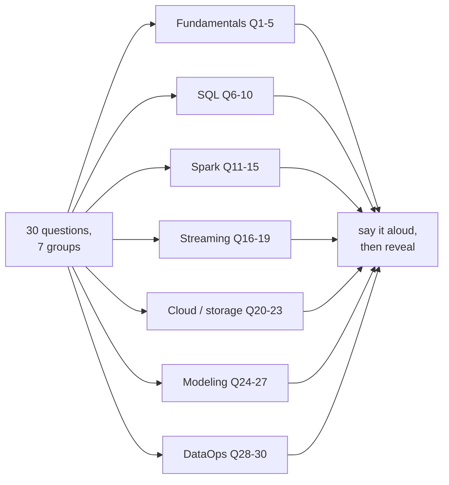
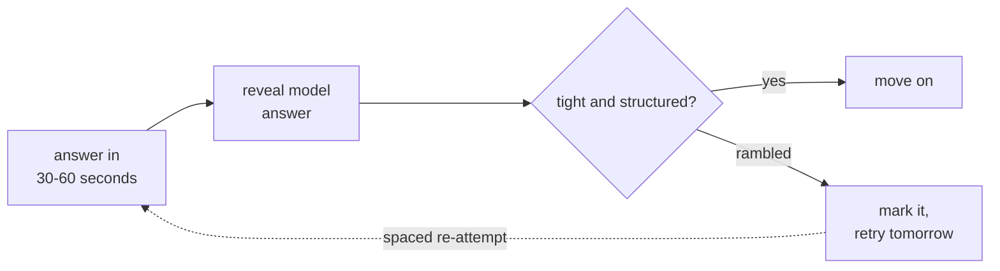

# Rapid Fire

> **Why it matters** — The last 72 hours before a loop aren't for learning new material; they're for fluency. These are the questions interviewers ask when they want to know if you *live* in this vocabulary — each one should take you under a minute aloud.

## How to use this chapter

Read each question, answer it **out loud** in 30-60 seconds, then expand the model answer and compare. You're not grading correctness — you're grading whether a crisp, structured answer came out of your mouth without stalling. A right answer delivered in a rambling 4 minutes loses to a tight 45 seconds.

::: tip 💡 The structure that sounds senior
Every model answer here follows the same shape: **definition → why it matters → the trade-off or gotcha**. Practice that rhythm — it's the difference between "knows it" and "owns it."
:::

## Fundamentals

**Q1 — Partitioning vs clustering: what's the difference and when does each win?**
::: details Model answer
Partitioning divides a table into disjoint physical segments on a column's values — pruning happens when a filter hits the partition key, and partitions are individually operable (overwrite, drop). Clustering (BigQuery) / ordering (Iceberg, Delta ZORDER) sorts data *within* files/partitions by columns — pruning happens via file-level min/max statistics. Partition on low-cardinality columns you filter on almost always (date); cluster on higher-cardinality or multi-column filters (customer_id). Over-partitioning on high-cardinality keys creates tiny-file hell; clustering has no such cliff.
:::

**Q2 — What does idempotent mean for a pipeline, and how do you build it?**
::: details Model answer
Re-running produces the same observable result — no duplicates, no double effects. Batch version: partition overwrite, where the output path is the idempotency key. Row version: upsert/`MERGE` on a natural or idempotency key. The test: "can I rerun this job for yesterday twice and get identical state?" If not, every retry and backfill is a corruption vector.
:::

**Q3 — OLTP vs OLAP: the actual engineering differences?**
::: details Model answer
OLTP optimizes for point reads/writes, row-at-a-time, normalized to kill update anomalies — row stores, indexes, small transactions. OLAP optimizes for scans and aggregates — columnar storage, compression, vectorized execution, denormalized models. The giveaway question: "would you run the dashboard query on the OLTP replica?" — no, because analytical scans starve transactional workloads and the storage layout is wrong for scans anyway.
:::

**Q4 — Explain a slowly changing dimension Type 2 in one breath.**
::: details Model answer
History-preserving dimension: when an attribute changes, close the current row (set end_ts / valid_to) and insert a new row with a new surrogate key — facts join to the version that was valid at event time. The gotchas: key changes must propagate through fact loads, late-arriving dimension updates need restatement logic, and SCD2 explodes size on high-churn attributes — churn-tracking columns belong in SCD1 or a separate table.
:::

**Q5 — When do you choose batch over streaming?**
::: details Model answer
Whenever the freshness SLO allows it — streaming costs 3-10× in complexity: state management, late data, watermarks, exactly-once-ish plumbing, harder backfills. The senior answer is demand-driven: "what decision breaks if data is 15 minutes stale?" Fraud scoring → stream. Daily revenue dashboard → batch, and say so confidently. Streaming-everything is a red flag of unowned trade-offs.
:::

## SQL

**Q6 — `RANK`, `DENSE_RANK`, `ROW_NUMBER` — when does the choice matter?**
::: details Model answer
At ties. `ROW_NUMBER` is arbitrary-per-tie unless you add a tiebreak; `RANK` shares the rank and skips (1,2,2,4); `DENSE_RANK` shares without skipping (1,2,2,3). Top-N-per-group: `ROW_NUMBER` guarantees exactly N rows, `RANK` keeps all tied winners. In dedup, you almost always want `ROW_NUMBER` with a deterministic `ORDER BY` — nondeterministic dedup picks a different survivor each run.
:::

**Q7 — Why does `NOT IN` with a subquery sometimes return zero rows?**
::: details Model answer
Three-valued logic: if the subquery produces any NULL, every comparison becomes `x != NULL` → UNKNOWN → filtered out → empty result. It's the most common silent-wrong-result in SQL. Fix: `NOT EXISTS` (null-safe) or filter NULLs in the subquery explicitly. This question is secretly testing whether you debug by reason or by superstition.
:::

**Q8 — What causes a join to fan out, and how do you detect it?**
::: details Model answer
Many-to-many or one-to-many where you expected one-to-one — the row count multiplies silently and aggregates inflate. Detection: compare `COUNT(*)` before and after the join, or check join-key cardinality per side (`GROUP BY key HAVING COUNT > 1`). Fix upstream: dedupe to one row per key before joining, or aggregate the many-side first. The interviewable skill: name the grain on both sides *before* writing the join.
:::

**Q9 — `QUALIFY` — what does it do and why do senior DEs love it?**
::: details Model answer
Filters on window-function results directly — `QUALIFY ROW_NUMBER() OVER (...) = 1` replaces the subquery-wrapper pattern. It exists because `WHERE` can't see window results (logical order: WHERE runs before SELECT). BigQuery, Snowflake, DuckDB support it; Postgres and MySQL don't — in ANSI-pure shops you write the CTE wrapper. Same semantics either way; it's ergonomics, not power.
:::

**Q10 — How do you dedupe while keeping the latest record per key?**
::: details Model answer
`ROW_NUMBER() OVER (PARTITION BY key ORDER BY updated_at DESC, tiebreaker) = 1`. The two decisions are semantic: the dedup key (natural key, not the row id) and the tiebreak (deterministic — a second column, not just timestamp, or reruns pick different survivors). In the lakehouse world the alternative is `MERGE`/upsert per micro-batch so you never scan history to dedupe.
:::

## Spark

**Q11 — What is a shuffle and why is it expensive?**
::: details Model answer
Redistribution of data across executors — required by `groupBy`, `join`, `distinct`, `repartition`. Expensive because it's all three costs at once: network transfer + serialization + disk spill for state too big for memory. It's the usual suspect behind jobs that read 10 GB but run for an hour. Levers: filter before the shuffle, broadcast the small side, pre-partition hot joins, kill skew (salting or AQE skew-split).
:::

**Q12 — Broadcast join: when does Spark pick it and when should you force it?**
::: details Model answer
When one side is under `spark.sql.autoBroadcastJoinThreshold` (default 10 MB — raise it deliberately, e.g., 100 MB) Spark broadcasts the small side to every executor: no shuffle, a map-side join. Force it with `broadcast(small_df)` when the optimizer's stats are stale and it misses. The danger: broadcasting a "small" table that isn't — OOMed executors are how that lie gets discovered.
:::

**Q13 — What is data skew and name two mitigations?**
::: details Model answer
A few keys holding a disproportionate share of rows — one task processes 100× its share while the cluster idles; shows up as one straggler task in the UI. Mitigations: (1) salting — append a random key suffix to hot keys, aggregate two-stage; (2) broadcast join to eliminate the skewed shuffle; (3) AQE skew-partition splitting (Spark 3+) which auto-splits oversized partitions. Root-cause note: sometimes skew means a bad join key — NULLs or a sentinel value like `-1` collapsing into one partition.
:::

**Q14 — Spark vs Flink for streaming: how do you choose?**
::: details Model answer
Flink for true event-at-a-time streaming: event-time semantics, watermarks, long-lived keyed state, sub-second latency, mature savepoints. Spark Structured Streaming is micro-batch by default — a limited Continuous Processing mode exists (~1ms latency, experimental, rarely used in practice): simpler mental model, shares batch code, better for near-real-time (seconds-to-minutes) pipelines on existing Spark estate. Decision: latency requirement + stateful-window complexity + what the team already runs. "Flink for streaming-native, Spark for streaming-adjacent" is the fair summary.
:::

**Q15 — What does `cache()`/`persist()` actually do and when does it hurt?**
::: details Model answer
Materializes the DataFrame's lineage result in memory (or disk) so later actions don't recompute the DAG. Wins when you read the same DF multiple times (joins to it twice, iterative ML). Hurts when: the data doesn't fit (spills or evicts), you cache once-read data (pure overhead), or the lineage is cheap anyway (recompute beats memory). Rule: cache at reuse points after expensive narrowing — not reflexively.
:::

## Streaming

**Q16 — Explain watermarks and allowed lateness without jargon.**
::: details Model answer
A watermark is the engine's estimate of "how late is late": event-time progress tracked by the stream, telling windows when they're probably complete. Events past watermark + allowed-lateness get dropped or side-output. The trade-off is a dial: short lateness → timely results, dropped stragglers; long lateness → completeness, delayed output and more state. Set it from your actual arrival lateness distribution, not vibes — mobile sources need hours, datacenter sources need minutes.
:::

**Q17 — Consumer group rebalancing: what happens and why does it matter?**
::: details Model answer
When a consumer joins/leaves/dies, partitions get reassigned across the group — during the rebalance, consumption pauses and committed offsets resume processing. It matters because rebalances are invisible downtime: a flapping consumer (GC pauses, slow processing beyond `max.poll.interval.ms`) triggers rebalance storms that look like throughput collapse. Fixes: static group membership, tuned timeouts, faster poll loops, or cooperative rebalancing.
:::

**Q18 — How do you handle a consumer that can't keep up?**
::: details Model answer
First, is it transient (deploy, spike) or structural? Transient → Kafka retention absorbs it; let lag drain. Structural → scale out (more partitions + consumers — parallelism is bounded by partition count), then reduce per-message cost (batch writes, async I/O, cheaper serialization), then check the sink — usually the consumer isn't slow, the *downstream* is. Alert on lag, not throughput: lag is the leading indicator, retention is the countdown clock to data loss.
:::

**Q19 — Event time vs processing time — which do you window on and why?**
::: details Model answer
Event time, almost always: it's when the thing happened, so results are reproducible under replays, restarts, and late data. Processing time is when the engine saw it — results depend on when you run the job, which breaks under backfills and outages. The cost of event time is the lateness machinery (watermarks, allowed lateness). Processing time is acceptable only for metrics about the pipeline itself — never about the business events.
:::

## Cloud & storage

**Q20 — Parquet vs Avro vs JSON: when does each win?**
::: details Model answer
Parquet is columnar — wins for analytics: column pruning, compression, predicate pushdown; it's the lakehouse default. Avro is row-based with a schema — wins for streaming/CDC: compact serialization, schema evolution built in, schema registry pairing. JSON is human-readable and schema-flexible — wins for APIs and debugging, loses on size/parse cost for bulk. Pattern: Avro/JSON on the wire, Parquet at rest.
:::

**Q21 — What problem do table formats (Iceberg/Delta/Hudi) solve that plain Parquet doesn't?**
::: details Model answer
Files + metastore ≠ a table. Table formats add: ACID transactions and optimistic concurrency, snapshot isolation + time travel, schema/partition evolution safely, upserts/deletes, and hidden partitioning. Without them: no safe concurrent writes, no rollback of a bad batch, partition changes require rewrites. The trade-off: compaction/maintenance jobs (small-file merge, snapshot expiry) become your ops burden.
:::

**Q22 — Small files problem — what is it and why does everyone warn about it?**
::: details Model answer
Thousands of tiny files in object storage kill query performance — per-file overhead (listing, open, footer read, scheduling) dominates the actual scan; metastores and planners choke on file counts, not bytes. Causes: over-partitioning, low-latency streaming sinks committing frequently, too-parallel writers. Fixes: compaction jobs, sized writers, coarser partitions, sink-side file sizing (Iceberg's `target-file-size-bytes`). The smell: a query reading 2 GB that plans for 30 seconds.
:::

**Q23 — Partitioning an S3/lake table: how do you pick the key?**
::: details Model answer
Filter columns with low cardinality that *most* queries constrain on — almost always a date grain. Cardinality math: too few partitions → big scans; too many (partition on user_id) → tiny files + metastore pain. Rules of thumb: hundreds-to-thousands of partitions fine; partition size ideally ≥ ~100-256 MB; never partition on a column only *some* queries use. Iceberg's hidden partitioning (day(ts), bucket(col)) fixes the "must match path layout" trap.
:::

## Modeling

**Q24 — Star schema vs one-big-table: what's the trade-off?**
::: details Model answer
Star: fact + conformed dimensions — compact, join-efficient for BI, self-documenting grain, but every join costs and SCD history adds complexity. OBT: pre-joined wide table — no joins at query time, perfect for a fixed dashboard, but storage-duplicated, harder to maintain, and a dimension change means rewriting the fact. Answer is consumption-driven: many flexible consumers → star; one hot dashboard/query path → OBT or aggregate. Most shops do both: star underneath, OBT/aggregates on top.
:::

**Q25 — What grain question do you ask before modeling anything?**
::: details Model answer
"What does one row represent?" — order, order-line, user-day, account. The grain is the table's contract: every column must describe exactly one row of that grain, every join must preserve it. Most production data bugs are grain bugs: a "user" table that's actually user-device, or metrics aggregated at order grain then joined at order-line grain — instant fanout. Saying the grain aloud before modeling is the fastest senior signal in a modeling discussion.
:::

**Q26 — When do you denormalize?**
::: details Model answer
When the join cost or complexity outbids the storage/maintenance cost: hot query paths, BI tools that can't join well, dimensions flattened into facts for readability, precomputed aggregates. Cost you're paying: redundancy (the value lives in N places → N update paths → drift risk) and rebuild-on-change. The framing: normalize for write correctness, denormalize for read performance — at the serving layer, not the source of truth.
:::

**Q27 — A dashboard metric is suddenly 40% higher after a "small change." First three checks?**
::: details Model answer
(1) Grain/fanout — did a join start duplicating rows (the classic 40% = new many-side)? (2) Filter changes — did a `WHERE` or dedupe change start including rows it excluded (NULL keys, soft-deletes now counted)? (3) Time/partition — did the window or timezone shift, double-counting a boundary? Notice what's first: not the data, the *diff*. Reproduce with row-count comparisons at each CTE — bisect the pipeline like code, don't eyeball aggregates.
:::

## DataOps

**Q28 — What should a DAG run look like to be truly backfill-safe?**
::: details Model answer
Idempotent per partition — rerunning `dt=2024-01-15` produces identical state whether run once or ten times, today or six months later. That means: partition-scoped reads and writes (no reading "today"), no mutable lookups that change over time (or snapshot them), deterministic transforms, overwrite semantics. The anti-pattern that fails this: `WHERE date = CURRENT_DATE` — a job that can't backfill because it doesn't know what day it's for.
:::

**Q29 — Data quality checks: where do they live and what do you check?**
::: details Model answer
Three checkpoints: ingest (contract/schema validation → reject to DLQ, never propagate), transformation (unit tests on logic — dbt tests, expectations), and serving (freshness/volume/drift monitors on the output). What you check: completeness (row counts vs expected), uniqueness (key dupes), validity (ranges, enums, nullability), freshness (max event_time lag), and distribution drift (sudden mean shifts). A check that pages on noise gets muted; reserve alerts for user-impacting breaches.
:::

**Q30 — Walk me through your on-call response to "yesterday's pipeline wrote half the rows."**
::: details Model answer
Symptom-first triage: is it upstream (source sent half — check volume SLIs), transform (a filter or join dropped rows — bisect row counts per stage), or sink (write partially failed)? Then the questions that matter: did it *fail loud* (job error → retry) or *succeed silently* (worse — you need completeness checks, not status checks)? And can you safely rerun — i.e., is it idempotent? The meta-point interviewers want: your first move is isolation by layer, your second is verifying replay-safety before re-running, not after.
:::

## Group-to-round cheat sheet

| Group | Questions | Round where it surfaces most | Weak-spot drill |
|---|---|---|---|
| Fundamentals | Q1-5 | Every round, woven into follow-ups | Say each answer in one breath |
| SQL | Q6-10 | Technical screen + coding onsite | Whiteboard the query pattern cold |
| Spark | Q11-15 | Senior loops at Spark shops | Explain shuffle/skew with numbers |
| Streaming | Q16-19 | Real-time platform roles | Draw a window/watermark timeline |
| Cloud & storage | Q20-23 | Platform/lakehouse roles | Know one format's internals well |
| Modeling | Q24-27 | Modeling rounds, BI-heavy teams | Grain-first on every example |
| DataOps | Q28-30 | Behavioral + production ownership stories | Rehearse the incident triage aloud |

## The follow-up pattern

Rapid-fire questions are almost never the whole question — they're the on-ramp to a probe. Each group has a characteristic second move:

| Group | Typical follow-up probe |
|---|---|
| Fundamentals | "What breaks if you get it wrong?" — the failure mode, not the definition |
| SQL | "Now the data has duplicates / NULLs / arrives late" — the edge case |
| Spark | "The job runs 6× slower than expected — where do you look first?" |
| Streaming | "How late can data be before it's useless to you?" — the SLO question |
| Cloud & storage | "What's this architecture's monthly cost driver?" — cost intuition |
| Modeling | "A stakeholder disputes your grain choice — how do you resolve it?" |
| DataOps | "It's 3am and the check fires — walk me through your first 10 minutes" |

If your one-paragraph answer already names the trade-off, the probe usually upgrades: "what if volume is 100×?" — that's the interviewer fishing for whether the answer scales in *your head*, not just on paper.

## 🧠 Quiz — set 1

<QuizCard :questions="[{ q: 'When does clustering beat partitioning on a lake table?', options: ['When the filter column has low cardinality', 'When the table receives frequent deletes', 'When the table is smaller than 1 GB', 'When filters hit high-cardinality or multiple columns and partitioning would create tiny files'], correct: 3, explain: 'Partitioning on high-cardinality keys produces tiny files and metastore pain. Clustering/ZORDER sorts within files and prunes via min/max stats — no partition-count cliff.' }, { q: 'A NOT IN subquery returns zero rows unexpectedly. Most likely cause?', options: ['A NULL in the subquery makes every comparison UNKNOWN', 'NOT IN requires an index', 'The subquery is empty', 'Column type mismatch'], correct: 0, explain: 'x NOT IN (a, b, NULL) is never TRUE — three-valued logic filters every row out. NOT EXISTS is the null-safe equivalent.' }, { q: 'Spark shows one task processing 100x its share while the cluster idles. This is?', options: ['A GC problem', 'Insufficient executors', 'Data skew — hot keys collapsing into one partition', 'A serialization bug'], correct: 2, explain: 'Classic skew signature. Mitigations: salting, broadcast join, or AQE skew-split — and check whether the join key itself is broken (sentinel values like -1).' }, { q: 'Why does event-time windowing beat processing-time for business metrics?', options: ['It is faster', 'It uses less state', 'Results are reproducible under replays, restarts, and late data — processing-time results depend on when you ran the job', 'It requires no watermarks'], correct: 2, explain: 'Processing-time results change with run timing — a backfill produces different answers. Event time is deterministic given the same events.' }, { q: 'What do table formats like Iceberg add over plain Parquet files?', options: ['Automatic data quality checks', 'Faster single-row lookups', 'Better compression', 'ACID transactions, snapshots, schema/partition evolution, and safe deletes/upserts'], correct: 3, explain: 'Files plus a metastore are not a table — Iceberg adds the transactional layer: concurrent writes, rollback, time travel, and evolution without rewrites.' }, { q: 'A metric jumped 40% after a code change. First check?', options: ['Whether a join started fanning out and multiplying rows', 'Whether the source data changed', 'Whether a config flag flipped', 'Whether the dashboard cache is stale'], correct: 0, explain: 'A sudden step-change after a diff is almost always a grain bug — a new many-side join inflating aggregates. Bisect row counts per CTE before suspecting data.' }]" />

## 🧠 Quiz — set 2

<QuizCard :questions="[{ q: 'What makes a batch job backfill-safe?', options: ['Rerunning a partition produces identical state — partition-scoped reads, no CURRENT_DATE reads, deterministic transforms', 'It runs daily without failing', 'It uses MERGE instead of INSERT', 'It writes to a temp table first'], correct: 0, explain: 'Backfill-safety = idempotency plus time-independence. WHERE date = CURRENT_DATE is the canonical failure — the job cannot know what day it is for.' }, { q: 'Why do small files hurt lake queries so much?', options: ['They cannot be partitioned', 'They compress poorly', 'Per-file overhead — listing, open, footer read, task scheduling — dominates the actual scan', 'Object stores charge per file'], correct: 2, explain: 'Fixed cost per file × thousands of files dwarfs the bytes read. Compaction and sized writers are the fix; over-partitioning and chatty streaming sinks are the causes.' }, { q: 'When does Spark Structured Streaming lose to Flink?', options: ['When running on a single node', 'When the team knows Spark', 'When you need true event-at-a-time processing, sub-second latency, and complex long-lived keyed state', 'When data volume is small'], correct: 2, explain: 'Flink is streaming-native — real event-time, watermarks, savepointed state. Spark is micro-batch — fine for seconds-to-minutes freshness on a Spark estate, wrong for sub-second stateful work.' }, { q: 'What is the trade-off in watermark/allowed-lateness tuning?', options: ['Memory vs CPU', 'Timeliness vs completeness — short lateness drops stragglers; long lateness delays results and grows state', 'Throughput vs durability', 'Simplicity vs performance'], correct: 1, explain: 'The watermark is a dial between early-but-incomplete and late-but-complete. Set it from the measured arrival-lateness distribution — mobile sources need hours.' }, { q: 'Star schema vs one-big-table: what decides?', options: ['Consumption pattern — many flexible consumers favor star; one hot query path justifies OBT on top', 'Whether you use dbt', 'Table size limits', 'The BI tool vendor'], correct: 0, explain: 'Star optimizes join flexibility and conformed semantics; OBT optimizes a fixed read path. Common pattern: star as the modeled layer, OBT/aggregates as serving.' }, { q: 'Your consumer cannot keep up and lag grows. First diagnostic?', options: ['Add more consumers immediately', 'Transient or structural — retention absorbs transients; structural needs parallelism bounded by partitions or cheaper processing', 'Restart the consumer group', 'Increase the fetch size'], correct: 1, explain: 'Scaling first is a guess. Transient lag drains within retention; structural lag needs partition-count parallelism or cheaper per-message work — and usually the sink is slow, not the consumer.' }]" />

## Further reading

- [Kafka documentation — design & semantics](https://kafka.apache.org/documentation/#design) — consumer groups, rebalancing, and delivery semantics from the source.
- [Spark tuning guide](https://spark.apache.org/docs/latest/tuning.html) — skew, broadcast joins, and memory tuning from official docs.
- [Flink event-time & watermarks](https://nightlies.apache.org/flink/flink-docs-stable/docs/concepts/time/) — the authoritative reference for watermark mechanics.
- [Apache Iceberg docs](https://iceberg.apache.org/docs/latest/) — hidden partitioning, snapshots, and maintenance operations.
- [dbt — tests documentation](https://docs.getdbt.com/docs/build/tests) — the quality-check layer as most shops implement it.
- [BigQuery — clustered vs partitioned tables](https://cloud.google.com/bigquery/docs/clustered-tables) — the partitioning/clustering trade-off in concrete terms.
