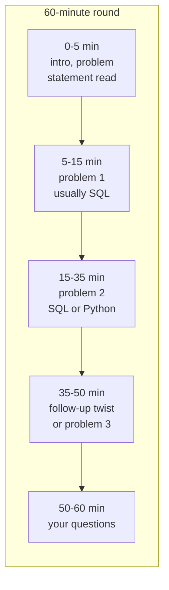
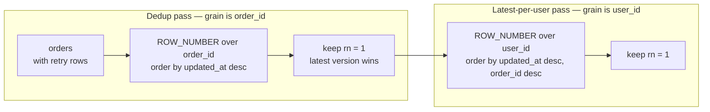

# SQL & Coding Rounds

> **Why it matters** — The live round isn't testing whether you can solve the problem; it's testing whether you can produce a correct, narrated solution in 25 minutes while someone watches. The skills are trainable and mostly mechanical — this chapter turns "I knew that" into "I delivered that."

## What the round actually looks like



The twist matters: interviewers rarely grade the first problem alone. The second half — "now handle duplicates," "now make it incremental," "now the file doesn't fit in memory" — is where senior signal lives.

## What's actually asked

The distribution across real DE loops is heavily concentrated:

| Pattern | Frequency | Typical shape |
|---|---|---|
| Top-N-per-group | Very high | "Latest order per user," "top 3 products per region" — `ROW_NUMBER() + QUALIFY` |
| Dedup | Very high | "Events retried, dedupe" — key choice + tiebreaker + NULL handling |
| Window running metrics | High | Running totals, LAG deltas, 7-day rolling revenue |
| Funnel / conversion | High | Multi-step events → stage counts + conversion rate |
| Sessionization | High | Group events by ≤30-min gaps — the islands pattern |
| Gaps & islands / streaks | Medium | Consecutive-day logins, subscription active periods |
| Retention / cohort | Medium | D1/D7 retention by signup cohort |
| SCD / incremental merge | Medium | "Apply these updates like a Type 2 dimension" |
| Python: dict/set manipulation | Very high | Group, count, dedupe, merge records in memory |
| Python: generators / streaming | High | "File doesn't fit in memory" — lazy iteration |
| Python: pandas/polars transform | Medium | Group-by + window equivalents in a DataFrame |

::: tip 💡 Senior insight
Notice what's absent: exotic SQL features. Nobody fails a DE round for not knowing `MATCH_RECOGNIZE`. They fail on grain, NULLs, duplicates, and ties — the boring stuff done carelessly under pressure.
:::

## The delivery protocol

Every problem, same skeleton. The narration *is* the deliverable:

| Phase | Time | What you say out loud |
|---|---|---|
| Restate | 0-2 min | "So we want one row per user per day — did I get the grain right?" |
| Edge cases | 2-4 min | "I'll assume: duplicate events possible, NULL user_ids exist, ties broken by latest timestamp — correct me if wrong" |
| Approach | 4-6 min | "Two steps: dedupe with ROW_NUMBER, then aggregate. Could also do it in one pass but this is clearer" |
| Write | 6-18 min | Narrate while typing; name the trap as you pass it ("using ROW_NUMBER not RANK because ties would...") |
| Verify | 18-22 min | Walk one concrete example row-by-row through the logic; check the edge cases you named |
| Extend | 22-25 min | "To make this incremental I'd key it on event_date partition..." |

::: warning ⚠️ The verify step is where offers happen
Interviewers report the single biggest differentiator: candidates who *test their own code* before being asked. Walking one example through your query and catching a bug yourself is worth more than writing it bug-free silently.
:::

## Worked walkthrough 1 — SQL: latest order per user

**Problem:** `orders(order_id, user_id, status, total, updated_at)` — orders get updated and retried; the same `order_id` may appear multiple times. Return the latest version of each order, then each user's most recent order.

::: details Narration box — first 2 minutes
*"Let me confirm the grain: two answers actually — deduped order table at grain order_id, then one row per user. Edge cases: multiple rows per order_id (retry versions), possible NULL updated_at, two orders with identical timestamps for a user — I'll break ties by order_id for determinism. Is that reasonable?"*
:::

```sql
WITH deduped AS (
  -- grain: one row per order_id — the retry-safe version
  SELECT order_id, user_id, status, total, updated_at
  FROM orders
  QUALIFY ROW_NUMBER() OVER (
    PARTITION BY order_id
    ORDER BY updated_at DESC NULLS LAST, total DESC  -- NULLS LAST: a retry may lack a timestamp
  ) = 1
),
latest_per_user AS (
  SELECT user_id, order_id, total, updated_at
  FROM deduped
  QUALIFY ROW_NUMBER() OVER (
    PARTITION BY user_id
    ORDER BY updated_at DESC, order_id DESC          -- deterministic tiebreak
  ) = 1
)
SELECT * FROM latest_per_user;
```

The two passes at a glance — each `QUALIFY` stage shifts the output grain:

::: details Follow-up: "now make it incremental"
The interviewer extends: *"The table is 5B rows; recomputing daily is too expensive."* The senior answer: dedupe only the incoming batch, `MERGE` into a current-state table keyed on `order_id` where `incoming.updated_at > existing.updated_at`. Late-arriving older versions get absorbed without rewriting history — and you just demonstrated the difference between a query and a pipeline.
:::

**Verify aloud:** "Take user 7 with orders o1 (updated 10:00) and o2 (updated 10:00, tie) — my tiebreak picks the higher order_id, deterministic. A retry row with NULL updated_at loses to the versioned row — correct."

## Worked walkthrough 2 — Python: stream-dedupe a too-big file

**Problem:** A 50GB CSV of events; dedupe on `event_id`, keep the *last* occurrence (the record with the highest `attempt_no`), output in input order.

::: details Narration box — first 2 minutes
*"Key constraint: 50GB doesn't fit in memory. Last-occurrence wins, so I can't dedupe on the fly — I need two passes or a single pass storing positions, not rows. Plan: pass 1 stores `event_id → (best attempt, row index)`, pass 2 streams again and emits only rows whose index won. Memory is O(unique ids), not O(file size)."*
:::

```python
import csv

def dedupe_stream(in_path, out_path):
    # pass 1: map event_id -> (attempt_no, row_index)
    best = {}                                # only metadata in memory
    with open(in_path) as f:
        reader = csv.DictReader(f)
        for i, row in enumerate(reader):
            eid, att = row["event_id"], int(row["attempt_no"])
            if eid not in best or att > best[eid][0]:
                best[eid] = (att, i)

    keep = {line_idx for _, line_idx in best.values()}

    # pass 2: emit surviving lines in original order
    with open(in_path) as fin, open(out_path, "w", newline="") as fout:
        reader = csv.DictReader(fin)
        writer = csv.DictWriter(fout, fieldnames=reader.fieldnames)
        writer.writeheader()
        for i, row in enumerate(reader):
            if i in keep:
                writer.writerow(row)
```

::: details The interviewer asks: "why not just a set?"
A `seen` set of event_ids gives *first*-occurrence dedupe only — the spec said keep the *last*/best attempt. Naming that distinction before coding is exactly what the round scores. If the requirement were first-wins, one pass + a set is correct and you should say so — simpler beats clever.
:::

**Alternative they'd accept:** single pass building `dict[event_id] = row` then `dict` iteration order (Python ≥3.7 preserves insertion order — but *last* assignment wins, and the dict keeps the first-inserted position, which violates output order). Walking through *why* the naive version is subtly wrong is senior signal.

## Eight practice problems

Work these on a timer (≤25 min SQL, ≤30 min Python), narrating aloud. Expand hints only when stuck; solutions are reference-grade, not the only correct answer.

### P1 — Top-3 products per region by revenue

`order_items(order_id, region, product_id, qty, unit_price)` → top 3 products per region by total revenue.

::: details Hint
One `GROUP BY` aggregate, then `ROW_NUMBER` over region. Watch ties and products with NULL prices — exclude or coalesce? State your choice.
:::

::: details Solution
```sql
WITH revenue AS (
  SELECT region, product_id,
         SUM(qty * COALESCE(unit_price, 0)) AS rev
  FROM order_items
  GROUP BY region, product_id
)
SELECT region, product_id, rev
FROM revenue
QUALIFY ROW_NUMBER() OVER (PARTITION BY region ORDER BY rev DESC, product_id) <= 3;
```
`RANK` vs `ROW_NUMBER` is the interviewable choice: `RANK` keeps ties (could return 4+ rows); `ROW_NUMBER` guarantees exactly 3 — say which you chose and why.
:::

### P2 — Signup → first-purchase conversion funnel

`events(user_id, event_name, event_ts)` where event_name ∈ {signup, activate, purchase} → count of users reaching each stage *in order*, plus stage-to-stage conversion rate.

::: details Hint
The trap is ordering — "reached purchase" means purchase *after* signup, not just a purchase row existing. Get each user's first timestamp per stage, then count sequentially.
:::

::: details Solution
```sql
WITH firsts AS (
  SELECT user_id,
         MIN(CASE WHEN event_name = 'signup'   THEN event_ts END) AS t_signup,
         MIN(CASE WHEN event_name = 'activate' THEN event_ts END) AS t_activate,
         MIN(CASE WHEN event_name = 'purchase' THEN event_ts END) AS t_purchase
  FROM events
  GROUP BY user_id
),
reached AS (
  SELECT
    COUNT(t_signup) AS n_signup,
    COUNTIF(t_activate > t_signup) AS n_activate,
    COUNTIF(t_purchase > t_activate AND t_activate > t_signup) AS n_purchase
  FROM firsts
)
SELECT n_signup, n_activate, n_purchase,
       ROUND(100.0 * n_activate / NULLIF(n_signup,0), 1)   AS signup_to_activate_pct,
       ROUND(100.0 * n_purchase / NULLIF(n_activate,0), 1) AS activate_to_purchase_pct
FROM reached;
```
`COUNTIF` is BigQuery; ANSI uses `SUM(CASE WHEN ... THEN 1 ELSE 0 END)`. The ordering predicates are the graded part, not the syntax.
Assumption stated aloud: this is a *strict ordered funnel* — purchase counts only when it follows activate, which itself follows signup. If the interviewer means the looser "purchase any time after signup" definition, swap the last predicate for `COUNTIF(t_purchase > t_signup) AS n_purchase_after_signup`.
:::

### P3 — Sessionize pageviews (30-min gap)

`pageviews(user_id, ts, url)` → sessions with `session_id`, start, end, event count. Gap > 30 min opens a new session.

::: details Hint
LAG to get the previous timestamp per user, flag gap-opens, cumulative-SUM the flags, GROUP BY the session number. See [Analytics SQL Patterns](/sql/analytics-patterns) for the full pattern treatment.
:::

::: details Solution
```sql
WITH lagged AS (
  SELECT user_id, ts,
         LAG(ts) OVER (PARTITION BY user_id ORDER BY ts) AS prev_ts
  FROM pageviews
),
flagged AS (
  SELECT *,
         CASE WHEN prev_ts IS NULL
                OR TIMESTAMP_DIFF(ts, prev_ts, MINUTE) > 30
              THEN 1 ELSE 0 END AS new_session
  FROM lagged
),
numbered AS (
  SELECT *,
         SUM(new_session) OVER (PARTITION BY user_id ORDER BY ts
                                ROWS UNBOUNDED PRECEDING) AS session_seq
  FROM flagged
)
SELECT user_id,
       FARM_FINGERPRINT(CONCAT(CAST(user_id AS STRING), '-', CAST(session_seq AS STRING))) AS session_id,
       MIN(ts) AS session_start, MAX(ts) AS session_end, COUNT(*) AS events
FROM numbered
GROUP BY user_id, session_seq;
```
Late-arriving events can split sessions and rewrite history — mention it unprompted; interviewers note it.
:::

### P4 — Longest login streak per user

`logins(user_id, login_date)` (may contain dupes) → each user's longest consecutive-day streak.

::: details Hint
Classic islands: dedupe dates first, then `login_date - ROW_NUMBER()` is constant within a streak. Group by that constant.
:::

::: details Solution
```sql
WITH days AS (
  SELECT DISTINCT user_id, login_date          -- dedupe first or islands break
  FROM logins
),
islands AS (
  SELECT user_id, login_date,
         DATE_SUB(login_date, INTERVAL
           ROW_NUMBER() OVER (PARTITION BY user_id ORDER BY login_date) DAY) AS grp
  FROM days
)
SELECT user_id, MAX(island_len) AS longest_streak
FROM (
  SELECT user_id, grp, COUNT(*) AS island_len
  FROM islands
  GROUP BY user_id, grp
)
GROUP BY user_id;
```
Two users can share the same `grp` value only within their partition — always `GROUP BY user_id` too.
:::

### P5 — 7-day rolling revenue with zero-fill

`orders(order_ts, amount)` → daily revenue plus 7-day rolling average, *including days with no orders*.

::: details Hint
The trap: a naive `SUM OVER (ORDER BY date ROWS 6 PRECEDING)` skips missing days, giving wrong averages. Build a date spine first, then left join.
:::

::: details Solution
```sql
WITH spine AS (
  SELECT d FROM UNNEST(GENERATE_DATE_ARRAY(
    (SELECT MIN(DATE(order_ts)) FROM orders),
    (SELECT MAX(DATE(order_ts)) FROM orders))) AS d
),
daily AS (
  SELECT s.d, COALESCE(SUM(o.amount), 0) AS rev
  FROM spine s
  LEFT JOIN orders o ON DATE(o.order_ts) = s.d
  GROUP BY s.d
)
SELECT d, rev,
       AVG(rev) OVER (ORDER BY d ROWS BETWEEN 6 PRECEDING AND CURRENT ROW) AS rolling_7d_avg
FROM daily
ORDER BY d;
```
The spine-join pattern transfers everywhere: retention zeros, funnel stages with no drop-off, sparse time series.
:::

### P6 — Second-highest salary, three ways

`employees(id, name, salary)` → the second-highest distinct salary, handling departments with ties and fewer than 2 values.

::: details Hint
`DENSE_RANK` handles ties cleanly. Discuss why `OFFSET 1 LIMIT 1` on distinct salaries is equivalent — and when `MAX < MAX` fails.
:::

::: details Solution
```sql
-- dense_rank version — ties counted once, NULL when <2 distinct salaries
SELECT salary AS second_highest
FROM (SELECT salary, DENSE_RANK() OVER (ORDER BY salary DESC) AS r
      FROM employees)
WHERE r = 2;

-- correlated version the interviewer may probe for
SELECT MAX(salary) AS second_highest
FROM employees
WHERE salary < (SELECT MAX(salary) FROM employees);
```
Knowing both — and that `DENSE_RANK` generalizes to Nth-highest — is the point. The `MAX < MAX` version returns NULL correctly but can't answer Nth-highest.
:::

### P7 — Python: group transactions into per-user running balances

`transactions = [{"user": "u1", "ts": 3, "amt": 50}, ...]` → for each user, return `[(ts, running_balance)]` sorted by ts, handling out-of-order input.

::: details Hint
Sort per user by ts, accumulate. One dict pass to group + a sort + a running sum. Mention ties and whether you mutate input.
:::

::: details Solution
```python
from collections import defaultdict

def running_balances(transactions):
    by_user = defaultdict(list)
    for t in transactions:
        by_user[t["user"]].append((t["ts"], t["amt"]))
    out = {}
    for user, txs in by_user.items():
        txs.sort(key=lambda x: x[0])            # stable sort; ties keep input order
        bal, series = 0, []
        for ts, amt in txs:
            bal += amt
            series.append((ts, bal))
        out[user] = series
    return out
```
O(n log n) total, O(n) space. If the interviewer says "data arrives ordered," a single streaming pass works — name the assumption first.
:::

### P8 — Python: pandas dedupe-with-aggregation

DataFrame `df[order_id, version, revenue]` — keep the highest `version` row per order, but if versions tie, sum the revenue of the tied rows.

::: details Hint
Sort by version, `groupby.tail(1)` or `drop_duplicates(keep="last")` gets most of it — but the tie-sum needs a `groupby` on (order_id, max_version) with aggregation, not a plain dedupe.
:::

::: details Solution
```python
import pandas as pd

def dedupe_orders(df):
    # keep rows at the max version per order, then sum revenue across ties
    mx = df.groupby("order_id")["version"].transform("max")
    top = df[df["version"] == mx]
    return (top.groupby("order_id", as_index=False)
               .agg(version=("version", "first"), revenue=("revenue", "sum")))
```
`groupby("order_id")["version"].idxmax()` is the common answer — but it silently picks one arbitrary row when versions tie, missing the revenue-sum requirement. Call that out before writing the correct version; in polars the same logic is `group_by` + a `pl.col("version") == pl.col("version").max()` filter inside the expression.
:::

## Common failure modes

| Failure | What it looks like | The fix |
|---|---|---|
| Jumping to code | Typing within 10 seconds of reading | Restate grain + edge cases first, every time |
| Silent solving | Correct answer, zero narration | Narrate trade-offs as you write; silence scores as floundering |
| No grain statement | Aggregates join-fanout duplicates | "One row per X" before any query |
| Ignoring NULLs | `NOT IN` with NULL subquery, join drops NULL keys | Name NULL behavior in edge-case phase |
| Ties unhandled | `ROW_NUMBER` picks arbitrary winner | Pick an explicit tiebreak and say it's deterministic |
| `DISTINCT` as patch | Sprinkled when duplicates appear | Debug *why* duplicates exist — usually a fanout join |
| Over-engineering | Window gymnastics when GROUP BY suffices | Simplest correct solution first, optimize only if asked |
| Untested submission | "Done" without a walkthrough | Trace one example row through before declaring done |

## How interviewers score you

Real rubrics converge on four axes. Knowing them changes what you optimize:

| Axis | No-hire signal | Hire signal | Strong-hire signal |
|---|---|---|---|
| **Problem framing** | Codes before understanding | Restates problem, confirms grain | Surfaces edge cases the interviewer hadn't stated |
| **Correctness** | Wrong on the happy path | Right answer, handles stated edge cases | Right answer + catches own bug during verification |
| **Code quality** | Unreadable, no structure | Clean CTEs / functions, sensible names | Reads like production code; comments only where non-obvious |
| **Communication** | Silent or rambles | Narrates while working | Collaborates — treats interviewer as a pair, checks in |
| **Trade-offs** | One answer, no alternatives | Mentions an alternative unprompted | Names cost/benefit and picks deliberately |

::: info ℹ️ The composite effect
A correct-but-silent solution typically nets "weak hire" at best; a slightly-imperfect but well-narrated, self-corrected attempt often nets "hire." The rubric measures *working with you*, not the artifact.
:::

## 🧠 Quiz

<QuizCard :questions="[{ q: 'An events table may contain retried duplicate rows. What is the first thing to do before writing the dedup query?', options: ['Check row counts for the last week', 'Add DISTINCT to the SELECT', 'Index the table by event_id', 'Choose the dedup key and tiebreak, then confirm the output grain aloud'], correct: 3, explain: 'Dedup correctness is a semantic decision — which record survives and what grain the output has — not a syntax one. Stating it aloud is also how you get credit for it.' }, { q: 'Why does a rolling-7-day revenue average computed directly on a daily aggregate table often give wrong results?', options: ['Days with zero orders are missing rows, so ROWS 6 PRECEDING spans more than a week', 'Window functions cannot aggregate revenue', 'Partitioning by date is required first', 'AVG ignores NULL revenue values'], correct: 0, explain: 'Sparse tables drop zero-revenue days entirely; the frame then covers a variable calendar window. The fix is a date spine LEFT JOIN — a transferable pattern for any sparse time series.' }, { q: 'In sessionization, what production behavior should a senior candidate mention unprompted?', options: ['Session tables need clustering', 'LAG is faster than self-joins', 'Sessions should use UUIDs', 'A late-arriving event inside a gap can merge or split sessions, rewriting history'], correct: 3, explain: 'Late data mutating session boundaries is the real production trade-off: either sessionize over closed windows or accept restatement. Naming it unprompted is a senior signal.' }, { q: 'Which dedup approach keeps the LAST occurrence when a 50GB file cannot fit in memory?', options: ['A Python dict of event_id to row built in one pass', 'A set of seen event_ids while streaming once', 'Sorting the file by event_id first', 'Two passes: first map event_id to best line offset, then emit winners in order'], correct: 3, explain: 'A seen-set keeps the FIRST occurrence. Keeping the last requires knowing future rows, so you need either two passes storing positions (not rows) — O(unique ids) memory — or an external sort.' }, { q: 'What do interviewers consistently rank as the biggest differentiator in live coding?', options: ['Verbally testing your own solution before being asked', 'Using the most advanced SQL features available', 'Solving without any bugs on the first try', 'Finishing faster than the timebox'], correct: 0, explain: 'Self-verification — tracing an example through your code and catching issues yourself — is reported as the top hire signal. It demonstrates the working behavior the round simulates.' }, { q: 'For top-3-per-group with possible ties, what does choosing RANK over ROW_NUMBER change?', options: ['RANK may return more than 3 rows when ties exist at the boundary', 'RANK is slower on all engines', 'Nothing, they are interchangeable', 'RANK ignores NULL ordering'], correct: 0, explain: 'RANK assigns the same rank to tied values, so a tie at rank 3 returns extra rows. ROW_NUMBER guarantees exactly N — the right choice depends on the business question, which you should state.' }]" />

## Further reading

- [DataLemur — SQL interview questions](https://datalemur.com/questions?category=SQL) — timed practice with company-tagged problems; the closest drill set to real DE screens.
- [Ace the Data Science Interview — blog resources](https://www.acethedatascienceinterview.com/) — companion material from the same author lineage as DataLemur.
- [Mode SQL tutorial — window functions](https://mode.com/sql-tutorial/sql-window-functions/) — clean reference for the window patterns these problems depend on.
- [BigQuery window functions documentation](https://cloud.google.com/bigquery/docs/reference/standard-sql/window-function-calls) — official syntax for `QUALIFY`, `ROWS`/`RANGE` frames, and function list.
- [LeetCode database problems](https://leetcode.com/problemset/database/) — free SQL set; filter by frequency for realistic screen questions.
- [pandas vs polars for interviews — Polars docs](https://docs.pola.rs/) — if a target company lists polars, learn `group_by`, expressions, and lazy frames from the official user guide.
- [Python itertools documentation](https://docs.python.org/3/library/itertools.html) — `groupby`, `islice`, and friends cover half the Python manipulation problems asked.
