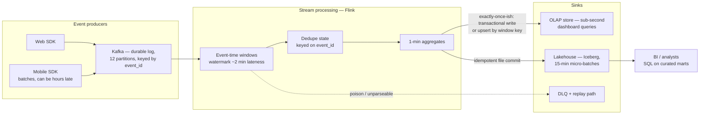
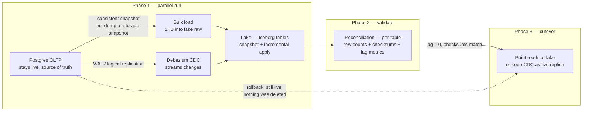
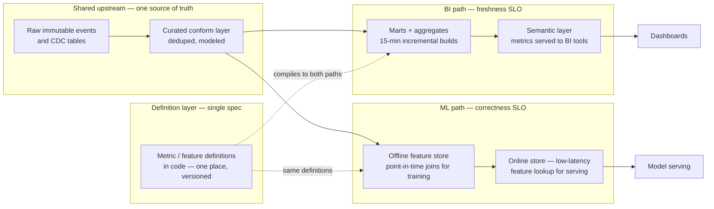
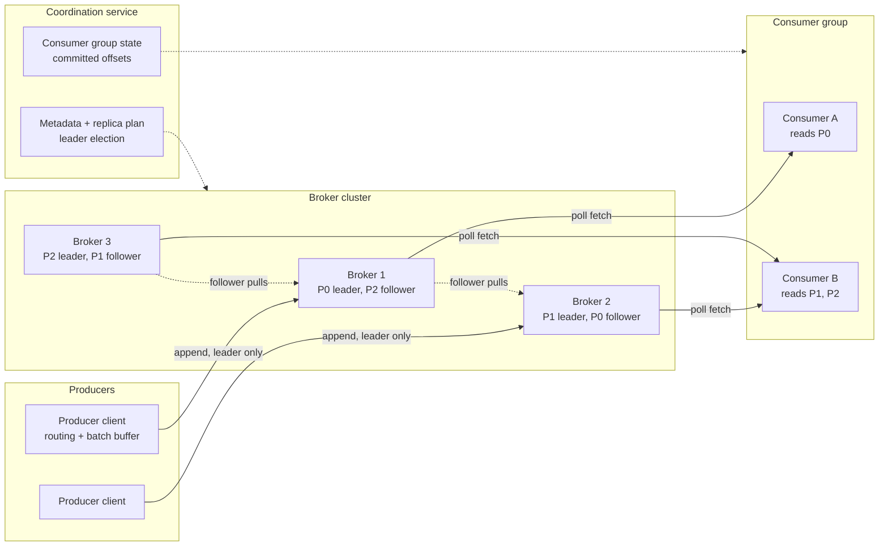
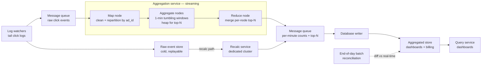
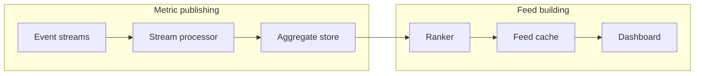

# The System Design Round

> **Why it matters** — This is the round that decides senior vs staff. Nobody scores the boxes you draw; they score whether your requirements questions were sharp, whether your numbers were plausible, and whether you named the failure modes before being asked. Design rounds are a performance of judgment, not knowledge.

## The 45-minute framework

The round has a rhythm. Candidates who manage the clock deliberately outperform those who let the interviewer drive:

| Phase | Time | What you produce | The signal |
|---|---|---|---|
| 1. Requirements | 0-8 min | Functional + non-functional requirements, agreed grain, scale inputs | Senior = asks before drawing |
| 2. Estimation | 8-13 min | Back-of-envelope: events/s, storage/day, partition counts, cost sketch | Numbers over adjectives |
| 3. High-level design | 13-25 min | 5-8 boxes: ingest → buffer → process → store → serve, observability as a peer | Clean layered diagram |
| 4. Deep dives | 25-38 min | 2-3 components drilled: consistency, semantics, failure handling | Trade-offs volunteered, not extracted |
| 5. Bottlenecks + wrap | 38-45 min | What breaks first, scaling plan, what you'd monitor | Failure-mode ownership |

::: tip 💡 Senior insight
Say your time budget out loud at minute zero: "I'll spend ~8 minutes on requirements, then estimation, a high-level sketch, and I'd like to deep-dive on exactly-once handling and backfills — sound right?" You've just converted a passive session into a managed one — and guaranteed the interviewer knows your plan when time runs short.
:::

Alex Xu's 4-step process is the skeleton under that clock. Mapped to a data-platform prompt:

| Xu step | What you do | The data-platform version | Interviewer reads |
|---|---|---|---|
| 1. Understand & scope | Clarify requirements and assumptions before solving | Freshness SLO, correctness tolerance, consumers, grain, replay needs | Whether the system you design is the one they asked for |
| 2. High-level + buy-in | Sketch the blueprint, get agreement, sanity-check with estimation | Ingest → buffer → process → store → serve boxes; run the numbers to justify each box | Whether you can defend a design instead of just drawing it |
| 3. Deep dive | Drill the components that carry the design | The 2-3 hard parts: dedupe window, exactly-once boundary, restatement handling | Depth on demand — do you know *why*, not just *what* |
| 4. Wrap up | Bottlenecks, error cases, monitoring, next scale | First failure at 10×, mitigation, observability story, trade-off recap | Whether you close the loop like an owner |

Two rules carry over verbatim: don't jump to an answer (Xu's cautionary tale is the kid who answers every question instantly — speed reads as guessing, not seniority), and treat the interviewer as a teammate you check in with, not a judge you perform at.

## The requirements questions that separate levels

For *any* data-platform prompt, these five questions unlock the design:

1. **"What decisions does this data drive?"** — determines freshness SLO. Dashboards for execs ≠ fraud blocking ≠ ML features.
2. **"What's the arrival pattern — volume, peaks, late/out-of-order?"** — determines buffer, windows, watermarks.
3. **"How wrong can it be, for how long?"** — determines correctness/completeness requirements: dupes tolerable? Restatement acceptable?
4. **"Who consumes it, in what shape?"** — determines serving layer: SQL marts, APIs, feature lookups.
5. **"What's the replay/backfill story?"** — determines whether raw must be immutable and how long you retain it.

## The estimation cheat-sheet

Xu's chapter 2 condenses Jeff Dean's latency numbers and powers of two into the math a design round actually uses. The DE version of the same sheet:

### Powers of two

| Unit | Bytes | Say it as |
|---|---|---|
| 1 KB | 2^10 ≈ 1 thousand | thousand |
| 1 MB | 2^20 ≈ 1 million | million |
| 1 GB | 2^30 ≈ 1 billion | billion |
| 1 TB | 2^40 ≈ 1 trillion | trillion |
| 1 PB | 2^50 ≈ 1 quadrillion | quadrillion |

The interview shortcut: 2^10 ≈ 10^3. Every conversion reduces to counting thousands — 86,400 seconds/day becomes ~10^5 s/day, which is the single most useful constant in data-platform estimation.

### Latency numbers worth memorizing

| Operation | Order of magnitude | Why a DE cares |
|---|---|---|
| L1/L2 cache reference | ~1-10 ns | Why hot aggregates live in-process |
| Main memory reference | ~100 ns | In-memory dedupe sets are free relative to disk |
| Send 2KB over 1 Gbps network | ~20 µs | Batch records before shipping — per-record network cost dominates |
| Read 1 MB sequentially from SSD | ~1 ms | Sequential scans are cheap; random reads are not |
| Disk seek | ~10 ms | Why event logs append and never update in place |
| Read 1 MB sequentially from disk | ~30 ms | Partition pruning turns a 30 ms/unit scan into a plan, not a scan of everything |
| Send packet CA → Netherlands → CA | ~150 ms | Cross-region replication latency bounds any global-consistency promise |

Three conclusions carry straight into DE rounds: memory is fast and disk is slow, so buffer and batch; compress before sending over the network; cross-region traffic is measured in hundreds of milliseconds — never promise a globally consistent real-time dashboard.

### The five estimation moves interviewers grade

1. **QPS / events-per-second** — DAU × actions ÷ ~10^5 s. Then **peak QPS ≈ 2× average** (Xu's rule of thumb; for batch data sources it's the end-of-window burst, not daily average, that sizes your buffer).
2. **Storage per day** — events/s × bytes/event × 86,400 (~10^5 s). 10k ev/s × 1 KB ≈ 1 TB/day — two multiplications, done.
3. **Retention → total storage** — per-day × days; state replication factor (~3×) only if asked, but know it's there.
4. **Throughput** — storage/day ÷ 10^5 s gives sustained MB/s; compare against disk (~30 ms per sequential MB) and network (~20 µs per small packet) to prove your design fits in one sentence.
5. **Count of machines/partitions** — total throughput ÷ per-node throughput. Rounding aggressively is expected — precision is not the graded signal.

:::: details The process is the answer
Xu's estimation tips: round hard (99987/9.1 becomes 100,000/10), write assumptions where the interviewer can see them, label every number with units, and narrate constantly. Interviewers grade the path — "150M DAU × 2 events = 300M/day ≈ 3.5k/s, call peak 7k/s" — not the arithmetic. A wrong number with a sound process scores better than a right number you reached silently.
::::

## Design A — Real-time analytics pipeline

*"Design a pipeline that ingests clickstream events (10k/s peak), powers near-real-time dashboards, and lands in a lakehouse for analysts."*

### Requirements

| Question | Assumed answer (state it, invite correction) |
|---|---|
| Freshness | Dashboards lag ≤1 min; lakehouse ≤15 min |
| Correctness | Metrics must not double-count on retries; small gaps acceptable during incidents |
| Consumers | Live dashboards (low-latency aggregates) + analysts (SQL on lake) |
| Lateness | Mobile events can arrive hours late; must be absorbed, not dropped |
| Shape | Append-only events, keyed by event_id, partitioned by event_time |

### Capacity math

- **Throughput:** 10k events/s × ~600 B ≈ **6 MB/s** — trivial for Kafka (3-6 partitions is plenty; add headroom → 12).
- **Storage:** 6 MB/s × 86,400 s ≈ **500 GB/day**; ×3 replication × 7-day retention ≈ **~10 TB hot** in the log; lake gets ~180 TB/yr raw, ~50 TB post-columnar compression.
- **The number that matters:** not ingest rate — it's *dedupe window* size and *recompute* cost of restating a week of aggregates.

### Decision points — narrate the trade-off

- **"Exactly-once":** say *effective-once*. Flink checkpointing + transactional sink covers inside-the-framework; the OLAP upsert keyed on (window, dimension) makes retries harmless anyway. At-least-once + idempotent sink beats an exotic exactly-once setup — cheaper, simpler, same observable guarantee.
- **Late data:** watermark at ~2 min for the dashboard path (dashboards tolerate eventual correction); lake path keeps a longer lookback — late events update Iceberg partitions via upsert, and dashboards restate on next read.
- **Two sinks, one source of truth:** the lake is canonical; the OLAP store is a disposable projection. If they disagree, rebuild OLAP from lake — naming the recovery story is the senior move.

### Failure modes to volunteer

| Failure | Handling |
|---|---|
| Mobile events arrive 6h late | Long-lookback lake upsert; dashboard accepts restatement or uses allowed-lateness windows |
| Flink job down 3h | Kafka retention covers it; on restart, catch-up processing — lag metric alerts at 15 min |
| Duplicate delivery on retry | Dedupe keyed on event_id within window + idempotent upsert at sink |
| Poison record | Bounded retries → DLQ with payload + offset; replay path after fix |
| Traffic spike 10× | Kafka absorbs; autoscalers on consumer lag; dashboards degrade gracefully, lake lags but doesn't lose |

### Follow-ups interviewers ask

- *"What if event_id isn't trustworthy?"* → content-hash fallback + producer-side dedupe; state the residual dup risk.
- *"Dashboard shows a dip — bug or real?"* → completeness SLI: expected vs actual volume per window; that's the monitoring answer.
- *"Make it exactly-once end-to-end."* → explain Two Generals; offer effective-once via outbox/transactional sink and name the cost.

## Design B — Zero-downtime CDC migration of a 2TB OLTP DB

*"Migrate a 2TB Postgres OLTP database to the data lake — no downtime, no lost writes, verifiable correctness."*

### Requirements

| Question | Answer |
|---|---|
| Downtime budget | Zero — OLTP stays live throughout |
| Consistency | Cutover point must be provable; no lost or duplicated writes |
| Validation | Row counts + checksums per table before and after cutover |
| Rollback | Must be able to revert for a stabilization window |
| Ongoing | Post-migration, the lake becomes the read replica for analytics |

### The plan — snapshot + CDC tail, dual-run, cutover

### Capacity math

- Snapshot copy: 2TB over a 1 Gbps pipe ≈ **~4.5 hours** — do it off-peak or throttle; storage snapshot + restore is faster but couples you to the engine.
- CDC lag: typical WAL rate on a busy OLTP ~50-200 MB/hr — catch-up after snapshot lands is minutes, not hours. Measure it; don't guess.
- Validation: checksumming 2TB is a scan, not a migration — run it per-table per-partition, in parallel, and *before* cutover while CDC keeps both sides current.

### Decision points

- **Snapshot consistency:** the snapshot must be *at a known WAL position*. The textbook approach — Debezium's incremental snapshot or a consistent point-in-time snapshot + log position — lets CDC apply changes *from that exact LSN* so nothing is skipped or double-applied. Say "LSN-consistent" and the interviewer knows you've done this.
- **Cutover semantics:** readers cut to the lake (or lake-fed replica) only after reconciliation shows zero-lag parity; writes never move — the OLTP remains source of truth. "Migrate reads, not writes" is the safest interpretation; if writes must move, you need dual-write fencing and a rollback bridge — name that cost.

- **Deletes:** CDC must propagate deletes (tombstones → Iceberg delete files or soft-delete flags), not just upserts. Forgetting deletes is the classic silent divergence.
- **Schema drift during migration:** source DDL during the window breaks naive replication — the schema registry / CDC connector handles compatible changes; breaking changes need a coordinated pause.

::: details The interview cheat: what "2TB" actually implies
2TB is small enough that the honest answer includes "a plain `pg_dump` + restore would work for most teams — if we could take downtime." Saying that *first*, then explaining why the requirement rules it out, shows you know the boring answer and chose the complex one for a reason. Interviewers specifically probe for candidates who reach for CDC when a weekend-migration window would have been simpler and cheaper.
:::

### Failure modes

| Failure | Handling |
|---|---|
| Snapshot stale before CDC caught up | LSN-anchored CDC resumes from snapshot point — no gap |
| CDC connector dies mid-tail | Checkpointed WAL position → resume; lag metric pages at threshold |
| Checksum mismatch on a table | Re-reconcile that table only; mismatches usually = in-flight txns or deletes not propagated |
| Need rollback post-cutover | OLTP untouched → repoint reads; the lake was never the writer |
| PK-free tables | CDC needs a replica identity; pre-migration audit finds and fixes these — *volunteer this check* |

### Follow-ups

- *"How do you prove correctness?"* → three layers: row counts per table, sampled row-level checksums, and application-level invariants (order totals reconcile). Counts alone miss corruption.
- *"What if the source is still being written during snapshot?"* → that's exactly why snapshot alone is insufficient; WAL tail covers it — this is *the* question the design exists to answer.

## Design C — Metrics / feature platform serving BI and ML

*"Design a platform that computes business metrics and ML features from shared pipelines — BI wants freshness SLAs, ML wants point-in-time correctness."*

### Requirements

| Question | Answer |
|---|---|
| Consumers | BI dashboards (SQL marts, 15-min freshness) + ML features (online lookup <10ms, offline training sets) |
| The hard constraint | Same data feeds both — metric drift and training-serving skew are the named risks |
| Scale | 200 metric/feature definitions, ~50 upstream tables, retrains daily |
| Correctness | Offline features must be point-in-time correct (no leakage); BI metrics must be reproducible |

### Capacity math

- Online serving: 1k lookups/s × ~1KB feature vectors — any KV store handles this; the SLO is <10ms p99, so the store choice matters less than *feature precomputation*: never compute at lookup time.
- Offline: daily point-in-time joins over 6 months of events ≈ a scheduled Spark job; the cost driver is **backfills** when a definition changes — 200 definitions × recompute is why definitions live in code with version pinning.

### Decision points

- **One definition, two engines:** a metric defined twice (once in dbt, once in the feature store) *will* drift. The platform answer: definitions-as-code compiled to both paths, or accept drift with reconciliation checks. This is the design's central tension — spend your deep-dive here.
- **Point-in-time correctness:** offline features must join labels as-of event time (ASOF joins), not current values — otherwise you ship leakage. Name "training-serving skew" and "leakage" explicitly; they're the vocabulary check.
- **Freshness vs correctness:** BI wants the newest data; ML wants reproducible data. Resolution: the lake is immutable and versioned — BI reads latest, training reads a frozen snapshot. Both from the same raw.
- **SLA ownership:** when a metric is wrong, who owns it? The platform answer: definition owner + platform SLOs on the pipeline (freshness/completeness SLIs), not per-dashboard monitoring.

### Failure modes

| Failure | Handling |
|---|---|
| Metric drifts between BI and feature paths | Single definition layer; reconciliation job comparing outputs |
| Training-serving skew | Same computation code for offline/online; skew tests in CI |
| Upstream late data restates metrics | Versioned/snapshot reads for ML; BI accepts restatement with a stated window |
| Feature definition change breaks backfill compat | Definitions versioned; training sets pin the version used |
| Online store stale after pipeline outage | Freshness SLI per feature group + fallback to last-good snapshot |

### Follow-ups

- *"Analysts want a new metric tomorrow — what's the path?"* → definition PR → compiled to marts → backfill → published to semantic layer. Speed of *adding* metrics is the platform's real product.
- *"Where does streaming fit?"* → only where the SLO demands it: fraud features near-real-time; daily aggregates batch. Resist stream-everything.

## Design D — Distributed message queue

*"Design a Kafka — a durable, replayable, partitioned event log with consumer groups and configurable delivery semantics."* (Vol 2 ch.4 — this is the chapter where DE candidates win or lose the round.)

### Requirements

| Question | Assumed answer (state it, invite correction) |
|---|---|
| Core functions | Producers append; consumers read; consumers can replay history, not just drain |
| Delivery semantics | Configurable per client: at-most-once, at-least-once, exactly-once (the hard one) |
| Ordering | Ordered within a partition only — never promise global order |
| Retention | Days on disk, replayable; unlike RabbitMQ, the queue doesn't delete on consume |
| Message size | KB range; no multi-MB blobs — say so or someone designs for video |
| Latency vs throughput | Tunable per topic: batch-tuned for log pipelines, low-latency for transactional events |

### Capacity math

- **Throughput:** 10k msgs/s avg × ~1 KB ≈ **10 MB/s** ingest — one partition handles it; you partition for *parallel consumers*, not for raw write throughput.
- **Storage:** 10 MB/s ≈ **~1 TB/day**; ×3 replicas × 7-day retention ≈ **~21 TB** hot on brokers — cheap spinning disks, sequential I/O, that's the whole storage argument.
- **The number that matters:** partition count × consumer parallelism — rebalancing a group over hundreds of consumers takes *minutes*. Size partitions for the growth estimate up front (30%/yr → 2× in ~3 years); re-keying partitions in production is a migration, not a config change.

### Decision points — narrate the trade-off

- **Storage is a WAL, not a database:** write-heavy, read-heavy, *sequential-only*, no updates. A relational or NoSQL store pays B-tree/random-access costs for a workload that is pure append. WAL segmented per partition, new messages to the active segment, old segments serve reads until retention truncates them. Sequential I/O + OS page cache gets hundreds of MB/s per disk — the "disks are slow" intuition only applies to random access.
- **Consumers pull, brokers don't push:** the consumer specifies an offset, gets back a chunk. Consumers control their own rate — a slow consumer lags instead of OOMing, a batch consumer fetches aggressively. Push wins on latency, loses on diverse consumers and replay. Use long polling to paper over empty pulls.
- **ISR is the durability dial:** followers that keep up stay *in-sync*; a lagging replica drops out of the ISR set and rejoins when it catches up. `ack=all` waits on the whole ISR set (strongest, slowest); `ack=1` is leader-only (can lose in-flight messages); `ack=0` is fire-and-forget (metrics/logging). Name the dial — `min.insync.replicas` — don't say "it depends on your consistency needs."
- **Exactly-once is an illusion built from idempotency:** at-least-once delivery + retries means the same message arrives twice — at the producer-broker boundary and again at consumer-offset-commit. Effective-once = idempotent producer (dedupe retries) + commit the consumer offset in the *same transaction* as the output write. A consumer that processes, writes output, then crashes before committing the offset re-reads and double-counts — that's the failure to name.

::: tip 💡 Where this design lands vs real Kafka
The chapter's generic design is recognizably Kafka: WAL segments, ISR, `ack=0/1/all`, pull consumers, group coordinator. Where reality moved: Kafka stores consumer offsets *in the log itself* (`__consumer_offsets` topic, not an external KV store) and retired ZooKeeper for KRaft — the coordinator became Raft-replicated metadata inside the cluster. Exactly-once = idempotent producer + `send_offsets_to_transaction`. Details: [Kafka internals](/streaming/kafka).
:::

### Failure modes to volunteer

| Failure | Handling |
|---|---|
| Broker dies | Elected controller rewrites the replica distribution plan; new leader from ISR; new replicas catch up as followers — never co-locate a partition's replicas on one node |
| Slow follower | Drops out of ISR at the lag bound; commits continue at `min.insync.replicas`; rejoins on catch-up |
| Consumer crash mid-batch | Offset not committed → successor re-reads from last committed offset; at-least-once, dedupe is the consumer's job |
| Consumer joins/leaves/crashes | Coordinator triggers rebalance via heartbeat; group leader computes the dispatch plan; consumption pauses group-wide during rebalance |
| Retention expires on a decommissioned partition | Partition drains on the retention clock, not on removal — decreasing partition count is not a shortcut to free disk |

### Follow-ups interviewers ask

- *"Why not RabbitMQ / why not a database table?"* → retention-and-replay vs drain-on-consume; write-heavy sequential access vs B-tree random access. RabbitMQ's overflow disk is orders of magnitude smaller.
- *"Push vs pull?"* → pull: consumer-controlled rate, batch-friendly, replay-friendly; push only if you must minimize latency for homogeneous fast consumers.
- *"Walk me through a consumer crash."* → missed heartbeats → coordinator marks dead → rebalance → new consumer resumes from last committed offset in state storage.
- *"Add a partition — what breaks?"* → nothing on write (old messages stay put, no migration); consumers rebalance; keyed ordering for existing keys is preserved only if you don't remap them.
- *"Make it exactly-once."* → idempotent producer + transactional offset commit + idempotent sink; name the throughput cost and offer at-least-once + idempotent consumer as the cheaper equivalent.

## Design E — Ad-click event aggregation pipeline

*"Aggregate ad clicks: per-ad counts over rolling windows, top-N ads per minute, correct enough to bill on."* (Vol 2 ch.6 — the canonical streaming-aggregation case.)

### Requirements

| Question | Assumed answer |
|---|---|
| Queries | Count per ad_id over last M minutes; top-N ads over last M minutes — filterable by country / ip / user_id; refreshed every minute |
| Scale | ~1B clicks/day, ~2M ads, +30% YoY |
| Latency | A few minutes end-to-end — billing and reporting, not RTB's sub-second |
| Correctness | Exactly-once or bust — a few percent of duplicates is a few million dollars of billing error |
| Edge cases | Duplicate sends (client retries), late events (hours), partial system failures |

### Capacity math

- **QPS:** 10⁹ events / ~10⁵ s/day ≈ **10k avg**; ×5 peak factor = **50k peak QPS** — always state both; systems are sized for peak.
- **Storage:** ~0.1 KB/event × 10⁹ = **~100 GB/day raw**, ~3 TB/month — trivially cheap; the cost is in *state*, not bytes.
- **The number that matters:** two message-queue hops (raw events in, aggregates out) sized for the growth multiple — pre-allocate partitions for 30%/yr; changing the key→partition mapping mid-flight remaps every ad_id.

### Decision points — narrate the trade-off

- **Kappa over lambda:** one streaming path; reprocessing is a *replay through the same aggregation service* on a dedicated cluster, not a second batch codebase to keep in sync. Keep the raw events — when an aggregation bug ships, you recalculate from raw starting at the deploy that broke it.
- **Event time + watermark, reconciled later:** event time is correct for billing; processing time is safer but wrong for late events. Take event time, extend windows by a ~15s watermark for stragglers, and accept that long-delayed events get corrected by the end-of-day batch — don't design for the 0.1% case in the hot path.
- **Tumbling for counts, sliding for top-N:** per-minute counts are non-overlapping tumbling windows; "top-N in last M minutes" is a sliding window over M evaluated each minute — state both window types by name.
- **Dedupe via offset atomicity, not magic:** an aggregator that publishes results then crashes *before* committing the upstream offset reprocesses the range on restart → double counts. Commit the offset *after* the downstream ack — and for true exactly-once, wrap publish + offset-commit in one transaction (Kafka transactions), or make the sink idempotent so the duplicate write is harmless.
- **Hot ad skew:** partitioning by ad_id sends a mega-advertiser's 300-event burst at one node's 100-event capacity. Mitigate with local pre-aggregation + a global reduce, and a resource manager that splits hot keys across extra aggregate nodes — named as the same global-local aggregation pattern every real system uses.

### Failure modes to volunteer

| Failure | Handling |
|---|---|
| Aggregation node dies | In-memory window state lost → recover from latest snapshot (offsets + running counts) then replay from upstream since snapshot |
| Downstream write acked, offset commit fails | Replay → duplicates → mitigated only by idempotent sink or transactional commit |
| Events arrive hours late | Outside watermark → missed in real-time counts; corrected by end-of-day reconciliation batch |
| One ad gets 100× clicks | Hot-key split: partial aggregates per node, single reduce merges |
| Consumer group rebalance storm at scale | Hundreds of consumers = minutes of paused consumption; scale during off-peak, pre-allocate partitions |

### Follow-ups interviewers ask

- *"How late is too late — what happens to a 6-hour-late event?"* → watermark covers seconds-to-minutes; the reconciliation batch (sorted replay of raw events) fixes the rest; name the residual: real-time counts are provisional, reconciled counts are the billable truth.
- *"Exactly-once — how, precisely?"* → the atomic unit is *output write + upstream offset commit*. Kafka transactions make it native; otherwise idempotent sink keyed on (ad_id, window) with commit-after-ack. If they push further: that's a distributed transaction, and it costs throughput.
- *"Raw or aggregated storage — pick one."* → both, deliberately: raw in cheap columnar storage (replay + recalculation insurance), aggregates in a write+read-optimized time-series store for dashboards. Raw is backup you hope never to query; aggregated is what billing reads.
- *"What do you monitor?"* → per-stage latency stamps, Kafka records-lag (not queue size — it's a log, not a queue), aggregation node resources, and a completeness check on the reconciliation diff.

::: tip 💡 Vol 2 depth patterns — the estimation upgrade
Vol 2's back-of-envelope is strictly better than Vol 1's "compute the average." Each chapter layers refinements on the same skeleton — learn the moves, not the numbers:

- **Average → peak, always:** click QPS = 1B/day ≈ 10k avg, then explicitly ×5 for peak. Sizing to average is the junior tell.
- **Traffic → traffic × retention:** raw events are cheap; multiply by retention days and replication factor before you flinch — then tier it (7 days raw → 30 days at 1-min → 1 year at 1-hour resolution in the metrics chapter).
- **Growth is a design input, not a footnote:** +30%/yr → 2× in ~3 years → pre-allocate Kafka partitions and storage headroom now, because re-keying partitions later is a migration.
- **Funnels estimate reads from writes:** the hotel chapter derives page-view QPS from reservation TPS through a 10%-per-step conversion funnel — invent a funnel whenever the "query rate" isn't given.
- **State beats bytes:** the binding constraint is never MB/s — it's dedupe windows, partition counts, in-memory aggregation state. Say which one binds.
:::

## Worked mini-case — Xu's 4 steps end-to-end

*"Design a news-feed-style analytics dashboard: product managers see a ranked feed of their metrics, updating near-real-time."* Watch how each step produces something the interviewer can score.

### Step 1 — Scope (minutes 0-7)

Questions, in the order a senior asks them:

- *"Feed of what — precomputed metric tiles, or queries run on click?"* → determines whether this is a serving problem or a compute problem.
- *"How fresh — seconds, minutes, hourly?"* → PM dashboards: interviewer says "under a minute" — that's a streaming SLO, not micro-batch hourly.
- *"How many dashboards, how many metrics each, how many concurrent viewers?"* → 10k PMs, ~20 tiles each, ~500 concurrent.
- *"Ranked how — chronological, or by anomaly/interest score?"* → interviewer says ranked by "what changed most" — the feed is a ranking problem *and* a serving problem.
- *"Correctness — can a number restate?"* → yes, within a stated window; label late-arriving corrections.

### Step 2 — Buy-in (minutes 7-15)

Sketch two flows — exactly like Xu's feed split into publishing vs building — then check them against a back-of-envelope before committing:

The math that buys in the design: 500 concurrent dashboards × 20 tiles = 10k tile reads per refresh. If tiles are query-on-read against raw data, every refresh is 10k OLAP scans — absurd. Precompute tiles into an aggregate store, rank into a feed cache, serve reads from cache. The estimation *is* the argument for precomputation — say that out loud.

### Step 3 — Deep dive (minutes 15-35)

Pick the two components with real depth, not the plumbing:

- **Aggregate store vs query-on-read** — the classic fan-out trade-off. Precompute (push model): reads are cheap, writes do the work, restatement must propagate through every aggregate that consumed an event. Query-on-read (pull model): always correct, read cost explodes. Offer the hybrid — precomputed tiles for the feed, on-demand drill-down for ad-hoc — and name why.
- **Ranking under restatement** — "what changed most" recomputes whenever late data lands. Rank on a snapshot of aggregates, version the snapshot, and let the feed label tiles "updated 2m ago" rather than promising instant consistency between rank and value.

### Step 4 — Wrap up (minutes 35-45)

Run the checklist below: name the first bottleneck (aggregate write amplification under restatement), the 10× plan (shard aggregates by metric, batch ranker recomputes), and recap the two trade-offs you actually made — precompute over freshness, ranked-snapshot over live consistency.

## The wrap-up checklist

Xu's step 4 is the easiest place to pick up free points — and the most skipped. In the last 5 minutes, hit every row:

| Beat | Say something like | Signal |
|---|---|---|
| Bottleneck | "The first thing that breaks is ___ at ~10× load" | You've operated systems, not just drawn them |
| Mitigation | "I'd mitigate by ___" — one per bottleneck | You debug toward a fix, not a shrug |
| Failure case | "If the stream processor dies, replays catch up from offsets; dashboards go stale, not wrong" | Graceful degradation beats silent corruption |
| Ops story | "I'd watch end-to-end freshness lag and aggregate restatement rate" | Operability is part of the design |
| Next scale curve | "At 10× viewers the feed cache fans out; at 10× metrics the aggregate store shards" | You think in orders of magnitude |
| Trade-off recap | "I chose precompute over query-on-read because the refresh math demanded it — the cost is restatement complexity" | Closing the loop on your own decisions |

:::: tip 💡 Senior insight
Never say the design is finished or perfect. Xu's rule: there is always something to improve, and claiming otherwise reads as someone who has never been paged by their own architecture. One honest limitation beats ten defensive justifications.
::::

## The junior vs senior rubric

| Dimension | Junior answer | Senior answer |
|---|---|---|
| Requirements | Starts drawing immediately | Spends the first 8 min extracting constraints; states assumptions explicitly |
| Scale | "It should scale" | Numbers: "10k/s × 600B ≈ 6MB/s — the log is trivial; dedupe window is the real cost" |
| Components | Names tools ("Kafka, Flink, Spark") | Names *patterns*, tools in parentheses — and says why each exists |
| Failure modes | Answers when asked | Volunteers the top 3 + mitigations unprompted |
| Trade-offs | One design, no alternatives | "Option A is simpler, option B survives restatement — I'd pick A because the SLA tolerates it" |
| Consistency | "Exactly-once" as a word | Effective-once: names the guarantee boundary and where it ends |
| Recovery | Doesn't mention it | Names replay path, backfill story, and which layer is canonical |
| Scope | Designs the whole internet | Designs what's asked, notes what's deliberately out of scope |

::: warning ⚠️ The trap that reads as junior
Drawing a beautiful architecture with no numbers and no stated assumptions. Interviewers consistently write "great diagram, never told me why" in feedback. A messy sketch with capacity math and named failure modes beats a clean one without — every time.
:::

## 🧠 Quiz

<QuizCard :questions="[{ q: 'What should occupy the first ~8 minutes of a 45-minute design round?', options: ['Listing the tools you would use', 'Estimating storage costs', 'Extracting requirements — freshness, correctness tolerance, consumers, replay needs — and stating assumptions', 'Drawing the high-level boxes'], correct: 2, explain: 'Requirements determine the design. Candidates who draw first routinely build the wrong system — the requirement questions are themselves the graded signal.' }, { q: 'In a zero-downtime CDC migration, what does the snapshot need to guarantee?', options: ['It must run during off-peak hours only', 'It must include indexes for fast queries', 'It must finish faster than 4 hours', 'It must be anchored to a WAL/LSN position so CDC applies changes from exactly that point with no gap or overlap'], correct: 3, explain: 'A snapshot at an arbitrary point plus a log tail started separately leaves a gap or overlap of changes. LSN-anchored consistency is the correctness mechanism of the whole design.' }, { q: 'An interviewer asks to make your pipeline exactly-once end-to-end. The senior response is?', options: ['Explain that true end-to-end exactly-once is impossible, offer effective-once via idempotent sinks and dedupe, and name the guarantee boundary', 'Increase checkpoint frequency', 'Add a distributed transaction across all sinks', 'Enable Kafka exactly-once semantics everywhere'], correct: 0, explain: 'Exactly-once ends at the last framework-managed write. External sinks make it at-least-once plus idempotency — effective-once. Knowing where the guarantee stops is the answer being tested.' }, { q: 'In a metrics/feature platform, what is the central design tension?', options: ['How many Spark executors the backfill needs', 'One metric definition feeding BI and ML paths will drift unless definitions live in one versioned spec compiled to both', 'Whether to use Redis or DynamoDB for online serving', 'Whether dashboards should refresh every 5 or 15 minutes'], correct: 1, explain: 'Two engines computing the same metric is a guaranteed drift source. The platform answer is definitions-as-code with version pinning — and the follow-up vocabulary is training-serving skew and point-in-time joins.' }, { q: 'What most distinguishes a senior design answer?', options: ['Naming more technologies', 'Drawing more detailed diagrams', 'Answering every follow-up instantly', 'Volunteering the top failure modes and their mitigations before being asked'], correct: 3, explain: 'Proactively naming failure modes demonstrates production ownership — the thing the round simulates. Reactive answers, even correct ones, score lower.' }, { q: 'Why should the lake, not the OLAP store, be the canonical layer in a dual-sink design?', options: ['Lake storage is cheaper per query', 'The lake is faster to query', 'The OLAP store is a disposable projection — if sinks disagree you rebuild the projection from the canonical lake', 'OLAP stores cannot deduplicate'], correct: 2, explain: 'Naming which layer is source of truth defines your recovery story. A disposable projection can always be rebuilt; making the fast layer canonical couples recovery to the component most likely to need rebuilds.' }]" />
<QuizCard :questions="[{ q: 'In Xu\'s 4-step framework, what is the purpose of the buy-in step?', options: ['To finish the estimation before drawing anything', 'To write the final database schema', 'To sketch a high-level blueprint, get interviewer agreement, and sanity-check it with back-of-envelope numbers', 'To list every technology you will use'], correct: 2, explain: 'Step 2 produces a 5-to-8-box blueprint the interviewer has agreed to, then estimation proves it fits the scale. Skipping buy-in means deep-diving a design nobody signed off on.' }, { q: 'Using the estimation cheat-sheet: 20k events/s at 1 KB each produces roughly how much storage per day?', options: ['~2 TB/day', '~20 TB/day', '~20 GB/day', '~200 GB/day'], correct: 0, explain: '20k ev/s x 1 KB x ~10^5 s/day = ~2x10^9 KB = ~2 TB/day. The shortcut is events-per-second times size times ten-to-the-fifth seconds — three multiplications, no calculator.' }, { q: 'What does peak QPS estimation typically assume in Xu\'s method?', options: ['Peak is only relevant for writes, not reads', 'Peak equals average divided by 2', 'Peak equals average multiplied by total users', 'Peak is roughly 2x average QPS'], correct: 3, explain: 'Xu uses peak ~= 2x average as the sizing rule of thumb — for Twitter he estimated 3.5k average and ~7k peak. For data platforms the analogue is the end-of-window batch burst, which sizes buffers, not daily averages.' }, { q: 'In the wrap-up step, which closing move scores worst?', options: ['Naming the first bottleneck and its mitigation', 'Recapping the trade-offs you made', 'Describing what you would monitor in production', 'Stating the design is complete and has no weaknesses'], correct: 3, explain: 'Xu is explicit: never claim the design is perfect. Every architecture has a first thing that breaks — saying so demonstrates you have operated real systems; claiming completeness reads as inexperience.' }]" />

<QuizCard :questions="[{ q: 'In the distributed message queue case, what mechanism stops one slow replica from stalling a whole partition?', options: ['In-sync replicas: a follower that lags beyond the bound drops out of the ISR set and rejoins on catch-up, so commits proceed at min-insync-replicas', 'The leader waits for every configured replica before committing', 'The coordinator rewrites the message to all replicas synchronously', 'Consumers read directly from whichever replica is closest'], correct: 0, explain: 'ISR is the durability-versus-latency dial: ack=all waits on the full ISR set for strongest durability, but a straggler falls out of the set rather than blocking commits. ack=1 or ack=0 trade durability for latency explicitly.' }, { q: 'In the ad-click pipeline, an aggregator publishes results then crashes before committing its upstream offset. What happens, and what is the fix?', options: ['The watermark drops the replayed events', 'Nothing — Kafka dedupes by message key automatically', 'The reduce node filters the duplicates', 'The range is reprocessed and clicks double-count; fix by committing the offset only after the downstream ack, and for true exactly-once wrap output-write plus offset-commit in one transaction or make the sink idempotent'], correct: 3, explain: 'Offset-before-output loses data; offset-after-output duplicates data. Exactly-once is really atomicity between the output write and the offset commit — transactions, or an idempotent sink that makes the duplicate harmless.' }, { q: 'The ad-click case uses event time plus a ~15s watermark. What does the watermark NOT solve?', options: ['Client clock skew on event timestamps', 'Events arriving hours late — those are corrected by the end-of-day batch reconciliation, not in the streaming path', 'Window boundaries computed on processing time', 'Events arriving a few seconds late'], correct: 1, explain: 'Watermarks absorb bounded lateness at the cost of added latency. Long-delayed events are a low-probability tail: reconcile them with a batch job over raw data instead of complicating the hot path.' }]" />

## Further reading

- [A Framework for System Design Interviews — ByteByteGo](https://bytebytego.com/courses/system-design-interview/a-framework-for-system-design-interviews) — the 4-step structure this chapter's 5-phase framework adapts for data platforms.
- [System Design Interview Vol 1 & 2 — Alex Xu](https://bytebytego.com/) — the standard design-round vocabulary; chapters on rate limiters and metrics pipelines map directly to DE rounds.
- **System Design Interview: An Insider&apos;s Guide** — Alex Xu (2020), [ByteByteGo](https://bytebytego.com/) — source of the 4-step framework, the estimation cheat-sheet, and the wrap-up discipline this chapter maps to data platforms.
- **System Design Interview: An Insider&apos;s Guide, Volume 2** — Alex Xu & Sahn Lam (2022), [ByteByteGo](https://bytebytego.com/) — source of the distributed message queue and ad-click aggregation worked cases plus the peak-factor, growth, retention-tiering, and funnel estimation refinements.
- [Designing Data-Intensive Applications — Kleppmann](https://dataintensive.net/) — the conceptual basis for every consistency/partitioning/streaming trade-off in this chapter.
- [Start Data Engineering — DE system design interview series](https://www.startdataengineering.com/post/de_interview_sd) — DE-specific design round walkthroughs with real problem statements.
- [Debezium documentation — snapshots](https://debezium.io/documentation/reference/stable/connectors/postgresql.html#postgresql-snapshots) — snapshot modes and LSN consistency for the migration design.
- [Confluent — delivery semantics](https://docs.confluent.io/kafka/design/delivery-semantics.html) — at-most/at-least/exactly-once definitions for the guarantee-boundary answer.
- [feast.dev — feature store concepts](https://docs.feast.dev/) — offline/online stores and point-in-time joins as implemented by a real feature platform.
