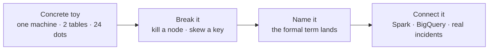

# Intuitions: See It Before You Name It

> **Why it matters** — Most data-engineering concepts are taught backwards: jargon first, picture later, understanding maybe. This track inverts it. Every chapter starts with a system small enough to fit in your head — one machine, two tables, twenty-four dots — and lets you break it until the formal name feels obvious.

## Why intuition before jargon

You can memorize "predicate pushdown reduces intermediate cardinality" and still not know when it matters. But if you've *watched* a filter node slide under a join and seen the cost bar collapse 38% in one step, the phrase is just a label for something you already own. That's the design rule here:

1. **Concrete first.** A tiny example you could hold in your head — not a diagram of a real cluster.
2. **Interactive second.** Every chapter has a component you can poke. Press the button that breaks it; the interesting part is always what happens next.
3. **Name last.** The formal term arrives *after* the picture, phrased as "what you just watched is called X." That's not a gimmick — it's how the concept actually enters your long-term memory.
4. **Then reality.** Once the intuition is solid, each chapter connects it to the real systems, the trade-off tables, and the production failure modes.

## Track map

| Chapter | You'll build the mental model for | The formal names that land |
|---|---|---|
| [Scaling: Up vs Out](/intuitions/scaling) | One machine grows until it can't; a fleet absorbs a death | Shared-nothing, partial failure, diminishing returns |
| [Query Plans & Optimization](/intuitions/query-plans) | SQL as a wish; a tree of operators getting rewritten | Logical vs physical plan, pushdown, pruning, cost model, join order |
| [Shuffle, Partitioning & Skew](/intuitions/shuffle-skew) | 24 dots hashing into 4 buckets — then one bucket overflows | Shuffle boundary, hash partitioner, straggler, salting, AQE |

::: tip 💡 How to use this track
Read these *before* the deep-dive tracks (Spark, SQL, system design). They won't teach you configs — they'll teach you what the configs are for. When a later chapter says "your shuffle is skewed," you'll already have the picture.
:::

## The one-idea-per-visual rule

Each interactive shows *one* idea, animated:

- **Scaling** — vertical vs horizontal, and the moment a node dies under each.
- **Query plans** — the optimizer as a series of rewrites, not a black box.
- **Shuffle** — hashing as a fairness machine, skew as its failure mode.

If you can explain what happened in each visual without using the jargon, the chapter worked. If you can now explain it *using* the jargon, you're interview-ready.

## Suggested path

1. [Scaling](/intuitions/scaling) — 20 minutes. Why we distribute at all.
2. [Query plans](/intuitions/query-plans) — 25 minutes. What the engine does with your SQL.
3. [Shuffle & skew](/intuitions/shuffle-skew) — 25 minutes. Where the bill and the 3am page both come from.

Then move to [Spark architecture](/spark/architecture), [Catalyst & joins](/spark/execution), or [system design](/system-design/) with the pictures already in place.
