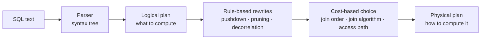
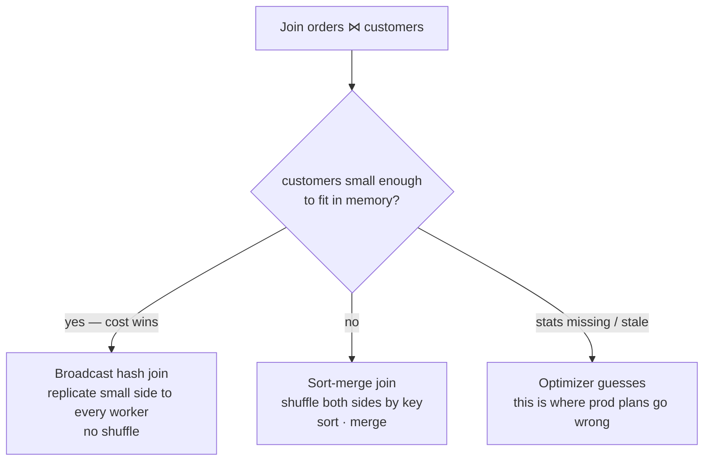
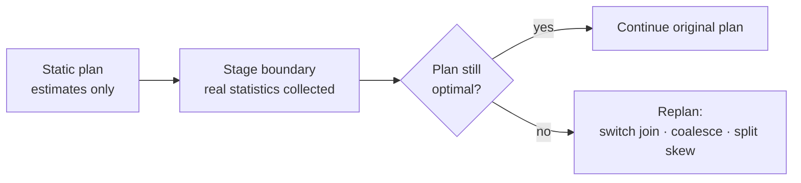
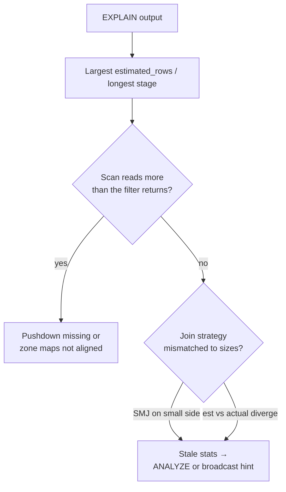

# Query Plans & Optimization

> **Why it matters** — The same SQL can scan 3 TB in one plan and 30 GB in another, and the engine decides which before you blink. If you can't read a plan, you're guessing at performance; if you can, you can usually point at the exact node where the optimizer guessed wrong.

## SQL is a wish, not a recipe

Here is a perfectly ordinary query:

```sql
SELECT c.name, o.total
FROM orders o
JOIN customers c ON o.customer_id = c.customer_id
WHERE o.year = 2024
```

Notice what you did *not* write: you didn't say which table to read first, which index to use, whether to sort before joining, or which columns to load. SQL is **declarative** — it describes *what* result you want, not *how* to compute it. That gap between *what* and *how* is the optimizer's entire job.

A naive execution of that query: read both tables fully, join them on customer_id, then throw away every row where year ≠ 2024, then throw away every column except name and total. It returns the right answer while reading ~100x too much data.

Watch the same query get smarter, one rule at a time:

<QueryPlanViz />

## What you just watched is a logical plan becoming a physical plan

The tree you saw at step 0 is a **logical plan** — the query translated into relational algebra:

- `σ` (sigma) = filter rows — the `WHERE`
- `π` (pi) = project columns — the `SELECT` list
- `⋈` = join — the `ON` condition
- Leaves = scans of base tables

The tree is *correct* but says nothing about *efficient*. Every step after that rewrote the tree into a better one — and the final step, replacing `JOIN` with `BROADCAST JOIN`, crossed an important line: the optimizer stopped asking *what* to compute and started choosing *how* to compute it. That's the boundary between a **logical plan** and a **physical plan**.



| Layer | Answers | Example decision |
|---|---|---|
| Logical plan | What result? | `orders ⋈ customers`, filtered to 2024, two columns |
| Physical plan | How, on which hardware? | Broadcast the 200-row customers; sort-merge the rest; zone-map prune the scan |

::: tip 💡 Senior insight
When you open `EXPLAIN` (Postgres, BigQuery, Spark `explain(True)`), you're looking at the *physical* plan. The logical plan is what you wrote; the physical plan is what you'll pay for. The skill isn't reading SQL — it's reading the difference.
:::

## The two optimizer brains

### Rules — always-good rewrites

The first two steps in the viz were **rule-based** optimizations: transformations that are correct and (almost) always cheaper regardless of statistics.

**Predicate pushdown** slid `WHERE year = 2024` from above the join to on top of the scan. Why it wins: a join's cost is driven by input size, and filtering early means fewer rows to shuffle, hash, and compare. The query can't get *worse* — the filter was going to run anyway.

**Column pruning** did the same trick vertically: if the query names `name` and `total`, the scan doesn't need the other 38 columns. This is why `SELECT *` in production pipelines isn't a style issue — it defeats a free 10-100x I/O reduction.

Other rules in the same family:

- **Constant folding** — `WHERE year = 2023 + 1` → `WHERE year = 2024` at plan time.
- **Decorrelation** — correlated subqueries (`WHERE EXISTS (SELECT ... WHERE outer.id = id)`) rewritten as joins so they can be optimized normally.
- **Join simplification** — `DISTINCT` or `LIMIT` on one side can shrink or eliminate joins.

### Cost — choices that depend on the data

The third step was different. *Which join algorithm* isn't a rewrite — it's a bet, and the optimizer places it using a **cost model**: estimated row counts × per-row CPU/IO/network cost, summed over candidate plans.



The classic physical-join ladder, cheapest to most expensive:

| Algorithm | When it wins | The catch |
|---|---|---|
| **Broadcast hash** | One side fits in memory (~10 MB default in Spark, configurable) | OOM if the "small" side lied; replicates to every worker |
| **Shuffle hash** | Both sides big, but one fits in memory *per partition* | Memory pressure on the build side |
| **Sort-merge** | Both sides large | Pays a full shuffle + sort — but robust and spillable |
| **Nested loop** | Tiny left side or non-equi joins | O(m×n) — catastrophic on real data |

::: warning ⚠️ Stale statistics = wrong physical plan
Cost-based optimization is only as good as its estimates. The number-one cause of "the optimizer picked a terrible plan" isn't a bug — it's **missing or stale table statistics**. The fix isn't a hint; it's `ANALYZE TABLE` / `ANALYZE` / updated stats. A broadcast join chosen on a table that grew from 5 MB to 5 GB is a production incident the hint system signed up for.
:::

## Join ordering: the problem that makes optimizers hard

Three-way join: `A ⋈ B ⋈ C`. Associativity says `(A ⋈ B) ⋈ C` and `A ⋈ (B ⋈ C)` return the same rows — but the *cost* is wildly different. If `A ⋈ B` produces 100 rows and `B ⋈ C` produces 100 million, join order decides whether your query takes seconds or never finishes.

For N tables there are N! orderings — a 10-table join has 3.6 million candidates. No optimizer enumerates them all. Two shapes organize the search:

| Shape | What it looks like | Trade-off |
|---|---|---|
| **Left-deep** | `((A ⋈ B) ⋈ C) ⋈ D` — one input always a base table | Smaller search space, pipelined execution — most optimizers default here |
| **Bushy** | `(A ⋈ B) ⋈ (C ⋈ D)` — both inputs can be joins | Finds better plans in some cases, but the space explodes — needs smarter search |

Real optimizers (Postgres, Catalyst, CockroachDB) use **dynamic programming** over the left-deep space for smaller joins, and fall back to **greedy or genetic search** above a table-count threshold. The rule of thumb you carry into production: *join order matters most when intermediate results are huge* — filters and small tables should join first because they shrink what flows upward.

## A cost model, with actual numbers

The cost model is embarrassingly simple in principle — and the estimate errors that make it wrong are the interesting part.

Suppose `orders` has 100M rows and `customers` has 10K rows. The optimizer evaluates two physical join plans:

**Broadcast hash join:** build a hash table on `customers` (10K entries — tiny), then stream `orders` through it.
- Read orders: 100M rows × read cost
- Broadcast customers: 10K rows × N workers (replication cost — trivial)
- Cost ≈ one full scan of orders.

**Sort-merge join:** shuffle *both* sides by `customer_id`, sort each partition, merge.
- Read both tables: 100M + 10K rows
- Shuffle orders: 100M rows × network+serialize cost — *the big number*
- Sort + merge both sides.
- Cost ≈ scan + **a full shuffle of the large table**.

Broadcast wins by roughly the cost of shuffling 100M rows. Easy choice — *if* the optimizer knows customers is 10K rows. Now imagine a filter `WHERE c.country = 'US'` on customers that reduces it to 500 rows — still broadcastable. But if stats think customers is 5 GB, the optimizer picks sort-merge and the query pays a shuffle it never needed. The cost model didn't make a math error — it made a *data* error.

| Statistic | Where it comes from | What goes wrong |
|---|---|---|
| Row count | `ANALYZE` / catalog metadata | Never refreshed after bulk load |
| NDV (distinct values) | Histogram / HyperLogLog sketch | Data drift — new keys appear |
| Column histograms | `ANALYZE` with bucketing | Skewed distributions mis-estimated |
| Filter selectivity | Assumed independence of predicates | Correlated columns (city + zip) multiply wrong |

::: info ℹ️ Correlated predicates are the silent plan-killer
Independence assumption: `WHERE city = 'NYC' AND zip = '10001'` gets selectivity(city) × selectivity(zip) — but NYC and 10001 are correlated, so the true selectivity is much higher than the estimate. The optimizer thinks the filter returns 10x fewer rows than reality → under-broadcasts, over-shuffles. Modern engines (Postgres `CREATE STATISTICS`, Spark's CBO) support *extended statistics* on correlated column groups for exactly this.
:::

## Same idea, different dialects

Every engine runs the same pipeline with different vocabulary. Mapping the names:

| Concept | Spark (Catalyst) | Postgres | BigQuery | Trino |
|---|---|---|---|---|
| Rule-based rewrite | `Rule[LogicalPlan]` batches | Rewriter | Standard optimizer rules | Optimizer rules |
| Cost model | CBO with stats | cost × page/tup | Slot-time cost model | Cost-based with stats |
| Inspect plan | `explain(True)` / `EXPLAIN` | `EXPLAIN (ANALYZE)` | Query plan graph in console | `EXPLAIN ANALYZE` |
| Force a join | `broadcast()` hint | `SET enable_mergejoin=off` | `#StandardSQL` execution hints (limited) | `/*+ BROADCAST */`-style session props |
| Refresh stats | `ANALYZE TABLE` | `ANALYZE` | Automatic (mostly) | `ANALYZE` |

The *why* never changes. Reading `EXPLAIN` output in an unfamiliar engine is mostly vocabulary translation — the tree shape is always the same idea.

## When the optimizer needs help — hints, but honestly

Every engine offers hints, and every senior treats them as a last resort. The honest order of operations:

1. **Fix the stats.** `ANALYZE` first, always. Most "bad plan" cases are stale stats wearing a bad-plan costume.
2. **Restructure the data, not the query.** Cluster, partition, or index so the *cheap* plan is also the *correct* plan.
3. **Restructure the query last.** Rewrite correlated subqueries as joins, break a monster CTE into stages, pre-aggregate before joining.
4. **Hint only with a rollback plan.** `/*+ BROADCAST(x) */` is a promise the data won't outgrow the hint. Document it, date it, re-check it quarterly.

::: warning ⚠️ Hints ossify
A hint that was right last year becomes a bug as data grows. `BROADCAST` on a table that crossed the memory threshold converts a slow query into a driver OOM. Stats-based plans degrade gracefully; hinted plans degrade catastrophically.
:::

## The plan you ship vs the plan that ran

One subtlety worth knowing: the plan `EXPLAIN` shows is the plan the optimizer *thinks* it will run. Two things can change it at runtime:

- **AQE / adaptive execution** — Spark 3.2+, some MPP engines — replans at shuffle boundaries using measured statistics. `AdaptiveSparkPlan` in `explain` output means the final plan is decided mid-flight.
- **Runtime filters** — Bloom-filter-style dynamic pruning injected during execution (Snowflake, BigQuery, Databricks). A join's small side builds a filter that the large side's scan checks against, pruning rows the plan never mentioned.



This is why "the plan looked fine in EXPLAIN" and "the job was still slow" aren't contradictory — the plan that ran may differ from the plan you reviewed.


## The physical layer's cheat codes

Two techniques operate *below* the plan tree and routinely beat clever SQL.

### Columnar storage

Row storage reads every column of every row touched. **Columnar storage** (Parquet, ORC, BigQuery Capacitor, ClickHouse) stores each column contiguously — so a query over 3 of 100 columns reads ~3% of the file. Combine that with column pruning and you see why "just add a filter" can't fix a `SELECT *` pipeline: the read amplification happens at the storage layer, before the engine sees a row.

### Zone maps / min-max pruning

Columnar files store, per row-group or block, the **min and max** of each column. A filter `WHERE year = 2024` on a block whose `min(year) = 2019, max(year) = 2022` is skipped *without reading a single row*. This is called **zone-map pruning** (Parquet: statistics pruning; BigQuery: block pruning; Snowflake: micro-partition pruning).

::: info ℹ️ Why sort order and clustering are physical, not logical
Zone maps only work if similar values land in the same block. That's why `CLUSTER BY` (BigQuery), `OPTIMIZE ZORDER BY` (Delta), sort keys (Redshift), and `ORDER BY` at write time are *physical* decisions with no logical-plan equivalent — they change which blocks a filter can skip. A query can be logically identical and physically 1000x faster.
:::

## Reading a plan: the 30-second drill

Whatever engine you use, the ritual is the same:

1. **Find the biggest number.** In `EXPLAIN ANALYZE` (Postgres) or the Spark SQL UI, look for the node with the largest estimated or actual rows — that's where the time goes.
2. **Check the scan.** Is it a full table scan where you expected pruning? Missing predicate pushdown or missing stats.
3. **Check the join.** Sort-merge on a small table → the optimizer doesn't know it's small. Stats or a broadcast hint.
4. **Compare estimated vs actual rows.** Off by 10x+ → stale stats → the entire plan above that node may be wrong.

### A glossary of physical operators

Whatever vocabulary your engine uses, plan nodes map to a small set of physical moves:

| Plan word (any engine) | What it actually does | Red flag when it appears |
|---|---|---|
| `Seq Scan` / `Table Scan` / `Scan` | Reads the relation, possibly with pushed filters | On a table you expected to prune |
| `Index Scan` / `Index Seek` | Uses an index to touch only matching rows | On a huge result — index overhead per row adds up |
| `Hash Join` / `BroadcastHashJoin` | Builds a hash table on one side, probes with the other | Build side >> memory → spill or OOM |
| `SortMergeJoin` / `Merge Join` | Sorts both inputs on the key, merges | When either side was broadcastable |
| `Exchange` / `Shuffle` / `Redistribute` | Moves rows across nodes — the expensive part | More than once per query without reason |
| `Aggregate` / `HashAggregate` | Groups and rolls up | `spill` counters — groups don't fit memory |

The same 6-ish moves show up in every `EXPLAIN` ever printed. Learn them once; they transfer everywhere.



::: details The interview version
"Walk me through what the optimizer does with my query" = parse → logical plan → rule rewrites (pushdown, pruning) → cost-based physical plan (join order, join algorithm, access path) → execute. Then say the sentence that separates seniors: *"and the failure mode is almost always stale statistics, not a bad optimizer."*
:::

## 🧠 Quiz

<QuizCard :questions="[{ q: 'Why does predicate pushdown usually help even before any statistics are consulted?', options: ['It converts a filter into a join, which is always faster', 'Filtering rows earlier shrinks the input to every operator above it, so less data is shuffled and joined', 'It enables index use on the filtered column', 'It moves the filter to the client, offloading the server'], correct: 1, explain: 'Pushdown is a rule-based rewrite — correct and almost always cheaper regardless of data sizes, because smaller intermediate results reduce cost everywhere downstream.' }, { q: 'EXPLAIN shows a sort-merge join where one input is a 50-row table. What is the most likely root cause?', options: ['The query used SELECT * too many times', 'The join key is skewed', 'Missing or stale table statistics made the optimizer overestimate the small side', 'Sort-merge is optimal for tiny tables'], correct: 2, explain: 'Cost-based join choice relies on estimates. A 50-row table joining via sort-merge almost always means the optimizer thinks it is much bigger — stats are the fix, not a different query shape.' }, { q: 'What distinguishes a physical plan from a logical plan?', options: ['The physical plan chooses operators and access paths — broadcast vs sort-merge, index vs scan — while the logical plan only describes what to compute', 'The physical plan is written in SQL; the logical plan is algebra', 'The logical plan is optimized; the physical plan is not', 'There is no difference — they are two names for the same tree'], correct: 0, explain: 'Logical = what (filter, join, project). Physical = how (broadcast hash join, index scan, file pruning). EXPLAIN output shows the physical plan.' }, { q: 'A query joins 8 tables and the optimizer times out enumerating join orders. Why is this expected?', options: ['8 tables means a cartesian product', 'The cost model only handles 4 tables', 'There are millions of candidate orderings — optimizers use dynamic programming on left-deep trees and heuristics beyond a threshold', 'Join order does not affect cost, so enumeration is pointless'], correct: 2, explain: 'N-factorial orderings force real optimizers to restrict the search space. Left-deep dynamic programming plus greedy/genetic fallback is the standard compromise.' }, { q: 'Zone-map (min-max) pruning skips a Parquet row-group for WHERE year = 2024 when…', options: ['The user has permission on the year column', 'The file has fewer than 1000 rows', 'The row-group statistics show max(year) < 2024 — no row can match, so the block is never read', 'AQE is enabled'], correct: 2, explain: 'Zone maps store per-block min/max. If the filter range falls outside, the block provably contains no matches — pruning happens at the storage layer without reading data.' }, { q: 'Why does SELECT * matter on columnar storage specifically?', options: ['It makes the result non-deterministic', 'It changes the logical plan tree shape', 'It disables the query cache', 'Columnar reads happen per column — selecting all columns reads every byte instead of the ~3 percent a narrow projection would'], correct: 3, explain: 'Column pruning + columnar storage is a multiplicative win: a 3-of-100-column projection reads roughly 3 percent of the file. SELECT * forfeits it entirely.' }]" />

## Further reading

- [How Query Engines Work — Andy Grove](https://howqueryengineswork.com/) (free online; the best single book on this chapter)
- [Use The Index, Luke](https://use-the-index-luke.com/) — indexing and access-path intuition
- [Spark SQL Catalyst internals — Jacek Laskowski](https://japila.pl/apache-spark-internals/)
- [PostgreSQL EXPLAIN docs](https://www.postgresql.org/docs/current/using-explain.html)
- [Cascades Framework for Query Optimization — Goetz Graefe](https://www.cse.iitb.ac.in/infolab/Data/Courses/CS632/Papers/Cascades-graefe.pdf) (the architecture behind most modern CBOs)
- *Designing Data-Intensive Applications*, Ch. 3 — columnar storage and zone maps
