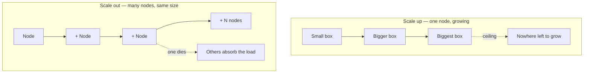
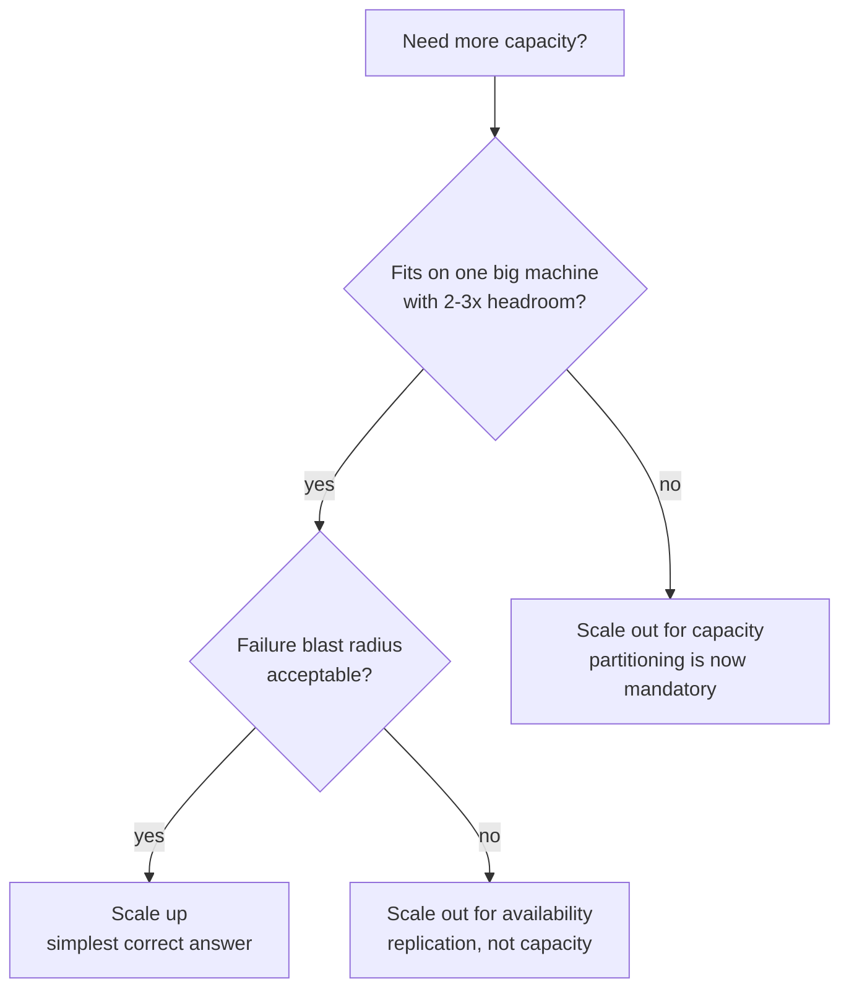
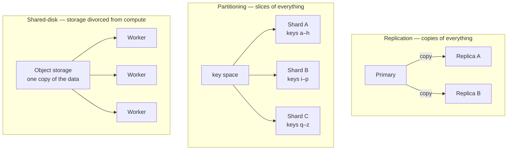
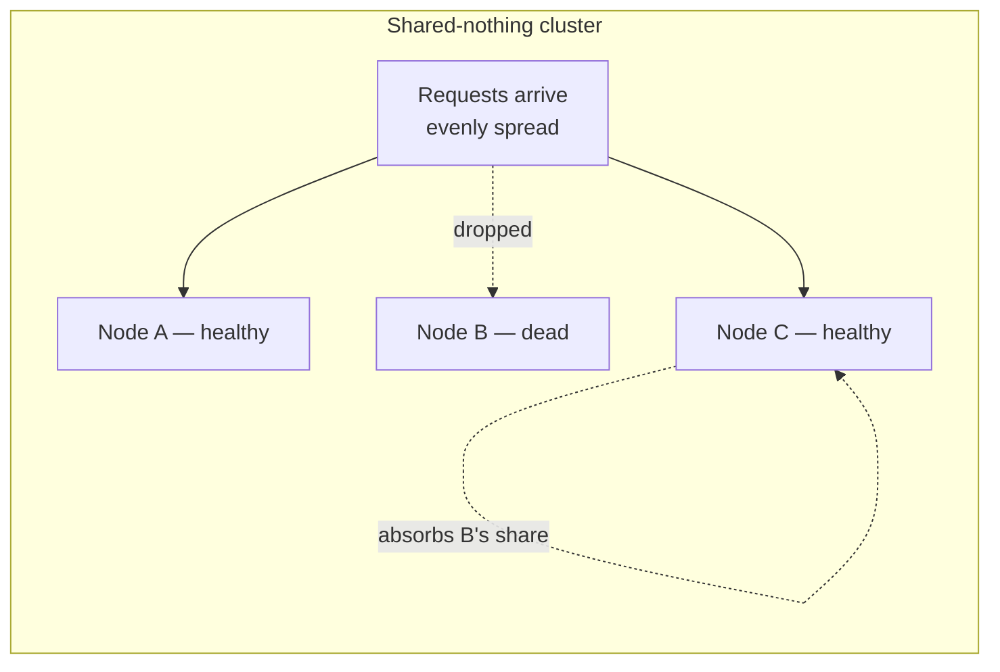

# Scaling — Up vs Out

> **Why it matters** — Every senior data-engineering interview and every capacity review asks the same question in disguise: "what happens when this is 100x bigger?" The honest answer is never "buy a bigger box" — it is a decision about where the load lands and what breaks when a piece of it disappears.

## A toy problem: one kitchen, one cook

Your laptop compiles a dbt project in 4 seconds. Your teammate's takes 40. Same project — their laptop has half the RAM and swaps. You could fix this two ways:

1. Buy them a laptop with twice the RAM.
2. Split the project so two laptops each build half.

Option 1 is **scaling up** (vertical). Option 2 is **scaling out** (horizontal). Everything in this chapter is those two sentences with production stakes.

Play with both before reading on. Watch what the load bar does, then hit **Kill a node**.

<ScalingViz />

## What you just watched has names

When you pressed **Scale up**, one bar grew taller — until a label appeared: `hardware ceiling`. That ceiling is real. The largest machine you can rent tops out somewhere (a few hundred cores, a few TB of RAM), and each upgrade bought less than the one before it. In economics this is **diminishing returns**: the second doubling costs more than the first and delivers less. Your cloud bill knows this even if your architecture diagram doesn't.

When you pressed **Scale out**, a new small machine appeared and the load split itself. No ceiling in sight — ten machines, a hundred machines, same operation. This is the **shared-nothing architecture**: each node has its own CPU, memory, and disk, and coordinates only by passing messages. Data systems from Hadoop to ClickHouse to Kafka are built on this premise.

Then you pressed **Kill a node** — and the two modes diverged completely:

- **One big machine:** total outage. The whole bar went dark.
- **Fleet:** the dead machine flashed red, its neighbors absorbed its share, and the system degraded instead of dying.

That difference — *degraded, not dead* — is the entire reason distributed systems exist.

## The numbers behind the ceiling

Why does the vertical bar stop buying throughput? Two compounding effects:

| Upgrade step | Hardware spend | Throughput gain | Why it shrinks |
|---|---|---|---|
| Small → medium | ~2x | ~1.8x | Most components scale cleanly |
| Medium → large | ~3x | ~1.4x | Memory bandwidth, NUMA boundaries |
| Large → largest | ~4x | ~1.1x | Diminishing returns; single socket limits |

Two physical reasons the gains flatten:

- **Amdahl's law** — if 10% of your workload is serial (one lock, one writer, one sort key), doubling hardware can only ever speed up the parallel 90%. The ceiling isn't the machine; it's the serial fraction of your code.
- **NUMA and shared resources** — the biggest machines are really several machines fused into one chassis, competing for memory bandwidth and IO controllers. You pay for "one big box" and get "several boxes that argue internally."

Meanwhile the horizontal column compounds in your favor: commodity nodes are priced at the sweet spot of the market — the per-dollar performance of a mid-range box beats a flagship server by design. The market *wants* you to scale out; it punishes scale-up at the top end.

::: info ℹ️ Amdahl's law, one-liner
If p of the work parallelizes perfectly and (1−p) is serial, max speedup is `1 / (1 − p)` no matter how many machines you add. At p = 0.9, the ceiling is 10x. Fix the serial part or no fleet saves you.
:::

## What "shared-nothing" actually shares

The name is a lie by omission. Nodes share *nothing* in the hardware sense — no shared RAM, no shared disk — but they share three things in the logical sense, and each is a place where the model leaks:

| Shared thing | How nodes share it | Where it breaks |
|---|---|---|
| **The data's partition map** | Consensus or a coordinator (ZooKeeper, Raft, gossip) | Split-brain, leader election storms |
| **Time** | Nothing reliable — each node's clock drifts | "Order" of events is ambiguous; this is why distributed systems use logical clocks |
| **Failure information** | Heartbeats and timeouts | Cannot distinguish slow from dead — the core ambiguity |

When a system advertises "shared-nothing," read it as: *each node's failure is its own, but coordination is everyone's problem.* Scaling out doesn't remove coordination — it makes coordination the bottleneck you must design around.

### How do 100 nodes agree on anything?

Two patterns cover most of the field:

- **Coordinator-based** — one node (or a small consensus group) holds the map of who owns what. Simple, but the coordinator is a mini-SPOF — usually replicated via Raft/Paxos. Examples: HDFS NameNode, Kafka's controller, Spark's driver.
- **Gossip/peer-based** — every node periodically exchanges state with random peers; the map emerges from the swarm. No SPOF, but eventually consistent — nodes briefly disagree. Examples: Cassandra, Dynamo-style systems.

Either way, the cost of scale-out is a coordination protocol running in the background forever. This is the tax vertical scaling never pays.

## In defense of the single machine

The industry overcorrected. After a decade of "scale out or die," the contrarian position — *one big machine is often the right answer* — deserves its own section, because it's usually correct.

A modern single server has 100+ cores and a terabyte of RAM. That runs most production databases on earth. And the argument isn't just capacity — it's that single-node systems are *simpler in ways that compound*:

- **No coordination cost.** No consensus, no shuffling, no leader election. The code path from request to answer is a function call, not a protocol.
- **Transactions come free.** On one machine, ACID is a solved problem. Across a fleet, it's two-phase commit, sagas, or giving up.
- **Failure is legible.** One machine fails completely — monitoring, alerting, and failover are easy to reason about. A half-dead fleet produces *weird* failures.
- **The 2020s hardware is genuinely enormous.** "Scale from zero to millions of users" examples assume 2010-era hardware. Today, a well-tuned Postgres on a single large instance handles workloads that "required" a Cassandra cluster in 2014.

::: warning ⚠️ Distributed systems are a cost, not a feature
Every node you add buys capacity and pays in coordination, partial failure, debugging difficulty, and operational surface area. The senior instinct is: scale up until it hurts, scale out only when one of the three *real* reasons forces you — capacity ceiling, failure blast radius, or geographic distribution of users.
:::

## When vertical still wins: the honest checklist

Stay on one machine when all of these hold:

1. **The working set fits** in one machine's RAM (or fast NVMe) *with headroom for 2-3x growth*.
2. **The workload is transactional** — writes that must be ordered, correlated, or ACID across entities.
3. **Latency matters more than throughput** — cross-node calls add milliseconds; in-memory calls add microseconds.
4. **Team size is small** — distributed systems need distributed-systems operators. One Postgres needs one Postgres book.

The flip side — scale out when any of these hold:

1. **Throughput exceeds any single machine** — Kafka-scale ingest, Spark-scale batch, fleet-scale request rates.
2. **Blast radius is unacceptable** — an outage that takes the whole product down needs a fleet, even if one box is "big enough."
3. **Data is naturally partitioned** — multi-tenant by region, time-series by window, logs by source. Nature already drew the shard lines.

## Three ways fleets carry state

Once you do scale out a stateful system, there are exactly three architectures. Everything else is a hybrid of these:

| Pattern | Each node holds | Scales | Weakness |
|---|---|---|---|
| **Replication** | A full copy | Reads only — writes still bottleneck on the primary | Doesn't help write-heavy load |
| **Partitioning (sharding)** | A slice of the keyspace | Both reads and writes | Cross-shard queries are expensive; rebalancing is hard |
| **Shared-disk** | Stateless compute over shared storage | Compute and storage independently | Every query reads over the network |

The combination you see most often: **partitioned *and* replicated** — each shard has a primary and followers, so a node death loses neither the data nor the capacity. Kafka topic partitions, Elasticsearch shards, and BigQuery's internal layout are all this shape.

::: tip 💡 Senior insight
Partitioning scales *throughput*; replication buys *availability*. They are different purchases. A 3-node replica set stores one copy of the data three times — it doesn't scale your writes, it survives your failures. Interviewers ask "how do you scale this database" and the trap answer is "add replicas."
:::

## The comparison that actually matters

| Property | Scale up (vertical) | Scale out (horizontal) |
|---|---|---|
| **Ceiling** | Hard — largest machine on the market | Soft — limited by coordination cost, not hardware |
| **Cost curve** | Exponential at the top end | Roughly linear; commodity hardware |
| **Failure mode** | Total outage — single point of failure | Partial degradation — capacity dips, service lives |
| **Code changes** | None — same process, more RAM | Everything — data must be partitioned, work distributed |
| **Deploys/maintenance** | Downtime or complex failover | Rolling — drain one node at a time |
| **Consistency model** | Simple — one machine sees one truth | Hard — replicas disagree, clocks drift, messages drop |

::: tip 💡 Senior insight
The interview answer "we'll scale horizontally" is incomplete without the follow-up: **horizontally scaled over what partition key, and what happens to a query that doesn't have it?** Scaling out isn't free capacity — it's a contract that says work arrives pre-divided, or pays a shuffle.
:::

## So why doesn't everyone scale out?

Because the right column of that table hides the two hard problems of distributed computing.

### Problem 1 — the network is not a wire

On one machine, two functions share memory. Across two machines, they share *messages* — and messages can be slow, duplicated, reordered, or simply never arrive. A node can't tell the difference between "the other node is dead" and "the network dropped my packets for ten seconds." This is why timeout configuration is an architectural decision, not an ops detail.

In 1994, Sun Microsystems engineers codified the wrong mental model as the **fallacies of distributed computing**. The ones that bite data engineers daily:

- *The network is reliable* — it isn't; partitions happen inside one datacenter.
- *Latency is zero* — a same-AZ round trip is ~0.5 ms; a disk read is ~0.1 ms; a cache hit is ~100 ns. Orders of magnitude matter.
- *Bandwidth is infinite* — that's your shuffle bill.
- *There is one administrator* — your Spark cluster and your warehouse disagree about time, schema, and who owns the data.

### Problem 2 — failure becomes partial

On one machine the failure modes are binary: process alive or dead. In a fleet, any *subset* can be alive, dead, or — worst of all — **alive but lying** (corrupt data, split brain, a node that responds to health checks while its disk fills). A system with N nodes has roughly 2^N failure states. You cannot reason about all of them, so you design for one rule:

**Partial failure is the default, not the exception.** A fleet of 1,000 machines with 99.9% individual uptime expects ~1 failure *per day*. Systems are designed so that expected failure is routine — replication, retries, idempotent writes — not so that failure never happens.

::: warning ⚠️ The quiet killer: gray failure
The hardest production incidents aren't dead nodes — they're *limping* ones. A node with a failing NIC or a full disk stays "up," accepts work, and returns errors or timeouts. It drags p99 latency while dashboards show green. Design health checks that observe *results* (can it actually serve?), not just heartbeats.
:::

## Where real systems sit on the up/out axis

| System | Vertical limit | Horizontal limit | Notes |
|---|---|---|---|
| **Single Postgres** | Large — 100+ cores, TBs RAM | Read replicas only | The honest default for most workloads |
| **Spark / Flink** | Executor size | Thousands of executors | Coordination cost: shuffles, scheduler |
| **Kafka** | Broker size | Thousands of partitions | Partitions are the unit of parallelism |
| **ClickHouse / BigQuery** | Node size | Petabyte-scale | Shared-nothing (or shared-disk) MPP |
| **Redis** | One primary per shard | Sharded cluster | Classic "scale out = resharding" story |

::: info ℹ️ The shared-disk middle path
Not everything is pure shared-nothing. Snowflake, BigQuery, and Aurora separate **compute from storage**: data lives on shared object storage, and stateless compute nodes scale up and out independently. You get horizontal elasticity without repartitioning files — at the cost of every query reading over the network. The trade moved; it didn't disappear.
:::

## The decision procedure

When someone asks "how does this scale?", walk it in order:

1. **Is it stateless?** Stateless services (web servers, query workers) scale out trivially — add nodes behind a load balancer. State is where scaling gets expensive.
2. **Where does the state live?** If one machine can hold it comfortably, scale up and sleep well. Postgres on a big box beats a distributed database you didn't need.
3. **What's the partition key?** Scaling out stateful systems means every request/query must route by some key. No good key → no good scale-out.
4. **What's the failure story?** "It fails over" is not a story. Which failures are detected, by whom, in how long, and what does a user see during the gap?

::: details The 3am version
Scale-up fails *completely* but *rarely* — you'll get paged once a year, hard. Scale-out fails *partially* but *constantly* — a node dies every week and nobody notices because the system absorbed it, until the day the absorber itself is the bottleneck (your shuffle chapter covers exactly this). Choose which 3am you want.
:::

## 🧠 Quiz

<QuizCard :questions="[{ q: 'A single-node Postgres is at 90% CPU. Your first move is to spin up a 32-node Spark cluster to replace it. What did you skip?', options: ['Nothing — 32 nodes is the correct default', 'Benchmarking Spark vs Postgres query speed', 'Migrating the schema to Parquet first', 'Checking whether a bigger box or a read replica solves it — scale-out buys ceiling at the price of distributed-system complexity'], correct: 3, explain: 'Vertical headroom is almost always cheaper than distributed complexity. Scale out when scale-up hits its ceiling or its failure mode is unacceptable, not before.' }, { q: 'In a shared-nothing cluster of 1000 nodes each at 99.9% uptime, how often should you expect a node failure?', options: ['Once a year', 'Never — 99.9% means reliable', 'Once a week', 'About once a day'], correct: 3, explain: '0.1% failure per node times 1000 nodes is roughly one expected failure per day. Distributed systems treat failure as routine, not exceptional.' }, { q: 'Why does a dead node in a fleet degrade the system instead of killing it?', options: ['Dead nodes are restarted instantly by the scheduler', 'The load balancer retries failed requests on other nodes', 'Clients cache responses so nobody notices', 'Remaining nodes absorb the dead node share of work — capacity dips but service continues'], correct: 3, explain: 'The fleet redistributes the dead node share of work. The system runs slower, not dark — that graceful degradation is the point of scaling out.' }, { q: 'Two nodes in one datacenter cannot reach each other for 10 seconds, but both are alive. From the perspective of node A, node B is indistinguishable from what?', options: ['A slow disk', 'A dead node — the network cannot prove life, only deliver messages', 'A garbage-collection pause', 'A different availability zone'], correct: 1, explain: 'Timeouts cannot distinguish slow, partitioned, and dead. This ambiguity is why distributed consensus and failure detection are genuinely hard problems.' }, { q: 'Which workload gets the LEAST benefit from horizontal scaling?', options: ['A single-writer OLTP database where every transaction touches every row', 'Embarrassingly parallel batch jobs', 'Kafka partitions consumed independently', 'Stateless API servers'], correct: 0, explain: 'Work that cannot be partitioned cannot be distributed. A workload where every operation needs the whole dataset gains nothing from more nodes — only coordination cost.' }, { q: 'Snowflake scales compute by adding warehouses while data stays on shared object storage. This architecture is called…', options: ['Vertical clustering', 'Federated sharding', 'Shared-nothing', 'Shared-disk — compute and storage are decoupled'], correct: 3, explain: 'Shared-disk designs keep data in one place and scale stateless compute over it — trading per-query network reads for elastic scaling without repartitioning.' }]" />

## Further reading

- [A Crash Course on Scaling the Data Layer — ByteByteGo](https://blog.bytebytego.com/p/a-crash-course-on-scaling-the-data)
- [The Fallacies of Distributed Computing — Wikipedia](https://en.wikipedia.org/wiki/Fallacies_of_distributed_computing)
- [The Datacenter as a Computer — Barroso, Hölzle & Ranganathan](https://link.springer.com/book/10.1007/978-3-031-01761-2)
- [Scalability Patterns for Modern Distributed Systems — ByteByteGo](https://blog.bytebytego.com/p/scalability-patterns-for-modern-distributed)
- *Designing Data-Intensive Applications*, Ch. 1 & 8 — Martin Kleppmann (the definitive partial-failure chapter)
- [Shared-nothing architecture — Wikipedia](https://en.wikipedia.org/wiki/Shared-nothing_architecture)
