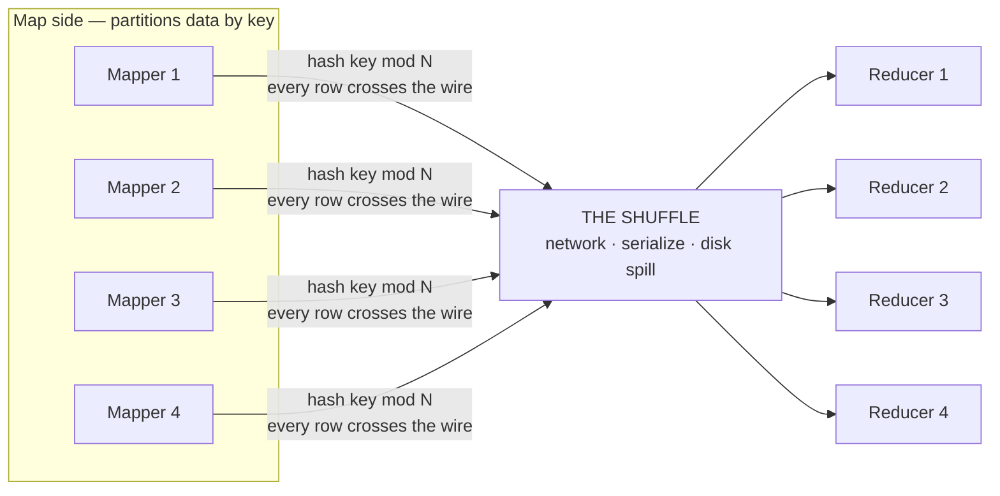
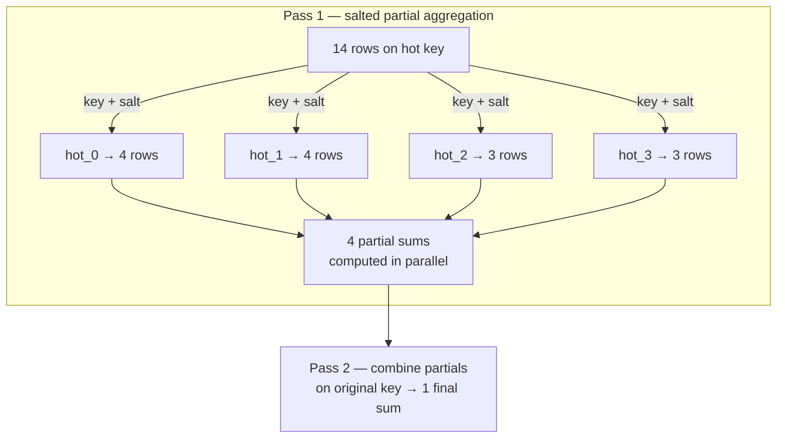
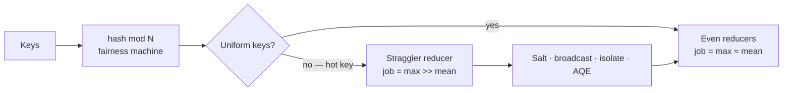

# Shuffle, Partitioning & Skew

> **Why it matters** — "Job stuck at 99% for an hour" is the most common distributed-computing incident on earth, and it is almost always one overloaded partition. If you can picture rows flowing through a hash function into buckets, you can diagnose skew, explain AQE, and answer the interview question before it's finished being asked.

## Twenty-four rows, four workers

Forget terabytes. You have **24 rows** and **4 workers**. Each row has a key. To group all rows that share a key onto the same worker (for a join or aggregation), each row runs through one rule:

```
worker = hash(key) mod 4
```

That's it — that one line is the entire mechanism. Watch it happen, then press **Skewed key** and break it:

<ShuffleViz />

## What you just watched is called a shuffle

The balanced view first: each dot started on a *mapper* (the workers that read data) and moved to a *reducer* (the workers that aggregate it). Every dot traveled across the network to land with other dots sharing its key. That mass movement — every row, across the wire, regrouped by key — is the **shuffle**.

Two things to notice:

1. **Every row moved.** A shuffle is a full data migration, not a lookup. This is why shuffles are the single most expensive operation in distributed data processing — network bandwidth, serialization, disk spill, all of it.
2. **The job ends when the slowest reducer ends.** There is no "average worker time" — the wall clock is set by the *maximum*. That asymmetry is the entire skew story.



## Hash partitioning: fair by accident

Why `hash(key) mod N` and not `key mod N` directly? Because keys are *lumpy* — customer IDs are sequential, timestamps cluster by hour, country codes cluster by population. A raw `mod` would route all Monday-morning traffic to the same worker. The **hash function** scrambles keys into a uniform spray first — it's a fairness machine: whatever lumpy key distribution you feed it, the output looks random.

The catch is in the animation: hashing is fair *only if the hash inputs are uniform*. Press **Skewed key** — one key (the orange dots) now owns 14 of 24 rows. `hash(hotkey)` is one value; it mod 4 is one reducer. **Hashing cannot help you when the skew is inside a single key.** Reducer 0 got 14 dots; the others got 3-4. Its timer bar is still running when the rest are done — that lone running bar is a **straggler**.

::: tip 💡 Senior insight
The straggler math is brutal: with one key at 60% of the data, that reducer does 60% of the work while the other three idle — the job runs at ~1.6x the ideal time *and* 75% of your cluster is wasted capacity. Double the cluster size and the straggler still owns 60%. You cannot throw hardware at skew.
:::

## Other ways to partition — and why hash wins by default

`hash(key) mod N` isn't the only option. Three schemes exist, and each trades something different:

| Scheme | Rule | Wins when | Fails when |
|---|---|---|---|
| **Hash** | `hash(key) mod N` | You need key-locality (joins, `groupBy`) and don't know the key distribution | One hot key — this chapter's whole problem |
| **Range** | Key intervals → nodes | Keys are sorted and you need range scans preserved (time-series, ordered output) | Distribution shifts — a busy range still overloads one node |
| **Round-robin** | `row_counter mod N` | You need perfectly even size, don't care about locality | Key-locality is lost entirely — a groupBy must re-shuffle anyway |

The trade-off is always *locality vs balance*. Hashing gets key-locality but inherits key skew. Round-robin gets balance but gives up locality. Range keeps order but inherits *distribution* skew. There's no free lunch — every partitioner picks which imbalance it will tolerate.

## What a single shuffled row actually pays

Each dot in the viz cost, in sequence:

1. **Serialization** on the mapper — turn a JVM/Python object into bytes.
2. **A partition write** — buffer, sort by reducer, spill to a local shuffle file if the buffer overflows.
3. **A network hop** — every row crosses at least one network boundary, often two.
4. **A remote read** — the reducer fetches the file blocks that belong to it, from *every* mapper.
5. **Deserialization** — bytes back into objects, then sort/aggregate.

Steps 2 and 4 are why shuffles hit disk *and* network *and* CPU simultaneously — the only operation that exercises all three at once. A shuffle-heavy job isn't "slow because Spark" — it's slow because it paid a three-way tax on every row.

::: details Why Spark writes shuffle files instead of streaming
MapReduce's original insight: write each mapper's output partitioned-by-reducer to local disk, let reducers pull their slice. This turns the shuffle into a *checkpoint* — a dead reducer's work can be replayed from files without re-running the whole stage. Spark inherits this (with an external shuffle service for dynamic allocation). The cost is disk I/O; the benefit is fault tolerance without lineage replay.
:::

## Skew's greatest hits in production

| The symptom | The cause | The tell |
|---|---|---|
| Job at 99%, one task running | One hot key | Shuffle read on one task is 10-100x median |
| Random "slow day" same code | A new hot key appeared (viral product, bot traffic, a mega-tenant) | Compare per-key counts across days |
| OOM on one executor only | Hot partition can't fit in memory | GC/spill on a single task, others clean |
| Join much slower than either side alone | Skewed join key | `null`/sentinel keys are the usual suspect |

::: warning ⚠️ The null-key trap
`NULL` join keys all hash to the same partition — a *guaranteed* hot partition you built yourself. Same for sentinel defaults (`-1`, `'UNKNOWN'`). Filtering or remapping nulls before a join is the highest-leverage skew fix that exists, and it costs a `WHERE` clause.
:::

## Salt: cheating the hash function

Press **+ Salt** and watch the orange dots spread across all four reducers. What changed isn't the hash — it's the *keys themselves*.

Salting rewrites the hot key into N variants:

```
salted_key = key + "_" + (row_number mod S)    -- S = salt factor, e.g. 4
```

The 14 hot rows now carry `hot_0`, `hot_1`, `hot_2`, `hot_3` — four *different* keys, hashed to four different reducers. Each reducer processes a ~4-row slice in parallel. Then a second pass **rolls the salted partial aggregates back together** on the original key (for `SUM`/`COUNT`-style operations) or handles the join counterpart.



| When to salt | Cost | When NOT to salt |
|---|---|---|
| Aggregation with one/few hot keys (`groupBy` on a mega-customer) | One extra aggregation round-trip | Keys are uniform — pure overhead |
| Post-join stage inherits skew | Salt both sides consistently | The join itself — broadcast instead |
| You can't change the data upstream | Works on any engine | AQE already splits it for free |

::: info ℹ️ Salting a join is different from salting an aggregation
For a join, the *small* side must be replicated per salt bucket (it joins against every `hot_i`), or the big side must be pre-salted — two shuffle passes instead of one. That's why the playbook for a skewed *join* is usually "broadcast the small side" first, salt second, isolate the hot key third.
:::

### What salted aggregation looks like in code

The two-pass shape, in SQL-flavored pseudocode:

```sql
-- pass 1: aggregate on salted key
WITH salted AS (
  SELECT key || '_' || CAST(FLOOR(RAND() * 4) AS INT) AS skey, val
  FROM events
),
partial AS (
  SELECT skey, SUM(val) AS psum
  FROM salted GROUP BY skey
)
-- pass 2: combine partials on the original key
SELECT SPLIT(skey, '_')[0] AS key, SUM(psum) AS total
FROM partial GROUP BY 1
```

Or the PySpark equivalent:

```python
salted = df.withColumn("skey", concat(col("key"), lit("_"), (rand() * 4).cast("int")))
partial = salted.groupBy("skey").agg(sum("val").alias("psum"))
final = (partial
    .withColumn("key", split(col("skey"), "_")[0])
    .groupBy("key").agg(sum("psum").alias("total")))
```

### The surgical alternative: isolate the hot key

When you *know* the hot key — a mega-customer, a null, a bot — you don't have to salt everything. Split the data into "hot" and "normal," handle them separately, union back:

```python
hot  = fact.filter(col("customer_id") == -1)          # the known hot key
rest = fact.filter(col("customer_id") != -1)
result = rest.join(dim, "customer_id") \
             .union(hot.join(broadcast(dim), "customer_id"))
```

The bulk takes the normal path; only the hot slice takes the broadcast path. Two plans, one union — often cheaper than a global salt because only the hot partition pays the extra pass.

| Fix | Extra passes | Best for |
|---|---|---|
| **Salt everything** | +1 aggregation round on *all* keys | Skew is spread across many keys, or unknown |
| **Isolate hot key** | +1 join only on the hot slice | One known hot key; surgical, cheapest |
| **Broadcast** | 0 shuffles (the best "fix") | One join side fits in memory |

## Skew beyond Spark

The same picture shows up in every distributed engine — the vocabulary differs, the straggler doesn't:

| Engine | Their name for the reducer | How skew shows up | Their fix |
|---|---|---|---|
| **Kafka** | Partition | One partition lags; consumer group unbalanced | Custom partitioner, key redesign |
| **ClickHouse** | Shard / part | One shard at 100% CPU, query stuck | Better sharding key, `OPTIMIZE` redistribution |
| **Flink** | Subtask / keyed partition | Backpressure on one parallel instance | Rebalance, key splitting, adaptive batch |
| **BigQuery** | Slot-stage worker | "Shuffling too much" / straggler slots | `APPROX_TOP_COUNT`, join key redesign |
| **Cassandra** | Token range / node | One node hot, storage imbalance | Virtual nodes (vnodes), better partition key |

::: warning ⚠️ Skew in Kafka is structural
Spark skew is per-query — a bad join, fix the query. Kafka skew is per-*topic* — a bad partition key means one broker and one consumer carry the load *forever*, until the producer's key strategy changes. Fixing it usually means re-producing to a new topic with a better key, not just a config flip.
:::

## The shuffle boundary is a stage boundary

Zoom out one level. In Spark/Flink/MapReduce, a shuffle isn't just movement — it **cuts the job into stages**. Everything upstream must finish writing its shuffle files before anything downstream can read them (a reducer needs *all* rows with its key; they might live on any mapper). Consequences:

- **It's a synchronization barrier** — the straggler doesn't just delay its own partition; it delays the entire next stage.
- **It's a checkpoint** — Spark can recompute a lost partition from shuffle files without restarting the job; this is why wide dependencies are recoverable but expensive.
- **It's where the physical plan is decided** — AQE (below) can only re-plan *between* shuffle boundaries, because that's when it finally sees real data sizes.

## AQE: the engine salts for you now

Since Spark 3.2, **Adaptive Query Execution** watches real shuffle statistics at stage boundaries and re-plans the rest of the job — including skew:

| AQE feature | What you saw in the viz | Config |
|---|---|---|
| Skew join split | The hot reducer's work is subdivided into smaller tasks | `spark.sql.adaptive.skewJoin.enabled` (default true) |
| Coalesce partitions | Reducers with trivial work merge — fewer, saner tasks | `spark.sql.adaptive.coalescePartitions.enabled` |
| SMJ → broadcast switch | "Small" table turned out small → no shuffle at all | `spark.sql.adaptive.autoBroadcastJoinThreshold` |

AQE's skew handling reads *median partition size* after the shuffle write and splits any partition over `skewedPartitionFactor` (default 5x) times the median. It's the salt trick, automated — but only for *join* skew, only *after* the shuffle, and only if the partition can be split at all (a `groupByKey` on one key can't be subdivided — the rows are already married to one task).

::: info ℹ️ AQE is a safety net, not a fix
AQE splits skewed *join* partitions at runtime — but it can't help before the first shuffle, can't split a partition whose rows are already married to one key (`groupByKey`-style), and doesn't remove the shuffle's cost — it just spreads the damage. The design-level fixes (better keys, broadcasting, pre-aggregation) are still worth doing; AQE is the seatbelt for when your estimates were wrong.
:::

## When you can't split the hot key

Some hot keys are indivisible *by definition*: all rows sharing a key must land together for correctness (a `groupByKey`, a window partition, a sessionization keyed by user). Salting helps only if the operation is *re-combinable* — sums, counts, sets. If the operation needs the whole group at once (median, session window, custom aggregate over all rows of the key), no salt, split, or AQE saves it. The remaining levers:

- **Give the hot reducer more memory/CPU** — vertical scaling applied to one partition (`spark.executor.memory`, or split the job so the hot partition runs alone on a bigger node).
- **Pre-aggregate what you can** — a `reduceByKey` on the map side shrinks rows before they hash, even if the final combine still needs all keys together.
- **Re-key the problem** — sessionize on `user_id + day` instead of `user_id`, then combine; the day-suffix is a deterministic salt.


::: details The diagnostic checklist, compressed
Job slow → open the stage detail → sort tasks by shuffle read. Max is 10x+ median → skew. Then: is it one key (`null`/sentinel?) → isolate or filter it. Is it a join → broadcast the small side. Aggregation → salt. Already on Spark 3.2+ → check whether AQE saw it (`AdaptiveSparkPlan` in `explain(True)`); if AQE didn't fire, your partition may be unsplittable.
:::

## The mental model to keep



Three sentences that cover most interviews and most incidents:

1. **A shuffle moves every row over the network — the wall clock is set by the slowest reducer, not the average.**
2. **Hashing fixes lumpy *distributions* of keys but cannot fix one lumpy *key*.**
3. **Skew fixes are all the same idea: split the hot partition — by salting it yourself, broadcasting around it, or letting AQE do it at runtime.**

## 🧠 Quiz

<QuizCard :questions="[{ q: 'A Spark stage shows median task shuffle-read of 50 MB and one task at 4 GB. Root cause?', options: ['Not enough shuffle partitions — increase spark.sql.shuffle.partitions', 'A slow executor — replace the node', 'A hot key — one key hashes most rows to a single reducer', 'GC pressure — increase executor memory'], correct: 2, explain: 'Skew shows up as max >> median on shuffle read. Partition count and hardware do not help — all rows of the hot key land on one reducer by definition.' }, { q: 'Why does a hash function sit between the key and the mod-N partition assignment?', options: ['It compresses the key to save bandwidth', 'It scrambles lumpy key patterns into a uniform spray, so unrelated keys land evenly across reducers', 'It encrypts keys for security', 'It guarantees the same reducer always gets the same key'], correct: 1, explain: 'Hashing is a fairness machine — sequential IDs, clustered timestamps, and skewed code distributions all come out uniform. But it cannot help when the skew is inside a single key value.' }, { q: 'You salt a hot key with a salt factor of 4. What must happen next for the answer to be correct?', options: ['The join partner is broadcast to all reducers', 'A second pass combines the 4 partial results back on the original key', 'The salt is removed by a UDF at write time', 'Nothing — salted results are already final'], correct: 1, explain: 'Salting splits one key into S variants for parallel partial aggregation. Correctness requires a combine pass that merges the S partials on the original key.' }, { q: 'A join between 1-billion-row fact and 200-row dimension is running sort-merge with heavy shuffle. First fix?', options: ['Increase shuffle partitions', 'Broadcast the 200-row dimension — a replicated local hash join beats any shuffle', 'Enable speculative execution', 'Salt the fact side join key'], correct: 1, explain: 'When one side fits in memory, broadcasting eliminates the shuffle entirely — always try it before salting, which adds a pass.' }, { q: 'Why can AQE only re-optimize at shuffle boundaries?', options: ['Shuffle boundaries are where the driver reconnects', 'Shuffles are the only place Spark checks for errors', 'AQE is disabled during map stages by license', 'Shuffle writes produce the first real statistics — partition sizes and row counts — needed to replan what comes next'], correct: 3, explain: 'Before the first shuffle, sizes are estimates. Shuffle write files are measured facts — AQE waits for facts, then re-plans the remaining stages.' }, { q: 'All NULL join keys land on the same partition because…', options: ['They do not — nulls are dropped before hashing', 'Nulls are sent to the last partition by convention', 'NULL is skipped by the hash function', 'hash(NULL) is a single constant value, so every NULL row hashes to one reducer — a guaranteed hot partition'], correct: 3, explain: 'One input, one hash output, one partition. Null and sentinel keys are the most common self-inflicted skew — filter or remap them before the join.' }]" />

## Further reading

- [Adaptive Query Execution — Databricks docs](https://docs.databricks.com/en/optimizations/aqe.html)
- [Spark SQL Performance Tuning — official docs](https://spark.apache.org/docs/latest/sql-performance-tuning.html)
- [Why is my Spark job stuck on the last task — Databricks](https://answers.databricks.com/spark-job-stuck-last-task-data-skew)
- [MapReduce paper — Dean & Ghemawat](https://research.google/pubs/mapreduce-simplified-data-processing-on-large-clusters/) (where the shuffle was born)
- *Designing Data-Intensive Applications*, Ch. 6 — partitioning and skew ("hot keys" section)
- *Spark: The Definitive Guide* — Chambers & Zaharia, partitioning chapter
