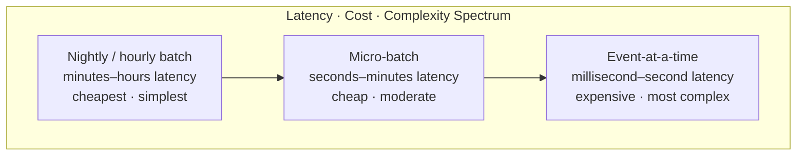
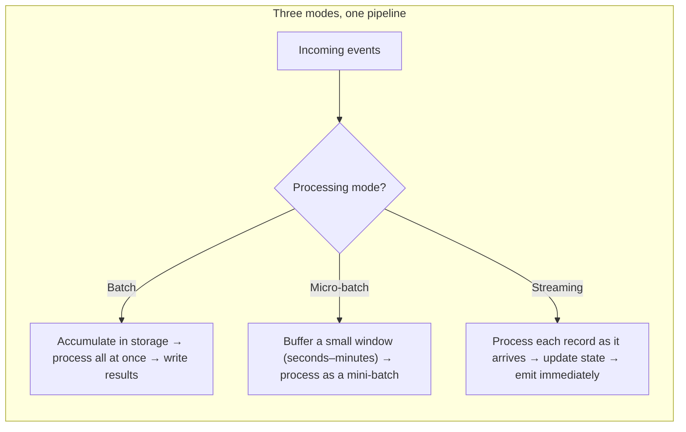
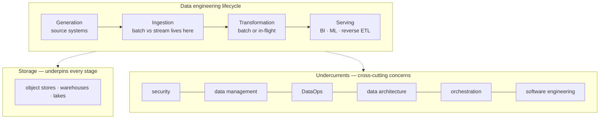
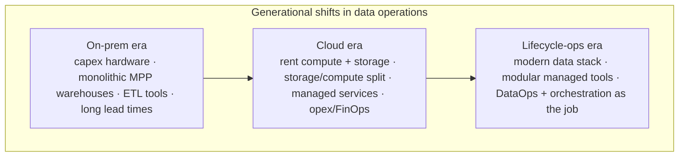
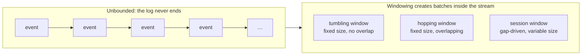
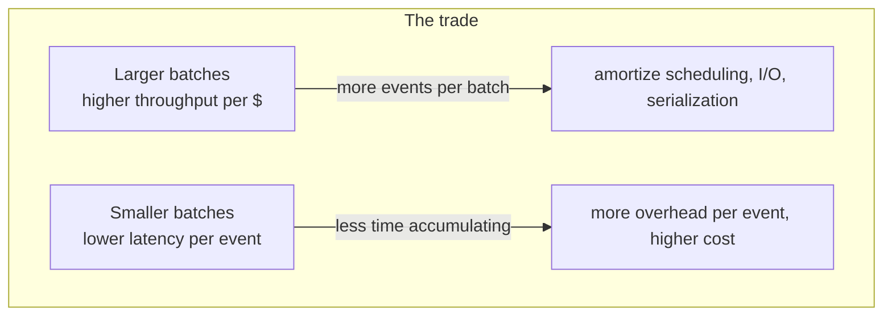
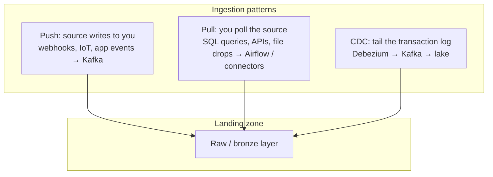

# Batch vs Streaming

> **Why it matters** — "Should this be real-time?" is the most consequential and most badly answered question in data engineering. Teams burn 3–10x compute budget and operational headroom chasing streaming pipelines for requirements that were actually "hourly" or "when it changes." Choosing wrong in the other direction — batch for a genuinely latency-sensitive product — means missed fraud windows and stale recommendations.

## The spectrum, not a binary

"Batch vs streaming" is not two camps. It is a continuous spectrum of trade-offs between **when results arrive**, **how much infrastructure costs**, and **how much complexity you own**.

| Mode | Latency | State window | Best for | Typical tools |
|---|---|---|---|---|
| Scheduled batch | minutes–hours | whole dataset | billing, reports, ML training, compliance | Spark, SQL dbt, Airflow |
| Micro-batch | seconds–minutes | per trigger interval | dashboards, alerts, CDC replication, IoT ingestion | Spark Structured Streaming, Flink batch triggers |
| Event-at-a-time | ms–seconds | per event + windows | fraud, fraud-adjacent, clickstream personalization, control loops | Flink, Kafka Streams, Beam runners |

::: info 💡 Senior insight
The dominant mistake is defaulting to streaming because the business says "real-time." Push back with a number: *What is the decision this data feeds, and what is the cost of it being 10 minutes stale?* If the answer is "nothing measurable," you have just saved 3x compute and a whole on-call tier.
:::

## The lifecycle lens — ingestion is one stage of five

Reis & Housley's *Fundamentals of Data Engineering* frames every pipeline as a run through the **data engineering lifecycle**: generation → storage → ingestion → transformation → serving. Storage underpins all stages rather than sitting strictly between ingestion and transformation; the middle stages routinely overlap, repeat, or weave together. The batch-vs-stream choice is an *ingestion* decision that ripples through everything after it — once data is cut into batches, downstream latency is capped no matter how fast your transform engine is.

The **undercurrents** are the book's most useful frame for senior review: no lifecycle stage functions without them. Batch and streaming pipelines draw on the same six:

| Undercurrent | What it demands of an ingestion/pipeline choice |
|---|---|
| Security | least-privilege access to sources, encryption in flight and at rest, secrets management |
| Data management | lineage, catalogs, governance — a streaming pipeline without lineage is a debugging horror |
| DataOps | monitoring, alerting, incident response; streaming raises the on-call bar permanently |
| Data architecture | does the source/sink topology match the query workload downstream? |
| Orchestration | dependency graphs across systems; streaming trades the scheduler for always-on jobs |
| Software engineering | versioned, tested transform code — regardless of trigger mode |

:::: info 💡 Senior insight
The book's sharpest line: virtually all data is *inherently streaming* — it is produced continuously at the source. Batch ingestion is a deliberate simplification that chunks the stream on a time or size boundary. So the real question is never "batch or stream?" but "where do we cut the stream, and who pays the latency?" Cut early (at ingestion) and every downstream stage inherits the freshness; cut late and you keep batch economics.
::::

### Generational shifts — how we got here

The lifecycle is stable; the operating model under it has shifted roughly once a decade:

- **On-prem → cloud** flipped cost structure: from sizing hardware up front (and oversizing for peak) to renting per-second. Storage and compute decoupled, which is what made cheap persistent staging layers — and therefore ELT — viable.
- **Cloud → modular ops ("modern data stack")**: the engineer's job moved up the value chain from babysitting clusters (the big-data era) to wiring managed services together, owning DataOps, FinOps, and orchestration. Reis & Housley describe the modern role as a *data lifecycle engineer* — less low-level plumbing, more undercurrent work.
- **The trap**: lift-and-shift. Treating cloud services like familiar on-prem servers reproduces on-prem practices at cloud prices — the book calls this a widespread migration error. Similarly, adopting streaming because the modern stack makes it easy reproduces "big data for small problems."

## Bounded vs unbounded data

The clean mental model, from Tyler Akidau's *Streaming Systems*:

- **Bounded data** — a finite dataset you can *finish*. A file, a table, a partition. Batch processing reads it, transforms it, produces a complete result.
- **Unbounded data** — a never-ending stream of events. There is no "end" to process. You define *windows* to create artificial boundaries for aggregations and reporting.

Everything about engine choice, semantics, and operational burden follows from this distinction. A bounded dataset has deterministic reruns and trivial idempotence; an unbounded stream never "finishes," so you carry checkpoints, watermarks, and exactly-once machinery instead.

::: warning ⚠️ Risk / production failure mode
Teams reach for windowed streaming when the business asks for "hourly totals." A tumbling 1-hour window in a streaming engine is not the same as an hourly batch: it carries watermark logic, late-arrival policy, and state TTL you didn't need. An Airflow-scheduled hourly job is simpler, cheaper, and easier to backfill.
:::

## Throughput vs latency trade-offs

The engineering constraint that does not go away: **batching improves throughput but worsens latency**; smaller batches improve latency but worsen throughput and cost.

| Lever | Pulls toward | Cost of pulling |
|---|---|---|
| Bigger trigger interval / batch size | throughput, lower cost | higher latency, bigger state |
| Smaller interval / more triggers | lower latency | more CPU per event, more I/O ops, higher cost |
| Exactly-once semantics | correctness | checkpoint overhead, commit coordination, slower recovery |
| Late-data support | completeness | larger state, watermark complexity, delayed results |
| Event-time processing | correctness for out-of-order data | watermark tuning, late-event handling, state growth |

::: tip 💡 Senior insight
Interview answer that lands: "I optimize for *sufficient* latency — the smallest interval the downstream consumer can act on — then maximize throughput inside that budget." This frames latency as a constraint, not a goal.
:::

## When batch is still right

Batch has not been displaced. It wins whenever:

- **The output is a complete dataset**, not a stream of updates — a daily general ledger, a training snapshot, a regulatory filing
- **Correctness > freshness** — billing runs must reconcile; a 4-hour batch that is right beats a 4-second stream that drifts
- **The computation needs the whole dataset** — training ML models, computing medians/percentiles over history, full reindexing
- **Operational simplicity matters** — a failed batch reruns deterministically; a streaming job has checkpoint compatibility, state format, and upgrade-continuity concerns

::: warning ⚠️ Risk / production failure mode
Batch jobs that silently skip partitions are the classic correctness bug. If your "hourly" job processes "new data since last run," a delayed upstream partition lands in the *next* run's output and your numbers shift retroactively. Prefer partition-based processing — "process partition P" — over time-based incremental reads wherever possible.
:::

## Ingestion patterns

How data enters the platform shapes everything downstream:

| Pattern | Strengths | Weaknesses | Use when |
|---|---|---|---|
| Push to stream | lowest latency, decoupled | requires source-side instrumentation | events, telemetry, product analytics |
| Pull / scheduled query | simple, no source changes | load spikes, missed deletes, polling lag | third-party APIs, small tables, legacy DBs |
| CDC (log tail) | captures every change including deletes, low source load | requires log access, more moving parts | OLTP → lakehouse replication, near-real-time sync |

### Source-push vs sink-pull vs poll

Reis & Housley note the push/pull line is blurrier than it looks — data is often pushed *and* pulled across one pipeline's stages. A third pattern, **polling**, is pull-on-a-schedule: the sink periodically checks the source for changes.

| Pattern | Who initiates | Source load | Latency ceiling | Control point | Watch out for |
|---|---|---|---|---|---|
| Source push | source writes to an endpoint (webhooks, file export, event emitter) | near zero after emit | lowest — arrives when produced | source team owns schema/semantics | sink must absorb bursts; source team can break you silently |
| Sink pull | destination queries/reads the source (ETL extract, direct DB read) | query load on the source | bounded by schedule | you control timing and retries | missed deletes, snapshot drift, production-DB impact |
| Poll | pull, but only when a check says "changed" | low, mostly cheap checks | check interval + pull time | you | the change-detection mechanism is the whole correctness story |

:::: tip 💡 Senior insight
CDC straddles the line cleanly: trigger-based CDC *pushes* a message per row change into a queue; log-based CDC has the database *push* to its own WAL while the ingestion system *pulls* from the log — the source barely notices. Timestamp-based CDC is plain poll-and-pull. Same acronym, three different load/coupling profiles.
::::

### ETL vs ELT vs "just-in-time" transformation

Where the `T` runs is a lifecycle-placement question, not a branding one:

- **ETL** — transform before load, in a dedicated processing tier. Right when the target is expensive to compute in (legacy MPP), or when data must be masked/normalized *before* it can legally land in the warehouse.
- **ELT** — load raw, transform inside the warehouse/lakehouse. Enabled by the storage/compute split: raw staging is cheap and the warehouse is the strongest engine you own. Two flavors the book distinguishes: transform-after-load (dbt-style) and transform-on-read (data lake queries over raw files).
- **Just-in-time / in-flight** — transform while the record moves, inside the stream or at the ingestion layer: enrich with fields, coerce types, drop bad records *before* the data lands. Right when the transform is stateless and the consumer needs clean data immediately; wrong when it needs joins or history — you can't re-run an in-flight transform the way you re-run a dbt model.

The nuance that matters: **in-flight transformation is a one-way door like batching is.** Once you transform inside the stream, the raw event may never be stored — your ability to reprocess is bounded by what you chose to keep. ELT keeps the raw landing so every transformation stays re-runnable. That is why the modern default is "load first, transform in the warehouse, in-flight only for stateless fixes."

::: details Deep-dive: why log-based CDC beats query-based extraction
Query-based CDC ("select * where updated_at > last_sync") misses hard deletes, sees only current state, and cannot distinguish "was updated then updated again" from a single update. Log-based CDC reads the database's own write-ahead log — the same mechanism used for replication — so every insert, update, and delete is captured in commit order, with minimal load on the source.
:::

::: details Deep-dive: the micro-batch sweet spot
Spark Structured Streaming's default mode is micro-batch: it buffers events for a trigger interval, then runs a short batch job against them. This inherits batch's fault tolerance and simple reasoning while delivering seconds-level latency. For most "real-time" analytics, this is the right default — you pay streaming-complexity prices only when sub-second latency is genuinely required.
:::

## 🧠 Quiz

<QuizCard :questions="[{ 'q': 'A product manager asks for real-time fraud scoring on payment events. Which processing mode is most appropriate, and why?', 'options': ['Hourly batch — fraud models do not need low latency', 'Micro-batch — it balances latency and cost', 'Event-at-a-time streaming — fraud decisions have to happen inside the transaction window', 'Nightly batch — it is cheapest'], 'correct': 2, 'explain': 'Fraud scoring happens inside the authorization window — the decision must block the transaction. That is sub-second latency with a real cost of being wrong/late. Event-at-a-time is justified; micro-batch adds seconds you do not have.' }, { 'q': 'What is the key difference between bounded and unbounded data?', 'options': ['Bounded data is batch-processed; unbounded data is always streaming', 'Bounded data has a defined end; unbounded data never finishes', 'Bounded data is smaller than unbounded data', 'Bounded data comes from files; unbounded data comes from Kafka'], 'correct': 1, 'explain': 'Bounded vs unbounded is about whether the dataset ever ends. The same dataset can be processed by either paradigm — a file can be read by a stream processor, a Kafka topic snapshot processed in batch.' }, { 'q': 'Why does increasing batch size generally reduce cost per event?', 'options': ['Overhead (scheduling, I/O, serialization) is amortized across more events', 'Streaming engines charge per event', 'Batch jobs use spot instances', 'Larger batches compress better'], 'correct': 0, 'explain': 'Fixed costs — job startup, metadata lookups, file opens, serialization — are paid once per batch. More events per batch means each event carries a smaller share of that overhead.' }, { 'q': 'A team runs an hourly batch that selects &quot;WHERE event_time > last_run_time&quot;. What is the biggest correctness risk?', 'options': ['The query is slow', 'Late-arriving data and clock skew cause missed or double-counted records', 'Timezone bugs in the timestamp', 'It cannot handle deletes'], 'correct': 1, 'explain': 'Time-based incremental reads have no guarantee of completeness: events arriving after the watermark are silently missed or shifted to the next run, and retries can double-count. Partition-based or CDC-based ingestion closes the hole.' }, { 'q': 'Which statement about micro-batch processing is true?', 'options': ['It is always more expensive than event-at-a-time', 'It cannot do event-time windowing', 'It processes each event as it arrives', 'It buffers a short window then processes as a small batch, keeping batch semantics with seconds-level latency'], 'correct': 3, 'explain': 'Micro-batch is the middle path: batch-style execution over small time windows. You get streaming latency without giving up batch fault tolerance and simple reasoning.' }]" />

<QuizCard :questions="[{ 'q': 'In the Reis &amp; Housley lifecycle, what do the undercurrents (security, data management, DataOps, architecture, orchestration, software engineering) have in common?', 'options': ['They only matter at the serving stage', 'They cut across every lifecycle stage — no stage functions without them', 'They are optional add-ons once pipelines work', 'They replace the need for ingestion design'], 'correct': 1, 'explain': 'The undercurrents are the book\'s cross-cutting bedrock: a streaming pipeline with no orchestration or a batch job with no security fails just as hard at generation as at serving. They are not a phase; they are the floor under every phase.' }, { 'q': 'A source database pushes every committed change to its WAL, and your connector reads the log. Which ingestion pattern is this?', 'options': ['Pure push — data bypasses all pulling', 'Sink pull — the connector reads from the database', 'A hybrid: source-side push to the log, sink-side pull from the log — log-based CDC', 'Polling — it checks for changes on a schedule'], 'correct': 2, 'explain': 'Log-based CDC is deliberately two-sided: the database pushes to its own replication log (near-zero added load), and the ingestion system pulls the log without querying the source tables. Calling it pure push or pure pull misses why it loads the source so little.' }, { 'q': 'Why is ELT the modern default over in-flight (just-in-time) transformation for analytics?', 'options': ['The raw landing stays re-runnable; in-flight transformation is a one-way door that may discard the raw event', 'In-flight transforms are more expensive to write', 'ELT is always lower latency', 'In-flight transforms cannot handle JSON'], 'correct': 0, 'explain': 'Once a record is transformed inside the stream, reprocessing is bounded by whatever was persisted. ELT loads raw first so every transformation can be re-run in the warehouse. Reserve in-flight for stateless fixes like type coercion and dropping bad records.' }]" />

## Further reading

- [Tyler Akidau, "Streaming 101" — O'Reilly Radar](https://www.oreilly.com/radar/the-world-beyond-batch-streaming-101/) — the bounded/unbounded framing that shaped the field
- [Apache Beam programming model](https://beam.apache.org/documentation/basics/) — the event-time/watermark model most engines now implement
- [Spark Structured Streaming Programming Guide](https://spark.apache.org/docs/latest/structured-streaming-programming-guide.html) — micro-batch mechanics and triggers
- [Debezium documentation](https://debezium.io/documentation/) — log-based CDC in production
- [Martin Kleppmann, "Turning the Database Inside Out"](https://martin.kleppmann.com/2015/03/04/turning-the-database-inside-out.html) — the log-as-first-class-citizen argument
- [*Streaming Systems* (Akidau, Chernyak, Lax)](https://www.oreilly.com/library/view/streaming-systems/9781491983867/) — the reference book on windows, watermarks, and exactly-once
- [Apache Kafka documentation](https://kafka.apache.org/documentation/) — producer/consumer semantics that bound your pipeline's guarantees
- [*Fundamentals of Data Engineering* (Reis & Housley, O'Reilly 2022)](https://www.oreilly.com/library/view/fundamentals-of-data-engineering/9781098108298/) — the lifecycle and undercurrents framing, push/pull ingestion, and the generational history used in this chapter
