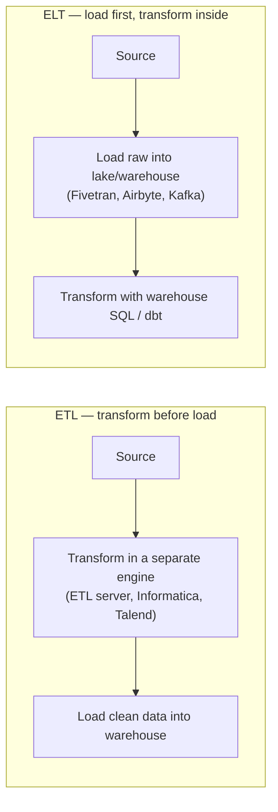
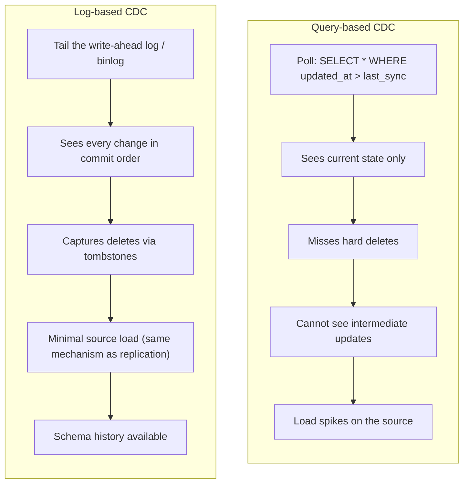
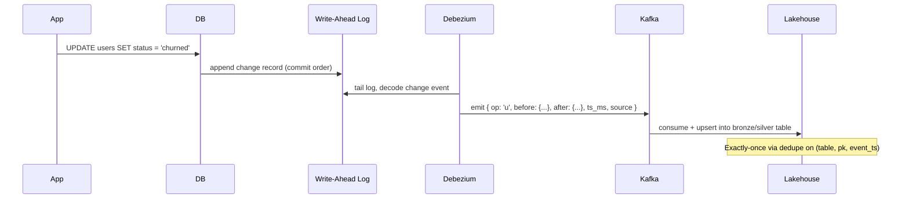
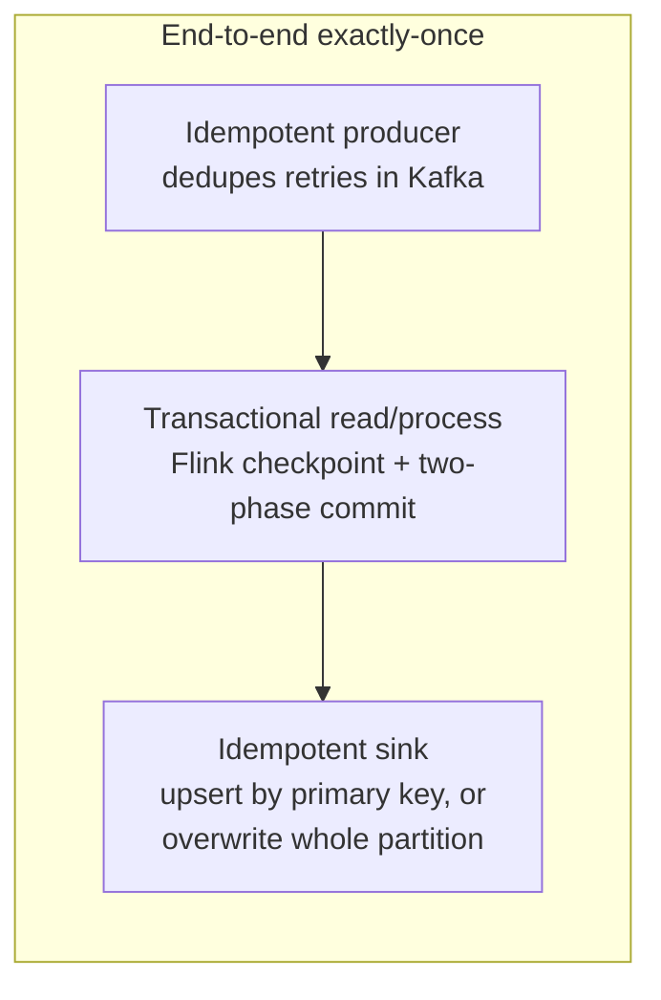
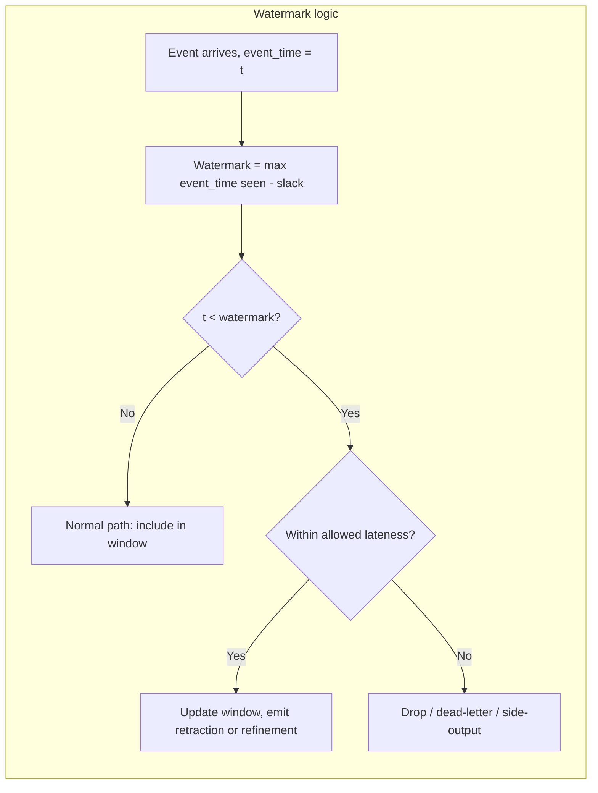
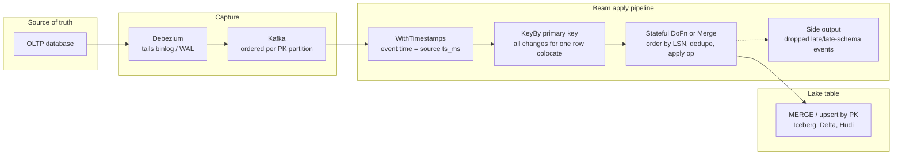
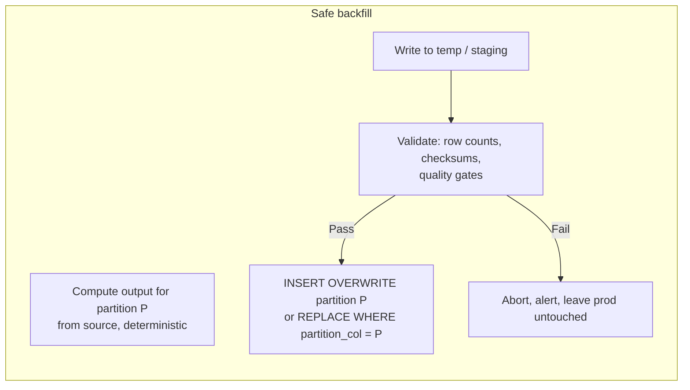

# ETL, ELT, CDC & Backfills

> **Why it matters** — This is where pipelines actually touch production data. Get ingestion semantics wrong and you silently double-count revenue; get backfill mechanics wrong and a "fix" becomes a data corruption incident. These are the operational patterns senior engineers internalize so the 2am page is a known playbook, not archaeology.

## ETL vs ELT

The letters are the same; the architecture is not.

| Property | ETL | ELT |
|---|---|---|
| Where transforms run | dedicated engine (Informatica, Talend, DataStage, custom jobs) | inside the warehouse/lakehouse (dbt, SQL, Spark) |
| Data granularity | often aggregated/filtered before load | raw data lands first; transforms re-run on demand |
| Compute | source-adjacent, often I/O-bound | warehouse push-down; modern MPP handles it |
| Schema evolution | painful — transform code must be updated first | cheap — raw data is already there |
| Dominant era | pre-cloud warehouses (compute was expensive, storage was expensive) | 2015+ (storage cheap, compute elastic, SQL democratized) |
| Where it still wins | very sensitive data (mask before landing), strict egress rules, sources too big to land raw | almost everywhere else |

::: tip 💡 Senior insight
The real shift was not tool preference — it was *where compute lives*. In the MPP/lakehouse era the warehouse is the most powerful transform engine you own, so pushing compute to the data (ELT) beats shipping data to the compute (ETL). dbt exists because of this.
:::

::: warning ⚠️ Risk / production failure mode
Pure ELT's failure mode is *raw-data sprawl*: every source lands unfiltered into bronze, and nobody knows what sensitive fields (PII, credentials, payment data) are now sitting in the lake. Modern practice is **EtLT** — light transform (mask, filter, type-enforce) before landing, then full transforms inside. Treat it as default.
:::

## CDC mechanics

Change Data Capture replicates *changes* — inserts, updates, deletes — rather than snapshots. Two families:

**Debezium** is the reference implementation: a set of Kafka Connect connectors that tail MySQL binlog, Postgres WAL, MongoDB oplog, SQL Server CDC, Oracle LogMiner, etc., and emit structured change events.

| Property | Query-based | Log-based |
|---|---|---|
| Latency | poll interval (minutes typical) | near-real-time (seconds) |
| Deletes | invisible | captured (tombstone events) |
| Ordering | none — only final state | commit order preserved |
| Source load | repeated scans | reads log file — same as native replication |
| Schema changes | silent breakage | schema history topic tracks evolution |
| Setup cost | low | requires log access, broker, connector ops |

::: info ℹ️ Note
Query-based CDC is not wrong — it is a fallback when you cannot get log access (hosted DBs with restricted roles, SaaS APIs). But treat it as *eventually consistent at best* and never use it when deletes matter.
:::

## Exactly-once vs at-least-once

The guarantees that actually exist:

- **At-most-once** — fire-and-forget; data can be lost, never duplicated. Rarely acceptable for business data.
- **At-least-once** — retries on failure; data is never lost but can be duplicated. **This is the honest default** — you get it from Kafka + most sinks for free.
- **Exactly-once** — the marketing term. What it actually means: *the output is as if each event was processed exactly once*, which requires deduplication + idempotent writes + transactional commits. It is a **pipeline property**, not a single connector's flag.

The practical recipe: **at-least-once delivery + idempotent sink = effectively-once output**. The sink either upserts by a stable primary key (CDC merges) or overwrites a whole partition deterministically (batch loads). Duplicates still arrive; the sink absorbs them.

::: warning ⚠️ Risk / production failure mode
The classic exactly-once bug: a job writes to the sink, then crashes *before* checkpointing. On restart it re-reads the last checkpoint and reprocesses — the sink receives the same events twice. If the sink appends rather than upserts/overwrites, you now have duplicates that no downstream `DISTINCT` will fully repair because they have different ingestion timestamps.
:::

## Late-arriving data

Events do not arrive in order. Network retries, mobile offline sync, cross-region replication lag — all mean "the event happened at 14:00 but arrived at 15:30."

The standard model (Akidau):

- **Event time** — when the thing happened (the timestamp in the payload)
- **Processing time** — when the pipeline saw it (the clock on the wall)
- **Watermark** — the engine's heuristic for "I believe I have seen all data up to event time T" — the point where a window can be considered complete
- **Allowed lateness** — how long to keep state open for stragglers after the watermark passes

| Strategy | What you do with late events | Cost |
|---|---|---|
| Drop | discard them | simplest, loses data |
| Side-output | route to a separate stream/table for review | keeps data, adds operational surface |
| Refine | update the previous aggregate, emit correction | most correct, complex downstream handling |
| Big window | keep state long enough that "late" almost never happens | state size and memory |

::: tip 💡 Senior insight
"How late is too late?" is a business question, not an engineering one. A billing system that must close books nightly cannot tolerate 48-hour-late events; a recommendation pipeline can. Push the allowed-lateness decision up to the product owner.
:::

## The change-apply pipeline: Debezium → stream → lake

CDC gets events to a topic; something still has to *apply* them — deduplicate, order, merge by primary key — before the lake table is trustworthy. Beam makes the shape of this stage explicit, and its primitives map 1:1 to the problems CDC actually has.

| CDC problem | Beam primitive that absorbs it |
|---|---|
| Events arrive out of order across partitions | assign event time from the Debezium `ts_ms`, not Kafka append time |
| A row's changes must be serialized | `KeyBy(pk)` — every change for one key lands in one `DoFn`, guaranteed same instance |
| Retries redeliver the same change | dedupe on `(table, pk, LSN/position)` held in per-key `ValueState`; bundle replay replays into a stateful dedupe, not a blind append |
| Changes arrive after a snapshot/late partition | `withAllowedLateness` keeps mergeable state open; beyond it, route to a side output for reconciliation rather than silently dropping |
| Deletes vs updates look identical downstream | carry the Debezium `op` field through; only the apply stage may interpret `u` as upsert and `d`/`t` as tombstone |
| Schema drift mid-stream | Debezium schema history side input (or schema registry) resolves per-event schema at apply time |

:::: warning ⚠️ Risk / production failure mode
Applying CDC changes in *arrival* order is the silent-corruption bug: Kafka orders per partition, not per primary key globally, and snapshot + binlog phases interleave. The apply stage must order by the source ordering key (`source.ts_ms` + LSN/position), not consume order — otherwise a stale update overwrites a newer committed row and nothing downstream sees the inversion.
::::

:::: tip 💡 Senior insight
Beam's state/timers chapter generalizes the apply stage to a pattern worth remembering: a keyed stateful `DoFn` + an event-time timer is a poor man's merge operator. Buffer changes per key, let the watermark say "no more data before T", apply the ordered batch, flush. It is the same shape as the lake format's `MERGE`, one level earlier — and it is what makes late events a *first refinement*, not a second pipeline.
::::

## Backfills

Backfills are where pipelines go to die. The patterns that survive:

### Idempotent partition overwrite

The single most important backfill pattern. Never append; always overwrite a whole partition deterministically.

- **Slice isolation** — each backfill run targets a disjoint set of partitions (a date, a region, a tenant). Failures do not contaminate neighbors.
- **Idempotence** — rerunning the same slice produces the same result, byte-for-byte where possible. Achieve this by computing from immutable inputs (a specific Kafka offset range, a specific file list) rather than "everything up to now."
- **Atomic swap** — stage results, validate, then atomically replace the partition (`INSERT OVERWRITE`, `REPLACE WHERE`, or table-swap for full-table rebuilds). Never delete-then-insert.

| Pattern | Guarantee | When to use |
|---|---|---|
| `INSERT OVERWRITE PARTITION` | partition is fully replaced atomically | Spark/dbt `insert_overwrite` models, Hive-style partitions |
| `REPLACE WHERE` (Iceberg/Delta) | targeted predicate delete+insert | fine-grained overwrite on table formats |
| Table swap | new table validated then renamed | full rebuilds, schema changes, large backfills |
| Upsert by key | merge on primary key | CDC replay, small targeted corrections |

::: warning ⚠️ Risk / production failure mode
**Dual-write hazards.** The classic backfill bug: backfill job writes corrected history to the warehouse *while* the live pipeline also writes current data to the same table. Interleaved writes produce a mix where some partitions are correct, some are double-counted, and reconciliation is now forensic. The fix: pause the live writer, backfill, catch up from the checkpoint — or write backfill results to a separate table and atomically swap.
:::

::: details Deep-dive: why "deterministic input" matters more than idempotent output
An idempotent write (`INSERT OVERWRITE`) is necessary but not sufficient. If the *input* is not deterministic — e.g., you recompute a partition by scanning a Kafka topic "from the beginning" — a rerun after new events arrived produces a different result. Pin inputs: specific offset ranges, specific file lists, specific snapshot IDs. Then reruns are truly reproducible.
:::

::: details Deep-dive: CDC into the lakehouse
The common production pattern: Debezium → Kafka → stream processor (Flink/Spark) → lakehouse table (Iceberg/Delta/Hudi) with upsert semantics. The lakehouse table format's `MERGE` or `upsert` capability absorbs CDC's insert/update/delete events. Bronze keeps the raw CDC stream for replay; silver applies the merge and SCD logic.
:::

## 🧠 Quiz

<QuizCard :questions="[{ 'q': 'What is the main architectural advantage of ELT over ETL in the modern stack?', 'options': ['ELT does not need a data lake', 'ELT requires less code', 'ELT is cheaper because it skips a step', 'The transform step runs inside the warehouse, which is the most powerful compute available; raw data is already there for schema evolution and re-runs'], 'correct': 3, 'explain': 'The shift was about where compute lives. In the MPP/lakehouse era, the warehouse is the best transform engine, so loading first and transforming inside beats paying a separate ETL tier.' }, { 'q': 'Why is log-based CDC (Debezium-style) generally superior to query-based CDC?', 'options': ['It is faster', 'It requires no setup', 'It only works with Postgres', 'It captures every insert/update/delete in commit order with minimal source load, including hard deletes that query-based CDC misses entirely'], 'correct': 3, 'explain': 'Log-based CDC tails the database write-ahead log — the same mechanism as replication — so it sees every change including deletes, in order, with negligible load. Query-based CDC sees only current state and misses deletes and intermediate updates.' }, { 'q': 'A pipeline guarantees at-least-once delivery. What does the sink need to produce effectively-once output?', 'options': ['A faster consumer', 'Idempotent writes — upsert by primary key or atomic partition overwrite — so duplicates are absorbed', 'Exactly-once Kafka transactions', 'A dead-letter queue'], 'correct': 1, 'explain': 'Exactly-once is a pipeline property: at-least-once delivery plus idempotent writes equals effectively-once output. The sink absorbs duplicates by design.' }, { 'q': 'What is the biggest correctness risk in a dual-write backfill — where a backfill job and the live pipeline write to the same table simultaneously?', 'options': ['The backfill overwrites the checkpoint', 'The live pipeline skips data', 'The job runs too long', 'Interleaved writes produce mixed partitions that are neither fully correct nor reconcilable — some data is double-counted, some missed'], 'correct': 3, 'explain': 'Concurrent writers to the same partitions corrupt the boundary between old and new data. The fix is to quiesce the live writer or write backfill to a separate table and atomically swap.' }, { 'q': 'In event-time processing, what does a watermark represent?', 'options': ['The processing-time clock', 'The Kafka offset of the latest record', 'The engine heuristic for how far event-time has progressed — the point after which a window is considered complete', 'The oldest event in the stream'], 'correct': 2, 'explain': 'The watermark is the engine best guess that no more events earlier than T will arrive. Windows close at the watermark; allowed lateness controls how long stragglers can still update results.' }, { 'q': 'Why should a backfill job pin its inputs (specific offset ranges, file lists, snapshot IDs) rather than read &quot;everything so far&quot;?', 'options': ['Kafka requires it', 'It uses less memory', 'It runs faster', 'Deterministic input makes reruns byte-for-byte reproducible — otherwise a rerun after new data arrives produces a different result'], 'correct': 3, 'explain': 'Idempotent output alone is not enough. If the input window drifts between reruns, the same slice produces different results and the backfill is not actually safe to retry.' }]" />

<QuizCard :questions="[{ 'q': 'In a Debezium → Beam → lake pipeline, what should order the application of change events?', 'options': ['Processing time', 'The order rows appear in the snapshot', 'The source ordering key — commit LSN/position and source ts_ms — not consume order', 'Kafka partition order'], 'correct': 2, 'explain': 'Kafka orders per partition, and snapshot and binlog phases interleave. Applying in arrival order lets a stale change overwrite a newer committed row; the apply stage must sequence by the source position.' }, { 'q': 'How does a keyed stateful DoFn plus an event-time timer implement a merge?', 'options': ['It only works on bounded data', 'It replaces the sink entirely', 'It batches changes per key until the watermark says no earlier data can arrive, then applies the ordered batch', 'It writes each event immediately'], 'correct': 2, 'explain': 'Per-key state buffers the changes; the event-time timer fires when the watermark guarantees the batch is complete for that window. It is a stream-native merge operator, one level before the lake format MERGE.' }, { 'q': 'After a crash and replay, what prevents duplicate CDC events from double-applying?', 'options': ['Larger checkpoint intervals', 'Kafka exactly-once semantics alone', 'Nothing — duplicates are unavoidable', 'Dedupe in the apply stage on a stable change key like (table, pk, LSN), because replay re-delivers the same events'], 'correct': 3, 'explain': 'Bundle atomicity guarantees each element affects state once per attempt, but a crash after commit replays the batch. Per-key dedupe state keyed on the source position absorbs the replay.' }]" />

## Further reading

- [Debezium documentation](https://debezium.io/documentation/) — log-based CDC connectors, event schema, snapshot modes
- [Martin Kleppmann, "Turning the Database Inside Out"](https://martin.kleppmann.com/2015/03/04/turning-the-database-inside-out.html) — the log-centric architecture behind CDC thinking
- [Apache Iceberg documentation](https://iceberg.apache.org/docs/latest/) — partition overwrite, REPLACE WHERE, table-swap mechanics
- [*Streaming Systems* (Akidau, Chernyak, Lax)](https://www.oreilly.com/library/view/streaming-systems/9781491983867/) — event time, watermarks, exactly-once deep dive
- **Building Big Data Pipelines with Apache Beam** — Jan Lukavský (2022), [Packt](https://www.packtpub.com/en-us/product/building-big-data-pipelines-with-apache-beam-9781800564937) — unified batch/streaming, stateful apply stages, watermarks and runner semantics
- [Apache Airflow documentation](https://airflow.apache.org/docs/) — backfill semantics, catchup, task concurrency
- [Apache Kafka documentation](https://kafka.apache.org/documentation/) — delivery semantics, idempotent producer, transactions
- [Airbyte — Understanding CDC](https://docs.airbyte.com/understanding-airbyte/cdc) — practical comparison of CDC approaches across sources
