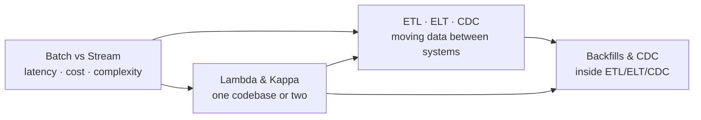
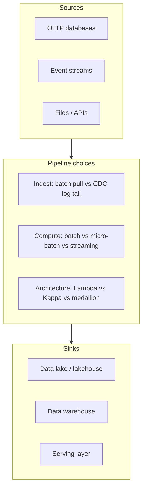

# Pipelines & Architecture

> **Why it matters** — Pipeline architecture is the difference between a platform that is reliable, affordable, and boring and one that is a pager-duty generator. Batch vs stream, Lambda vs Kappa, and how you move data are the trade-off questions senior interviews — and production outages — are made of.

This track covers the architectural decisions that determine whether a data platform is reliable, affordable, and boring — or a constant pager duty source. It is the *systems thinking* layer of data engineering: less about which tool, more about which shape.

## Who it is for

- Data engineers who can write a DAG but get fuzzy when asked *why batch, why stream, why this architecture?*
- Solution architects evaluating whether to unify on a streaming engine or keep a split batch/stream stack
- Anyone preparing for senior-level system design interviews, where these trade-offs are the main event

## The map

## Chapters

**[Batch vs Streaming](/pipelines/batch-vs-stream)** — The latency/cost/complexity spectrum from nightly batch through micro-batch to event-at-a-time streaming. Why "real-time" is usually the wrong default, when batch is still correct, and how bounded vs unbounded data changes your mental model.

**[Lambda & Kappa](/pipelines/lambda-kappa)** — The two canonical answers to "we need both low latency and correct history." Lambda's dual-path pain, Kappa's log-as-source-of-truth, modern unified engines, and the medallion pattern that quietly won the industry.

**[ETL, ELT, CDC & Backfills](/pipelines/etl-elt-cdc)** — How data actually moves: ETL vs ELT in the lakehouse era, log-based CDC with Debezium, delivery semantics, late data, and the idempotent partition-overwrite pattern that makes backfills safe.

## Pareto focus

The ideas here that do the most work in real systems and interviews:

1. **Bounded vs unbounded data** — the one distinction that determines your engine choice
2. **Latency is a budget, not a feature** — most "streaming" requirements are micro-batch economics
3. **Exactly-once is a pipeline property, not a connector flag** — dedupe + idempotent sinks
4. **CDC via transaction log** beats query-based extraction for correctness under deletes and ordering
5. **Idempotent backfills** — `INSERT OVERWRITE` per partition, or you will double-count
6. **Medallion layering** — bronze/silver/gold is the de-facto standard, whatever the tool
7. **One codebase, two modes** — unified engines (Spark, Flink) made Lambda mostly obsolete
