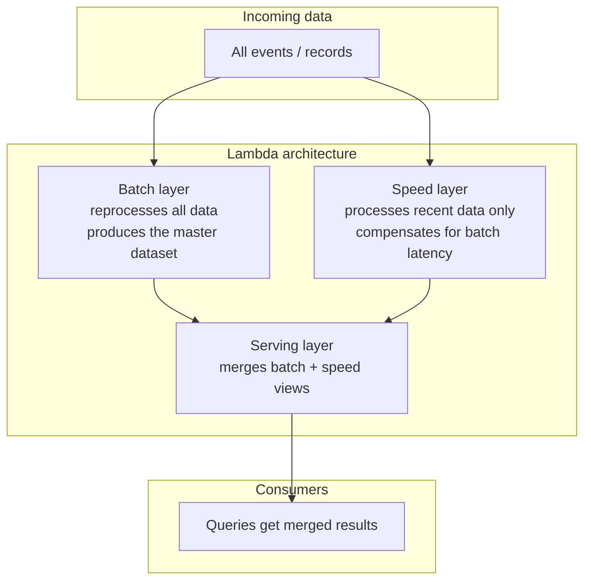
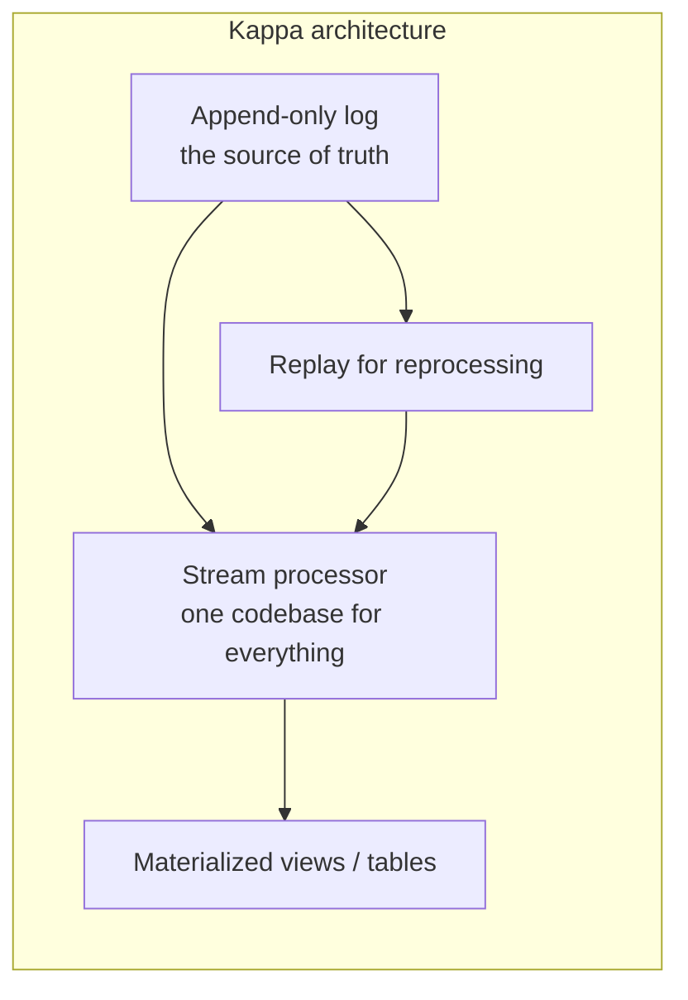
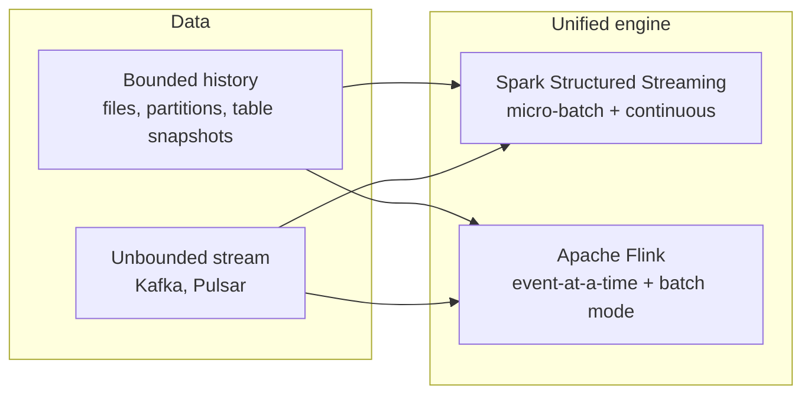
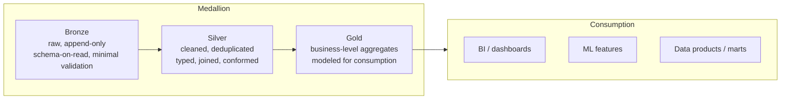
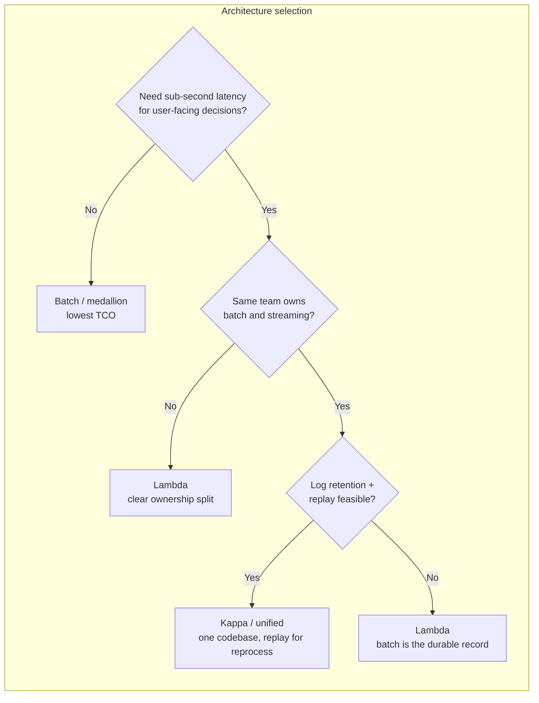
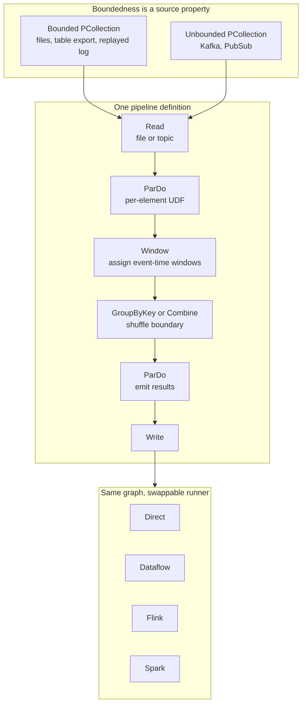

# Lambda & Kappa Architectures

> **Why it matters** — "We need low-latency dashboards *and* correct historical numbers" is the oldest hard problem in data engineering. Lambda solved it by running two pipelines; Kappa solved it by making the log the source of truth. Understanding both — and why modern engines made Lambda mostly unnecessary — is core senior-engineer fluency and the right answer to half the architecture questions in interviews.

## The problem both solve

You want:

1. **Fresh data** — dashboards, alerts, personalization that update in seconds
2. **Correct history** — the ability to recompute the "true" answer when bugs, late data, or business-rule changes invalidate what you previously served

A single batch job gives you #2 but not #1. A pure streaming job gives you #1 but historically struggled with #2 — reprocessing months of state, upgrading code without losing checkpointed state, and keeping long-term aggregates consistent.

## Lambda architecture

Nathan Marz's *Big Data* (2013) formalized the pattern:

- **Batch layer** — stores the immutable master dataset (HDFS/S3), periodically recomputes views over *all* data. Expensive but simple and correct.
- **Speed layer** — processes only recent events to cover the window the batch layer hasn't reached yet. Often a streaming engine with approximate/incremental logic.
- **Serving layer** — indexes both outputs and merges them at query time, e.g., "real-time count = batch count + speed count for recent window."

::: warning ⚠️ Risk / production failure mode
The canonical Lambda failure is **dual-codebase drift**: the batch logic in Spark/Hive and the speed logic in Storm/Flink implement the same business rule, differently. A "users who purchased" definition diverges by a boundary condition and the merged view returns inconsistent counts. Keeping two pipelines in semantic lockstep is the permanent tax.
:::

| Layer | Tooling era | Typical weakness |
|---|---|---|
| Batch | Hadoop MapReduce → Hive → Spark | hours of lag between recomputes |
| Speed | Storm → Spark Streaming → Flink | only holds recent state; approximates complex joins |
| Serving | Druid, Pinot, custom KV stores | merge logic is often bespoke and fragile |

## Kappa architecture

Jay Kreps' 2014 counterargument: you don't need a batch layer if your **log is the source of truth**. Run everything through a stream processor; when you need to "reprocess history," replay the log.

- **One codebase** — no speed/batch drift because there is only one path
- **The log is the database** — immutable, replayable, ordered
- **Reprocessing = replay** — fix a bug, redeploy, rewind offsets, and let the stream processor recompute from scratch

::: tip 💡 Senior insight
Kappa's insight is architectural inversion: instead of *deriving the log from tables*, you *derive tables from the log*. This is the same mental model as CDC (covered in the next chapter) and event sourcing. Once the log is primary, "batch" becomes just a replay with a big window.
:::

| Property | Lambda | Kappa |
|---|---|---|
| Codebases | two (batch + speed) | one |
| Source of truth | batch layer (master dataset) | the log itself |
| Reprocessing | rerun batch job | replay log from offset 0 or a timestamp |
| Latency | low (speed layer) | low |
| Operational cost | two systems to run | one system + log retention |
| Correctness risk | speed/batch divergence | replay determinism, state compatibility |

## Kappa+ / unified engines

The 2020s brought the middle path: **one engine that can run in both modes**. Spark Structured Streaming and Apache Flink both treat batch as a special case of streaming (a bounded stream), so a single job can process history and then seamlessly tail the live stream.

- **Spark Structured Streaming** — micro-batch engine; run `Trigger.Once()` or `Trigger.AvailableNow()` for batch-style execution, `Trigger.ProcessingTime` for continuous
- **Flink** — originally streaming-first; `ExecutionMode.BATCH` gives true bounded-data batch execution with its own optimizations, used by Flink CDC and lakehouse ingest

::: info ℹ️ Note
Lambda is not dead — it survives where the serving layer has genuinely different access patterns (e.g., Pinot/Druid for sub-second OLAP + a warehouse for deep history). What died is the *two separate compute stacks* part; modern Lambda implementations unify compute and split only at the serving tier.
:::

## Medallion architecture

The pattern that quietly became the industry default is less an architecture than a **layering discipline**:

| Layer | Content | Guarantees | Typical operations |
|---|---|---|---|
| Bronze | raw source data, minimal transform | append-only, audit trail | ingest, schema capture, dedupe keys |
| Silver | cleaned, typed, conformed | deduplicated, joins resolved, quality checks | dedupe, type enforcement, SCD handling, reference joins |
| Gold | business metrics & dimensions | ready for consumption | aggregations, star schemas, data marts, feature tables |

::: warning ⚠️ Risk / production failure mode
Medallion's failure mode is *over-layering*: every hop becomes a full materialized table, so a simple metric requires three pipelines and triple storage. Discipline: only materialize a layer when you need a durable boundary (schema contract, quality gate, or different SLA); otherwise compute through.
:::

## Which architecture for which org maturity

There is no universal answer — the right choice depends on team size, latency requirements, and tolerance for operational complexity.

| Org profile | Recommended pattern | Why |
|---|---|---|
| Small team, analytics-only | Batch + medallion on a lakehouse | simplest, cheapest, fewest moving parts |
| Mixed batch + streaming, one team | Unified engine (Spark/Flink) + medallion | one codebase, two modes, replay for reprocessing |
| High-scale, latency-critical product | Kappa + stream processor + serving layer | log is truth; replay is a first-class operation |
| Regulated, multi-team, strict SLAs | Lambda-style split with shared schema contracts | clear ownership, audit trail, independent scaling |

::: details Deep-dive: the replay cost nobody budgets for
Kappa's "just replay the log" assumes the log is retained (often 30–90 days or indefinite in cloud object storage) and that replay is actually fast enough. A month of high-throughput events can take hours to replay through a stateful job, and during replay you are either serving stale data or running a parallel pipeline. Budget for it: measure replay throughput, test it quarterly, and have a snapshot/checkpoint strategy to shorten recovery.
:::

::: details Deep-dive: why Lambda persists in the serving layer
Even with a unified engine, the *serving* side often splits: an OLAP store (Pinot, Druid, ClickHouse) for user-facing queries and a lakehouse for deep history and ad-hoc. This is Lambda-shaped but the compute layer is unified — one pipeline writing to two sinks, not two pipelines computing the same thing twice.
:::

## Apache Beam: the model that made Kappa practical

Spark and Flink unified *engines*; Apache Beam unified the *programming model*. Beam (from Google's Dataflow model paper, Akidau et al.) poses four questions — **what** results you compute, **where** in event time, **when** in processing time results materialize (triggers), **how** later refinements relate — and makes the answer to "batch or stream?" a property of the *data*, not the code. A `PCollection` is a dataset that may be bounded or unbounded; a `PTransform` graph is a DAG that never changes between the two.

Reprocessing in Kappa terms is just swapping the source: point `Read` at retained history and the identical graph — windows, triggers, joins, side inputs — runs unchanged. That is Kappa's "one codebase" enforced by the type system, not by discipline.

### Windowing: batch's global window vs unified semantics

In a batch world every record implicitly lives in one window that closes when the input ends. Beam makes that explicit: the default is `GlobalWindows`, and a bounded source simply advances the watermark to end-of-time so the default trigger fires once. The same code on an unbounded source keeps the window open and emits per trigger.

| Concern | Pure batch view | Beam unified view |
|---|---|---|
| Default window | the whole dataset, implicit | `GlobalWindows`, explicit and re-assignable via `Window.into` |
| Event time | ignored — data is "all here" | every element carries a timestamp; watermark heuristics drive progress |
| Result emission | once, at job end | trigger-defined; on bounded data the watermark reaching end-of-window fires once |
| "Late" data | impossible by definition | real — handled by allowed lateness, refinements, or side outputs |
| History recompute | rerun the job | replay the source as a bounded `PCollection`, same graph |

:::: warning ⚠️ Risk / production failure mode
A trigger is a *recommendation*, not a contract — a runner may legally skip or merge firings (batch runners routinely emit a single pane). Never write correctness logic that depends on pane count; use triggers for latency, `PAssert`-style tests for semantics.
::::

### Joining patterns: side inputs vs CoGroupByKey

Beam gives two canonical ways to bring a second stream into a `ParDo`, and the choice is an operational one, not a stylistic one.

| Pattern | Mechanism | Memory bound | Ordering semantics | Use when |
|---|---|---|---|---|
| Side input (`View.asSingleton` / `asMap` / `asList` / `asMultimap`) | secondary `PCollection` reduced to a `PCollectionView`, read inside `DoFn` | the *entire* view must fit per worker (except `asIterable`) | main input waits for the side-input window's first pane; later panes update asynchronously | small, slowly-changing reference data; runtime config |
| `CoGroupByKey` | each input tagged with `TupleTag`, `GroupByKey` over same key + window | per-key iterables only (some runners still require per-key fit) | joins strictly within compatible windows; result completeness waits for window end + allowed lateness | stream–stream joins too large for memory |
| Stateful `DoFn` + event-time timer | one stream buffered in per-key state, other drives `@OnTimer` | per-key state, runner-managed and checkpointed | you define the match window explicitly | asymmetric joins, custom expiry of buffered side |

:::: tip 💡 Senior insight
The book's rule of thumb for side inputs: the main input *blocks* until the side input's window produces data, then processes updates asynchronously. That makes slowly-changing side inputs (config refreshed every few minutes) efficient — but a fast-changing view serializes your main stream behind view updates. If the "side" data is really a stream of record updates, it is a join — use `CoGroupByKey`, don't pretend it's a lookup.
::::

### Runner portability and delivery guarantees

Runners differ in *how* they execute the same graph: **classic** runners consume a pipeline in the same language as the SDK; **portable** runners serialize the pipeline to a protobuf representation and delegate UDF execution to an SDK harness over the Fn API — any-SDK flexibility at some per-call overhead. Portability is not total: Beam's published **capability matrix** records which model features (state, timers, merging windows, splittable `DoFn`s) each runner fully supports. Check it before switching runners, not after.

| Runner | Batch | Streaming | Execution model | Notes |
|---|---|---|---|---|
| Direct | ✔ | ✔ | in-JVM | testing only; exercises full semantics locally |
| Dataflow | ✔ | ✔ | remote managed state (Windmill-style) | reference implementation; state committed per bundle, workers effectively stateless → autoscaling-friendly |
| Flink | ✔ | ✔ | local state + periodic checkpoints | checkpoint interval *is* the commit cadence — too frequent adds overhead, too sparse delays source acks |
| Spark | ✔ | partial | micro-batch heritage | verify timer/state support in the capability matrix before relying on event-time triggers |

On guarantees: Beam's model requires that a *bundle* — the atomic unit of work — either fully commits or fully reverts. On failure every stateful transform resets to the last committed state and processing resumes, so duplicates can only escape through **sinks that aren't idempotent**. That yields the practical knob matrix:

| Knob | Runner | Effect |
|---|---|---|
| `--checkpointingInterval` | Flink | state snapshot frequency = bundle-commit cadence; governs replay length on crash |
| bundle commit + remote state | Dataflow | consistent snapshot always available; at-least-once to non-idempotent sinks |
| idempotent sink writes | all | converts at-least-once delivery into effectively-once output — the only end-to-end lever that matters |

:::: tip 💡 Senior insight
"Exactly-once" inside Beam means *each element affects state exactly once* — a bundle-atomicity property. The end-to-end story is still at-least-once delivery plus an idempotent sink. The book's failure example is the classic one: write to a non-transactional commit log, crash before checkpoint, replay → duplicate rows no downstream `DISTINCT` fully repairs because they carry different processing timestamps.
::::

## 🧠 Quiz

<QuizCard :questions="[{ 'q': 'What is the defining failure mode of the Lambda architecture?', 'options': ['The serving layer cannot merge results', 'It cannot handle high throughput', 'The batch layer is too slow', 'The speed layer and batch layer implement the same logic and drift apart'], 'correct': 3, 'explain': 'Dual-codebase drift is the canonical Lambda pain: two teams, two engines, one business rule. Every schema change, edge case, and bugfix has to land identically in both, forever.' }, { 'q': 'In the Kappa architecture, what is the source of truth?', 'options': ['The append-only log', 'The speed layer', 'The serving layer', 'The batch layer'], 'correct': 0, 'explain': 'Kappa inverts the dependency: the immutable log (e.g., Kafka) is the source of truth, and all tables/views are derived. Reprocessing means replaying the log, not running a separate batch job.' }, { 'q': 'What does a unified engine like Spark Structured Streaming or Flink give you that Lambda does not?', 'options': ['Higher throughput', 'One codebase that can run in batch mode (bounded input) or streaming mode (unbounded input)', 'Built-in data quality checks', 'Cheaper compute'], 'correct': 1, 'explain': 'The unified engine treats batch as a bounded stream. One codebase handles both history reprocessing and live tailing — the practical end of the Lambda pattern.' }, { 'q': 'In the medallion architecture, which layer should contain business-level aggregates ready for BI consumption?', 'options': ['Silver', 'Bronze', 'Gold', 'A separate serving layer outside the medallion'], 'correct': 2, 'explain': 'Gold is the consumption layer: business metrics, star schemas, data marts. Bronze is raw, silver is cleaned/conformed, gold is modeled for use.' }, { 'q': 'A Kappa pipeline has a bug that corrupted a month of output. What is the recovery path?', 'options': ['There is no recovery — Kappa cannot reprocess', 'Run the batch layer', 'Fix the bug, redeploy, and replay the log from a known-good offset', 'Restore from database backup'], 'correct': 2, 'explain': 'Kappa reprocesses by replaying the log. You fix the code, reset consumer offsets (or trigger a bounded replay from a timestamp), and let the same stream job recompute correct output.' }, { 'q': 'When would Lambda still be the right choice today?', 'options': ['When serving requires genuinely different access patterns (e.g., sub-second OLAP store + deep-history warehouse) and the compute is unified', 'Never — it is obsolete', 'When you have unlimited budget', 'When the team does not know streaming'], 'correct': 0, 'explain': 'Modern Lambda splits at the serving tier, not the compute tier. One pipeline feeds both a fast OLAP store and a lakehouse; the architecture survives as a serving-layer pattern.' }]" />

<QuizCard :questions="[{ 'q': 'In Apache Beam, what determines whether a pipeline runs in batch or streaming mode?', 'options': ['The boundedness of the source PCollection — the same graph runs both modes unchanged', 'A flag on each PTransform', 'The runner you choose', 'A separate batch pipeline class'], 'correct': 0, 'explain': 'Boundedness is a property of the data, not the code. Point the source at a bounded file or replayed log and the identical window/trigger/join graph executes as batch; point it at Kafka and it is a streaming job.' }, { 'q': 'Two streams are too large for an in-memory lookup join in Beam. What is the right primitive?', 'options': ['A bigger side input', 'CoGroupByKey — TupleTag both inputs and group by key within compatible windows', 'GroupByKey on one stream only', 'A global window over both'], 'correct': 1, 'explain': 'Side inputs must fit in worker memory per window; CoGroupByKey shuffles both inputs by (key, window) so only per-key iterables must materialize. It is the memory-safe stream-stream join.' }, { 'q': 'Where does end-to-end effectively-once actually come from in a Beam pipeline?', 'options': ['Bundle atomicity in the model plus an idempotent or transactional sink', 'Using the DirectRunner', 'Disabling retries', 'A runner flag called exactly-once'], 'correct': 0, 'explain': 'Runners guarantee a bundle commits fully or reverts — replay after a crash resends elements. Only an idempotent sink (upsert by key, partition overwrite, transactional write) turns that at-least-once delivery into effectively-once output.' }]" />

## Further reading

- [Nathan Marz, "How to beat the CAP theorem"](http://nathanmarz.com/blog/how-to-beat-the-cap-theorem.html) — the original Lambda argument
- [Jay Kreps, "Questioning the Lambda Architecture"](https://www.linkedin.com/pulse/questioning-lambda-architecture-jay-kreps/) — the Kappa counter-proposal
- [kappa-architecture.com](https://milinda.pathirage.org/kappa-architecture.com/) — Kreps' canonical summary, hosted mirror
- [*Big Data* (Marz & Warren)](https://www.manning.com/books/big-data) — the Lambda reference
- **Building Big Data Pipelines with Apache Beam** — Jan Lukavský (2022), [Packt](https://www.packtpub.com/en-us/product/building-big-data-pipelines-with-apache-beam-9781800564937) — the unified batch/streaming model, runners, state and portability deep-dive
- [Databricks — What is the medallion lakehouse architecture?](https://docs.databricks.com/en/lakehouse/medallion) — the de-facto industry layering pattern
- [Apache Flink documentation](https://flink.apache.org/) — batch mode and unified execution
- [Spark Structured Streaming Programming Guide](https://spark.apache.org/docs/latest/structured-streaming-programming-guide.html) — micro-batch and continuous triggers
