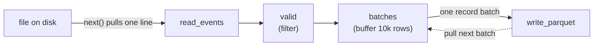
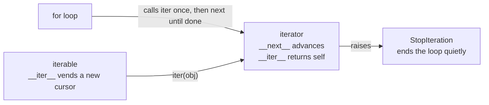
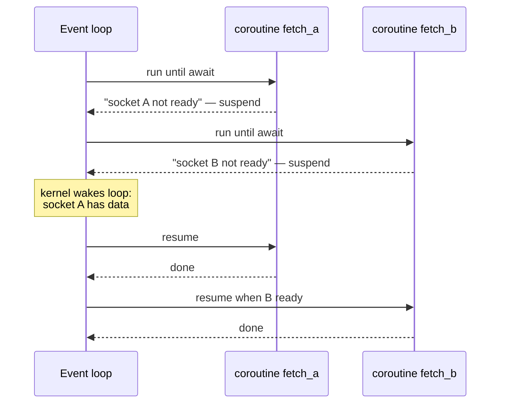
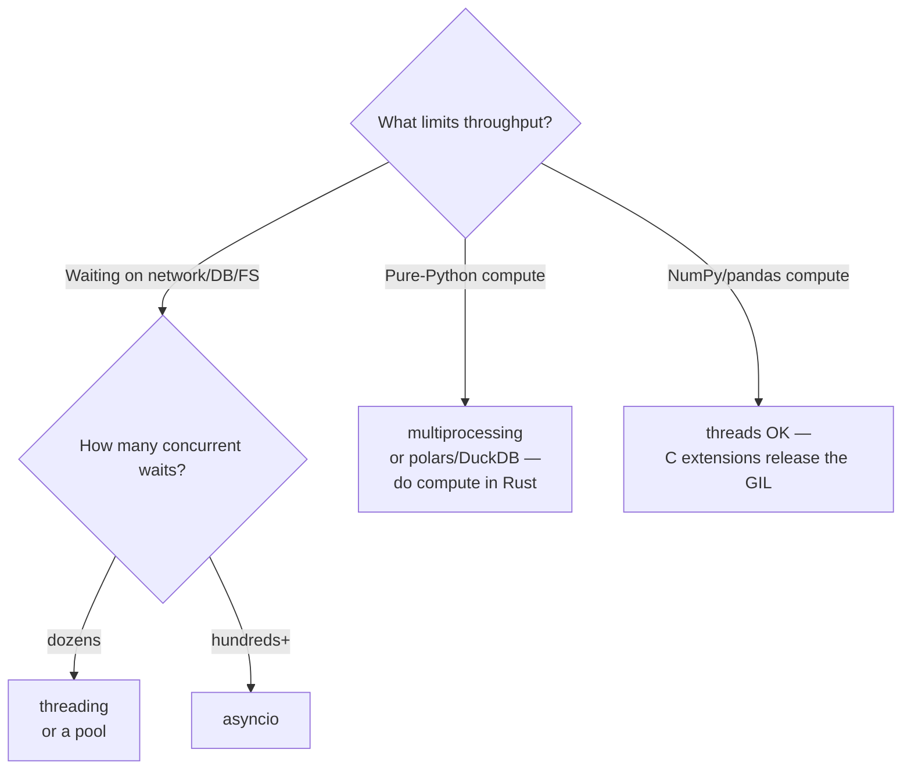

# Advanced Python

> **Why it matters** — A `read_csv()` that pulls 40 GB into memory, a retry loop that hammers a degraded API, a job that "works locally" but OOMs in the container — these are interpreter-level failures, not SQL problems. Senior data engineers write Python that streams, validates at boundaries, and picks the right concurrency model; that requires knowing what the interpreter actually does.

The Pareto set below assumes you already write functions and classes. Each section covers a concept whose absence shows up as a production incident or a slow pipeline.

## Iterators and generators

An **iterator** is any object implementing `__iter__` + `__next__`. A **generator** is the lazy iterator you get from a function containing `yield` — it computes one element at a time and pauses between them.

```python
def read_events(path: str):
    with open(path) as f:          # one line at a time — O(1) memory
        for line in f:
            yield parse_event(line)

def valid(events):
    for e in events:
        if e["schema_version"] == 2:
            yield e

def batches(events, n: int = 10_000):
    batch = []
    for e in events:
        batch.append(e)
        if len(batch) == n:
            yield batch
            batch = []
    if batch:
        yield batch

pipeline = batches(valid(read_events("events.jsonl")))
for chunk in pipeline:              # nothing runs until here
    write_parquet(chunk)
```

Each generator is a node; `for` loops pull data through the graph one row at a time. Nothing materializes until something consumes it — this is the same pull-based execution model Spark's RDDs and polars' LazyFrame borrowed.



::: tip 💡 Senior insight
`itertools` is the senior-engineer's standard library: `islice` (truncate a stream), `chain` (concatenate lazily), `groupby` (streaming aggregation — needs pre-sorted input), `tee` (duplicate a stream — careful, it buffers). Know it before reaching for a framework.
:::

::: warning ⚠️ Risk / production failure mode
Generators are single-use. A generator consumed once is exhausted silently — a second `for` loop over it yields zero rows, no error. If you need the data twice, materialize it explicitly (`list(...)`) or regenerate the iterator. Silent-exhaustion bugs in ETL are notoriously hard to spot in tests with tiny inputs.
:::

::: details What about generator-based error handling?
`gen.throw(exc)` and `gen.send(value)` let you build coroutine-style pipelines where data flows *into* generators. Powerful, but almost never worth it in 2025 — asyncio and plain `for` loops cover the same ground with better debugging. Know that `.send` exists for reading old code; don't build new systems on it.
:::

### Composing generators: `yield from`

`yield from sub()` delegates yields to a subgenerator — cleaner than `for x in sub(): yield x`, and it also captures the subgenerator's `return` value:

```python
def read_all(paths):
    for p in paths:
        yield from read_events(p)             # splice each file into one stream

def walk_partitions(node, level: int = 0):
    yield node, level
    for child in node.children:
        yield from walk_partitions(child, level + 1)   # recursion stays flat
```

This is why generators compose so well for streaming ETL: each stage is an independent iterator holding only its own tiny frame state, `yield from` splices sources without materializing them, and the *consumer* drives the whole graph. Stop early — say validation fails on row 3 of 50M — and nothing downstream ran: the pipeline never did wasted work.

## The data model: dunder contracts pipelines rely on

Python's data model is the protocol layer between your objects and interpreter syntax: `for` calls `__iter__`, `with` calls `__enter__`/`__exit__`, `obj[k]` calls `__getitem__`. Implement the right dunders and a plain class behaves like a built-in — a `Manifest` that supports `for f in manifest` and `manifest["a.parquet"]` for free.

| Dunder | Triggered by | Contract that matters in pipelines |
|---|---|---|
| `__iter__` | `iter(x)`, `for`, unpacking | Return a **fresh iterator** — never `self` on a container (below) |
| `__next__` | `next(it)`, implicit in loops | Raise `StopIteration` on exhaustion — inside a generator never let it escape, PEP 479 rewrites it as `RuntimeError` |
| `__enter__` / `__exit__` | `with` | `__exit__` runs even on exceptions; return truthy to suppress — suppress only what you meant to swallow |
| `__getitem__` | `obj[k]` | Legacy iteration hook: with no `__iter__`, `iter()` falls back to `__getitem__` fed 0-based indexes |
| `__eq__` / `__hash__` | `==`, dict/set membership | Equal objects MUST hash equal; derive both from immutable state — a key mutated after insertion is unfindable |
| `__len__` | `len(x)`, truthiness fallback | Keep it O(1); `len()` hits a C-level slot, not an attribute lookup |
| `__bool__` | `if x:` | Consulted when `__len__` is absent — define it when emptiness and falsiness differ |
| `__repr__` | `repr()`, `%r` in logs, tracebacks | Write it for every record class — it is what you read in a 2am traceback |

Two interpreter rules worth knowing: dunders are looked up on the **type**, not the instance (monkeypatching `obj.__iter__` per-instance does nothing), and `len()`/`iter()` take C fast paths — always call the builtin, never `obj.__len__()`.

### Iterable vs iterator — the distinction that prevents silent bugs

An **iterable** is anything `iter()` accepts (`__iter__`, or `__getitem__` with 0-based indexes). An **iterator** is the cursor produced from it.



An iterable that returns `self` from `__iter__` is a classic data bug: the first consumer exhausts the single cursor and every subsequent loop sees zero rows — silently. A `Partition` collection iterated twice (once to count, once to write) must vend a *new* iterator per `iter()` call. Iterators themselves correctly return `self` — a cursor has no second pass to give.

:::: tip 💡 Senior insight
The two-argument form `iter(callable, sentinel)` builds an iterator that calls the callable until it returns the sentinel — the stdlib's own example is `iter(partial(f.read, 65536), b'')` for chunked binary reads. It pairs with `functools.partial` to freeze the size argument, and beats a `while True` + `break` for fixed-block streaming.
::::

## Decorators: retries and timing

A decorator is a function that wraps a function. Two that belong in every data engineer's toolbox:

```python
import functools, logging, random, time

log = logging.getLogger(__name__)

def timed(fn):
    @functools.wraps(fn)                       # preserves __name__, docstring
    def wrapper(*args, **kwargs):
        start = time.monotonic()
        try:
            return fn(*args, **kwargs)
        finally:
            log.info("%s took %.2fs", fn.__name__, time.monotonic() - start)
    return wrapper

def retry(times: int = 3, backoff: float = 1.0, exceptions=(Exception,)):
    def deco(fn):
        @functools.wraps(fn)
        def wrapper(*args, **kwargs):
            for attempt in range(1, times + 1):
                try:
                    return fn(*args, **kwargs)
                except exceptions as e:
                    if attempt == times:
                        raise
                    sleep = backoff * 2 ** (attempt - 1) + random.uniform(0, 1)
                    log.warning("attempt %d failed: %s — sleeping %.1fs", attempt, e, sleep)
                    time.sleep(sleep)
        return wrapper
    return deco

@retry(times=4, backoff=2, exceptions=(TimeoutError, ConnectionError))
@timed
def fetch_manifest(url: str) -> dict: ...
```

Key details: `functools.wraps` preserves the wrapped function's identity (without it, stack traces, `help()`, and Airflow task names all lie to you). The `retry(fn)(args)` two-level structure is how you make a decorator take arguments. The `+ random.uniform(0, 1)` is **jitter** — without it, N parallel jobs retry in lockstep and re-crash the downstream service.

The rest of the `functools` toolbox that earns its keep in pipelines: `@cache` / `@lru_cache` memoize pure functions — ideal for schema parsing or dimension lookups by key. Every argument must be hashable, and `@cache` is **unbounded**, so in a long-running worker prefer `@lru_cache(maxsize=...)` or the memo becomes a memory leak. `partial(fn, fixed_arg)` freezes leading arguments (the trick behind `iter(partial(f.read, 65536), b'')`). `cached_property` computes an expensive attribute once per instance — but it writes into the instance `__dict__`, so it cannot combine with `__slots__` unless `'__dict__'` is slotted too.

::: tip 💡 Senior insight
Don't reinvent the retry wheel in shared code — `tenacity` does exponential backoff, jitter, and stop-conditions correctly and is battle-tested. Writing your own once, to understand it, is the exercise above. Production: `tenacity` or the retry built into your SDK (boto3, google-cloud-*).
:::

## Context managers

`with` guarantees cleanup — file handles, connections, locks, transactions — even when exceptions fly. Anything with `__enter__`/`__exit__` works; `contextlib` makes custom ones cheap:

```python
from contextlib import contextmanager

@contextmanager
def staging_table(conn, name: str):
    conn.execute(f"CREATE TEMP TABLE {name} ...")
    try:
        yield name                     # the 'as' variable
    except Exception:
        conn.execute(f"DROP TABLE IF EXISTS {name}")
        raise
    else:
        conn.execute(f"INSERT INTO prod SELECT * FROM {name}")  # swap on success
    finally:
        conn.execute(f"DROP TABLE IF EXISTS {name}")
```

Other `contextlib` utilities worth knowing: `ExitStack` (enter a dynamic number of context managers — e.g., "open all files in this partition"), `suppress` (swallow specific exceptions deliberately), `closing` (wrap things with `.close()` but no `__exit__`).

::: warning ⚠️ Risk / production failure mode
A generator that owns a resource keeps it open until the generator is exhausted *or* garbage-collected. `yield` inside `with` is legal but dangerous: if the consumer abandons the pipeline half-way, your connection/file can leak for an unbounded time in a long-running process. Either consume fully, `gen.close()` explicitly, or manage the resource outside the generator.
:::

## Dict and set internals: the hash table you live inside

`dict`, `set`, and `frozenset` are the same engine — a hash table — so the consequences generalize:

- **Keys must be hashable**: implement `__hash__` + `__eq__` derived from immutable state; equal keys must hash equal, and a key mutated after insertion becomes unfindable. `frozenset` is hashable (usable as a key); `set` is not.
- **Lookup is ~O(1)**: hash → index offset, a few probes at worst. Millions of keys cost the same as three. Hence dedupe-by-dict is idiomatic: `list(dict.fromkeys(rows))` drops duplicates *and* preserves first-seen order.
- **Insertion order is guaranteed**: a side effect of CPython 3.6's compact layout, a language guarantee since 3.7. Group-by maps, watermark dicts, and last-write-wins merges all rely on it.
- **Memory is the tax**: the table keeps roughly a third of its rows empty to keep probes short — a dict buys speed with space. Related: instances store attributes in `__dict__`, and since PEP 412 same-shape instances *share* the keys table — so set every attribute in `__init__`; attributes added later force a private hash table for that one instance.

`__missing__` is the hook `dict.__getitem__` calls when a key is absent — the machinery behind `defaultdict`. Subclass `dict` for lookup-side normalization:

```python
class NormalizedKeyDict(dict):
    def __missing__(self, key):
        skey = str(key)                    # retry with the stringified key
        if skey in self:
            return self[skey]
        raise KeyError(key)
```

:::: warning ⚠️ Risk / production failure mode
`__missing__` fires on `d[k]` but **not** on `d.get(k)` for a plain `dict` subclass — callers using `.get()` silently get `None`. And guard the recursion: an unguarded `self[key]` inside `__missing__` that can itself miss recurses forever.
::::

## Dataclasses vs pydantic: validation boundaries

Both replace hand-written `__init__` boilerplate — but they answer different questions.

| Concern | `dataclasses` | `pydantic` (v2) |
|---|---|---|
| Cost | Stdlib, zero deps, plain classes | External dep, Rust-core validation |
| Runtime validation | ❌ annotations are cosmetic | ✅ coerces or rejects on construction |
| Serialization | manual / `asdict()` | `model_dump()`, `model_dump_json()` built in |
| Speed of construction | fastest | ~5–20× slower (v2 narrowed this a lot) |
| Best placement | **inside** a pipeline — trusted, typed records | **boundaries** — API payloads, config files, raw JSON, Kafka messages |
| Failure mode | wrong type flows through silently | raises `ValidationError` with field-level detail |

```python
from dataclasses import dataclass
from pydantic import BaseModel, Field, field_validator

# --- boundary: whatever the source system sends us ---
class RawEvent(BaseModel):
    event_id: str
    user_id: int
    occurred_at: str                    # still a string here
    gbv_cents: int = Field(ge=0)        # reject negative money at the door

    @field_validator("event_id")
    @classmethod
    def nonempty(cls, v: str) -> str:
        if not v.strip():
            raise ValueError("empty event_id")
        return v

# --- inside the pipeline: already-validated, zero re-check cost ---
@dataclass(frozen=True, slots=True)
class Event:
    event_id: str
    user_id: int
    occurred_at: datetime
    gbv_cents: int
```

::: tip 💡 Senior insight
The rule that scales: **validate once at the ingress boundary, then treat the interior as typed and trusted.** Re-validating on every stage is slow; never validating means one malformed record poisons a batch of 50M rows at 2am and you can't tell which one.
:::

::: info ℹ️
`@dataclass` options that matter: `frozen=True` (hashable, immutable — safe as dict keys and for shared state), `slots=True` (3.10+; see memory section), `kw_only=True` (force keyword args — kills positional-order bugs across refactors), `field(default_factory=list)` (mutable defaults done right).
:::

## Typing: Protocol, TypedDict, generics

Python's type hints are checked by mypy/pyright — never at runtime (except pydantic-style enforcement). In pipelines they earn their keep three ways:

```python
from typing import Protocol, TypedDict, TypeVar

# 1. Protocol — structural typing: "anything with a .write() method"
class Sink(Protocol):
    def write(self, records: list["Event"]) -> int: ...   # rows written

class ParquetSink:                        # no explicit inheritance needed
    def write(self, records: list["Event"]) -> int: ...

def load(sink: Sink, records: list["Event"]) -> int:
    return sink.write(records)

# 2. TypedDict — typed access into JSON-shaped data without a class
class EventJSON(TypedDict):
    event_id: str
    user_id: int
    occurred_at: str

def parse(raw: EventJSON) -> "Event": ...   # mypy catches raw["use_id"] typos

# 3. Generics — a pipeline stage typed on what it carries
T = TypeVar("T")
U = TypeVar("U")

def stage(fn: Callable[[T], U], records: Iterable[T]) -> Iterator[U]:
    for r in records:
        yield fn(r)
```

| Tool | Use when |
|---|---|
| `Protocol` | You want "duck typing, but checked" — pluggable sinks/sources without a base class |
| `TypedDict` | Data arrives as dicts (JSON, `**kwargs`, warehouse rows) and a full class is overkill |
| Generics | One stage/handler works for many record types and you want the types to flow through |
| `dataclass`/pydantic | You want behavior (methods, validation), not just shape |

Prefer `Protocol` over an ABC for pluggable components: an ABC forces every sink to inherit from it, coupling implementations to your codebase; a `Protocol` accepts anything with the right methods — mypy checks it statically, and `@runtime_checkable` makes `isinstance` work at runtime.

The three record shapes overlap, so pick by trust level:

| Situation | Pick |
|---|---|
| Dicts arrive from JSON/warehouse rows; a class is overkill | `TypedDict` — mypy-checked, zero runtime cost, still a dict |
| Internal records need methods, invariants, immutability | `@dataclass` — trusted interior |
| Untrusted input needs coercion/rejection with field errors | pydantic — the boundary guard |
| "Anything with `.write()` should work" | `Protocol` — structural, no base class |

::: tip 💡 Senior insight
Types in pipelines are a *contract-testing tool that runs before deploy*. `mypy` on CI catches the "renamed a field, forgot one caller" class of bug that otherwise surfaces as a null column in a report three weeks later. Type the boundaries (`Protocol` for sinks, `TypedDict`/pydantic for payloads); the interior can stay lightly annotated.
:::

## Async fundamentals

`asyncio` is cooperative concurrency on **one thread**: coroutines run until they `await`, then the event loop runs a different coroutine. All real parallelism comes from I/O syscalls — the GIL is released during them anyway, so a single thread can keep hundreds of sockets busy.



```python
import asyncio, aiokafka

async def consume():
    consumer = aiokafka.AIOKafkaConsumer(
        "events", bootstrap_servers="kafka:9092",
        group_id="etl-v3", enable_auto_commit=False,
    )
    await consumer.start()
    try:
        batch = []
        async for msg in consumer:
            batch.append(msg.value)
            if len(batch) >= 5_000:
                await sink.write(batch)                    # async sink
                await consumer.commit()                    # commit AFTER durable write
                batch = []
    finally:
        await consumer.stop()
```

::: warning ⚠️ Risk / production failure mode
The two classic asyncio foot-guns: (1) **one blocking call freezes everything** — `requests.get`, `time.sleep`, a pandas concat inside a coroutine stalls *all* coroutines on that loop; offload blocking work with `asyncio.to_thread`. (2) **fire-and-forget tasks get garbage-collected** — `asyncio.create_task` without keeping a reference can silently drop work (fixed behavior improved in 3.11+, but the pattern is still a leak source). Keep a `set` of tasks or use `asyncio.TaskGroup` (3.11+).
:::

When does async actually help?

| Workload | Async wins? |
|---|---|
| 500 concurrent API calls / Kafka consumption | ✅ massively — one thread, minimal memory |
| CPU-bound transform on each message | ❌ — GIL serializes the compute anyway |
| 3 sequential calls in a script | ❌ — complexity without payoff |
| Fan-out + fan-in pipeline (fetch → transform → write) | ✅ for the I/O edges; transform still needs threads/processes |

## The GIL and the concurrency decision

The **Global Interpreter Lock** means CPython executes one thread's bytecode at a time. I/O releases it; pure-Python compute does not.

| | `threading` | `asyncio` | `multiprocessing` |
|---|---|---|---|
| Parallelism | I/O only (GIL released on syscalls) | I/O only, cooperative | True CPU parallelism — separate interpreters |
| Overhead | ~8 MB stack per thread | ~KB per coroutine | Full process + pickle serialization |
| Scaling ceiling | hundreds of threads | tens of thousands of coroutines | # of CPU cores |
| Failure isolation | shared memory — a crash kills all | same | process dies alone — restartable |
| When to pick | Sync libraries (boto3, requests) with modest concurrency | High fan-out I/O: Kafka consumers, API crawlers, many sockets | CPU-bound: image/parquet transforms, heavy pure-Python math |
| Watch out for | Races on shared state — use queues | One blocking call stalls the loop | Data must cross a process boundary — use Arrow/shared memory, never pickled DataFrames |

::: info ℹ️
Python 3.13+ ships an experimental **free-threaded build** (PEP 703) that removes the GIL; 3.14 formalized it under PEP 779 criteria. It works, but costs single-threaded performance and C-extension compatibility — treat it as "watch this space" for data work, not a production choice yet. `multiprocessing` remains the answer for CPU-bound CPython in 2025.
:::



::: tip 💡 Senior insight
Before reaching for `multiprocessing`, ask whether the hot loop can leave Python entirely. Polars, DuckDB, PyArrow, and NumPy do their compute in Rust/C released from the GIL — moving the compute into them is usually a bigger, simpler win than managing a process pool.
:::

## Memory model and profiling

CPython objects carry overhead (~56 bytes for an "empty" object, plus `__dict__` per instance). A list of 10M dicts is not 10M small rows — it's 10M dict headers + 30M pointers.

- **`__slots__`** replaces per-instance `__dict__` with a fixed array of references — in Ramalho's benchmark (10M objects with two numeric fields), process RAM dropped from ~1.55 GiB to ~551 MiB *and* creation got faster. Caveats: redeclare `__slots__` in each subclass; no dynamic attributes unless `'__dict__'` is slotted (defeating the point); no `@cached_property`; no weakrefs unless `'__weakref__'` is added. `@dataclass(slots=True)` gives it for free.
- **`tracemalloc`** snapshots allocations by line of code — the stdlib answer to "where did my RAM go":

```python
import tracemalloc

tracemalloc.start()
run_pipeline()
snap = tracemalloc.take_snapshot()
for stat in snap.statistics("lineno")[:10]:
    print(stat)               # file:line → bytes allocated, count
```

- **`sys.getsizeof`** on a list returns the *list's* bytes, not its contents' — shallow by design.
- For production services: `memray` (Bloomberg's profiler) gives allocation flamegraphs; tracemalloc is the always-available tool.

::: warning ⚠️ Risk / production failure mode
Generators hide memory leaks: a generator holds its entire frame state (local variables, including that big DataFrame) until exhausted. A pipeline that stages "just one more thing" in a local var per row, across 50M rows, leaks 50M references through live generator frames. Keep generator locals small; let heavy objects go out of scope.
:::

## Walrus and match (3.8+/3.10+)

Two syntax features that earn their place in pipeline code:

```python
# walrus — name a value inside a condition instead of calling twice
while chunk := reader.read(65536):        # read until falsy
    sink.write(chunk)

# match — structural dispatch on record shape
match event:
    case {"type": "purchase", "gbv": g} if g > 0:
        handle_purchase(event)
    case {"type": "purchase"}:
        dead_letter(event, "non-positive gbv")
    case {"type": "refund", **rest}:      # capture remaining keys
        handle_refund(event, rest)
    case _:
        log.warning("unknown event type: %s", event.get("type"))
```

`match` shines at **dispatch on message shape** — exactly what raw event streams look like. The `**rest` capture and `if` guards make it a poor-man's schema-aware router. For simple `if/elif` on one field, plain `if` is still clearer — don't force it.

Two subtleties worth knowing: **mapping patterns match on a subset of keys** — extra keys don't prevent a match, which is why `{"type": "purchase"}` catches records carrying ten other fields — and `match` looks up keys internally via `get(key, sentinel)`, so a missing key just fails that case and falls through instead of raising `KeyError`. Beyond mappings, **class patterns** match by type plus attributes: `case Event(user_id=uid, gbv_cents=g) if g > 0:` binds fields while asserting `isinstance` — the shape-aware router for already-validated records.

## Exceptions as control flow: EAFP beats LBYL

Python style assumes success and catches failure — the official glossary calls it **EAFP** ("easier to ask forgiveness than permission"). The opposite, **LBYL** ("look before you leap"), pre-checks every condition:

```python
# LBYL — two lookups, plus a race in threaded code
if key in mapping:
    return mapping[key]
return default

# EAFP — one atomic lookup, honest about failure
try:
    return mapping[key]
except KeyError:
    return default
```

| | EAFP | LBYL |
|---|---|---|
| Style | `try` the operation, `except` the failure | `if` the precondition, then operate |
| Hot path | Free when the common case succeeds | Pays the check on every call |
| Races | Atomic — no gap between check and use | Check-then-act gap: key deleted, file removed between `if` and use |
| Readability | Failure modes sit in named `except` clauses | Precondition pyramid grows per hazard |

:::: tip 💡 Senior insight
`try/except/else` is the senior form: keep the `try` to the single risky call and put success-path code in `else` — it runs only when no exception was raised, so you never accidentally swallow an error from the *next* line.
::::

:::: details Exception groups (3.11+) — fan-out failures
PEP 654 added `ExceptionGroup` and `except*` so concurrent fan-out (`asyncio.TaskGroup`, `gather`) reports *all* failures instead of surfacing the first and hiding the rest. `except* KeyError` filters matching members; unmatched ones re-raise wrapped in a new group. Rarely needed in batch ETL — essential when N task-group children run and you want every failure, not just the first.
::::

## Packaging: pyproject, venvs, uv

The 2025 shape of a Python project:

```toml
# pyproject.toml — one file, standard since PEP 621
[project]
name = "events-etl"
version = "0.4.0"
requires-python = ">=3.12"
dependencies = ["polars>=1.0", "duckdb>=1.1", "pydantic>=2.0"]

[dependency-groups]                        # uv/pip standard for dev deps
dev = ["pytest", "mypy", "ruff"]
```

- **`uv`** (Astral, Rust) is the current default tool: `uv init`, `uv add`, `uv lock`, `uv sync` — replaces pip+venv+pip-tools+pyenv in one binary, 10–100× faster, with a real lockfile (`uv.lock`) for reproducible deploys.
- **`venv` still matters**: Docker images, CI, and Airflow workers isolate per-environment — `uv venv` or `python -m venv` both fine.
- **`pipx`/`uv tool`** for CLI tools (dbt, sqlfluff) — never install tools into your project's env.
- Reproducibility rule that prevents most "works on my machine": **commit the lockfile, install from the lockfile** (`uv sync --locked` or `pip install -r requirements.txt` with hashes).

::: tip 💡 Senior insight
Pin *ranges* in `pyproject.toml` (`polars>=1,<2`), pin *exact versions* in the lockfile. The range says what your code supports; the lock says what production runs. Confusing the two is how `pip install` upgrades a transitive dep on a Tuesday and breaks the nightly job.
:::

## 🧠 Quiz

<QuizCard :questions="[{ q: 'A pipeline reads a 40 GB JSONL file, filters rows, batches them, and writes Parquet. Which structure keeps memory near-constant?', options: ['list comprehension over the file, then batch', 'asyncio with a shared list buffer', 'multiprocessing.Pool.map over the file', 'a chain of generator functions pulled by a for loop'], correct: 3, explain: 'Generators compose pull-style: each stage asks the previous for one row, so at most one batch lives in memory. Lists materialize; asyncio and multiprocessing change concurrency, not memory shape.' }, { q: 'Why does the retry decorator add random.uniform(0, 1) to the sleep?', options: ['to spread CPU load across the worker', 'to make logs easier to deduplicate', 'to decorrelate retries so parallel jobs do not hammer a degraded service in lockstep', 'because exponential backoff alone overflows'], correct: 2, explain: 'Jitter breaks the thundering-herd: without it, N workers that all failed together all retry together, re-overwhelming the downstream. This is the single most-skipped detail in hand-rolled retries.' }, { q: 'Where does pydantic belong in a pipeline that uses both pydantic and dataclasses?', options: ['at ingress boundaries — validate once, then use cheap dataclasses inside', 'only at the egress, before writing', 'on every intermediate record, for safety', 'nowhere — dataclasses with __post_init__ validation are equivalent'], correct: 0, explain: 'Validation is expensive and its value is at untrusted boundaries. Validate payloads once at the edge (pydantic), then flow typed, trusted records (dataclasses) through the interior.' }, { q: 'A job calls requests.get() inside a coroutine and throughput collapses. Root cause?', options: ['the GIL prevents any concurrency in asyncio', 'the coroutine was not awaited', 'requests is not thread-safe', 'a blocking call freezes the entire event loop — all coroutines stall'], correct: 3, explain: 'asyncio is cooperative: one synchronous call never yields control, so every other coroutine waits. Offload with asyncio.to_thread or use an async client (aiohttp, httpx).' }, { q: 'Pure-Python transform over 50M rows is CPU-bound on 8 cores. Best lever?', options: ['threading with 8 threads', 'free-threaded Python 3.13 in production today', 'asyncio', 'move the compute into polars/DuckDB/NumPy, or use multiprocessing for true parallelism'], correct: 3, explain: 'The GIL serializes threads for pure-Python compute. First try leaving Python (Rust/C engines release the GIL); if you must stay in Python, multiprocessing gives real parallelism. Free-threaded builds are still experimental.' }, { q: 'A second for loop over a generator returned zero rows with no error. Why?', options: ['the walrus operator consumed it', 'generators are single-use and exhaust silently', 'the file handle closed', 'tracemalloc garbage-collected it'], correct: 1, explain: 'Iterators hold state; once exhausted they stay empty and raise nothing — the loop just ends. Materialize or regenerate if you need the data twice. Classic silent-ETL bug.' }]" />

<QuizCard :questions="[{ q: 'A custom Partition collection implements __iter__ by returning self (it holds __next__ internally). What breaks on the second pass?', options: ['the second pass silently yields zero rows — the single cursor was already exhausted', 'each for-loop gets an independent cursor', 'iter() raises TypeError immediately', 'nothing; returning self is the recommended pattern'], correct: 0, explain: 'An iterable must vend a fresh iterator per iter() call so independent loops get their own cursor. Returning self couples every consumer to one cursor — exhausted after the first pass, with no error raised.' }, { q: 'Why does a dict with millions of keys use notably more memory than a list of the same pairs?', options: ['dicts pre-allocate eight slots per key', 'keys are interned as strings', 'every entry stores a copy of its type object', 'the hash table keeps roughly a third of its rows empty so probes stay short'], correct: 3, explain: 'Hash tables trade space for speed: empty rows keep collision probes short and lookup near O(1). A list of tuples is denser; a dict buys constant-time access with slack.' }, { q: 'In threaded code, what is the risk of `if key in mapping: return mapping[key]`?', options: ['`in` is slower than a try block', 'another thread can delete the key between the test and the lookup — try/except KeyError is atomic', 'the membership test holds a lock the lookup releases', 'hash() can change mid-expression'], correct: 1, explain: 'LBYL has a check-then-act gap: state can change between the precondition and the operation. EAFP collapses both into one atomic lookup and catches the failure explicitly.' }]" />


## Further reading

- [Python docs — Iterator types & generators](https://docs.python.org/3/library/stdtypes.html#iterator-types) and [itertools](https://docs.python.org/3/library/itertools.html)
- [Python docs — contextlib](https://docs.python.org/3/library/contextlib.html)
- [Pydantic v2 documentation](https://docs.pydantic.dev/latest/)
- [mypy documentation](https://mypy.readthedocs.io/en/stable/) — and `pyright` for IDE-speed checking
- [Python docs — asyncio](https://docs.python.org/3/library/asyncio.html) and [aiokafka](https://aiokafka.readthedocs.io/en/stable/)
- [PEP 703 — Making the GIL Optional](https://peps.python.org/pep-0703/) and [the free-threading HOWTO](https://docs.python.org/3/howto/free-threading-python.html)
- [tracemalloc](https://docs.python.org/3/library/tracemalloc.html) and [memray](https://bloomberg.github.io/memray/)
- [uv documentation](https://docs.astral.sh/uv/) and [PEP 621 — pyproject metadata](https://peps.python.org/pep-0621/)
- **Fluent Python, 2nd ed.** — Luciano Ramalho (2022), [O'Reilly](https://www.oreilly.com/library/view/fluent-python-2nd/9781492056348/) — the definitive treatment of the data model, iterators/generators, dict internals, and EAFP style
