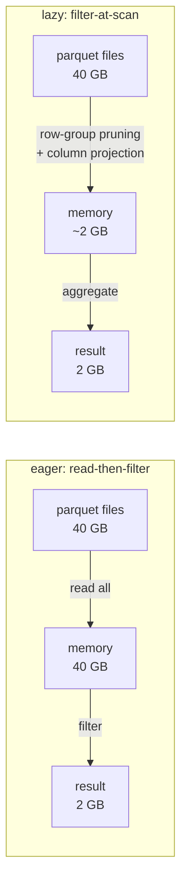
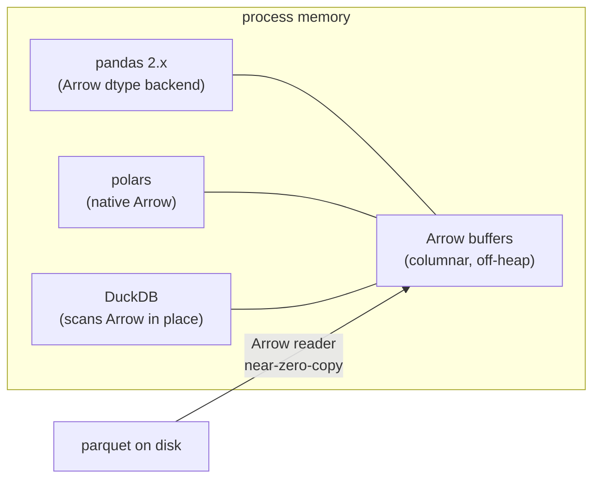
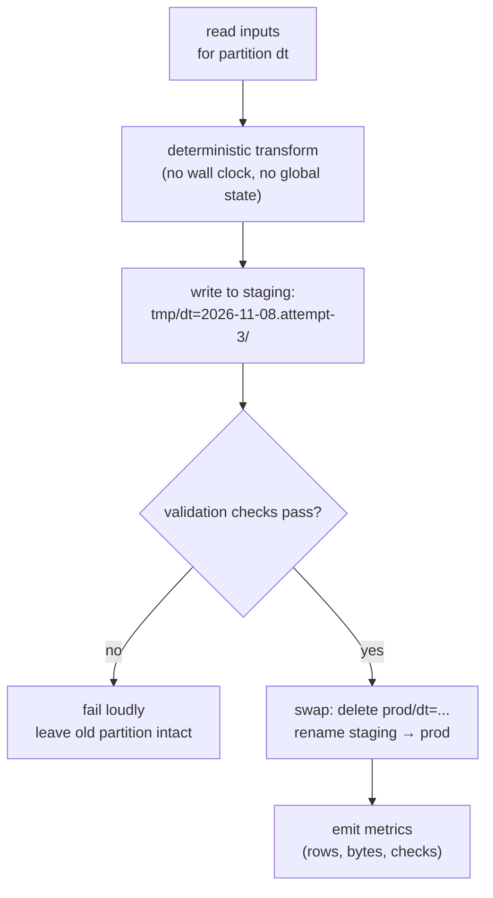
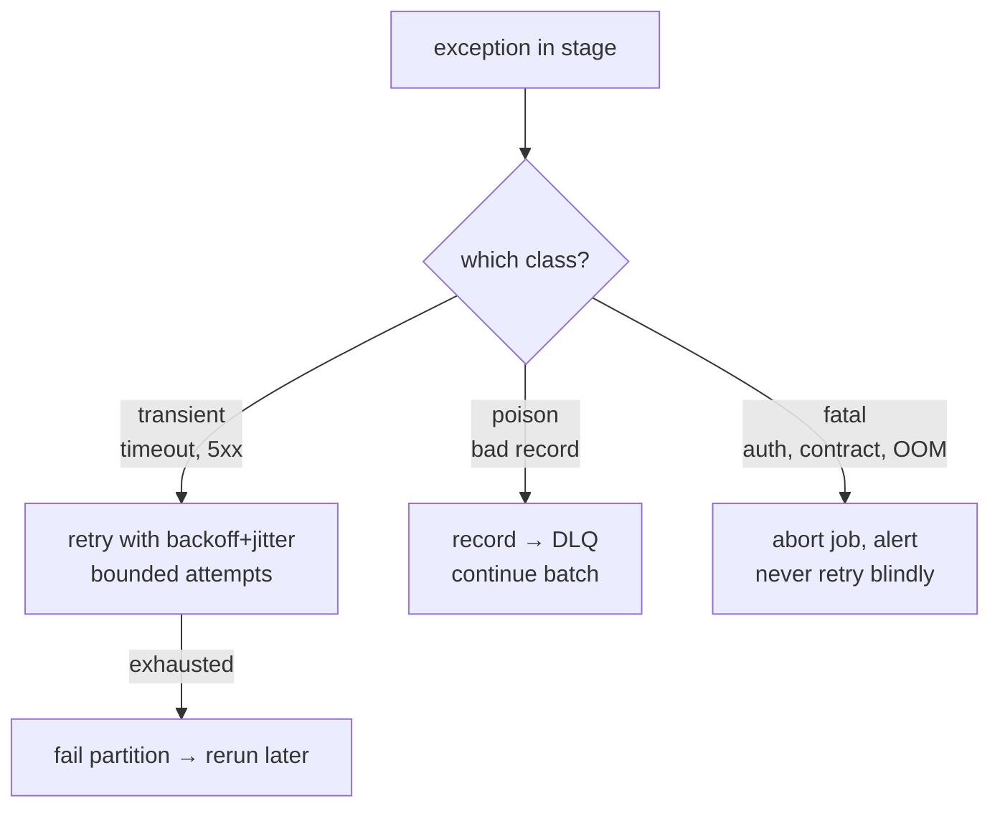
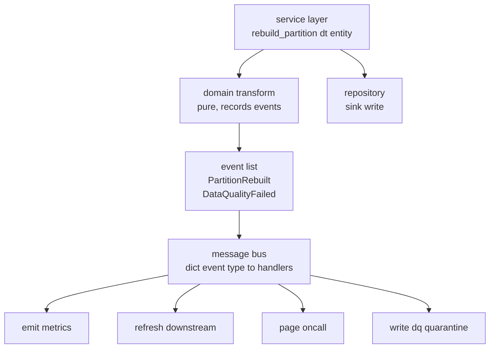
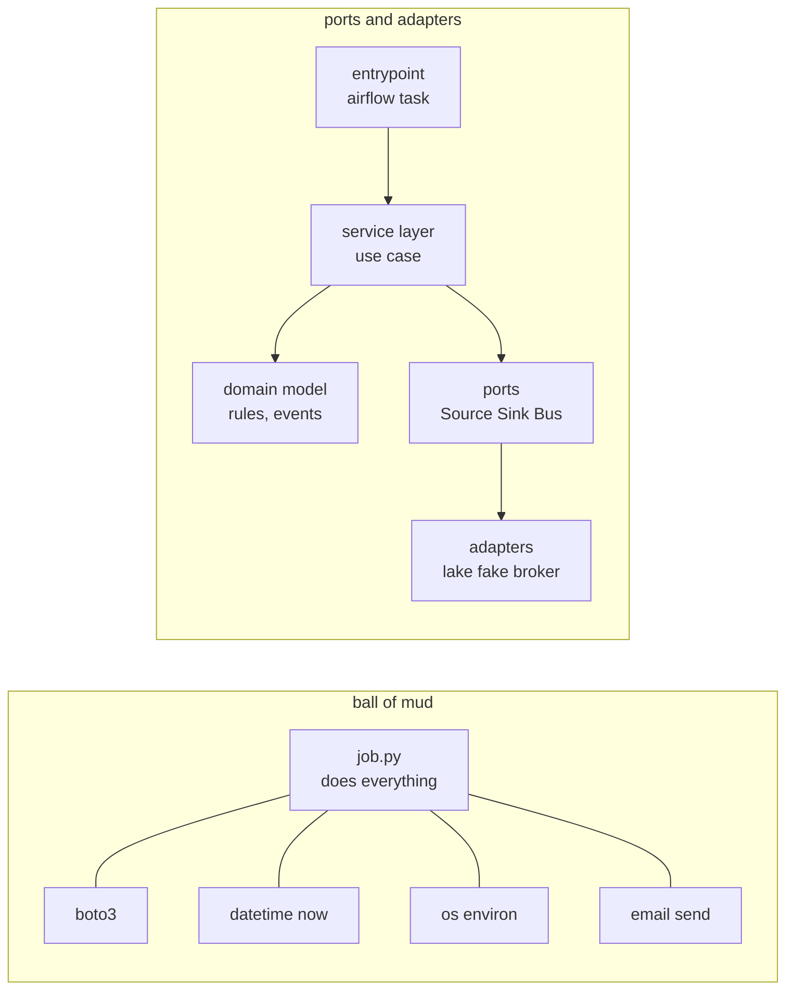

# Python for Data Engineering

> **Why it matters** — Most "Python ETL" in production is a script that grew past its design: `read_csv()` into memory, append-mode writes, `except: pass`, and no tests. This chapter is about the engineering layer — picking the right DataFrame engine, keeping memory bounded, making retries safe, and structuring a job you can rerun, test, and debug at 3am.

## pandas vs polars vs DuckDB

All three answer "transform tabular data in one process" — differently.

| | pandas | polars | DuckDB |
|---|---|---|---|
| Paradigm | eager, row-at-a-time-ish index | eager + **lazy** (`LazyFrame` query planner) | embedded SQL OLAP engine |
| Memory model | NumPy block manager (copies common) | Arrow-native columns, zero-copy | Arrow-compatible vectors |
| Threading | mostly single-threaded | multi-threaded by default | multi-threaded |
| Out-of-core | manual chunking | `scan_*` + streaming execution | spills to disk natively |
| API style | imperative, index-heavy | expression DSL (`pl.col().filter()`) | SQL over files/DataFrames |
| Sweet spot | small interactive work, the vast existing ecosystem | single-node transforms, >1 GB, pipeline code | ad-hoc SQL over files, joining many formats, parquet-heavy lakes |
| Watch out | `SettingWithCopy` traps, silent dtype coercion, `read_csv` memory | younger ecosystem, stricter typing | SQL-first; programmatic API thinner than polars |

```python
import polars as pl

# lazy: predicate + projection pushed into the parquet reader
result = (
    pl.scan_parquet("lake/events/2026/*.parquet")
    .filter(pl.col("country") == "VN")
    .select("user_id", "gbv", "occurred_at")
    .group_by("user_id")
    .agg(pl.sum("gbv").alias("total_gbv"))
    .collect(engine="streaming")           # bounded-memory execution
)
```

The `scan_*` + `collect` split is the point: polars sees the whole query plan before reading a byte, so it pushes the filter into the parquet row-group reader and only pulls the columns you asked for. `pd.read_parquet` followed by `df[df.country == "VN"]` does it backwards — read everything, filter after.



### Arrow: the common memory format

Apache Arrow defines one columnar in-memory layout that pandas (2.x), polars, DuckDB, PyArrow, Spark, and DuckDB-wasm all share. Moving a DataFrame between engines is a pointer hand-off, not serialization:



```python
df = pl.read_parquet("events.parquet")
duck = duckdb.sql("SELECT user_id, SUM(gbv) FROM df GROUP BY 1").pl()  # views, not copies
pd_df = duck.to_pandas()          # Arrow-backed pandas, still no serialize
```

::: tip 💡 Senior insight
The practical rule: **pandas for interactivity and ecosystem, polars for single-node pipeline code, DuckDB when SQL over files is the natural fit.** They interoperate through Arrow — pick per-stage, not per-project. A job that scans parquet with DuckDB, transforms with polars, and emits a small pandas frame for a legacy consumer is legitimate design, not a smell.
:::

::: warning ⚠️ Risk / production failure mode
`pd.read_csv` / `pd.read_parquet` with no row budget is the #1 way a Python job OOMs. Pandas inflates text ~3–5× (Python `str` objects per cell); a 5 GB CSV can need 25 GB RAM. If the file's size isn't bounded by contract, you *must* process it chunked or lazily — there is no "it worked in dev" excuse in production.
:::

## Chunked and lazy processing

Three idioms cover nearly all bounded-memory single-node work:

```python
# 1. pandas chunked CSV — only when you must stay in pandas
for chunk in pd.read_csv("huge.csv", chunksize=500_000):
    process(chunk)

# 2. polars lazy streaming — preferred default
pl.scan_parquet("in/*.parquet").filter(...).sink_parquet("out/")

# 3. PyArrow record-batch streams — for custom IO
import pyarrow.parquet as pq
for batch in pq.ParquetFile("huge.parquet").iter_batches(batch_size=100_000):
    handle(batch)                  # ~100k rows in Arrow, no pandas tax
```

::: info ℹ️
Parquet already encodes row-group and column statistics; lazy readers exploit them. Your job: write filters on **partition columns and sorted/prunable columns** so the engine can skip row groups entirely. A filter on `dt` (partition col) is free; a filter on a random UUID is a full scan.
:::

## Idempotent job design

A job is **idempotent** if running it twice on the same inputs produces the same outputs. Retries, backfills, and `airflow clear` all re-run jobs — non-idempotent writes turn every retry into a data-quality incident.

Three rules cover most of it:

1. **Deterministic transform** — outputs depend only on inputs and parameters, never on `datetime.now()`, wall-clock ordering, or dict iteration order. Pass `execution_date` in as a parameter; never read the clock inside the transform.
2. **Write to a staging path, then swap** — produce `out/dt=2026-11-08/` in a temp location; on success, atomically replace the partition (delete target dir → rename, or `INSERT OVERWRITE`/replace-aware table write). A failed run leaves either the old complete partition or nothing — never a half-written one.
3. **Replace, don't append** — partition-scoped writes (`dt=...`, `batch_id=...`) make the re-run boundary the overwrite boundary. Append-mode sinks need dedupe keys or exactly-once semantics you probably don't have.



```python
def run_partition(dt: date) -> None:
    staging = f"tmp/events/dt={dt}/run-{uuid4()}"
    final = f"warehouse/events/dt={dt}"
    df = transform(read(dt))                       # pure function of dt
    write_parquet(df, staging)
    checks = validate(staging)                     # row count, nulls, keys
    if not checks.ok:
        raise DataQualityError(checks.failures)
    shutil.rmtree(final, ignore_errors=True)       # swap boundary
    os.rename(staging, final)
```

::: warning ⚠️ Risk / production failure mode
"Delete-then-write" without staging is the classic foot-gun: you delete `dt=2026-11-08`, the transform throws on row 4M, and now the partition is *gone* — the retry rebuilds it, but every dashboard in between saw missing data. Stage → validate → swap. On object stores without atomic rename, write to a new path and flip via manifest/table format (Iceberg commit, `_SUCCESS` file consumers check).
:::

::: tip 💡 Senior insight
Determinism includes **ordering**: `df.write` where row order depends on a non-deterministic `group_by` produces byte-different outputs and breaks file-level reconciliation. Sort output on the natural key before writing if anything downstream diffs files.
:::

## Testing pipelines

Test at three levels — each catches a different failure class:

| Level | What | Tool | Catches |
|---|---|---|---|
| Unit | pure `transform(df_in) -> df_out` | pytest + `assert_frame_equal` / `pl.testing` | logic bugs, null handling, dtype drift |
| Data-quality | schema + invariants on real partitions | pandera / Great Expectations / plain `assert` checks | upstream schema change, null spikes, dup keys |
| Contract | "this input shape must always parse" | hypothesis / parameterized fixtures | silent format drift from the producer |

```python
import polars as pl
from polars.testing import assert_frame_equal
import pytest

@pytest.fixture
def events() -> pl.DataFrame:
    return pl.DataFrame({
        "event_id": ["e1", "e2", "e2"],            # e2 duplicated on purpose
        "user_id": [1, 2, 2],
        "gbv": [100, 50, 50],
    })

def test_dedup_keeps_first(events):
    out = dedup(events)
    assert out.height == 2
    assert out["event_id"].n_unique() == out.height

def test_dedup_deterministic(events):
    assert_frame_equal(dedup(events), dedup(events))
```

Contract-style invariants are cheap asserts at the boundary — cheaper than a full GX deployment for a single job:

```python
def validate(df: pl.DataFrame) -> CheckResult:
    return CheckResult([
        check(df.height > 0, "empty partition"),
        check(df["event_id"].is_unique().all(), "duplicate event_id"),
        check(df["gbv"].drop_nulls().min() >= 0, "negative gbv"),
        check(df.null_count().sum(axis=1).max() < 5, "row-level null flood"),
    ])
```

::: tip 💡 Senior insight
The highest-ROI test in ETL is **determinism under re-run**: run `transform` twice on the same fixture, assert byte-equal output. It catches wall-clock reads, set-iteration ordering, and hidden global state — the exact bugs that make backfills produce different numbers than the first run.
:::

::: details What about Great Expectations / Soda / dbt tests?
Full data-quality frameworks earn their keep when checks are shared across many tables, owned by non-engineers, or wired into orchestration-wide alerting. For a single Python job, a `validate()` function returning structured results is the same pattern with zero framework tax. Graduate to GX/Soda/dbt-tests when the check *catalog* becomes the product, not before.
:::

## Logging and observability hooks

`print` is not observability. Minimum viable instrumentation for a batch job:

```python
import logging, time

logging.basicConfig(
    level=logging.INFO,
    format="%(asctime)s %(levelname)s %(name)s %(message)s",
)
log = logging.getLogger("etl.events")

def run(dt: date):
    start = time.monotonic()
    log.info("run start", extra={"dt": str(dt)})
    rows_in = count(input_path(dt))
    ...
    log.info(
        "partition complete",
        extra={"dt": str(dt), "rows_in": rows_in, "rows_out": n,
               "dropped": rows_in - n, "elapsed_s": round(time.monotonic() - start, 1)},
    )
```

Emit structured key=value fields (`rows_in`, `rows_out`, `dropped`, `elapsed_s`) — they're grep-able now and JSON-parseable the day someone ships logs to an aggregator. `structlog` is the upgrade when you want real JSON from the start.

::: info ℹ️
The three numbers that catch most pipeline regressions: **rows in, rows out, elapsed**. A silent upstream schema change shows up as `rows_in` collapsing or `dropped` spiking — before any downstream report looks wrong. Log them per partition, always.
:::

## Error handling: a taxonomy, not a try/except

Production pipelines fail in three ways; each wants a different response:

| Failure class | Examples | Response |
|---|---|---|
| **Transient** | network blip, 429/503, lock contention, broker rebalance | retry with exponential backoff **+ jitter**, bounded attempts |
| **Poison** | one malformed record/schema that will never succeed | isolate record → dead-letter queue/path; job continues |
| **Fatal** | auth expired, contract violation, 0 rows on a non-empty SLA, OOM | fail the job fast and loudly — page a human |

```python
async def process_batch(records: list[dict]) -> None:
    good, bad = [], []
    for r in records:
        try:
            good.append(EventModel.model_validate(r))    # pydantic boundary = poison detector
        except ValidationError as e:
            bad.append((r, str(e)))
    if bad:
        write_dead_letter(bad)                       # s3://dlq/events/dt=.../run-*/
        metrics.incr("events.poisoned", len(bad))
    await sink.write(good)
```

- **Backoff**: `sleep = min(cap, base * 2**attempt) + jitter` — the jitter matters more than the exponent.
- **DLQ**: poison records go to a side path with their error attached; quarantine, don't drop silently and don't block the batch.
- **Fail fast**: an empty input partition on a table that should have data is a *stop*, not a zero-row output — write nothing, raise, let the retry/next run decide.



::: warning ⚠️ Risk / production failure mode
`except Exception: pass` and unbounded retries are the two ways jobs silently corrupt data: the first swallows poison *and* fatal alike, the second turns a downed-dependency outage into a job that burns slots for 6 hours and pages nobody. Every `except` should know which of the three classes it's catching; every retry should have a ceiling and an alarm.
:::

## Mini-case: a typed pipeline end-to-end

Putting it together — boundary validation, pure transform, partition-scoped idempotent write, structured logging, error taxonomy:

```python
from dataclasses import dataclass
from datetime import date, datetime
from typing import Protocol
import polars as pl
from pydantic import BaseModel, ValidationError

# --- boundary ---
class RawEvent(BaseModel):
    event_id: str
    user_id: int
    gbv_cents: int
    occurred_at: datetime

# --- interior record ---
@dataclass(frozen=True, slots=True)
class Event:
    event_id: str
    user_id: int
    gbv_cents: int
    occurred_at: datetime

# --- pluggable sink ---
class PartitionSink(Protocol):
    def write(self, dt: date, df: pl.DataFrame) -> int: ...

class LakeSink:
    def write(self, dt: date, df: pl.DataFrame) -> int:
        staging = f"tmp/events/dt={dt}/"
        final = f"lake/events/dt={dt}/"
        df.sort("event_id").write_parquet(staging + "part.parquet")
        atomic_swap(staging, final)
        return df.height

# --- transform: boundary validation + pure mapping ---
def transform(raw: list[dict]) -> tuple[pl.DataFrame, list[tuple[dict, str]]]:
    good, bad = [], []
    for r in raw:
        try:
            v = RawEvent.model_validate(r)               # raises on poison records
            good.append(Event(v.event_id, v.user_id, v.gbv_cents, v.occurred_at))
        except ValidationError as ex:
            bad.append((r, str(ex)))
    return pl.DataFrame(good), bad

# --- job ---
def run(dt: date, source, sink: PartitionSink, dlq) -> None:
    rows_in = 0
    frames = []
    for raw_batch in source.read(dt):                    # generator: bounded memory
        rows_in += len(raw_batch)
        df, bad = transform(raw_batch)
        if bad:
            dlq.write(dt, bad)
        frames.append(df)
    if rows_in == 0:
        raise EmptyInputError(f"no rows for {dt}")       # fatal, not zero-output
    out = pl.concat(frames)
    written = sink.write(dt, out)
    log.info("done", extra={"dt": str(dt), "rows_in": rows_in, "rows_out": written})
```

Read the shape: the only impure code is `source.read`, `dlq.write`, and `sink.write` — everything between them is a pure function of its inputs, testable with a fixture and `assert_frame_equal`. That separation is the whole design.

## Architecture patterns for pipeline code

The mini-case above already separates source, transform, and sink — that instinct is the same one *Architecture Patterns with Python* (Percival & Gregory, "cosmicpython") formalizes for application code. Their patterns map onto pipelines almost directly: repositories over storage, a service layer for orchestration, domain events for side effects. This section is the DE translation — and, just as important, when *not* to bother.

### When does a pipeline deserve a domain layer?

A domain model earns its keep when the pipeline encodes **invariants and business rules** — "an order line allocates to at most one batch," "a customer's lifetime window can't reopen," "negative gbv is impossible" — not when it's moving bytes. The tell-tale sign: the transform's rules live in prose, Slack, and tribal knowledge instead of in executable code.

| Pipeline shape | Verdict |
|---|---|
| land → validate → write, no rules | no domain layer; keep it procedural |
| rules with names (`allocate`, `price`, `reconcile`) that recur across jobs | domain objects + value objects |
| concurrent writers / rerun windows must not break an invariant | an **aggregate**: one object that owns the consistency boundary, loaded and mutated as a unit |
| two teams use the same word ("customer", "deal") for different things | **bounded contexts** — split models rather than force one schema on both |

```python
# the aggregate owns its invariant — callers never touch batches directly
@dataclass(slots=True)
class PartitionSet:
    """Aggregate: all partitions of one fact table for one entity.
       Every mutation goes through a method that enforces the invariant."""
    entity_id: str
    partitions: dict[date, pl.DataFrame]

    def upsert(self, dt: date, df: pl.DataFrame) -> None:
        if df["entity_id"].n_unique() != 1:
            raise InvariantError("partition contains foreign entity")
        self.partitions[dt] = df          # replace, never merge-append
```

::: tip 💡 Senior insight
Choose the aggregate the way cosmicpython chose `Product` over `Warehouse`: find the **smallest boundary inside which things must be mutually consistent**. Two entities' partitions can be rebuilt concurrently because no invariant spans them — so make the entity the aggregate, get concurrency for free, and keep the boundary small enough to hold in memory.
:::

### Repository over storage: testable seams

The Repository pattern is dependency inversion pointed at I/O: pipeline logic depends on an *abstraction* of the store, and both the real reader and the test fake implement it. The rule of thumb from the book: **if the abstraction is hard to fake, it's the wrong abstraction** — faking difficulty is design feedback.

```python
from typing import Protocol, Iterator

class EventSource(Protocol):
    def read(self, dt: date) -> Iterator[list[dict]]: ...

class EventSink(Protocol):
    def write(self, dt: date, df: pl.DataFrame) -> int: ...

class LakeSource:                                  # real adapter
    def read(self, dt: date) -> Iterator[list[dict]]:
        yield from stream_parquet_rows(f"lake/events/dt={dt}/")

class FakeSource:                                  # test adapter: a working
    def __init__(self, batches): self._batches = batches   # implementation,
    def read(self, dt): yield from self._batches           # not a mock

class FakeSink:
    def __init__(self): self.writes = {}
    def write(self, dt, df): self.writes[dt] = df; return df.height

# the job depends on the PROTOCOL — prod injects LakeSource, tests FakeSource
def run(dt: date, source: EventSource, sink: EventSink, dlq) -> None: ...

def test_run_writes_partition():
    src = FakeSource([[{"event_id": "e1", "user_id": 1,
                        "gbv_cents": 500, "occurred_at": NOW}]])
    sink = FakeSink()
    run(SOME_DT, src, sink, dlq=FakeSink())
    assert sink.writes[SOME_DT].height == 1
```

Prefer **fakes over mocks**: a fake is a working in-memory implementation you assert *end state* on (`sink.writes[dt]`); a mock verifies *interactions* (`assert_called_once_with`). Mock-coupled tests break when you refactor internals without changing behavior — the exact refactor the test suite is supposed to make safe.

### Service layer + message bus: orchestration without tangling

Every pipeline step has the same boring shape — *fetch state → check preconditions → apply domain logic → persist*. That's the service-layer recipe; keep it as one flat function per use case, taking primitives (`dt`, `entity_id`) and abstractions (`source`, `sink`), so it runs identically under pytest and under Airflow.

Where the book's biggest idea lands hardest is **side effects**. "Recompute the partition, *and* emit metrics, *and* notify the dashboard, *and* trigger the downstream backfill" is SRP violation dressed as a job — the classic test is that you can't name the function without "and". Domain events fix it: the transform records *facts that happened*; a message bus maps each event to its handler.

```python
@dataclass
class Event: ...
@dataclass
class PartitionRebuilt(Event):
    dt: date; entity_id: str; rows_in: int; rows_out: int
@dataclass
class DataQualityFailed(Event):
    dt: date; failures: list[str]

# service layer: orchestration only — collect events, hand them to the bus
def rebuild_partition(dt: date, src: EventSource, sink: EventSink,
                      bus: MessageBus) -> None:
    out, events = transform(src.read(dt))      # domain logic emits facts
    sink.write(dt, out)
    for e in events:                            # publish AFTER the write
        bus.handle(e)

HANDLERS = {
    PartitionRebuilt:   [emit_metrics, refresh_dbt_downstream],
    DataQualityFailed:  [page_oncall, write_dq_quarantine],
}
```



::: warning ⚠️ Risk / production failure mode
The event replaces the exception — **don't do both** for the same fact. A `DataQualityFailed` event *and* a raised `DataQualityError` for the same condition forces every caller to reason about two channels. Pick per fact: exceptions for conditions the caller must handle inline, events for facts others *react* to.
:::

::: details Is the in-process bus not just an Airflow DAG / Celery?
The in-process bus separates *responsibilities within one run* — it gives you a single readable recipe per use case, not distribution. When a handler must outlive the process or run in another service, promote that event to a real broker topic (the book calls these *external events*); the handler signature and the event schema barely change. Don't reach for a broker for in-process decoupling.
:::

### TDD for transformation logic: fakes vs mocks, high vs low gear

| Double | What | Asserts on | Use for | Cost |
|---|---|---|---|---|
| Fake | working in-memory impl (`FakeSource`, `FakeSink`, DuckDB `:memory:`) | end **state**: rows written, events raised | repository seams, service-layer tests | you must write it once |
| Spy/stub | records calls, returns canned values | both | boundary objects you don't own (email, HTTP) | brittle if overused |
| Mock (`patch`) | verifies *interactions* | call args, call order | last resort — patching `boto3.s3.put_object` | couples test to internals; zero design feedback |

```python
# fakes let the service layer run "edge to edge" in memory — fast, no patching
def test_dq_failure_pages_and_quarantines():
    bus = FakeBus()                       # records handled events
    src = FakeSource([[{"event_id": "e1", "user_id": None, ...}]])  # poison
    rebuild_partition(SOME_DT, src, FakeSink(), bus)
    assert isinstance(bus.seen[-1], DataQualityFailed)
```

The book's gear metaphor for where to aim tests:

- **Low gear — domain-level tests.** New domain or a gnarly rule? Test the aggregate directly (`product.allocate(...)`). The tests are executable documentation while the design is still moving.
- **High gear — service-level tests.** Once the shape is stable, write tests against `rebuild_partition(...)` with fakes. Lower coupling to internals means refactors don't trigger hundred-test rewrites.
- **Aim the pyramid**: bulk fast unit tests over fakes, a thin layer of real-storage integration tests (one real `LakeSource` round-trip on a temp dir), one or two e2e runs on a real partition.

::: tip 💡 Senior insight
**Designing for testability *is* designing for extensibility.** An abstraction built so tests can fake it is the same abstraction that later lets you run `--dry-run`, swap S3 for GCS, or replay a partition locally. `mock.patch` gives you a green test and none of that — which is why the book treats monkeypatching as a smell, not a style choice.
:::

### Coupling patterns to avoid in pipeline code

Coupling is fine *locally* — cohesive code is coupled by definition. It kills you *globally*, when change cost grows superlinearly because everything touches everything. The DE-specific versions of the mud:

| Smell | Why it rots | Fix |
|---|---|---|
| `import boto3` inside `transform()` | pure logic hostage to infra; untestable without patch | repository/Protocol seam, inject at the edge |
| `datetime.now()` inside transform | non-deterministic; re-runs diverge | pass `execution_date` in |
| exceptions as control flow *and* events for the same fact | two channels to reason about | one channel per fact |
| "god job": extract+validate+enrich+write+notify in one function | can't name it without "and"; every change risks the rest | service-layer steps + events for side effects |
| reading `os.environ` / global config deep in helpers | hidden inputs, tests pass only on the author's machine | explicit parameters at the seam |
| anemic service layer: all logic in services, model is bags of dicts | orchestration swallows the domain; rules scatter | push rules down into domain objects |



The whole game is the direction of the arrows: **the domain depends on nothing, everything depends on the domain, and I/O only ever points inward.**

## 🧠 Quiz

<QuizCard :questions="[{ q: 'A 30 GB parquet dataset needs filtering to 2 GB before aggregation. Which approach minimizes memory?', options: ['polars scan_parquet with filter and select before collect, streaming engine', 'DuckDB COPY entire table to pandas', 'pd.read_parquet then df.loc filter', 'read_csv with chunksize then concat all chunks'], correct: 0, explain: 'Lazy scan pushes the filter and projection into the parquet reader — row-group pruning and column selection happen before data reaches memory. Eager readers pay full cost up front; concat-of-chunks defeats the purpose.' }, { q: 'What makes a pipeline write idempotent?', options: ['adding a UNIQUE constraint to the table', 'staging the output, validating it, then atomically swapping the partition — never appending blindly', 'running the job only once per day', 'using INSERT instead of UPDATE'], correct: 1, explain: 'Idempotency = rerun produces the same state. Stage → validate → swap makes the partition boundary the retry boundary; append needs dedupe keys, constraints help but do not fix half-written files.' }, { q: 'A record fails schema validation in a batch of 50k. Correct handling?', options: ['write it to a dead-letter path with the error, continue the batch', 'skip it silently', 'retry the record 5 times', 'fail the whole partition'], correct: 0, explain: 'A malformed record is poison — deterministic, will never succeed. Isolate to DLQ with context and continue; failing the batch starves 49,999 good rows, silent skipping loses data invisibly, retrying is wasted work.' }, { q: 'Why does Arrow matter when mixing pandas, polars, and DuckDB?', options: ['it is a faster CSV parser', 'it replaces the GIL', 'all three share one columnar memory layout — interchange is pointer hand-off, not serialization', 'it makes parquet files smaller'], correct: 2, explain: 'Arrow is the common in-memory format: polars is Arrow-native, pandas 2.x has an Arrow backend, DuckDB scans Arrow in place. Mixing engines per-stage is cheap because nothing serializes between them.' }, { q: 'Which three metrics, logged per partition, catch most silent pipeline regressions?', options: ['rows_in, rows_out, elapsed', 'errors, warnings, retries', 'partition size, file count, schema version', 'cpu, memory, disk'], correct: 0, explain: 'rows_in detects upstream collapse, rows_out detects filter/transform drift, elapsed detects data-skew and infra slowdown. They are cheap to emit and grep-able before any dashboard looks wrong.' }, { q: 'What is the highest-ROI test for an ETL transform function?', options: ['coverage above 90%', 'running transform twice on the same fixture and asserting byte-equal output', 'testing on a production sample only', 'mocking the file system'], correct: 1, explain: 'Determinism-under-rerun catches wall-clock reads, set-ordering, and hidden global state — the bugs that make backfills diverge from first runs. Mocks hide real behavior; production samples are not tests.' }]" />

<QuizCard :questions="[{ q: 'When does a pipeline deserve a domain layer?', options: ['whenever it has more than one file', 'only when it uses an ORM', 'when the team prefers OOP', 'when it encodes named business rules and invariants rather than just moving bytes'], correct: 3, explain: 'Domain modeling pays off when rules like allocate or reconcile must be expressed in code. Byte-moving extract-load jobs gain nothing — keep them procedural.' }, { q: 'Why prefer a FakeSource or FakeSink over mock.patch in pipeline tests?', options: ['mock.patch does not work on file I/O', 'fakes assert on end state and stay valid through internal refactors; mocks verify interactions and couple tests to implementation', 'fakes run faster than mocks', 'fakes need less code'], correct: 1, explain: 'A fake is a working in-memory implementation — tests assert rows written, not call arguments. Mock-based tests break whenever internals change even if behavior is unchanged, so they fight the refactors tests exist to protect.' }, { q: 'What role does a message bus play in a pipeline service layer?', options: ['it replaces the repository for storage', 'it distributes work across worker nodes', 'it guarantees exactly-once delivery', 'it maps domain events raised by the transform to side-effect handlers, keeping orchestration free of notify-and-also logic'], correct: 3, explain: 'The in-process bus decouples responsibilities within one run: the transform records facts like PartitionRebuilt, and handlers such as emit_metrics subscribe by event type. Distribution across services is a separate concern requiring a real broker.' }]" />

## Further reading

- [Polars user guide — lazy API & streaming](https://docs.pola.rs/user-guide/lazy/)
- [DuckDB Python client & Pandas/Polars integration](https://duckdb.org/docs/stable/clients/python/overview)
- [Apache Arrow Python (PyArrow) docs](https://arrow.apache.org/docs/python/)
- [pandas 2.x Arrow dtype backend](https://pandas.pydata.org/docs/user_guide/pyarrow.html)
- [pytest fixtures documentation](https://docs.pytest.org/en/stable/how-to/fixtures.html)
- [Pandera — dataframe validation](https://pandera.readthedocs.io/en/stable/) · [Great Expectations](https://docs.greatexpectations.io/docs/)
- [AWS Builders' Library — Timeouts, retries, and backoff with jitter](https://aws.amazon.com/builders-library/timeouts-retries-and-backoff-with-jitter/)
- [structlog documentation](https://www.structlog.org/en/stable/)
- **Architecture Patterns with Python** — Harry Percival & Bob Gregory (2020), [cosmicpython.com](https://www.cosmicpython.com/) — source of the repository / service layer / message bus / fakes-over-mocks section above; free to read online
