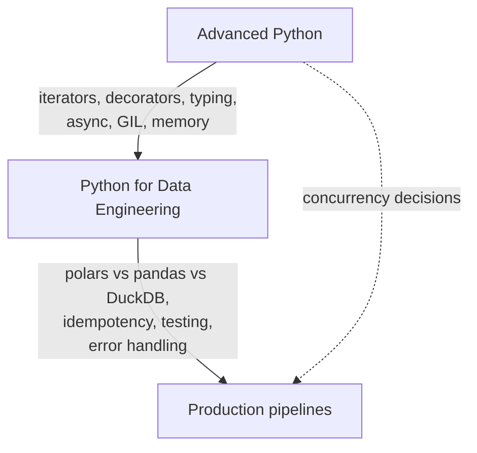

# Python Deep Dive

> **Why it matters** — Python is the glue of every data platform, and it is also where slow, memory-hungry, non-idempotent jobs are born. The difference between "knows pandas" and "senior" is understanding execution, zero-copy data movement, and writing jobs that survive retries and 3am pages.

Python is the glue language of data engineering — but "writes scripts" is not the bar. This track covers the Python that separates a senior data engineer from someone who knows pandas syntax: how the interpreter actually executes code, how to move data without copying it, and how to write jobs that survive retries, backfills, and 3am pages.

**Who it's for:** intermediate Python developers moving toward senior data engineering roles. You should already be comfortable with functions, classes, and basic pandas. We skip the API-reference stuff you can look up and go deep on the parts that determine whether a pipeline is fast, correct, and operable.

## Chapters

### [Advanced Python →](/python/advanced-python)

The interpreter internals that matter: iterators and generators as the backbone of O(1)-memory pipelines, decorators for retries and timing, context managers for resource safety, `dataclasses` vs pydantic for validation boundaries, `Protocol`/`TypedDict`/generics for typed pipelines, the asyncio event loop, the GIL and the threading/multiprocessing/asyncio decision, and memory profiling with `tracemalloc` and `__slots__`. Ends with modern packaging — `pyproject.toml` and `uv`.

### [Python for Data Engineering →](/python/data-engineering)

Applying all of it to real jobs: when pandas, polars, or DuckDB wins (and how Arrow's zero-copy interchange lets them coexist), chunked and lazy processing patterns that beat `read_csv()` into memory, idempotent job design with partitioned writes, testing pipelines with fixtures and contract checks, structured logging, and an error-handling taxonomy — retry with jitter vs dead-letter vs fail-fast. Closes with a mini end-to-end typed pipeline.

## Pareto focus

The ideas in this track that pay for themselves fastest:

- **Generators compose into O(1)-memory pipelines** — the single most useful Python idiom for data work
- **Validate at boundaries, trust inside** — pydantic at the edge, dataclasses in the core
- **The GIL decision table** — threads for I/O on sync libs, asyncio for fan-out at scale, multiprocessing for CPU
- **Eager vs lazy DataFrames** — pushing filters to the file reader is the cheapest speedup that exists
- **Arrow is the common language** — pandas ↔ polars ↔ DuckDB interchange without serialization
- **Idempotent writes make retries safe** — write-then-swap over whole partitions, never append-by-default
- **Errors need a taxonomy** — transient (retry), poison (DLQ), fatal (stop the job); conflating them is a classic outage
