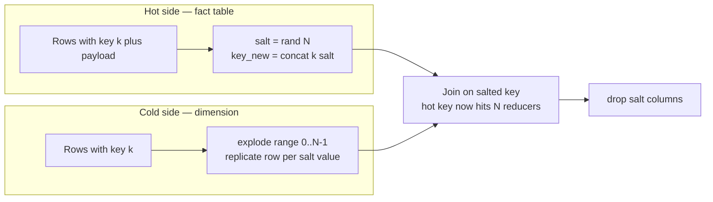
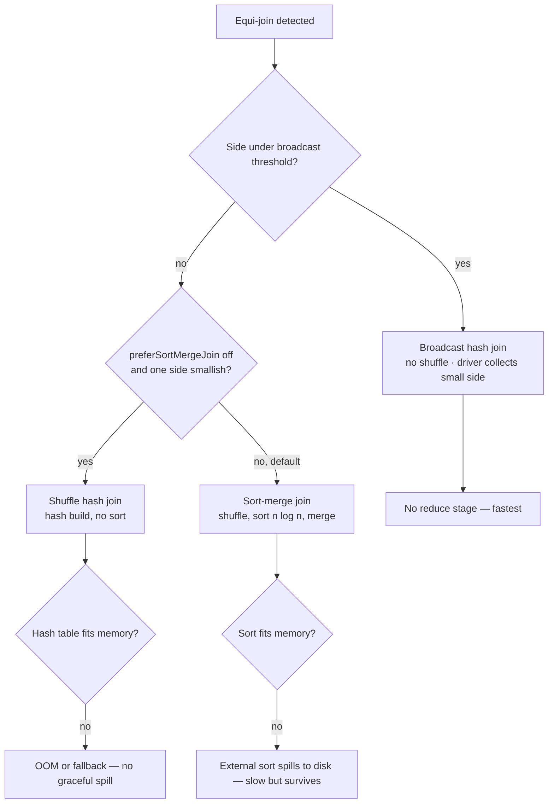
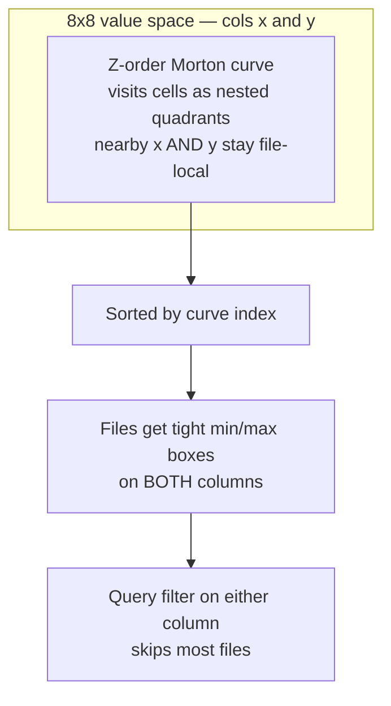
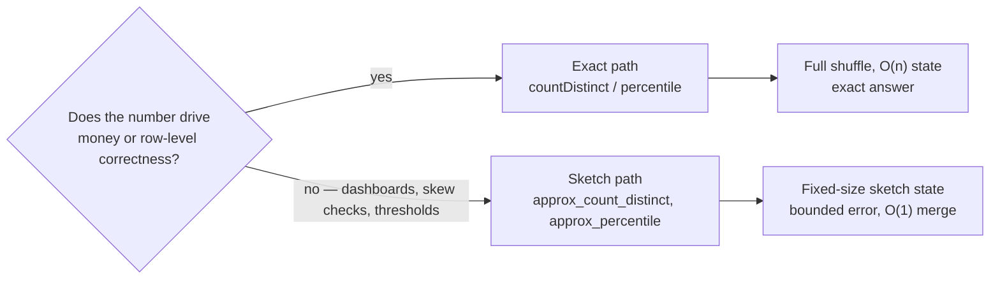

# Advanced Spark Algorithms

> **Why it matters** — Tuning knobs fix symptoms; algorithms fix structure. Salting a skewed join, truncating iterative lineage, choosing between sort-merge and broadcast, and laying out files so min/max stats actually prune — these are the levers that take a job from "runs" to "runs at 10× on the same cluster." This chapter is the algorithmic layer underneath every config in [Performance Optimization](/spark/optimization).

## Partitioning algorithms: how rows find partitions

Every shuffle routes rows through a partitioner — a pure function `partition(row_key) → p ∈ [0, N)`. Which function Spark uses determines locality, skew, and ordering guarantees.

| Partitioner | Rule | Guarantees | Used by |
|---|---|---|---|
| `HashPartitioner` | `p = hash(k) mod N` | Same key → same partition | `groupByKey`, `reduceByKey`, hash joins, `repartition(N, col)` |
| `RangePartitioner` | Sample keys, build range boundaries, `p = bisect(k)` | Each partition holds a contiguous key range; roughly equal sizes | `sortBy`, `sortWithinPartitions`, `repartitionByRange` |
| `RoundRobinPartitioner` | `p = position mod N` within each map task | Perfectly even row counts, zero key locality | `repartition(N)` *without* a column |
| `Custom` | Your function | Whatever you implement — dangerous and powerful | `partitionBy(new CustomPartitioner)` |

::: info ℹ️ Range partitioning's hidden cost
`RangePartitioner` runs a **sampling job before the real job** — it reads a fraction of the data to estimate key quantiles, then builds boundaries that balance partition sizes. That's why a plain `sortBy` sometimes shows an extra stage before the sort: the sampler ran first. It's also why range partitioning resists skew better than hashing — the boundaries adapt to the actual key distribution.
:::

`repartition(200)` and `repartition(200, col("k"))` look interchangeable and are not: the first is round-robin — perfectly balanced, key-blind; the second hashes `k` — key-grouped, skew-prone. The *guarantee* you need dictates the partitioner — locality for grouping work, balance for spreading work — and the API spelling follows.


### Salting math — the skewed-key algebra

A hot key `k*` with `H` rows lands on one partition because `hash(k*)` is one value. Salting replaces the key with `k' = concat(k, '_', salt)` where `salt ∈ [0, N)` — `hash(k'_{i})` now spreads `k*` across up to `N` reducers.

Choosing `N` — the number that matters:

- `N ≈ ceil(hot_key_bytes / target_task_bytes)` is the floor: 1 GB of hot-key data ÷ 256 MB target task ⇒ `N ≥ 4`.
- `N ≈ ceil(skew_ratio)` where `skew_ratio = max_partition / median_partition` is the practical rule: max 100× median ⇒ salt `N ≥ 100`.
- Higher `N` is cheap for aggregations, expensive for joins (the other side gets duplicated `N`× — see below).

Mechanics: a salted key `k' = concat(k, s)` is a *different* key per `s`, so `hash(k'_s) mod P` lands in different slots — with `N` salts the hot key splits into `N` independent hash streams, `≈ H/N` rows per target partition modulo normal hash noise. Salting reduces no shuffle bytes; it re-splits the *worst key* so no single task carries it.




Worked example — a `customer_id` skew:

- 200 partitions, median task input 50 MB → a 10 GB stage.
- `customer_id = 42` alone is 5 GB: one task runs 100× the median; the other 199 finish in ~3 minutes and idle.
- `skew_ratio = 5000 / 50 = 100` → `SALT_N = 100`. The exact value doesn't matter — the order of magnitude does.
- After salting: the hot key becomes ~100 keys of ~50 MB each, matching median task size.
- Cost: the dimension side replicates 100× — fine at 10 MB, fatal at 5 GB. That sizing check comes *before* writing the join.


## Two-phase salting — worked example

The pattern splits depending on whether the hot key survives the operation or is being reduced away.

```python
from pyspark.sql import functions as F
from pyspark.sql.functions import col, lit, pmod, rand, explode, array, concat_ws

SALT_N = 64   # ~ skew_ratio: hot key holds ~64x the median partition

# ----------------------------------------------------------
# 1. SALTED JOIN — both sides must move
# ----------------------------------------------------------
# Hot side: spread each row over one of N salt buckets
fact_salted = fact.withColumn(
    "salt", pmod(rand(seed=42) * SALT_N, lit(SALT_N)).cast("int")
).withColumn("key_salted", concat_ws("_", col("customer_id"), col("salt")))

# Cold side: replicate every row N times — REQUIRED, or you lose
# N-1/N of the join output. Co-salting is the part everyone forgets.
dim_salted = (
    dim.withColumn("salt", explode(array([lit(i) for i in range(SALT_N)])))
       .withColumn("key_salted", concat_ws("_", col("customer_id"), col("salt")))
)

joined = fact_salted.join(dim_salted, "key_salted").drop("salt", "key_salted")
```

The cold side grows `SALT_N`× — 64× a 100 MB dimension = 6.4 GB shuffled. That's the trade: you pay a bounded replication on the small side to un-pin the unbounded skew on the big side. If the cold side is also huge, don't salt the join — broadcast it if it fits, or isolate the hot key instead.

::: warning ⚠️ Salt on the real key, not the string
Concatenating `"customer_id || salt"` works but allocates strings per row and defeats whole-stage codegen on the join condition. A cheaper production form: salt on a composite struct or hash `pmod(rand()*N, N)` into a second join column and join on `(customer_id, salt)` — same math, no string ops.
:::

### Aggregation variant — partial then final

For a skewed `groupBy` you don't replicate anything — you aggregate twice:

```python
# Phase 1: partial aggregate on (key, salt) — breaks the hot key
partial = (
    events.withColumn("salt", pmod(rand(seed=7) * SALT_N, lit(SALT_N)).cast("int"))
          .groupBy("customer_id", "salt")
          .agg(F.sum("amount").alias("amt"), F.count("*").alias("cnt"))
)
# Phase 2: final aggregate on key — shuffle now carries ~N*#keys rows,
# not the raw fact volume
final = partial.groupBy("customer_id").agg(
    F.sum("amt").alias("total"), F.sum("cnt").alias("n")
)
```

Phase 1 already collapses the hot key into `N` partial rows before the second shuffle — this is exactly what Spark's own two-phase `HashAggregate → HashAggregate (final)` does, except you're controlling the fan-out manually because one key defeats the default.

::: info ℹ️ Detecting skewed groups before writing this
You don't guess `SALT_N` — you measure it. One pass `events.groupBy("customer_id").count().describe()` (or `approxQuantile` on the counts) gives the max/median ratio the formula needs. If the hot key is *known* (a sentinel like `-1`, a mega-tenant), the isolate-hot-key pattern from [Performance Optimization](/spark/optimization#the-data-skew-playbook) beats salting — it's two passes but no replication.
:::


## Iterative algorithms — the lineage explosion

Graph and ML algorithms loop `R` times over the same structure. Each iteration extends the RDD lineage DAG by another full stage: after `R` iterations the driver holds an `O(R · stage_size)` plan, scheduling slows, and a lost partition triggers recompute of the *entire history* — the recompute itself often OOMs the lineage chain. This is why naive iterative Spark jobs die around iteration 30–50.

| Mechanism | Truncates lineage? | Durable? | Cost |
|---|---|---|---|
| `persist()` / `cache()` | **No** — lineage kept for recompute | Memory/disk, lost with executor | Cheap; reuse without recompute *while nothing fails* |
| `checkpoint()` | **Yes** — writes files, rewrites lineage to `CheckpointRDD` | Reliable storage (`setCheckpointDir`) | Full write + synchronous by default (`checkpoint(eager=True)`) |
| `localCheckpoint()` | **Yes** — same truncation | Executor local disk only — gone on executor loss | Cheaper; no durable storage needed |

::: tip 💡 Senior insight
`persist` alone does **not** solve iterative blowup — it speeds recompute but the DAG still grows until a fetch failure recomputes 40 stages. Production iterative jobs `checkpoint()` every `k` iterations (typically `k = 5–10`) *and* `persist()` — persist so the next iteration doesn't re-read the checkpoint files. Use `localCheckpoint()` on ephemeral clusters where writing a checkpoint dir to S3/HDFS is the bottleneck; accept that executor loss re-triggers lineage growth.
:::

`localCheckpoint()` deserves its own note: same lineage truncation as `checkpoint()`, but the data lands on executor-local disk — no `setCheckpointDir`, no network write to HDFS/S3, and the data dies with the executor. Right tool for trimming DAG depth inside one job's lifetime (a 50-iteration EM loop, a long chained transform); wrong tool where executor churn is expected or output must survive the job.


### PageRank — GraphFrames and the raw version

GraphFrames compiles graph algorithms into joins and aggregations:

```python
from graphframes import GraphFrame

g = GraphFrame(vertices, edges)          # v(id, ...), e(src, dst, ...)
ranks = g.pageRank(resetProbability=0.15, maxIter=20)
comps = g.connectedComponents()          # requires spark.setCheckpointDir
```

Under the hood `pageRank` runs the same aggregate-message-passing loop you can write by hand — worth knowing because hand-rolled versions let you control checkpoint cadence:

```python
# Raw PageRank: ranks_i+1 = alpha/N + (1-alpha) * sum(ranks_j / outdeg_j)
verts = vertices.select("id")
edges = links.select(col("src"), col("dst"))

outdeg = edges.groupBy("src").count().withColumnRenamed("count", "deg")
ranks  = verts.withColumn("rank", lit(1.0))          # init uniform

spark.sparkContext.setCheckpointDir("s3a://tmp/pr-ckpt")
for i in range(20):
    contrib = (
        ranks.withColumnRenamed("id", "src")
             .join(outdeg, "src")
             .join(edges, "src")                     # attach edges to src rank
             .groupBy("dst")
             .agg(F.sum(col("rank") / col("deg")).alias("pr"))
    )
    ranks = (
        verts.join(contrib, verts.id == contrib.dst, "left")
             .select("id", (lit(0.15) + lit(0.85) *
                     F.coalesce(col("pr"), lit(0.0))).alias("rank"))
    )
    ranks = ranks.persist()                          # reuse next iter
    if i % 5 == 0:
        ranks = ranks.checkpoint(eager=True)         # truncate lineage
```

Two production notes on the raw loop. First, convergence: `maxIter=20` is a guess — real PageRank stops when `sum(|rank_new - rank_old|)` drops below `eps` (typically `1e-4 · N`), which usually saves a third of the iterations on sparse graphs but requires an extra action per check, so check every 2–3 iterations, not every one. Second, the `left` join keeps vertices with no inbound edges at the teleport floor `0.15` — a common bug drops them silently, after which `rank` mass is no longer conserved and ranks drift below the theoretical sum of `N`.


### Connected components — the logarithmic trick

Naive label propagation (`component(v) = min(component(neighbors))`, repeat) converges in `O(diameter)` iterations — hundreds of rounds on long chains. The **alternating large-star / small-star** algorithm (Kiveris et al., "Connected Components in MapReduce and Beyond") converges in `O(log diameter)` rounds by contracting *large* components toward their min vertex in strict alternation — it's what GraphX/GraphFrames `connectedComponents` implements, and why it demands a checkpoint dir: the iteration count is unpredictable.

::: details GraphFrames vs GraphX vs hand-rolled — honest trade-offs
GraphFrames gives you the algorithms in PySpark but every iteration pays DataFrame overhead — plan optimization, UnsafeRow ↔ catalyst expression boundaries. GraphX (`aggregateMessages`, `pregel` on `VertexRDD`) is ~2–3× faster on iterative workloads because it caches indexed vertices natively, but it's Scala/RDD-only and effectively in maintenance mode. Hand-rolled DataFrame loops sit in between: full control over checkpoint cadence and message schema, but you own convergence and numerical bugs. For most PySpark jobs, GraphFrames + `setCheckpointDir` is the right default; reach for raw loops when you need custom stopping criteria or non-standard update functions.
:::

## Join algorithm selection — the cost model

Catalyst's `JoinSelection` strategy picks among five physical implementations. Three dominate practice:

| | Broadcast hash | Shuffle hash | Sort-merge |
|---|---|---|---|
| Shuffle | None — small side shipped to every executor | Both sides hash-shuffled | Both sides hash-shuffled **and sorted** |
| Build cost | `B` bytes on driver once + broadcast to `E` executors | Hash table over streamed side | `O(n log n)` sort per partition, merge pass |
| Memory risk | Driver collect OOM; executor hash table OOM | Build-side hash table must fit memory or spill | Sort spills to disk gracefully — the safest large-join |
| Picked when | `size ≤ autoBroadcastJoinThreshold` (default **10 MB**) | `preferSortMergeJoin=false` and side smallish | Default for large-large joins |

Two memory facts people get wrong: the 10 MB threshold is measured on **driver-side materialized size** — a `broadcast()` on 5 GB OOMs the *driver* before any executor sees it; and `spark.sql.broadcastTimeout` (default 300s) is the most common false-failure on slow networks, fix the size not the timeout.

Why 10 MB: the threshold trades broadcast cost `B × E` (B bytes to each of E executors) against shuffle cost `~B + F` (both sides over the network). Under ~10 MB, `B × E` stays trivial even at 100 executors — 1 GB of total network transfer beats shuffling a multi-GB probe side. Raise it deliberately with stats: `autoBroadcastJoinThreshold = min(executor_memory × 0.1, driver_headroom)` is a sane ceiling; a hint bypasses the check entirely, which is why stale `BROADCAST` hints are production incidents.




**Sort-merge vs shuffle-hash, as math:** for `n` rows per side, SMJ pays a `O(n log n)` sort plus an `O(n)` merge — the sort is what enables spilling to disk, which is why SMJ is the default: it degrades gracefully. Shuffle-hash skips the sort (`O(n)` build + `O(n)` probe) but the hash table is all-or-nothing memory — a build side that doesn't fit fails rather than spilling (pre-AQE; modern versions can switch the build side). Rule: SMJ for large-large, SHJ only when `preferSortMergeJoin=false` and you've sized the build side, cartesian/shuffle-replicate-NL only as last resorts.

The two remaining strategies cover edge cases: `BroadcastNestedLoopJoin` for non-equi joins (`ON a.x < b.y` — no hash key exists; `O(n·m)` per partition, survivable only when one side broadcasts) and `ShuffleReplicateNL`, the rarest plan, which replicates *both* sides over a fixed grid for cross joins. Either showing up on a large-large join means the join condition is missing or broken — it's a bug report, not a tuning problem.


### AQE — the runtime re-optimizer

[AQE](/spark/optimization#adaptive-query-execution-aqe) converts and repairs joins using *actual* shuffle sizes, not estimates:

| Mechanism | Config | Math |
|---|---|---|
| SMJ → Broadcast conversion | `spark.sql.adaptive.autoBroadcastJoinThreshold` (default `-1` = inherit) | At stage end, if a side's real bytes < threshold, re-plan remaining stages as broadcast |
| Skew partition split | `skewJoin.skewedPartitionFactor` (5) + `skewedPartitionThresholdInBytes` (256 MB) | Partition is skewed iff `size > median_size × factor` **and** `size > threshold` — split into pieces of `advisoryPartitionSizeInBytes` (64 MB default) |
| Partition coalesce | `coalescePartitions.enabled` | Merge small map outputs up to `advisoryPartitionSizeInBytes` |

So the AQE skew split on a 2 GB reduce partition with 64 MB advisory ⇒ ~32 sub-partitions, each reading a slice of the same shuffle block file and re-joining against a replicated build partition. It's salting done for you — *but only on sort-merge joins, and only at reduce-partition granularity*. Pre-shuffle skew (one map task reading a giant file) and skewed `groupBy` are out of scope.

## Data layouting algorithms — file-level math

Everything above optimizes the shuffle; this section optimizes what the shuffle never has to read.

### Partition pruning arithmetic

A table partitioned by `dt` with `D` partitions of ~equal size scans `T × W/D` bytes for a `W`-day filter — linear speedup. The catch is **cardinality**: each partition is a directory + metadata entry, so partitioning on a 1M-value column produces a metastore cliff, not pruning. Effective partition keys: hundreds of values, uniform-ish sizes, aligned to query predicates. The invisible win is *listing*: on object stores, listing 50k files can take longer than reading them — a well-partitioned path skips the listing entirely.

### Bucketing — pre-shuffled data

`bucketBy(B, key)` writes each key range to a fixed bucket file. On a join where **both sides are bucketed on the key with the same function**, Spark skips the shuffle entirely (SMJ on pre-sorted, pre-partitioned data). Bucket count math: `B` should be ≥ total cores and sized so each bucket file lands in the 100–500 MB range — `B` much larger than your parallelism wastes small files; `B` smaller means fewer join tasks than cores. Catch: bucketing is write-time commitment — writers that don't go through `bucketBy` (appends, merges, `INSERT OVERWRITE` from unbucketed sources) silently de-bucket the table and the shuffle comes back.

Co-bucketing is stricter than it looks: the shuffle elimination only fires when both sides share a *compatible* bucket spec (`spark.sql.bucketing.enabled` is on by default). A 200-bucket fact joining a 200-bucket dim on the bucket key runs SMJ with **no `Exchange` node** in `explain` — that's the verification. Bucket pruning also applies on read: `WHERE k = v` on a `B`-bucket table reads only `1/B` of the files, because `hash(v)` pins `v` to exactly one bucket.


### Z-order vs Hilbert vs linear clustering

Single-column clustering sorts rows so each file's `min/max` stats on that column barely overlap — great for that column, useless for the second dimension. **Space-filling curves** interleave the bits of `k` column values into one scalar (`Z = bit_interleave(c1, c2, ...)`) and sort by it — rows close in *multi-dimensional* space land close in file order, so min/max pruning works on **all** clustered columns at once.

The Z-value computation is pure bit surgery: for two columns, `Z = interleave(bits(x), bits(y))` — first bit of `x`, first bit of `y`, second bit of `x`, ... sorted as one integer. Strings and timestamps get mapped to orderable integers first (dictionary or timestamp-as-long). Practical notes: 2–3 columns is the sweet spot (each added column halves each column's bit share and dilutes locality), high-cardinality numeric/date columns work best, and low-cardinality columns (`country` with 5 values) contribute almost no discriminative bits — partition those instead of curve-indexing them.




| Layout | Mechanism | Wins when | Loses when |
|---|---|---|---|
| Hive partition | Directory per value | Low-cardinality filter col | High cardinality; multi-col predicates |
| Bucket | `hash(k) mod B` files | Repeated joins on `k` | Writers bypass bucketBy; skewed `k` |
| Sort/linear cluster | Sort by `c` | Single dominant predicate | Second-dimension queries degrade |
| **Z-order** (Morton) | Bit-interleave 2–4 cols | Multi-dimensional filters, similar importance | >4 columns dilute; very low-cardinality cols waste bits |
| **Hilbert** | Curve with better locality | Strictly better locality preservation than Z | Costlier to compute; mostly Iceberg/Databricks internals |
| Liquid clustering | Incremental re-clustering, no fixed buckets | Cardinality-free, re-tunable keys | Databricks-runtime only |

::: info ℹ️ Why curves beat sorting
A lexicographic sort on `(x, y)` gives perfect `x` locality but `y` scatters: fixing `x` forces a walk through all `y`. The Z-order curve trades a little locality on each dimension for *some* locality on all of them — provably optimal for range-box pruning when dimensions are equally filtered. Hilbert curves do the same job with strictly better locality guarantees (fewer "jumps"), at higher encoding cost — which is why it shows up inside engines rather than as a user-facing `OPTIMIZE ZORDER BY` syntax.
:::

## Whole-stage codegen and Tungsten — the CPU layer

Catalyst emits a tree of physical operators; `WholeStageCodegenExec` then **fuses** adjacent ones into a single generated Java method per stage: `scan → filter → project → hash-aggregate` becomes one `for` loop over columnar batches, no virtual calls, no boxed objects, loop unrolled over rows. That fusion is why a DataFrame chain is fast despite being "just a plan" — per-operator overhead disappears.

Underneath, **Tungsten** stores rows as `UnsafeRow` — a fixed-layout binary blob (null bitmap + 8-byte words + variable-length tail for strings/arrays) read via raw memory offsets in `sun.misc.Unsafe`, often off-heap (`spark.memory.offHeap.enabled`). The algorithmic wins: rows are cache-line-dense (sequential scan beats pointer-chasing Java objects), string compares run on raw bytes, and hash-table probes touch contiguous memory instead of GC-managed objects. Net effect vs the pre-Tungsten interpreter path: roughly an order of magnitude on CPU-bound stages.

Tungsten also redefined *how* executor memory is spent: the unified memory manager splits heap into **execution** (sort buffers, hash tables — allowed to spill) and **storage** (cached blocks — no spill, evictable) pools that borrow from each other, bounded by `spark.memory.fraction` (0.6 of heap) and `spark.memory.storageFraction` (0.5 of that). That's the mechanism behind the UI's "Spill" column: spill is the execution pool hitting its share and pushing sort/hash state to disk *by design*, not an error.

Codegen sits at the bottom of the stack described in [Execution Model](/spark/execution): the stage boundary stays a shuffle, but *inside* a stage there is effectively no operator boundary at all — that's the whole point of fusing into one method.


::: warning ⚠️ Where codegen stops
Codegen fuses JVM-native operators. A Python `udf`, an RDD `.map`, or `collect_list` into complex types **breaks the fusion boundary** — rows cross serialization/deserialization barriers per call. Check `explain(mode="codegen")`; a `* WholeStageCodegen` star covering fewer operators than you expected is the tell.
:::

## Statistics and CBO — the planner's inputs

`spark.sql.cbo.enabled=true` (default since 3.x) makes Catalyst a cost-based optimizer — but it can only cost what it can measure. `ANALYZE TABLE t COMPUTE STATISTICS` collects table stats (row count, size); `... FOR COLUMNS` adds column stats (NDV, min, max, nulls, histograms where enabled). With stats, Catalyst does **join reordering** (DP over join order minimizing intermediate cardinalities), picks the smaller build side, and adjusts broadcast decisions against real sizes — not just the 10 MB default.

Without stats, plan-time estimates are guesses: joins run in written order, small tables after filters look large, and a `BROADCAST` hint becomes a loaded gun. The production pattern: `ANALYZE` tables after major writes, keep stats on join keys and filter columns, and distrust any plan that regresses after data growth — stale stats are the usual suspect.

```sql
ANALYZE TABLE events COMPUTE STATISTICS FOR COLUMNS customer_id, amount;
```

::: tip 💡 Senior insight
Sampling is how stats stay affordable: `ANALYZE ... FOR COLUMNS` uses sketches (HyperLogLog-style NDV) on a scan, not a distinct count per column. On huge tables, collect stats only on the columns that drive plans — join keys and selective filters — not all 400.
:::

## Anti-patterns — the algorithm-level traps

| Anti-pattern | Why it's algorithmically wrong | Do instead |
|---|---|---|
| `explode` → `groupByKey`/shuffle | Explosion multiplies rows *before* the shuffle — `n×` fan-out crosses the network | `flatMap`+pre-aggregate, or explode *after* the shuffle |
| Python `udaf`/`udaf`-like `pandas_udf` on hot path | Per-batch JVM↔Python serde breaks codegen and Tungsten | Built-in `functions.*`, or Scala UDAF |
| Cartesian via "wrong key" (e.g., constant `lit(1)` join) | `n×m` with `n` rows per reducer partition — OOM by arithmetic | Salt, or isolate the actual skewed key |
| `repartition(N)` per stage in a pipeline | Each repartition is a full shuffle; `k` repartitions = `k` shuffles | One `repartition` at the boundary, coalesce via AQE |
| `groupByKey` on RDDs | No map-side combine — full volume shuffles to reducers | `reduceByKey`/`aggregateByKey` with combiner |
| `count()` to "check if empty" | Scans everything | `head(1)` / `limit(1)` / `isEmpty` |
| `collect` then loop on driver | Driver OOM + serialized single-thread work | Broadcast the small side back, or `foreachPartition` |

::: details The cartesian-join tell
`CrossJoin` / `BroadcastNestedLoopJoin` in the physical plan means the optimizer found no equality condition — either intended (small dimension cross-join) or a bug (join key null/renamed). For intended small-NL cases, `spark.sql.crossJoin.enabled` used to gate it; modern practice is `crossJoin()` explicitly so the intent is visible in code review. For the `lit(1)` "all-to-one" aggregation trick — it's a guaranteed single-reducer bottleneck; use `groupBy()` global agg or `rollup`/`cube` which the engine can partially aggregate.
:::

### Why repartition-per-stage keeps appearing

It looks defensive — "rebalance before each heavy operator" — but every `repartition` is a full shuffle: three of them in one pipeline triple the network I/O and triple the stage count. The engine already re-partitions implicitly wherever a wide dependency needs it (`groupBy`, `join`, `distinct`, `sortBy`) — an explicit repartition only earns its shuffle when you're *changing* the key distribution the next operator requires (e.g., `repartition("country")` before a partitioned write). Everything else is paying for movement you already get for free.


## Top-N per key — two algorithms, two costs

The classic recipe has two shapes: **global top-N** (one list for the whole dataset) and **per-key top-N** (top N rows inside each group). Their cheapest implementations are structurally different.

### Global top-N — `takeOrdered` beats sort

`rdd.takeOrdered(N, key=f)` is a *partial-sort* algorithm: each partition emits only its own top-N into a bounded priority queue, then one reduce merges `P` lists of size `N`. Shuffle volume is `O(N × P)`, not `O(n)`:

```python
# Top 10 URLs by visit count — one pass, bounded memory.
top10 = url_counts.takeOrdered(10, key=lambda kv: -kv[1])

# DataFrame equivalent — limit pushes down a per-partition top-N
# into the shuffle; the final stage merges N per partition, not n.
top10_df = url_counts.orderBy(F.desc("visits")).limit(10)
```

::: tip 💡 Senior insight
`ORDER BY ... LIMIT N` in the DataFrame API already plans as `TakeOrderedAndProject`, not a full sort — you get the `O(N × P)` pattern for free. The trap is `rdd.sortBy(f).take(N)` or `collect()` then sort on the driver: both materialize all `n` elements in one place. Same rule applies per-partition: `mapPartitions` + `heapq.nlargest` is the MapReduce "local top-N per mapper, merge on a single reducer" pattern — the local lists are tiny, so *one* reducer is fine and cheaper than a shuffle.
:::

### Per-key top-N — window rank vs secondary sort vs `takeOrdered`-per-group

| Approach | Mechanism | Shuffle | When it wins |
|---|---|---|---|
| `row_number() over (partitionBy k orderBy v desc)` + `filter ≤ N` | Window operator: sorts each partition key-group, indexes rows | Full shuffle by `k`, `O(n)` data moves | DF-native, readable, optimizable; the default |
| `groupBy(k).applyInPandas(heapq.nlargest)` | Aggregate: no sort of the full group, bounded heap per key | `O(n)` shuffle but no sort in executor | Huge groups where the window sort dominates; skips `O(n log n)` |
| RDD `repartitionAndSortWithinPartitions` (secondary sort) | Composite key `(k, v)` + grouping partitioner | `O(n)` shuffle, sorted output for free | RDD-only; needed when downstream reads order without re-sort |

```python
from pyspark.sql import functions as F, Window

# Window version — the one you write 90% of the time.
w = Window.partitionBy("user").orderBy(F.desc("amount"))
top_n = txns.withColumn("rn", F.row_number().over(w)).filter("rn <= 5")

# applyInPandas — bounded heap, no full sort of each group.
def top5(pdf):
    return pdf.nlargest(5, "amount")
top_n = txns.groupBy("user").applyInPandas(top5, schema=txns.schema)
```

### Secondary sort — the RDD pattern and the DF equivalent

Parsian's secondary-sort recipe (key by `(k, v)` composite, partition by `k` alone) is what `repartitionAndSortWithinPartitions` does on RDDs. The DataFrame API hides it, but the semantic equivalent is one shuffle + intra-partition sort:

```python
# DF equivalent: hash partition on k, sort within each partition on (k, v).
sorted_df = (df.repartition("k")                 # HashPartitioner on k
               .sortWithinPartitions("k", "v"))  # range order inside partition
# Rows now arrive at mapPartitions/applyInPandas in (k, v) order.
```

::: warning ⚠️ The composite-key alternative everyone forgets
On raw RDDs, secondary sort needs *two* pieces: a composite sort key `(k, v)` **and** a custom partitioner that hashes only `k`. `partitionBy(N, keyFunc=lambda kv: kv[0])` alone sorts nothing; `sortBy` on `(k, v)` alone splits keys across partitions. Miss either half and per-key order is silently wrong — rows are sorted globally but a key's rows span partitions, or grouped correctly but unsorted within.
:::

## More graph algorithms — paths and communities beyond PageRank

The connected-components section covers label-contraction; two more GraphFrames recipes cover the common "how far / what cluster" questions:

| Algorithm | GraphFrames call | Converges when | Output |
|---|---|---|---|
| Shortest paths | `g.shortestPaths(landmarks=[...])` | `O(diameter)` BFS rounds per landmark | `distances` map: vertex → distance to each landmark |
| Label propagation | `g.labelPropagation(maxIter=K)` | `K` fixed rounds — no convergence test | `label`: community ID per vertex |
| BFS (one source) | `g.bfs(fromExpr, toExpr)` | First path found — early exit | Single path as a DataFrame |

```python
spark.sparkContext.setCheckpointDir("/tmp/gf-ckpt")   # REQUIRED for iterative frames

# Shortest paths to landmark airports — runs BFS per landmark.
paths = g.shortestPaths(landmarks=["LGA", "SFO"])

# Community detection — trades accuracy for speed; not a converged partition,
# just "mostly agree after K rounds".
communities = g.labelPropagation(maxIter=5)
```

::: details Sketch of label propagation — why it's not "converged"
Each vertex adopts the most frequent label among its neighbors each round (ties broken arbitrarily). On a well-separated graph it stabilizes; on balanced communities it can oscillate forever, which is why the API takes `maxIter` instead of a tolerance. It detects *dense* communities — a vertex surrounded by one cluster joins it. It is not deterministic in label assignment order, so run it twice before trusting a borderline vertex's community.
:::

::: tip 💡 Senior insight
`shortestPaths` to `L` landmarks is `L` parallel BFS traversals sharing one frontier expansion — keep `L` small (under ~50). For all-pairs distance the math collapses: `O(V)` BFS runs over `O(V+E)` each. If you need approximate "reach" at scale instead, a HyperLogLog per vertex accumulating neighbors over rounds (ANF/HyperANF) estimates neighborhood cardinality without storing paths.
:::

## Set operations and the inverted index recipe

Set math on RDDs is one shuffle each — `union` is the only free one:

| Operation | RDD | Shuffle? | Cost note |
|---|---|---|---|
| Union | `rdd1.union(rdd2)` | No — narrow, just coalesces partitions | Free; duplicates kept |
| Intersection | `rdd1.intersection(rdd2)` | Yes — `distinct` over union | `O(n)` shuffle both sides |
| Difference | `rdd1.subtract(rdd2)` | Yes — right side broadcast-sized or shuffled | Prefer `leftOuterJoin` + `isNull` filter when the small side fits broadcast |
| Cartesian | `rdd1.cartesian(rdd2)` | Yes — full cross product | `O(n·m)` — almost always a bug |

### Inverted index — words to documents, at scale

The recipe is six transformations: tokenize `(doc, text)` → emit `((word, doc), 1)` → `reduceByKey` for per-doc frequency → rekey to `(word, (doc, freq))` → `groupByKey`/`collect_list`. In DataFrames it's three operators:

```python
from pyspark.sql import functions as F

index = (docs
    .select(F.input_file_name().alias("doc"),
            F.explode(F.split(F.lower(F.col("text")), r"\W+")).alias("word"))
    .filter(~F.col("word").isin(*STOP_WORDS))
    .groupBy("word", "doc").count()                    # ((word,doc),1) + reduce
    .groupBy("word")
    .agg(F.collect_list(F.struct("doc", "count")).alias("postings")))
```

::: warning ⚠️ `groupByKey` after `reduceByKey` is the double-shuffle trap
The RDD version tempts `rdd.groupByKey()` for the postings list — that re-shuffles every `(word, (doc, freq))` pair raw. `aggregateByKey`/`collect_list` merges per-partition first, so only one small map per word crosses the wire. The DF `groupBy.agg(collect_list)` does this combiner step automatically; the hand-rolled RDD version must do it explicitly. Also: one hot word ("the", if you skip stopwords) concentrates an entire postings list in one task — filter before grouping, not after.
:::

## Market-basket co-occurrence — the mapper-side combiner pattern

Item-pair counting is the canonical "shuffle is the algorithm" problem: every basket of size `s` emits `O(s²)` pairs. Parsian's in-mapper combining recipe — aggregate in a hash map per partition *before* emitting — is the difference between feasible and OOM:

```python
from itertools import combinations
from collections import Counter

def pairs_per_partition(baskets):
    local = Counter()                      # the in-mapper combiner
    for basket in baskets:
        for pair in combinations(sorted(set(basket)), 2):
            local[pair] += 1
    return iter(local.items())             # emit ~unique pairs, not raw pairs

co = (baskets_rdd
    .mapPartitions(pairs_per_partition)    # local combine
    .reduceByKey(lambda a, b: a + b))      # final global count

# DF version: groupBy does the combiner for you — no mapPartitions needed.
pairs = (baskets_df
    .select(F.explode(F.array_combinations("items", 2)).alias("pair"))
    .groupBy("pair").count())
```

::: tip 💡 Senior insight
The combiner's win is proportional to pair repetition *within a partition*: baskets for the same user segment shuffle together and their `("milk","bread")` counts merge locally. Worst case (all-unique pairs) the map adds memory overhead for zero reduction — the heap is bounded by unique pairs per partition, not rows. The "pairs vs stripes" trade: emitting `(i, {j:1})` stripes uses less combiner memory per key but more shuffle entries; pairs win when pair skew is low, stripes when a few items dominate.
:::

## Moving averages — window vs self-join, and what each costs

Two recipes compute a 7-day average; they differ by one order of magnitude of shuffle work:

```python
from pyspark.sql import Window

# 1) Window — one shuffle by entity, sort by date, running frame.
w = (Window.partitionBy("symbol")
     .orderBy("date")
     .rowsBetween(-6, Window.currentRow))
ma_windowed = prices.withColumn("ma7", F.avg("close").over(w))

# 2) Self-join — join each row to its own trailing window, then aggregate.
ma_joined = (prices.alias("a")
    .join(prices.alias("b"),
          (F.col("a.symbol") == F.col("b.symbol")) &
          (F.col("b.date").between(F.date_sub("a.date", 6), "a.date")))
    .groupBy("a.symbol", "a.date")
    .agg(F.avg("b.close").alias("ma7")))
```

| | Window function | Self-join + aggregate |
|---|---|---|
| Rows shuffled | `n` | `n × W` — every row replicated W times to its window peers |
| Per-group work | `O(n_k log n_k)` sort, then single pass | `O(n_k × W)` aggregation |
| Frame semantics | `rowsBetween`/`rangeBetween` — exact sliding frame | Re-implemented by hand in the join predicate |
| Use when | Default — always try first | Pre-window API (very old Spark), or when you need a *non-contiguous* frame the DSL can't express |

::: warning ⚠️ `rangeBetween` on timestamps costs more than `rowsBetween`
`rowsBetween(-6, currentRow)` counts *rows* — cheap index arithmetic. `rangeBetween` over a timestamp/date column counts *values* inside the interval, which needs a sliding aggregation that can't reuse a running sum as cheaply and behaves differently with gaps (a 7-day range over missing days silently averages fewer rows). If "last 7 calendar days" is the spec, `rangeBetween` is correct — just know it costs more, and that `rowsBetween` on gap-filled data gives the same answer faster.
:::

## Sketches — when exact counts aren't worth the shuffle

`count(distinct)` and `percentile` are exact — and pay for it: the former shuffles every distinct key, the latter sorts each group. The approximations trade a bounded error for orders-of-magnitude less work:

| Exact | Approximate | Sketch inside | Error bound | Use when |
|---|---|---|---|---|
| `countDistinct(col)` | `approx_count_distinct(col, rsd)` | HyperLogLog | `rsd` relative SD (default 5%) | Cardinality for dashboards, dedupe factors, join stats |
| `percentile(col, p)` | `approx_percentile(col, p, acc)` | T-digest / quantile sketch | rank error ∝ `1/acc` | Latency p95/p99, distribution checks |
| `count()` | exact already | — | 0 | Always exact — counting needs no sketch |

```python
# 2% relative error instead of a full distinct shuffle.
users_approx = events.agg(F.approx_count_distinct("user_id", 0.02))

# p99 latency — accuracy 10000 = rank error ~0.01%.
p99 = latencies.agg(F.approx_percentile("ms", 0.99, 10000))
```

::: tip 💡 Senior insight — when exact still matters
**Approximate is wrong** when the number feeds money or correctness: billing counts, dedupe reconciliation, join keys for row-level matching, "did this user appear" membership tests. **Approximate is right** when the number feeds a decision with tolerance: "is this key skewed?", "what's the p99?", "roughly how many uniques before I pick the salt factor?" Rule of thumb: if you'd quote the number in a report with a decimal point, use exact; if you'd say "about", use the sketch.
:::


## 🧠 Quiz

<QuizCard :questions="[{ q: 'A join key holds ~100x the median partition size. What salt N do you pick, and why?', options: ['N=100, matching the skew ratio so the hot key spreads across ~100 reducers', 'N=num_partitions, to guarantee every reducer shares the load equally', 'N=10, larger values make the shuffle too expensive', 'N=2, salting only needs to break the single partition'], correct: 0, explain: 'The rule of thumb is N ≈ skew_ratio (or hot_bytes / target_task_bytes). N=100 spreads the hot key across ~100 partitions so each salt bucket carries roughly median load.' }, { q: 'Why must the non-skewed side of a salted join be exploded N times?', options: ['To rebalance the sort-merge join', 'So every salted copy of the hot key finds its match — otherwise N-1/N of join output is lost', 'It does not need to be — explode is optional optimization', 'To increase parallelism of the build side'], correct: 1, explain: 'Salting rewrites the hot key to N distinct keys. Without replicating the other side N times, each salted variant would miss N-1 of its N possible partners.' }, { q: 'What does checkpoint() do that persist() does not for iterative algorithms?', options: ['Compresses cached partitions', 'Moves data off-heap', 'Speeds up the next iteration', 'Truncates the RDD lineage so iteration R does not recompute R stages of history on failure'], correct: 3, explain: 'Persist caches data but keeps the lineage DAG, which grows O(R) with iterations and explodes driver/recompute cost. Checkpoint writes to reliable storage and rewrites lineage to a CheckpointRDD.' }, { q: 'AQE splits a skewed reduce partition when which condition holds?', options: ['Spill is detected for that partition', 'Size exceeds median x skewedPartitionFactor AND skewedPartitionThresholdInBytes', 'Size exceeds the largest partition by any amount', 'It contains more than 1M rows'], correct: 1, explain: 'Both tests must pass: relative (size > median x factor, default 5x) and absolute (size > 256MB default). Splits target advisoryPartitionSizeInBytes, default 64MB.' }, { q: 'Sort-merge join is the Spark default for large joins mainly because it:', options: ['Builds a hash table faster than shuffle-hash', 'Requires no executor memory', 'Degrades gracefully — its sort spills to disk instead of OOMing the build side', 'Avoids shuffle entirely'], correct: 2, explain: 'SMJ costs O(n log n) sort but external sorting spills safely. Shuffle-hash is O(n) yet its in-memory hash table is all-or-nothing — a build side that does not fit fails.' }, { q: 'A table filtered equally on columns x and y. Which layout gives the best file skipping?', options: ['Lexicographic sort on x then y', 'Partition by x', 'Bucket by x', 'Z-order by x and y'], correct: 3, explain: 'Z-order interleaves bits of both columns so each file has tight min-max ranges on both — pruning works on either predicate. A lexicographic sort gives x perfect locality but scatters y.' }]" />
<QuizCard :questions="[{ q: 'Why is takeOrdered(N) cheaper than sortBy + take(N) for a global top-N?', options: ['Each partition keeps only its own top-N in a bounded heap, so the shuffle merges N per partition not all rows', 'It runs only on the driver with no executor work', 'It uses a broadcast join instead of a shuffle', 'It skips sorting entirely and samples N random rows'], correct: 0, explain: 'takeOrdered is a partial-sort pattern: per-partition top-N heaps produce P lists of size N, and a single merge finishes the job — shuffle volume is O(N x P) instead of O(n).' }, { q: 'In the market-basket recipe, what does the in-mapper combiner actually change?', options: ['It reduces O(s^2) pair emissions to ~unique pairs per partition before the shuffle', 'It filters stopword items out of the baskets', 'It replaces the reduceByKey with a broadcast join', 'It sorts each basket so pairs arrive ordered'], correct: 0, explain: 'A per-partition Counter merges repeated item pairs locally, so the shuffle carries unique pair counts rather than every raw pair — the win scales with pair repetition within a partition.' }, { q: 'When should approx_count_distinct be replaced by an exact countDistinct?', options: ['Approximate counts are always safe to substitute', 'Whenever the dataset fits in memory', 'Only when the relative SD parameter is unavailable', 'When the count drives billing, dedupe reconciliation, or row-level correctness'], correct: 3, explain: 'Sketches are for decisions with tolerance — skew checks, dashboards, p99 thresholds. Any number that feeds money or per-row correctness needs the exact (shuffle-paying) path.' }]" />

## Further reading

- [Spark SQL Performance Tuning — official docs](https://spark.apache.org/docs/latest/sql-performance-tuning.html)
- [RDD Programming Guide — partitioning & checkpointing](https://spark.apache.org/docs/latest/rdd-programming-guide.html)
- [Adaptive Query Execution: Speeding Up Spark SQL at Runtime — Databricks](https://www.databricks.com/blog/2020/05/29/adaptive-query-execution-speeding-up-spark-sql-at-runtime.html)
- [Faster SQL with Adaptive Query Execution in Databricks](https://www.databricks.com/blog/2020/10/21/faster-sql-adaptive-query-execution-in-databricks.html)
- [GraphFrames documentation — algorithms](https://graphframes.io/04-user-guide/03-centralities.html)
- *High Performance Spark* — Karau & Warren (O'Reilly) — [book page](https://www.oreilly.com/library/view/high-performance-spark/9781491943199)
- [Optimize data file layout — Databricks docs](https://docs.databricks.com/en/delta/optimize.html)
- [Apache Spark Internals — Jacek Laskowski](https://japila.pl/apache-spark-internals/)
- *Data Algorithms with Spark* — Mahmoud Parsian (2022), [O'Reilly](https://www.oreilly.com/library/view/data-algorithms-with/9781492082378/)
