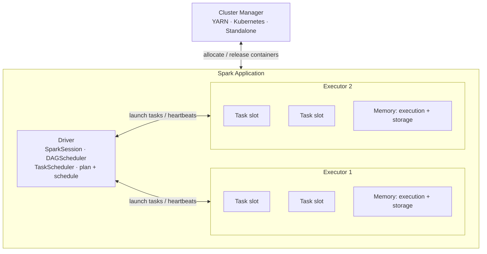
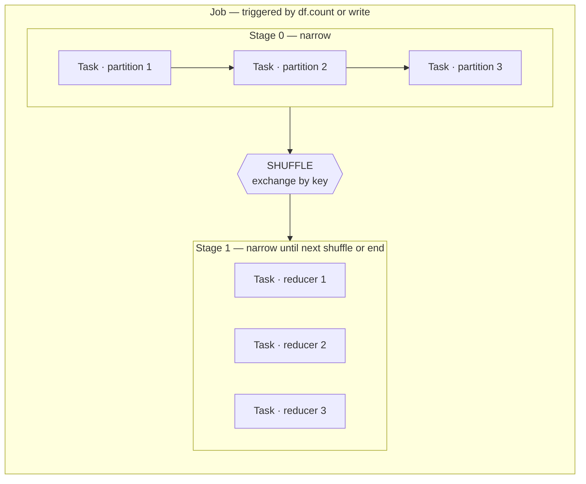
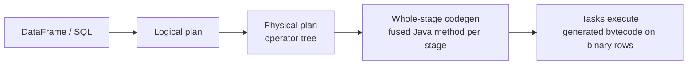
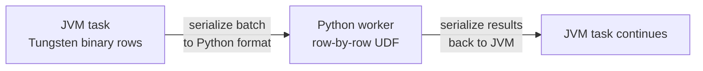
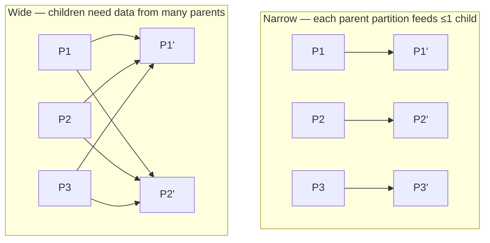
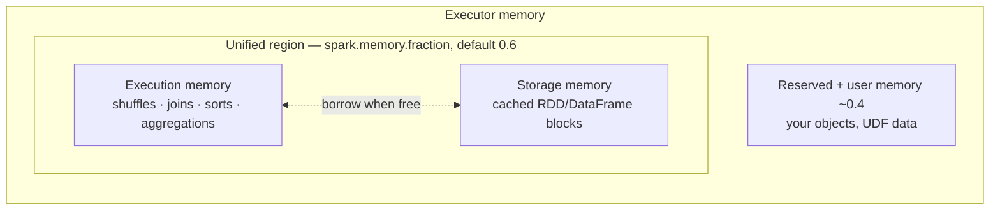
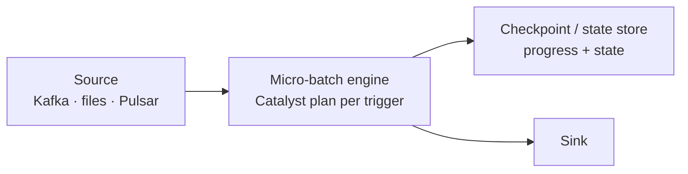

# Architecture & Execution Model

> **Why it matters** — Every Spark performance problem is an architecture problem in disguise: a shuffle that shouldn't exist, a straggler task holding 90% of the data, or an executor OOMing because execution memory starved. You can't tune what you can't diagram.

## The runtime: driver, executors, slots

A Spark application is **one driver** coordinating **N executors**. The driver builds the plan, schedules tasks, and tracks metadata. Executors run tasks in JVM threads (task slots) and hold cached data.

- **Driver** — owns the `SparkSession`. Turns your code into a DAG, splits it into stages, negotiates resources. Also collects results (`collect`, `toPandas`). If the driver dies, the application dies.
- **Executor** — a JVM process on a worker node. Runs tasks, caches blocks, writes shuffle output. Lives for the application's duration (or is reclaimed under dynamic allocation).
- **Task slot** — one executor core runs one task at a time. `executor.instances × executor.cores` = total parallelism ceiling. 10 executors × 4 cores = 40 concurrent tasks.
- **Shuffle service** — an external service (enabled via `spark.shuffle.service.enabled`) that serves shuffle files so executors can be freed between stages. Required for dynamic allocation.

::: warning ⚠️ Driver OOM
`collect()`, `toPandas()`, and broadcast variables land on the **driver's** heap. Pulling 50 GB into `collect()` doesn't distribute — it crashes the one machine that can't be retried. Use `collectAsList` equivalents or write to storage.
:::

## Cluster managers

| Manager | How it allocates | When you see it |
|---|---|---|
| **Standalone** | Spark's built-in; static worker pool | Small on-prem clusters, dev |
| **YARN** | Hadoop resource manager; `client`/`cluster` deploy modes | Legacy Hadoop shops, EMR default |
| **Kubernetes** | Executor pods; driver pod or `spark-submit` client | Modern standard; Databricks, EMR on EKS, most self-managed 2024+ |

::: info ℹ️ client vs cluster deploy mode (YARN / K8s)
`client` mode runs the driver in your submit process (fine for notebooks, dies when you close the laptop). `cluster` mode runs the driver inside the cluster — required for production and anything that must survive a disconnect.
:::

### YARN vs Kubernetes — ops trade-offs

The 2018 edition of *Spark: The Definitive Guide* lists only Standalone, Mesos, and YARN — **Spark on Kubernetes postdates it** (experimental in 2.3, GA in Spark 3.1). Current picture:

| | YARN | Kubernetes |
|---|---|---|
| Maturity | Decade+ of production; battle-tested resource queues | GA since Spark 3.1; now the common green-field default |
| Multi-tenancy / queueing | Strong — Capacity/Fair schedulers, hierarchical queues | Weaker natively — namespace quotas; add Volcano/YuniKorn for batch queueing |
| Resource shape | Fixed container sizes (memory × vcores) | Arbitrary pod shapes; sidecars; node affinity per pod |
| Elasticity | Dynamic allocation via external shuffle service | Dynamic allocation works, but pod teardown needs the shuffle service too — shuffle files live in pods |
| Image/deps | Deps shipped via `--jars`/`--files` per job | Bake Spark + deps into an image; reproducible, versioned |
| Ops burden | Piggybacks on existing Hadoop ops | You own the K8s cluster; driver pod = a Kubernetes resource you can `kubectl` |

Rule of thumb: if your org already runs Hadoop/HDFS, YARN is the boring right answer. If you're cloud-native or on object storage, K8s gives you image-level reproducibility and per-job isolation. Mesos support was removed in Spark 3.2 — treat any Mesos guidance in older books as obsolete.

## From code to tasks: jobs → stages → tasks

An **action** (`count`, `write`, `collect`) triggers a **job**. The DAGScheduler splits the job's DAG into **stages** at every shuffle boundary. Each stage is a set of **tasks** — one per partition of the final RDD in that stage.

Key rules:

- **Transformations are lazy** — `filter`, `join`, `groupBy` build a DAG; nothing runs until an action.
- **Stages are sequential** — stage N+1 cannot start until every task in stage N finished writing its shuffle output.
- **Tasks are the unit of failure and retry** — a straggler re-runs as a *speculative* or retried task; a stage with one giant partition = one giant task = the classic skew symptom.

### Whole-stage code generation — where it fits

Catalyst's optimizer produces a physical plan of operators (scan → filter → project → aggregate). Under the hood, **Tungsten's whole-stage codegen** then compiles each chain of operators *between shuffle boundaries* into a single Java method — the "volcano" iterator model's virtual-call overhead disappears, and generated code operates directly on the compact binary row format (below) instead of JVM objects.

In the Spark UI's SQL tab, a `WholeStageCodegen` box = one fused unit. Operators that can't fuse — exchanges, some Python UDFs, certain scan paths — split the codegen regions. Practical read: a stage showing several small `WholeStageCodegen` blocks instead of one big one usually means a non-fusible operator (or your UDF) is breaking the pipeline.

*(Version-dependent: codegen is on by default via `spark.sql.codegen.wholeStage`; in Spark 3.x, AQE can re-optimize plans at stage boundaries but codegen still applies per re-planned stage.)*

### API levels — what actually plans the work

| API | Optimization | When you use it |
|---|---|---|
| **RDD** (`sc.parallelize`, `.map`, `.reduceByKey`) | None — you write the physical ops | Rare today; debugging, custom partitioning, legacy code |
| **DataFrame / Dataset** | Full Catalyst + codegen | The default; everything below is free |
| **Spark SQL** | Same Catalyst engine | Same plan as DataFrame — interchangeable |

- **Structured APIs (DataFrame / Dataset / SQL)** — you declare *what* you want; Catalyst picks the physical plan. Optimizations compound: every release ships improvements you get for free.
- **RDDs (low-level)** — you write the physical operators yourself; Spark executes exactly that, no optimization pass.

The DataFrame API and SQL compile to the *same* logical plan — `df.filter(...).groupBy(...)` and the equivalent `spark.sql(...)` produce identical physical plans. Choosing between them is style, not performance. RDDs bypass Catalyst entirely: no pushdown, no codegen, no AQE. That's why "rewrite the RDD job as DataFrames" is a legitimate optimization — and why "our custom RDD pipeline is faster" claims deserve skepticism: Catalyst writes better RDD code than almost anyone writes by hand, at a fraction of the effort.

### Structured vs low-level: the decision

| Reach for... | When | Why |
|---|---|---|
| **DataFrame / SQL** | Default — ~95% of work | Catalyst optimization, codegen, pushdown, AQE, consistent across languages |
| **Dataset (Scala/Java)** | Type safety required, or business logic that won't fit expressions | Compile-time type checks, encoder converts `Row` ↔ case class |
| **RDD** | Custom partitioning control, `mapPartitions`/`pipe`, truly unstructured data | Fine-grained physical control you can't express declaratively |
| **RDD from Python** | Almost never | Python↔JVM serialization on every record — slowest, least stable option |

:::: tip 💡 Senior insight (Chambers &amp; Zaharia)
The book's canonical RDD use case is *fine-grained control over physical data distribution* — custom partitioning, `repartitionAndSortWithinPartitions`, per-partition work. If you're on an RDD because "the DataFrame version is slow," the answer is almost always fixing the SQL plan, not abandoning it. And if you must use RDDs, use them from Scala/Java: Python RDDs serialize data in and out of the Python process for every transformation.
::::

### The serialization tax: why Python UDFs cost

A Python UDF isn't "Python running your function on a row." The full path per executor:

Three separate costs stack:

1. **Process startup** — Spark forks a Python worker on the executor (one per task slot). Real but amortizable.
2. **Serialization both ways** — data must be converted out of Spark's internal binary format into a format Python can read, then results converted back. This is the dominant cost and it scales with data volume.
3. **Unmanaged memory** — once data enters the Python process, Spark can no longer account for or bound it. JVM and Python workers compete for the same RAM; Python-side blowups show as container kills, not JVM OOMs.

Mitigations, in preference order: use built-in `functions.*` (JVM-native, codegen-eligible); write the UDF in Scala/Java and call it from Python (book's recommendation — you keep PySpark ergonomics without the per-row crossing); use a **pandas/Arrow UDF** (`pandas_udf`), which vectorizes the crossing via Apache Arrow batches — the serialization cost becomes per-*batch*, not per-row, and Arrow's columnar format is near-zero-copy. *(Version-dependent: pandas UDFs exist since Spark 2.3; Arrow integration improves through 3.x — postdates the 2018 book.)*

### Dataset vs untyped: what typed APIs buy

`DataFrame` *is* `Dataset[Row]` — "Dataset" as an API means the **typed** variant, JVM-only (Scala/Java). An **Encoder** maps your case class / JavaBean to Spark's internal binary row format at runtime.

| | DataFrame (`Dataset[Row]`) | Typed `Dataset[T]` |
|---|---|---|
| Type errors surface at | Runtime | Compile time |
| Per-row cost | Stays in binary row format | Encoder converts `Row` → object → back, every row touched |
| Languages | Scala, Java, Python, R | Scala, Java only |
| Best for | Everything by default | Reused Scala-library transformations; correctness-critical boundaries |

The encoder conversion is real overhead — the book flags it as the Dataset tax — but it's JVM-internal, so it's an order of magnitude cheaper than a Python UDF. Common pattern: **DataFrames for the ETL body, Datasets at the boundaries** (per-row parsing in, typed collection out to the driver).

`SparkSession` wraps the older `SparkContext`/`SQLContext` — a session is the entry point; `spark.sparkContext` still exists underneath for RDD ops, accumulators, and broadcast variables.

## Narrow vs wide dependencies

| | Narrow | Wide |
|---|---|---|
| Examples | `map`, `filter`, `union` (same partitioner), `mapValues` | `groupByKey`, `reduceByKey`, `join` (un-partitioned), `distinct`, `sortBy` |
| Shuffle | No | **Yes** — new stage boundary |
| Fault recovery | Recompute one partition | Recompute + re-shuffle (expensive) |
| Pipelining | Fuse into one task | Blocks pipelining |

::: tip 💡 Senior insight
`reduceByKey` is narrow in cost but wide in mechanics — it shuffles, *but* it pre-aggregates on the map side first. `groupByKey` shuffles every record unreduced. Never write `groupByKey` when a `reduceByKey`/`aggregateByKey`/`agg` expresses the same thing — it's the single most common avoidable shuffle blowup.
:::

### Fault tolerance: lineage, not replication

RDDs recover by **recomputing lost partitions from the lineage** (the recorded transformation DAG), not by replicating data. Narrow losses recompute one partition cheaply; a lost partition feeding a wide dependency may force a whole ancestor stage to re-run — which is why long lineages get `checkpoint()`ed (see [Optimization](/spark/optimization)).

Two practical consequences:

- **Speculative execution** (`spark.speculation=true`) re-runs tasks that are slower than the stage median on a second executor and keeps whichever finishes first — helps stragglers, harmless for skew.
- **`spark.task.maxFailures`** (default 4) bounds per-task retries; repeated task failure at the *same* partition usually means bad data at a specific input offset, not a flaky executor.

::: details Why no replication? The cost model
Replicating every intermediate RDD across nodes would double memory and add network cost for data that's usually recomputable from raw inputs in seconds. Spark bets that lineage + retained shuffle files beat replication for batch analytics. The bet breaks for very long, branching DAGs (iterative ML, graph) — that's exactly where `checkpoint()` exists.
:::

## What a shuffle actually writes

When a stage finishes, each map task sorts its output by target partition and writes **one data file plus one index file** (the sort-based shuffle, default since Spark 2.0). The index records each partition's offset range inside the data file, so each reducer fetches only its slice from every map output — via the external shuffle service or local disk.

Consequences that matter in production:

- Shuffle files are **on local disk** — executor loss or spot-preemption forces recomputation unless the shuffle service retained them.
- `spark.sql.shuffle.partitions` (default **200**) sets the reduce-side partition count for SQL shuffles — the #1 knob for "too many tiny tasks" or "too few giant tasks" before AQE existed.
- Spill during shuffle writes disk pressure; the external shuffle service decouples read availability from executor lifetime.

::: warning ⚠️ The 200 partition default
A 2 GB shuffle with `shuffle.partitions=200` = ~10 MB partitions and 200 mostly-empty tasks. A 2 TB shuffle = ~10 GB partitions and tasks that OOM. The default is wrong at both ends — AQE's coalescing fixes the small side automatically, but you still own the large side.
:::

### Why shuffles dominate cost

A shuffle is three expensive things at once:

- **Serialization** — every record leaves the JVM object world, gets serialized, and is deserialized on the far side.
- **Network + disk** — full data movement across nodes, written to local disk on the map side and read back over the network by reducers. No shuffle ever ran in memory end-to-end.
- **A barrier** — the next stage can't start until *every* map task finished; the slowest map task sets the floor.

This is why "reduce shuffle volume" (pre-aggregate, broadcast, prune before the exchange) beats almost every other optimization: you're attacking serialization, network, and the stage barrier simultaneously.

::: info ℹ️ Fetch failure = the cascade
`FetchFailedException` — a reducer can't read a map's shuffle output (executor died, disk full, shuffle service down) — triggers a **stage retry**: the whole map stage recomputes. Chronic fetch failures usually mean executors are being killed (spot, OOM) or disk is saturated, not a code bug.
:::

## The unified memory model

Executor JVM heap is split (since Spark 1.6, refined through 3.x):

- **Execution memory** — transient buffers for shuffles, joins, sorts, aggregations. **Can evict storage** when needed.
- **Storage memory** — cached/persisted blocks. Can borrow execution space but **cannot evict execution**.
- **Spill** — when execution memory fills, Spark sorts and writes intermediate data to local disk and reads it back. Spill is normal; *spilling every task* means under-provisioned memory or skew.

### Tungsten binary rows vs JVM objects

Structured-API data inside the JVM isn't Java objects — it's Tungsten's **internal binary row format**: fixed-width fields packed directly, variable-length fields as offset+data, managed as off-heap (`sun.misc.Unsafe`) or serialized-on-heap memory. This is why DataFrames beat both RDDs of case classes and naive expectations.

| | Tungsten binary row | JVM object (RDD of case classes, Python `Row`) |
|---|---|---|
| Memory per row | ~bytes of actual fields + small header | Object header + field pointers + padding — often 2–5× the logical size |
| GC pressure | Minimal (few large managed regions) | Every row = a live object → GC churn at scale |
| Cache locality | Contiguous, cache-line friendly | Pointer-chasing across the heap |
| SerDe at shuffle | Already serialized — writes nearly verbatim | Full Java/Kryo serialization round-trip |
| Who manages it | Spark (bounded, spillable) | JVM heap — your OOM problem |

This is the mechanical reason behind the earlier rules: Python UDFs are expensive because data must *leave* this format; encoders cost because they convert it to objects; and `cache()` on a DataFrame stores compact binary blocks while `rdd.cache()` stores bloated objects. *(Book context: Tungsten shipped in 1.4–1.6; Chambers & Zaharia describe the binary format without naming it — the name comes from the Databricks project that built it.)*

| Symptom in UI | Cause |
|---|---|
| High `Spill (Memory)` | Tasks needed more execution memory than share — check skew or raise `executor.memory` |
| Tasks OOM, `Storage memory` near zero | Cache evicted everything; drop unnecessary `persist` or raise `memory.storageFraction` |
| GC time > ~10% of task time | Memory pressure — objects churning; consider Kryo or fewer/larger partitions |

## DataSource V2

DSv2 is the modern connector API (default since Spark 3 for most built-ins). It exists because DSv1 couldn't express predicate/filter pushdown, column pruning, or report partitioning cleanly.

- Enables **pushdown** of filters and projections into the scan (read less).
- Supports **partition-aware** reads and writes — the table's partitioning is visible to the planner.
- Table formats (Iceberg, Delta, Hudi) plug in via DSv2 catalogs; `spark.sql.catalog.*` registers them.

::: info ℹ️ Why you care
A DSv1 source may silently ignore `df.filter(...)` in the scan and read everything. Check `explain` for `PushedFilters` — if they're absent, your "cheap filter" reads the whole table.
:::

## The config that actually matters

Most of `spark-defaults.conf` is noise. These move the needle:

| Config | Default | Why |
|---|---|---|
| `spark.executor.memory` / `.cores` / `.instances` | — | Sizing. Roughly: enough memory for shuffle partitions + cache, cores 4–5/executor for GC balance |
| `spark.sql.shuffle.partitions` | 200 | Reduce-side task count; tune per data size |
| `spark.sql.adaptive.enabled` | true (3.2+) | AQE — leave on |
| `spark.dynamicAllocation.enabled` | false | Scale executors with load; needs shuffle service |
| `spark.serializer` | Java | Set `KryoSerializer` for perf |
| `spark.sql.files.maxPartitionBytes` | 128 MB | Read-side partition size for file scans |
| `spark.memory.fraction` / `.storageFraction` | 0.6 / 0.5 | Unified-memory split; rarely tune, know it exists |

### Executor sizing rules of thumb

- **Fat vs thin executors:** many 1-core executors waste JVM overhead; one giant executor concentrates risk and GC pauses. Sweet spot: **4–6 cores, 16–32 GB** per executor.
- `executor.memory` ≈ (shuffle buffers + cached data + overhead). Spark adds `spark.executor.memoryOverhead` (~10% or 384 MB min) on top for off-heap/Python — on K8s the pod requests the sum; under-budget it and the pod gets OOM-killed, not the task.
- **PySpark adds a Python worker per task slot** — Python data lives *outside* the JVM heap (in `memoryOverhead`), so PySpark OOMs often show as container kills, not Java OOMs.

::: info ℹ️ SparkSession is the one config surface
`SparkSession.builder.config(...)` (or `spark-defaults.conf`, `spark-submit --conf`) sets everything above. Runtime-tunable `spark.sql.*` keys can also be set per-session with `spark.conf.set` — useful for `shuffle.partitions` before a specific heavy join.
:::

## Where structured streaming fits

Structured Streaming is not a separate engine — it's **the same Catalyst/Tungsten engine run in micro-batches**. The driver plans a sequence of incremental executions over an unbounded table; each trigger fires a normal Spark job. Continuous processing exists but is deprecated-in-practice; micro-batch (and its *available-now* trigger) is the model that matters.

## 🧠 Quiz

<QuizCard :questions="[{ q: 'A job has 4 stages; stage 2 shows 199 tasks done in seconds and one task running 40 minutes. What is the most likely cause?', options: ['Broadcast join failure', 'Data skew — one shuffle partition holds a hot key', 'Driver out of memory', 'Too few executors'], correct: 1, explain: 'A single long tail task inside one stage is the canonical skew signature — the data hashed to one reduce partition dominates all others.' }, { q: 'Which transformation creates a stage boundary?', options: ['map', 'union of identically partitioned inputs', 'groupByKey', 'filter'], correct: 2, explain: 'groupByKey requires a shuffle (wide dependency). filter/map are narrow and fuse; a union over same-partitioned inputs stays narrow.' }, { q: 'In the unified memory model, which is true?', options: ['They are fixed, non-overlapping pools', 'Storage memory can evict execution memory', 'Execution memory can evict storage memory', 'Spill writes cached blocks to S3'], correct: 2, explain: 'Execution memory (shuffles/joins) takes precedence and can borrow/evict storage; storage cannot evict execution. Spill goes to local disk.' }, { q: 'What does spark.sql.shuffle.partitions control?', options: ['Read-side file split size', 'Broadcast threshold', 'Number of partitions after a shuffle in SQL/DataFrame ops', 'Executor thread count'], correct: 2, explain: 'It sets reduce-side partition count for shuffles. Read-side splits are spark.sql.files.maxPartitionBytes.' }, { q: 'Why prefer cluster deploy mode for production?', options: ['The driver runs inside the cluster and survives client disconnects', 'It is faster', 'It enables AQE', 'It disables the shuffle service'], correct: 0, explain: 'In client mode the driver lives in your submit process — close the laptop, lose the job. Cluster mode keeps the driver with the executors.' }, { q: 'A cached DataFrame keeps getting evicted and recomputed. What is happening?', options: ['GC is too slow', 'The shuffle service is down', 'Kryo is not registered', 'Execution memory is evicting storage blocks under shuffle pressure'], correct: 3, explain: 'Execution memory has priority — heavy shuffle/join pressure can evict cached blocks, forcing recompute on next use.' }]" />

<QuizCard :questions="[{ q: 'A PySpark job is 10x slower than the equivalent Scala job, and the executor logs show heavy serialization between JVM and a Python process. What is the dominant fix?', options: ['Switch to cluster deploy mode', 'Enable Kryo serialization', 'Increase executor memory', 'Replace the row-by-row Python UDF with built-in functions, a Scala UDF, or a pandas Arrow UDF'], correct: 3, explain: 'Every record must be serialized out of the JVM binary row format into Python and back. Built-in functions stay in codegen; Arrow batching turns the per-row crossing into a per-batch one.' }, { q: 'Why does a Spark UI stage show a WholeStageCodegen box?', options: ['The stage failed and was retried', 'The data is stored as JVM objects', 'Catalyst fused the operator chain between shuffle boundaries into one generated Java method', 'The stage was compiled by AQE'], correct: 2, explain: 'Whole-stage codegen compiles all fusible operators in a stage into a single method operating on compact binary rows, eliminating per-operator virtual-call overhead. Non-fusible ops split it into multiple boxes.' }, { q: 'Your org is cloud-native on object storage and wants per-job dependency isolation and reproducible images. Which cluster manager fits?', options: ['Kubernetes', 'Mesos', 'YARN', 'Standalone'], correct: 0, explain: 'K8s lets you bake Spark plus dependencies into a versioned image per job. YARN fits Hadoop shops; Mesos support was removed in Spark 3.2.' }]" />

## Further reading

- [Spark Cluster Mode Overview — official docs](https://spark.apache.org/docs/latest/cluster-overview.html)
- [Spark Configuration — official docs](https://spark.apache.org/docs/latest/configuration.html)
- [Spark SQL Performance Tuning — official docs](https://spark.apache.org/docs/latest/sql-performance-tuning.html)
- [Project Tungsten: Bringing Spark Closer to Bare Metal — Databricks](https://www.databricks.com/blog/2015/04/28/project-tungsten-bringing-spark-closer-to-bare-metal.html)
- [Apache Spark Internals — Jacek Laskowski](https://japila.pl/apache-spark-internals/)
- *Spark: The Definitive Guide* — Bill Chambers & Matei Zaharia (2018), [O'Reilly](https://www.oreilly.com/library/view/spark-the-definitive/9781491912201/)
- *Learning Spark, 2nd Edition* — Damji, Wenig, Das, Lee (O'Reilly) — [free PDF from Databricks](https://pages.databricks.com/rs/094-YMS-629/images/LearningSpark2.0.pdf)
