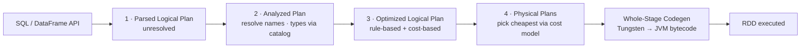
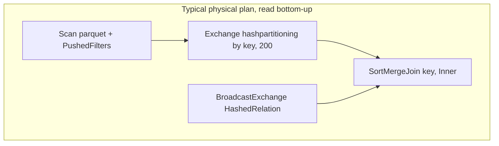
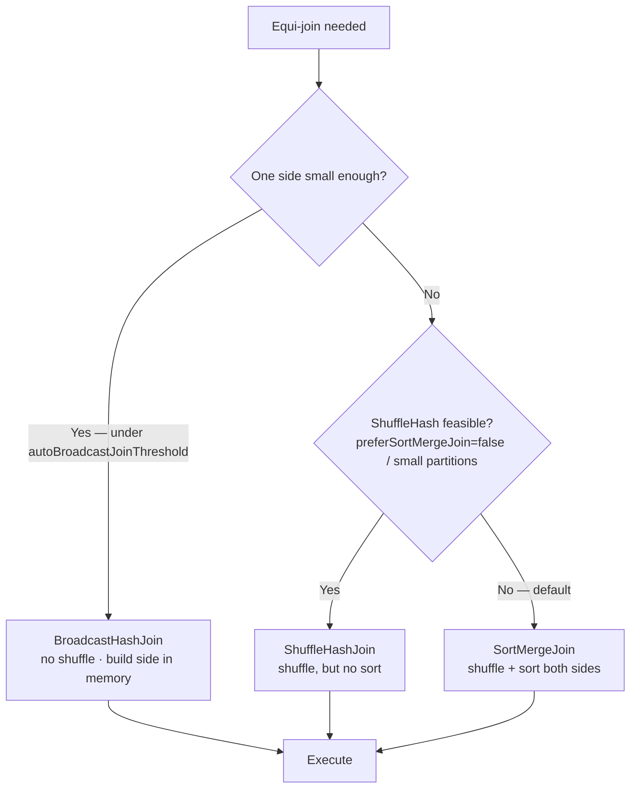
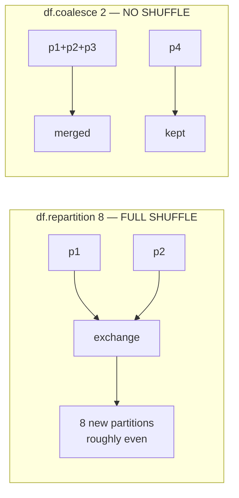
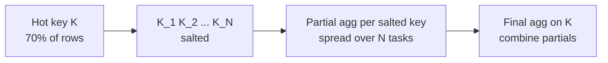
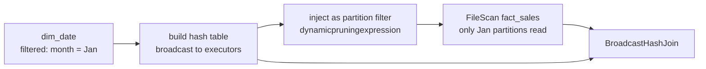

# Catalyst, Shuffle & Joins

> **Why it matters** — Spark SQL is not executed the way you wrote it. Catalyst rewrites your logical plan through rule-based and cost-based passes before a single task runs. Reading `explain(True)` is how you find out what actually executes — which is the difference between guessing and diagnosing.

## The Catalyst pipeline

Every DataFrame/SQL query flows through four phases. The output is generated bytecode — not interpreted row loops.



### What each phase does

| Phase | Rules you will see in `explain` | Interview framing |
|---|---|---|
| **Parse** | `UnresolvedRelation`, `UnresolvedAttribute` | ANTLR parses text → tree of unresolved nodes |
| **Analysis** | resolves against catalog | Table names, column names, types bound; fail here = `AnalysisException` |
| **Logical optimization** | `PushDownPredicates`, `ColumnPruning`, `ConstantFolding`, `CollapseProject`, `CombineFilters` | ~80 deterministic rules, then CBO if stats exist |
| **Physical planning** | `BroadcastHashJoin` vs `SortMergeJoin`, `HashAggregate` vs `SortAggregate` | Generates candidates, picks by cost model |
| **Codegen** | `*(N)` in plan = whole-stage codegen | Fuses operators into one generated method per stage |

### The optimizations that matter most

- **Predicate pushdown** — `WHERE` clauses pushed into the scan (`PushedFilters` in DSv2, partition pruning for partitioned tables). Filters read less, not just process less.
- **Column pruning** — unused columns dropped at the earliest possible node. `SELECT a, b` from a 200-column Parquet table reads only `a` and `b`.
- **Constant folding** — `lit(1) + 2` evaluated once at plan time, not per row.
- **CBO (cost-based optimization)** — with `ANALYZE TABLE ... COMPUTE STATISTICS`, Catalyst picks join order and broadcast vs sort-merge by real sizes, not defaults.

::: tip 💡 Senior insight
Pushdown only works if the filter is *expressible* to the source. `filter(col("x") === 5)` pushes; a Python UDF wrapping the same logic doesn't — Spark sees an opaque function and reads everything. Keep filters in DataFrame ops, not lambdas, wherever possible.
:::

### Worked example — one query through the pipeline

```sql
SELECT region, SUM(amount) FROM orders WHERE dt = '2024-01-01' GROUP BY region
```

1. **Parsed** — `UnresolvedRelation orders`, `UnresolvedAttribute region/amount/dt`.
2. **Analyzed** — catalog binds `orders` to a Parquet table; types resolve; `dt` known as partition column.
3. **Optimized** — filter pushed into the scan (partition pruning: only `dt=2024-01-01` dirs read); only `region, amount` columns survive pruning; aggregation rewritten as partial-sum + final-sum.
4. **Physical** — `FileScan parquet` → `HashAggregate partial_sum` → `Exchange hashpartitioning(region)` → `HashAggregate final_sum`. One shuffle, unavoidable and correct.

Notice what *didn't* need to happen: no broadcast debate (no join), no sort (hash aggregate), minimal scan (pruning). This is the shape of a healthy aggregation plan.


## Reading `explain(True)`

`df.explain(True)` prints all four plans. You mainly read the **physical plan** (bottom). Key nodes:



| Physical node | Meaning | Red flag |
|---|---|---|
| `Exchange hashpartitioning` | A shuffle — repartition by key | Extra `Exchange` you didn't ask for |
| `BroadcastExchange` | Build side copied to all executors | Broadcasting something > `autoBroadcastJoinThreshold` accidentally |
| `SortMergeJoin` | Default big-big join; sort both sides | On huge skew, one side's hot key serializes |
| `BroadcastHashJoin` / `BroadcastNestedLoopJoin` | Small side in memory, no shuffle | NestedLoop without equi-key = Cartesian risk |
| `HashAggregate` | In-memory aggregation | `ObjectHashAggregate` + spill = high-cardinality aggregation |
| `Scan` + `PushedFilters` | What the source actually filtered | Missing `PushedFilters` = full scan |

::: warning ⚠️ The `InMemoryTableScan` trap
If your plan shows `InMemoryTableScan` you didn't expect, something is `cache()`d upstream — possibly a leftover from development holding stale data. Conversely, a missing one means your "cached" DataFrame was never persisted or was evicted.
:::

## Reading `explain(FORMATTED)` — the node-by-node workflow

Spark 3 adds explain modes: `df.explain(mode)` accepts `"simple"` (default, physical plan only), `"extended"` (all four plans, same as `explain(True)`), `"cost"` (plans plus CBO statistics), `"codegen"` (generated code), and `"formatted"` — the cleanest for diagnosing a single node. In SQL it's `EXPLAIN FORMATTED SELECT ...`.

The formatted output splits into two parts: a compact tree where each node gets a number, then a detail block per node:

```
== Physical Plan ==
* Project (3)
+- * Filter (2)
   +- Scan text (1)

(1) Scan text
Output [1]: [value#72]
PushedFilters: [IsNotNull(value), StringContains(value,Spark)]
ReadSchema: struct<value:string>

(2) Filter [codegen id : 1]
Input [1]: [value#72]
Condition : (isnotnull(value#72) AND Contains(value#72, Spark))

(3) Project [codegen id : 1]
Output [1]: [value#72]
Input [1]: [value#72]
```

How to read it, top-down:

1. **Match the tree number to the detail block.** Node `(2)` is the filter — its `Condition` shows the *full* predicate expression Spark evaluates.
2. **Check `PushedFilters` on the scan.** Here `StringContains(value,Spark)` was pushed into the file source — the filter node still appears (it re-checks pushed predicates defensively), but the heavy lifting happened at read.
3. **Note `codegen id`.** Nodes sharing an id are fused into one whole-stage codegen method — one `for` loop over rows, no per-operator function calls.
4. **`Input` vs `Output`:** a node that outputs fewer/different columns than its input is where pruning happened (or failed to).

::: tip 💡 Senior insight
Use `"simple"` for a fast smell-check, `"extended"` when you suspect a logical-optimization misfire (e.g., a filter that should have been pushed but shows up unresolved in the optimized plan), `"formatted"` when explaining a specific scan/join to a colleague — and `"cost"` to confirm Catalyst actually sees your `ANALYZE TABLE` statistics (look for `Statistics(sizeInBytes=...)` per node).
:::

## Join strategies — the decision ladder

Catalyst picks a physical join by size and statistics. The cost ladder:



| Strategy | Shuffle? | Sort? | When it wins | Failure mode |
|---|---|---|---|---|
| **Broadcast hash** | No | No | One side fits in memory (`spark.sql.autoBroadcastJoinThreshold`, default 10 MB) | Build side too big → driver/executor OOM |
| **Shuffle hash** | Yes | No | Smaller partitions fit memory; `preferSortMergeJoin=false` | Rarely chosen; memory-heavy on skew |
| **Sort-merge** | Yes | Yes | Big-big joins, skewed or not — the default | Sort + spill cost; hot key = one huge task |
| **Nested loop / Cartesian** | No | No | Non-equi joins only | O(N×M); never for big data |

### Skew inside joins

With `spark.sql.adaptive.skewJoin.enabled` (on by default), AQE splits a hot sort-merge partition at runtime. Without it, your levers are **salting** (below), **broadcasting** the small side, or **isolating** the hot key into its own union.

### Which side is the build side

For `a.join(b, "key")`, Spark can broadcast **either** side — the smaller estimated one becomes the build (hash table), the larger is streamed/probed. A broadcast hint like `a.join(broadcast(b))` is safe only when `b` is genuinely small *after its own filters and projections*, not just on disk. Check `explain` — the `BroadcastExchange` node sits under whichever side is built.

::: details Join ordering under CBO
With statistics (`ANALYZE TABLE t COMPUTE STATISTICS FOR ALL COLUMNS` or Databricks auto-stats), Catalyst can reorder multi-way joins to put the cheapest reductions first — joining `fact ⋈ dim1 ⋈ dim2` in an order that shrinks intermediate sizes. Without stats it joins left-to-right as written, so explicit ordering (`fact.join(dims, ...)` smallest-first) is the manual version of the same idea. Stats staleness is a real failure mode: a table that grew 10× since `ANALYZE` silently degrades join order.
:::

### Join strategy hints — syntax and effect

Spark 3 extends hints beyond `broadcast()` to every supported join strategy, via SQL `/*+ ... */` comment blocks or the DataFrame `.hint()` API:

| Hint | Syntax | Effect |
|---|---|---|
| Broadcast | `/*+ BROADCAST(a) */` / `a.hint("broadcast")` | Force `BroadcastHashJoin` with `a` as build side — overrides `autoBroadcastJoinThreshold` |
| Sort-merge | `/*+ MERGE(a, b) */` | Force `SortMergeJoin` — e.g., avoid an unwanted broadcast of a "medium" table |
| Shuffle hash | `/*+ SHUFFLE_HASH(a, b) */` | Force `ShuffleHashJoin` — shuffle but skip the sort; useful when partitions are small enough to build hash maps |
| Shuffle-replicate NL | `/*+ SHUFFLE_REPLICATE_NL(a, b) */` | Force shuffle-and-replicate nested loop — niche; for non-equi joins where you *want* the replicated behavior |

```sql
SELECT /*+ MERGE(fact, dim) */ * FROM fact JOIN dim ON fact.k = dim.k
SELECT /*+ BROADCAST(dim) */   * FROM fact JOIN dim ON fact.k = dim.k
```

::: warning ⚠️ Hints are instructions, not suggestions
Catalyst honors a join hint even when it's wrong — `BROADCAST` on a 5 GB "dimension" produces an executor OOM, not a smarter plan. Hints also mask staleness: a `MERGE` hint keeps forcing sort-merge long after the table shrank below broadcast size, and it can *block* AQE from switching strategies at runtime. Verify with `explain` after hinting, and prefer raising/lowering `autoBroadcastJoinThreshold` over hard hints when the intent is "broadcast the small side."
:::

### Inside `Exchange`: how a key finds its partition

Every shuffle in the plan is an `Exchange` with a partitioning scheme:

- **`hashpartitioning(exprs, N)`** — `hash(key) % N` picks the reduce partition. Same hash on both join sides = co-partitioned, no data needs to move beyond that.
- **`rangepartitioning`** — ordered distribution for `sortBy`/`orderBy`; samples the data to draw split boundaries (sampling errors → uneven partitions).
- **`SinglePartition`** — everything to one reducer (global `orderBy` limit, `coalesce(1)`). In a plan, this is a red flag worth reading twice.

### Sorting and `repartitionByRange`

- `orderBy`/`sort` — **global** sort: samples keys, builds range boundaries, shuffles into `rangepartitioning`, then `SinglePartition` merges for a true total order. Two shuffles worth of cost; unavoidable when you need it, wasteful when you don't.
- `sortWithinPartitions` — sorts *inside* each partition only. Cheap (no shuffle), correct for partitioned writers and per-partition ordering needs.
- `repartitionByRange(col)` — range-partitions without a final global merge: use when downstream wants roughly-ordered, evenly-sized partitions (e.g., writing sorted files for later pruning).

## Controlling partitioning

### `repartition` vs `coalesce`



| | `repartition(n)` | `coalesce(n)` |
|---|---|---|
| Shuffle | Yes — full | No — merges existing partitions |
| Result size | Roughly even | Can be uneven (merges, doesn't rebalance) |
| Direction | Up or down | **Down only** (can't add partitions without shuffle) |
| Use | Even out before join/agg; increase parallelism | Reduce partition count cheaply before write |

::: warning ⚠️ coalesce before a heavy stage
`coalesce` doesn't shuffle, so the merged partitions keep their skew. Coalescing 200 → 2 then running a heavy aggregation gives you **2 tasks** doing all the work while the cluster idles. If downstream needs parallelism, `repartition` (pay the shuffle) or `repartitionByRange`.
:::

### Salting for skew

When a few keys dominate, a direct `groupBy("key")` sends them all to one partition. Salting spreads them:

1. Add a random salt: `key_salted = concat(key, '_', floor(rand() * N))`
2. Aggregate on `key_salted` → partial sums spread across N partitions
3. Aggregate again on the original `key` to combine the partials



Worked example — a `groupBy` where `customer_id = -1` (the "guest" sentinel) holds 60% of rows:

```python
SALT = 32
salted = df.withColumn("cid_s", concat_ws("_", col("customer_id"), floor(rand() * SALT)))
partials = salted.groupBy("cid_s").agg(sum("amount").alias("s"))
# cid_s encodes customer_id — strip the suffix for the final combine
final = (
    partials.withColumn("customer_id", split(col("cid_s"), "_")[0].cast("long"))
            .groupBy("customer_id").agg(sum("s").alias("total"))
)
```

For a skewed **join**, salt the large side and *replicate* the small side per salt value (`explode` an array of `0..N-1` on the small side's join key) so the hot key's rows still find their match — plain salting alone breaks the join match.

::: details When salting is worth it
Salt only when the hot key is real and measured (UI shows one task with 10–100× the shuffle read of others). Salting adds a second aggregation round-trip; for mild skew it's net slower. AQE's `skewJoin` already handles skew *in joins* — salting is mainly for skewed **aggregations** and cases where AQE can't split (e.g., a groupBy on a key that's hot *after* join).
:::

### Bucketing and partition columns

- **Partition column** (`partitionBy`) — a physical directory layout (`/dt=2024-01/region=us/`). Great for *scan pruning* (skip whole folders); bad for join locality — partitioning doesn't avoid join shuffles by itself.
- **Bucketing** (`bucketBy(n, col)`) — pre-shuffles rows into `n` fixed buckets hashed on a column. Two tables bucketed on the join key can **skip the exchange entirely** (a "bucketed join") — powerful but rigid: bucket count is baked at write time, and it only pays off for frequently-joined large tables.

| | Partition by | Bucket by |
|---|---|---|
| Avoids | Scanning irrelevant dirs | The join shuffle |
| Granularity | Directory per value | Fixed `n` hash buckets |
| High-cardinality col | Bad — small files | Fine |
| Change after write | Re-partition dirs | Fixed; rewrite to change |

## Dynamic partition pruning — the star-schema superpower

**DPP** (Spark 3, on by default) pushes a runtime filter from the small side of a join into the *scan* of the partitioned side — so a dimension filter prunes fact-table partitions it never names directly.



Mechanics (classic `fact ⋈ dim` star query):

1. Spark builds the broadcast hash table on the dimension side **with its filters applied**.
2. That result is wrapped in a broadcast variable and shipped to every executor.
3. The join-key values inside it are injected into the fact table's file scan as a `dynamicpruningexpression` on the partition column.
4. Only fact partitions whose partition key survives the probe get read — the pruning happens *at file-open time*, not row time.

You'll see it in the plan as `dynamicpruningexpression(cast(dt#X as string) IN dynamicpruning#Y)` on the fact `FileScan`, with a `SubqueryBroadcast` node on the dim side feeding it.

| DPP fires when… | DPP does NOT fire when… |
|---|---|
| Fact side is **partitioned on the join key** | Join key isn't a partition column — nothing to prune |
| Dim side is small enough to **broadcast** | Both sides are large → sort-merge, no broadcast variable to reuse |
| Filter lives on the dim side (`dim.flag = 1`) | Filter is only on the fact side (that's ordinary static pruning) |
| `spark.sql.optimizer.dynamicPartitionPruning.enabled = true` (default) | DSv1/DSv2 source can't express the dynamic filter pushdown |

::: tip 💡 Senior insight
The design implication: **partition your fact table by the column it most often joins on** (`dt`, `region`, `store_id`), not just the column you filter by. A fact partitioned by `load_ts` but joined on `event_date` gets zero DPP benefit — every star query still scans all partitions. This is also why DPP pairs with broadcast: the broadcast result *is* the pruning list, so the optimization is free whenever the join would have broadcast anyway.
:::

## AQE — adaptive execution in Spark 3.x

AQE re-optimizes the plan at **materialization points** — every shuffle/broadcast exchange is a barrier where real statistics (bytes, rows, partition sizes) become known. The loop per stage:

1. Execute leaf stages (scans) up to the next exchange.
2. On materialization, update the logical plan with real stats.
3. Re-run Catalyst: coalesce small shuffle partitions, flip `SortMergeJoin` → `BroadcastHashJoin` if a side shrank, split skewed partitions.
4. Repeat until all stages complete.

### Skew join split mechanics

With `spark.sql.adaptive.skewJoin.enabled` (default true), AQE inspects finished map-side shuffle partitions at the exchange. A partition qualifies as skewed when its size exceeds both `skewedPartitionFactor` × the **median** partition size and the absolute `skewedPartitionThresholdInBytes`. AQE then splits the hot partition's shuffle output at the reducer side into several sub-partitions (a `CustomShuffleReader` serves them), and **replicates** the matching build-side data to each new task — so the join still matches every row while N tasks share the hot key's work instead of one.

| Config key | Default | Controls |
|---|---|---|
| `spark.sql.adaptive.enabled` | true (3.2+) | Master switch for AQE |
| `spark.sql.adaptive.coalescePartitions.enabled` | true | Merge tiny post-shuffle partitions into ~advisory-size chunks |
| `spark.sql.adaptive.advisoryPartitionSizeInBytes` | 64 MB | Target partition size when coalescing / initial partition sizing |
| `spark.sql.adaptive.skewJoin.enabled` | true | Runtime skewed-partition splitting in SMJ/SHJ |
| `spark.sql.adaptive.skewJoin.skewedPartitionFactor` | 5 | Skew = bigger than factor × median partition |
| `spark.sql.adaptive.skewJoin.skewedPartitionThresholdInBytes` | 256 MB | …and bigger than this absolute floor (both conditions required) |
| `spark.sql.adaptive.localShuffleReader.enabled` | true | Skip shuffle when the exchange is already co-located |

::: warning ⚠️ AQE fixes joins, not aggregations
The skew split works on **join** partitions (it can replicate the build side). A skewed `groupBy` key has no partner to replicate — AQE can't help; that's what salting is for. Also, `autoBroadcastJoinThreshold = -1` (a common "disable broadcast" hack) disables AQE's SMJ→BHJ conversion entirely — set it to a real size instead.
:::

## Adaptive vs static plans

Before Spark 3, the physical plan was fixed at planning time from estimates. **AQE** re-plans at stage boundaries using *real* shuffle statistics:

- If a "big" table turns out small after filters → AQE switches `SortMergeJoin` → `BroadcastHashJoin` mid-flight.
- If one partition is huge → splits it for skew handling.
- If 200 reduce partitions mostly carry nothing → coalesces to a handful.

Static planning is now the fallback; AQE is the production reality on Spark 3.2+ (and required for most modern skew mitigation). See the [Optimization](/spark/optimization) chapter for the config keys and the full playbook.

### Reading an adaptive plan

`explain(True)` on an adaptive query shows the initial plan plus `AdaptiveSparkPlan` wrappers; in the UI/SQL tab you can toggle to see the **final** plan after re-optimization (`isFinalPlan=true`). If a node you expected (a broadcast, a coalesced exchange) is missing from the static text, check the rendered physical plan in the UI — AQE may have already changed it. When comparing two runs' performance, always compare final plans, not the initial text.

::: info ℹ️ When the plan looks "worse" but runs faster
AQE can produce plans that look heavier (an extra `CustomShuffleReader`, a `CoalescedShuffleReader`) — these are the *fix* nodes. `CustomShuffleReader` is AQE's coalescing/skew-split reader wrapped around a normal exchange; seeing it means runtime stats reshaped your shuffle.
:::

## Plan anti-patterns

| In the plan | Smell | Fix |
|---|---|---|
| Back-to-back `Exchange` nodes | Double shuffle from redundant `repartition`/`distinct`/`groupBy` | Remove the redundant op; one shuffle serves both |
| `BroadcastNestedLoopJoin` on big data | Non-equi condition degraded the join | Rewrite as equi-join if possible; else accept and bound sizes |
| `CartesianProduct` | `crossJoin` or join with no condition | Almost never intended on big data |
| `Scan` reading whole table, filter after | Pushdown failed | Express filter in pushable form / fix stats |
| `Sort` operators nested under other sorts | Repeated `orderBy` in chained transforms | Keep one final sort |

::: warning ⚠️ `.distinct()` after a wide join
`distinct` adds its own shuffle on top of the join's. If the duplicates came from a fan-out (join on non-unique key), fix the join key or pre-dedupe the small side — cheaper than a second full shuffle.
:::

## 🧠 Quiz

<QuizCard :questions="[{ q: 'In explain(True), you see PushedFilters is empty on a Parquet scan with a WHERE clause. Most likely cause?', options: ['AQE removed it', 'The filter uses a UDF or non-pushable expression, so Spark reads everything', 'Catalyst is disabled', 'The table is too small'], correct: 1, explain: 'Opaque expressions (UDFs, some casts) cannot be pushed to the source — the scan reads all rows and filters after.' }, { q: 'When does Catalyst choose BroadcastHashJoin?', options: ['Only when both sides are small', 'Never — it requires a hint', 'Always for equi-joins', 'When the build side is under spark.sql.autoBroadcastJoinThreshold (default ~10 MB) or hinted'], correct: 3, explain: 'Catalyst broadcasts when the estimated size of one side fits the threshold (or a broadcast hint forces it).' }, { q: 'repartition(200) vs coalesce(200): which can increase partition count, and why?', options: ['coalesce — it rebalances', 'Both can', 'repartition — it shuffles; coalesce can only merge existing partitions down', 'Neither'], correct: 2, explain: 'coalesce avoids a shuffle by merging, so it can only reduce. repartition does a full exchange and can go up or down.' }, { q: 'A groupBy on a key where 70% of rows share one value is slow even with many partitions. Best fix?', options: ['cache the input', 'Increase shuffle.partitions', 'Salting — spread the hot key across N salted keys, partial-agg, then final-agg', 'Use coalesce'], correct: 2, explain: 'Adding partitions does not help — the hot key still hashes to one partition. Salting splits it across tasks.' }, { q: 'What does the star notation *(2) mean in a physical plan?', options: ['Operators fused into one whole-stage-codegen generated function', 'Two partitions', 'Stage 2 has 2 tasks', 'A broadcast variable'], correct: 0, explain: '*(N) marks a whole-stage codegen region — adjacent operators compiled into a single JVM method, no per-row virtual calls.' }, { q: 'Two tables are frequently joined on user_id and both are bucketed on user_id with the same bucket count. What does this enable?', options: ['Predicate pushdown', 'AQE skew split', 'Broadcast joins', 'Skipping the shuffle — a bucketed sort-merge join with no Exchange'], correct: 3, explain: 'Matching bucketing lets the join read co-located partitions directly — the Exchange disappears from the plan.' }]" />

<QuizCard :questions="[{ q: 'A partition is treated as skewed by AQE when its size exceeds?', options: ['Any partition over 1 GB', 'The largest partition, always', 'Only spark.sql.adaptive.skewJoin.skewedPartitionThresholdInBytes', 'skewedPartitionFactor times the median partition size AND the threshold in bytes'], correct: 3, explain: 'Both conditions must hold: bigger than 5x the median partition (default factor) and bigger than the 256 MB absolute floor.' }, { q: 'Dynamic partition pruning requires which combination?', options: ['Two partitioned tables and sort-merge join', 'Any join plus a WHERE clause', 'ANALYZE TABLE statistics on both sides', 'Fact partitioned on the join key plus a broadcastable dimension side'], correct: 3, explain: 'DPP injects the broadcast build result as a partition filter into the fact scan — no partition column or no broadcast means nothing to inject.' }, { q: 'In explain(mode=&quot;formatted&quot;) output, what does [codegen id : 1] on two nodes mean?', options: ['They share a shuffle', 'They run in the same Spark stage id', 'They are fused into one whole-stage codegen method', 'They were optimized by the same Catalyst rule'], correct: 2, explain: 'A shared codegen id means whole-stage code generation collapsed those operators into a single generated function — no virtual calls between them.' }]" />

## Further reading

- *Learning Spark: Lightning-Fast Data Analytics* (2nd ed.) — Damji, Wenig, Das & Lee (O'Reilly, 2020) — [oreilly.com](https://www.oreilly.com/library/view/learning-spark-2nd/9781492050032/)
- [Spark SQL Performance Tuning — official docs](https://spark.apache.org/docs/latest/sql-performance-tuning.html)
- [Deep Dive into Spark SQL's Catalyst Optimizer — Databricks](https://www.databricks.com/blog/2015/04/13/deep-dive-into-spark-sqls-catalyst-optimizer.html)
- [Apache Spark as a Compiler: Joining a Billion Rows per Second on a Laptop — Databricks](https://www.databricks.com/blog/2016/05/23/apache-spark-as-a-compiler-joining-a-billion-rows-per-second-on-a-laptop.html)
- [Mastering Spark SQL — Jacek Laskowski](https://japila.pl/mastering-spark-sql/)
- *Spark: The Definitive Guide* — Chambers & Zaharia (O'Reilly) — [companion repo](https://github.com/databricks/Spark-The-Definitive-Guide)
- [Adaptive Query Execution — Databricks docs](https://docs.databricks.com/en/optimizations/aqe.html)
