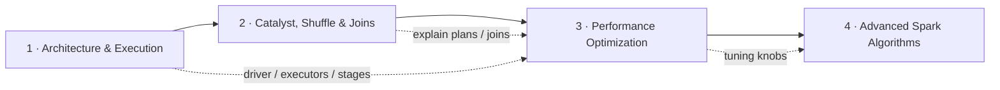
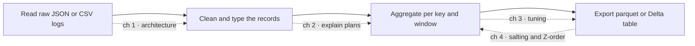

# Spark Deep Dive

> **Why it matters** — Spark is still the default distributed compute engine for lakehouses, ETL fleets, and ML feature pipelines. The difference between a job that costs $3 and one that costs $300 is rarely the code — it's whether the author understands shuffles, join strategies, and what the optimizer actually did.

## Who this track is for

Engineers who can already write a Spark job but can't yet answer *why it was slow*. The target reader has run PySpark or Spark SQL in production, has stared at the Spark UI without knowing which numbers matter, and wants to reach the level where a slow stage is diagnosed in minutes, not days.

## Track map

| Chapter | You will be able to |
|---|---|
| [Architecture & Execution](/spark/architecture) | Diagram a Spark app (driver, executors, slots), explain jobs→stages→tasks, narrow vs wide deps, unified memory, DSv2, and the configs that actually matter. |
| [Catalyst, Shuffle & Joins](/spark/execution) | Trace a query through Catalyst, read `explain(True)`, choose the right join strategy, and control partitioning (repartition, coalesce, salting, bucketing). |
| [Performance Optimization](/spark/optimization) | Read the Spark UI like a profiler, apply the skew playbook, use AQE config keys, pick storage levels, kill small files, and work a tuning checklist ordered by impact. |
| [Advanced Spark Algorithms](/spark/advanced-algorithms) | Do the salting math for a hot key, control lineage in iterative algorithms (PageRank, connected components), explain the join cost model, use Z-order/bucketing for file pruning, and reason about Tungsten whole-stage codegen and CBO statistics. |

## Pareto focus — what actually matters

- **Shuffles are the price of everything.** Wide dependencies create stages, stages serialize work, and every slow Spark job is a shuffle story.
- **Join strategy is a decision, not a detail.** Broadcast → shuffle-hash → sort-merge is a cost ladder; knowing when Catalyst picks wrong (and how to hint it) is the single highest-leverage skill.
- **Data skew is the #1 production failure mode.** One hot key = one 40-minute task while 199 executors idle. Salting, broadcasting, and isolating are the fixes; AQE's skew-split is the safety net.
- **AQE changes the mental model.** Since Spark 3, plans are re-optimized at runtime from real statistics — coalescing partitions, switching join strategies, splitting skew. Know what it fixes and what it can't.
- **Memory is unified but not free.** Execution vs storage memory, spill to disk, and the difference between `cache()`, `persist()`, and `checkpoint()` decide whether a job finishes or OOMs.
- **`repartition` ≠ `coalesce`.** One shuffles, one doesn't — and picking wrong either adds a full shuffle or creates 200 tiny files.
- **The Spark UI is the profiler.** Stage time, shuffle read/write, spill, GC, and task time distribution tell you the failure class before you touch code.

## Suggested path

1. Read [Architecture & Execution](/spark/architecture) until you can draw the runtime without notes.
2. Read [Catalyst, Shuffle & Joins](/spark/execution) until `explain(True)` output stops looking like noise.
3. Read [Performance Optimization](/spark/optimization) with a slow job of yours open in the Spark UI.
4. Read [Advanced Spark Algorithms](/spark/advanced-algorithms) when you want the *why* underneath the knobs — salting, iterative lineage, codegen, Z-order.

Every chapter ends with a quiz calibrated to what senior interviews actually ask.

## Build one project end-to-end (the best way to learn Spark)

*Spark in Action* is organized around a simple arc — ingest → transform → aggregate → export — and the fastest way to internalize this track is to run one small pipeline through every chapter. Pick a public dataset you can hold in your head: web-server access logs, GHCN weather CSVs, or GitHub events JSON.

| Project step | Do this | Chapter to read first |
|---|---|---|
| Ingest | `spark.read.json(...)` / `.csv(...)` on raw logs; inspect the inferred schema, then supply your own | [Architecture & Execution](/spark/architecture) — know what the driver and executors just did |
| Clean | Filter, cast timestamps, dedupe; chain transformations and notice nothing runs yet | [Catalyst, Shuffle & Joins](/spark/execution) — laziness is a feature; read `explain(True)` on your chain |
| Aggregate | `groupBy` a key, count per window, join to a small dimension table | [Catalyst, Shuffle & Joins](/spark/execution) — the shuffle you just triggered; [Performance Optimization](/spark/optimization) for the Spark UI read |
| Export | Write partitioned parquet; check file sizes on disk | [Performance Optimization](/spark/optimization) — `repartition` vs `coalesce`, small-file problem |
| Stretch goal | Salt a hot key, Z-order the output, cache an iterative step | [Advanced Spark Algorithms](/spark/advanced-algorithms) |

::: warning Common beginner traps from the book
- **`collect()` on big data** — it pulls everything to the driver; use it for a handful of rows (`show()`, `take(n)`) and let executors do the work.
- **Driving everything through one dataframe** — chaining fifty transformations on one `df` builds a giant logical plan nobody can debug; materialize intermediate results with names you can find in the UI.
- **Never running `explain()`** — the physical plan is the cheapest diagnostic you have; if you can't read it, you can't tune the job.
- **`local[*]` habits in prod** — `local` mode is for learning; hardcoding the master (or defaults sized for your laptop) into a deployed app is how jobs silently run on one core.
- **Expecting Spark to "just work" like a database** — Spark does lazy, distributed computation, not magic; a transformation you don't understand becomes a stage you can't explain.
:::

## Further reading

- **Spark in Action, Second Edition** — Jean-Georges Perrin (2020), [Manning](https://www.manning.com/books/spark-in-action-second-edition)
