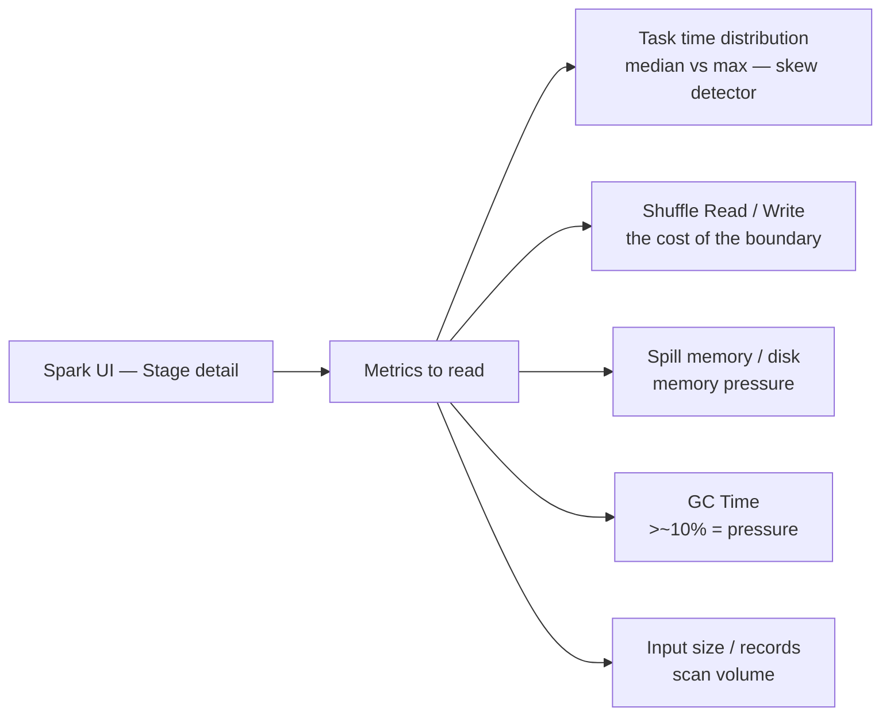
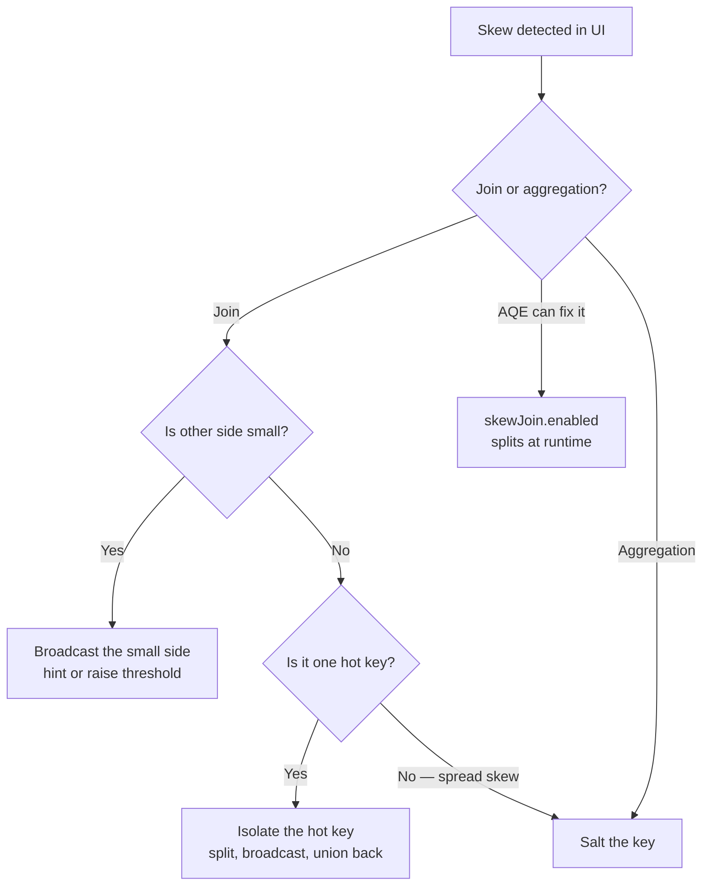
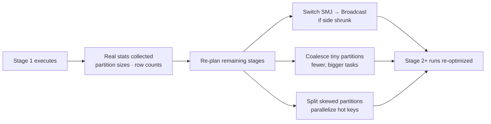
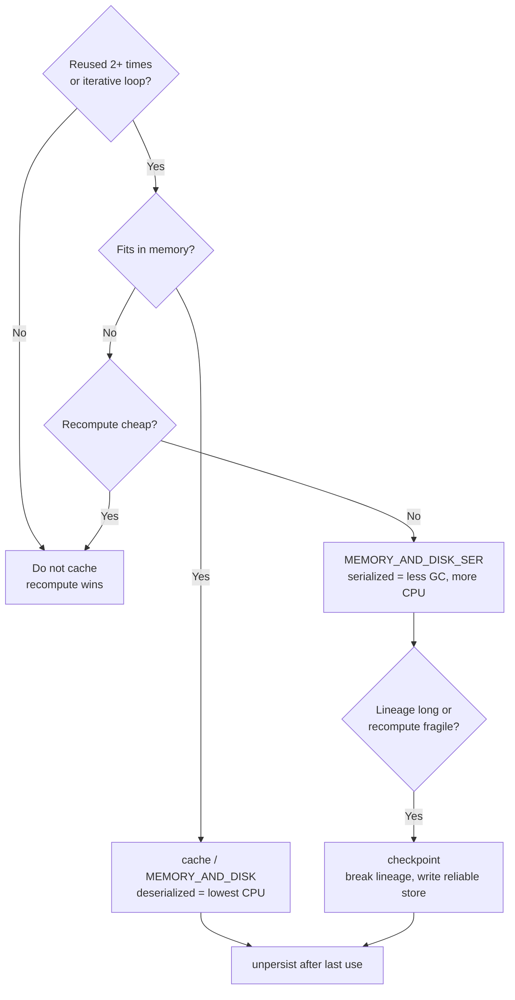
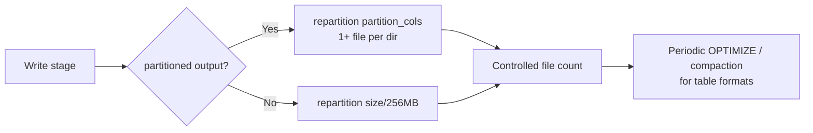
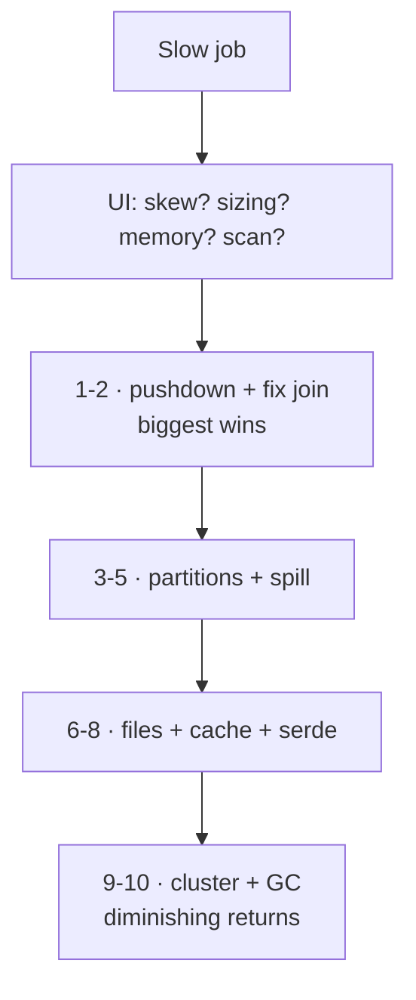
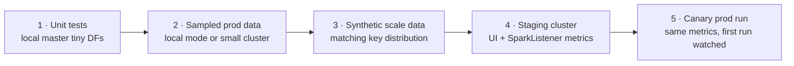

# Performance Optimization

> **Why it matters** — A Spark job that runs in 8 minutes on tuned config often runs 3 hours untuned — same code, same data. Optimization is not magic; it's a repeatable procedure: read the UI, classify the bottleneck, apply the matching fix. This chapter is that procedure.

## Reading the Spark UI — the profiler

Open the **Stages** tab for a slow job. The columns that matter:



| Signal | What it tells you | Likely class |
|---|---|---|
| **Max task time >> median** | Data skew — one partition huge | Skew (playbook below) |
| **High Shuffle Write + Spill** | Execution memory starved | Memory / partitioning |
| **200 tasks, seconds each, huge total** | Too many tiny partitions | `shuffle.partitions` / AQE coalesce |
| **Few tasks, GBs each** | Too few partitions | Raise `shuffle.partitions`, repartition |
| **GC > ~10–15% of task time** | Object churn, memory pressure | Kryo, bigger partitions, more memory |
| **Stage does full scan despite filter** | No pushdown/pruning | Predicate pushdown / file layout |

::: tip 💡 Senior insight
Before changing any code, sort the stage's task table by **Duration** and by **Shuffle Read Size**. If the max is 10–100× the median, you have skew. If they're uniform but the stage is slow, you have a sizing problem. This one check classifies most production Spark incidents.
:::

### The other tabs, in 20 seconds each

| Tab | Use it for |
|---|---|
| **Jobs** | Which action is slow; DAG visualization links stages |
| **Stages** | The table above — 90% of diagnosis happens here |
| **SQL/DataFrame** | The *rendered* physical plan per query — where you see AQE's final plan |
| **Executors** | Memory usage, GC time, failed tasks, shuffle read/write per executor — catch a bad node or a driver-side memory cliff |
| **Environment** | Effective config — verify your `spark.conf.set` actually landed |

::: info ℹ️ The summary-vs-tasks views
The stage **summary metrics** table gives min/median/75th/max per metric — read the median-to-max gap. The per-task table below it lets you sort and find *which* executor ran the outlier (bad node vs bad data).
:::

## The data skew playbook

Skew = a few keys hold most of the data. Symptoms: one straggler task, one partition with 10× the shuffle read, job "stuck" on the last task of a stage.



| Fix | When | Cost |
|---|---|---|
| **Broadcast small side** | One side fits memory | Fastest; no shuffle |
| **Salting** | Skewed aggregation or post-join hot key | Extra aggregation round-trip |
| **Isolate hot key** | One/few known hot keys (e.g., `null`, `-1`, a mega-customer) | Two-pass union; surgical |
| **AQE skew join** | Sort-merge join skew, Spark 3+ | Free — on by default |
| **Pre-aggregate** | `reduceByKey`/`agg` before join | Reduces shuffle volume |

::: warning ⚠️ The null-key trap
A `null` or sentinel (`-1`, `"UNKNOWN"`) join key is a *guaranteed* hot partition — all nulls hash to one reducer. Filter or re-map nulls before the join; it's the most common accidental skew source in production.
:::

### Isolate: the surgical pattern for one hot key

```python
hot  = fact.filter(col("customer_id") == -1)
rest = fact.filter(col("customer_id") != -1)
result = rest.join(dim, "customer_id").union(hot.join(broadcast(dim), "customer_id"))
```

The bulk of the data takes the normal sort-merge; only the hot key goes through the broadcast path. Also the fix for null keys: `fact.filter(col("k").isNotNull())` before the join, then union the null rows back if they must survive.

### Stragglers ≠ skew — speculative execution

Tasks that are slow because of a noisy node, not more data, are *stragglers*. `spark.speculation=true` (with `.quantile` / `.multiplier` thresholds) launches duplicate tasks on other executors and keeps whichever finishes first. Helps long-tail heterogeneity; does nothing for true skew — the duplicate task reads the same hot partition and is equally slow.

### Detect skew before the shuffle — sampling

Don't wait for the straggler. Sample the key distribution first:

```python
# find hot keys on a 1% sample, cheap and bounded
hot = (df.sample(0.01, seed=42)
         .groupBy("customer_id").count()
         .orderBy(desc("count")).limit(20))
```

`sampleByKey` (stratified sampling) takes a per-key fraction — useful both for *detecting* skew and for *creating* test data that reproduces it.

**Salting, worked numbers.** Say 1 key holds 10M of 12M rows. With a salt factor of 32:

| Step | Before | After |
|---|---|---|
| Rows on worst task | 10M (one hash slot) | ~10M / 32 ≈ 312K per `key_salt` value |
| Aggregation | `groupBy("k")` — one reducer drowns | `groupBy("k", "salt")` partial agg → `groupBy("k")` final |
| Join | hot key → 1 task | salt fact side; explode dim side ×32 (`dim.crossJoin(range(32))`) — only if dim × 32 still broadcasts |

::: tip 💡 Senior insight
Pick the salt factor so `hot_key_rows / salt < typical_partition_rows`. More salt isn't free — the second aggregation pass and the dim-side explosion grow with it. And prefer *map-side* reduction (`reduceByKey`-style combine, or a per-partition distinct-count `mapPartitions`) over salting when you can: deduplicating before the shuffle shrinks the data instead of just spreading it.
:::

## Adaptive Query Execution (AQE)

AQE re-optimizes the physical plan **at runtime** using real shuffle statistics collected at stage boundaries. Enabled by default since Spark 3.2.



| AQE feature | Config key | What it fixes |
|---|---|---|
| Coalesce shuffle partitions | `spark.sql.adaptive.coalescePartitions.enabled` (default true) | 200 mostly-empty tasks → few real ones |
| Convert sort-merge → broadcast | `spark.sql.adaptive.autoBroadcastJoinThreshold` | A "big" table that filtered down to small |
| Optimize skew join | `spark.sql.adaptive.skewJoin.enabled` (true) + `.skewedPartitionFactor` / `.skewedPartitionThresholdInBytes` | Splits hot reduce partitions |
| Master switch | `spark.sql.adaptive.enabled` (true on 3.2+) | All of the above |

::: details AQE limits — what it cannot fix
AQE observes *shuffle outputs*, so it can't help before the first exchange or fix skew caused by a `groupByKey`-style un-reduced shuffle. It also won't save a genuinely undersized cluster, a driver OOM, or a query that scans 100× too much data at the source. Treat it as a safety net for *plan-time estimation errors*, not a substitute for correct partitioning and pushdown.
:::

## Caching: `cache` vs `persist` vs `checkpoint`

Three different tools people conflate:

| | `cache()` | `persist(level)` | `checkpoint()` |
|---|---|---|---|
| Stores | Memory (or mem+disk) | You choose level | Reliable storage (HDFS/S3), **breaks lineage** |
| Recomputes on loss? | Yes — recompute from DAG | Yes | **No** — reads checkpoint file |
| Use when | Reused DF, fits memory, cheap recompute OK | Need disk overflow or serialized form | Long/complex lineage, iterative algo, truncation needed |

Storage levels for `persist`:

| Level | Where | CPU | Use |
|---|---|---|---|
| `MEMORY_ONLY` | Heap, deserialized | Low | Default when it fits |
| `MEMORY_AND_DISK` | Heap → spills to disk | Low | Safer default — survive memory pressure |
| `MEMORY_ONLY_SER` | Heap, serialized | Higher | Tight memory, pay CPU to compress |
| `DISK_ONLY` | Disk | High | Rarely — defeats the point |
| `*_2` variants | + replication | — | Fault tolerance; rarely needed |

::: warning ⚠️ Cache is lazy and sticky
`cache()` doesn't run until the next action, and it pins the *lineage* — a cached DF built from a slowly-changing upstream keeps stale data until `unpersist()`. And it holds memory: caching a 50 GB DF on a 30 GB cluster silently spills to disk and can be *slower* than recomputing. Cache only what's reused 2+ times and fits.
:::

::: details When cache actually pays off
Cache earns its memory only when the same DataFrame feeds **2+ downstream actions** (or an iterative loop) and recompute is expensive relative to the storage cost. A single-pass ETL `read → transform → write` gains nothing — cache and unpersist are pure overhead. Quick test: count the actions on the DF; if it's one, don't cache. And always `unpersist()` after the last use in long-running sessions (notebooks, streaming driver state) or storage memory fills with dead blocks.
:::

### `localCheckpoint()` — the middle ground

`localCheckpoint()` truncates lineage like `checkpoint()` but writes to executor local disk instead of reliable storage — no HDFS/S3 needed, no checkpoint dir, but data survives only as long as the executor does. Good for trimming a long DAG inside one job; not a durability mechanism.

A cache decision tree (from *High Performance Spark*, Karau & Warren):



The book's blunt rule: a cached RDD that doesn't fit and thrashes to disk is *slower* than recomputing — check `Storage` tab hit ratios, and remember cached executors are held by dynamic allocation (`.cachedExecutorIdleTimeout`), so stale caches also pin cluster resources.


## The small-files problem

Spark writes **one file per task per partition**. `repartition(500)` then `write` = 500 files; `coalesce(1)` = one file written by one task (slow). The disease: 10k 50-KB files crush both your metastore and every downstream read's per-file overhead.

Fixes, in order:

1. **`repartition(N)` or `coalesce(N)` before write** — pick N ≈ `total_size / 256 MB`. For partitioned output, `repartition(partition_cols)` to get one file per partition.
2. **`spark.sql.files.maxRecordsPerFile`** — cap rows per output file.
3. **Table format compaction** — Delta `OPTIMIZE`, Iceberg `rewrite_data_files`, Hudi `clustering` — merge small files offline.
4. **AQE coalesce** already reduces the post-shuffle task count feeding the write.



## Partition-level operations — `mapPartitions` vs `map`

Per-record functions (`map`, `foreach`) pay per-record overhead: function dispatch, and — fatally — per-record setup if you open a connection or build a helper inside the lambda. `mapPartitions` / `foreachPartition` hand you the whole partition as an `Iterator`, so setup happens **once per partition**, not once per record.

| Pattern | Setup granularity | Use for |
|---|---|---|
| `map` / `foreach` + connection inside | **Per record** — worst | Never; opens N connections |
| `mapPartitions` | Per partition | Transforms needing a resource (DB cursor, RNG, HTTP client, batch insert buffer) |
| `foreachPartition` | Per partition, on the action side | Writing results out — batched inserts, one connection per partition |
| `mapPartitionsWithIndex` | Per partition + index | Partition-aware logic (rank stats, per-partition dedup) |
| broadcast + `@transient lazy val` | Once per executor | Serializable setup you want shared across partitions/tasks |

```scala
rdd.mapPartitions { iter =>
  val conn = DriverManager.getConnection(url)   // once per partition
  try iter.map(row => writeOne(conn, row))      // stream, don't buffer
  finally conn.close()
}
```

::: warning ⚠️ The iterator-to-iterator rule
Inside `mapPartitions`, keep the transformation **iterator-to-iterator** — return a derived `Iterator`, never `iter.toList` / `toArray` / `toBuffer`. Converting to a collection forces the entire partition into memory, defeats Spark's selective spilling, and is the classic cause of "one task OOMs, others fine". Same rule on the output side: build a `HashMap`/`ArrayBuffer` only when the per-partition aggregate is bounded (a distinct-count per partition is bounded by `columns × partitions`; arbitrary keys are not).
:::

### Keyset pagination for large reads/exports

`ORDER BY k LIMIT n OFFSET m` doesn't distribute — the driver ends up materializing pages and offset still scans-and-skips. The distributed version is **keyset pagination**: read `WHERE k > :last_seen_key ORDER BY k` ranges, where each task or sequential page resumes from the previous page's max key rather than an offset. On the RDD side this is what a **range partitioner** gives you natively — `repartitionAndSortWithinPartitions` assigns each task a contiguous key range, which is also the building block of secondary sort. Use it for exports ordered by key, per-key-range backfills, and anytime "read the next slice" would otherwise become a driver loop.

## Structured API vs RDD — what you pay

| | DataFrame / Dataset (Tungsten) | RDD |
|---|---|---|
| In-memory repr | Columnar, off-heap capable, far smaller than Java objects | Heap JVM objects → GC + memory pressure |
| Sort/agg/serialize | Operates on serialized bytes — sorts without deserializing | Java serde by default; Kryo better but still object-bound |
| Optimizer | Catalyst: predicate/column pushdown, whole-stage codegen, AQE | None — *you* are the optimizer |
| Shuffle path | Managed, unsafe-row format | Manual; your partitioner, your memory budget |
| Right tool when | Anything expressible as relational ops — the default | Custom partitioners, secondary sort, iterator-level control, per-partition aggregation, legacy code |

::: tip 💡 Senior insight
Stay in DataFrames until a step genuinely can't be expressed there, then dip: `df.rdd.mapPartitions(…)` → `toDF` and hand it back to Catalyst. The expensive mistake is the opposite — doing the *whole* pipeline on RDDs because one step needed `mapPartitions`, and losing pushdown, Tungsten encoding, and AQE on every other step.
:::

## Serialization: Kryo and Arrow

- **Kryo** (`spark.serializer=KryoSerializer`) — faster, more compact than default Java serialization for shuffle and cached data. Register classes (`registerKryoClasses`) for best results; unregistered still works but slower.
- **Arrow** (`spark.sql.execution.arrow.pyspark.enabled`) — columnar, zero-copy-ish transfer between JVM and Python. The difference between `toPandas`/`pandas_udf` that's usable vs 10× slower. On by default for `pandas_udf`; enable for `toPandas`/`createDataFrame` in PySpark.

Serialization rules that prevent the classic failures:

- **Register your classes** — `spark.kryo.registrator` / `registerKryoClasses`. Unregistered classes still work, but Kryo writes the full class name per record: bigger shuffle payloads, slower serde.
- **Never capture driver state in a nested closure.** `rdd.map(x => f(x, bigLocalLookup))` ships `bigLocalLookup` **with every task**. Broadcast it — one copy per executor, amortized across all tasks. Same trap: referencing `this` inside a method-level lambda captures (and serializes) the whole enclosing object — extract to a top-level `object`'s method.
- **Non-serializable setup → `@transient lazy val` inside a broadcast wrapper**, or create it inside `mapPartitions` (pattern above).
- **Avoid mutable structures in closures** — they cause serialization errors and *wrong results* when lazy lineage recomputes a partition. Prefer immutable accumulators or mutate a fresh accumulator inside `aggregateByKey`'s sequence function only.
- **`Task not serializable` debugging**: the error names the captured field — chase what your lambda closes over, not the line that triggered it.

::: details Era note — `spark.kryo.unsafe`
The book flags `spark.kryo.unsafe=true` (Spark 2.x era) as faster-than-Tungsten for RDD work. It's since become the common default path; treat pre-2.x Kryo guidance in the book as historical, the registration and closure rules as timeless.
:::

## Dynamic allocation

`spark.dynamicAllocation.enabled=true` lets Spark grow/shrink the executor pool to match pending tasks instead of holding a fixed fleet. Requirements: external shuffle service enabled (so freed executors don't take their shuffle files). Bounds with `.minExecutors` / `.maxExecutors`. Right default for shared/multi-tenant clusters and spiky workloads; often left off on dedicated fixed-size jobs.

::: warning ⚠️ Spot/preemptible executors
With dynamic allocation on spot capacity, executor loss mid-stage is routine — that's what the shuffle service is for. But if the driver lands on a spot node, one preemption kills the job. Pin the driver to on-demand; let only executors ride spot.
:::

## Broadcast OOM, hints, GC

### Broadcast OOM risk

`broadcast(df)` copies the whole DF to **every executor's** memory — and materializes it first on the **driver**. A `broadcast()` on a 5 GB table OOMs the driver before a single task runs. Guardrails: keep the side under the threshold, or raise `spark.sql.autoBroadcastJoinThreshold` deliberately (not blindly) and size driver memory for it.

### Detecting a broadcast OOM

In the UI: the job fails at `BroadcastExchange`, driver logs show the executor-side timeout (`Could not execute broadcast in 300 secs`) or a driver heap OOM during `collect`-style materialization. Fix order: check the broadcast is still justified (did the table grow?), raise the threshold *and* driver memory together, or drop the broadcast entirely and let sort-merge run.

### Join & coalesce hints

```sql
SELECT /*+ BROADCAST(small) */ * FROM big JOIN small ON ...
SELECT /*+ MERGE(large) */    * ...      -- force sort-merge
SELECT /*+ COALESCE(10) */   * ...      -- reduce post-shuffle partitions
SELECT /*+ REPARTITION(200) */ * ...
```

::: tip 💡 Senior insight
Hints are a contract you're making with the optimizer: *"I know better than your stats."* They're correct when Catalyst's estimate is wrong (no statistics, filtered-down table). They're a foot-gun when the estimate was right — a stale `BROADCAST` hint on a table that grew past memory is a production incident. Prefer fixing statistics (`ANALYZE TABLE`) over sprinkling hints.
:::

### GC tuning basics

The only GC lever that matters at the senior level: **GC time in the UI should stay under ~10–15% of task time.** Fixes, ordered:

1. More executor memory or fewer, larger partitions (less object churn).
2. Kryo serialization (fewer objects).
3. `MEMORY_ONLY_SER` for caches.
4. G1GC (default on modern JVMs) + `spark.executor.extraJavaOptions=-XX:+UseG1GC` — tune only after the above fail.

::: warning ⚠️ Era-flagged claims (book: 2017, Spark 2.x / JDK 8)
The book recommends **G1GC over CMS** for large heaps — CMS is now *removed* from modern JDKs, so on JDK 11+ this is settled: G1 is the default, and for very large executor heaps ZGC/Shenandoah are the modern options. Also era-scoped sizing heuristics, still directionally sound: **~5 cores per executor ceiling** (HDFS connection contention; the book tolerated 6–7), **executors ≥ ~4 GB** (fixed overhead ~384 MB + `memoryOverhead` fraction makes tiny executors pure overhead), and **giant heaps trade GC frequency for pause length**. Verify against your JDK/JVM before cargo-culting the numbers.
:::

Programmatic perf verification: the book attaches a `SparkListener` and reads `onTaskEnd` metrics (executor run time, `jvmGCTime`, records read/written) — the same numbers the UI shows, but assertable in tests.

## Tuning checklist — ordered by impact

Work top-down; stop when the job is fast enough. Most jobs are fixed by the first three.

1. **Read the UI** — classify: skew, sizing, memory, or full-scan.
2. **Push down filters & columns** — read less; verify `PushedFilters` in the plan.
3. **Fix the join** — broadcast the small side; break or salt the skewed one.
4. **Right-size partitions** — `shuffle.partitions`, `repartition`/`coalesce`; let AQE coalesce.
5. **Eliminate spill** — memory, partition size, or Kryo.
6. **Kill small files** — repartition before write, periodic compaction.
7. **Cache deliberately** — reused 2+ times, fits memory, `MEMORY_AND_DISK`.
8. **Serialization** — Kryo, Arrow for Python.
9. **Right-size the cluster** — `dynamicAllocation`, executor sizing.
10. **GC / JVM knobs** — only after 1–9 are clean.



## Performance testing workflow — the ladder

Scale bugs are mostly *distribution* bugs — skew, empty partitions, per-record costs — that invisible test data hides. Climb the ladder; each rung catches a different class of bug:



| Rung | Catches | Tooling |
|---|---|---|
| Unit tests | Logic errors | `local[4]`, hand-built DataFrames, spark-testing-base |
| Sampled prod | Schema surprises, hot keys | `df.sample(0.01)`, `sampleByKey` for stratified keys |
| Synthetic scale | Skew/OOM only visible at volume | `RandomRDDs` — exponential/normal generators matching your real key distribution |
| Staging cluster | Shuffle, spill, GC, partition sizing | Web UI + `SparkListener` counters |
| Canary prod | Data drift, config mismatch | Same metrics, alerted |

::: warning ⚠️ Uniform test data lies
Generating test records with a uniform key distribution guarantees your skew bugs ship to prod. The Goldilocks case from the book: an algorithm that worked on "evenly distributed" data failed because 25% of values were zeros — one key carrying a quarter of the input. Match the *distribution shape*, not just the volume.
:::

## Certification-grade quick checks

The Databricks Associate Developer exam (and every Spark interview) drills a handful of exact facts. Cross-checked against *Databricks Certified Associate Developer for Apache Spark Using Python* (Shah, 2024) and the official defaults — commit these to memory:

| Fact | Value |
|---|---|
| `spark.sql.shuffle.partitions` default | **200** — the post-shuffle partition count behind "one task per partition" symptoms |
| `spark.sql.autoBroadcastJoinThreshold` default | **10 MB** — Catalyst broadcasts the build side below this; `-1` disables auto-broadcast entirely |
| AQE master switch | `spark.sql.adaptive.enabled` — default **true** since Spark 3.2 |
| AQE partition coalescing | `spark.sql.adaptive.coalescePartitions.enabled` (true), tuned by `.advisoryPartitionSizeInBytes` (~64 MB) |
| AQE broadcast conversion | `spark.sql.adaptive.autoBroadcastJoinThreshold` — defaults to `autoBroadcastJoinThreshold` when unset |
| AQE skew join | `spark.sql.adaptive.skewJoin.enabled` (true) + `.skewedPartitionFactor` (5) / `.skewedPartitionThresholdInBytes` (256 MB) |
| `df.cache()` storage level | **`MEMORY_AND_DISK`** for DataFrames — but plain `MEMORY_ONLY` for RDDs. A classic exam trick. |
| Lazy evaluation | Transformations build the DAG; nothing runs, and nothing fails, until an action is called |
| Narrow transformations | `map`, `filter`, `flatMap`, `select`, `union` — one input partition → one output partition, no shuffle |
| Wide transformations | `groupBy`, `join`, `sortBy`/`orderBy`, `distinct`, `repartition`, `reduceByKey`, `groupByKey` — shuffle, stage boundary |
| Actions | `show`, `count`, `collect`, `take`, `first`, `head`, `foreach`, `save`/`write` — trigger execution, return to driver or storage |
| `repartition(n)` | Full shuffle; raises **or** lowers partition count |
| `coalesce(n)` | Narrow merge of partitions; only lowers count unless `shuffle=True` (Spark 3.0+) — `coalesce(20)` on 5 partitions is a no-op |
| Default join type | `inner` when `how=` is omitted |
| `union()` vs `unionByName()` | `union` matches **by position**, mismatched column names still concatenate; `unionByName` matches by name (add `allowMissingColumns=True` for schema gaps) |
| Dataset API | Scala/Java only — **not available in Python** (PySpark DataFrames are the equivalent) |

::: warning ⚠️ Exam traps that are also prod traps
- **`groupBy()` is wide, not narrow.** The cert book itself lists `groupBy()` under narrow transformations once (Ch. 6) — that's an error; any per-key regrouping shuffles. Same class of trap: `distinct()`/`intersect()` are transformations (lazy), not actions, even though they feel "terminal".
- **`coalesce` cannot increase partitions.** `df.coalesce(20)` on a 5-partition DF silently does nothing — the exam answers `repartition(20)`, and in prod your "rebalanced" job still runs 5 tasks. In Spark 3.x `coalesce(n, shuffle=True)` *can* grow partitions, but that's a repartition under the hood.
- **`how="broadcast"` is not a join type.** `df.join(other, "id", "broadcast")` throws; broadcast is a hint/`broadcast(df)` wrapper, not a value of `how=`. Prod same: the engine *chooses* broadcast; you only hint it.
- **`StorageLevel.MEMORY_AND_DISK_3` doesn't exist.** Valid replication suffix is `_2` only (e.g. `MEMORY_AND_DISK_2`). Fat-fingering the level name fails at runtime, not compile time.
- **Lazy means lazy failures.** A wrong path or bad column name in `read`/`select` doesn't error until the first action — so "it ran fine in my notebook cell" proves nothing.
:::

## 🧠 Quiz

<QuizCard :questions="[{ q: 'A stage shows median task 2s, max task 45min, and one task reading 100x the shuffle data of others. Diagnosis and first fix?', options: ['GC pressure — increase memory', 'Small files — compact', 'Undersized cluster — add executors', 'Data skew — broadcast the small side, salt the key, or isolate the hot key'], correct: 3, explain: 'The task-time and shuffle-read distribution is the skew signature. Adding executors does nothing — the hot key still lands on one task.' }, { q: 'What does AQE fix automatically?', options: ['Small files on write', 'Driver OOM', 'Predicate pushdown failures', 'Switching join strategy, coalescing shuffle partitions, and splitting skewed partitions at runtime'], correct: 3, explain: 'AQE re-plans between stages using real shuffle stats: SMJ→broadcast conversion, partition coalescing, and skewed-partition splitting. It cannot fix driver OOM or missing pushdown.' }, { q: 'When should you use checkpoint() instead of persist()?', options: ['To cache in memory', 'Always — it is faster', 'To break a long lineage so failure does not trigger full recomputation, at the cost of writing to storage', 'For streaming only'], correct: 2, explain: 'checkpoint truncates the DAG — recovery reads the checkpoint file rather than recomputing the whole lineage. persist still relies on lineage on loss.' }, { q: 'A job produces 5000 files of ~50 KB each. What is the cheapest fix at write time?', options: ['Enable Kryo', 'Increase shuffle.partitions', 'repartition(N) or repartition(partition_cols) before write so N ≈ data_size / ~256MB', 'Increase executor memory'], correct: 2, explain: 'File count follows the final-stage task count. Repartitioning before the write controls output file count directly; compaction handles files already written.' }, { q: 'Why can a broadcast() call OOM the driver before any task runs?', options: ['It triggers a shuffle', 'The build side is first collected and materialized in driver memory, then shipped to executors', 'Broadcast uses no memory', 'It disables AQE'], correct: 1, explain: 'broadcast materializes the table on the driver to build the relation — a too-large side crashes the driver first, not an executor.' }, { q: 'GC time is 40% of task time across all tasks. First lever to pull?', options: ['Disable caching', 'Switch to G1GC', 'Add executors', 'Reduce object churn — larger partitions or more executor memory — before JVM flags'], correct: 3, explain: 'High GC is almost always memory pressure/object churn. More memory or fewer-bigger partitions fixes the cause; GC flags are the last resort.' }]" />
<QuizCard :questions="[{ q: 'Writing results to a JDBC sink is slow. Which pattern fixes it correctly?', options: ['Use foreachPartition so one connection is created per partition and reused for its batch', 'repartition(1) then insert', 'collect the RDD and insert from the driver', 'Open the connection inside foreach so each record gets one'], correct: 0, explain: 'Per-record setup is the classic partition-parallelism bug: foreach opens a connection per row. foreachPartition amortizes setup across the whole partition — same reasoning as mapPartitions for transforms.' }, { q: 'Inside mapPartitions you call iter.toList, sort it, and return its iterator. What did you lose?', options: ['Type safety only', 'Selective spilling — the whole partition now must fit in executor memory', 'Nothing — same result', 'Laziness — the partition runs eagerly at DAG build time'], correct: 1, explain: 'Converting the iterator to a collection forces the entire partition into memory. Iterator-to-iterator transformations let Spark spill only the records that do not fit, which is what makes partitions bigger than RAM processable.' }, { q: 'A job fails at scale but passes all local tests. The most likely reason the tests missed it?', options: ['The cluster JVM differs', 'Test data used a uniform key distribution while prod data is skewed', 'Local mode uses a different scheduler', 'Unit tests ran too few executors'], correct: 1, explain: 'Scale bugs are usually distribution bugs — hot keys and empty partitions only appear when test data matches the prod key distribution. Generate skewed test data (e.g. exponential RandomRDDs), not uniform.' }]" />
<QuizCard :questions="[{ q: 'Your groupBy on a 2 TB table produced 200 mostly-tiny reduce tasks. Which default explains the count?', options: ['spark.sql.shuffle.partitions = 200', 'spark.executor.instances', 'spark.sql.files.maxPartitionBytes', 'spark.default.parallelism = 200'], correct: 0, explain: 'spark.sql.shuffle.partitions (default 200) sets the partition count after every shuffle — groupBy, join, distinct, repartition. Tune it or let AQE coalesce the small partitions at runtime.' }, { q: 'df is cached with df.cache(). At what storage level?', options: ['MEMORY_ONLY_SER', 'DISK_ONLY', 'MEMORY_ONLY', 'MEMORY_AND_DISK'], correct: 3, explain: 'DataFrame cache() defaults to MEMORY_AND_DISK — but RDD cache() defaults to MEMORY_ONLY. The exam loves the DataFrame-vs-RDD split; in prod, MEMORY_AND_DISK is why a cached DF spills instead of recomputing under memory pressure.' }, { q: 'Which code reduces df from 12 partitions to 6 without a full shuffle — and which raises 5 to 20?', options: ['df.repartition(6) and df.repartition(20)', 'df.coalesce(6) and df.coalesce(20)', 'df.coalesce(6) and df.repartition(20)', 'df.repartition(6) and df.coalesce(20)'], correct: 2, explain: 'coalesce merges partitions narrowly and can only reduce — coalesce(20) on 5 partitions is a silent no-op unless you pass shuffle=True (Spark 3.0+). repartition always shuffles and works both directions.' }]" />

## Further reading

- [Spark SQL Performance Tuning — official docs](https://spark.apache.org/docs/latest/sql-performance-tuning.html)
- [Adaptive Query Execution: Speeding Up Spark SQL at Runtime — Databricks](https://www.databricks.com/blog/2020/05/29/adaptive-query-execution-speeding-up-spark-sql-at-runtime.html)
- [Spark Tuning — official docs](https://spark.apache.org/docs/latest/tuning.html)
- [Apache Spark Internals — Jacek Laskowski](https://japila.pl/apache-spark-internals/)
- [Diving into Spark Streaming's Execution Model — Databricks](https://www.databricks.com/blog/2015/07/30/diving-into-spark-streamings-execution-model.html)
- *Spark: The Definitive Guide* — Chambers & Zaharia (O'Reilly) — [companion repo](https://github.com/databricks/Spark-The-Definitive-Guide)
- [Adaptive Query Execution — Databricks docs](https://docs.databricks.com/en/optimizations/aqe.html)
- [Monitoring and Instrumentation — official docs](https://spark.apache.org/docs/latest/monitoring.html)
- **High Performance Spark** — Karau & Warren (2017), [O'Reilly](https://www.oreilly.com/library/view/high-performance-spark/9781491943199/)
- **Databricks Certified Associate Developer for Apache Spark Using Python** — Saba Shah (2024), [Packt](https://www.packtpub.com/en-us/product/databricks-certified-associate-developer-for-apache-spark-using-python-9781803219329)
