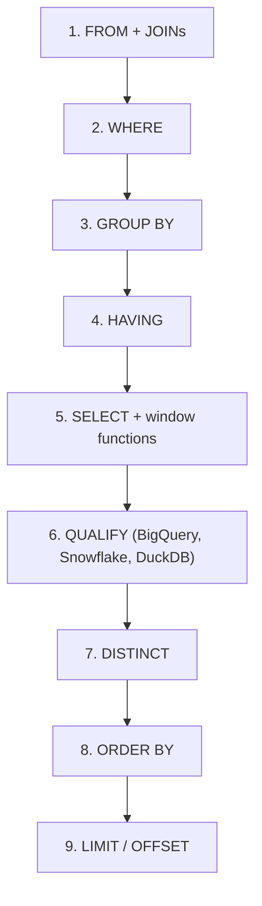
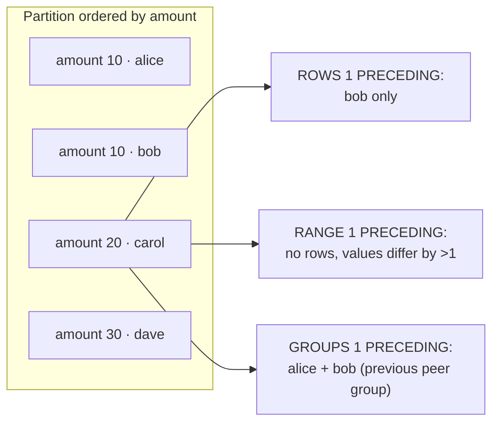
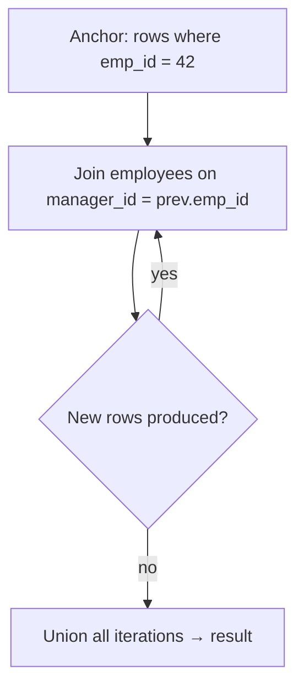
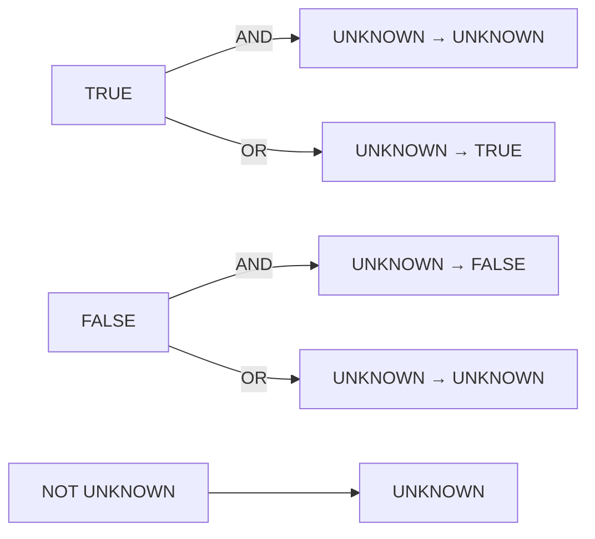

# Advanced Query Craft

> **Why it matters** — Most analytics bugs aren't join bugs; they're semantic bugs. A default window frame silently duplicates running totals, a `NOT IN` meets a NULL and returns nothing, a `WHERE` on an outer-join column quietly demotes a `LEFT JOIN` to `INNER`. This chapter covers the constructs where correctness lives.

## 1. Think in execution order, not writing order

SQL reads top-to-bottom but executes in a fixed logical order. Half the "weird" errors you've seen — alias not visible in `WHERE`, can't filter a window function, `HAVING` accepts aggregates `WHERE` rejects — are this order made visible.



| Clause | Filters | Can reference SELECT aliases? | Can use aggregates? |
|---|---|---|---|
| `WHERE` | input rows | No | No |
| `HAVING` | groups | No (except aliases in some dialects) | Yes |
| `QUALIFY` | rows after window eval | Yes (window results) | Window functions |
| `ORDER BY` | — (sorts) | Yes | Yes |

::: info Filtering a window function without QUALIFY
On dialects without `QUALIFY` (Postgres, SQL Server), wrap the windowed query in a subquery and filter the alias outside. `QUALIFY` is that wrapper, built into the grammar.
:::

::: warning WHERE on a LEFT JOIN column
```sql
SELECT * FROM orders o
LEFT JOIN shipments s ON s.order_id = o.order_id
WHERE s.carrier = 'dhl';   -- s.carrier is NULL for unmatched rows;
                           -- NULL = 'dhl' is NULL, not TRUE → row dropped
```
This silently rewrites your `LEFT JOIN` into an `INNER JOIN`. Move the condition into the `ON` clause, or add `OR s.order_id IS NULL`.
:::

## 2. Window functions: the frame is the contract

`OVER (PARTITION BY ... ORDER BY ...)` defines a partition and ordering; the **frame** defines which rows within that partition the function sees *for each row*. This is where bugs breed.

### ROWS vs RANGE vs GROUPS



- **`ROWS n PRECEDING`** — counts physical row positions. Deterministic given the ordering.
- **`RANGE n PRECEDING`** — counts *values* within `n` of the current ordering value. All **peers** (rows with equal ordering values) are always in or out together.
- **`GROUPS n PRECEDING`** — counts peer *groups*. One group back from `amount=20` is the entire `amount=10` peer group.

::: warning The default frame will burn you
When you write `ORDER BY` inside `OVER()` with no frame, the default is `RANGE BETWEEN UNBOUNDED PRECEDING AND CURRENT ROW` — **peers included**. Two rows with the same ordering value get the *same* cumulative value, and `LAST_VALUE` returns the current row instead of the partition's last row.

```sql
-- WRONG: ties on ts produce identical (and surprising) cumulative sums
SUM(x) OVER (PARTITION BY k ORDER BY ts)

-- RIGHT: deterministic, position-based
SUM(x) OVER (
  PARTITION BY k ORDER BY ts
  ROWS BETWEEN UNBOUNDED PRECEDING AND CURRENT ROW
)
```
Always write the frame explicitly. BigQuery and Spark follow the same default.
:::

### The LAST_VALUE pitfall

`LAST_VALUE(x) OVER (PARTITION BY k ORDER BY ts)` does **not** give the partition's last value — with the default frame it gives the last value *of the frame ending at the current row*, i.e. usually `x` itself.

```sql
-- "Fill forward to the partition's actual last row" needs an explicit frame:
LAST_VALUE(x) OVER (
  PARTITION BY k ORDER BY ts
  ROWS BETWEEN UNBOUNDED PRECEDING AND UNBOUNDED FOLLOWING
)

-- Or, more honestly: forward-fill the last NON-NULL value seen so far (BigQuery):
LAST_VALUE(x IGNORE NULLS) OVER (
  PARTITION BY k ORDER BY ts
  ROWS BETWEEN UNBOUNDED PRECEDING AND CURRENT ROW
)
```

Spark lacks `IGNORE NULLS` in some versions — emulate with `MAX(CASE WHEN x IS NOT NULL THEN ts END)` partitioning, or sort by a flag.

### Running totals and moving windows

```sql
-- Cumulative revenue per customer (deterministic)
SUM(amount) OVER (
  PARTITION BY customer_id ORDER BY order_ts
  ROWS BETWEEN UNBOUNDED PRECEDING AND CURRENT ROW
) AS running_total,

-- 7-event moving average (NOT 7 days — see chapter 3 for time-based)
AVG(amount) OVER (
  PARTITION BY customer_id ORDER BY order_ts
  ROWS BETWEEN 6 PRECEDING AND CURRENT ROW
) AS ma_7,

-- BigQuery/Postgres 11+ support RANGE on INTERVAL for true time windows:
AVG(amount) OVER (
  PARTITION BY customer_id ORDER BY UNIX_DATE(order_date)
  RANGE BETWEEN 6 PRECEDING AND CURRENT ROW
) AS ma_7d
```

### Top-N per group

```sql
-- ANSI-safe version (works everywhere)
SELECT * FROM (
  SELECT t.*,
         ROW_NUMBER() OVER (PARTITION BY user_id ORDER BY spend DESC) AS rn
  FROM transactions t
)
WHERE rn <= 3;

-- BigQuery / Snowflake / DuckDB: one level flatter
SELECT *
FROM transactions
QUALIFY ROW_NUMBER() OVER (PARTITION BY user_id ORDER BY spend DESC) <= 3;
```

| Need | Function | Tie behavior |
|---|---|---|
| Exactly N rows, deterministic | `ROW_NUMBER()` | Breaks ties by `ORDER BY`; add a unique key to stabilize |
| N per group, ties count as one slot | `DENSE_RANK()` | Ties share a rank, no gaps — can return >N rows |
| N per group, ties skip slots | `RANK()` | Ties share rank then gap — can return >N rows |
| Proportion (top 10%) | `NTILE(n)` / `PERCENT_RANK()` | Roughly equal buckets |

::: tip Make ROW_NUMBER deterministic
`ORDER BY spend DESC` with ties makes `rn=1` nondeterministic — a different "latest" row can win on every run, which poisons dedup and SCD logic. Append a unique tiebreaker: `ORDER BY spend DESC, event_id`. If you can't accept arbitrary tie-breaking, you need `DENSE_RANK` or a business rule, not luck.
:::

## 3. CTEs, subqueries, and derived tables

```sql
WITH flagged AS (
  SELECT user_id, COUNT(*) AS events
  FROM events
  WHERE event_date >= DATE '2026-01-01'
  GROUP BY user_id
  HAVING COUNT(*) > 100
)
SELECT u.user_id, u.plan, f.events
FROM flagged f
JOIN users u USING (user_id);
```

| Construct | Readability | Reusable in query? | Optimizer notes |
|---|---|---|---|
| CTE (`WITH`) | Best — name reveals intent | Yes, reference many times | Postgres ≤11 materialized CTEs (optimization fence); 12+ inlines when single-use. BigQuery/Spark treat as views, no fence |
| Derived table (subquery in `FROM`) | OK for 1-2 levels | No | Inlined everywhere; deepest nesting is hardest to read |
| Scalar/correlated subquery | Terse for one value | No | Correlated = per-row evaluation; rewrite as join when it aggregates (see [Query Performance](/sql/query-performance)) |
| Temp table | Visible, debuggable | Across statements | Materializes once; use when a CTE is referenced 3+ times *and* expensive |

::: tip Refactor rule
Use CTEs to name each logical step in the order you'd explain it aloud. If a CTE is referenced more than twice and is expensive to compute, consider materializing it (temp table / intermediate model). Don't nest derived tables more than two deep — that's what CTEs are for.
:::

## 4. Recursive CTEs

A recursive CTE has an anchor member and a recursive member joined by `UNION ALL`, iterating until the recursive member yields no rows.

```sql
-- Org chart: all reports under manager 42, with depth
WITH RECURSIVE reports AS (
  SELECT emp_id, manager_id, name, 0 AS depth
  FROM employees
  WHERE emp_id = 42                 -- anchor

  UNION ALL

  SELECT e.emp_id, e.manager_id, e.name, r.depth + 1
  FROM employees e
  JOIN reports r ON e.manager_id = r.emp_id  -- recursive step
)
SELECT * FROM reports ORDER BY depth, emp_id;
```

```sql
-- Gap/series generation: dates in a range without a calendar table
WITH RECURSIVE days AS (
  SELECT DATE '2026-01-01' AS d
  UNION ALL
  SELECT d + INTERVAL '1' DAY FROM days WHERE d < DATE '2026-01-31'
)
SELECT d FROM days;
```



**Classic uses:** org/bill-of-materials hierarchies, graph traversal (reachable nodes), generating calendar rows or numeric series, splitting strings iteratively.

::: warning Runaway recursion
A cycle in your hierarchy (`A manages B, B manages A`) makes naive recursion loop forever in some engines or explode rows in others. Defenses: keep a visited-path array and stop on membership (`WHERE NOT e.emp_id = ANY(path)`), cap `depth`, and know your dialect's limit — Postgres defaults to no hard limit (use a `depth < n` guard), BigQuery's recursive CTEs iterate up to 500 times, SQL Server defaults to `MAXRECURSION 100`.
:::

::: details Dialect notes: recursion
Postgres, MySQL 8, SQL Server, DuckDB, and Spark 3.4+ (`WITH RECURSIVE`) support the standard form. BigQuery added recursive CTEs (`WITH RECURSIVE`) in 2023 with a 500-iteration cap and no `CYCLE` clause. SQL Server omits the `RECURSIVE` keyword entirely (`WITH x AS (...)`) and caps at 100 recursions by default. Spark requires `UNION ALL` specifically — `UNION` is unsupported in the recursive term.
:::

## 5. PIVOT and UNPIVOT

```sql
-- BigQuery / Snowflake / SQL Server / Spark 3.4+:
SELECT *
FROM (
  SELECT user_id, event_name, 1 AS n
  FROM events
)
PIVOT (SUM(n) FOR event_name IN ('login', 'purchase', 'refund'));

-- Postgres / anything without PIVOT — the portable idiom:
SELECT user_id,
       COUNT(*) FILTER (WHERE event_name = 'login')    AS logins,  -- FILTER: PG/SQLite/BQ-not
       COUNT_IF(event_name = 'purchase')               AS purchases, -- BigQuery
       SUM(CASE WHEN event_name = 'refund' THEN 1 ELSE 0 END) AS refunds  -- ANSI fallback
FROM events
GROUP BY user_id;
```

`UNPIVOT` (BigQuery, Snowflake, SQL Server, Spark 3.4+) melts columns to rows; elsewhere use `CROSS JOIN LATERAL (VALUES ...)` or `UNNEST` on a struct array.

::: info Dynamic pivots
`PIVOT` requires a literal `IN` list — "pivot on whatever values appear" needs dynamic SQL or two passes (aggregate keys first, then generate the pivot). This is why BI tools pivot client-side and dbt models use macros like `dbt_utils.pivot`.
:::

## 6. LATERAL, UNNEST, and arrays

Modern warehouses store nested/repeated fields natively. Flattening is a per-row lateral join, not a `GROUP BY` trick.

```sql
-- BigQuery: repeated field → one row per element (CROSS JOIN = keep parents with empty arrays)
SELECT o.order_id, item.sku, item.qty
FROM orders o, UNNEST(o.items) AS item;

-- Postgres / Spark equivalent:
SELECT o.order_id, item.*
FROM orders o
CROSS JOIN LATERAL UNNEST(o.items) AS item;

-- Spark:
SELECT o.order_id, item.sku, item.qty
FROM orders o LATERAL VIEW explode(o.items) t AS item;
```

| Operation | BigQuery | Postgres | Spark |
|---|---|---|---|
| Explode array to rows | `, UNNEST(arr)` / `CROSS JOIN UNNEST` | `CROSS JOIN LATERAL unnest(arr)` | `LATERAL VIEW explode` / `explode()` in SELECT |
| Keep rows with empty arrays | `LEFT JOIN UNNEST` | `LEFT JOIN LATERAL ... ON TRUE` | `explode_outer` / `posexplode_outer` |
| Explode with position | `WITH OFFSET` | `WITH ORDINALITY` | `posexplode` |
| Array aggregation | `ARRAY_AGG(x)` | `array_agg(x)` | `collect_list` / `collect_set` |

::: warning Exploding fanout
`explode` multiplies rows. Aggregating a parent-level metric *after* exploding double-counts it — sum a parent's `order_total` over exploded items and you get `order_total × num_items`. Aggregate at the right grain: explode first, then roll up, or aggregate parent columns before the explode.
:::

## 7. Set operations: UNION, EXCEPT, INTERSECT

```sql
-- Rows in A but not in B (set difference — dedupes!)
SELECT user_id FROM cohort_a
EXCEPT
SELECT user_id FROM cohort_b;      -- BigQuery: EXCEPT DISTINCT

-- Overlap only
SELECT user_id FROM a INTERSECT SELECT user_id FROM b;
```

| Operator | Default (DISTINCT) | ALL variant | Use case |
|---|---|---|---|
| `UNION` | dedupes both sides | `UNION ALL` (almost always what you want) | Stacking same-shape tables |
| `EXCEPT` | rows in left, not right | `EXCEPT ALL` keeps multiplicities | Anti-joins, set diffs, finding drift between snapshots |
| `INTERSECT` | shared rows | `INTERSECT ALL` | Overlap checks, common-dimension validation |

::: tip UNION ALL by default
`UNION` (bare) sorts/dedupes the entire concatenated result — an expensive shuffle you rarely want and a correctness trap (two genuinely identical events get collapsed). Type `UNION ALL` unless dedup is the explicit goal. Also: legs bind **positionally**, not by column name — `SELECT a, b UNION ALL SELECT b, a` compiles fine and corrupts silently.
:::

`EXCEPT` vs `NOT EXISTS`: `EXCEPT` deduplicates and compares whole rows; `NOT EXISTS` preserves multiplicities and can use indexes. For "find differences between two table snapshots" `EXCEPT` is the clean tool; for "filter this table by absence in another" `NOT EXISTS` usually performs better.

## 8. NULL semantics: the three-valued trap

SQL logic is ternary: **TRUE, FALSE, UNKNOWN**. `NULL` isn't a value, it's the absence of one — so every comparison with NULL is UNKNOWN, and WHERE keeps only TRUE rows.

```sql
-- The classic interview killer:
SELECT * FROM users
WHERE user_id NOT IN (SELECT banned_id FROM bans);
-- If bans.banned_id contains even ONE NULL, the whole query returns ZERO rows.
-- x NOT IN (1, 2, NULL)  ≡  x<>1 AND x<>2 AND x<>NULL
--                        ≡ TRUE  AND TRUE  AND UNKNOWN  → UNKNOWN → filtered out.

-- Safe:
SELECT * FROM users u
WHERE NOT EXISTS (SELECT 1 FROM bans b WHERE b.banned_id = u.user_id);
```

| Expression | Result | Why |
|---|---|---|
| `NULL = NULL` | NULL (not TRUE) | Equality can't assert anything about missing values |
| `NULL IS NULL` | TRUE | `IS` is the NULL-safe test |
| `TRUE OR NULL` | TRUE | One branch known true |
| `FALSE OR NULL` | NULL | Outcome undecided |
| `TRUE AND NULL` | NULL | Undecided |
| `NOT NULL` | NULL | Negating unknown stays unknown |
| `NULL IN (NULL)` | NULL | Membership uses `=` |
| `COUNT(col)` vs `COUNT(*)` | counts non-NULLs vs all rows | Only aggregate that counts NULL rows is `COUNT(*)` |



::: warning Null-safe equality across dialects
- ANSI/Postgres/BigQuery/Spark: `a IS NOT DISTINCT FROM b` (NULLs equal) — the clean idiom.
- BigQuery also accepts `IS [NOT] DISTINCT FROM`; Spark additionally has `<=>`.
- `COALESCE(a, sentinel) = COALESCE(b, sentinel)` works but breaks index/zone-map pruning — `b IS NULL AND a IS NULL OR a = b` is the planner-friendly expansion.
- `GROUP BY` and `UNION`/`EXCEPT` treat NULLs as equal (they group and dedupe NULLs) even though `=` doesn't. Expect this asymmetry in interview questions — and in dedup bugs.
:::

::: warning Aggregates + empty groups
`SUM`/`AVG`/`MIN`/`MAX` over a group containing only NULLs return **NULL, not 0** — and `SUM` over an empty *grouped* set disappears entirely vs `SUM` over zero rows returning NULL. Money math that can't afford NULLs needs `COALESCE(SUM(x), 0)` plus a `LEFT JOIN` to a spine so missing keys stay visible (see [Analytics Patterns](/sql/analytics-patterns)).
:::

## 🧠 Quiz

<QuizCard :questions="[{ q: 'In BigQuery, `LAST_VALUE(x) OVER (PARTITION BY k ORDER BY ts)` returns x itself on most rows. Why?', options: ['PARTITION BY resets ordering', 'The default frame ends at CURRENT ROW, so the frame last value is the current row', 'LAST_VALUE only sees the partition start', 'BigQuery requires IGNORE NULLS for LAST_VALUE to work'], correct: 1, explain: 'With ORDER BY and no explicit frame, the frame is RANGE BETWEEN UNBOUNDED PRECEDING AND CURRENT ROW — the last row of that frame is the current row. Fix with ROWS BETWEEN UNBOUNDED PRECEDING AND UNBOUNDED FOLLOWING.' }, { q: 'A query: `WHERE id NOT IN (SELECT fk FROM t)`. fk contains one NULL. Result?', options: ['All rows', 'Zero rows', 'Error: NULL in subquery', 'All rows except that fk'], correct: 1, explain: 'NOT IN expands to id<>v1 AND id<>v2 AND ... AND id<>NULL. The NULL comparison is UNKNOWN; TRUE AND UNKNOWN = UNKNOWN, so every row fails the filter. Use NOT EXISTS.' }, { q: 'You need exactly the 3 most recent orders per customer, deterministic across runs. Best primitive?', options: ['DENSE_RANK() <= 3', 'ROW_NUMBER() OVER (PARTITION BY c ORDER BY ts DESC, order_id) <= 3', 'MAX(ts) grouped by customer, joined back', 'RANK() OVER (PARTITION BY c ORDER BY ts DESC) <= 3'], correct: 1, explain: 'ROW_NUMBER guarantees exactly N rows; the order_id tiebreaker makes it deterministic. RANK/DENSE_RANK can return more than N on ties; MAX+join returns only the single latest.' }, { q: 'A LEFT JOIN gets silently demoted to INNER JOIN. Most likely cause?', options: ['Using ON instead of USING', 'The optimizer choosing a hash join', 'Adding ORDER BY', 'A WHERE clause comparing an outer-join-side column to a non-NULL value'], correct: 3, explain: 'WHERE filters run after the join; unmatched rows have NULL in all right-side columns, and NULL = anything is UNKNOWN → row dropped. Put the predicate in ON or allow IS NULL.' }, { q: 'Why prefer UNION ALL over UNION when stacking daily partitions?', options: ['UNION dedupes the whole result — wasted sort/shuffle, and it can collapse legitimately identical events', 'UNION does not allow different schemas', 'UNION ALL validates column names', 'UNION ALL preserves ordering'], correct: 0, explain: 'Bare UNION adds a full dedup pass you rarely need and can silently drop real duplicate events. UNION ALL is a pure concatenation. Legs bind positionally regardless.' }, { q: 'Recursive CTE terminates when...', options: ['UNION ALL becomes UNION', 'DEPTH reaches 100 always', 'All anchors are consumed', 'The recursive member produces zero new rows'], correct: 3, explain: 'Iteration stops when a recursive step yields an empty set. Engines add caps (BigQuery 500 iterations, SQL Server MAXRECURSION 100) — and cycles need explicit guards, e.g. a visited-path check.' }]" />

## Further reading

- [PostgreSQL docs — Window Functions](https://www.postgresql.org/docs/current/functions-window.html) — canonical function list and frame semantics
- [PostgreSQL docs — WITH queries incl. recursive](https://www.postgresql.org/docs/current/queries-with.html) — recursion rules, cycle detection, SEARCH/CYCLE clauses
- [BigQuery — window function calls](https://cloud.google.com/bigquery/docs/reference/standard-sql/window-function-calls) — frames, `IGNORE NULLS`, GoogleSQL specifics
- [BigQuery — QUALIFY](https://cloud.google.com/bigquery/docs/reference/standard-sql/query-syntax#qualify_clause) — evaluation order and usage
- [Spark SQL — LATERAL VIEW / generators](https://spark.apache.org/docs/latest/sql-ref-syntax-qry-select-lateral-view.html) — explode/posexplode syntax
- [Bruce Momjian — Postgres Window Magic (PDF)](https://momjian.us/main/writings/pgsql/window.pdf) — deep visual walkthrough of frames and exclusions
- [mode SQL tutorial — window functions](https://mode.com/sql-tutorial/sql-window-functions) — pragmatic examples on real data
- [modern-sql.com — NULL features & three-valued logic](https://modern-sql.com/caniuse) — dialect feature matrix for QUALIFY, IS DISTINCT FROM, FILTER
