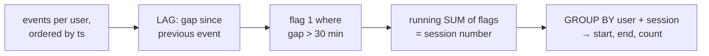
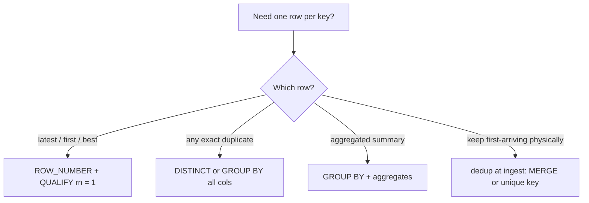
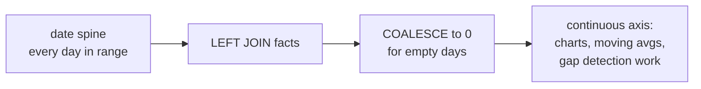
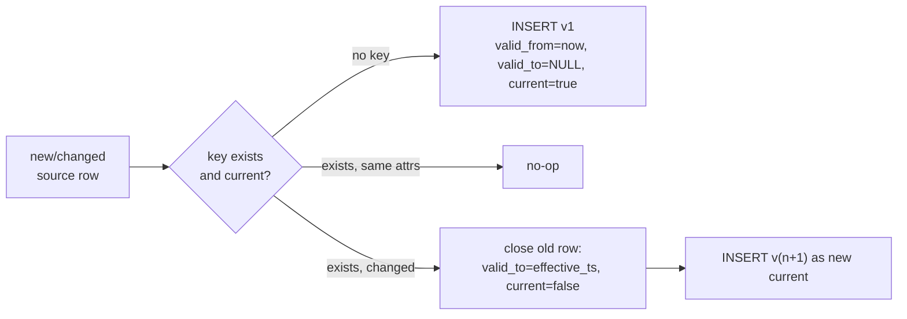

# Analytics SQL Patterns

> **Why it matters** — Every analytics request maps to a dozen stock patterns. Senior engineers pattern-match instantly: "sessionize" = window islands, "latest record" = ROW_NUMBER, "as of date" = spine join. Recognizing the pattern means shipping correct SQL in minutes instead of debugging a hand-rolled solution at 3am.

## 1. Sessionization — windows, not self-joins

A session = a run of events per user where consecutive gaps stay under a threshold (commonly 30 minutes).

```sql
WITH events AS (
  SELECT user_id, event_ts
  FROM raw_events
),
lagged AS (
  SELECT user_id, event_ts,
         LAG(event_ts) OVER w AS prev_ts
  FROM events
  WINDOW w AS (PARTITION BY user_id ORDER BY event_ts)
),
marked AS (
  SELECT *,
         -- new session when gap exceeds threshold (or first event)
         CASE WHEN prev_ts IS NULL
                   OR event_ts > prev_ts + INTERVAL '30' MINUTE
              THEN 1 ELSE 0 END AS new_session
  FROM lagged
),
numbered AS (
  SELECT *,
         SUM(new_session) OVER (PARTITION BY user_id ORDER BY event_ts
                                ROWS UNBOUNDED PRECEDING) AS session_seq
  FROM marked
)
SELECT user_id,
       -- session key must be unique across users: hash or concat
       MD5(CONCAT(CAST(user_id AS STRING), '-', CAST(session_seq AS STRING))) AS session_id,
       MIN(event_ts) AS session_start,
       MAX(event_ts) AS session_end,
       COUNT(*)      AS event_count
FROM numbered
GROUP BY user_id, session_id;
```



::: tip Deterministic session IDs
`MD5(user_id || '-' || seq)` (or `FARM_FINGERPRINT` in BigQuery) makes session IDs stable across reruns — a bare sequence number collides across users and changes when late data shifts the numbering. If your pipeline backfills, stable IDs are the difference between an idempotent job and a dedup nightmare.
:::

::: warning Late events split sessions
An event arriving 3 days late can fall *inside* a gap and merge two sessions — or open a new one — changing historical aggregates. Decide the contract: sessionize over a closed window (e.g., only events ≥ N days old) or accept mutable history with periodic restatement.
:::

## 2. Gaps and islands — the mother pattern

Sessionization is one instance of **islands**: contiguous runs grouped together. The general trick: two row numbers whose difference stays constant inside an island.

```sql
-- Login streaks: consecutive days each user was active
WITH active_days AS (
  SELECT DISTINCT user_id, DATE(event_ts) AS d
  FROM events
),
islands AS (
  SELECT user_id, d,
         -- for consecutive dates, d - rn is CONSTANT within an island
         DATE_SUB(d, INTERVAL ROW_NUMBER() OVER
                    (PARTITION BY user_id ORDER BY d) DAY) AS grp
  FROM active_days
)
SELECT user_id, grp AS island_id,
       MIN(d) AS streak_start, MAX(d) AS streak_end, COUNT(*) AS streak_days
FROM islands
GROUP BY user_id, grp;
```

**Missing dates (gaps):** generate the expected set and anti-join.

```sql
WITH RECURSIVE expected AS (                     -- or a calendar table / GENERATE_DATE_ARRAY
  SELECT DATE '2026-10-01' AS d
  UNION ALL SELECT d + INTERVAL '1' DAY FROM expected
  WHERE d < DATE '2026-10-31'
)
SELECT d
FROM expected e
WHERE NOT EXISTS (SELECT 1 FROM daily_metrics m WHERE m.metric_date = e.d);
-- BigQuery shortcut: FROM UNNEST(GENERATE_DATE_ARRAY('2026-10-01','2026-10-31')) AS d
```

| Problem | Island key | Notes |
|---|---|---|
| Login/activity streaks | `date - row_number` | DISTINCT first (multiple events/day) |
| Sessions | cumulative `SUM(new_session)` | Gap threshold is a business parameter |
| Status-change runs (state = 'active' periods) | `row_number - row_number partitioned by state` | Two ROW_NUMBERs: overall and per-state |
| Missing dates | spine vs actual anti-join | Calendar table beats recursion at scale |
| Consecutive N (e.g., 5-day streaks only) | `HAVING COUNT(*) >= 5` on the island aggregate | Add filters after grouping |

::: details Islands via RANGE vs ROW_NUMBER arithmetic
Two idioms solve islands: (1) `date − row_number` — elegant, one scan, breaks with gaps in the *sequence itself*; (2) the sessionization idiom — `LAG` + flag + running `SUM` — handles any "gap" definition, including non-uniform intervals, at one extra window pass. Reach for (2) when the contiguity rule is anything fancier than "integer/date +1".
:::

## 3. Cohorts and retention matrices

```sql
WITH first_seen AS (
  SELECT user_id, DATE_TRUNC(MIN(event_date), MONTH) AS cohort_month
  FROM events GROUP BY user_id
),
activity AS (
  SELECT DISTINCT f.cohort_month, e.user_id,
         DATE_DIFF(DATE_TRUNC(e.event_date, MONTH), f.cohort_month, MONTH) AS months_since
  FROM events e JOIN first_seen f USING (user_id)
)
SELECT cohort_month,
       COUNTIF(months_since = 0) AS m0,
       COUNTIF(months_since = 1) AS m1,
       COUNTIF(months_since = 2) AS m2,
       COUNTIF(months_since = 3) AS m3
FROM activity
GROUP BY cohort_month
ORDER BY cohort_month;
```

Divide each column by `m0` for the retention triangle. For *week*-over-week stickiness use `DATE_DIFF(..., WEEK)`; for classic "returned on day N" use day granularity.

::: warning Cohort ≠ segment
A cohort is anchored on a **first event** (signup, first order) and must use *that user's* anchor, not a calendar. Anchoring on "users seen in month X" mixes new and old users and inflates retention — the classic "our retention improved!" dashboard bug after a growth spike.
:::

## 4. Time-series bucketing and ASOF joins

```sql
-- Bucketed metrics: explicit floor is clearer than string formatting
SELECT DATE_TRUNC(event_ts, HOUR) AS hour, COUNT(*) AS events
FROM events
GROUP BY hour;

-- ASOF: latest price at-or-before each trade (the "nearest ≤" join)
-- BigQuery doesn't have ASOF syntax — emulate with a ranged join + window:
SELECT t.*, p.price
FROM (
  SELECT trade_id, symbol, trade_ts,
         MAX(price_ts) AS matched_price_ts        -- latest price ≤ trade time
  FROM trades t JOIN prices p
    ON p.symbol = t.symbol AND p.price_ts <= t.trade_ts
  GROUP BY trade_id, symbol, trade_ts
) k
JOIN trades t USING (trade_id, symbol, trade_ts)
JOIN prices p ON p.symbol = k.symbol AND p.price_ts = k.matched_price_ts;
```

::: info Native ASOF support
ClickHouse, KDB+/q, Timescale, Snowflake (`ASOF JOIN` GA 2025), DuckDB and Pandas all have native `ASOF JOIN` — worth knowing because the emulated ranged-join above fans out badly on dense price feeds. On BigQuery, a window approach often beats it: `LAST_VALUE`/`FIRST_VALUE` over an ordered union of both streams with an explicit frame.
:::

::: warning Left join on ≤ matches nothing before the first price
A trade before the symbol's first price quote gets `matched_price_ts = NULL` → dropped by the inner join back. If that's wrong for your use case, outer-join it and decide whether NULL price is acceptable downstream — don't let the join silently eat early trades.
:::

## 5. Dedup patterns — pick your poison deliberately

```sql
-- Latest record per key, whole-row: the canonical pattern
SELECT * EXCEPT(rn)
FROM (
  SELECT t.*,
         ROW_NUMBER() OVER (PARTITION BY user_id
                            ORDER BY updated_at DESC, event_id DESC) AS rn
  FROM events_raw t
)
WHERE rn = 1;

-- BigQuery/Snowflake/DuckDB shortcut:
SELECT * FROM events_raw
QUALIFY ROW_NUMBER() OVER (PARTITION BY user_id
                           ORDER BY updated_at DESC, event_id DESC) = 1;
```

| Method | When it wins | Watch out |
|---|---|---|
| `ROW_NUMBER() = 1` / `QUALIFY` | Whole-row dedup, "latest per key" | Needs deterministic tiebreaker — always add a unique key |
| `GROUP BY` + aggregates | Only need per-key summary | `ANY_VALUE` on other columns picks arbitrarily |
| `ARRAY_AGG` + `[OFFSET(0)]` (BigQuery) | Whole row at max key, one pass | Same tiebreak problem; reads nicely inside a GROUP BY |
| `DISTINCT` | Exact-row duplicates only | Wide-row sort; doesn't pick "latest" |
| `MAX(key)` + join back | Very large tables where window shuffles hurt | Two passes; NULL key rows vanish |



::: tip Dedup at write time when you can
`ROW_NUMBER` dedup rescans the whole table every run. If duplicates enter via retries/streaming, fix at ingest: `MERGE` upserts, insert-only-with-watermark, or BigQuery `CREATE TABLE ... AS` with dedup on the merge key — the query-side window is your safety net, not your strategy.
:::

## 6. Incremental MERGE / upsert

```sql
MERGE dim_customers T
USING (
  SELECT customer_id, name, tier, updated_at
  FROM staging_customers
  QUALIFY ROW_NUMBER() OVER (PARTITION BY customer_id
                             ORDER BY updated_at DESC) = 1   -- stage can hold dupes!
) S
ON T.customer_id = S.customer_id
WHEN MATCHED AND S.updated_at > T.updated_at THEN   -- late-arriving guard
  UPDATE SET name = S.name, tier = S.tier, updated_at = S.updated_at
WHEN NOT MATCHED THEN
  INSERT (customer_id, name, tier, updated_at)
  VALUES (S.customer_id, S.name, S.tier, S.updated_at)
WHEN NOT MATCHED BY SOURCE AND T.is_current THEN    -- optional: handle deletes
  UPDATE SET is_current = FALSE;
```

Non-negotiables:

1. **Dedup the staging side first** — BigQuery errors *"UPDATE/MERGE must match at most one source row"* when the `ON` key isn't unique in `USING`.
2. **Guard late arrivals** (`S.updated_at > T.updated_at`) or a stale replay can clobber newer data.
3. **Decide the delete contract explicitly** — `NOT MATCHED BY SOURCE` soft-deletes; omit it if sources are partial feeds (you'd delete everything not in today's slice).

::: warning MERGE scans the target
BigQuery `MERGE` over a large partitioned target scans the whole table unless you bound the match set — e.g., `ON T.customer_id = S.customer_id AND T.partition_date >= DATE '2026-01-01'`, or use the documented "update a subset" pattern merging against a filtered target subquery. For wide SCD tables, compare hash-of-attributes instead of column-by-column.
:::

## 7. Date spine joins — never let a metric drop a zero

```sql
-- "Revenue per day" that INVISIBLY drops zero-revenue days:
SELECT order_date, SUM(amount) FROM orders GROUP BY order_date;

-- Spine-first: every date present, zeros explicit
WITH spine AS (
  SELECT d FROM UNNEST(GENERATE_DATE_ARRAY('2026-10-01', '2026-10-31')) AS d
)
SELECT s.d AS day,
       COALESCE(SUM(o.amount), 0) AS revenue,
       COUNT(o.order_id) AS orders
FROM spine s
LEFT JOIN orders o ON o.order_date = s.d
GROUP BY s.d ORDER BY s.d;
```



The spine is load-bearing for downstream logic: moving averages computed on a row-missing series silently average over *fewer* days, and gap detection is impossible when the gap itself is missing. Materialize a `dim_calendar` (dates, fiscal periods, holidays) once — every fact query gets the join for free.

## 8. SCD2 from scratch

Slowly Changing Dimension Type 2: keep history by versioning rows with `valid_from`/`valid_to` + `is_current`.



```sql
-- One MERGE closes changed rows; a second statement inserts new versions.
-- (BigQuery/Spark SQL both support multi-clause MERGE.)

-- Step 1: close out current rows whose attributes changed
MERGE dim_customer T
USING (
  SELECT * FROM staging_customer
  QUALIFY ROW_NUMBER() OVER (PARTITION BY customer_id ORDER BY updated_at DESC) = 1
) S
ON T.customer_id = S.customer_id AND T.is_current
WHEN MATCHED AND (T.tier, T.region) IS DISTINCT FROM (S.tier, S.region) THEN
  UPDATE SET valid_to = S.updated_at, is_current = FALSE;

-- Step 2: insert new versions — new keys + rows closed in step 1
INSERT INTO dim_customer (customer_id, tier, region, valid_from, valid_to, is_current)
SELECT S.customer_id, S.tier, S.region, S.updated_at, NULL, TRUE
FROM staging_customer S
LEFT JOIN dim_customer T
  ON T.customer_id = S.customer_id AND T.is_current
WHERE T.customer_id IS NULL;          -- no current version (new or just closed)
```

::: details Attribute-hash shortcut
Comparing `IS DISTINCT FROM` over 20 columns is verbose and easy to drift. Hash instead: `MD5(CONCAT_WS('|', COALESCE(tier,'~'), COALESCE(region,'~'), ...))` stored as `attr_hash` — one comparison detects any change. Use a NULL sentinel that can't collide with real data (`'~'` vs `''`). Spark's Delta `MERGE` and dbt snapshots implement the same two-step close+insert under the hood — understanding the SQL is how you debug them.
:::

::: warning Point-in-time queries need the overlap predicate
Consumers must filter `WHERE as_of >= valid_from AND (as_of < valid_to OR valid_to IS NULL)`. Forgetting the `valid_to` side returns *all* historical versions — silent row multiplication that looks exactly like a fanout bug (because it is one).
:::

## 9. A/B test aggregation — variance-aware, not just means

```sql
WITH assignment AS (
  SELECT user_id, variant, MIN(exposed_ts) AS first_exposure
  FROM experiment_exposures
  WHERE experiment = 'checkout_v2'
  GROUP BY user_id, variant
),
outcomes AS (
  SELECT a.variant, a.user_id,
         COALESCE(SUM(o.amount), 0) AS revenue,          -- per-user metric
         MAX(CASE WHEN o.order_id IS NOT NULL THEN 1 ELSE 0 END) AS converted
  FROM assignment a
  LEFT JOIN orders o
    ON o.user_id = a.user_id AND o.order_ts >= a.first_exposure  -- post-exposure only!
  GROUP BY a.variant, a.user_id
)
SELECT variant,
       COUNT(*)               AS n,
       AVG(revenue)           AS mean_rev,
       VAR_SAMP(revenue)      AS var_rev,
       -- standard error of the mean; compare DIFF to SE(diff) for significance
       SQRT(VAR_SAMP(revenue) / COUNT(*)) AS se_mean,
       AVG(converted)         AS conv_rate
FROM outcomes
GROUP BY variant;
```

Three traps that invalidate results:

1. **Post-exposure window.** Include pre-exposure orders and you credit the variant for behavior it never influenced.
2. **Unit of analysis.** Randomization is per *user* — aggregate to user grain *before* statistics. Per-order denominators fake larger `n` and understate standard error (pseudo-replication).
3. **Multiple comparisons.** 20 metrics at α=0.05 ≈ one false positive by construction. Pre-register the decision metric; treat the rest as exploratory.

::: info Welch's t via SQL
Unequal-variance t-statistic: `t = (x̄₁ − x̄₀) / √(v₁/n₁ + v₀/n₀)`. Compute per-variant `AVG`, `VAR_SAMP`, `COUNT` as above, then combine in an outer query. `|t| ≳ 2` ≈ significance at typical sample sizes. Ratio metrics (revenue/session) need delta-method or bootstrap variance — the naive `SUM/SUM` ratio hides per-user heterogeneity.
:::

## 🧠 Quiz

<QuizCard :questions="[{ q: 'Sessionization with LAG + cumulative SUM fails in one well-known way. Which?', options: ['A late-arriving event inside a gap renumbers all later sessions, changing history', 'It cannot handle >30 min gaps', 'SUM is not deterministic', 'LAG requires RANGE frames'], correct: 0, explain: 'Session numbers derive from event order — an inserted event shifts every subsequent session_seq. Mitigate with deterministic hashed session IDs plus a closed processing window or accepted restatement.' }, { q: 'The islands trick `date - ROW_NUMBER()` groups consecutive days because...', options: ['Within a consecutive run, both date and row_number increment by 1, so their difference is constant; a gap breaks it', 'It partitions by user', 'ROW_NUMBER resets per month', 'Date subtraction auto-buckets'], correct: 0, explain: 'Both quantities step +1 inside an uninterrupted run, so the difference is invariant per island — a gap advances date without advancing row_number, yielding a new group value.' }, { q: 'A MERGE fails: &quot;must match at most one source row&quot;. Root cause?', options: ['MERGE does not support UPDATE', 'The USING side has duplicate keys — dedup it (e.g. QUALIFY ROW_NUMBER = 1) before merging', 'is_current is not indexed', 'Target table too large'], correct: 1, explain: 'MERGE requires the join key unique on the source side. Staging extracts routinely contain multiple versions per key; dedup with a deterministic ROW_NUMBER first.' }, { q: 'Revenue-by-day chart shows dips that are actually missing rows. Correct fix?', options: ['Use INNER JOIN on calendar', 'LEFT JOIN facts to a generated date spine and COALESCE aggregates to 0', 'FILTER out nulls', 'Add DISTINCT'], correct: 1, explain: 'GROUP BY emits only days present in the fact table; a spine guarantees every date appears, making zeros explicit — also required for correct moving averages and gap detection.' }, { q: 'SCD2 point-in-time query must use which predicate?', options: ['WHERE as_of >= valid_from AND (as_of < valid_to OR valid_to IS NULL)', 'ORDER BY version DESC LIMIT 1', 'WHERE valid_from = as_of', 'WHERE is_current'], correct: 0, explain: 'Both bounds are required: valid_from alone returns every historical version (fanout), is_current alone loses history. The half-open interval [valid_from, valid_to) selects exactly one version.' }, { q: 'A/B significance is computed on per-order conversion, inflating n 5x. What went wrong?', options: ['Conversion cannot be averaged', 'Unit-of-analysis error: randomization is per user; per-order rows are correlated, understating standard error (pseudo-replication)', 'VAR_SAMP is biased', 'Nothing — more n is more power'], correct: 1, explain: 'Orders from the same user are not independent — treating them as such shrinks the SE and manufactures false significance. Aggregate to the randomization unit (user) first.' }]" />

## Further reading

- [Gaps and Islands in SQL — Simple Talk / Redgate](https://www.red-gate.com/simple-talk/databases/sql-server/t-sql-programming-sql-server/introduction-to-gaps-and-islands-analysis/) — canonical explanation of the islands technique
- [Itzik Ben-Gan — Islands T-SQL Challenge, SQLPerformance.com](https://sqlperformance.com/2022/04/t-sql-queries/islands-t-sql-challenge) — competitive solutions to hard island variants
- [BigQuery — MERGE statement](https://cloud.google.com/bigquery/docs/reference/standard-sql/dml-syntax#merge_statement) — multi-clause merge, `NOT MATCHED BY SOURCE`, best practices
- [BigQuery — GENERATE_DATE_ARRAY and date functions](https://cloud.google.com/bigquery/docs/reference/standard-sql/array_functions#generate_date_array) — date spines without a calendar table
- [Kimball Group — Slowly Changing Dimensions](https://www.kimballgroup.com/data-warehouse-business-intelligence-resources/kimball-techniques/dimensional-modeling-techniques/type-2/) — the dimensional-modeling reference for SCD types
- [dbt snapshots — SCD strategy internals](https://docs.getdbt.com/docs/build/snapshots) — how check/timestamp strategies implement close+insert
- [Spark SQL — MERGE INTO (Delta)](https://docs.delta.io/latest/delta-update.html) — lakehouse upsert semantics and matched clauses
- [Trustworthy Online Controlled Experiments (Kohavi et al.)](https://www.cambridge.org/core/books/trustworthy-online-controlled-experiments/D97B6A4AF60DD6FD1ACFB4BE9A82A64F) — the standard text on experiment statistics and pitfalls
