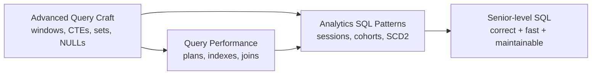

# SQL Deep Dive

> **Why it matters** — SQL is where data correctness and warehouse cost meet. Almost every analytics bug is a SQL bug: silent NULL drops, fanout joins, wrong frame defaults, dedup on the wrong key. Almost every warehouse bill is a SQL problem too: unpruned scans, exploded joins, shuffle storms. This track teaches the 20% of SQL that produces 80% of production outcomes.

## Who this is for

You can already write `JOIN`s, `GROUP BY`s, and CTEs without thinking. You want the layer senior engineers actually operate at: reading query plans, knowing why a window `RANGE` frame silently corrupts a running total, writing an SCD2 upsert that survives late-arriving data. Dialects covered are ANSI SQL, BigQuery (GoogleSQL), and Spark SQL — dialect differences are called out where they bite.

## How the chapters fit

## Chapters

**[Advanced Query Craft](/sql/advanced-queries)** — The constructs that separate intermediate from advanced SQL: window frames (`ROWS`/`RANGE`/`GROUPS`), the `LAST_VALUE` trap, top-N-per-group, recursive CTEs, `LATERAL`/`UNNEST`, set operations, and the NULL semantics that quietly eat rows. Ends with a mental model of logical execution order — `QUALIFY` vs `HAVING` vs `WHERE` — so you stop fighting the grammar and start reasoning about it.

**[Query Performance](/sql/query-performance)** — How engines actually execute your query: logical vs physical plans, reading `EXPLAIN`/`EXPLAIN ANALYZE`, what B-trees, zone maps, partition pruning, and clustering each buy you, and when hash/merge/broadcast joins win. Then the anti-pattern catalog: `SELECT *`, functions on join keys, OR-blocked pruning, `DISTINCT` as a fanout patch, and exploding joins.

**[Analytics SQL Patterns](/sql/analytics-patterns)** — The reusable templates of analytics engineering: sessionization via window islands, cohort retention matrices, gaps-and-islands for streaks and missing dates, ASOF joins, dedup that is actually correct, incremental `MERGE`, date spines, SCD2 built from scratch, and A/B-test aggregation with variance-aware math.

## Pareto focus

The ideas in this track that matter most — learn these cold:

1. **Window frames and the default-frame trap.** `RANGE UNBOUNDED PRECEDING` plus peers silently duplicates values. Know the default, always specify the frame.
2. **`ROW_NUMBER()` + `QUALIFY` is the dedup primitive.** Almost every "latest record" and "top-N-per-group" question is this pattern in a trench coat.
3. **Logical execution order.** `FROM → WHERE → GROUP BY → HAVING → SELECT → QUALIFY → DISTINCT → ORDER BY → LIMIT`. Every confusing error message is this order made visible.
4. **NULL is three-valued logic.** `NOT IN` + NULL = empty result. `=` never matches NULL. Outer-join column NULLs break `WHERE` filters.
5. **Read the plan, not the query.** Row-count estimates vs actuals in `EXPLAIN ANALYZE` reveal where the optimizer guessed wrong — that's where your time goes.
6. **Prune before you shuffle.** Filter and project early; joins multiply data, filters divide it. On columnar warehouses, `WHERE` on the partition/cluster key is the single biggest cost lever.
7. **Islands solve sequences.** Sessionization, streaks, missing dates — the two-`ROW_NUMBER` islands trick handles all of them without self-joins.
8. **MERGE is a contract, not magic.** An incremental upsert that doesn't handle duplicates, deletes, or out-of-order arrival is a production incident with extra steps.
