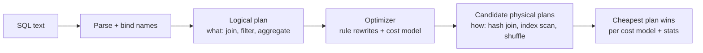
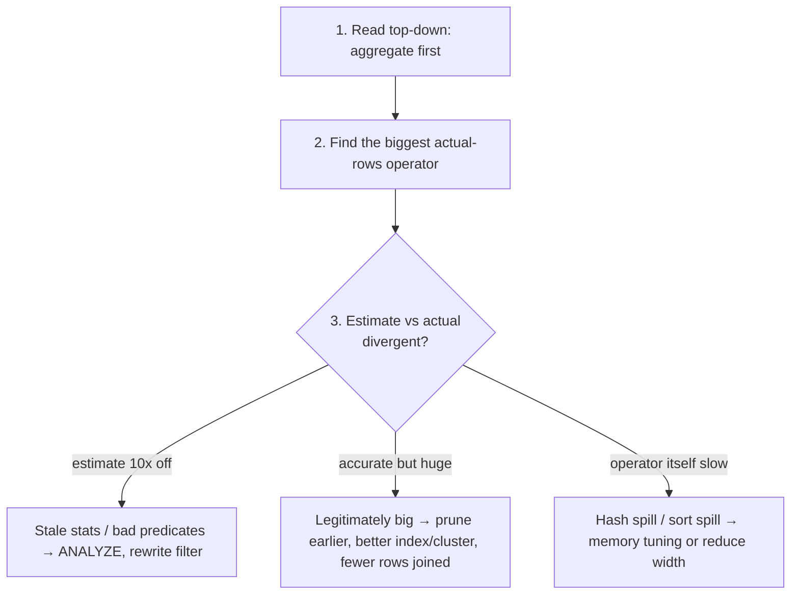
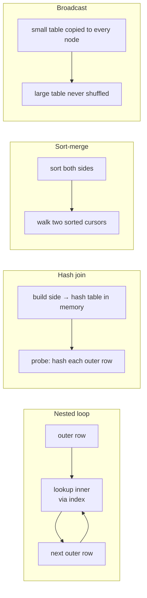

# Query Performance

> **Why it matters** — Slow SQL costs twice: the engineer waiting on it and the warehouse billing for the scan. Senior engineers don't tune by superstition ("add an index", "rewrite as a join") — they read the plan, find where estimates diverge from reality, and fix the one operator that matters.

## 1. Logical plan vs physical plan



The **logical plan** is your query rewritten into relational algebra — join order candidates, pushed predicates, merged subqueries. The **physical plan** picks concrete operators: hash vs merge join, sequential vs index scan, broadcast vs shuffle exchange. The optimizer maps logical → physical using a **cost model fed by table statistics** (row counts, column cardinalities, histograms).

::: tip The one insight that explains everything
Optimization is only as good as the statistics underneath. Stale stats → wrong row-count estimates → wrong join order and algorithm → the classic "this query was fast yesterday" incident. BigQuery/Snowflake hide stats maintenance; Postgres needs `ANALYZE` (autovacuum usually covers it); Spark needs `ANALYZE TABLE ... COMPUTE STATISTICS` for CBO.
:::

## 2. Reading EXPLAIN

`EXPLAIN` shows the estimated plan; `EXPLAIN ANALYZE` (Postgres, Spark) / `EXPLAIN (ANALYZE true)` / actual job graph (BigQuery) shows what *happened*: real row counts, real time per operator.

```sql
EXPLAIN (ANALYZE, BUFFERS)
SELECT o.customer_id, SUM(o.amount)
FROM orders o
JOIN customers c ON c.id = o.customer_id
WHERE o.order_date >= DATE '2026-01-01'
GROUP BY o.customer_id;
```

```text
HashAggregate  (cost=...) (actual time=812.4..812.4 rows=95k)
  ->  Hash Join  (cost=...) (actual rows=10.2M)       ← join output
        ->  Seq Scan on orders o  (actual rows=10.2M) ← full scan!
              Filter: order_date >= '2026-01-01'
              Rows Removed by Filter: 90M             ← 90% of table scanned
        ->  Hash  (actual rows=95k)                   ← build side in memory
              ->  Seq Scan on customers c
```



What to look for, in order:

1. **Seq scans + "rows removed by filter"** — you're scanning far more than you use. On warehouses, that's the bill; on Postgres, that's the missing index.
2. **Estimate vs actual mismatch** — `rows=100` vs `actual rows=5M` means the optimizer planned the rest of the query for a tiny input. Downstream choices (nested loops! broadcast!) are wrong.
3. **Spills** — `Sort Method: external merge Disk`, BigQuery shuffle spill, Spark `spill to disk`: an operator exceeded memory. Reduce row width (drop `SELECT *` columns) or join fewer rows earlier.
4. **Nested loops on big inputs** — fine when the inner side is indexed and the outer side is small; a disaster at warehouse scale.

::: warning EXPLAIN ANALYZE runs the query
In Postgres, `EXPLAIN ANALYZE` actually executes — `EXPLAIN ANALYZE DELETE/UPDATE` will modify data. Wrap destructive statements in a transaction and `ROLLBACK`, or use plain `EXPLAIN`.
:::

## 3. Indexing and pruning: what each structure buys you

| Structure | Stores | Wins on | Loses on | Where |
|---|---|---|---|---|
| B-tree | Sorted key → row pointer | Point lookups, range scans, `ORDER BY`, low cardinality OK if selective | Wide tables (write amplification), unselective predicates | Postgres, MySQL, SQL Server |
| Bitmap index | Bit vector per value | Low-cardinality columns, AND/OR of many values | High-cardinality, write-heavy | Redshift, analytical DBs |
| Zone map / min-max | Min+max per block/partition | Range predicates on naturally ordered data | Random-ordered data | BigQuery (automatic), Delta/Parquet (data skipping), Redshift |
| Partition pruning | Table physically split by key | `WHERE` on partition column — skips whole partitions | Queries missing the partition filter | BigQuery, Hive/Spark, all warehouses |
| Clustered index / clustering | Rows physically co-located by key | Range + equality on cluster key, join on it | Frequently-updated cluster keys | BigQuery (`CLUSTER BY`), Snowflake, SQL Server |

The unifying idea: **all of these exist to skip data.** The cost of a query is roughly proportional to bytes scanned and rows moved — indexing and pruning reduce both before any join logic runs.

```sql
-- Partition pruning is the #1 cost lever on warehouse tables:
SELECT * FROM events
WHERE event_date >= DATE '2026-10-01'    -- scans only October partitions
  AND customer_id = 123;                  -- cluster key: skips blocks inside those partitions

-- vs the same table queried as:
WHERE DATE(event_ts) >= DATE '2026-10-01' -- function on partition column can
                                          -- still prune in BigQuery, but raw-column
                                          -- comparisons are the portable safe form
```

::: info BigQuery specifics
BigQuery has no B-trees — instead: partitioned tables (`PARTITION BY DATE(ts)`), clustering (`CLUSTER BY`), and automatic block-level zone maps. `_PARTITIONTIME` pseudo-column filters also prune. `REQUIRE partition filter` forces callers to prune, which is the cheapest "index" you'll ever deploy.
:::

::: details Sort order is the invisible index
A min/max zone map only skips blocks when values are spatially clustered — a `customer_id` filter prunes well only if rows are sorted/clustered by `customer_id`. Random writes make every block's min-max span nearly the full domain, so pruning degrades to a full scan. This is why Spark pipelines `ZORDER`/`SORT BY` output and why BigQuery auto-reclusters in the background.
:::

## 4. Join algorithms



| Algorithm | How it works | Wins when | Fails when |
|---|---|---|---|
| Nested loop | For each outer row, probe inner (ideally via index) | Outer side small + inner indexed; OLTP lookups | Both sides large — O(outer × inner probe) |
| Hash join | Build hash table on smaller side, probe with larger | Equi-joins on unsorted data; the OLAP default | Build side exceeds memory → disk spill |
| Sort-merge | Sort both inputs, merge cursors | Inputs already sorted; non-equi joins; huge build sides | Paying sort cost on already-huge inputs |
| Broadcast (Spark/warehouse) | Replicate small table to all executors | One side ≪ shuffle bandwidth (`autoBroadcastJoinThreshold`, ~10MB default in Spark) | "Small" side actually large → executor OOM |
| Shuffle hash / sort-merge (Spark) | Repartition both sides by join key | Both sides large | Skewed join key → one reducer gets all rows |

### Where do join orders come from? Cardinality estimation

Every "join these three tables" plan is a guess built on guesses: the planner estimates how many rows each filter and join will emit, prices every order, picks the cheapest. A selectivity estimate that's 20% wrong per predicate compounds — three wrong predicates in a row and the "cheap" plan is scanning 100x what it expected. A 16,000x estimate error like the nested-loop example above isn't rare; it's the default failure mode of queries optimized by hand-tweaking instead of plan-reading.

::: tip Estimate debugging heuristic
When a plan is bad, don't ask "why this algorithm?" — ask "which estimate is wrong?" Find the largest `estimated vs actual` divergence in `EXPLAIN ANALYZE` (or the biggest slot-time stage in BigQuery's plan graph). The fix is upstream of that node: refresh stats, give the planner a sargable predicate it can estimate, or materialize the intermediate result so the optimizer sees real counts instead of compounding guesses.
:::

### Reading plans per dialect

| Engine | Estimate view | Actuals view | Key signals |
|---|---|---|---|
| Postgres | `EXPLAIN` / `EXPLAIN (COSTS)` | `EXPLAIN (ANALYZE, BUFFERS)` | rows vs actual rows, `Rows Removed by Filter`, external sort, loop counts |
| BigQuery | `bq query --dry_run` (bytes billed) | Query plan graph / `EXPLAIN` | slot ms per stage, shuffle bytes, `input vs output rows` skew |
| Spark | `df.explain()` / `EXPLAIN FORMATTED` | SQL tab in UI; `EXPLAIN COST` | Exchange nodes (shuffles), BroadcastHashJoin vs SortMergeJoin, AQE coalescing |
| Snowflake | Query Profile | Query Profile (always actuals) | bytes scanned %, partitions pruned (`partitions scanned / total`), spillage |

::: warning Shuffle is the distributed seq scan
On Spark/BigQuery, `Exchange`/`shuffle` nodes are where your money goes — data is serialized, moved across the network, and re-sorted. The single most effective optimization is almost always "shuffle less": filter and aggregate before the join, broadcast the small side, and keep join keys narrow (a `BIGINT` key shuffles cheaper than a `STRING`).
:::


::: warning Skew: the warehouse join killer
All join algorithms partition work by join key. If 40% of rows share `user_id = NULL` or `country = 'US'`, one task does 40% of the work while 99 finish and idle. Symptoms: a Spark stage stuck at 199/200 tasks; a BigQuery slot-time spike on one worker. Fixes: salt the hot key, split the skewed slice out and union back, or (Spark 3.2+ / AQE) let skew partition optimization split it automatically — and set `spark.sql.adaptive.skewJoin.enabled`.
:::

## 5. The rewrites that almost always pay

### Predicate pushdown & column pruning

Push filters as close to the scan as the semantics allow — engines do this automatically for most predicates, but you defeat it when you:

```sql
-- Defeats pushdown / pruning:
WHERE strftime('%Y', order_ts) = '2026'          -- function on column
WHERE a.id = b.id OR a.id IS NULL                -- OR across indexability
JOIN dim ON fact.region = UPPER(dim.region)      -- function on join key: no hash/zone match

-- Pushdown-friendly forms:
WHERE order_ts >= TIMESTAMP '2026-01-01'
  AND order_ts <  TIMESTAMP '2027-01-01'
WHERE (a.id = b.id)                              -- handle NULLs separately / in ON
JOIN dim ON fact.region = dim.region_norm        -- normalize at ingest, not at join
```

And prune columns: `SELECT *` on a columnar table forces reading every column's blocks. A dashboard query needing 5 of 200 columns scans ~5/200 of the bytes — same for shuffle width downstream.

### Correlated subquery → join rewrite

```sql
-- Correlated: evaluates the inner query once per outer row (row-by-agonizing-row on
-- engines that can't decorrelate):
SELECT u.*, (SELECT MAX(o.order_date) FROM orders o WHERE o.user_id = u.id) AS last_order
FROM users u;

-- Rewritten as a join+aggregate: one pass over orders, one hash join:
SELECT u.*, m.last_order
FROM users u
LEFT JOIN (SELECT user_id, MAX(order_date) AS last_order FROM orders GROUP BY user_id) m
  ON m.user_id = u.id;
```

Postgres decorrelates simple cases automatically; BigQuery and Spark do too much of the time. Write the join anyway — it's the portable, predictable form, and it composes (one CTE can serve several correlated lookups).

## 6. The anti-pattern catalog

| Anti-pattern | Why it hurts | Fix |
|---|---|---|
| `SELECT *` | Scans all columns; widens every shuffle/join/sort | Project only needed columns |
| Function on join/filter key | Breaks zone maps, indexes, hash matching | Raw-column comparisons; normalize at ingest |
| OR across different columns | One clause unprunable → all blocks scanned | Split into `UNION ALL` of prunable legs, or normalize schema |
| `DISTINCT` as fanout patch | Hides a join grain bug; sorts the whole result | Fix the join cardinality (see below) |
| Exploding join | M:N join multiplies rows before aggregation | Aggregate to join grain first, then join |
| `ORDER BY` without `LIMIT` in a view/CTE | Sorts the full result then maybe throws most away | Sort only the final consumer |
| Wide `GROUP BY` on high-cardinality key | Hash table explosion / spill | Pre-aggregate at coarser grain if consumers allow |
| `NOT IN` with nullable column | Returns zero rows *and* confuses planners | `NOT EXISTS` / `EXCEPT` |
| Filtering after UNION legs | Same filter scanned twice per leg | Filter inside each leg, or push into a shared CTE |
| Joining different key types (INT ↔ STRING) | Implicit cast per row; can defeat zone maps and skew hash distribution | Align types at ingest, else explicit CAST |

### The exploding join — the highest-frequency production bug

```sql
-- orders 1:N items and 1:N payments — joining both fans out:
SELECT o.id, SUM(i.qty) AS qty, SUM(p.amt) AS paid   -- qty × payments fanout!
FROM orders o
JOIN items i    ON i.order_id = o.id
JOIN payments p ON p.order_id = o.id
GROUP BY o.id;

-- Correct: aggregate each side to the join grain FIRST
SELECT o.id, i.qty, p.paid
FROM orders o
JOIN (SELECT order_id, SUM(qty) AS qty FROM items GROUP BY order_id) i   USING (order_id)
JOIN (SELECT order_id, SUM(amt) AS paid FROM payments GROUP BY order_id) p USING (order_id);
```

::: tip The 2x-multiple tell
When a sum comes back exactly `k×` the expected value, you fanned out — k is the row count of some one-to-many leg. `COUNT(*)` before and after the join, or `COUNT(DISTINCT pk)` vs `COUNT(*)`, exposes it in ten seconds.
:::

::: warning DISTINCT on a wide row is a full sort
`SELECT DISTINCT` on 30 columns sorts/hashes the entire result on all 30. If you only meant "one row per key", that's `ROW_NUMBER() ... QUALIFY rn = 1` or `GROUP BY key` — which also forces you to *choose* which row wins instead of hoping.
:::

## 🧠 Quiz

<QuizCard :questions="[{ q: 'EXPLAIN ANALYZE shows estimated rows=500 but actual rows=8M on a scan feeding a nested loop. First move?', options: ['Add a LIMIT', 'Rewrite with a CTE', 'Increase work_mem', 'Refresh statistics; the plan was chosen for a 500-row input and is wrong throughout'], correct: 3, explain: 'A 16,000x estimate error means every downstream operator choice (nested loop, broadcast) was planned for the wrong input size. ANALYZE the table / update stats first; only then look at structure.' }, { q: 'BigQuery table partitioned by DATE(event_ts), clustered by customer_id. Which filter prunes best?', options: ['WHERE event_date >= DATE 2026-01-01 AND customer_id = 5', 'WHERE customer_id = 5', 'WHERE FORMAT_DATE(&quot;%F&quot;, event_ts) = &quot;2026-01-05&quot;', 'WHERE DATE(event_ts) = DATE 2026-01-05'], correct: 0, explain: 'Partition column + cluster key together: partition pruning skips whole partitions, clustering skips blocks within them. Functions on the partition column are risky across dialects — raw comparisons always prune.' }, { q: 'A 10MB dimension table joins a 2TB fact table in Spark. Best physical join?', options: ['Broadcast hash join', 'Shuffle hash join with 4000 partitions', 'Nested loop join', 'Sort-merge join'], correct: 0, explain: 'Broadcasting the small table avoids shuffling the 2TB fact side entirely — the fact table is scanned once locally. Sort-merge would repartition and shuffle both sides.' }, { q: 'SUM(amount) after joining orders→items→payments returns exactly 4x expected. Diagnosis?', options: ['Stale statistics', 'Integer overflow', 'NULLs in amount', 'M:N fanout: each order averages ~4 payments (or items), multiplying the other leg'], correct: 3, explain: 'Joining two one-to-many legs before aggregating cross-multiplies rows. Aggregate each leg to the join grain first; verify with COUNT(*) vs COUNT(DISTINCT order_id).' }, { q: 'Why can WHERE a = x OR b = y defeat partition/index pruning?', options: ['OR is not valid SQL in filters', 'A row can satisfy the second clause even where the first cannot be evaluated per-block, so every block must be scanned', 'OR always forces a nested loop', 'Planners ignore OR predicates'], correct: 1, explain: 'Per-block pruning needs ALL conjuncts to provably exclude the block. OR means a block only prunes if both sides fail — and if one side is unprunable, nothing prunes. UNION ALL of prunable legs restores skipping.' }, { q: 'DISTINCT in a query often signals...', options: ['The table needs an index', 'A hidden grain/fanout bug being patched over, plus an expensive full sort', 'Column pruning', 'Better query parallelism'], correct: 1, explain: 'DISTINCT deduplicates the entire projected row — a sort of everything — and frequently exists only because a join fanned out. Fix cardinality, then drop DISTINCT.' }]" />

## Further reading

- [PostgreSQL docs — Using EXPLAIN](https://www.postgresql.org/docs/current/using-explain.html) — canonical guide to plan output and `EXPLAIN ANALYZE`
- [pganalyze — Postgres query planning](https://pganalyze.com/docs/explain/basics-of-postgres-query-planning) — readable deep dive on the cost model
- [Use The Index, Luke](https://use-the-index-luke.com/) — the standard reference on B-tree indexing, covering multi-column order and covering indexes
- [BigQuery — query execution explanation](https://cloud.google.com/bigquery/docs/query-plan-explanation) — stages, shuffles, and slot-time reading of BigQuery plans
- [Spark SQL — join strategy hints & AQE](https://spark.apache.org/docs/latest/sql-performance-tuning.html) — broadcast thresholds, skew join config, adaptive query execution
- [PostgreSQL docs — indexes](https://www.postgresql.org/docs/current/indexes-types.html) — B-tree vs bitmap vs BRIN trade-offs
- [Redshift — sort keys / zone maps](https://docs.aws.amazon.com/redshift/latest/dg/t_Sorting_data.html) — how min/max block metadata prunes scans
