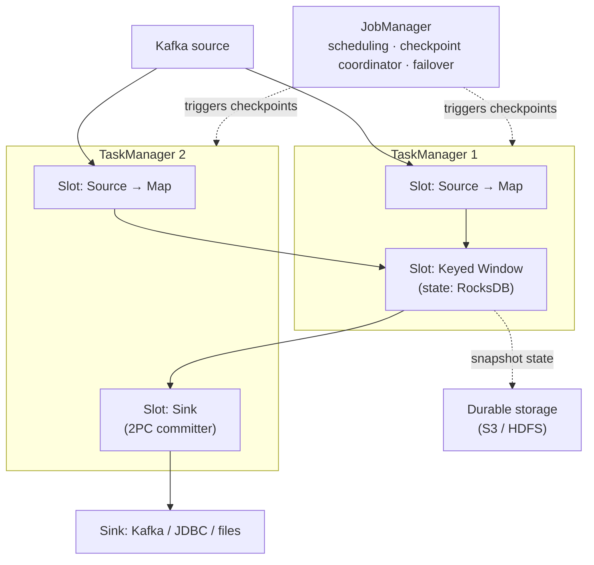
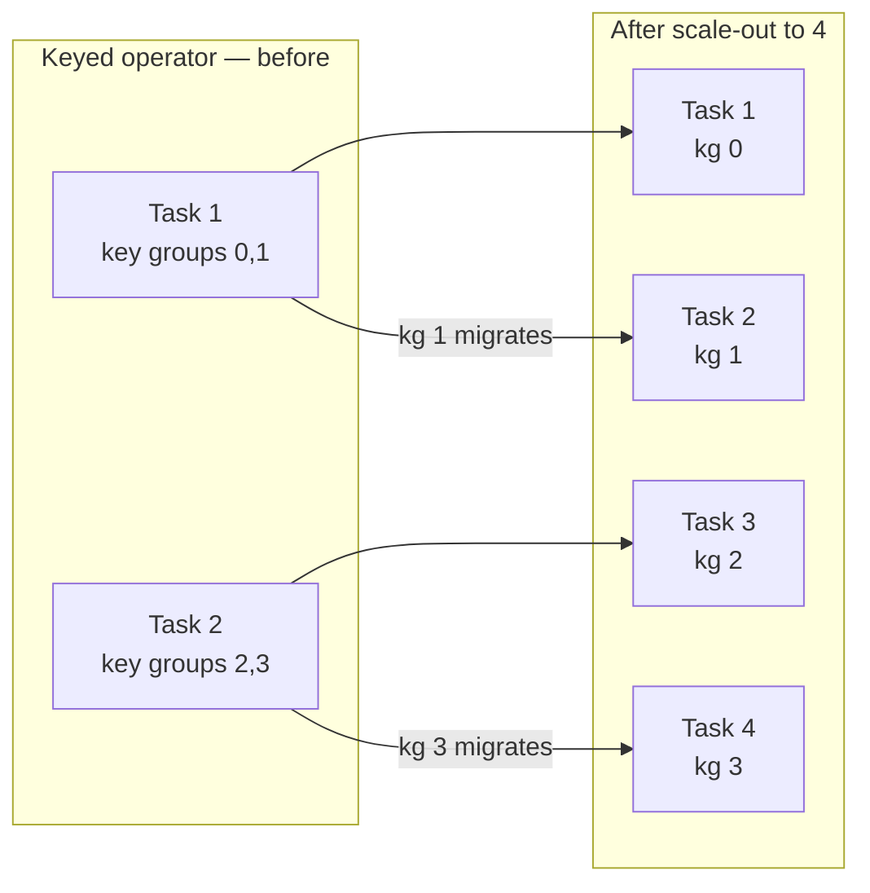
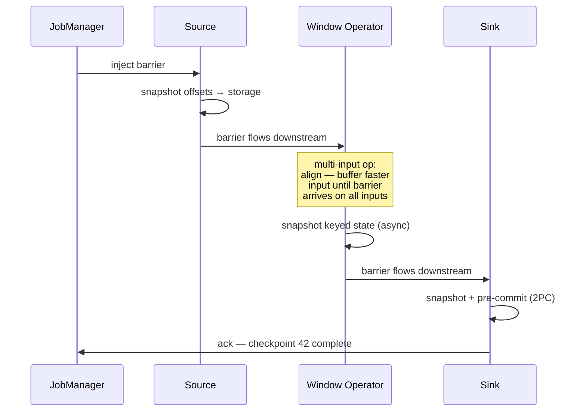
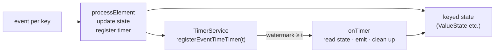
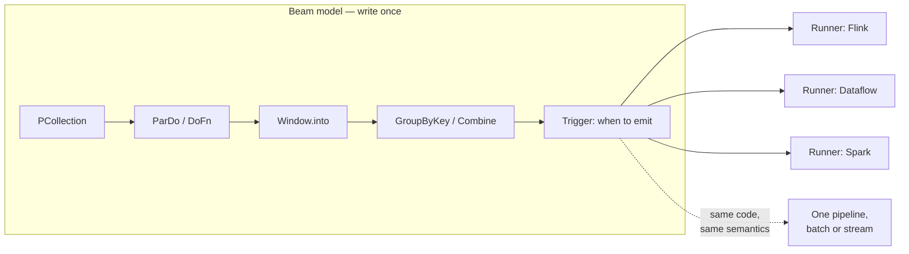

# Flink & Beam

> **Why it matters** — When the job is "aggregate a Kafka topic per user per minute, tolerate failures, replay cleanly," the engine choice decides whether recovery takes seconds or a night of deduplication. Flink is the default stateful-streaming engine today; Beam is the model you write when portability (Dataflow, Flink, Spark) is a requirement, not a preference.

## Flink runtime

A Flink cluster is a **JobManager** (coordinator: scheduling, checkpoint triggering, failure recovery) plus **TaskManagers** (workers running parallel operator subtasks in **slots**). The job graph — sources, keyed operators, sinks — is chopped into tasks that hold local **state**.

Key vocabulary for interviews:

- **Operator state vs keyed state** — operator state is per-subtask (a Kafka source's partition offsets); keyed state is per-key (`ValueState`, `MapState`, `ListState`) and redistributed on rescaling via key groups.
- **Parallelism** — each operator's subtask count; keyed state can only rescale within `maxParallelism` key groups.
- **Task chaining** — adjacent operators fuse into one task, avoiding serialization and network hops.

### Keyed state primitives

| Primitive | Shape | Typical use |
|---|---|---|
| `ValueState<T>` | one value per key | last-seen event, running count |
| `ListState<T>` | list per key | buffered records for a key |
| `MapState<K,V>` | map per key | per-key dictionaries, joins |
| `ReducingState` / `AggregatingState` | incremental combine | sums, merges — never materialize the list |
| `MapState` + timers | event/proc-time timers per key | session gaps, timeouts, TTL-like logic |

Keyed state is sharded into **key groups** — the rescaling unit. `maxParallelism` fixes how many key groups exist at job start; you can only rescale to parallelism ≤ that number without a full state migration. Set it at first deploy, not after the state is real.

Rescaling never moves individual keys — it remaps **whole key groups** to subtasks, which is what makes scale-out/in cheap and deterministic. Each key hashes into exactly one of `maxParallelism` key groups; the number of key groups assigned per subtask just changes. The same repartitioning logic applies on *any* stateful-parallelism change, including savepoint restores at a different parallelism. The non-keyed operators scale differently: operator **list state** redistributes entries evenly, **union list state** broadcasts the full list to every new task (each keeps what it needs), and **broadcast state** is simply copied — downscaling just cancels surplus tasks.

### Sizing slots vs TaskManagers

A **TaskManager is a JVM process**; a **slot is a slice of that process** that runs one parallel slice of the whole job — one subtask of *each* operator — as a thread. All tasks in a TM share its heap, network stack, and fate: one misbehaving task can kill the process and every task on it.

| Decision | Consequence | Rule of thumb |
|---|---|---|
| Many slots per TM | Cheap colocation — chained/local tasks exchange data in-process, no network | Default for throughput; watch for one bad task taking siblings down |
| One slot per TM | Hard isolation per job slice; failure blast radius = one task | Unstable UDFs, mixed-tenant clusters |
| Several TMs per host | Threads for parallelism + processes for isolation | The standard production topology |
| Slots vs cores | `slots ≈ CPU cores` per TM is the classic starting point; I/O-heavy jobs can oversubscribe | Measure CPU vs state-access wait before adding slots |

Two constraints the model implies: the job needs **as many slots as its maximum operator parallelism** (a pipeline with a `parallelism=4` operator needs ≥4 free slots, period), and network buffer demand grows **quadratically** with task count on shuffle/broadcast connections — each sending task needs a dedicated buffer per receiving task. A job that ran fine small can wedge at scale on buffer starvation, not CPU.

## Deployment: session, application, Kubernetes

| Mode | Cluster lifecycle | Where it fits |
|---|---|---|
| **Session** | Long-lived cluster; many jobs submit to it | Shared dev clusters, mixed workloads — resource contention is your problem |
| **Application (K8s)** | Cluster per job/app; JM+TMs are pods, autoscaled | Production default — isolation, savepointed upgrades, native HA |
| **YARN** | Legacy Hadoop-era resource manager | Older on-prem estates; largely replaced by K8s operator |

The **Flink Kubernetes Operator** is the production standard now: declare a `FlinkDeployment` and it handles JobManager HA via K8s leader election, savepoint-on-upgrade, and autoscaler integration.

## Checkpoints: barrier alignment

Flink's fault tolerance is a **distributed snapshot** of all operator state, triggered by the JobManager inserting **checkpoint barriers** into the data stream. When a barrier reaches an operator, the operator snapshots its state; barriers flow with the stream, so a snapshot is a consistent cut — "every record before barrier *n* has been applied."

With **multiple inputs**, an operator must *align*: it stops processing the input where the barrier already arrived until the barrier arrives on all inputs. Under backpressure, alignment stalls — which is why **unaligned checkpoints** exist: the barrier overtakes buffered records and the in-flight data is snapshotted too, so checkpointing keeps working when the pipeline is lagging. On Flink 1.x they are opt-in via `execution.checkpointing.unaligned.enabled`; from Flink 2.0 (FLIP-413) they are the default.

::: warning ⚠️ Long checkpoints are a symptom
Checkpoint duration growing toward the interval means state is too big, RocksDB is I/O-bound, or backpressure is blocking barrier flow. `checkpointingMode: UNALIGNED` and incremental RocksDB snapshots are the first levers — not a longer interval, which just delays the crash.
:::

### Backpressure propagation

Flink's flow control is **credit-based**: each downstream input channel announces buffer credits upstream; a task whose output buffers are all occupied stops emitting, and that blockage propagates back to the source, which simply stops polling Kafka. There is no "slow consumer signal" — backpressure *is* the signal, and it shows up as checkpoint alignment stalls and `outPoolUsage`/`inPoolUsage` saturation before anything errors.

<BackpressureViz />

Run the producer faster than the consumer. With backpressure **ON**, the receiver only grants as many buffer credits as it can drain, so the sender's effective rate collapses to the consumer's — the backlog notification even lets the receiver prioritize which senders get the next credits. With it **OFF**, the bounded buffer fills and events drop. That is the whole mechanism: Flink never tells upstream to slow down; it simply stops handing out credits, and the stall propagates hop by hop until the source stops polling Kafka.

### Async I/O and Async State API

Two workhorses worth naming: **Async I/O** (`AsyncDataStream`) for enrichment calls to external services — unordered or ordered waits without blocking the operator thread — and **Async State Access** (State V2, Flink 2.x), which removes RocksDB's synchronous get/put latency from the processing path for state-heavy jobs.

## Exactly-once end-to-end: the two-phase-commit sink

Checkpoints make *internal* state exactly-once. To extend that to the sink, Flink's `TwoPhaseCommitSinkFunction` ties external writes to the checkpoint cycle — the protocol maps cleanly onto it:

1. **`beginTransaction`** — before the first record (and after every barrier), the sink opens a transaction on the external system: a Kafka transaction, a temp file, an uncommitted DB transaction.
2. **`invoke`** — every record between barriers is written *inside* the open transaction — visible to the sink system but not committed.
3. **`preCommit`** — on barrier arrival, the sink flushes/stages the transaction, snapshots the transaction handle as state, and acks the checkpoint. This ack is the 2PC "commit vote."
4. **`commit`** — when the JobManager broadcasts checkpoint-complete (every task acked), all parallel sink instances commit together. This notification is the 2PC "commit command."
5. **`abort`** — on failure before completion, the pending transaction is rolled back; recovery resumes from the last completed checkpoint.

Because voting piggybacks on the regular checkpoint, 2PC costs almost nothing per record — it runs once per checkpoint interval, not per message. The hard part is the *contract the sink system must honor*:

- **Transactional writes** — data written must not be visible before commit (or transactions must be emulated, e.g. temp-file → atomic rename).
- **Transaction survives a checkpoint interval** — and longer during recovery; a sink-side timeout that closes the transaction loses data.
- **Recoverable transaction handle** — a transaction ID the sink can commit or abort after a process crash.
- **Idempotent commit** — a repeated commit after recovery must be a no-op.

Once a sink task has *acked* a checkpoint, it **must** be able to commit that transaction even across a crash — that invariant is the whole exactly-once guarantee.

### The end-to-end exactly-once checklist

Checkpoints only make *internal* state consistent. End-to-end exactly-once is a property of the whole chain — the book's consistency matrix:

| | Non-resettable source | Resettable source |
|---|---|---|
| Any (plain) sink | At-most-once | At-least-once |
| Idempotent sink | At-most-once | Exactly-once* — transient inconsistencies while replaying |
| WAL sink | At-most-once | At-least-once |
| 2PC sink | At-most-once | **Exactly-once** |

The requirements, in order:

1. **Source must be resettable** — it must persist its read position in checkpointed state and be able to rewind: Kafka partition offsets, file byte offsets. A socket source discards data once consumed — no reset, no better than at-most-once, full stop.
2. **All state checkpointed** — every operator's state lands in the snapshot.
3. **Sink must be transactional or idempotent** — 2PC (writes only materialize on checkpoint completion) or deterministic upserts (idempotent writes can momentarily show rolled-back results during replay — "jump back in time" — before converging).

The WAL-sink alternative — buffer all output in state, flush on checkpoint-complete — works with *any* sink system but bloats state, emits in spikes, and only reaches at-least-once in edge cases. Prefer 2PC when the sink supports transactions.
Kafka sinks get this free (`delivery.guarantee=EXACTLY_ONCE` wraps Kafka transactions); JDBC sinks achieve it via XA or upsert-and-dedup. The checkpoint completes only when every participant acks — one consistent epoch across state, offsets, and side effects.

::: tip 💡 Senior insight
Exactly-once is a *pipeline property*, not a connector feature. The chain is: idempotent/transactional source replay → consistent state snapshot → atomic sink commit. Any non-transactional leg (an HTTP API call, a fire-and-forget side output) silently drops you to at-least-once — plan for it explicitly.
:::

## State backends

Where keyed/operator state physically lives:

| | **HashMap / embedded heap** (`HashMapStateBackend`) | **RocksDB** (`EmbeddedRocksDBStateBackend`) |
|---|---|---|
| State location | JVM heap + snapshots to storage | Local disk (embedded LSM) + incremental snapshots to storage |
| Max state size | Heap-bound — GBs risky, GC pressure | Practically unbounded — TBs common |
| Read/write latency | In-memory, fastest | Per-access disk/serialization cost (~10–50 µs) |
| Snapshots | Full — cost grows with state | Incremental — only changed SSTables upload |
| Recovery | Reload entire state from snapshot | Restore changed files only — faster catch-up |
| Use when | Small state, lowest latency | Any production job with GBs+ of state |

::: info ℹ️ The practical rule
Dev and small-state jobs: heap. Anything with keyed windows over real traffic or joins across days: RocksDB with incremental checkpoints and `state.ttl` set — otherwise state grows until the job falls over, and "the job worked for three months" is not a coincidence, it's a memory leak you called steady state.
:::

## Savepoints vs checkpoints

Both are snapshots of the same mechanism; they differ in *who triggers them and why*.

| | Checkpoint | Savepoint |
|---|---|---|
| Trigger | Automatic, periodic | Manual (`flink savepoint <job>`) or CLI/API on deploy |
| Purpose | Failure recovery — restart in place | Planned ops: upgrades, rescaling, code changes, A/B rollouts |
| Retention | Rotated (keep-last-N), owned by the job | Retained until deleted, owned by the operator |
| Format stability | Internal — can change between versions | Stable/portable across versions by contract |

### Savepoint-compatible evolution — what breaks a savepoint

Savepoint state is indexed by **operator `uid` + state name**, not by task. A modified job can only adopt savepoint state where the new graph has a matching uid. Since default uids are generated from each operator's position in the graph, any structural edit silently re-ids everything downstream.

| Change | Savepoint survives? |
|---|---|
| Change parallelism of any operator | ✅ — state redistributes by key group |
| Swap function logic, same uid, same state schema | ✅ — this is the point of savepoints |
| Add a new operator mid-graph | ✅ with manual uids; ❌ with generated uids (downstream ids shift) |
| Remove an operator that held state | ⚠️ — its savepointed state is orphaned/unrestorable |
| Change a state field's type or serializer | ❌ — schema mismatch on restore |
| Rescale keyed state beyond `maxParallelism` | ❌ — key groups can't split further; requires state migration |
| Restore a job that never had `uid()`s set | ❌ — ids don't line up; effectively starting fresh |

Rule: assign `uid()` to every operator **before the first stateful deploy** — retrofitting uids onto a running job means abandoning its current savepoints.

The standard deploy dance: `savepoint` → cancel job → redeploy new jar with `--fromSavepoint`. Skip it and you either lose state or recover from a checkpoint that may not match the new job graph.

## Failure modes you'll actually see

| Symptom | Real cause | First lever |
|---|---|---|
| Checkpoint timeout / slow alignment | Backpressure upstream of the barrier, or state too large | Unaligned checkpoints; incremental RocksDB; find the saturated task first |
| State grows forever | Missing `state.ttl`, or allowed lateness wider than needed | TTL matched to the window semantics — see [Windows & Watermarks](/streaming/windows-watermarks) |
| Recovery takes minutes | Full state restore from remote storage on every restart | Local recovery (task-local state), fewer restarts, smaller state |
| Job "works" until deploy | Graph changed between savepoint and new jar; operator `uid` drift | Always `uid()` every operator so savepoints map cleanly |
| Sinks emit duplicates after restart | Non-2PC sink replaying post-checkpoint records | Transactional/idempotent sink, or accept at-least-once and dedup downstream |
| Lag grows steadily | Parallelism can't keep up with input rate | More parallelism on the bottleneck operator, or fewer per-record costs (chaining, avoid serialization) |
| Job won't restart after a TM died | Remaining slots < max operator parallelism — job needs slots ≥ widest operator, not average | More TMs/slots, or reduce parallelism; the JM waits rather than degrade |
| Throughput collapses at larger scale | Network buffers quadratic in task pairs on shuffle/broadcast connections | More TM network buffers; break chains so fewer channels multiplex |
| Checkpoints always running, processing starved | Checkpoint duration ≥ interval; only one in-flight by default | `minPauseBetweenCheckpoints` to protect processing; `maxConcurrentCheckpoints` only when checkpoints are slow-but-cheap |
| Recovery replays minutes of duplicates | Long checkpoint interval + non-transactional sink | Shorter interval, or a 2PC/idempotent sink |
| One task's OOM kills half the job | Slots are threads in one JVM — no fault isolation inside a TM | Fewer slots per TM / more TMs per host for blast radius |
| Checkpoints slow with heavy timers | Heap-stored timers checkpoint synchronously under RocksDB incremental | RocksDB-managed timers; bound timer cardinality per key |

::: info ℹ️ uid() is the cheapest insurance
Every operator you don't name gets an auto-generated uid from its position in the job graph — which changes the moment you reorder code. Name operators once (`uid("window-agg")`) and every future savepoint survives refactors.
:::

### Event-time timers and the process-function pattern

`KeyedProcessFunction` is the escape hatch when windows can't express the logic. `processElement` sees each record plus a `Context` carrying the record's timestamp, key, and a `TimerService`; `onTimer` fires callbacks. Two timer domains: `registerProcessingTimeTimer` (wall clock of the machine) and `registerEventTimeTimer` (fires when the **watermark** reaches the timestamp — this is how you get "no event for this key in 30 min of *event* time").

The pattern that makes it powerful: **state + timer = arbitrary per-key logic** — session reconstruction, "emit if no second event within X," TTL-style expiry, custom windows — with `processElement` and `onTimer` synchronized so state access is single-threaded per key.

The mechanics worth memorizing:

- **One timer per key per timestamp** — re-registering the same timestamp is a no-op; a key may hold many timers at different timestamps.
- **Timers are checkpointed state** — processing-time timers that expired during downtime fire immediately on resume (expect a burst); timers restored from savepoints behave the same.
- **Past timestamps are not dropped** — processing-time timers fire right away; event-time timers fire on the next watermark.
- **Timers live on heap by default** — a priority queue per key. With RocksDB incremental checkpoints, heap timers are checkpointed *synchronously*: millions of timers = slow checkpoints. Configure RocksDB-managed timers or keep timer counts bounded.
- **Timers require a keyed stream** — a constant `KeySelector` key works but collapses the operator to parallelism 1.

### Flink SQL and the Table API

Flink SQL is not a toy layer — it compiles to the same operator graph as DataStream code, so `MATCH_RECOGNIZE`, windowing TVFs (`TUMBLE`, `HOP`, `CUMULATE`), and upsert/changelog sinks all inherit the same checkpoint and state machinery. Production teams increasingly write streaming jobs as SQL for exactly this reason: same correctness contract, a fraction of the code. The DataStream API remains for what SQL can't express — custom timers, low-level state, async patterns.

## Beam: the portable model

Beam answers four questions — **What** are you computing, **Where** in event time, **When** do results materialize, **How** do refinements relate — and turns them into one model that runs over batch *and* stream:

- **`PCollection`** — the dataset (bounded or unbounded).
- **`PTransform` / `ParDo`** — per-element processing; `DoFn` is the unit of user logic.
- **`GroupByKey` / windowing / triggers** — grouping, event-time slicing, and materialization timing.
- **Runners** — the same pipeline executes on Flink, Dataflow, Spark, or the local Direct runner; the runner translates the model, it doesn't change the semantics.

Two Beam specifics worth internalizing: **PCollections are immutable** — transforms produce new collections, which is what makes the model runner-agnostic and replayable — and **`DoFn` supports per-key state and timers** (`@StateId`, `@TimerId`), so session logic and event-time callbacks are expressible portably, with the runner implementing them.

**"Beam = model, Flink = engine"** is not marketing shorthand — it's the architecture: Beam defines *semantics* (event-time correctness, windows, triggers, accumulators) and the runner implements them. A Flink-native job gets deeper control (async I/O, finer state TTL, lower-level APIs); a Beam job gets portability and a cleaner mental model.

::: details Where portability actually breaks

The model is portable; the *implementation coverage* is not uniform. A pipeline that uses timers, state, or merging session windows runs on Flink and Dataflow but may fall back to emulation — or not run — on weaker runners. Splittable `DoFn`, some trigger combinations, and certain side-input patterns have runner-specific gaps; the Beam capability matrix is the reference, not a nice-to-have. Portability is real for the common 80% — windows, triggers, stateful DoFns, Kafka IO — and the other 20% is where you pin to a runner anyway. Treat "runs anywhere" as "runs on the runners that matter to you."

:::

## Choosing an engine

| | **Apache Beam** | **Apache Flink** | **Spark Structured Streaming** |
|---|---|---|---|
| Programming model | Declarative (What/Where/When/How), portable | DataStream/Table API, engine-native | Micro-batch DataFrame API + continuous mode |
| Latency | Runner-dependent (Flink/Dataflow: true streaming) | True streaming, ~ms–10s of ms | Micro-batch: ~100 ms–seconds; continuous mode rare |
| State | Runner-managed keyed state | First-class keyed state, RocksDB scale, TTL | State store with checkpoints; bounded by micro-batch |
| Event-time support | Canonical — windows, watermarks, triggers | Native — watermarks, allowed lateness | Event-time windows + watermarking, trigger semantics limited |
| Exactly-once | Runner + sink dependent | Checkpoints + 2PC sinks, mature | Checkpointed micro-batch + idempotent/transactional sinks |
| SQL | Beam SQL (Calcite, subset) | Flink SQL / Table API — production-grade | Spark SQL — strongest ecosystem |
| Best fit | Portability, Dataflow on GCP, one codebase batch+stream | High-throughput stateful streaming, fine control | Teams already on Spark, latency ≥seconds acceptable |

### When Kafka Streams is enough

If your topology is **Kafka in → transform → Kafka out**, and you don't need multi-engine portability, **Kafka Streams** is often the right answer:

- A library in your app, not a cluster — no JobManager to run; scaling = more app instances; state lives in embedded RocksDB + changelog topics.
- Exactly-once via Kafka transactions with zero extra infrastructure.
- You lose: non-Kafka sources/sinks without Connect, the Beam model's portability, and Flink's richer event-time toolbox (side outputs, CEP, async state access).

::: warning ⚠️ Kafka Streams is not a general engine
The moment you need to join against an external system at scale, serve queries on arbitrary state, or leave the Kafka ecosystem, you've outgrown it — and a rewrite is the exit cost. If there's any real doubt, Flink; if the whole job is genuinely Kafka-in/Kafka-out, Streams is dramatically less ops.
:::

## 🧠 Quiz

<QuizCard :questions="[{ q: 'A JobManager says the job cannot restart after a TaskManager died, even though most slots are free. Why?', options: ['The network buffers leaked', 'State was lost', 'Checkpoint barrier alignment failed', 'The job needs as many slots as its maximum operator parallelism — a parallelism-4 operator needs 4 slots, and the lost TM dropped the pool below that'], correct: 3, explain: 'Slots are the scheduling unit: an app needs slots ≥ max operator parallelism. If the surviving TMs cannot supply them, the JobManager waits for resources rather than restart degraded.' }, { q: 'A sink task acked checkpoint 42, then crashed before the JobManager sent the completion notification. What must the sink be able to do for exactly-once to hold?', options: ['Re-read the source', 'Discard the transaction', 'Wait for checkpoint 43', 'Recover and commit the pre-committed transaction — once it voted, aborting would lose data'], correct: 3, explain: 'The ack is the 2PC commit vote. After voting, the transaction must be committable across failures — via a recoverable transaction handle — or the records it covers are lost.' }, { q: 'You redeploy a job from a savepoint with a new operator added mid-pipeline. Stateful operators downstream of it lose their state. Why?', options: ['The savepoint was corrupt', 'Default operator uids are generated from graph position — inserting an operator re-ids everything after it', 'The parallelism changed', 'RocksDB snapshots are not portable'], correct: 1, explain: 'Savepoint state maps by uid + state name. Generated uids shift when the graph changes; uid() on every operator is the fix — applied before the first stateful deploy.' }]" />

<QuizCard :questions="[{ q: 'A barrier arrives on one input of a two-input operator but not the other. What does the operator do in an aligned checkpoint?', options: ['Duplicates the barrier', 'Buffers the arrived input until the barrier arrives on all inputs, then snapshots', 'Skips the checkpoint', 'Snapshots immediately'], correct: 1, explain: 'Alignment is what makes the snapshot a consistent cut. It is also why backpressure stalls checkpoints — unaligned checkpoints let the barrier overtake in-flight records to keep working under load.' }, { q: 'Why is RocksDB the default state backend recommendation for production streaming jobs?', options: ['It avoids serialization', 'It is required for savepoints', 'State size is not heap-bound and incremental checkpoints upload only changed SSTables', 'It is faster than heap for all access'], correct: 2, explain: 'Heap state backends bound you to JVM memory and full snapshots. RocksDB spills to local disk, snapshots incrementally, and scales to TBs of keyed state.' }, { q: 'What makes an application end-to-end exactly-once rather than just internally exactly-once?', options: ['Task chaining', 'Faster checkpoints', 'RocksDB state backend', 'A resettable source plus a sink that is transactional (2PC) or idempotent'], correct: 3, explain: 'Exactly-once is end-to-end: source replay + state snapshot + atomic commit. A sink that cannot participate in 2PC or be idempotent reverts the whole pipeline to at-least-once.' }, { q: 'Beam pipelines run on Flink, Dataflow, and Spark with the same code. What actually transfers?', options: ['Only the SQL', 'The binary artifacts', 'The semantics — PCollections, windows, triggers, event-time model; the runner implements execution', 'The checkpoint format'], correct: 2, explain: 'Beam is a specification of semantics plus SDKs. Runners translate the model to engine primitives — that is the Beam = model, engine = runner split.' }, { q: 'Job: read Kafka topic, enrich from another Kafka topic, write to a Kafka topic. Which engine is dramatically less ops than running Flink?', options: ['Beam on Dataflow', 'Flink SQL', 'Spark', 'Kafka Streams — a library in your app; scaling is more instances, exactly-once via Kafka transactions with no separate engine to operate'], correct: 3, explain: 'For pure Kafka-in/Kafka-out topologies Kafka Streams removes the cluster entirely. You lose non-Kafka IO, the Beam model, and the richer event-time toolbox of Flink.' }]" />

## Further reading

- [Apache Flink documentation](https://nightlies.apache.org/flink/flink-docs-stable/)
- [Flink checkpointing & fault tolerance](https://nightlies.apache.org/flink/flink-docs-stable/docs/dev/datastream/fault-tolerance/checkpointing/)
- [Flink state backends](https://nightlies.apache.org/flink/flink-docs-stable/docs/ops/state/state_backends/)
- [Flink savepoints](https://nightlies.apache.org/flink/flink-docs-stable/docs/ops/state/savepoints/)
- [Apache Beam Programming Guide](https://beam.apache.org/documentation/programming-guide/)
- [Kafka Streams documentation](https://kafka.apache.org/documentation/streams/)
- **Stream Processing with Apache Flink** — Fabian Hueske & Vasiliki Kalavri (2019), [O'Reilly](https://www.oreilly.com/library/view/stream-processing-with/9781491974285/)
- [Spark Structured Streaming guide](https://spark.apache.org/docs/latest/structured-streaming-programming-guide.html)
- [Chandy–Lamport distributed snapshots (the paper checkpoints are built on)](https://lamport.azurewebsites.net/pubs/chandy.pdf)
