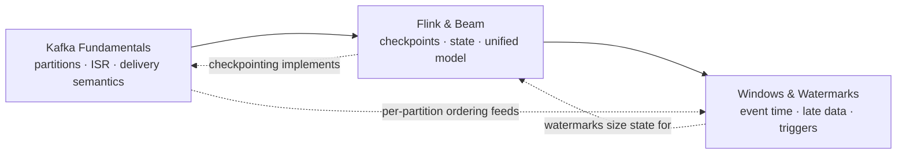

# Track 6 · Streaming Systems

> **Why it matters** — Streaming is where batch intuitions break: event time, watermarks, exactly-once claims, and unbounded state all fail quietly until they page you. This track builds the mental model that keeps "real-time" pipelines correct under late data and replays.

Most production "streaming" work is not exotic: it is Kafka in the middle, a stream processor doing windowed aggregation or enrichment, and a fight with late data and state size. This track covers exactly that stack — the broker, the engine, and the time semantics that make results correct.

**Who this is for:** engineers who can already build batch pipelines and need to reason about unbounded data — consumer lag, exactly-once claims, watermarks, and state — at a level that survives a senior interview and a 3am page.

## The track at a glance

## Chapters

### [Kafka Fundamentals](/streaming/kafka)

The broker as a replicated commit log: leaders, followers, and the ISR; consumer groups and why rebalancing is the most common production incident; delivery semantics from at-most-once to transactional exactly-once; partition sizing math; skewed keys and hot partitions; KRaft (ZooKeeper is gone in Kafka 4.x); retention and log compaction; and a field-tested best-practices checklist.

### [Flink & Beam](/streaming/flink-beam)

The two dominant processing stacks. Flink: JobManager/TaskManager runtime, checkpoint barrier alignment, two-phase-commit sinks for end-to-end exactly-once, RocksDB vs heap state, savepoints vs checkpoints. Beam: the PCollection/ParDo programming model, one codebase across batch and stream, portable runners — and the mental split "Beam is the model, Flink is the engine." Plus where Kafka Streams and Spark Structured Streaming sit.

### [Windows, Watermarks & Late Data](/streaming/windows-watermarks)

Event time vs processing time and why skew between them is the whole problem; tumbling, sliding, session, and global windows; watermarks as the completeness heuristic; allowed lateness, side outputs, and triggers; and a fully worked 10-minute tumbling-window example showing exactly when each pane fires and where late events land.

## Pareto focus

If you retain only eight ideas from this track:

- **Ordering is per-partition only.** Everything else — keys, consumer concurrency, hot partitions — follows from this.
- **Partitions are your concurrency budget.** Consumers per group ≤ partitions; sizing is throughput math plus headroom, not vibes.
- **Delivery semantics are a configuration, not a feature.** At-least-once + idempotent consumer, or transactions end-to-end. "Exactly-once" without both halves is marketing.
- **Rebalancing is the failure mode.** Cooperative-sticky assignment and static group membership prevent most stop-the-world incidents.
- **Checkpoints are the recovery unit.** Flink's barrier-aligned snapshot is what makes exactly-once real; savepoints are the operator-facing version.
- **Event time is the only time that matters.** Watermarks are the estimate of completeness; allowed lateness bounds the state you pay to keep.
- **Beam = model, Flink = engine.** The What/Where/When/How questions are portable; the runner is a deployment choice.
- **State size is the real capacity limit.** RocksDB for big state, TTL for state you forgot you were keeping.
