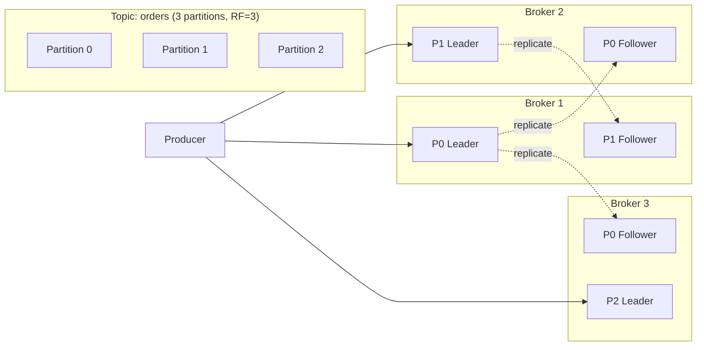
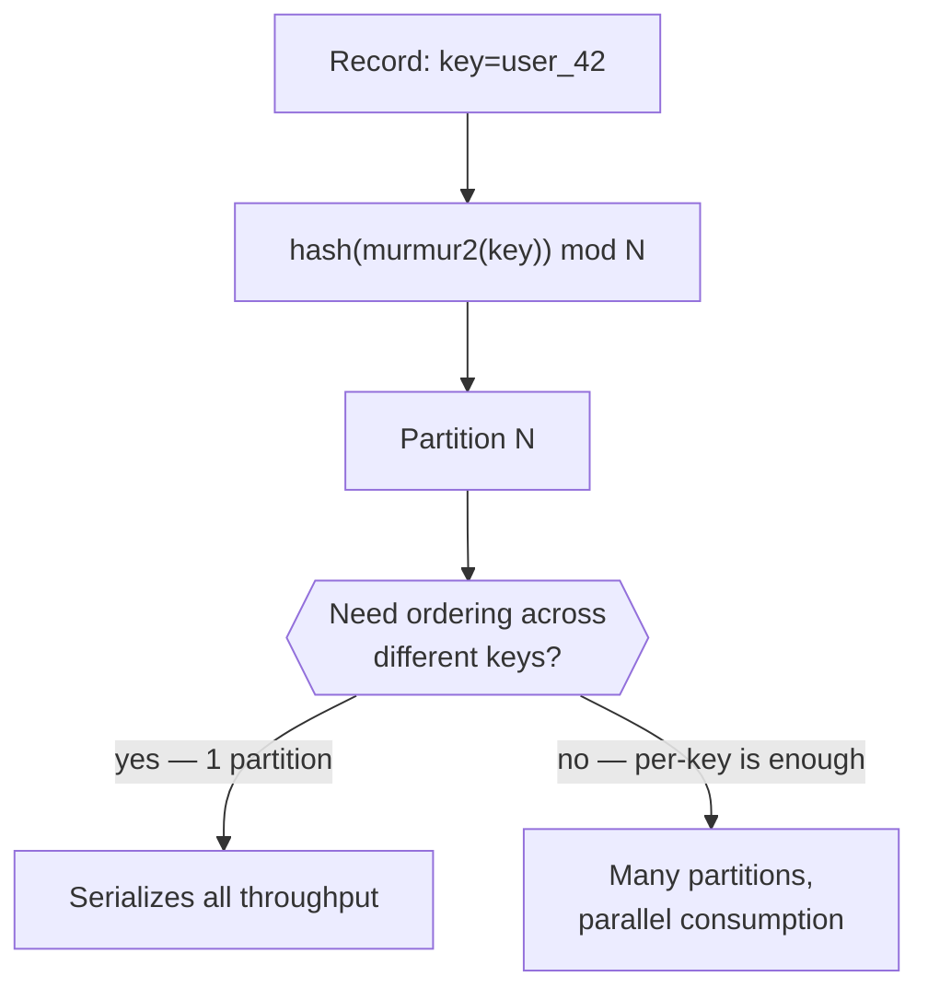
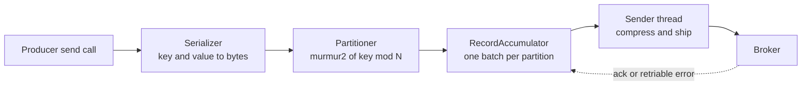
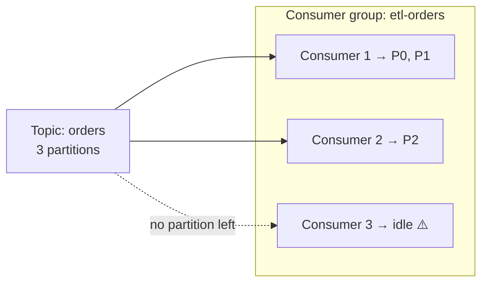
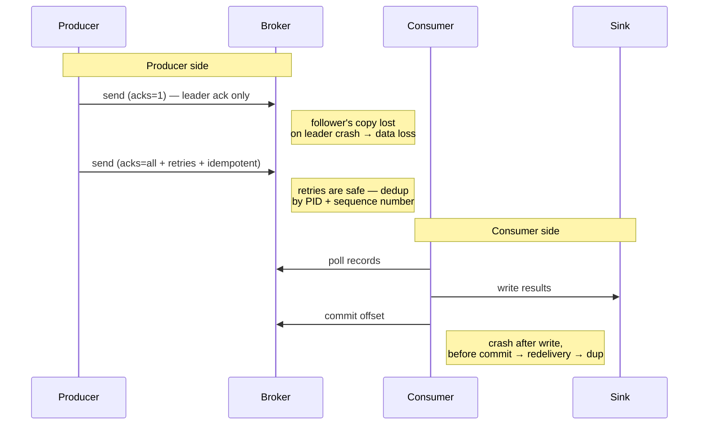

# Kafka Fundamentals

> **Why it matters** — Kafka is the default write-ahead log between every producer and consumer in modern data platforms. When it breaks, it breaks as consumer lag, duplicated metrics, or a rebalancing storm that looks like an outage but isn't. The senior skill is not the API — it is knowing which of the five knobs (partitions, acks, commits, keys, retention) just caused the incident.

## The broker as a replicated commit log

A Kafka topic is an ordered, append-only log split into **partitions**. Each partition lives on one broker as the **leader**; replica copies on other brokers are **followers**. Producers and consumers only ever talk to the leader — followers exist purely for failover.

### ISR: the in-sync replica set

The **ISR** is the subset of replicas caught up to the leader (within `replica.lag.time.max.ms`). Writes acknowledged with `acks=all` are durably on every ISR member. If a follower falls behind — slow disk, GC pause, network partition — it leaves the ISR; if the leader dies, only an ISR member can be elected the new leader.

::: warning ⚠️ min.insync.replicas is a correctness knob
`acks=all` + `min.insync.replicas=1` silently degrades to "leader only" the moment one follower lags — you get an acked write that survives zero replicas. Set `min.insync.replicas=2` with RF=3 so a single broker failure can never lose acknowledged data. The cost: writes fail when only one replica is alive.
:::

::: tip 💡 Under-replicated partitions are the canary
`UnderReplicatedPartitions > 0` on any broker is the single most important Kafka metric. It means replication is broken somewhere — disk full, network, or a broker falling behind — before any consumer notices. Alert on it first.
:::

### Rack-aware placement and preferred leader election

`broker.rack` tags each broker with a fault domain — a physical rack, or an AZ in the cloud. Kafka then spreads a partition's replicas across distinct racks **at topic creation**, so a rack or AZ outage cannot take out every copy. Two caveats the docs bury:

- Rack awareness applies only when partitions are *created*. Partition reassignment can silently undo it, and Kafka neither monitors nor self-corrects the drift — an external balancer (e.g. Cruise Control) keeps it honest.
- Each partition also has a **preferred leader**: the replica designated leader in the original assignment. With `auto.leader.rebalance.enable=true` the controller periodically checks (default every 5 minutes via `leader.imbalance.check.interval.seconds`) whether preferred leaders are actually leading, and elects them back if eligible. That is how leader load rebalances after broker bounces; a manual preferred-leader election does the same on demand.

:::: warning ⚠️ unclean.leader.election is an availability-vs-durability switch
`unclean.leader.election.enable=true` lets an out-of-ISR replica take leadership when no in-sync replica survives — the partition stays available but every acknowledged write not yet on that replica is gone. Default `false` prefers durability: the partition waits for an ISR member to return. Leave it off unless downtime is more expensive than data loss, and know which you chose.
::::

## Ordering, keys, and partitioning

Kafka guarantees ordering **within a partition, only**. Records with the same key hash to the same partition, so per-entity ordering is free — but cross-entity ordering is not.

- **Key choice = co-location choice.** Key by the entity you need ordered (`user_id`, `order_id`), not a surrogate.
- **`partitioner` matters.** The default `murmur2` hash spreads uniformly; a bad custom partitioner can concentrate load.
- **Round-robin / sticky without keys** maximizes throughput but forfeits per-entity ordering.

::: warning ⚠️ Key skew → hot partition
One key carrying 30% of traffic (a celebrity user, a `null` key, `country='US'` on a skewed dataset) makes one partition the bottleneck for the whole topic: its consumer burns a core while others idle. Fixes in order of preference: salt the key (`user_42#rand(0..K)`) and aggregate downstream, separate the hot key to its own topic, or reduce per-record cost so the hot consumer keeps up. You cannot rebalance a key across partitions — the hash is the contract.
:::

## Producer batching: the throughput lever nobody reads

- **`compression.type`** — `lz4` or `zstd` usually *increases* end-to-end throughput: less network I/O beats the CPU cost on both sides.

`send()` looks synchronous but is a pipeline:

The **RecordAccumulator** is where batching actually happens: every partition gets its own batch inside `buffer.memory`, and a background **Sender** thread drains each batch when it fills or has waited `linger.ms`, groups batches per destination broker, and ships one produce request per broker. This is why the producer has almost no backpressure until `buffer.memory` fills and `send()` itself blocks for `max.block.ms`, then throws.

| Knob | Default | Turn it when | Watch out |
|---|---|---|---|
| `linger.ms` | 0 — send ASAP | Batch-heavy workloads: 5–20 ms buys several× throughput and far better compression | Adds that latency to every record |
| `batch.size` | 16 KB per partition | Bigger records or high per-partition rates | It is bytes *per partition* — memory cost scales with partition count, and an oversized setting does not delay sends (half-full batches still ship) |
| `delivery.timeout.ms` | 120 s | The real "how long until give up" knob: covers linger + request timeouts + all retries | Prefer it over tuning `retries` — set it above leader-election time (~30 s+) so a broker crash does not exhaust the retry budget |
| `buffer.memory` / `max.block.ms` | 32 MB / 60 s | Bursty producers outrunning the broker | Exceeding `max.block.ms` throws `TimeoutException` from `send()` — the only producer backpressure there is |
| `max.in.flight.requests.per.connection` | 5 | Keep ≤5 with `enable.idempotence=true` | Retries with >1 in flight and no idempotence can reorder records within a partition |

:::: tip 💡 Senior insight: tune the timeout, not the retries
The book's practical rule: measure how long leader election takes after a broker crash (commonly ~30 s), set `delivery.timeout.ms` comfortably above it (e.g. 120 s), and leave retries effectively unbounded. "Retry for longer than the cluster takes to heal" is a saner contract than guessing a retry count and backoff.
::::

::: info ℹ️ Throughput vs latency is one dial
`linger.ms` + `batch.size` + compression trade a few milliseconds of added latency for large throughput gains and smaller broker load. Set them deliberately instead of inheriting latency-optimal defaults for a batchy workload.
:::

## Consumer groups and rebalancing

Consumers in a **group** share the partitions of a topic; each partition is read by exactly one member at a time. That invariant is also the limit: **a group can never run more consumers than the topic has partitions**.

Offsets are committed per partition to the internal `__consumer_offsets` topic; on failure, the next owner resumes from the last commit — which is what makes redelivery (and duplicates) possible.

### Inside the poll loop

`poll()` is the consumer's entire event loop, not just a fetch: it finds the group coordinator, joins the group, receives and revokes assignments, runs rebalance callbacks, fetches records, and drives heartbeats. Nearly every consumer failure — including anything thrown inside your own rebalance listeners — surfaces as an exception from `poll()`.

| Knob | Default | What it controls |
|---|---|---|
| `fetch.min.bytes` | 1 byte | Broker waits until at least this much data exists before answering a fetch — fewer, bigger requests on quiet topics |
| `fetch.max.wait.ms` | 500 ms | Cap on how long the broker holds a fetch waiting for `fetch.min.bytes` — the latency ceiling of the previous knob |
| `fetch.max.bytes` | 50 MB | Total memory bound per fetch response. If the first batch alone exceeds it, the limit is ignored so the consumer always makes progress — don't rely on `max.partition.fetch.bytes` for memory, you can't predict how many partitions land in one response |
| `max.poll.records` | 500 | Records returned per `poll()` — the direct lever on worst-case processing time between polls |
| `max.poll.interval.ms` | 5 min | Max gap between `poll()` calls before the consumer is evicted, even if heartbeats look healthy |

`heartbeat.interval.ms` runs on a **background thread**, which means heartbeats lie: a stuck processing thread still heartbeats happily. `max.poll.interval.ms` is the only liveness signal that measures "is the poll loop actually moving." That is why unbounded work between polls — a slow HTTP call, a huge batch — converts directly into group-wide rebalances: the consumer gets evicted, its partitions move, and on recovery it rebalances back.

`pause()`/`resume()` stop fetches for specific partitions while keeping you in the group. The classic use: a retriable downstream failure (database down) — commit the last successfully processed offset, buffer the unprocessed records, `pause()` the partitions, keep polling to stay alive, retry until the dependency recovers. The other canonical retry pattern pushes failures to a retry/DLQ topic and keeps consuming.

:::: warning ⚠️ Offset commits are cumulative — no per-record acks
Kafka has no message-level ack: committing offset N acknowledges everything before N. If record 30 failed but 31 succeeded, committing 31 marks both processed. Either retry in place with `pause()`, or route failures to a retry topic — never commit past a failed record.
::::

### Rebalancing

When membership changes — consumer joins, crashes, misses `max.poll.interval.ms`, or a subscription changes — the group **rebalances**: partitions are revoked and reassigned.

| Protocol | Behavior | Cost |
|---|---|---|
| **Eager (legacy)** | All members revoke everything, then reassignment happens under a global stop-the-world pause | Every rebalance stalls the whole group; long `max.poll` processing amplifies it |
| **Cooperative incremental** (KIP-429, default since 3.0 via `CooperativeStickyAssignor`) | Members revoke only partitions moving to someone else; unaffected partitions keep processing | No full pause; takes two rebalances to converge |
| **Static membership** (`group.instance.id`) | Identity survives restart — a bounce within `session.timeout.ms` triggers no rebalance at all | Requires stable instance identity (K8s StatefulSets fit perfectly) |

::: tip 💡 Senior insight: most "Kafka outages" are rebalance storms
Rolling deploys with eager assignment + long processing = every pod restart pauses the whole group, lag spikes, alerts fire, and by the time you look the group is recovering on its own. Default fix: `CooperativeStickyAssignor` + `group.instance.id` on stateful consumers. Your deployment cadence stops being a partition shuffling event.
:::

### Rebalance listeners: the offset-commit pattern

`subscribe(topics, listener)` accepts a `ConsumerRebalanceListener` with three callbacks:

- **`onPartitionsRevoked`** — called before giving up partitions. With eager assignment it fires before the whole-group stop; with cooperative it fires at the end with only the subset actually moving. Commit offsets **synchronously** (`commitSync`) here: the next owner resumes from whatever is committed, so this is your last chance to prevent reprocessing.
- **`onPartitionsAssigned`** — called after assignment, before consumption resumes. Load partition state, `seek()` if needed, open resources. Must return inside `max.poll.interval.ms` or you evict yourself.
- **`onPartitionsLost`** — cooperative only, and only in the exceptional case where partitions moved without a clean revoke: they already have new owners by the time it runs, so cleanup must not clobber the new owner's state.

The standard pattern: keep a `Map<TopicPartition, OffsetAndMetadata>` of processed offsets (record offset + 1), `commitAsync` each loop for speed, `commitSync` inside `onPartitionsRevoked` and once more in a `finally` on shutdown. Async for throughput, sync exactly at the two moments a missed commit means duplicates.

## Delivery semantics

The semantics question has two halves — the producer path and the consumer path — and "exactly-once" is only real when both halves hold.

| Semantics | Producer config | Consumer behavior | Reality |
|---|---|---|---|
| **At-most-once** | `acks=0/1`, no retries | Commit offsets *before* processing | Fast, loses data on failure |
| **At-least-once** | `acks=all`, `enable.idempotence=true` | Commit *after* processing | Duplicates on redelivery — the default honest choice |
| **Exactly-once (E2E)** | `enable.idempotence=true` + `transactional.id`, `isolation.level=read_committed` | Process and commit offsets inside the transaction | Only true across Kafka→Kafka (or a transactional sink); a non-transactional sink breaks it |

### The idempotent producer

`enable.idempotence=true` (default since Kafka 3.0) gives each producer a PID and a per-partition sequence number; the broker dedups retried sends. It removes *retry* duplicates, not *application* duplicates — if your producer crashes and its upstream replays, that's at-least-once at a higher level.

### Transactions

`producer.beginTransaction()` … `sendOffsetsToTransaction()` … `commitTransaction()` atomically commits records **and** the consumer offsets of the records that produced them — this is how Kafka Streams and Flink's Kafka sink implement end-to-end exactly-once.

::: info ℹ️ The honest mental model
End-to-end exactly-once = **idempotent writes + atomic offset commit**. If your sink isn't Kafka and isn't transactional (Postgres, S3, HTTP), you're back to at-least-once + an idempotent consumer — usually a dedup key or upsert. Design the consumer for redelivery regardless; it's cheaper than trusting the claim.
:::

## Partition sizing

Partitions are the unit of parallelism **and** the unit of replication overhead. Sizing is arithmetic, not intuition:

$$N \geq \max\!\left(\frac{T_{target}}{T_{producer/partition}},\; \frac{T_{target}}{T_{consumer/partition}}\right)$$

Measure per-partition throughput on your real workload (Jun Rao's canonical guidance): a single partition typically sustains ~10 MB/s on the producer side, but consumer throughput depends on your processing cost — a 50 ms per-record handler caps a partition at 20 rec/s regardless of broker speed.

| Too few partitions | Too many partitions |
|---|---|
| Consumer parallelism capped; can't scale the group | Each partition = files, buffers, replication state → broker memory and end-to-end latency grow |
| Throughput ceiling you can't raise without a new topic | Leader election takes longer after failures; hundreds of partitions per broker extend unavailability |
| — | Unbounded growth is irreversible: you can add partitions, **never remove them** |

::: warning ⚠️ Adding partitions breaks key ordering
`hash(key) mod N` changes when N changes — the same key suddenly lands on a different partition, and interleaved old/new offsets scramble per-key ordering during the transition. Size with headroom (2–4× expected growth) up front; if you must grow, drain or dual-write rather than resizing a live ordering-sensitive topic.
:::

## Consumer concurrency: threads vs processes

The Java `KafkaConsumer` is **not thread-safe** — `poll()` and commits must come from one thread. So "more concurrency" means one of two shapes:

- **More consumer instances** — more JVMs/processes in the same group, each owning a disjoint set of partitions. The clean path: partition is the unit, scaling is horizontal, offsets stay simple. Ceiling: partition count.
- **Worker thread pool inside one consumer** — one thread polls and hands records to N workers. You get concurrency beyond partition count but must handle offset commits yourself (commit only after workers finish a batch — `pause()`/`resume()` helps), and a worker crash mid-batch means redelivery semantics you implemented, not Kafka's.

::: tip 💡 Pick processes first
A second consumer instance gets you isolation, rebalancing, and correct offset management for free. A worker pool is justified only when per-record work is heavy and irregular (enrichment calls, CPU-bound transforms) and partition count can't grow — and it converts your "Kafka consumer" into a bespoke delivery-semantics implementation.
:::

## Retention and log compaction

Kafka retains data, not messages-consumed — consumers re-read freely within retention.

- **`retention.ms` / `retention.bytes`** — time/size-bounded deletion; the replay window for backfills and incident recovery.
- **`cleanup.policy=compact`** — keeps the latest record per key (a changelog). Downstream consumers rebuilding state only need the newest value per key, so compacted topics double as materialized tables.
- **Compact + delete** (`compact,delete`) — compaction for hot keys, time deletion for the tail.
- **`delete.retention.ms` / tombstones** — a record with a null value deletes the key after the grace period.

::: warning ⚠️ Compaction is a table, not a queue
Consumers of compacted topics must read from offset 0 to rebuild full state — a new consumer starting `latest` sees only keys written after it joined. Compact is for changelogs and reference state; don't use it for event streams where every record matters.
:::

### Tiered storage: decoupling retention from broker disk

KIP-405 adds a remote tier (S3/HDFS) behind the local one: brokers keep hot log segments on local disk and offload sealed segments to object storage. Each tier gets its own retention — local retention measured in hours, remote in days or months.

- Retention stops being bounded by broker disk, so partition count and retention window stop dictating cluster size and disk spend.
- Recovery and rebalancing speed up: replicas only need to restore the local tail — remote segments stream from the remote tier on demand.
- Historical reads get isolated: remote reads travel a different network path and leave the page cache alone. The KIP-405 measurements show old-data reads hurting p99 far less with tiering on than off.
- It eliminates the bespoke Kafka→S3 archival pipelines many deployments maintain just for replay.

Trade-off: backfills and cold-start replays read at object-storage latency instead of page-cache speed — acceptable for catch-up workloads, wrong for latency-sensitive consumers, which is exactly why they always hit the local tail.

## Backpressure: reading Kafka's vital signs

Kafka itself doesn't push backpressure at the producer — the producer's `buffer.memory` blocks (`max.block.ms`) once full. The operational signals:

- **Consumer lag** (`__consumer_offsets` vs log-end-offset) — the queue depth; lag growing steadily means consumers are slower than producers, permanently.
- **`fetch.rate` / processing time** — if `max.poll.records` batches take longer than `max.poll.interval.ms`, the consumer gets evicted and rebalances churn.
- **Produce request latency, `UnderReplicatedPartitions`, request handler idle ratio** — broker-side strain before clients complain.
- **`records-lag-max` per partition** — one hot partition inflates lag for the group; check per-partition, not the aggregate.

::: tip 💡 Lag is a symptom, not a diagnosis
Lag grows because (a) consumers are slow — scale out if partitions allow, (b) a hot partition — fix the key, (c) rebalancing churn — check `max.poll` and deploys, or (d) the broker is sick — check `UnderReplicatedPartitions`. Reading lag alone can't tell you which.
:::

## Quotas and request throttling

Brokers cap what clients may consume — three quota types: **produce** and **consume** (bytes/second per client) and **request** (fraction of broker time spent processing a client's requests). Scope is hierarchical: a cluster-wide default, an override per `client.id`, or per authenticated user — set dynamically with `kafka-configs` or the AdminClient API, not the broker config file (static file values need a rolling restart).

Enforcement is server-side and works by **delaying the response**, not rejecting it: the broker holds the response for the throttled interval, which self-paces the client because in-flight requests are bounded — and for clients that keep hammering anyway, the broker mutes the channel outright.

| Client-side symptom | Means |
|---|---|
| `produce-throttle-time-avg/max` > 0 | Producer requests delayed by a produce or request quota — surfaced in client metrics before anything "fails" |
| `fetch-throttle-time-avg/max` > 0 | Consumer fetches throttled — reads degrade as extra latency, not errors |
| `buffer.memory` fills, `send()` blocks → `TimeoutException` | Client outrunning its quota long enough to exhaust the local buffer — throttling converts into a hard failure |

This is why quotas are the noisy-neighbor tool for multi-tenant clusters: they shape traffic without errors until the client's own buffer runs out.

:::: tip 💡 Senior insight: check throttle metrics before blaming the consumer
Steady lag growth with healthy consumers, or produce latency climbing with nothing wrong on the wire, is often just a quota doing its job. `*-throttle-time-*` tells you you're being shaped; without checking it you'll "fix" the wrong layer — more partitions and more threads won't move a byte-rate cap.
::::

## KRaft: no more ZooKeeper

Since KIP-833, Kafka 4.x runs **only** on KRaft — a Raft-based internal quorum that stores cluster metadata in a built-in `__cluster_metadata` topic. ZooKeeper mode was removed in Kafka 4.0 (3.x was the bridge).

| | ZooKeeper mode (≤3.x) | KRaft (≥3.3 prod, only option 4.x) |
|---|---|---|
| Metadata store | External ZK ensemble, separate ops burden | Internal Raft quorum (controller nodes) |
| Controller | One active, elected via ZK; metadata pushed to brokers | Active controller + standby voters; brokers pull metadata via fetch |
| Partition limit | Practically ~200k cluster-wide | Millions tested — metadata propagation is incremental, not full-state |
| Ops surface | Two systems to secure, monitor, upgrade | One |

::: info ℹ️ Combined vs dedicated controllers
Small clusters can colocate controller and broker roles on the same nodes. Production guidance: dedicated controllers (3 or 5) once the cluster matters — the controller quorum is your cluster's brainstem.
:::

## Kafka Streams internals

A Streams app is one **topology** — a DAG of processors from source nodes (read topics) to sink nodes (write topics). Execution is three steps: the DSL builds a logical topology, `StreamsBuilder.build(props)` compiles it to a physical topology (enable `TOPOLOGY_OPTIMIZATION` → `OPTIMIZE` to reuse internal topics), and `KafkaStreams.start()` runs it.

The unit of parallelism is the **task**: each task owns a subset of input partitions and runs every topology step for those partitions end to end. Task count = input partition count — one more place partition sizing is the ceiling. Repartitioning (`groupBy` on a new key) writes to an internal topic and splits the topology into subtopologies; that's why stream-stream joins require co-partitioned inputs.

### State stores and RocksDB

Stateful ops (aggregations, joins, windows) keep per-task state in embedded **RocksDB** — spilling past memory to local disk — and every mutation is mirrored to a compacted **changelog topic**. Crash recovery replays the changelog to rebuild the store; the replay is the slow part of a rebalance, not the reassignment itself.

:::: tip 💡 Failover SLA = state replay time
Two levers from the book: compact changelogs aggressively (small `segment.bytes`, low `min.compaction.lag.ms`) so replays are short, and set `num.standby.replicas` so shadow tasks keep warm copies — failover then costs a rebalance, not a restore.
::::

### Interactive queries

Because the state lives in queryable RocksDB stores, the Streams app itself can serve reads — `store()` + `query()` return the materialized view directly, turning your stream job into a read API ("top 10 books" without an output topic and a database). On multi-instance deployments the store is sharded by task, so you route a key's query to whichever instance owns its partition — `metadataForKey()` tells you where.

## Cross-cluster mirroring: MirrorMaker 2

MM2 is a set of Kafka Connect source connectors — each task is a consumer+producer pair copying partitions from a source cluster to a target. It preserves partition layout and ordering, auto-detects new topics and partitions, can sync consumer offsets and topic config/ACLs, and names remote topics with the source-cluster alias (`NYC.orders`) — a namespace that doubles as cycle prevention in active-active. Two WAN rules of thumb from the book: never stretch broker membership across regions, and prefer consuming remotely over producing remotely — a stalled consumer loses no data, while a producer writing across the WAN eats the latency and error risk directly. Compress hard; cross-DC bandwidth is the constraint.

| Pattern | Shape | Use when | Price you pay |
|---|---|---|---|
| **Hub-and-spoke** | Regional clusters → one central aggregate | Regional apps stay local; analytics need the full dataset in one place | Cross-region reads are impossible — a user roaming to another region's branch sees nothing local |
| **Active-active** | Bidirectional mirror between DCs | Local reads and writes everywhere; redirect on outage | Replication cycles (broken by topic namespacing) + write conflicts you must resolve; users get pinned to a home DC |
| **Active-standby** | One-way mirror to a cold DR cluster | Legal/DR requirement only | Failover always loses or duplicates *something* — unplanned failover loses the mirroring lag and offset mapping is its own problem (MM2's offset translation + `RemoteClusterUtils` helps). Practice failover quarterly minimum |
| **Stretch cluster** | One Kafka cluster spanning 3 AZs via `broker.rack` | Synchronous replication is a hard requirement (RPO=0) | Only guards datacenter loss, not Kafka/app failure; needs 3 low-latency sites for the controller quorum — the "2.5 DC" variant runs a single quorum node in the third site |

## Best practices checklist

- `acks=all`, `min.insync.replicas=2`, `enable.idempotence=true` on every producer that can't afford loss.
- `CooperativeStickyAssignor` + `group.instance.id` for consumers that restart often.
- Commit offsets **after** processing; design consumers idempotent anyway.
- Size partitions from measured throughput × headroom; never plan to shrink.
- Alert on `UnderReplicatedPartitions`, per-partition lag, and `max.poll` evictions — not just aggregate lag.
- Key by the entity that needs ordering; plan for the hot key before it finds you.
- Compact topics that represent entity state; set retention to match your real replay window, not the default week.
- Set `linger.ms` + compression deliberately; bound retries with `delivery.timeout.ms`, not a retry count.
- `commitSync` in `onPartitionsRevoked` and on shutdown; never commit past a failed record.
- Set `broker.rack` on every broker and run periodic preferred-leader elections; rebalance-aware deploys beat reactive balancing.
- Watch `*-throttle-time-*` client metrics before diagnosing "slow" consumers — quotas degrade as latency, not errors.

## 🧠 Quiz

<QuizCard :questions="[{ q: 'A consumer group has 8 members and the topic has 6 partitions. What happens?', options: ['Two consumers get double partitions', 'Two consumers sit idle — partitions are the max parallelism per group', 'The group fails to form', 'Kafka auto-creates 2 more partitions'], correct: 1, explain: 'Each partition is owned by exactly one group member at a time. Extra members are pure standby; you cannot scale a group past the partition count.' }, { q: 'Producer uses acks=all and min.insync.replicas=1 with RF=3. A follower lags out of the ISR, then the leader dies. What did you just lose?', options: ['Only uncommitted writes', 'The topic metadata', 'Acknowledged writes — they were only durable on the leader', 'Nothing — acks=all protects the write'], correct: 2, explain: 'With min.insync.replicas=1, acks=all degrades to leader-only once the ISR shrinks. That is why the pair acks=all + min.insync.replicas=2 is the durability contract.' }, { q: 'Your consumer processes a record, writes to Postgres, then crashes before committing the offset. Semantics?', options: ['Exactly-once — the write succeeded', 'At-least-once — redelivery will duplicate the Postgres write unless the sink is idempotent', 'At-most-once — the offset was consumed', 'Exactly-once if enable.idempotence=true'], correct: 1, explain: 'The uncommitted offset is replayed. End-to-end exactly-once needs a transactional sink or an idempotent consumer (upsert/dedup key). Producer idempotence does not help the consumer side.' }, { q: 'A rolling deploy causes lag spikes on every pod restart. First fix?', options: ['Static group membership via group.instance.id so restarts skip rebalancing', 'Add more partitions', 'Switch to at-most-once', 'Increase max.poll.records'], correct: 0, explain: 'With group.instance.id, a member that returns inside session.timeout.ms keeps its assignment — no rebalance at all. Cooperative assignment is the second half of the fix.' }, { q: 'Same key now hashes to a different partition after you increased partition count. Per-key ordering is now?', options: ['Preserved — ordering follows the key', 'Scrambled during transition — old offsets on the old partition, new on the new one', 'Irrelevant — ordering was never guaranteed', 'Preserved if consumers are cooperative'], correct: 1, explain: 'hash(key) mod N changes with N. Per-key ordering is guaranteed per partition, and the key just moved partitions mid-stream. Plan N with headroom instead of resizing.' }, { q: 'In KRaft mode, where does cluster metadata live?', options: ['In the ISR of a metadata partition', 'On each broker disk only', 'The __cluster_metadata internal topic on a Raft controller quorum', 'A ZooKeeper ensemble'], correct: 2, explain: 'KRaft replaces ZK with an internal Raft quorum; brokers fetch metadata incrementally from the active controller. Kafka 4.x removed ZooKeeper entirely.' }]" />
<QuizCard :questions="[{ q: 'Producer p99 latency is fine, but throughput and compression ratios are terrible and batch.fill metrics show tiny batches. Which knob first?', options: ['Reduce max.in.flight.requests.per.connection', 'Increase buffer.memory', 'Set linger.ms to a few milliseconds so the accumulator actually fills batches', 'Raise batch.size'], correct: 2, explain: 'Batches ship when full OR when linger.ms expires — with linger.ms=0 an idle sender thread ships single-record batches. linger.ms is the wait lever; batch.size only caps the size.' }, { q: 'Which rebalance callback is the right place to synchronously commit offsets?', options: ['onPartitionsLost', 'onPartitionsAssigned', 'Inside poll() right before close()', 'onPartitionsRevoked'], correct: 3, explain: 'onPartitionsRevoked fires before partitions move — the last chance to commit so the next owner resumes correctly. onPartitionsLost is exceptional-only and the partitions already have new owners by then.' }, { q: 'A consumer client is being quota-throttled by the broker. What does the client observe?', options: ['The connection is closed', 'Requests rejected with a QuotaViolation error', 'Responses delayed — plus a muted channel if the client keeps firing requests', 'Its consumer group is rebalanced'], correct: 2, explain: 'Brokers enforce quotas by delaying responses, which self-paces the client via bounded in-flight requests. Watch produce/fetch-throttle-time metrics — throttling looks like latency, not errors.' }]" />

## Further reading

- **Kafka: The Definitive Guide, 2nd ed.** — Shapira, Palino, Sivaram & Petty (2021), [O'Reilly / Confluent free PDF](https://www.confluent.io/resources/kafka-the-definitive-guide/)

- [Apache Kafka documentation — design & guarantees](https://kafka.apache.org/documentation/)
- [KRaft operations — official Kafka docs](https://kafka.apache.org/40/operations/kraft/)
- [KIP-833: Mark KRaft as Production Ready](https://cwiki.apache.org/confluence/display/KAFKA/KIP-833%3A+Mark+KRaft+as+Production+Ready)
- [Jun Rao — How to Choose the Number of Topics/Partitions in a Kafka Cluster](https://www.confluent.io/blog/how-choose-number-topics-partitions-kafka-cluster/)
- [KIP-429: Consumer Incremental Rebalance Protocol](https://cwiki.apache.org/confluence/display/KAFKA/KIP-429%3A+Kafka+Consumer+Incremental+Rebalance+Protocol)
- [KIP-98: Exactly Once Delivery and Transactional Messaging](https://cwiki.apache.org/confluence/display/KAFKA/KIP-98+-+Exactly+Once+Delivery+and+Transactional+Messaging)
