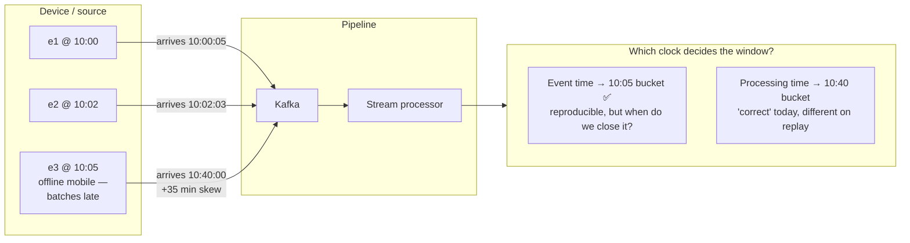
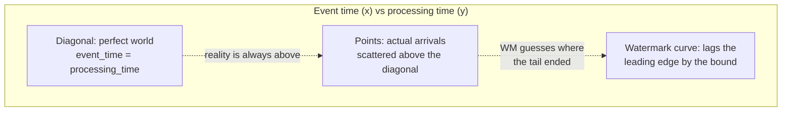
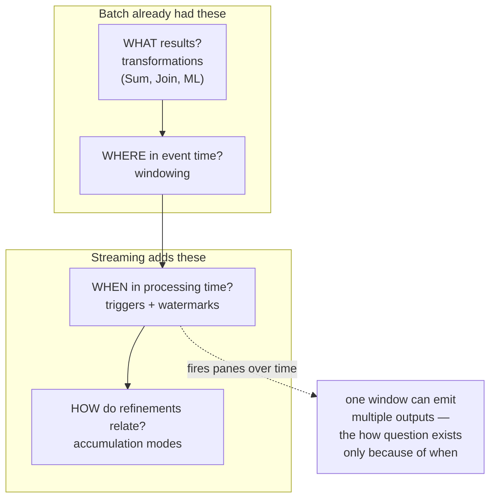
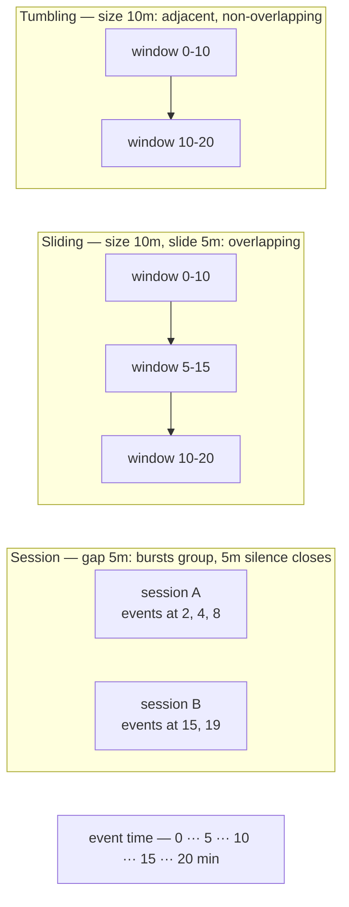
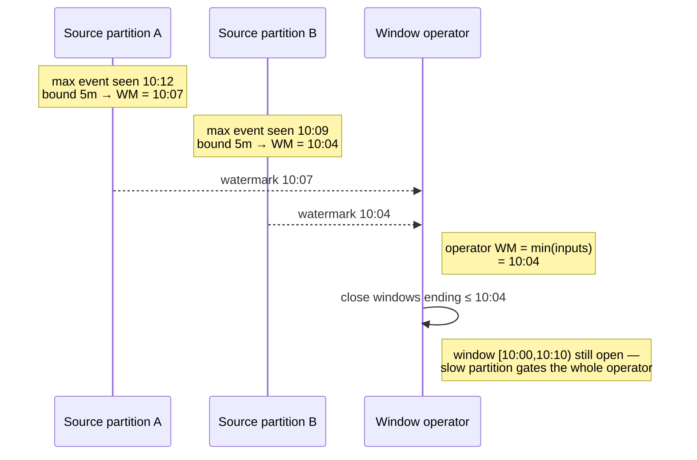
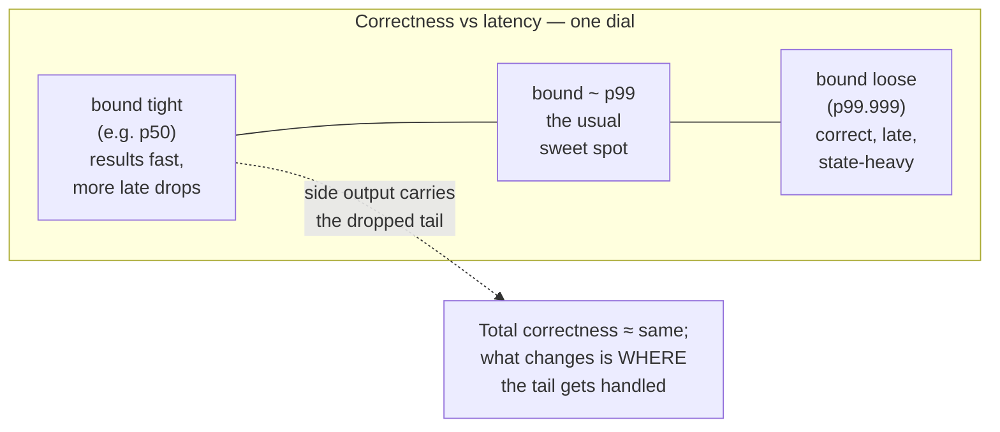
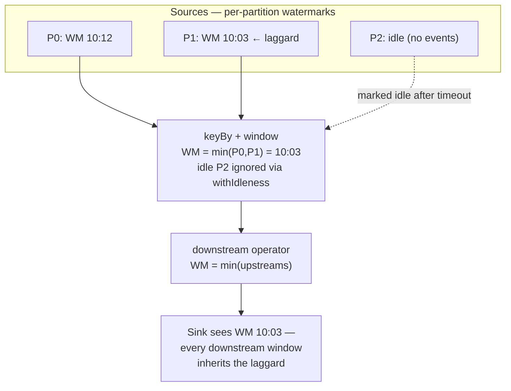
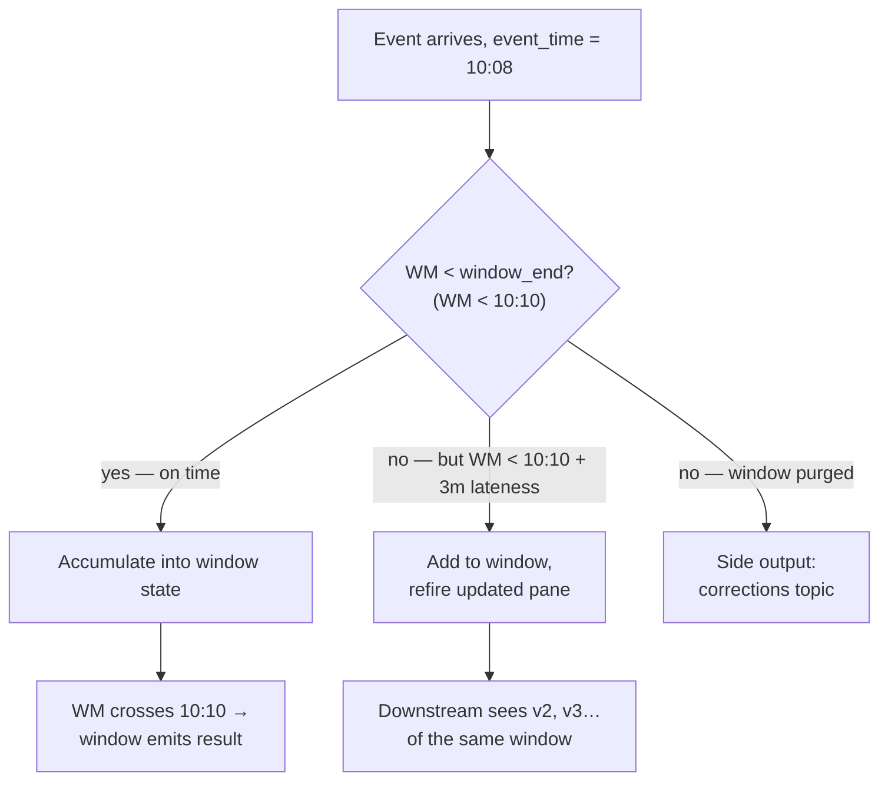

# Windows, Watermarks & Late Data

> **Why it matters** — Unbounded data has no "end of file," so the central question of streaming is *when is a result final?* Watermarks are the bet your system makes on completeness; windows are where that bet gets paid out. Get the trade-offs wrong and you either report wrong numbers silently or hold state forever.

## Three clocks, one problem

Every event can be timed three ways:

- **Event time** — when the thing happened (device clock, `created_at`). The only time that makes results reproducible across replays and lag.
- **Ingestion time** — when the event entered the system (Kafka log append). A cheap approximation; monotonic, but it moves with pipeline speed, not reality.
- **Processing time** — wall-clock when the engine sees the event. Simplest, and wrong for any result that must survive a backfill or a consumer outage.

The gap between event time and processing time — **skew** — is where all the difficulty lives:

::: tip 💡 Senior insight
Event time is the only honest answer, and it costs you a completeness problem: you can never *prove* no more 10:05 events are coming. Watermarks are the mechanism for betting on it — the entire chapter is how to size that bet.
:::

The canonical mental picture is a scatter of events on event-time × processing-time axes: the ideal is the diagonal (event arrives the instant it happens); the watermark is a lagging curve underneath the leading edge of arrivals; the gap between curve and diagonal is the out-of-orderness bound you chose.

## The four questions: What, Where, When, How

Streaming Systems (Akidau, Chernyak, Lax) frames every unbounded-data pipeline as answers to four questions. This chapter's sections map onto them — keep the table nearby as the organizing skeleton:

| Question | Answered by | Chapter section | The decision you're really making |
|---|---|---|---|
| **What** results are calculated? | Transformations: sums, joins, aggregations | (the business logic — out of scope here) | What the numbers mean |
| **Where** in event time? | Event-time **windowing** | Window types | Which events group into one result |
| **When** in processing time are results materialized? | **Triggers** + **watermarks** | Watermarks; Firing | How long you wait before betting the input is complete |
| **How** do refinements relate? | **Accumulation modes** | Firing: accumulation modes | Whether each output is a delta, a new value, or a correction |

The payoff of the frame: **batch is a degenerate case** — one global window, one firing when input ends, one output. Everything else in this chapter is what falls out of un-baking those three assumptions.

## Window types

Windows slice an unbounded stream into bounded chunks you can actually aggregate.

| Type | Definition | Events per window | Classic use |
|---|---|---|---|
| **Tumbling (fixed)** | Adjacent, non-overlapping, size *s* | exactly 1 | "events per minute/hour/day" |
| **Sliding (hopping)** | Size *s*, slide *d* — overlapping when *d < s* | up to *s/d* | "rolling 10-min avg, computed every 2 min" |
| **Session** | Gap *g* — closes after *g* inactivity; windows merge | variable | user sessions, clickstreams, device activity bursts |
| **Global** | One window for the whole key | all | only meaningful with triggers — "emit every N events" |
| **Count-based** | Every *n* records | — | processing-time fallbacks; avoid for analytics |

::: info ℹ️ Session windows merge
A session window isn't known until the gap expires — a new event inside the gap extends it, and two sessions bridged by a late event **merge into one**. In Beam/Flink this is `MergingWindowFn`; it is the reason session analytics needs the merge machinery most simpler windows never touch.
:::

## Watermarks: the completeness heuristic

A **watermark** is a claim: *"we believe no more events with event time < T will arrive."* Operators close event-time work (windows, joins, timers) when the watermark passes their end.

### How watermarks get generated

Two emission styles:

- **Periodic** (the default, `WatermarkStrategy.forBoundedOutOfOrderness`) — the source emits `max_seen − bound` on a timer (`autoWatermarkInterval`, default 200 ms) regardless of record flow. Predictable, and it makes idle partitions visible.
- **Punctuated** — a watermark rides the stream after a marker record (a "snapshot complete" sentinel, an event boundary flag). Used when sources can *declare* completeness — CDC streams, file ingestion with explicit boundaries. Wrong markers = silently dropped data, so prefer periodic unless the source genuinely knows.

Monotone inputs get a shortcut: `forMonotonousTimestamps()` emits `max_seen` as the watermark — correct when each partition's event times only increase (append-only logs, sequenced producers).

### The critical rules

- **`WM = max_event_time_seen − out_of_orderness_bound`.** Bounded-out-of-orderness (`forBoundedOutOfOrderness(5 min)`) assumes no event is more than 5 minutes late vs the latest seen.
- **Per-partition, then min.** Each source partition keeps its own watermark; downstream operators take the **minimum** across inputs. One stalled partition — or one idle topic partition receiving no events — freezes the watermark and leaks state forever. `withIdleness` marks silent partitions idle so they stop gating.
- **Watermark ≠ wall clock.** It advances only when data with higher event times flows. No traffic → no watermark → no firing. (Idle-source detection is the fix.)
- **Watermarks propagate downstream.** The min rule applies at every operator — a slow upstream leg delays every window behind it.

::: warning ⚠️ The watermark is a guess — size it like a risk decision
Too tight (30s) → real late events get dropped or side-output constantly, results are wrong-fast. Too loose (hours) → windows stay open, keyed state balloons, results are correct but late and expensive. The honest answer is a distribution: measure p99 lateness from your actual producers, set the bound there, and put the tail through allowed lateness or a side output rather than stretching the watermark.
:::

### Perfect vs heuristic, low vs high

Not all watermarks are the same object. Streaming Systems splits them two ways:

| Axis | Options | What it means |
|---|---|---|
| **Knowledge** | **Perfect** — source *provably* knows completeness (bounded files, sequenced logs, CDC with boundaries) | Never wrong; rare outside replayable inputs |
| | **Heuristic** — estimate from observed arrivals (`max_seen − bound`) | Sometimes wrong; the wrongness is your late data |
| **Direction** | **Low watermark** — tracks the *oldest* outstanding event (Beam, Flink, Dataflow) | Resilient to arbitrary skew: correctness degrades gracefully |
| | **High watermark** — tracks the *newest* event seen, then discards beyond a fixed lateness (Spark Structured Streaming) | Fast, but silently drops data whenever real skew exceeds your declared bound |

The low/high distinction matters when skew is unbounded. A low watermark follows the oldest event no matter how ugly the tail gets — a phone uploading a week of offline events delays results but doesn't corrupt them. A high watermark with a 10-minute bound simply discards that week. Same name, opposite failure mode.

### Percentile watermarks and the correctness–latency dial

A bound is a blunt instrument: one p99.99 straggler holds every window hostage. The refinement is a **percentile watermark** — emit the timestamp below which, say, 99.9% of observed event times fall, explicitly winnowing the slowest tail out of the calculation. The stragglers still get handled (allowed lateness, side output), they just stop gating everyone else.

The subtle point the book makes: tightening the watermark doesn't necessarily lose data — it *relocates* it. Events the watermark passes become "late" and are recovered by allowed lateness or the side output. The bound chooses how much of your tail rides the fast path versus the correction path.

### Where event-time skew comes from

The bound you pick must cover the real sources of skew, which are physical, not statistical:

- **The data itself** — offline devices batch-uploading hours of events (a plane landing and every phone leaving airplane mode at once), mobile clients buffering on poor connectivity. Unbounded, bursty, and the hardest to bound.
- **Shared resources** — network congestion, cross-region hops, CPU contention in multi-tenant environments, broker saturation during traffic spikes.
- **Software causes** — retries, backpressure, GC pauses, partition reassignment, a slow upstream operator queueing everything behind it.

Skew is not a fixed property of the dataset — it's a varying function of everything between the event and your operator. That's why a bound measured on Tuesday's quiet traffic lies to you on Black Friday.

### Propagation and idle inputs

Dataflow-class engines add refinements worth knowing exist: **heuristic/gradient watermarks** (a confidence-weighted estimate instead of a hard bound, so a single straggler doesn't stall the pipeline) and **heartbeat watermarks** (sources emit watermark progress even without data, fixing the idle-partition stall without idleness detection). The semantics are the same — these are better estimators of the same bet.

## Firing: triggers, allowed lateness, side outputs

Three independent levers decide *when* a window produces output and *how long* it can be revised:

- **Trigger** — the rule that fires a pane: default is "watermark passes window end"; `EarlyFiring`/`processingTime` triggers emit partial results on a cadence ("every 1 min, emit whatever's accumulated"); `AfterCount`/`AfterElement` for record-count fires.
- **Allowed lateness** — how long after the watermark crosses window-end the window keeps its state and can *refire* on late arrivals. `allowedLateness(3 min)` = revisions accepted until `WM ≥ window_end + 3 min`.
- **Side output / late data tag** — events arriving after allowed lateness (or outside the watermark entirely) get routed to a side channel: a DLQ, a correction table, a reprocessing topic. Never silently drop them — a late event is a fact, not garbage.

### Accumulation modes: how panes relate

Once a window can fire more than once, a second question appears: is each emitted pane a *delta*, a *new total*, or a *correction*? Beam's three accumulation modes — the "How" of the four questions — answer it differently. Same window, same two firings (inputs `3` then `8, 1`; true sum = 12):

| Pane | Discarding | Accumulating | Accumulating + retracting |
|---|---|---|---|
| Pane 1 (inputs: 3) | 3 | 3 | 3 |
| Pane 2 (inputs: 8, 1) | 9 | 12 | 12, −3 *(retract prior)* |
| **Final pane value** | 9 | 12 | 12 |
| **Sum of all panes** | 12 | 15 ❌ | 12 |

- **Discarding** throws state away after each firing — every pane is an independent delta. Correct only if the *consumer* sums panes itself (delta-feed into an accumulator). If the consumer takes the last value, you under-report.
- **Accumulating** keeps state — each pane is a complete running result. Perfect for sinks that overwrite in place (key-value store keyed on window). If the consumer *sums* panes, you double-count (15 above).
- **Accumulating + retracting** emits the new total *plus* an explicit retraction of the previous pane. Both "last value" and "sum of everything" yield 12 — the only mode that's safe for a naive appending consumer. It's also the only sane choice when windows **merge** (sessions): a merged result replaces several old windows, and only explicit retractions tell downstream which.

Cost increases down the list: discarding stores nothing between firings, retracting must remember the last emitted pane per window *and* emit two records per firing. Pick the cheapest mode your sink's semantics tolerate.

:::: tip 💡 Match the mode to the sink
KV store / upsert warehouse → accumulating. Delta-hungry downstream accumulator → discarding. Appending log, replayed topics, merging sessions → retracting. The bug in every case is the same shape: the consumer's aggregation assumption and the producer's accumulation mode disagree, and both sides look locally correct.
::::

### Choosing a late-data strategy

| Strategy | What you accept | Cost | Fits |
|---|---|---|---|
| Tight WM + side output | On-time result fast; stragglers go to corrections | Complexity: a second write path consumers must handle | Dashboards with SLOs, audit-required pipelines |
| Generous allowed lateness | Refires produce revised results | State lives longer; downstream must handle updates (upserts) | Warehouse sinks that can upsert; most production analytics |
| Loose watermark | Almost everything is "on time" | Slowest straggler gates all output; state balloons | Low-volume feeds with wild latency |
| Processing time | No lateness concept | Non-reproducible; replay gives different answers | Monitoring/alerting where "now" is the semantic |
| Drop late silently | Simplicity | Silent wrongness — the worst option | Never for anything reported upward |

### Trigger recipes that show up in production

| Goal | Recipe |
|---|---|
| "Final result per window, revised for late data" | Default event-time trigger + `allowedLateness` |
| "Live dashboard + final result" | `AfterWatermark.pastEndOfWindow()` with `withEarlyFirings` on a processing-time cadence — early partials every minute, then the on-time pane |
| "Alert on bursts" | Global window + `AfterCount(n)` or processing-time trigger — no waiting for event time |
| "Exactly-once-ish accounting" | On-time pane only, discarding mode; treat refires as updates, not appends |

## Checkpoints, state, and the real cost of lateness

Window state lives in the state backend until the window is *purged* — window end + allowed lateness. Two coupled dials:

- **Longer allowed lateness** → more keys' windows open at once → bigger keyed state, longer RocksDB snapshots, slower recovery.
- **Shorter checkpoint interval** → faster recovery (less reprocessing after failure) but more snapshot overhead; with incremental RocksDB, frequent small checkpoints are usually cheaper than rare large ones.
- **Per-key state compounds**: a session window with allowed lateness × millions of keys × a fat accumulator is how a job quietly grows from 2 GB to 200 GB.

::: tip 💡 Rule of thumb
Set `state.ttl` and allowed lateness together — they are the same decision expressed twice. A window that can refire for 3 minutes should not keep state for a week; a TTL shorter than your lateness horizon silently drops the late data you said you'd accept.
:::

## Worked example

**Spec:** 10-minute tumbling windows over clickstream, watermark = 5-minute bounded out-of-orderness, allowed lateness = 3 minutes. Window W = `[10:00, 10:10)`.

| Arrival (proc. time) | Event time | WM after event | What happens |
|---|---|---|---|
| 10:00:02 | 10:00 | 09:55 | Accumulates in W |
| 10:05:00 | 10:05 | 10:00 | Accumulates |
| 10:11:00 | 10:11 | 10:06 | Next window [10:10,10:20); W still open |
| 10:16:00 | 10:16 | **10:11** | **WM crosses 10:10 → W fires v1** |
| 10:18:00 | 10:07 (late, 9 min behind tip) | 10:11 | Within lateness (WM < 10:10+3=10:13): **W refires v2** |
| 10:20:00 | 10:19 | 10:14 | WM ≥ 10:13 → **W's state purged** |
| 10:25:00 | 10:06 | 10:20 | Past purge → **side output** |

Read it twice: the window emitted **three** artifacts — v1 at fire, v2 at refire, and a side-output record — and any consumer that writes results as inserts (not upserts keyed on window) just double-counted.

::: warning ⚠️ Refires are updates, not new rows
If the sink appends, allowed-lateness refires will silently inflate your aggregates — the same failure class as join fan-out, one level down. Sinks that take streaming window output must be upsert-capable or versioned on (key, window_end).
:::

### See it move

<WindowViz />

Step through 10 arrivals (slider jumps to any point). Each event sits at its **event time** on the top row; the dot on the bottom row is when it actually arrived — the dashed skew line between them is the lateness. The red watermark is `max event time seen − 3 min`.

- **Step arrival** — one event at a time. Watch `[10:00,10:10)` fire the moment WM crosses 10:10, then *refire* when the 10:05 event shows up at processing-time 10:15 — still inside the 5-minute lateness horizon.
- **allowed lateness** toggle — on, late events inside `window_end + 5m` refire the window; off, everything after the first firing goes straight to the side output, and the 10:02 straggler always lands there once state is purged.
- **retractions** toggle — switches refires from bare updated panes to retraction + new pane pairs (accumulating-and-retracting mode): the downstream contract for consumers that can't overwrite.

Two events are planted late on purpose: `10:05 arriving 10:15` (within lateness → refire) and `10:02 arriving 10:20` (past purge → side output). They're the worked example above, animated.

## Design checklist for windowed pipelines

- **Pick the clock deliberately.** Event time for anything reported; processing time only for "right now" alerting. If you can't articulate why, it's event time.
- **Measure lateness before choosing a bound.** Look at your producers' actual p50/p99/p999 arrival skew, then set the watermark at the tail you're willing to treat as on-time.
- **Bound the revision window.** Allowed lateness is a state-budget decision as much as a correctness one — set it, pair it with `state.ttl`, and write down why.
- **Route the tail somewhere.** Side output to a corrections/DLQ path; a late event that vanishes is a fact you chose to lose.
- **Make the sink upsert-aware.** Windows refire; appending sinks double-count. Key results on (entity, window_end) or accept eventual-consistency corrections.
- **Kill idle partitions' veto.** `withIdleness` on sources; heartbeat watermarks if your runner supports them.
- **Watch watermark lag, not just consumer lag.** `currentOutputWatermark` behind event time is the leading indicator that windows are stalling — before lag metrics notice.

::: details Stream-stream joins are windows in disguise

Joining two unbounded streams has no natural end either — you join on a key *and* a time interval (event-time window join, or interval join in Flink). Both sides buffer state until the watermark rules out more matches, which means join state size is governed by the join window plus watermark skew, and a slow input on either side holds both sides' state open. Interval joins (`a.time BETWEEN b.time - 5m AND b.time + 5m`) are the practical tool: explicit bounds, explicit state lifetime. Unbounded "temporal" joins that never expire are how jobs end up with 500 GB of state nobody remembers creating.

:::

## 🧠 Quiz

<QuizCard :questions="[{ q: 'Why prefer event time over processing time for analytics?', options: ['It is faster to compute', 'Results are reproducible — replays and lag do not change which window an event lands in', 'It needs no watermarks', 'It uses less state'], correct: 1, explain: 'Event time ties the result to when things happened, not when the pipeline happened to read them. Processing-time windows give different answers on every replay or lag spike.' }, { q: 'A two-input operator receives watermark 10:07 on partition A and 10:04 on partition B. Its effective watermark?', options: ['10:07 — the max', '10:05:30 — the average', '10:04 — the min; the slowest input gates the operator', 'Whichever arrived last'], correct: 2, explain: 'Watermark = min(inputs). One lagging or idle partition stalls every downstream window — which is why idle-source detection exists.' }, { q: 'Watermark bound is 5m. Event at event-time 10:16 arrives. A window ending 10:10…', options: ['Cannot fire — event is in the future', 'Fires only after 5 more minutes of wall time', 'Already closed at 10:10', 'Fires now — the watermark advanced to 10:11, past the window end'], correct: 3, explain: 'WM = max_seen - bound = 10:16 - 5m = 10:11 > 10:10. The watermark is driven by event times in the stream, not wall clock.' }, { q: 'Window fires at WM crossing, then a late event arrives within allowed lateness. The window…', options: ['Blocks the watermark', 'Is dropped — too late', 'Refires an updated pane; the sink must handle revisions (upsert/version)', 'Goes to the side output immediately'], correct: 2, explain: 'Allowed lateness = the window keeps state and can emit revised results. Only after WM passes window_end + lateness is state purged and do further laggards hit the side output.' }, { q: 'A partition in your Kafka source has had no traffic for an hour. Window output stalls because…', options: ['Kafka stopped delivering', 'The idle partition holds the min watermark back — fix with idleness detection', 'Checkpoints are too frequent', 'Session windows never close'], correct: 1, explain: 'No events means no watermark progress on that partition, and min() gates the operator. withIdleness (or heartbeat watermarks) lets silent inputs be ignored.' }, { q: 'Biggest lever on streaming job state size for windowed aggregation?', options: ['Bigger checkpoint interval', 'More partitions', 'Watermark bound + allowed lateness — how long each window stays open before purge', 'More TaskManager slots'], correct: 2, explain: 'State accumulates per open window per key. The completeness knobs decide the retention horizon; checkpoints and parallelism just move the bytes around.' }]" />

<QuizCard :questions="[{ q: 'In the What/Where/When/How model, which question do watermarks + triggers answer?', options: ['How refinements relate', 'Where in event time results are computed', 'What results are calculated', 'When in processing time results are materialized'], correct: 3, explain: 'When = triggers and watermarks: the bet on input completeness that decides when a pane is emitted. Where = windowing, How = accumulation mode.' }, { q: 'A window fires pane 1 = 3, then pane 2 = 9 under DISCARDING mode (true sum 12). A consumer that keeps the last pane reports…', options: ['3 — the first pane wins', '12 — panes always carry the running total', '9 — discarding emits deltas; last-pane consumers under-report', '15 — panes sum together'], correct: 2, explain: 'Discarding makes each pane an independent delta: only a consumer that sums panes sees 12. Accumulating mode would report 12 on the last pane but 15 if summed.' }, { q: 'Spark Structured Streaming uses a high watermark with a fixed lateness bound vs Flink-style low watermark. A phone uploads a week of offline events — what happens?', options: ['Both drop the data', 'High WM handles it gracefully', 'High WM: events past the bound are discarded; low WM: results stall but stay correct', 'Both systems hold state a week'], correct: 2, explain: 'Low watermarks track the oldest outstanding event and degrade to latency under unbounded skew; high watermarks assume skew fits your declared bound and silently drop anything beyond it.' }]" />

## Further reading

- [Streaming 101: The world beyond batch — Tyler Akidau (O'Reilly Radar)](https://www.oreilly.com/radar/the-world-beyond-batch-streaming-101)
- [Streaming 102: The world beyond batch — Tyler Akidau (O'Reilly Radar)](https://www.oreilly.com/radar/the-world-beyond-batch-streaming-102/)
- [Apache Beam Programming Guide — watermarks, triggers, windowing](https://beam.apache.org/documentation/programming-guide/)
- [Flink docs — timely stream processing / event time](https://nightlies.apache.org/flink/flink-docs-stable/docs/concepts/time/)
- [Flink docs — generating watermarks](https://nightlies.apache.org/flink/flink-docs-stable/docs/dev/datastream/event-time/generating_watermarks/)
- [Flink docs — windows](https://nightlies.apache.org/flink/flink-docs-stable/docs/dev/datastream/operators/windows/)
- [Streaming Systems — Akidau, Chernyak, Lax (O'Reilly)](https://www.oreilly.com/library/view/streaming-systems/9781491983867/)
- [Spark Structured Streaming — watermarking](https://spark.apache.org/docs/latest/structured-streaming-programming-guide.html#handling-late-data-and-watermarking)
