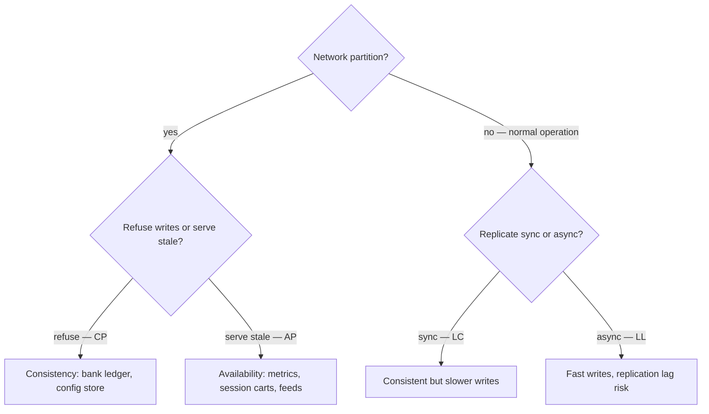
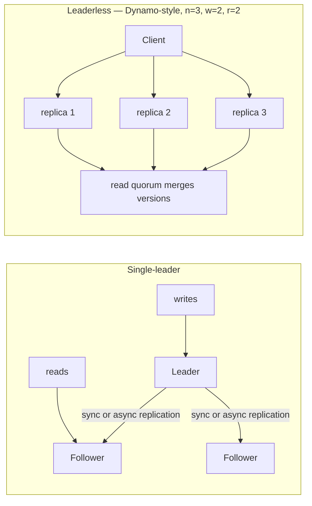
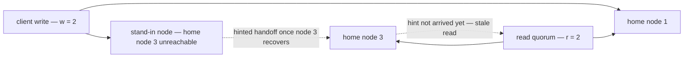
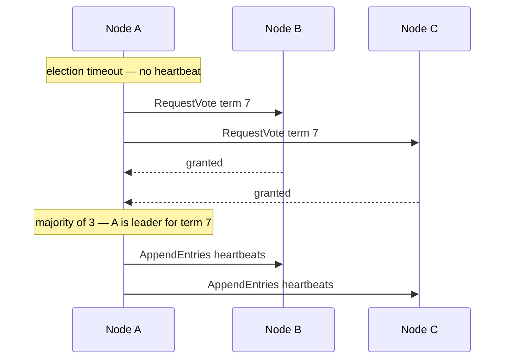
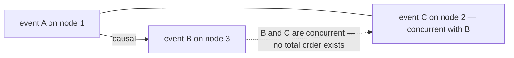
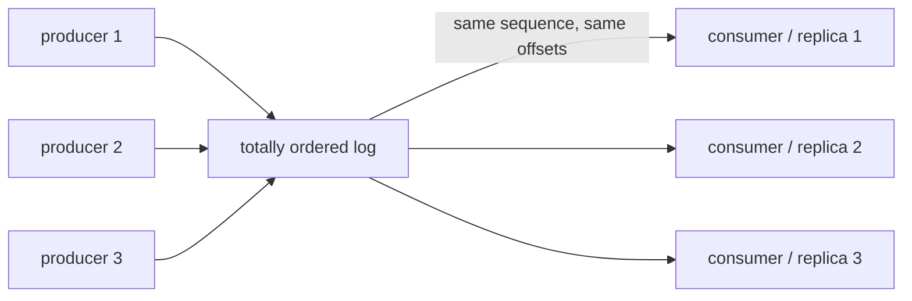
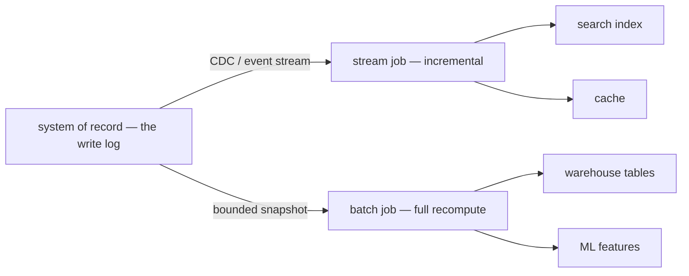

# Data-Intensive Foundations

> **Why it matters** — Every system you build — warehouse, Kafka cluster, CDC pipeline — is a distributed system making silent trade-offs between consistency, availability, and latency. When a dashboard shows stale rows or a failover corrupts a partition, the engineers who can name the trade-off fix it in an hour; everyone else files a ticket.

## The frame: reliability, scalability, maintainability

Kleppmann's *Designing Data-Intensive Applications* opens with the only three properties that matter. Everything else in this chapter is mechanism for achieving them.

| Property | Question | Data-engineering translation |
|---|---|---|
| **Reliability** | Does it keep working when things fail? | A crashed worker retries without duplicating output; a bad upstream file goes to a DLQ, not into prod tables. |
| **Scalability** | Does it degrade gracefully as load grows? | Adding partitions/nodes increases throughput ~linearly; p99 latency stays flat as volume 10×s. |
| **Maintainability** | Can the next engineer change it safely? | Schema evolution is compatible, lineage is traceable, and a rerun produces the same answer. |

::: tip 💡 Senior insight
Interviewers use this frame implicitly. When asked to "design X," narrate which of the three you're optimizing and what you're sacrificing — that trade-off narration *is* the senior signal.
:::

### Describing load and performance

Load is described by **load parameters** — the numbers that matter for *your* system: events/sec, read:write ratio, fan-out (one write → how many reads), active entities. Performance is latency **percentiles** (p50/p95/p99), never averages — the p99 is what your slowest customers experience and what tails-of-distribution bugs live behind.

::: warning ⚠️ Risk / production failure mode
Mean latency hides the failure. A pipeline averaging 200 ms with a p99 of 30 s means 1% of requests — often the biggest customers with the most data — are nearly timing out. Always SLO on percentiles.
:::

## CAP and PACELC

**CAP**: under a network **P**artition, a system must choose between **C**onsistency (every read sees the latest write or errors) and **A**vailability (every request gets a non-error response). The nuance people miss:

- C + A is not "impossible" — it's impossible **only during a partition**. When the network is healthy you can have both.
- You don't pick "two of three" once. You pick **CP or AP per subsystem, per partition event**. Your auth service might refuse writes (CP) while your dashboard serves stale data happily (AP).
- "CA systems" don't exist in distributed systems — if it can partition (and it can), the choice is forced.

**PACELC** extends this to the healthy case: **i**f **P**artition, choose **A**vailability or **C**onsistency; **E**lse, choose **L**atency or **C**onsistency. The EL half is the one you live with daily: synchronous replication gives consistency but adds cross-AZ/region RTT to every write; asynchronous replication is fast but can lose recent writes on failover.

::: info ℹ️
Practical cheat sheet: money, inventory counts, leader election → CP. Telemetry, recommendations, presence, dashboards → AP. Most data pipelines are AP systems with a CP control plane (e.g., KRaft/ZooKeeper for metadata).
:::

### Picking CP vs AP per subsystem

The "pick two" framing is wrong; the real question is *per data flow, during partition, which do we sacrifice?*

| Subsystem | Partition behavior | Why |
|---|---|---|
| Control plane / metadata (KRaft, etcd) | CP — refuse writes without quorum | Divergent metadata is unrecoverable; unavailability is preferable |
| Payment/ledger writes | CP — fail the write | A lost or double write is worse than a rejected one |
| Metrics, logging, telemetry | AP — accept and buffer | Volume is huge; gaps are tolerable; lag already expected |
| User-facing reads (feeds, dashboards) | AP — serve stale | Stale beats error pages; pair with a freshness SLO |
| Session/cart state | AP with conflict resolution | Losing a cart item is recoverable UX; downtime isn't |

::: details The C+A nuance, precisely
CAP is a theorem about a *single register* during a partition, not a system taxonomy. A healthy cluster is both consistent and available every day — the theorem only bites when messages are dropped/delayed. Two practical consequences: (1) you can't "design a CA system" because you can't opt out of partitions; (2) many real systems are *mostly* CA and degrade to explicit CP/AP behavior only on failure — which is exactly what PACELC's ELSE branch describes.
:::

## Consistency models

Consistency models describe what a client can observe across **replicas**. Weakest at the bottom, most expensive at the top.

| Model | Guarantee | Cost | Where you meet it |
|---|---|---|---|
| **Linearizable** | Every op appears to happen atomically, in real-time order, on a single copy of the data | Highest — coordination on every write | ZooKeeper/etcd, Kafka controller, "leader only" reads |
| **Sequential** | Ops appear in some order consistent with each client's program order — but not real-time | High | Some quorum reads |
| **Causal** | Happens-before-related writes seen in order; unrelated may reorder | Medium | Version-vector systems |
| **Read-your-writes** | You always see your own writes | Low (sticky sessions, read-from-leader) | User-facing writes; what most products actually need |
| **Eventual** | If writes stop, replicas converge *eventually* | Lowest | Dynamo-style stores, CDC replicas, caches |

::: tip 💡 Senior insight
"Eventual consistency" in production usually means *a replication lag SLO* (e.g., <5 s p99) plus monitoring — not a shrug. The model is weak; the operational contract is what makes it usable.
:::

### Guarantees as user-facing promises

The useful way to pick a model isn't "how strong can we afford" — it's "what lie will a user notice?" Kleppmann frames replication-lag guarantees as promises the product makes, each with a concrete anomaly it prevents and a cheap mechanism that delivers it.

| Promise | Anomaly it prevents | Cheapest mechanism | DE translation |
|---|---|---|---|
| **Read-your-writes** | User reloads and their own update vanished — they assume it was lost | Read own writes from the leader, or route reads to a replica caught up to the client's last-write timestamp/LSN | After an UPSERT the same session must read it back; dashboards serving "your recent run" need leader reads or lag-aware routing |
| **Monotonic reads** | Time appears to go backward — a refresh shows *older* data than the previous refresh | Pin each user's reads to one replica (e.g., hash of user ID) | Sticky routing on read replicas; matters when a user polls a status endpoint during a long load |
| **Consistent prefix reads** | Causally related writes appear out of order — an answer shows before its question | Writes that are causally related go to the same partition | A CDC consumer applying a delete before the insert it responds to; keep causal chains on one partition key |
| **Linearizability** | A stale read silently returns — no way to distinguish "unchanged" from "not yet replicated" | Single leader + coordination (consensus) for reads and writes | The only model that supports "read, then decide" — compare-and-swap, uniqueness, leader-election leases |

:::: tip 💡 Senior insight
These are *per-user* promises, not global ones — read-your-writes says nothing about when other users see your write. That makes them cheap: sticky sessions and LSN-aware routing deliver them without consensus. Reserve linearizability for the tiny surface that actually needs it (locks, unique claims, fencing tokens) — it costs coordination on every operation.
::::

:::: warning ⚠️ Risk / production failure mode
Cross-device read-your-writes is the version that bites: sticky sessions by connection don't survive a user switching from phone to laptop. The robust fix is a client-tracked watermark — each device carries the user's minimum LSN/timestamp, and any serving replica must be caught up to it or the read waits.
::::

### Consistency ≠ isolation

- **Consistency models** (above) govern *replicas*: what readers see across copies of the data.
- **Isolation levels** (below) govern *concurrent transactions* inside one database: what interleavings are allowed.

People conflate them in interviews constantly. Don't.

## Replication

Why replicate: durability (survive node loss), read scaling, geo-locality. The cost is the consistency problem above.

| Topology | Writes go to | Conflict handling | Failure mode |
|---|---|---|---|
| **Single-leader** | One leader; followers replicate | None — one write order | Failover lag; **split-brain** if old leader is resurrected |
| **Multi-leader** | One leader per region; leaders sync async | Last-write-wins, CRDTs, app-level | Conflict storms; divergence if sync breaks |
| **Leaderless** | Quorum `w` of `n` replicas | Read repair + version vectors/`r` reads | Sloppy quorums mask inconsistency; `w + r ≤ n` reads can miss writes |

### Quorum math in leaderless systems

In Dynamo-style stores (Cassandra, Riak) there's no leader: the client (or a coordinator node) sends each write to `n` replicas and each read to `n` replicas; `w` and `r` responses are needed for success. The rule of thumb:

- **`w + r > n`** → reads usually see the latest write, because the write set and read set must overlap on at least one node. Common choices: `n=3, w=r=2` (tolerates one node down) or `w=1, r=3` for read-heavy data.
- **`w + r ≤ n`** → a read can legitimately miss a committed write; you get eventual convergence, not a guarantee.
- `w + r > n` is *not* a hard guarantee — it's probabilistic. Concurrent writes, clock-skewed last-write-wins, or a write that landed while a read raced ahead can still return stale values. Sloppy quorums (below) make even the overlap uncertain.

**Sloppy quorums and hinted handoff:** when some of a key's `n` "home" nodes are unreachable, a strict quorum fails — so Dynamo-style systems let *any* reachable node hold the write. `w` acknowledgments still succeed, but some live on stand-in nodes outside the `n`. When the real home node recovers, the stand-ins forward it the writes — **hinted handoff**. The catch: now even `w + r > n` doesn't promise the latest read, because the newest value may sit on a node outside the `n` your read contacts. A sloppy quorum isn't really a quorum — it's a *durability* promise ("stored on `w` nodes somewhere"), not a consistency one.

:::: details Where you tune this in real systems
Cassandra exposes `CONSISTENCY ONE | QUORUM | ALL` per query; Riak exposes `r`/`w`/`n` per bucket. The operational knob is the same either way: raising `w` buys durability at the cost of write availability during partial outages, and sloppy quorum settings (`sloppy_quorum` in Riak, hinted handoff in Cassandra) buy write availability at the cost of stale reads until handoff completes. Watch hinted-handoff backlog metrics — a growing backlog means your reads are quietly time-traveling.
::::

### The split-brain problem

Single-leader failover has a classic trap: the leader's heartbeats time out, a follower is promoted — but the old leader was only *slow* (GC pause, network blip), not dead. Now two nodes accept writes and the replicas diverge. The fix: **fencing** — the new leader gets a monotonically increasing term/epoch (from the consensus layer), and any node with a stale epoch is rejected by storage. This is why systems like Kafka's KRaft and etcd exist: they don't just elect leaders, they *fence* old ones.

::: warning ⚠️ Risk / production failure mode
Split-brain isn't exotic — it happens on every long GC pause under aggressive timeouts. If your failover script doesn't fence the old leader (STONITH, epoch checks, or storage-level lease revocation), a "successful" failover can silently fork your data.
:::

## Partitioning

Replication copies the same data; partitioning splits it. Goal: spread load evenly so `n` nodes ≈ `n`× throughput.

| Strategy | How | Pros | Cons |
|---|---|---|---|
| **Hash partitioning** | `hash(key) mod n` | Even load, no range hotspots | Loses ordering; range scans hit all partitions; reshuffling on `mod` |
| **Range partitioning** | Sorted key ranges per shard | Range scans and sorted reads are cheap | Hot spots on monotonic keys (timestamps!); needs splitting |
| **Compound** | Hash within range, or vice versa | Best of both (e.g., partition by date, hash by user) | Complexity |

**Consistent hashing** (hashing nodes and keys onto a ring, moving only `k/n` keys on membership change) is the standard answer to "what happens when we add a node?" — vanilla `mod n` reshuffles almost everything.

<HashRingViz />

Try the buttons: **Add node** inserts a node at a fixed ring position — only the keys in the arc between it and its predecessor change color, which is exactly the "move `k/n` keys" property. **Remove node** hands that node's arc to the next node clockwise — again a small local move. Then toggle **Naive mod-N**: the same membership change recolors almost every key, because the modulus itself changed. That visual difference is why caches, shard maps, and job-routing tables use consistent hashing — a reshuffle under `mod n` means a cold cache or a full data migration; a ring means a bounded rebalance.

:::: details Why the ring still needs care
Hashing nodes onto the ring gives each node a *random* arc — with few nodes the arcs are uneven, so load is uneven. Real systems fix this with **virtual nodes** (each physical node claims many ring positions, smoothing the distribution — Cassandra's vnodes, Ketama in memcached clients). The interactive above uses one position per node for clarity; multiply each by ~100 vnodes and the arc sizes equalize while the `k/n` move property survives.
::::

### Hot spots and the celebrity problem

No scheme saves a skewed *key*. If one user_id generates 30% of writes, whichever partition owns it melts while others idle. Mitigations: **key salting** (append a random bucket suffix `user_123#7` to spread one key across partitions, at the cost of scatter-gather reads), dedicated "celebrity" partitions, or two-phase aggregation.

::: tip 💡 Senior insight
This is *the* most common real partitioning failure — not picking hash vs range, but discovering post-launch that 3 keys own 40% of traffic. Always ask "what does the key distribution look like?" before discussing the partitioning function.
:::

## Isolation levels and anomalies

Inside a transactional store, isolation controls what concurrent transactions can observe. Anomalies by level:

| Isolation | Dirty read | Non-repeatable read | Phantom | Write skew / lost update |
|---|---|---|---|---|
| Read uncommitted | ✅ possible | ✅ | ✅ | ✅ |
| Read committed | ❌ | ✅ | ✅ | ✅ |
| Repeatable read | ❌ | ❌ | ✅ (mostly prevented in InnoDB/Postgres) | ✅ write skew |
| Serializable | ❌ | ❌ | ❌ | ❌ |

Two anomalies worth knowing cold:

- **Lost update**: two transactions read-modify-write the same row; the second commit overwrites the first. Fix with atomic operations, explicit `SELECT ... FOR UPDATE` locking, or compare-and-swap.
- **Write skew**: each transaction's writes are individually valid but together violate an invariant — e.g., two on-call doctors both see "≥1 on call" and both sign off, leaving zero. Only true serializability (or materialized locks on the *predicate*, e.g. a dedicated row) prevents it.

::: info ℹ️
Postgres "repeatable read" already prevents phantoms via snapshot isolation — its serializable level adds SSI (Serializable Snapshot Isolation) to catch write skew. Default is read committed; most ORMs leave it there.
:::

### How serializability is actually implemented

"Serializable" is a guarantee, not a mechanism. Three families deliver it, with very different costs:

| Mechanism | Idea | Concurrency style | The catch | Where |
|---|---|---|---|---|
| **Actual serial execution** | One thread executes transactions in order; no concurrency at all | None — ordered | Only works if transactions are short, fast, and fit in one node's memory | VoltDB, Redis (mostly), stored-procedure-per-partition designs |
| **Two-phase locking (2PL)** | Shared locks for reads, exclusive for writes; acquire in phase 1, release in phase 2 — writers block readers *and* vice versa | Pessimistic | Deadlocks need detection + abort; lock contention crushes throughput at hot rows; famously poor latency | MySQL/InnoDB serializable, SQL Server, DB2 repeatable read |
| **Serializable Snapshot Isolation (SSI)** | Transactions run on a snapshot (readers never block writers); the DB tracks read/write dependencies and aborts a transaction when it detects a dangerous interleaving | Optimistic | Aborts under contention — long/high-conflict transactions get retried; needs retry logic in the app | Postgres serializable, CockroachDB-style MVCC+validation |

The pessimistic-vs-optimistic split is the interview-worthy part: **2PL** makes every conflict wait (throughput dies under contention but nothing is wasted), **SSI** lets conflicts proceed and aborts the loser (great throughput when conflicts are rare, wasted work when they're common). Pick by contention profile — hot-row workloads suffer under both, which is why inventory counters end up as explicit CAS loops or queued writes instead.

:::: warning ⚠️ Risk / production failure mode
SSI's failure mode is silent in dev: aborts only appear under *real* concurrency. Code that passes tests on Postgres `SERIALIZABLE` can abort-storm in production if it lacks bounded retry with backoff — and an unbounded retry loop on a hot conflict is a livelock, not a fix.
::::

## Consensus and clocks

### Raft intuition

Consensus = getting `n` unreliable nodes to agree on one value/order despite failures. Raft does it with **terms** and **majority quorums**:

Key properties that matter operationally:

- **Leader election** happens on heartbeat timeout; a node needs a majority of votes. A 2-2 split elects no leader — no candidate reaches majority, so the cluster stays leaderless until re-election with randomized timeouts. Another reason for odd replica counts.
- **Terms double as fencing tokens**: a node that sees a higher term steps down. This is what prevents split-brain writes (above).
- **Committed = replicated to a majority.** A leader can only serve reads/writes for entries a majority has. Lose your majority (2 of 3 nodes down) and the cluster goes read-only — by design.

::: details Why odd numbers, and why consensus is everywhere in DE
A 5-node cluster tolerates 2 failures; a 6-node cluster also tolerates only 2 — so 5 is strictly better than 6. You meet this machinery constantly in data engineering: Kafka's KRaft metadata, ZooKeeper, etcd, Raft-backed coordination in ClickHouse Keeper, Pinot, and most control planes. You rarely *build* consensus; you operate systems whose availability is governed by it.
:::

### Clocks: why you can't trust timestamps

- **NTP clock drift**: machine clocks drift (±ms to seconds); NTP can *jump* the clock backward, breaking "later timestamp = newer data" assumptions. Never use wall-clock time alone to order events or pick "latest" versions.
- **Happens-before / Lamport clocks**: if A → B causally, A's logical clock < B's — but the converse doesn't hold. Lamport orders *causally related* events; it can't compare concurrent ones.
- **Vector clocks** track per-node counters and detect true concurrency (used in Dynamo-style conflict detection).
- **Hybrid Logical Clocks** (HLC): wall clock + logical counter — bounded drift, causally ordered, and human-readable. Used by CockroachDB, YugabyteDB, and Azure Cosmos DB for distributed ordering without physical-clock trust.

::: warning ⚠️ Risk / production failure mode
"Last write wins" ordered by client/ingest wall-clock timestamps is the single most common clock bug in pipelines — clock-skewed producers make the *wrong* write "win." Use event-time + watermarks with explicit late-data policy, or sequence numbers/offsets assigned by a single authority.
:::

### End-to-end ordering: total order broadcast

Clocks and Lamport timestamps give each *pair* of events an order, but they can't give the whole system one agreed sequence — a Lamport total order exists on paper, yet no node can know it in real time (you can't tell whether a "later" event is still in flight). The distributed-systems name for the thing that actually works is **total order broadcast**: a protocol with two safety properties —

- **Reliable delivery**: if a message is delivered to one node, it's delivered to all nodes (retrying through failures).
- **Totally ordered delivery**: every node receives the same messages in the same order.

This is exactly what consensus services implement: ZooKeeper, etcd, and Kafka's KRaft are, underneath, total-order-broadcast machines. It's also what you need for database replication and fencing — a single ordered log of operations that every node applies in sequence is the difference between "replicas that probably converge" and "replicas that are the same state machine."

The scope caveat matters for DE: ordering is usually **per partition**, not global. Kafka gives a total order inside each partition; nothing orders a message in partition 3 against one in partition 7. That's why causal chains must share a partition key (consistent prefix reads, above) and why cross-partition invariants (uniqueness across shards) still need a coordinating authority.

:::: tip 💡 Senior insight
Total order broadcast is consensus in work clothes — they're provably equivalent problems. Practical consequence: wherever you need "everyone agrees on the sequence" (leader election, fencing tokens, DDL propagation, schema registry versions), you're already standing on a consensus log, whether it's labeled etcd, KRaft, or the Kafka partition itself.
::::

## Batch vs streaming read paths

The same data reaches consumers through two structurally different paths:

| | Batch path | Streaming path |
|---|---|---|
| Data unit | Bounded snapshot — "data as of T" | Unbounded event stream |
| Consistency | Strong intra-run — one snapshot, one answer | Eventual — consumers see events at different lag |
| Latency | Minutes–hours | ms–seconds |
| Reprocessing | Recompute the snapshot — trivially correct | Requires replayable log + dedupe; late data is a first-class problem |
| Failure mode | Job fails → rerun whole slice | Lag, watermark misconfiguration, hot partitions |

::: tip 💡 Senior insight
The modern convergence: streaming engines treat batch as "a stream with finite bounds," and lakehouse tables give streaming sinks a replayable, re-partitionable landing zone. Design the *source of truth* as an immutable append log; batch and streaming become two readers of the same thing.
:::

### The unifying frame: derived data

Kleppmann's Part III reframes the whole batch-vs-stream debate: almost everything downstream of the write path is **derived data** — caches, search indexes, materialized views, warehouses, ML features. The **system of record** is the truth; everything else is a transform you could recompute. Batch and stream processing are then two strategies for the same job — keep derived data in sync with the record:

| | Batch derivation | Stream derivation |
|---|---|---|
| Sync mechanism | Recompute the whole derived dataset from a bounded snapshot | Incrementally apply each change as it arrives (CDC, event log) |
| Rebuild story | Trivial — rerun the job; output is deterministic | Replay the log from offset zero — needs the log to be replayable |
| State hazard | None inside a run — one snapshot, one answer | Late/out-of-order events, watermark tuning, exactly-once bookkeeping |
| Why it exists | Throughput, reproducibility, auditability | Latency — the record changes continuously and consumers can't wait |

The payoff of this framing: **batch and stream are not rival architectures — they're two readers of one immutable log.** If your system of record is an append-only event log, a search index is just a consumer at some offset, a batch warehouse table is the same consumer run to completion over a bounded range, and "rebuild the index" means "replay the log." Kleppmann's version of the lambda-to-kappa evolution follows directly: you don't need two codebases if the derived systems all consume the same ordered stream.

:::: tip 💡 Senior insight
When someone asks "batch or streaming for this pipeline?", the derived-data question dissolves most of the debate: what *latency does the consumer of this derived dataset actually need*, and is the log replayable enough to rebuild it? Pick the simplest reader that meets the latency SLO — a cron recompute of a derived table beats a streaming job with dedupe, state, and watermarks when "fresh within 6 hours" is the real requirement.
::::

## Putting it together: failure modes cheat sheet

| Symptom in production | Likely mechanism | Where to look |
|---|---|---|
| Read replica returns stale rows | Async replication lag — the AP/EL choice | Replication lag metrics; read-your-writes routing |
| Duplicate writes after failover | Split-brain — old leader not fenced | Epoch/fencing tokens in the consensus layer |
| One shard at 100% CPU, rest idle | Hot key — skew defeats the partition function | Per-key write distribution, not per-partition |
| "Newest" record is actually older | Wall-clock last-write-wins + clock skew | Ordering source — use offsets/sequence, not timestamps |
| Transactions corrupt an invariant | Write skew under snapshot isolation | Isolation level; needs serializable or a materialized lock |
| Writes hang after one node dies | Quorum loss or sync-replica stall | Cluster membership, `min.insync.replicas`-style settings |

Every row above is one of the concepts in this chapter wearing a pager-duty costume.

## 🧠 Quiz

<QuizCard :questions="[{ q: 'During a network partition, what does CAP actually force you to choose?', options: ['Between synchronous and asynchronous replication', 'Two of consistency, availability, partition tolerance', 'Consistency vs availability — partition tolerance is not optional', 'Whether to use a leader or quorum writes'], correct: 2, explain: 'Partition tolerance is a given in any distributed system — the network can always partition. The real choice is CP (refuse/deny writes) vs AP (serve potentially stale data), and it is made per subsystem, only during the partition.' }, { q: 'PACELC adds which trade-off that CAP misses?', options: ['Linearizability vs eventual consistency in multi-region writes', 'Latency vs cost during partitions', 'Load vs capacity under elastic scaling', 'Latency vs consistency when the network is healthy'], correct: 3, explain: 'Else (no partition) you still choose between Latency and Consistency — synchronous replication is consistent but adds RTT to every write; asynchronous is fast but risks losing recent writes on failover.' }, { q: 'In a leaderless system with n=3, w=2, r=1, what can go wrong?', options: ['Writes always fail', 'Reads can return stale data since w+r is not greater than n', 'Range scans become impossible', 'Split-brain between leaders'], correct: 1, explain: 'Quorum overlap requires w + r > n. With 2+1 = 3 = n there is no guaranteed overlap between write and read quorums — a read can hit the one replica that missed the write.' }, { q: 'Hash partitioning user_id works fine until one celebrity user generates 30% of writes. Best mitigation?', options: ['Salt the hot key — append a random bucket suffix to spread it across partitions', 'Add more partitions', 'Switch to range partitioning', 'Increase replication factor'], correct: 0, explain: 'The partition function cannot fix a skewed key. Salting (user_123#0..k) spreads one key across k partitions at the cost of scatter-gather reads. Range partitioning does not help — the hot key still lands in one shard.' }, { q: 'Two on-call doctors each check that at least one doctor is on call, then both sign off — leaving zero. Which anomaly, and which isolation level prevents it?', options: ['Lost update — repeatable read', 'Dirty read — read uncommitted', 'Write skew — serializable', 'Phantom — read committed'], correct: 2, explain: 'Each transaction reads a predicate, makes a locally valid decision, and the combination violates the invariant — classic write skew. Snapshot isolation (repeatable read) does NOT prevent it; true serializability (or a materialized lock row) does.' }, { q: 'Your pipeline picks the newest record version by producer wall-clock timestamp and corrupt data appears after a deploy. Most likely cause?', options: ['NTP clock drift or skew made an older write look newest', 'Quorum size too small', 'Too few partitions', 'Read committed isolation'], correct: 0, explain: 'Machine clocks drift and can jump backward. Ordering by producer wall-clock means a clock-skewed producer wins last-write-wins with stale data. Order by a single-authority sequence (offset/LSN) or use event-time + watermark policy instead.' }]" />

<QuizCard :questions="[{ q: 'With n = 3, w = 2, r = 2 and sloppy quorum enabled, why can a successful read still return stale data?', options: ['Vector clocks disagree', 'The newest write may sit on a stand-in node outside the n home nodes until hinted handoff completes', 'Read repair has not run yet', 'w + r > n only works with a leader'], correct: 1, explain: 'A sloppy quorum counts any reachable nodes toward w, so the fresh copy can live outside the designated home nodes — reads touching only home nodes miss it until hinted handoff delivers the write. Sloppy quorum is a durability promise, not a consistency one.' }, { q: 'How does Serializable Snapshot Isolation differ from two-phase locking?', options: ['It is weaker — it allows phantoms', 'It locks predicates instead of rows', 'It requires a single-threaded executor', 'It is optimistic — transactions run on a snapshot and the DB aborts on dangerous interleavings, rather than blocking readers and writers'], correct: 3, explain: 'SSI keeps the snapshot-isolation property that readers never block writers; it tracks read/write dependencies and aborts a transaction when serializability would be violated. 2PL is pessimistic — it makes conflicts wait on locks. Under SSI you need bounded retry logic; aborted transactions are normal, not errors.' }, { q: 'A user refreshes a dashboard and sees an older row count than the previous refresh. Which guarantee was violated?', options: ['Consistent prefix reads', 'Monotonic reads', 'Read-your-writes', 'Linearizability'], correct: 1, explain: 'Seeing time go backward across successive reads is exactly what monotonic reads prevent — the fix is pinning each user to one replica (for example a hash of the user ID) or routing to a replica caught up to the last-seen position.' }]" />

## Further reading

- **Designing Data-Intensive Applications** — Martin Kleppmann (2017), [O'Reilly Media / dataintensive.net](https://dataintensive.net/) — the book this chapter compresses; chapters 5–9 (replication, partitioning, transactions, consistency/consensus) are the canonical treatment, Part III covers derived data.
- [Harvest, Yield, and Scalable Tolerant Systems (CAP 12 years later) — Brewer](https://www.infoq.com/articles/cap-twelve-years-later-how-the-rules-have-changed/) — the CAP author correcting the "pick two" misreading.
- [PACELC paper — Abadi](https://www.cs.umd.edu/~abadi/papers/abadi-pacelc.pdf) — the latency-vs-consistency extension.
- [Raft: In Search of an Understandable Consensus Algorithm](https://raft.github.io/raft.pdf) — plus the visualizations at [raft.github.io](https://raft.github.io/).
- [PostgreSQL transaction isolation docs](https://www.postgresql.org/docs/current/transaction-iso.html) — exact anomaly semantics per level.
- [Logical Physical Clocks (HLC paper)](https://cse.buffalo.edu/~demirbas/publications/hlc.pdf) — how modern distributed DBs order events.
- [Jepsen analyses](https://jepsen.io/analyses) — what real databases actually deliver under partition, versus what they claim.
