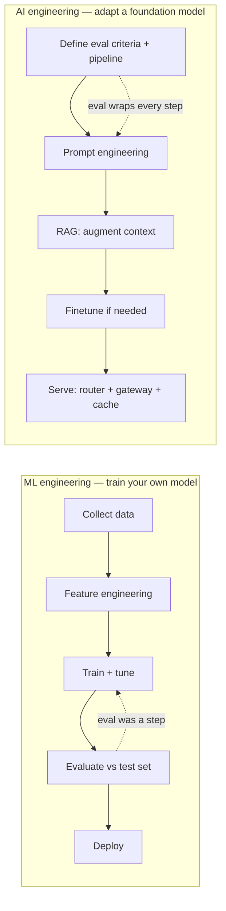
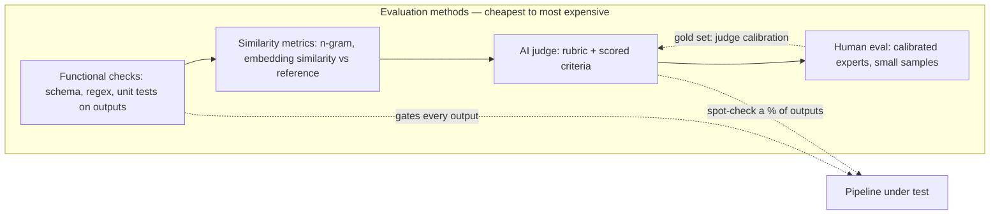
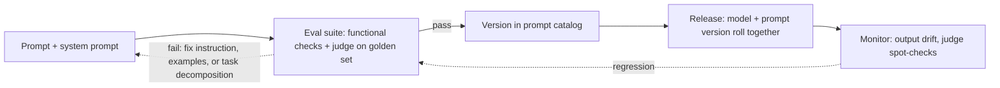
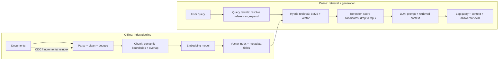
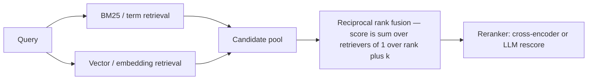
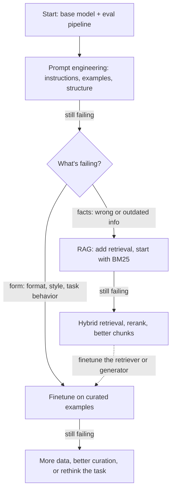
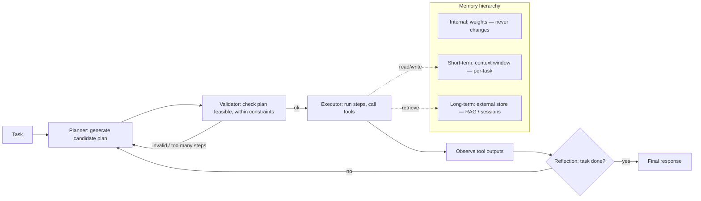
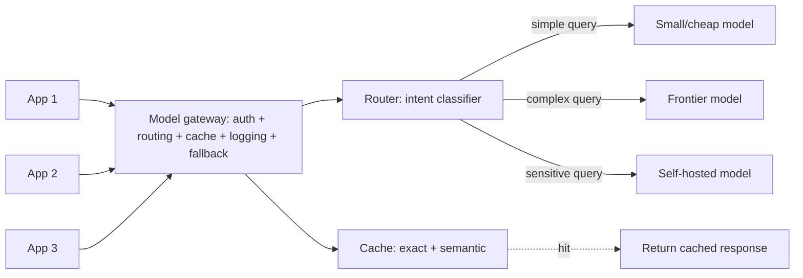

# GenAI Engineering for Data Engineers

> **Why it matters** — Foundation models turned the model itself into someone else's problem. What remains — evaluation pipelines, context retrieval, prompt versioning, cost and latency budgets, observability — is data engineering wearing a new label. If you can build a reliable batch pipeline, you already own most of the stack; the new part is knowing where the leverage moved.

## AI engineering vs ML engineering

Chip Huyen's framing in *AI Engineering* (O'Reilly, 2025): traditional ML engineering was about *training* models; AI engineering is about *adapting* models someone else trained. Three things actually changed:

1. **Model adaptation replaces model development.** You get leverage by prompt engineering, retrieval augmentation, and finetuning — not architecture design. Finetuning is the minority case.
2. **Models got bigger and more compute-hungry.** Inference cost and latency become first-class design constraints, not afterthoughts.
3. **Open-ended outputs broke evaluation.** A classifier is right or wrong; a paragraph has no ground-truth label. Evaluation moves from a test set and one metric to a whole pipeline — and it becomes the hardest part of the job.

| Dimension | ML engineering | AI engineering |
|---|---|---|
| Core skill | Modeling, training, feature engineering | Evaluation, context construction, prompt/data curation |
| The model | Yours — you own the weights | Borrowed — frontier API or open-weight checkpoint |
| Adaptation | Retrain with new data | Prompt → RAG → finetune, in that order |
| Evaluation | Test set, offline metrics (AUC, F1) | Eval pipeline: functional checks + AI judge + human review |
| Cost driver | Training compute, serving fleet | Per-token cost × volume; context length is a budget |
| The data team owns | Feature pipelines, training sets | Document pipelines, eval sets, retrieval index, feedback loops |

::: tip 💡 Senior insight
The work didn't disappear — it moved. Feature engineering became *context engineering*: the chunking, indexing, and query-time retrieval pipeline *is* the new feature pipeline. Data curation now matters more than model architecture because you no longer control the architecture.
:::

## Evaluation-first development

In ML engineering, evaluation was the last mile. In AI engineering it's the first: you cannot iterate on prompts, retrievers, or models faster than you can measure whether the change helped. Huyen's rule of thumb: build the eval pipeline *before* optimizing anything.

- **Functional correctness** runs first and is the only tier that scales to 100% of outputs: does the output parse as JSON? Match the required format? Compile? Execute correctly (code gen)? Pass the unit test?
- **AI-as-judge** handles the open-ended middle: another model scores outputs against a rubric. Fast and cheap relative to humans — but probabilistic, which makes it the riskiest component in the eval pipeline.
- **Human eval** sits at the top: expensive, slow, small-sample. Its job isn't to grade every output — it's to *calibrate the judges*. If your AI judge disagrees with a calibrated human rubric, fix the judge, not the humans.

### LLM-as-judge caveats

The book catalogs the known failure modes. Treat them like you treat data-quality bugs — they corrupt the measurement system itself:

| Bias / limit | Symptom | Mitigation |
|---|---|---|
| Inconsistency | Same input, same judge, different score across runs | Pin judge model version + prompt; set temperature low |
| Position bias | First answer in a pairwise comparison wins more often | Run comparisons in both orders, average |
| Verbosity bias | Longer answers score higher regardless of correctness | Length-normalize in rubric; penalize padding |
| Self-bias | Model favors its own outputs as judge | Use a different model family as judge |
| Criteria ambiguity | "Faithfulness" means different prompts across tools (MLflow 1–5, Ragas 0/1, LlamaIndex YES/NO) | Write your own rubric with scored examples; never trust a score whose judge prompt you haven't seen |

::: warning ⚠️ Production failure mode
AI-judge scores drift silently: someone edits the judge prompt, swaps the judge model, or the provider updates the endpoint — and your "coherence score" jumps 2 points for no application reason. Version the judge (model + prompt + sampling params) exactly like the pipeline it grades, and diff judge configs in code review.
:::

### The evaluation pipeline contract

From Chapter 4 of the book — a three-step design, in order:

1. **Evaluate each component independently.** If a resume extractor fails, you need to know whether the PDF-to-text step or the entity-extraction step failed. End-to-end scores alone can't tell you where it broke.
2. **Write an evaluation guideline before writing prompts.** Define what "good" means with scored examples; also define what's out of scope and how the system should decline. An ambiguous rubric produces misleading scores.
3. **Define eval methods and data per criterion.** Teams average ~2.3 evaluation criteria per application (relevance, factual consistency, safety…). Each gets its own method: binary checks, rubric scores, or comparative ranking.

::: details Tie eval metrics to business metrics
A factual-consistency score means nothing until you can say "80% consistency automates 30% of support tickets; 98% automates 90%." That mapping — not the score itself — is what justifies spending on eval infrastructure, and what tells you when "good enough" is good enough.
:::

## Prompt engineering as a pipeline stage

Prompting is not a vibe check. It's a versioned, tested artifact in the deployment path — treat it like a SQL query or a dbt model, not like an email.

Practices that survive production (paraphrased from the book's Chapter 5):

- **Separate prompts from code.** Keep them in a dedicated file or a `.prompt` format (Dotprompt, Humanloop) so domain experts can edit prompts without touching application code, and prompts can be tested independently.
- **Version prompts like schema changes.** A prompt catalog tracks each prompt's model, creation date, owning application, and input/output schema. Rollbacks mean *prompt + model version together* — they're one unit, same as a model + feature schema in classic ML.
- **Iterate systematically.** Unclear instructions and non-representative examples are the top two reasons prompting "doesn't work." Most claims that a task needs finetuning turn out to be sloppy prompts, not a real capability gap.
- **Decompose and constrain.** Break complex tasks into subtasks; give the model time to think (chain-of-thought); constrain output format explicitly when downstream code parses it.
- **Defensive prompting is real work.** System prompts get reverse-engineered, and prompts are an injection attack surface — treat user-supplied text going into prompts like untrusted input, with escaping and input filtering at the boundary.

::: tip 💡 Senior insight
Prompt engineering is the cheapest adaptation lever and the fastest iteration loop. Exhaust it before reaching for RAG or finetuning — not because prompts always win, but because the eval and experiment infrastructure you build doing it is the same infrastructure the heavier techniques need.
:::

## RAG: retrieval as a data-engineering problem

RAG is a data pipeline feeding a generator. The retrieval half — ingestion, chunking, indexing, ranking — is pure data engineering, and it's where most production quality lives or dies.

### Chunking strategy trade-offs

Chunking is the highest-leverage knob in the whole system. Too small loses context across boundaries; too large dilutes embedding relevance and wastes context window.

| Strategy | How it works | Pros | Cons |
|---|---|---|---|
| Fixed-size (chars/words/tokens) | Split every N units | Simple, predictable | Breaks mid-thought; token-boundary chunks pin you to one model's tokenizer — switch models, re-index |
| Recursive / hierarchical | Split by section → paragraph → sentence until under max size | Respects semantic boundaries | Slightly more complex; boundary units vary by doc type |
| Structure-aware (code, Q&A pairs) | Split on language or format semantics | Best relevance for structured docs | Format-specific logic per source type |
| Overlap (~10-20% of chunk) | Share boundary context between adjacent chunks | Preserves context at cut points | Redundant indexing cost; doesn't fix bad boundaries |

::: tip 💡 Senior insight
There is no universal best chunk size — experiment. Halving chunk size doubles the number of chunks and vector search space; smaller chunks lose meaning, larger chunks lose recall. Set chunk size from how the data gets *retrieved*, not how it's stored: a Q&A doc chunks by question, a codebase by function.
:::

### Embedding + vector index trade-offs

The index is the retrieval engine. Pick the ANN algorithm for your recall/latency/memory budget — not the marketing page.
| Index type | Recall | Query speed | Build cost | Memory | When to use |
|---|---|---|---|---|---|
| Brute force (kNN) | 100% | Slowest | None | Highest | Small corpora only; baseline for recall measurement |
| HNSW (graph) | High | Fast | High (slow build, memory-hungry) | High | Default for production: high-recall + low-latency reads |
| IVF (clustered) | Medium-high | Fast (cluster-bound) | Medium | Medium | Larger corpora; pairs with product quantization |
| LSH (hash buckets) | Lower | Fast | Low | Low | Cheap filtering, pre-rank candidate gen |
| Product quantization | Medium | Fast | Medium | Lowest (compressed vectors) | Billions of vectors, memory-bound deployments |

::: details Term-based vs embedding-based retrieval
Term-based (BM25, Elasticsearch) is faster, cheaper, and works out of the box — but misses semantic matches and can't be tuned much further. Embedding-based retrieval handles natural-language queries and improves with finetuning — but embeddings can *obscure* keywords (error codes like `EADDRNOTAVAIL`, product SKUs) that term search nails. Production systems use both.
:::

### Hybrid search + reranking

Pure vector retrieval misses keyword-sensitive queries; pure keyword misses paraphrases. Hybrid merges both:

- **Reciprocal rank fusion** combines rankings from parallel retrievers: a document ranked #1 by one retriever and #3 by another scores higher than either alone. k ≈ 60 is the standard dampening constant.
- **Reranking** applies an expensive precision step *after* cheap recall. A cross-encoder or LLM rescores the merged candidate pool — same funnel as candidate-gen → ranking in recommender systems.
- **Retrieval metrics** mirror the pipeline: **context precision** (of what we retrieved, how much was relevant?) and **context recall** (of what was relevant, how much did we retrieve?). Precision is cheap to measure; recall needs full-corpus annotation, so most teams approximate it on a labeled eval set.
- **Query rewriting** fixes referential queries ("how about Emily Doe?") before retrieval; the rewritten query must stand alone or retrieval hallucinates context.

::: warning ⚠️ Cost trap
Embedding generation, vector storage, and vector queries carry real cost — Huyen notes vector DB spend can reach a fifth to half of model API spend at scale. Re-embedding a 100M-document corpus on every reindex is the kind of line item that shows up in the cloud bill, not the architecture diagram. Cache embeddings and incremental-index.
:::

## Finetuning: the decision tree

The single most misused lever. Finetuning is expensive, requires real training data and serving infra, and can *degrade* a model on tasks outside its training distribution (the "alignment tax"). The book's ordering — and the rule for when each applies:

| Situation | Reach for | Why |
|---|---|---|
| Model lacks private/current info | RAG | Finetuning can't add knowledge it wasn't trained on at serving time — RAG retrieves it live |
| Model gets facts right but format/style wrong | Finetune | RAG doesn't fix behavior; finetuning does — "finetuning is for form, RAG is for facts" |
| Needs structured output (JSON, SQL dialect) | Finetune or constrained decoding | Prompt engineering first; finetune if the syntax is rare or complex |
| Task is common, benchmark-covered | Prompt engineering | Frontier models beat most finetuned domain models on standard tasks |
| Latency/cost budget tight | Smaller finetuned model or distillation | A finetuned small model can beat a large general one on a narrow task at a fraction of the cost |
| Still experimenting / unclear failure mode | Prompt + RAG only | Finetuning is a commitment — data, training runs, serving, ongoing maintenance |

::: warning ⚠️ The finetuning trap
Huyen's warning: "many practitioners claim prompting doesn't work and insist on finetuning — investigation shows their prompt experiments were minimal and unsystematic." The eval pipeline discipline from earlier sections is what separates "finetuning is needed" from "we haven't tried hard enough."
:::

Empirically: on current-events QA, RAG beats finetuning decisively (Ovadia et al., 2024) — finetuned models sometimes scored *worse* than base models because finetuning degraded general capability. RAG + finetuning together helped only ~43% of the time; adding RAG on top of a finetuned model *hurt* more often than it helped.

## Inference optimization

Serving a foundation model is the most expensive line item in most GenAI systems. The two levers: make the model cheaper, and make the serving layer smarter.

### Latency metrics that matter

User-perceived latency decomposes into two numbers — they're independent and need separate budgets:

- **TTFT** (time to first token): dominated by prefill — how fast the input prompt gets processed. Long system prompts and large context windows inflate it.
- **TPOT** (time per output token): dominated by decode — how fast each subsequent token streams out. Output length multiplies it directly.

Total latency ≈ TTFT + TPOT × output tokens. Optimize for percentiles (p90/p95/p99), not averages — one slow request skews the mean but doesn't tell you where the tail lives.

| Technique | What it does | Latency effect | Cost effect | When |
|---|---|---|---|---|
| **Batching** (static → dynamic → continuous) | Group concurrent requests into shared forward passes | Adds wait time to fill batches | Big win — amortizes compute | High-throughput serving; continuous batching returns responses as they finish |
| **KV cache** | Reuse key/value vectors instead of recomputing per token | Massive decode speedup | Memory-heavy — grows linearly with sequence length and batch | Always on in modern inference servers (vLLM's PagedAttention) |
| **Prompt caching** | Cache processed prompt prefixes (system prompt, long docs) | Cuts TTFT up to ~75-90% on cache hits | Cuts input-token cost up to ~90% | Long shared prefixes: system prompts, repeated documents, multi-turn |
| **Quantization** | FP32 → FP16/INT8/INT4 weights | Speeds memory-bound decode | Halves or quarters memory footprint | Almost always; watch quality drop below 4-bit |
| **Distillation** | Train small "student" to mimic large "teacher" | Faster smaller model | Cheaper serving long-term | Narrow tasks where a smaller model retains quality |
| **Prefill/decode disaggregation** | Split compute-bound prefill from memory-bound decode on separate instances | Smooths both TTFT and TPOT | More instances, better utilization | High-volume LLM serving |

::: details The output-token asymmetry
One output token costs roughly 2–4× an input token in API pricing, and Anyscale measured a single output token having the latency impact of ~100 input tokens. The cheapest optimization is often just *generating less*: cap output length, ask for terse formats, and prefer structured outputs over prose when the downstream consumer is code, not a human.
:::

## Agent architectures

An agent is what happens when you let the model call tools and loop. The pattern is planner → validator → executor, plus memory — and the failure modes are mostly about tool calls and plans, not generation quality.

The pieces that matter to a DE:

- **Tools are the real power.** A model with a calculator, a SQL executor, a web browser, and a code interpreter is dramatically more capable than the model alone. Tool inventory is a design decision — more tools mean more capability but harder planning and more failure modes.
- **Decouple planning from execution.** Never let the model generate a 1,000-step plan and run it unsupervised. Validate plans before execution (reject plans with invalid tools, cap step counts, or score with a judge), then execute.
- **ReAct pattern**: interleave reasoning and action — thought → act → observe → repeat — so the agent reflects after each step rather than planning blindly to the end.
- **Compound failures dominate.** Per-step accuracy of 95% becomes 60% over 10 steps and 0.6% over 100. Agent evaluation must measure *task completion*, not per-step quality — and track planning failures (invalid tool, wrong params, goal misses) separately from execution failures.
- **Memory maps to storage tiers.** Internal knowledge = model weights (never updated at runtime). Short-term memory = the context window (fast, bounded, per-task). Long-term memory = external retrieval (persistent across sessions — this is just RAG pointed at the agent's own history).

::: tip 💡 Senior insight
An agent that can't explain its plan and check its own work is a demo, not a system. The production version is a planner + validator + executor + scorer — each a separable component, each independently evaluable. That's the same component-evaluation principle from the eval pipeline section applied recursively.
:::

## Cost and latency engineering

This is where DE instincts transfer directly. Cost is tokens × price; latency is TTFT + TPOT × tokens. Everything else is a lever on those two equations.

| Lever | Mechanism | Cost | Latency | Trade-off |
|---|---|---|---|---|
| **Token budgeting** | Cap input/output lengths; trim context; terse output formats | Direct | Direct | Less context can hurt quality |
| **Model routing** | Intent classifier sends easy queries to small models, hard ones to large | Big win — most queries don't need the frontier model | Small router adds ~ms | Router itself needs eval + maintenance |
| **Exact caching** | Cache by query hash: identical query → cached response | Eliminates duplicate compute | Near-zero on hit | Staleness; privacy — cached answers can leak user data |
| **Prompt caching** | Provider caches shared prompt prefixes | Big win on long system prompts | Big TTFT win | Provider-specific; storage fees |
| **Semantic caching** | Cache by embedding similarity — "same meaning" queries hit | Higher hit rate than exact | Still fast | Similarity threshold is fragile; wrong hits are silent |
| **Fallback routing** | Gateway retries/switches providers on rate-limit or failure | Costs nothing until needed | Prevents timeouts | Different models ≠ identical behavior |

### The model gateway as infrastructure

The book's architecture step 3 is the piece DEs recognize immediately: a **model gateway** — one unified interface in front of all model providers and self-hosted endpoints. It centralizes access control (no API keys in application code), cost accounting, rate limiting, fallback routing, and logging. Think of it as the API gateway pattern applied to models — and the reason "swap providers" is a config change, not a rewrite.

::: tip 💡 Senior insight
Start with one model and no router. Add the gateway when you add a second provider or need centralized control. Add routing when you can measure that cheap models handle most queries. The architecture grows with measured need — adding all of it up front is resume-driven design, not engineering.
:::

## 🧠 Quiz

<QuizCard :questions="[{ q: 'A GenAI feature is producing inconsistent quality and the team wants to fix it fast. What should exist before any prompt, RAG, or finetuning change?', options: ['A semantic cache to stabilize outputs', 'An evaluation pipeline with defined criteria, functional checks, and a rubric for AI-judge and human review', 'A finetuning dataset of 10,000 labeled examples', 'A benchmark comparison of the top three model providers'], correct: 1, explain: 'Evaluation-first development is the foundational discipline: without a defined eval pipeline you cannot measure whether any change helps. Every adaptation technique — prompts, RAG, finetuning — is benchmarked against it, not the other way around.' }, { q: 'A model answers questions correctly in structure but with outdated or private facts it cannot know. What is the right adaptation?', options: ['Increase the temperature so it generalizes better', 'Finetune the model on recent documents', 'RAG — retrieve relevant context at query time; finetuning is for form, RAG is for facts', 'Add more few-shot examples to the prompt'], correct: 2, explain: 'Information-based failures — missing or stale knowledge — are what RAG exists for. Finetuning teaches behavior and format; it does not inject facts the model will need at serving time, and it can degrade general capability.' }, { q: 'An AI judge scores your RAG system higher this month than last, but nothing changed in the application. Most likely cause?', options: ['Users are asking easier questions', 'The judge model, prompt, or scoring rubric changed — judge configs are not versioned', 'The model provider upgraded the generation model', 'The retrieval index grew and improved recall'], correct: 1, explain: 'AI-as-judge scores are probabilistic and sensitive to the judge model and prompt. If the judge is not versioned like the pipeline it grades, score drift is the expected failure mode — always pin and diff judge configs.' }, { q: 'Latency budget: p99 TTFT must stay under 200 ms but users stream long answers. Which serving decisions target which metric?', options: ['Prefill disaggregation and prompt caching target TTFT; continuous batching and KV cache management target TPOT', 'TPOT only matters for non-streaming responses', 'TTFT is fixed by hardware and cannot be tuned', 'Batching reduces TTFT; quantization reduces TPOT'], correct: 0, explain: 'TTFT is dominated by prefill — long prompts and shared prefixes are what prompt caching and prefill scaling reduce. TPOT is decode-bound — continuous batching, KV cache, and output-length discipline are the levers.' }, { q: 'Your retrieval system returns documents that keyword-match perfectly but miss semantic intent, and misses error codes entirely on vector search. The fix?', options: ['Switch entirely to embedding-based retrieval', 'Lower the embedding similarity threshold', 'Hybrid search: combine BM25 and vector retrieval with reciprocal rank fusion, then rerank', 'Increase chunk size so more context is retrieved'], correct: 2, explain: 'Term-based and embedding-based retrieval have complementary failure modes — keywords for exact matches and codes, vectors for paraphrase and intent. Hybrid retrieval plus a reranker gets the precision of both without the blind spots.' }, { q: 'An agent system must plan, execute, and reflect on multi-step tasks. What is the most important production guardrail?', options: ['Use the largest available model so plans are always correct', 'Give the agent as many tools as possible to maximize capability', 'Cache all agent responses to reduce cost', 'Decouple planning from execution — validate plans before running them, cap steps, and measure task completion not per-step quality'], correct: 3, explain: 'Unvalidated plans run blind — the most common agent failure modes are invalid tool calls and goal misses, and errors compound across steps (95% per-step accuracy is 60% over 10 steps). Validate before executing; evaluate end-to-end task success.' }]" />

## Further reading

- **[AI Engineering — Chip Huyen (2025)](https://github.com/chiphuyen/aie-book)** — the book this chapter distills; the eval-pipeline, RAG, and finetune-decision frameworks above come from it. GitHub repo includes code examples and benchmarks.
- **[Designing Machine Learning Systems — Chip Huyen (2022)](https://www.oreilly.com/library/view/designing-machine-learning/9781098107956/)** — the predecessor volume; covers training/serving skew, drift, and the broader ML lifecycle that GenAI builds on.
- **[ReAct: Synergizing Reasoning and Acting in Language Models (Yao et al., 2022)](https://arxiv.org/abs/2210.03629)** — the interleaved thought-act-observe pattern behind most agent frameworks.
- **[Fine-Tuning or Retrieval? (Ovadia et al., 2024)](https://arxiv.org/abs/2401.08670)** — empirical evidence that RAG beats finetuning on knowledge-intensive tasks, and that combining them is not automatically better.
- **[Retrieval-Augmented Generation for Knowledge-Intensive NLP Tasks (Lewis et al., 2020)](https://arxiv.org/abs/2005.11401)** — the original RAG paper; the architecture everything else extends.
- **[Anthropic: Contextual Retrieval](https://www.anthropic.com/research/contextual-retrieval)** — practical write-up on augmenting chunks with context to fix the retrieval failures this chapter covers.
- **[Anthropic docs: Prompt caching](https://docs.anthropic.com/en/docs/build-with-claude/prompt-caching)** — the concrete mechanics and cost math behind the TTFT/input-token levers.
- **[Chip Huyen's blog](https://huyenchip.com/)** — her running notes on evaluation, model behavior, and production AI; the clearest public companion to the book.

**Cross-links:** [ML & GenAI System Design](/system-design/ml-systems) for the interview framing of RAG; [Data-Intensive Foundations](/system-design/data-intensive) for the consistency/partitioning ideas the retrieval layer inherits.
