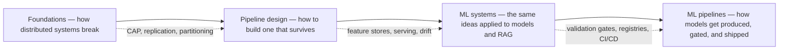

# System Design for Data Engineers

> **Why it matters** — At senior level nobody asks you to recite syntax. They ask: *"Design a system that ingests 50k events/sec, survives a region failure, and never double-charges a customer."* This track is the vocabulary and the trade-off intuition for answering that.

**Who this is for:** data engineers prepping for senior/staff system-design interviews, and engineers who own pipelines in production and want a sharper mental model of why things fail the way they do.

## Chapters

### [Data-Intensive Foundations](/system-design/data-intensive)

The Kleppmann frame — reliability, scalability, maintainability — then the machinery underneath every data system you operate: CAP and PACELC, consistency models, replication topologies and split-brain, partitioning and hot spots, isolation anomalies, consensus intuition via Raft, clocks and ordering, and how batch vs streaming read paths differ. This is the chapter that makes "why did the warehouse show stale rows?" a diagnosable question instead of a mystery.

### [Designing Reliable Pipelines](/system-design/pipeline-design)

The reference architecture — ingest → raw → curated → serve, wrapped in an observability plane — and every pattern that makes it survive production: idempotency keys and dedupe windows, why exactly-once is an illusion and what actually works, backpressure and load shedding, dead-letter queues, schema evolution and data contracts, checkpoint/restart and blue-green backfills, data SLOs, and a worked capacity-estimation example you can reuse verbatim in interviews.

### [ML & GenAI System Design](/system-design/ml-systems)

The interview framework — requirements → data → features → model → serving → monitoring — then the parts data engineers actually own: feature stores and training-serving skew, batch vs real-time inference, model lifecycle and shadow deploys, drift monitoring, plus three worked designs: fraud detection under a latency budget, two-stage recommendation, and a full RAG/GenAI architecture with guardrails and cost controls.

### [ML Training Pipelines in Production](/system-design/ml-pipelines)

The pipeline that produces the model, decomposed TFX-style: ExampleGen → StatisticsGen → SchemaGen → ExampleValidator → Transform → Trainer → Tuner → Evaluator → InfraValidator → Pusher, and why every gate exists. Data validation as a pipeline step with the three skews, feature engineering inside the pipeline via the shipped transform graph, model versioning and registry semantics, orchestration trade-offs (Beam, Kubeflow, managed, Airflow), the ML CI/CD test pyramid, and the monitoring hand-off that closes the retraining loop.

### [GenAI Engineering](/system-design/genai-engineering)

Chip Huyen's AI Engineering distilled for data engineers: evaluation-first development, prompts as versioned pipeline stages, RAG as a data-engineering problem (chunking, hybrid retrieval, reranking), the prompt → RAG → finetune decision tree, inference optimization (batching, KV cache, quantization, distillation), agent architectures, and token-budget cost engineering.

### [Data Platform Design Case Studies](/system-design/platform-designs)

Five end-to-end designs that combine everything above: a greenfield lakehouse for a 50-team org, a real-time personalization and feature platform, a global metrics and semantic layer, a compliance-grade PII platform, and a legacy on-prem ETL → cloud lakehouse migration. Each case follows the same skeleton — capacity estimate, decision log, failure modes, and what changes at 10x — so you can reuse the structure in interviews and design docs.

## Pareto focus

The ideas in this track that carry the most weight:

1. **There is no exactly-once delivery.** Effective-once = at-least-once delivery + idempotent writes + dedupe. Design every sink for retries.
2. **CAP is a partition-time choice, not a global one.** You pick CP or AP *per subsystem*; PACELC adds the healthy-network cost of that choice.
3. **Linearizability is expensive and often unnecessary.** Know what each consistency/isolation level actually buys before paying for it.
4. **Hot keys beat any partition strategy.** Hash vs range is table stakes; the celebrity problem is what takes systems down.
5. **Idempotency and schema contracts are the two highest-ROI reliability investments** in any pipeline — ahead of any tool choice.
6. **Data SLOs are what make a pipeline a product.** Freshness, completeness, correctness — measured, alerted, owned.
7. **In ML systems the model is ~10% of the design.** Features, serving latency, drift monitoring, and rollback are the other 90%.
8. **RAG is a data-engineering problem.** Ingestion, chunking, indexing, and evaluation discipline determine answer quality far more than model choice.
9. **A training pipeline is a data pipeline with extra gates.** Data validation, transform reuse, per-slice eval, and infra validation stand between raw data and a deployed model; the metadata store is what makes any of it reproducible.
