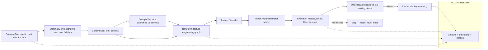
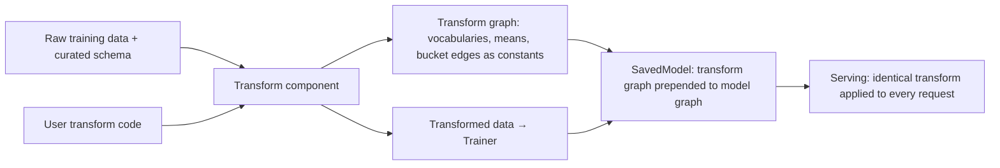
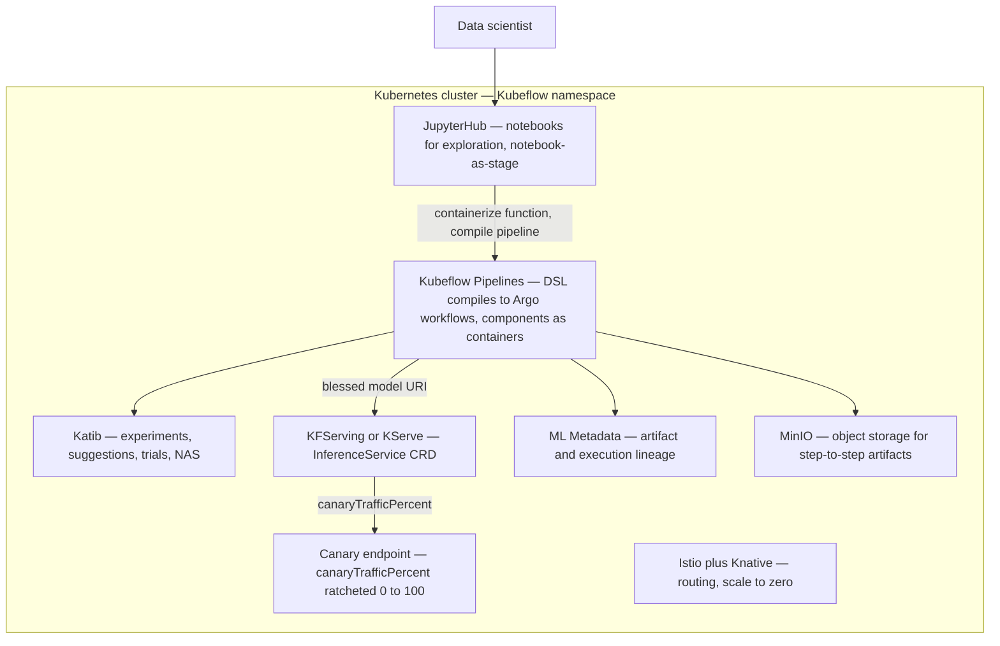
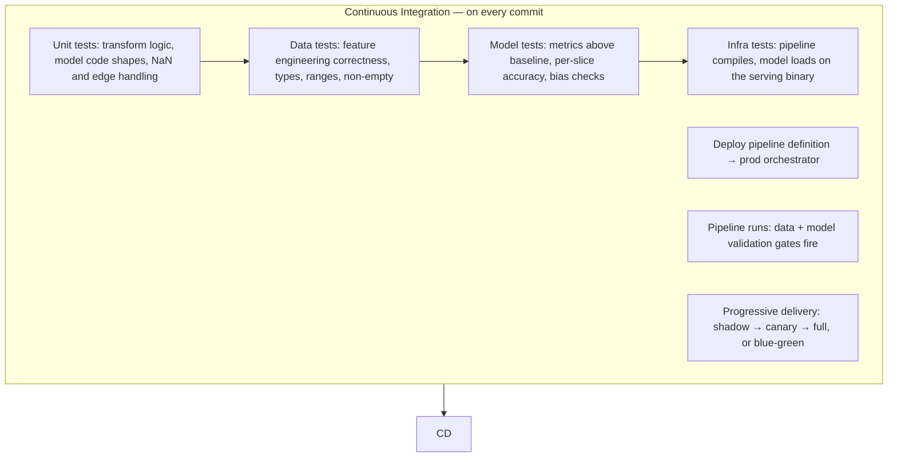
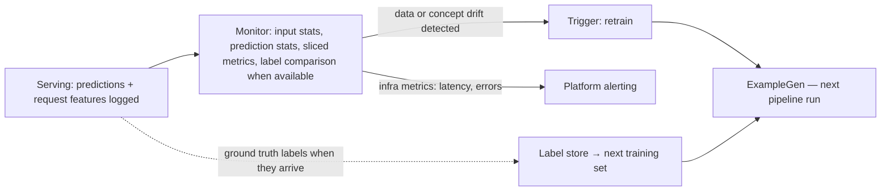

# ML Training Pipelines in Production

> **Why it matters** — [ML & GenAI System Design](/system-design/ml-systems) covered the system around the model; this chapter covers the pipeline that *produces* the model. Production retraining is a data pipeline with extra gates — data validation, transform reuse, model evaluation, infra validation — and most of its components are things a data engineer already knows how to build. The failure modes are also familiar: silent bad data, unreproducible artifacts, and deploys nobody can roll back.

## A model is not a pipeline

A notebook trains *a* model. A pipeline produces models **repeatedly, reproducibly, and with an audit trail**. The book's framing: an ML pipeline runs from ingestion of new training data to feedback on how the deployed model performs — it is a recurring cycle, not a one-shot run.

Pipelines earn their complexity when:

- The model has users, so it needs continuous updates and fine-tuning as the world changes.
- Datasets or compute are large enough that runs must scale and be resumable.
- Repeatability and audit trails matter — which data, which code, which config produced this artifact.

A model you train twice a year for a static domain can stay a script. The trigger to invest is **retraining frequency** — every manual validation, deploy, or analysis step is a step a data scientist repeats forever instead of building the next model.

## The TFX-style component decomposition

TensorFlow Extended (TFX) is the reference implementation for thinking about this — even if you never use it, its component boundaries name the gates every production training pipeline needs. Each component is a step with typed input and output **artifacts**; the orchestrator chains them via artifact dependencies, not hand-wired ordering.

Why each gate exists — every one answers a different question:

| Component | Question it answers | What it produces | Skip it and… |
|---|---|---|---|
| ExampleGen | What data are we training on? | Versioned train/eval splits | No data snapshot → no reproducibility |
| StatisticsGen | What does the data look like? | Full-pass stats (mean, stddev, categories) | Downstream gates have nothing to compare |
| SchemaGen | What *should* the data look like? | Inferred schema: types, presence, domains | Every downstream check is hand-coded |
| ExampleValidator | Is this run's data broken? | Anomaly report; can halt the pipeline | Bad data silently trains a bad model |
| Transform | How do raw features become model inputs? | Transform graph + transformed data | Preprocessing drifts between training and serving |
| Trainer | Fit the model | SavedModel | — |
| Tuner | Are the hyperparameters right? | Best trial's hyperparameters | One-shot guesses left on the table |
| Evaluator | Is this model *better* — overall and per slice? | Metrics + bless/reject verdict | Worse models replace good ones |
| InfraValidator | Does it actually load and serve? | Infra blessing | "Works in Python, crashes the model server" |
| Pusher | Ship it | Model in the serving location | — |

::: tip 💡 Senior insight
The pipeline's real product isn't the model — it's the **metadata store**. Every component writes what it read, produced, and decided, which gives you lineage ("which data trained this model?"), caching ("rerun only the failed component"), and the artifact chain that makes a rollback meaningful. Teams that skip the metadata layer get the orchestration but none of the debuggability.
:::

::: details The DAG is derived, not declared
In TFX-style systems you don't write the dependency graph — you wire artifacts: `StatisticsGen(examples=example_gen.outputs["examples"])` creates a data dependency automatically, and the orchestrator topologically sorts. ExampleValidator and Transform both consume SchemaGen's output but not each other's, so they run in parallel. Explicit task dependencies (`add_upstream_node`) exist only for orderings the artifact flow can't express.
:::

## Data validation as a pipeline step, not a pre-flight check

This is the piece data pipelines and ML pipelines share most directly — and where the ML version goes further. In a plain data pipeline, validation answers "is this batch loadable?" In a training pipeline it answers "is this batch *worth training on*?" — and the answer can legitimately stop the pipeline before it spends GPU-hours on garbage.

The standard split (from TensorFlow Data Validation, which powers StatisticsGen → SchemaGen → ExampleValidator):

1. **Compute statistics** over the whole dataset (full pass, Beam-scale).
2. **Infer a schema** — feature presence, type, valency, domain.
3. **Curate the schema by hand** — the inferred schema is a starting point; a human who knows the data tightens domains and required fields. The curated schema becomes the contract every future run is checked against.
4. **Detect anomalies** — single-dataset checks against the schema, and two-dataset comparisons for drift and skew.

### Skew vs drift — and the three kinds of skew

**Drift** compares across time: this week's training data vs last week's. **Skew** compares across environments: training data vs serving data. Skew has three distinct types that need different detection methods:

| Skew type | What differs | How it's detected | Classic cause |
|---|---|---|---|
| Schema skew | Training and serving data don't conform to the same schema — float in training, int in serving | Same machinery as anomaly detection: serving stats vs schema | Two code paths serialize features differently |
| Feature skew | Same entity, different feature *values* between training and serving | Join train and serving examples on an ID feature, compare values | Feature computed at different times, or a bug in one path |
| Distribution skew | The shape of a feature's distribution shifted | Statistical distance — Jensen–Shannon divergence (numeric), L-infinity distance (categorical) — over a threshold | Biased sampling, different sources, seasonality |

::: warning ⚠️ Risk / production failure mode
Schema skew is the cheap one to catch and the one teams actually catch. Distribution skew and feature skew need the *two-dataset* comparison — a serving-side stats job — which most pipelines never build. That's why training-serving skew is the classic silent killer: nothing errors, the model just quietly scores a different distribution than it learned.
:::

Decision rule on anomaly detection: a schema-level anomaly (unexpected feature, missing feature, wrong type) means **stop the pipeline and page a human** — the data contract broke. A distribution-level anomaly (statistically different but valid data) means the world changed — **retrain**, don't halt. The pipeline's value is encoding that distinction in the gate, not leaving it to whoever reads the alert.

## Feature engineering *inside* the pipeline

The naive design preprocesses data in a script, saves the result, then trains. This splits feature logic from the model and guarantees that one day the training transform and the serving transform disagree — the preprocessing bug the book calls out as a classic manual-workflow failure: the model still predicts, it's just wrong.

The pipeline-native design makes preprocessing a **component that emits two artifacts**:

Two mechanics make this work:

- **Full-pass analyzers.** Normalizing by z-score needs the dataset's mean and stddev; vocabulary and quantile bucketing need a full pass too. These "analyzers" run **once per training run** over the whole dataset (Beam-scale), then get frozen into the transform graph as constants — they do *not* recompute per request at serving time.
- **Graph shipping.** The transform becomes part of the model artifact itself. The serving path applies the identical computation graph — same constants, same ops — so training-serving skew from preprocessing is *structurally impossible*, not just unlikely.

::: info ℹ️
This is the same problem a feature store solves by dual-materializing one feature definition (see [ML & GenAI System Design](/system-design/ml-systems#feature-stores)). Transform-graph shipping solves it for in-model preprocessing; feature stores solve it for pre-computed features. Most real systems need both — the store for shared features, the in-graph transform for last-mile encoding.
:::

## Evaluation gates: the bless-or-reject chain

Trainer output is just a candidate. Three separate gates stand between it and production, each catching a different failure:

| Gate | Checks | Fails when |
|---|---|---|
| Evaluator | Metrics vs baseline — and per **slice** of the data | New model is worse overall, or better on average but broken on a segment |
| InfraValidator | The model loads and answers queries on the *actual serving binary*, in a sandboxed replica of the serving env | Model is metric-fine but incompatible with the production model server |
| Pusher (conditional) | Only runs if upstream gates blessed the model | Skipped entirely — the artifact exists but never reaches serving |

The per-slice check deserves emphasis: a churn model can beat the incumbent on overall accuracy while collapsing on one customer region. Slice metrics are the difference between "model approved" and "model approved with a fairness regression nobody saw."

::: tip 💡 Senior insight
Make the Pusher *conditional on the blessing artifact*, not on a human click. The evaluator emits a blessing artifact; the push step is declared in the graph but executes only when the blessing says go. That's the ML-pipeline version of a merge gate — the decision is data, the deploy is code.
:::

## Model versioning and the registry

"Which model is in prod?" needs a sharper answer than a filename. There's no industry-standard model version scheme — the book surveys several, all defensible:

| Scheme | Version increments when | Trade-off |
|---|---|---|
| Semantic-style (MAJOR.MINOR.PIPELINE) | MAJOR: data/target schema change; MINOR: model improved; PIPELINE: training pipeline changed | Readable semantics, but "improved" needs a defined metric |
| Arbitrary grouping | Developer decides which models belong to a version line | Flexible; can hide architecture/input changes |
| Black-box functional | Model is a black-box function; new version iff the input→output contract changes | Clean API semantics; ignores retraining on new data |
| Pipeline-execution | Every successful pipeline run mints a version (TFX's style) | Automatic and complete; version numbers carry no meaning about what changed |

Two concepts matter more than the numbering:

- **Model lineage** — the relationship set among the artifacts that produced the model: which code, which data snapshot, which preprocessing ops, which config. Lineage is what makes "reproduce this model" a query instead of an archaeology project. It covers training and evaluation; post-training operations (serving behavior) aren't part of it.
- **Model registry** — the central repository: versioned model artifacts + searchable metadata + approval gates + links back to the lineage store. The registry is where "the current production model" becomes a pointer you can atomically move — which is also what makes rollback a pointer-swap instead of a redeploy.

::: warning ⚠️ Risk / production failure mode
A model artifact without its transform graph and feature schema isn't a version — it's a half-version. The unit you register, promote, and roll back is **model + preprocessing + input contract together**. Versioning only the weights is how teams end up unable to roll back to last month's model: it exists, but nobody knows what features it expects.
:::

## Orchestration: who runs the DAG

The orchestrator is the glue: it orders components by artifact dependencies, tracks execution state, **caches component outputs so a failure reruns only the failed step**, and schedules recurring runs. Training pipelines are DAGs for the same reason Airflow DAGs are — directed so ordering is guaranteed, acyclic so runs terminate.

| Orchestrator | Model | When it fits |
|---|---|---|
| Interactive context (notebook) | *You* are the orchestrator; run components in order yourself | Development and debugging only — never production |
| Apache Beam runner | Reuses the data-processing cluster you already have | Minimal setup; Beam already runs your heavy transforms |
| Kubeflow Pipelines | Each component = a container on Kubernetes; artifact lineage UI | You have K8s and want scaling + the metadata/lineage surface |
| Managed pipelines (Vertex et al.) | Kubeflow under the hood, infra abstracted away | You want the DAG semantics without running the platform |

Where does Airflow sit? It's the general-purpose scheduler many teams already run for [data orchestration](/dataops/orchestration), and it *can* drive training pipelines (the TFX runtime supports generic orchestrators). The honest comparison:

- **Airflow** wins on ubiquity, scheduling semantics, and fitting training into a broader data-platform DAG (e.g., train right after the dbt build that produces features — see [dbt for Data Engineers](/dataops/dbt)).
- **Kubeflow/managed ML orchestrators** win on ML-native primitives: artifact typing, lineage UI, component caching keyed on inputs, GPU scheduling, per-component containers.

The dividing question: does your training pipeline need ML artifact semantics and GPU-aware per-step environments (→ ML orchestrator), or is it one stage in an existing data DAG where a containerized training task is enough (→ Airflow)? Picking per-pipeline is fine — the book notes switching orchestrators is usually a few lines, precisely because the pipeline definition is portable across them.

::: details Components should be containerized
Level-1+ pipelines treat each component as its own runtime: containerized, with its own dependencies, decoupled from siblings. That's what lets a Transform step run Beam-on-Dataflow while the Trainer runs on a GPU node — and what makes dev-cluster execution match production. If your "component" only works inside one fat environment, you have a script with extra steps.
:::

## The Kubeflow platform anatomy

Kubeflow is not one tool — it is a bundle of Kubernetes-native components that each own a slice of the model development life cycle, glued together by custom resource definitions (CRDs) on one cluster. The *Kubeflow for Machine Learning* book's map:

The pieces worth internalizing:

- **Kubeflow Pipelines (KFP)** sits on **Argo Workflows**, a container-native workflow CRD. KFP's value-add over raw Argo is a Python DSL that generates the YAML boilerplate, ML-specific hooks (typed outputs, `file_outputs` that shuttle artifacts through object storage), a recurring-run scheduler, and the experiment/lineage UI. Every pipeline you run is also visible as an Argo workflow — `argo list -n kubeflow` works — which is the debugging surface when the UI lies.
- **Every component is a container.** `func_to_container_op` wraps a Python function; `dsl.ContainerOp` runs any image in any language; `dsl.Condition` gates branches. Multilingual pipelines are the point — Spark for prep, TF for training, your own binary for publish.
- **Katib** treats hyperparameter tuning as a first-class CRD: an **Experiment** owns a search space plus objective metric, a **Suggestion** is one candidate config, a **Trial** is one training run of it. It is language-agnostic (the trial is just a Docker image), ships distributed-training and NAS support (DARTS, ENAS), and scales by being K8s-native — prototype on a laptop cluster, submit the same spec to production.
- **KFServing/KServe** serves models via an `InferenceService` CRD on Knative + Istio: serverless scale-to-zero, autoscaling replicas, and three deployment strategies from one spec — `default` only gives blue-green, `canary` with `canaryTrafficPercent: 0` gives a pinned experimental endpoint, `> 0` gives true percentage-split canary you ratchet to 100.
- **The glue is real infrastructure**: MinIO stores inter-step artifacts, Istio routes canary traffic, ML Metadata records lineage. Installing Kubeflow means running all of it — which is why managed offerings exist.

## Pipeline-as-code: KFP DSL vs the TFX model

Same idea — the pipeline *is* code — different grain:

| | TFX | Kubeflow Pipelines DSL |
|---|---|---|
| What you write | Component wiring (ExampleGen → Trainer → Pusher) against prebuilt component classes | Python functions with `@dsl.pipeline`, steps as `ContainerOp`s — any image |
| What it compiles to | Orchestrator-specific config (Airflow DAG, Beam, KFP) | Argo workflow YAML — K8s-only |
| Contract between steps | Typed artifacts tracked in ML Metadata | `file_outputs`/params — files shuttled via object storage; `step.after(x)` for side-effect ordering |
| Framework posture | TensorFlow-first, strong opinions | Framework- and language-agnostic by construction |
| Sweet spot | You want the gates (validation, bless/reject) designed for you | You have heterogeneous steps and want to define the gates yourself |

The two compose, they don't just compete: TFX components can run *on* KFP, and the book uses `ContainerOp` for anything TFX doesn't cover. The deeper difference — TFX ships an *opinionated component taxonomy*; KFP ships a *portable container DAG*. Pick TFX when its components are your pipeline; pick raw KFP when they aren't.

## Airflow vs Kubeflow: lineage vs scheduling maturity

The earlier orchestrator table gave the one-line version; the book's case studies sharpen the trade:

| Dimension | Airflow | Kubeflow |
|---|---|---|
| Scheduling | Mature cron semantics, catchup, backfill, rich trigger rules | Recurring runs are **frequency-only** — a daily run created at 10am runs at 10am daily; you specify *how often*, never *when* |
| Artifact lineage | Task logs, XComs if you're lucky | First-class: artifact store, execution records, lineage UI per run |
| Step isolation | Tasks share the worker env (or KubernetesPodOperator DIY) | Every step is its own container and node pool — GPU stages get GPU nodes |
| Step caching | Rerun the task | Cache keyed on inputs — a rerun replays only changed steps |
| Data-scientist ergonomics | DAGs are a DE artifact | Notebook → pipeline is the designed path; DSL is Python they already write |
| Best fit | Training is one stage in a data DAG you already run | The pipeline *is* the product: ML artifacts, GPUs, experiments |

The honest split: Airflow's scheduler is years ahead; Kubeflow's *per-run* semantics (lineage, caching, containers, GPU scheduling) are years ahead. Many shops run both — Airflow owns the data calendar and triggers KFP runs for training.

::: warning ⚠️ Risk / production failure mode
The executor abstraction leaks. Argo supports several container runtimes (Docker, kubelet, k8sapi, PNS — set via `containerRuntimeExecutor`), and the choice changes your pipeline's contract: the k8sapi executor can only pass parameters **and save artifacts through files/volumes**, while Docker passes params by value. Platforms without Docker APIs (OpenShift 4+) force a non-Docker executor — the same pipeline YAML can silently change what's persisted. Know your cluster's executor before assuming `file_outputs` behaves like the examples.
:::

## Kubernetes-native trade-offs — and the failure modes the book walked into

K8s gives you GPU nodes, per-step isolation, and scale-to-zero serving. The bill:

- **Resource requests are load-bearing.** `set_gpu_limit(N)` marks a stage for GPU; `resources.requests` on an `InferenceService` has defaults you will "almost always need to customize." Undersize and pods pend or OOM; oversize and the GPU pool idles — GPU autoscaling for inference is genuinely hard because it compounds utilization, duty cycle, and cold-start factors.
- **Nothing is shared between steps by default.** Each container is isolated; step-to-step data needs explicit plumbing — `file_outputs` (KFP copies to MinIO), a mounted PVC, or cloud object storage. "The file was right there" is the first bug everyone hits.
- **GPU must exist before you ask for it.** The cluster needs GPU-enabled node pools configured per your cloud provider; `.set_gpu_limit` on a CPU-only cluster schedules to nowhere.
- **Notebooks are a stage, not a home.** The designed flow: explore in JupyterHub on-cluster, containerize the function (`func_to_container_op`) or the whole notebook image, compile, run. Skipping the containerize step leaves you with a demo, not a pipeline.

Failure modes harvested from the book's walkthroughs:

| Failure mode | Mechanism | Guard |
|---|---|---|
| Step output "disappears" | Isolated container FS; no `file_outputs` declared | Declare every output path; artifacts land in MinIO |
| Recurring run at the wrong hour | Frequency-only scheduling; start time anchors to creation time | Create the recurring run at the hour you want it to fire |
| Unpinned components drift | `load_component` fetches the pipelines repo *master* branch by default | `load_component_from_file` against a downloaded release tag |
| Params lost between steps | Executor-specific param passing (k8sapi = files only) | Check `containerRuntimeExecutor` on your platform |
| Silent DSL breakage | Naming quirk: camelCase op names error; snake_case required | Lint the compiled YAML before uploading |
| Canary that can't route | `canaryTrafficPercent` needs Istio/Knative healthy | Verify the service plane before trusting the split |

## CI/CD for ML: three things under test, not one

Software CI tests code. ML CI has three test surfaces, and the pyramid layers them:

What changes relative to app CI:

- **Data unit tests** aren't the same as pipeline data validation — these check that *feature engineering code* computes correctly: scales are applied, one-hot vectors are right, embeddings generate, columns have the right type and range.
- **Model tests** assert floor metrics: accuracy/AUC above a baseline *and* above thresholds per important slice. A model that passes overall but fails a slice is a failed build.
- **Mocks matter differently**: synthetic test data should cover the edges and corners of the feature space, occupying roughly the same region as real data but sparse — you're testing behavior, not retraining.
- **CD deploys the pipeline, not just the model.** The crucial ML shift: you deploy a *training pipeline that continuously produces models*, not a frozen artifact. The pipeline's own triggers (schedule, new-data signal, decay detection) drive retraining.

This is the maturity ladder (the Google-derived MLOps levels the book uses):

| Level | What's automated | The signature gap |
|---|---|---|
| 0 | Nothing — manual notebook → hand-off to engineers | Retraining is a project; skew via manual handoff is endemic |
| 1 | The training pipeline itself: triggers, validation, deploy of each new model | The pipeline code still ships manually — no CI for pipeline changes |
| 2 | Full CI/CD: pipeline code is built, tested, deployed like software | — (aspirational for most orgs) |

The jump that hurts is 0 → 1; the jump that *pays* is 1 → 2, because it makes "improving the pipeline" as safe as retraining the model.

## The monitoring hand-off — where the pipeline ends and begins again

A training pipeline doesn't end at Pusher; it ends at a feedback contract with the serving side:

The hand-off has three payloads:

- **Logged prediction requests** — feature vectors as served. This is the raw material for detecting *serving-side* distribution shift and the skew comparisons above. If serving logs nothing, skew detection has no second dataset.
- **Ground-truth labels when they arrive** — late labels feed both true-accuracy monitoring and the *next training set*. The label-delay story from [ML & GenAI System Design](/system-design/ml-systems) is what determines whether decay detection is days-fast (proxies) or weeks-slow (real labels).
- **A retraining trigger** — monitor-decided, not calendar-decided. Scheduled retrains handle seasonality; drift-triggered retrains handle the world changing on its own schedule. Mature pipelines run both.

This closes the loop: the pipeline exists because models decay, monitoring detects decay, and the trigger restarts the pipeline. A training pipeline with no monitoring hand-off is a deploy script with extra steps — it can ship a model but can't tell you when it's wrong.

## 🧠 Quiz

<QuizCard :questions="[{ q: 'In a TFX-style pipeline, which component emits the artifact that every downstream validation gate depends on?', options: ['StatisticsGen', 'Pusher', 'ExampleGen', 'SchemaGen'], correct: 3, explain: 'SchemaGen infers the schema — types, presence, domains — that ExampleValidator checks anomalies against and Transform builds on. StatisticsGen produces the stats, but the schema is the contract.' }, { q: 'Serving features arrive as integers where training saw floats. Which skew type is this?', options: ['Feature skew', 'Schema skew', 'Distribution skew', 'Concept drift'], correct: 1, explain: 'Schema skew = training and serving data do not conform to the same schema. Feature skew compares same-entity values; distribution skew compares distribution shape.' }, { q: 'Why does the Transform component prevent training-serving skew better than a preprocessing script?', options: ['It caches features in a store', 'It runs faster on Beam', 'It validates the schema', 'It ships the transform graph prepended to the SavedModel, so serving applies the identical computation'], correct: 3, explain: 'The transform graph — including full-pass analyzer results frozen as constants — becomes part of the model artifact, so training and serving execute the same ops by construction.' }, { q: 'A candidate model beats the incumbent on overall accuracy but fails badly on one customer region. Which gate should stop it?', options: ['StatisticsGen', 'Pusher', 'Evaluator', 'InfraValidator'], correct: 2, explain: 'The Evaluator checks metrics against the baseline and per data slice — a model better on average but broken on a segment must not be blessed. InfraValidator only checks the model loads on the serving binary.' }, { q: 'What distinguishes MLOps level 1 from level 2?', options: ['Level 1 automates the training pipeline; level 2 adds CI/CD for the pipeline code itself', 'Level 1 uses Airflow; level 2 uses Kubeflow', 'Level 1 has monitoring; level 2 adds a feature store', 'Level 1 trains weekly; level 2 trains daily'], correct: 0, explain: 'Level 1 automates continuous training and model delivery. Level 2 wraps the pipeline definition itself in CI/CD — the pipeline code is built, tested, and deployed like software.' }, { q: 'What is the correct unit to register, promote, and roll back in a model registry?', options: ['The Docker image only', 'The training notebook + weights', 'Model artifact + transform/preprocessing + input contract together', 'Just the model weights'], correct: 2, explain: 'A model without its preprocessing and feature schema is a half-version — rollback to it is unsafe because nobody knows what inputs it expects. The versioned unit is the whole serving contract.' }]" />
<QuizCard :questions="[{ q: 'In Kubeflow Pipelines, how does data actually move between two pipeline steps?', options: ['file_outputs shuttled through object storage like MinIO', 'Env vars between pods', 'In-memory XComs on the Argo controller', 'Shared container filesystem'], correct: 0, explain: 'Every step is an isolated container — nothing is shared by default. KFP copies declared file_outputs into object storage (MinIO) so the next stage can mount or download them. The first bug everyone hits is an output that was never declared.' }, { q: 'An InferenceService has canaryTrafficPercent set to 0 with a canary predictor defined. What did you just deploy?', options: ['A blue-green deployment', 'Nothing — zero traffic means the canary never starts', 'A pinned deployment with an addressable experimental endpoint', 'A percentage-split canary'], correct: 2, explain: 'Zero percent gives a pinned deployment: production traffic stays on default, but the canary endpoint is addressable for experimental traffic. Above zero it becomes a true canary you ratchet toward 100; default-only is plain blue-green.' }, { q: 'Your team wants mature cron scheduling with catchup and backfill, and the training pipeline is one stage of an existing data DAG. Kubeflow or Airflow?', options: ['Both — run the pipeline twice', 'Airflow — scheduling maturity and DAG fit win', 'Kubeflow — better artifact lineage wins', 'Neither — notebooks are fine'], correct: 1, explain: 'Kubeflow recurring runs are frequency-only — you specify how often, not when. Kubeflow wins on per-run semantics (artifact lineage, step caching, GPU scheduling); Airflow wins on calendar semantics and fitting training into an existing data DAG.' }]" />

## Further reading

- **Machine Learning Production Systems** — Robert Crowe, Hannes Hapke, Emily Caveness, Di Zhu, Catherine Nelson (O'Reilly, 2024), [oreilly.com](https://www.oreilly.com/library/view/machine-learning-production/9781098156008/) — the source for this chapter: TFX component deep-dives, MLOps levels, skew taxonomy.
- [TFX User Guide](https://www.tensorflow.org/tfx/guide) — component APIs, artifact model, and orchestrator wiring for the real thing.
- [TensorFlow Data Validation](https://www.tensorflow.org/tfx/data_validation/get_started) — schema inference, anomaly detection, and the skew/drift comparators.
- [Kubeflow Pipelines docs](https://www.kubeflow.org/docs/components/pipelines/) — the Kubernetes-native orchestration side.
- **Kubeflow for Machine Learning: From Lab to Production** — Trevor Grant, Holden Karau, Boris Lublinsky, Richard Liu, Ilan Filonenko (O'Reilly, 2020), [oreilly.com](https://www.oreilly.com/library/view/kubeflow-for-machine/9781492050117/) — source for the Kubeflow sections: platform anatomy, KFP-on-Argo DSL, Katib tuning, KFServing canary strategies.
- [Google Cloud: MLOps continuous delivery and automation pipelines](https://cloud.google.com/architecture/mlops-continuous-delivery-and-automation-pipelines-in-machine-learning) — the original level 0/1/2 architecture writeup.
- [MLflow Model Registry](https://mlflow.org/docs/latest/model-registry.html) — the registry/stage model if you are not on TFX.
