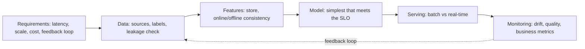
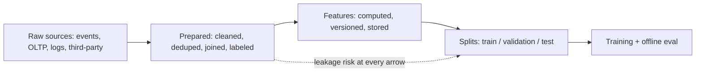
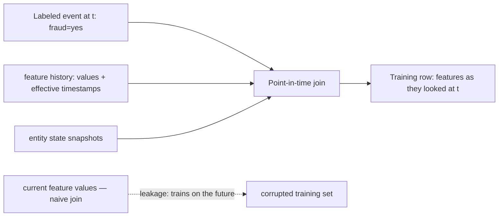
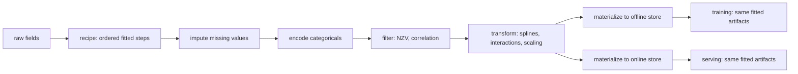
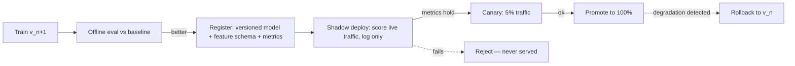
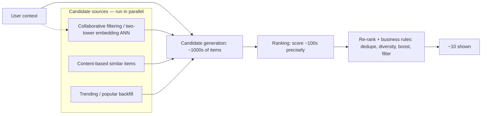
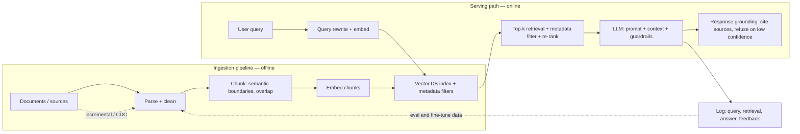

# ML & GenAI System Design

> **Why it matters** — ML systems are data systems with a model in the middle. The model is ~10% of the design; the other 90% — features, serving latency, training-serving consistency, drift detection, rollback — is data engineering. These questions now dominate senior DE interviews.

## The interview framework

Any ML system design question decomposes the same way. Walk it in order; the discipline is spending the right fraction of time on requirements before touching architecture.



The questions that separate senior answers:

- **Requirements**: prediction latency budget? Online or batch decisions? What does a wrong prediction cost (false positive vs false negative asymmetry)? How fresh must features be?
- **Labels**: where do they come from and *when do they arrive*? A fraud label arrives weeks after the event — that lag shapes the entire training pipeline.
- **Leakage**: does any feature encode information that wouldn't exist at prediction time? (The #1 silent killer of real-world model quality.)

::: tip 💡 Senior insight
Always state the latency budget and the label-arrival time explicitly before drawing boxes. They determine batch vs real-time serving and the whole feature-store design — everything else is downstream.
:::

## The model is the small part

Huyen's opening frame (echoing Google's "hidden technical debt" paper): when people say "machine learning system" they picture the algorithm — logistic regression, a transformer. In production the algorithm is one small box inside a much larger system: business requirements, the data stack, the serving interface, and the machinery for developing, monitoring, and updating models.

```mermaid
flowchart TB
    subgraph SYS["ML system in production"]
        BR["Business requirements + objectives"]
        DS["Data stack: ingestion, storage, labeling, feature pipeline"]
        subgraph BOX["ML code"]
            M["Model + training code"]
        end
        SVC["Serving layer: prediction service, UI, APIs"]
        OPS["Infra: CI/CD, monitoring, retraining, rollback"]
        DS --> BOX
        BOX --> SVC
        OPS -.->|"version, monitor, retrain"| BOX
        BR --> SYS
    end
```

The DE consequence: most ML-system failures are data failures, not algorithm failures — leakage, skew, stale features, broken pipelines. Interviewers listen for whether you size the problem that way.

:::: tip 💡 Senior insight
The "small square" framing is a real planning tool, not a slogan. If the ML code is ~10% of the system, then ~90% of project risk, headcount, and latency budget lives in data plumbing and ops. Push back on any design review that spends an hour on model architecture and five minutes on where labels come from.
::::

## Data engineering for ML

Before any model exists there is a data pipeline, and its stages each carry distinct correctness constraints:



Split hygiene is where silent corruption enters. Huyen's rules, paraphrased into a checklist:

- **Split by time, not randomly, whenever data is time-correlated.** Random splits on time-correlated data leak the future into training — train on weeks 1-4, validate/test on week 5.
- **Split before any global statistics.** Scaling, missing-value imputation, even exploratory analysis must use train-split statistics only. Compute mean/variance on train, apply to all splits.
- **Dedupe before splitting.** Near-duplicates that straddle train/test inflate eval — even canonical research datasets have had train/test duplication.
- **Split by group when entities repeat.** If one user, device, or patient generates many samples, keep the whole group in one split or the model memorizes the entity.

### Data leakage: the common causes

| Leakage type | Mechanism | Fix |
|---|---|---|
| Random split on time-correlated data | Future samples in train leak the day's conditions | Time-based splits |
| Scale/impute before splitting | Test-set statistics baked into features | Fit statistics on train split only |
| Duplicates across splits | Same or near-same sample in train and test | Dedupe before split |
| Group leakage | Correlated samples from one entity in both splits | Group-aware splitting |
| Leakage in data generation | Feature encodes how data was collected (e.g. which machine scanned it) | Audit the generation process |
| Point-in-time violation | Feature value reflects post-prediction state | As-of joins |

:::: warning ⚠️ Risk / production failure mode
Leakage is rarely obvious — each feature alone may be clean while two features together encode the label, and eval metrics only look better. Huyen's tell: a feature that predicts "too well." Measure per-feature importance; a dominant feature that outperforms the rest combined is guilty until proven innocent. More features = more leakage surface.
::::


## Feature stores

A feature store serves two consumers with conflicting needs:

| | Offline store | Online store |
|---|---|---|
| Consumer | Training jobs (point-in-time queries) | Real-time inference (low-latency lookups) |
| Typical tech | Warehouse/lakehouse (BigQuery, Iceberg) | KV store (Redis, DynamoDB, Bigtable) |
| Access pattern | Massive scans, time-travel joins | Single-entity gets, <10 ms p99 |
| Freshness | Batch-refreshed | Stream-updated or materialized on schedule |

The pipeline between them: features computed once (Spark/Flink), written to the offline store for training, **materialized** to the online store for serving. Materialization cadence is a real design knob: hourly materialization means served features lag up to an hour — fine for user-profile features, useless for "transactions in the last 5 minutes," which must stream directly to the online store.

### Training-serving skew

The single most important concept here: the features the model trains on must be computed **the same way** as the features it serves on. Skew sources:

- **Different code paths** — offline feature in pandas, online in a hand-ported service. Fix: one feature definition, dual-materialized (what feature stores exist for).
- **Point-in-time correctness** — training joins must use feature values *as of* the label timestamp, not current values, or the model trains on the future (leakage).
- **Different update cadences** — offline refreshes daily, online streams; if the transform differs even in null handling, predictions shift.

::: warning ⚠️ Risk / production failure mode
Skew is invisible in offline eval — the model looks great on its own training distribution and degrades only in production. The signature: offline metrics strong, online business metrics flat or negative, no errors anywhere. Always compare feature distributions online vs offline as a first-line monitor.
:::

### The point-in-time join

Building a training set is a *time-travel* problem: for each labeled example at time `t`, join each feature's value **as of `t`**, not as of now. A naive `JOIN features ON entity_id` leaks the future — you train on what the feature became weeks after the prediction moment. Feature stores automate this (e.g., Feast's `get_historical_features`); hand-rolled it's a per-feature `AS OF` join on event timestamps with late-arrival semantics decided explicitly.



### Static vs streaming features

Huyen's taxonomy maps features to the transport that produces them:

| | Static (batch) features | Streaming (dynamic) features |
|---|---|---|
| Produced by | Batch jobs over warehouse/lake data | Stream engines (Flink, Kafka Streams) |
| Examples | User profile, historical aggregates, embeddings | "txns in last 5 min", session state, trending counts |
| Consumers | Training + batch and online prediction | Mostly online prediction; also materialized offline for training |
| Failure mode | Staleness | Stream lag, late/out-of-order events, duplicated delivery |

An ML system almost always needs both pipelines: batch features dominate in count, but the few streaming features usually carry the latency-sensitive signal. Online prediction can mix the two — pull static features from the online store, compute or fetch streaming features per request.

### Feature engineering and reuse

Two properties decide whether a feature earns its place (Huyen's framing):

- **Feature importance** — how much the model's performance drops when the feature is removed. Built-in importances (XGBoost) or SHAP for model-agnostic measurement. Reality check: importance is heavily concentrated — top ~10 features often carry half the total importance while hundreds of tail features contribute <1%.
- **Feature generalization** — whether the feature holds up on unseen data: coverage (fraction of samples where it's populated) and whether its value distribution stays stable. A feature populated for 1% of data rarely generalizes — unless its missingness itself is the signal.

Cost of feature sprawl: every unused feature is debt — it adds inference latency on the online path and breaks whenever the upstream pipeline changes. Manage feature *definitions* as shared, versioned assets so teams reuse rather than re-implement (the registry role is the real value of a feature store — not all feature stores manage definitions).

:::: tip 💡 Senior insight
Store removed features rather than deleting the definition, and keep general feature definitions centrally so other teams reuse them. When one feature dominates importance suspiciously, treat it as a leakage suspect first and a discovery second.
::::


## Feature engineering as measurement design

Kuhn & Johnson's frame in *Feature Engineering and Selection*: a feature is a **measurement**, not a column. Feature engineering re-encodes raw data into representations that expose the signal a model can consume — and the highest-leverage input is subject-matter knowledge, not a cleverer transform. Two consequences for the DE who owns the pipeline:

- **Domain knowledge is an input to the pipeline, not a data-science side quest.** The book's recurring pattern: experts nominate which interactions, category groupings, and encodings are plausible *before* any algorithmic search runs. Practically, that means feature definitions deserve a reviewed, versioned spec — the registry half of the feature store section above exists to hold exactly this.
- **Preprocessing is a reproducible pipeline — the "recipe" model.** Ordered steps — impute, encode, filter, transform — each *estimated from training data*, then replayed identically at training and at serving. A scaler's mean, a target-encoding map, a spline's knot positions are all **fitted artifacts**: version them, timestamp them, and point-in-time them like any other feature. A transform that can't be replayed step-for-step in both contexts is a training-serving skew bug that hasn't shipped yet.



### Encodings for categoricals — pick by lifecycle, not habit

| Encoding | What it is | When it fits | Serving / leak caveat |
|---|---|---|---|
| Dummy / one-hot | L−1 indicator columns for L levels | Low-cardinality, interpretable models | Rare levels mint near-zero-variance columns; unseen level at serve → all-zeros row unless a pool exists |
| Effect (contrast) coding | Deviations from a reference level | Linear models needing coefficient interpretability | Same sparsity failure as one-hot; coefficients not comparable across predictors |
| Feature hashing | Deterministic hash → fixed-width columns | Very high cardinality, streaming vocab, no dictionary to store | Collisions alias *unrelated* categories and can cancel opposing effects; signed hashes mitigate; kills interpretability |
| Target / effect-of-outcome encoding | Per-level estimate of the outcome mean (log-odds), shrunk toward a prior | High cardinality where one-hot explodes; tree and linear models | **Supervised → leaks if estimated on the same data the model trains on**; rare levels need shrinkage; unseen level needs an explicit default |
| Entity embeddings | Learned dense lookup table | High cardinality + enough data; can capture semantic similarity | Lookup is a model artifact — version it; reserve an embedding slot for unseen values |

::: warning ⚠️ Risk / production failure mode
Supervised encodings are a "self-fulfilling prophecy" (Kuhn & Johnson's phrase): statistics estimated by one model get injected as variables into another fit on the *same* data — overfitting that no held-out-from-nothing metric can see, and summary statistics that understate the variance. The book's rule: estimate the encoding map on **different data** than the model, or compute it **inside resampling** so the assessment fold measures the leak. In pipeline terms: a target-encoding table computed once over the full warehouse and materialized for everyone is a leakage service.
:::

### The filtering ladder — cheapest cuts first

Feature selection is a ladder; climb it in cost order and stop early:

| Rung | Method | Cost | Failure mode |
|---|---|---|---|
| 1. Near-zero-variance | Drop predictors with few unique values or a dominant level; the book's rough cutoff: most-common:second-common frequency ratio ≳ 19:1 | Free, unsupervised | A column fine on full data collapses to one value **inside a resample fold** — run NZV inside resampling, or pool rare levels into "other" first |
| 2. Correlation clusters | Remove all but one member of highly-correlated groups | Cheap, unsupervised | Redundant predictors destabilize linear models and dilute importance estimates across the cluster |
| 3. Supervised filters | Per-feature association with outcome (odds ratio, p-value with FDR correction) | Moderate | Univariate — over-selects redundant features and misses anything only useful in combination |
| 4. Intrinsic | Model selects during fit: trees, MARS, lasso | Free with the model | Model-specific and often greedy — random forests deliberately over-select |
| 5. Wrapper / global search | RFE, genetic algorithms, simulated annealing over subsets | Most expensive | Highest overfit risk of all — must run **inside** resampling or it double-dips (below) |

::: tip 💡 Senior insight
Split the ladder by ownership: rungs 1–2 (NZV, correlation) are unsupervised, deterministic, and safe to run at build time inside the shared feature pipeline. Rungs 3–5 consume the outcome — they're *modeling* decisions. Keep them out of the shared feature table, or every downstream consumer silently inherits someone else's overfit selection.
:::

### Interactions and nonlinear basis expansions

The book imports three principles from experimental design that keep interaction search honest:

- **Hierarchy** — search pairwise terms before three-way and beyond; high-order interactions rarely carry signal and are nearly uninterpretable.
- **Effect sparsity** — only a small fraction of possible interactions matter. $p$ predictors mint $O(p^2)$ cross terms, so whitelist, don't fan out.
- **Heredity** — only consider $x_1 \times x_2$ when the parent terms $x_1$ and $x_2$ themselves explain variance. This prunes most of the combinatorial space.

And the first candidates should be **domain-nominated** interactions — a domain expert's shortlist beats a brute-force scan (the book quotes Neter et al.: identify in advance, whenever possible, the interactions most likely to matter).

For nonlinearity without a nonlinear model: a **basis expansion** augments $x$ with derived columns — $x^2$, $x^3$, or spline basis functions (piecewise cubics joined at knots, usually placed at quantiles; hinge functions are the MARS special case). The model stays linear in its parameters but gains curves in its inputs. In the pipeline these are just more derived features in the same replayable recipe — but they multiply column count, so gate them through the filtering ladder like everything else.

### Text and date features

- **Text**: clean markup/punctuation first, then engineered counts (links, hashtags, exclamation marks — the book shows the mere *presence of a hyperlink* nearly doubling the odds of a STEM profile). Filter terms by minimum frequency (~50 occurrences in their corpus), score survivors per-term with odds ratios + FDR-corrected p-values, and reach for embeddings only past that point. Term-frequency tables are a build-time artifact; the vocabulary must be frozen for serving.
- **Dates**: explode into components — day-of-week, month, and especially **holiday indicators**. The book's transit-ridership example: adding holiday flags visibly repaired a model whose residuals all traced to holidays. Dates are categoricals in disguise — they inherit every encoding concern above — and the holiday calendar is an external dependency: version it, because calendars change.

::: warning ⚠️ The data budget: selection and evaluation can't share the same data
Kuhn & Johnson's sharpest warning, via Ambroise & McLachlan's reanalysis of a published RNA study: feature selection run *outside* resampling reported ~0% error under leave-one-out CV, while an honestly held-out set measured 15–20% worse — and at the worst predictor-to-sample ratio, zero LOO error was achievable **even with scrambled labels**. Two failure mechanisms: resampling never sees the selection process's variance, and the same data both guides selection and scores it — re-predicting the training set by another name. The fix: treat selection (like preprocessing) as a step *inside* the resampling loop. DE translation: any "feature selection" or "feature importance" job that runs once over the full table and gets materialized as truth is a double-dip factory.
:::

## Batch vs real-time inference

| | Batch (offline scoring) | Real-time (online serving) |
|---|---|---|
| Latency | Minutes–hours | ms |
| Use cases | Lead scoring, churn lists, nightly recommendations | Fraud decisions, ranking, personalization |
| Feature freshness | Whatever the last batch computed | Stream-computed or request-time features |
| Cost | Cheap — amortized, spot-friendly | Expensive — always-on serving infra |
| Failure blast radius | Rerun | User-visible |

The middle ground: **near-real-time micro-batching** (score every 5-15 min) covers most "real-time" requirements at batch-system cost. Demand evidence that ms latency is actually needed before building streaming serving.

Decision rule: start batch, graduate to micro-batch, go real-time only when the decision's value decays measurably per minute of delay. A latency requirement that can't name the decay curve is a guess.

Batch and online are not mutually exclusive: apps like DoorDash batch-generate restaurant recommendations (too many to score at request time) but score food items online once you open one. Batch prediction is high-throughput and asynchronous — generate predictions for every entity on a schedule, serve lookups; online prediction is low-latency and synchronous — compute on request. Batch is often a workaround for when online isn't cheap or fast enough; as serving infra improves, expect more workloads to move online.

The broader iteration split — **model-centric vs data-centric** (Huyen's "mind versus data" debate): model-centric iteration holds data fixed and improves architecture; data-centric holds the model fixed and improves data quality/quantity. Industry's empirical verdict: more and better-managed data usually beats a cleverer algorithm — which is why the data stack, not the model, is where senior DE leverage lives.


## Model lifecycle



- **Versioning**: model artifact + feature schema + training data snapshot are one versioned unit — a model without its feature contract can't be safely rolled back to.
- **Shadow deploy**: new model scores production traffic but its outputs are logged, not used. Measures real-world performance with zero user impact.
- **Canary**: gradual traffic ramp with automated rollback on metric regression.
- **Rollback** must be a one-command operation tested *before* you need it — most "bad deploys" become incidents because rollback was never exercised.

::: info ℹ️
The deploy sequence — shadow → canary → promote, with automated rollback — is the exact same progressive-delivery pattern as service deploys. If your org already does canary deploys for apps, reuse that machinery rather than building ML-specific rollout infra.
:::

## Monitoring: the two drifts

Models don't fail loudly; they rot. The taxonomy:

- **Data drift (feature drift)**: input distribution shifts — `psi(feature_today vs feature_training) > threshold`, schema changes, new nulls, upstream source silently changed semantics.
- **Concept drift**: the relationship between features and labels changes — fraudsters adapt, user tastes shift, a pandemic breaks every demand model. Feature distributions may look perfectly stable while accuracy collapses.
- **Label/quality monitoring**: when ground truth arrives late, track proxies (dispute rates, click rates, manual-review overturns).

| Signal | Detects | Lag |
|---|---|---|
| Feature distribution stats (PSI, KS test) | Data drift | Immediate |
| Prediction distribution shift | Data or concept drift | Immediate |
| Business proxy metrics | Concept drift | Days–weeks |
| True accuracy vs labels | Both | Label delay (weeks–months) |

::: tip 💡 Senior insight
Set up feature-distribution monitoring *before* the first model ships — it's pipeline-level observability you need anyway, and it's the earliest drift signal. Waiting for label-delayed accuracy means learning about decay weeks late.
:::

## Baselines and offline experiment design

An evaluation metric is meaningless until you name the baseline it beats. Huyen's five, in order of how often they embarrass a demo:

| Baseline | Question it answers |
|---|---|
| Random | What does blind guessing score, given the class distribution? (On a 90/10 task, predicting the majority at its true rate hits ~0.9 F1 — an "F1 of 0.9" model may be random.) |
| Zero rule | Always predict the most frequent class |
| Simple heuristic | What does a rule get for free? (e.g. rank feed by recency) |
| Human | What do experts achieve? Sets the useful bar, and the trust bar |
| Existing solution | Beat the rules engine / third-party tool it replaces — but a slightly worse model that's cheaper or simpler can still be the right ship |

Then the development rule: **start with the simplest model, add complexity stepwise.** Simple first is not laziness — it isolates variables (easy to debug), gives you the baseline every later step must beat, and exposes whether the data pipeline is the real problem before you burn a quarter on architecture. Track experiments with enough context to reproduce: model code, feature versions, split definitions, seed, hyperparameters — a result you can't attribute to a cause isn't a result.

:::: tip 💡 Senior insight
"Good model" ≠ "useful model." A model can be state of the art and still lose to the incumbent rules engine on cost or maintainability. In interviews, always volunteer the baseline before quoting a metric — it signals you evaluate systems, not scores.
::::

## Continual learning: when to retrain

Models decay; retraining is the maintenance policy. Huyen frames maturity as four stages — manual ad-hoc retraining → automated scheduled retraining → automated stateful training (fine-tune on new data instead of from scratch) → true continual learning (online updates). Most companies live in stages 1–2.

The real design decision is the retraining trigger:

| Trigger | Mechanism | Fits | Watch out for |
|---|---|---|---|
| Manual / ad hoc | Someone notices degradation and retrains by hand | Few models, slow drift, small team | Updates slip to "when there's time"; unreplicated data/feature changes cause prod bugs |
| Scheduled (time-based) | Cron/scheduler kicks off retraining daily/weekly | Steady pipelines, predictable drift | Frequency is usually gut-feel; different models in one system need different cadences |
| Performance-based | Monitoring detects drift/accuracy drop → triggers retrain | Fast-changing domains, many models | Needs label or proxy-metric monitoring you trust; false triggers burn compute |
| Data-volume-based | Retrain after N new samples accumulate | High-throughput, natural labels | New data may not be better data — validate before training on it |

Dependencies complicate every trigger: if model B consumes model A's embeddings, retraining A cascades into retraining B. Model the dependency graph before automating the schedule.

## Feedback loops and human-in-the-loop

Two failure shapes to design around:

- **Degenerate feedback loop** — the model's predictions influence what users see, and that exposure generates the next training labels. A ranking model that over-recommends item A creates more A-clicks, confirming itself. Detect with diversity/randomization experiments; break by logging what was *shown*, not just what was clicked.
- **Feedback-loop length** — time from prediction to label. Fraud labels take weeks; click labels take minutes. Long loops mean your accuracy signal is permanently stale → proxies and human review fill the gap.

Human-in-the-loop levels (escalating involvement):

| Level | Human role | Example |
|---|---|---|
| L0 — full automation | None; model decides | High-volume, cheap-error tasks |
| L1 — model advises | Human decides, model scores/ranks | Fraud triage queue, decision support |
| L2 — human picks | Model proposes k candidates, human selects | Code completion, content moderation appeals |
| L3 — human edits | Model drafts, human corrects; corrections become labels | Support-reply drafts, annotation assist |

Choose the level by error cost and correctability: predictions that are *mostly* right are valuable only when a human can cheaply spot and fix the misses. If users can't correct the output, full automation plus guardrails is safer than pretending a human is supervising.

:::: warning ⚠️ Risk / production failure mode
The self-fulfilling loop is the quiet killer: models that only train on data they helped generate get more confident as they get narrower. Reserve a randomization budget (serve some traffic unexplored) so labels exist outside the model's own choices — otherwise drift detection and retraining all operate on a biased sample.
::::

## Worked design: fraud detection

The canonical low-latency design — constraints drive everything:

- **Latency budget**: ~50-200 ms total to approve/decline at transaction time. Budget split: ~10 ms feature fetch, ~10-30 ms model, ~20 ms rules + network. **This eliminates anything that can't run in-ms** — no joins, no on-demand aggregates over history.
- **Features**: velocity counters (txns/card/hour, amount/day), device/merchant reputation, geo-impossibility — all **pre-computed in a streaming job** into the online store. Request-time features limited to the current transaction's attributes.
- **Labels**: confirmed fraud arrives weeks later via chargebacks → training set has built-in recency bias; near-term labels use manual-review outcomes as proxy.
- **Feedback loop**: every decision (approve/decline/review) logged with model version → the training data for v_next and the audit trail.

::: warning ⚠️ Risk / production failure mode
The velocity-feature trap: computing "transactions in last hour" at request time against the OLTP store violates the latency budget under load. Pre-compute sliding-window aggregates in the streaming layer and serve lookups — the classic reason feature stores exist.
:::

Latency budget made concrete — "150 ms" decomposes into:

| Hop | Budget | Notes |
|---|---|---|
| Network in/out + auth | ~30 ms | Fixed cost, mostly untouchable |
| Feature fetch (online store) | ~10 ms | Single-entity KV gets; pre-joined |
| Model inference | ~30-80 ms | Gradient-boosted trees or small nets fit; big transformers do not |
| Rules + decision logic | ~20 ms | Hard blocks, velocity thresholds, lists |
| **p99 headroom** | ~30-60 ms | Tail latency eats the rest — budget at p99, not p50 |


## Worked design: recommendation

Two stages because no model can both scale and be accurate:



- **Candidate gen** is a recall problem — cheap, broad, many parallel sources merged. Embedding-based two-tower models + approximate-nearest-neighbor lookup is the modern default.
- **Ranking** is a precision problem — expensive features (user×item crosses), a heavy model, on the small candidate set.
- **Re-rank layer** is where business logic lives — deduplication, diversity, sponsored boosts, policy filters. Keep it explicit, not baked into the model.

::: details Why two stages, not one
Scoring 100M items with a heavy model at request time is impossible at any latency budget. Candidate gen trades precision for recall (a fast approximate pass), then ranking spends the latency budget only where it counts. This funnel pattern — cheap-broad → expensive-narrow — recurs everywhere: fraud (rules → model), search (BM25 → learned ranker), and RAG (vector recall → LLM re-rank).
:::

## Worked design: RAG / GenAI system

RAG is a data pipeline feeding a generator. The retrieval quality — not the model — determines most of answer quality.



Design decisions that matter:

- **Chunking** is the highest-leverage knob: too small loses context, too large dilutes embedding relevance. Chunk on semantic boundaries (sections, functions) not fixed token counts; overlap 10-20%.
- **Streaming vs batch ingestion**: batch-reindex on a schedule is fine for docs that change daily; CDC-driven incremental indexing for anything users expect fresh. Most production systems need both — batch for backfills, streaming for updates.
- **Retrieval isn't just vector similarity**: hybrid (dense + BM25/keyword), metadata pre-filters (tenant, permissions, recency), and a re-rank step beat pure top-k.
- **Guardrails**: refuse when retrieval confidence is low, cite sources for grounding, PII-filter both the index and the prompt. An ungrounded LLM answer presented confidently is worse than no answer.
- **Evaluation**: golden Q&A set with graded relevance; measure retrieval hit rate and answer faithfulness separately — they fail independently. Log everything for the eval dataset.
- **Cost controls**: cache embeddings and frequent answers, cap context length, route simple queries to small models, batch-embed ingestion. Token cost scales with retrieved context — over-fetching is the silent budget-killer.

| Knob | Cheap | Expensive | When to pay |
|---|---|---|---|
| Chunking | Fixed-size | Semantic/LLM-assisted | Long, structured docs |
| Retrieval | Pure vector top-k | Hybrid + re-rank | Precision-critical domains |
| Model | Small/cached | Frontier per query | Complex reasoning queries |
| Ingestion | Nightly batch | Streaming CDC | Freshness-critical corpora |

::: tip 💡 Senior insight
In interviews and in production, the RAG failure mode is almost never the LLM — it's bad chunks, missing metadata filters, or stale index. Debug retrieval first; blame the model last.
:::

## Classic ML vs GenAI — what actually changes in the design

| Dimension | Classic ML (fraud, recs) | GenAI / RAG |
|---|---|---|
| Output | Score or class — cheap to eval | Free text — needs faithfulness evals, not just accuracy |
| "Features" | Structured, engineered, store-managed | Documents + embeddings — the index *is* the feature store |
| Latency driver | Model inference | Token generation + context length |
| Failure mode | Silent drift | Confident hallucination — needs grounding/guardrails |
| Cost driver | Serving infra, always-on | Per-token cost; caching and context caps are levers |
| Feedback loop | Labels arrive on a delay | Explicit user feedback + logged eval sets |
| Versioning unit | Model + feature schema | Prompt + index version + model — all three must roll back together |

Same skeleton — requirements, data, serving, monitoring — but the reliability work moves from feature correctness to retrieval correctness and output grounding.

## 🧠 Quiz

<QuizCard :questions="[{ q: 'A fraud model must decide in 150 ms. Which feature strategy fits?', options: ['Compute velocity features on-demand at request time', 'Skip velocity features entirely', 'Pre-compute sliding-window aggregates in a streaming job into an online store; only current-transaction attributes computed at request time', 'Use only the offline feature store'], correct: 2, explain: 'Request-time aggregation over history cannot meet a 150 ms budget. Velocity features (txns/hour) are pre-computed by the streaming layer into the online store; request-time features are limited to attributes of the transaction itself.' }, { q: 'Offline eval is excellent but the model underperforms in production with no errors. Most likely cause?', options: ['Too few model parameters', 'Cold start', 'Training-serving skew — features computed differently online vs offline, or training used post-event data', 'Concept drift'], correct: 2, explain: 'The signature of skew: offline metrics hold, online degrades silently. Check point-in-time correctness (was training leakage-free?) and online-vs-offline feature distribution parity before anything else.' }, { q: 'Why two stages in recommendation (candidate gen then ranking)?', options: ['To allow A/B testing', 'Historical accident of early systems', 'Regulatory requirement', 'No model can be both broad-cheap and precise-expensive — candidate gen trades precision for recall at scale, ranking spends latency only on the shortlist'], correct: 3, explain: 'Scoring the full catalog with a heavy model is impossible at serving latency. The funnel — cheap-broad then expensive-narrow — is the recurring pattern also seen in fraud rules→model and RAG vector recall→re-rank.' }, { q: 'Feature distributions are stable but model accuracy collapses. Which drift?', options: ['Concept drift — the feature-to-label relationship changed even though inputs look the same', 'Data drift', 'Schema drift', 'Label drift'], correct: 0, explain: 'Concept drift is the dangerous one: inputs look identical, but what they mean changed (fraudsters adapt, tastes shift). Feature-distribution monitoring will not catch it — you need label or proxy-metric monitoring.' }, { q: 'What does a shadow deploy measure that offline eval cannot?', options: ['Model accuracy', 'Real-world behavior on production traffic with zero user impact — outputs are logged, not served', 'Infrastructure cost', 'Feature freshness'], correct: 1, explain: 'Shadow deploys run the new model on live traffic without acting on its outputs, capturing performance on the real production distribution — including inputs offline eval never saw — with zero blast radius.' }, { q: 'In a RAG system, answers are confidently wrong on recent topics. Debug order?', options: ['Switch to a bigger LLM', 'Add more guardrails', 'Increase temperature', 'Check index freshness and retrieval hit rate first — stale index or bad chunks are the usual cause; the model is rarely the problem'], correct: 3, explain: 'RAG failures are retrieval failures: stale index (recent topics missing), bad chunking, or missing metadata filters. Debug retrieval before touching the model — generation quality is bounded by what is retrieved.' }]" />

<QuizCard :questions="[{ q: 'A team computes feature-scaling statistics over the full dataset, then splits into train/test. Offline metrics look great; production degrades. What went wrong?', options: ['The model overfit', 'Training-serving skew in the feature store', 'Concept drift in production', 'Leakage — test-set statistics leaked into training features'], correct: 3, explain: 'Split first, then fit scalers and imputers on the train split only and apply to all splits. Global statistics computed before splitting bake information about the test split into features — a textbook leakage cause that inflates offline eval.' }, { q: 'When should a production model be retrained?', options: ['Manual, scheduled, or monitoring-triggered — chosen per model based on drift speed, label delay, and dependency graph', 'Whenever new data arrives, regardless of quality', 'Always on a fixed daily schedule', 'Only when engineers have free time'], correct: 0, explain: 'Huyen frames retraining as a policy choice: manual ad-hoc for few slow-drifting models, scheduled batch for steady pipelines, performance- or data-triggered for fast-changing domains. Different models in one system need different cadences, and dependent models (embeddings then ranker) retrain together.' }, { q: 'A ranking model keeps recommending item A; A gets more clicks, which become training labels confirming A. What is this?', options: ['Label delay', 'Selection bias in the test set', 'A degenerate feedback loop — predictions generate the labels that retrain the model', 'Concept drift'], correct: 2, explain: 'Degenerate feedback loops self-reinforce: the model shapes what users see and click, and those clicks become its next training data. Fix with a randomization or exploration budget so labels exist outside the model own choices.' }]" />

<QuizCard :questions="[{ q: 'A pipeline computes a target encoding (per-category outcome mean) once over the full warehouse table and materializes it for all training jobs. What is wrong?', options: ['Nothing — it is deterministic and reproducible', 'It is supervised leakage: the encoding was estimated on the same data the model trains on, so it must be estimated on different data or inside resampling', 'The encoding should use hashing instead', 'Target encodings only work for regression targets'], correct: 1, explain: 'Kuhn and Johnson call this a self-fulfilling prophecy: outcome-derived statistics injected as features into a model fit on the same data produce invisible overfitting. Estimate the encoding on separate data or inside the resampling loop.' }, { q: 'A dummy column has 990 zeros and 10 ones. Why is it a resampling hazard?', options: ['It is a near-zero-variance predictor — folds can mint it as all-zeros, so NZV filtering or an other-pool must run inside resampling', 'It will be dropped by correlation filtering', 'It needs target encoding', 'It forces wrapper selection'], correct: 0, explain: 'With a most-to-second frequency ratio of 99 (far past the rough 19:1 cutoff), resample folds can contain zero positive cases. Pool rare levels or filter inside resampling so fold variability is measured.' }, { q: 'Feature selection was run on the whole training set once; the chosen subset was then evaluated with cross-validation and looked excellent. Why is the estimate untrustworthy?', options: ['Wrapper methods never work', 'CV is too slow to be reliable', 'The same data guided selection and measured performance — a double dip; selection must be inside the resampling loop', 'The subset was too small'], correct: 2, explain: 'Ambroise and McLachlan reanalyzed a study using exactly this scheme: LOO error near zero while honest holdout was 15-20 percent worse — and zero error was achievable even on scrambled labels. Selection outside resampling is invisible to it.' }]" />

## Further reading

- [Designing Machine Learning Systems — Chip Huyen](https://www.oreilly.com/library/view/designing-machine-learning/9781098107956/) — the canonical ML system design book; feature stores, skew, drift.
- [Hidden Technical Debt in Machine Learning Systems (Google, NeurIPS)](https://papers.nips.cc/paper/5656-hidden-technical-debt-in-machine-learning-systems.pdf) — the "model is the small part" paper.
- [Feast — feature store docs](https://docs.feast.dev/) — offline/online store semantics, materialization, point-in-time joins.
- [Retrieval-Augmented Generation (original paper)](https://arxiv.org/abs/2005.11401) — the RAG formulation everything else builds on.
- [Eugene Yan's applied ML/RecSys writeups](https://eugeneyan.com/writing/) — production patterns for recommendation and evaluation.
- [Google SRE — canarying & progressive rollout](https://sre.google/workbook/canarying-releases/) — the shadow/canary machinery ML deploys reuse.
- [Chip Huyen's ML systems notes](https://huyenchip.com/ml-interviews-book/) — free companion to the book; drift and monitoring chapters.
- [Pinecone / vector DB learn: chunking strategies](https://www.pinecone.io/learn/chunking-strategies/) — practical chunking trade-offs for RAG.
- **Feature Engineering and Selection: A Practical Approach for Predictive Models** — Max Kuhn & Kjell Johnson (2021, [CRC Press](https://www.routledge.com/Feature-Engineering-and-Selection-A-Practical-Approach-for-Predictive-Models/Kuhn-Johnson/p/book/9781032090036); free online at [bookdown.org/max/FES](https://bookdown.org/max/FES/)) — encodings, the filtering ladder, interactions, and the resampling double-dip.
