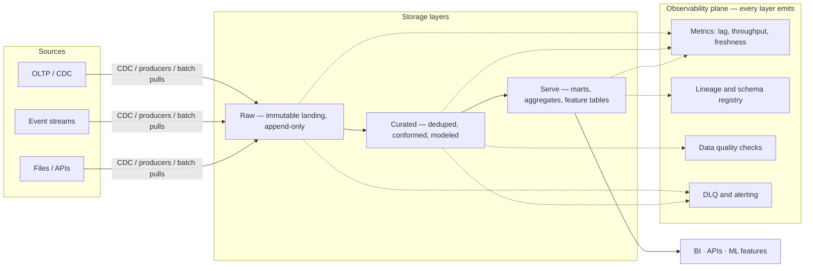
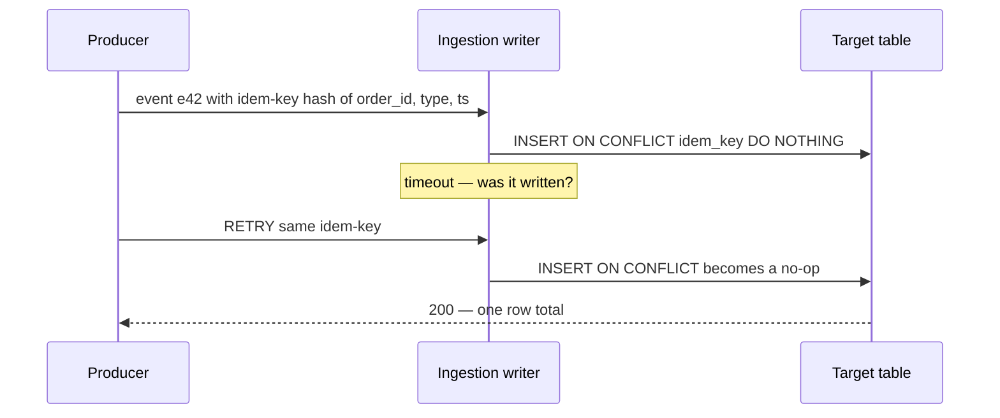
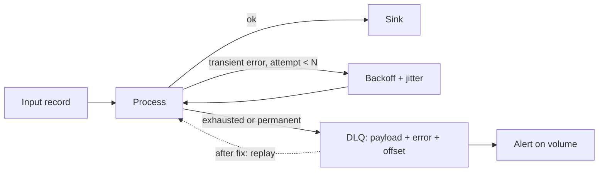

# Designing Reliable Pipelines

> **Why it matters** — Pipelines don't fail at design review; they fail at 3am on a retry, a schema change, or a source that silently doubled its volume. This chapter is the checklist of patterns that keep a pipeline correct *under failure* — which is the only time correctness is tested.

## The reference architecture

Design rules encoded in that diagram:

- **Raw is immutable and replayable.** Never transform into raw — land bytes/events as received, partitioned by arrival time. Every downstream bug is fixable by replaying raw.
- **Each layer is a checkpoint.** Raw→curated→serve are separate, independently re-runnable jobs. Don't build one monolith job spanning all three.
- **The observability plane is a peer, not an afterthought.** Every layer emits freshness, volume, schema, and lineage metadata or the pipeline is a black box the first time it lies.
- **Schemas are enforced at the boundary, not in the middle.** Validate at ingest into curated; a bad record dies at raw→curated, never propagates to serve.
- **Every hop is observable.** If you can't answer "is this partition complete and fresh?" per layer, the pipeline isn't done — it's just running.

::: tip 💡 Senior insight
The most common architecture smell in reviews: transformations fused across layers (raw→serve in one job) to "save a step." You lose independent reprocessing and blame attribution — the two things you need most during an incident.
:::

## Idempotency: making retries safe

Networks retry. Frameworks retry. Humans click "rerun." If your write isn't idempotent, every one of those is a duplicate.

| Technique | Mechanism | Scope | Gotcha |
|---|---|---|---|
| **Idempotency key** | Client-supplies unique key per logical op; sink dedupes on it | API/event ingestion | Key must survive across retries — derive from content, not `uuid4()` per attempt |
| **Natural/business key upsert** | `MERGE`/`INSERT ... ON CONFLICT` on `order_id`, `event_id` | DB sinks | Requires true natural key; composite keys on NULLs silently don't dedupe |
| **Dedupe window** | Remember seen keys for T (bloom filter, KV store, table partition) | Streams | Window too short → duplicates on late retry; too long → storage/memory cost |
| **Deterministic output** | Rerun produces byte-identical output; write via partition overwrite | Batch | The strongest guarantee — rerun *is* the dedupe |

::: info ℹ️
Partition-level idempotency is the batch version: write to a staging partition, then `INSERT OVERWRITE` the target partition. A rerun overwrites the same partition — the *output path* is the idempotency key.
:::

## The exactly-once illusion

**Exactly-once delivery does not exist.** The Two Generals' Problem: no protocol guarantees a message is both delivered and acknowledged over an unreliable network. What exists:

- **At-most-once**: send, don't retry → may lose data.
- **At-least-once**: retry until acked → may duplicate.
- **Effectively once** (what people mean): at-least-once transport + **idempotent processing + dedupe at the sink**. The system *can* process a record twice; it just can't *observe* the effect twice.

Framework "exactly-once" (Kafka EOS, Flink checkpointing) scopes this to *inside the framework* — read-process-write within Kafka/Flink state. The moment your sink is an external system (warehouse, API), you're back to at-least-once + idempotency unless the sink participates in the framework's transaction.

::: warning ⚠️ Risk / production failure mode
"Exactly-once" marketing causes real outages: engineers disable dedupe because "Flink guarantees it," then a sink-side retry (outside the checkpoint boundary) double-writes revenue events. Guarantee boundaries: exactly-once ends at the last framework-managed write.
:::

::: details Sizing the dedupe window — the underrated parameter
Dedupe state must cover your *worst-case redelivery horizon*, not the common one. Sources of late redelivery: consumer restart/replay (your longest realistic backfill), producer-side retries (hours on mobile/edge sources), and stream reprocessing after a bug fix (days). Rule of thumb: window ≥ max(retention of upstream retries, longest planned reprocessing horizon). Storage math is cheap: 50k events/s × 32-byte key × 24h ≈ 138 GB — feasible in Redis or a compacted Kafka topic; 7 days ≈ 1 TB — move to a bloom filter (with stated false-positive tolerance) or a partitioned dedupe table. A bloom filter trades: no exact lookups, tiny memory, but ~1% false "duplicate" verdicts — acceptable for metrics, unacceptable for payments.
:::

## Backpressure and load shedding

When consumers fall behind, something has to give. Choose consciously:

| Mechanism | Behavior | Use when |
|---|---|---|
| **Backpressure (pull)** | Consumer reads at its own rate; producer blocks/buffers | Durable buffer exists (Kafka, queue) — preferred default |
| **Bounded buffer + drop** | Buffer to capacity, then drop oldest/newest | Metrics, telemetry where loss > lag |
| **Load shedding** | Reject requests at the edge (429/503) | Interactive systems where latency SLO matters more than completeness |
| **Autoscale** | Add consumers on lag | Works until downstream (warehouse, API) becomes the bottleneck |

::: tip 💡 Senior insight
The durable log *is* your backpressure strategy. Kafka retaining 7 days means a 6-hour consumer outage is a lag problem, not a data-loss problem. Backpressure becomes data loss only when lag exceeds retention.
:::

### Retry policy primer

Retries are the default response to transient failure — and the default *cause* of cascading failure when done naively:

- **Exponential backoff with jitter**: `delay = base × 2^attempt`, randomized ±50%. Without jitter, synchronized clients retry in lockstep — the "thundering herd" that keeps a recovering service down.
- **Retry budgets**: cap retries as a fraction of total requests (e.g., ≤10%), not just per-request attempts. A client retrying 3× under a full outage triples load on a dying dependency.
- **Retry only transient errors**: 429/503/timeouts → retry; 4xx/validation/schema errors → fail fast to DLQ. Retrying a poison record wastes your budget and delays detection.
- **Deadline > per-attempt timeout**: bound the *whole* operation (including retries), or tail latency explodes.

## Dead-letter queues

A DLQ holds records that can't be processed — poison pills, schema violations, downstream hard-failures. Design decisions that matter:

- **Wrap the record, don't just drop it.** DLQ entry = original payload + failure metadata (error, stack, attempt count, source offset). You will need all of it to replay.
- **DLQ volume is a first-class metric.** Alert on it. A pipeline "succeeding" while its DLQ fills is silently losing data.
- **Have a replay path.** Re-drive DLQ records after fix — same consumer with a flag, or a dedicated replayer. A DLQ you can't replay is a trash can.
- **Bound retries first.** Retry transient failures (with exponential backoff + jitter) N times *before* DLQing — most "poison" records are just unlucky.

## Schema evolution and data contracts

Producers and consumers evolve independently. Compatibility defines who can upgrade first without breaking the other (Avro semantics; Protobuf/JSON Schema similar):

| Change | Backward (new reads old) | Forward (old reads new) | Full |
|---|---|---|---|
| Add field **with default** | ✅ | ✅ | ✅ |
| Add field **no default** | ❌ | ✅ | ❌ |
| Remove field **with default** | ✅ | ✅ | ✅ |
| Remove field **no default** | ✅ | ❌ | ❌ |
| Change type | ❌ (unless promotable, e.g. int→long) | ❌ | ❌ |
| Rename field | ❌ (alias can save it) | ❌ | ❌ |

- **Backward** (most common default): upgrade consumers first, then producers.
- **Forward**: upgrade producers first.
- **Full**: upgrade in any order — the safest contract.

::: info ℹ️
The universal rule that falls out of the table: **only ever add optional fields with defaults, and never remove or rename.** That alone is full-compatible. Everything else requires coordination.
:::

**Data contracts** formalize this: schema + semantics + SLOs agreed between producer and consumer, enforced in CI (schema registry compatibility check) and at ingest (contract validation → DLQ on violation). A contract that isn't enforced at the boundary is documentation, not a contract.

Contract scope checklist — what a real contract pins down beyond the schema: required fields and nullability, enum/allowed-value sets, key uniqueness and dedupe semantics, freshness and volume expectations, and the escalation path when violated. Schema alone catches shape breaks; semantics catch "shape fine, meaning changed" — the harder failure.

## Fault-tolerance patterns

| Pattern | Mechanism | Recovery semantic |
|---|---|---|
| **Checkpoint + restart** | Persist progress (offsets, state snapshots); resume from last checkpoint | At-least-once replay from checkpoint → needs idempotent sink |
| **Lineage replay** | Recompute from immutable raw/inputs | Deterministic — the strongest recovery, but only if inputs are replayable |
| **Write-ahead log** | Log intent before mutating state | Crash → replay WAL to reconstruct state |
| **Blue-green backfill** | Build corrected table/partition alongside; atomic swap | Zero-downtime correction; no partial-state exposure |
| **Transactional outbox** | Write intent to an outbox table in same TX as state; relay publishes it | Atomicity between DB write and message send |

::: details The outbox pattern is the one worth memorizing
The dual-write problem: "update the DB, then publish the event" is non-atomic — crash between them and they diverge forever. Outbox: write the event row inside the same DB transaction; a separate relay (CDC on the outbox table) publishes it. Now the DB is the single atomic commit point and the event can't be lost or half-sent. This is how Debezium-based CDC architectures guarantee consistency between the row and the event.
:::

## SLOs for data

Pipelines are products; products have contracts. The three SLO dimensions:

| SLO | Question | Typical measurement |
|---|---|---|
| **Freshness** | How stale is the data? | `max(event_time)` vs now, or last-partition-completed lag |
| **Completeness** | Did everything arrive? | Expected vs actual volume per window; reconciliation vs source counts |
| **Correctness** | Is the content right? | Contract validation pass rate, null/dup/outlier checks, canary queries |

- **SLA** is the external promise (contract, penalty); **SLO** is the internal target (stricter, drives alerting); **SLI** is the measurement.
- Error budgets apply to data too: a 99.9% freshness SLO means ~43 min/month of allowed staleness. Budget it, or you'll burn it silently.
- SLOs need *consumers*: publish them to downstream teams — an SLO nobody reads is just monitoring.

::: tip 💡 Senior insight
Freshness SLOs are the most negotiated number in pipeline design — "real-time" costs 5-10× a 15-minute batch. Always ask "what decision does staleness block?" before accepting a freshness target.
:::

### Alerting discipline

Not every SLO breach deserves a page. Reserve pages for *user-impacting, actively-worsening* conditions — completeness failures, freshness burning error budget fast. Slow-burn degradations (low-rate quality failures, DLQ trickle) belong on dashboards and ticket queues. Alert fatigue is how real breaches get ignored.

## Capacity estimation — worked example

The five-line model every interview (and real sizing exercise) runs on. Numbers are illustrative:

1. **Rate**: 50,000 events/sec peak, avg 500 B/event → **25 MB/s ingest**.
2. **Partitions**: rule of thumb ~10 MB/s per Kafka partition (conservative) → `25/10 ≈ 3` — but size for **peak × headroom (3×) and consumer parallelism** → ~**12-24 partitions**, and round to a multiple that divides evenly across consumers.
3. **Storage**: `25 MB/s × 86,400 s ≈ 2.2 TB/day`. With replication ×3 and 7-day retention → `2.2 × 3 × 7 ≈ 46 TB` hot in the log. Tiered/offloaded to lake: `2.2 × 365 ≈ 800 TB/yr` raw, ~3-5× less post-compression+columnar → ~**200-300 TB/yr**.
4. **Downstream**: one Spark/Flink consumer group reading 25 MB/s is trivial; the cost driver is *recomputation* — a 30-day backfill reads 66 TB.
5. **Cost sketch** (rough, order-of-magnitude): ~50 TB hot × ~$0.10-0.20/GB-mo ≈ **$5-10k/mo** log storage; lake at ~$0.02/GB-mo on ~250 TB ≈ **$5k/mo**; compute usually exceeds both — the real budget question is scan/compute, not storage.

::: info ℹ️
The interview skill isn't the arithmetic — it's narrating *which* number drives the design: here, retention × replication (46 TB log) and the recompute cost of backfills, not the ingest rate.
:::

## Failure-mode → mitigation cheat sheet

The whole chapter in one table — when an interviewer describes a symptom, name the pattern:

| Failure | Mitigation pattern |
|---|---|
| Retried write duplicates a record | Idempotency key / natural-key upsert / partition overwrite |
| Lost event between DB write and message send | Transactional outbox + CDC relay |
| Consumer outage causes data loss | Durable log with retention > worst-case recovery time |
| Poison record kills the whole consumer | Bounded retries → DLQ with payload + metadata + replay path |
| Producer deploys a field consumers can't parse | Schema registry compatibility check in CI; contract validation at ingest |
| Downstream table is wrong; fix needs rerun | Immutable raw layer + per-layer checkpoints + blue-green backfill |
| Bad data published, then corrected in place | Blue-green: rebuild alongside, atomic swap, keep old until verified |
| Dashboard numbers silently stale | Freshness/completeness/correctness SLIs with alerting, not just job status |
| Sync retry storm deepens an outage | Exponential backoff + jitter + retry budget + global deadline |

::: tip 💡 Senior insight
Notice what is absent: tool names. Every mitigation above works on Kafka or Kinesis, Flink or Spark, Airflow or Dagster. In design interviews, answering with the *pattern* and mentioning the tool parenthetically is what reads as senior.
:::

## 🧠 Quiz

<QuizCard :questions="[{ q: 'Why is exactly-once delivery impossible, and what do systems actually guarantee?', options: ['It is possible with Kafka EOS', 'Two Generals Problem — no protocol guarantees delivery plus ack; systems offer at-least-once plus idempotent sinks for effective-once', 'Only batch systems can achieve it', 'Network reliability prevents it entirely'], correct: 1, explain: 'You cannot guarantee a message is both delivered and acknowledged over an unreliable network. What exists is effective-once: at-least-once transport plus dedupe/idempotent writes at the sink. Framework exactly-once (Kafka EOS, Flink) ends at the last framework-managed write.' }, { q: 'Your consumer retries a timed-out write. What makes this safe?', options: ['Exactly-once checkpointing in Flink', 'At-least-once delivery semantics', 'The message has a unique offset', 'An idempotency key or natural-key upsert at the sink so the retry dedupes to one write'], correct: 3, explain: 'Retry safety lives at the sink: a client-supplied idempotency key or a natural-key upsert (MERGE / ON CONFLICT) makes the second attempt a no-op. Framework exactly-once does not extend to external sinks.' }, { q: 'A stream consumer falls behind but Kafka retains 7 days. What is backpressure doing here?', options: ['The durable log buffers the backlog — the consumer drains at its own rate; data loss only if lag exceeds retention', 'Dropping old events to catch up', 'Rejecting new producer requests', 'Slowing producers via TCP'], correct: 0, explain: 'The durable log IS the backpressure mechanism: producers are unaffected, consumers drain at their own pace. Lag becomes loss only when retention expires. Load shedding/edge rejection is the alternative when there is no durable buffer.' }, { q: 'A record poisons the consumer after 5 retries. The right DLQ design stores what?', options: ['A pointer to the Kafka offset only', 'Just the error code', 'Nothing — dead-lettering is for notification only', 'The original payload plus error, attempt count, and source offset — and a replay path after the fix'], correct: 3, explain: 'A DLQ entry without the payload and provenance (offset, error, attempts) cannot be replayed or diagnosed. And a DLQ you cannot re-drive after the fix is a trash can: alerting on DLQ volume plus a replay path are the point.' }, { q: 'You need consumers and producers to upgrade independently, in any order. Which schema compatibility and which change pattern?', options: ['Forward — remove unused fields', 'Backward — add required fields', 'Full — only add optional fields with defaults, never remove or rename', 'None — schemas do not constrain upgrades'], correct: 2, explain: 'Full compatibility allows either side to upgrade first. The only change pattern that is safe under both backward and forward rules is adding optional fields with defaults; removes, renames, and type changes require coordination.' }, { q: 'Sizing: 50k events/sec × 500B = 25 MB/s. With replication 3 and 7-day retention, hot log storage is roughly?', options: ['800 TB', '46 TB', '15 GB', '2 TB'], correct: 1, explain: '25 MB/s × 86,400s ≈ 2.2 TB/day; ×3 replication ×7 days ≈ 46 TB in the log. The 800 TB figure is yearly raw lake storage before compression — the numbers answer different questions, which is the point of the estimation exercise.' }]" />

## Further reading

- [Making retries safe with idempotent APIs — AWS Builders' Library](https://builder.aws.com/content/3Ev0BENTyBr0XxzRk5FDZzgNYos/making-retries-safe-with-idempotent-apis) — the canonical idempotency writeup.
- [Confluent — Schema Evolution and Compatibility](https://docs.confluent.io/platform/current/schema-registry/fundamentals/schema-evolution.html) — the compatibility rules table, authoritative.
- [Kafka design docs — exactly-once semantics](https://kafka.apache.org/documentation/#semantics) — what EOS actually covers and where it stops.
- [Flink checkpointing & fault tolerance docs](https://nightlies.apache.org/flink/flink-docs-stable/docs/dev/datastream/fault-tolerance/checkpointing/) — checkpoint mechanics behind "exactly-once."
- [The Log — Jay Kreps](https://engineering.linkedin.com/distributed-systems/log-what-every-software-engineer-should-know-about-real-time-datas-unifying) — why the durable log is the backbone of these architectures.
- [Google SRE book — Service Level Objectives](https://sre.google/sre-book/service-level-objectives/) — SLI/SLO/SLA framing that data SLOs borrow directly.
- [AWS Well-Architected — reliability pillar](https://docs.aws.amazon.com/wellarchitected/latest/framework/rel_prevent_interaction_failure_idempotent.html) — make mutating operations idempotent, retries, backoff.
